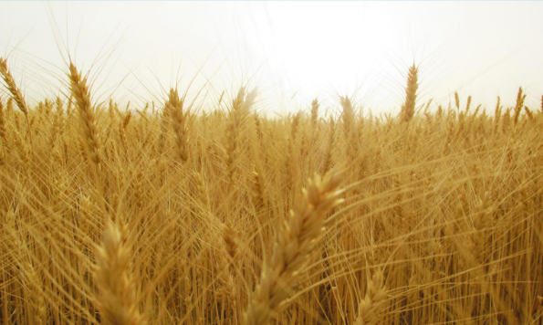
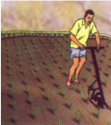
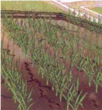
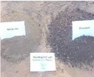
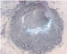
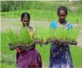
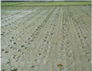
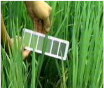

# Development of e-Courses for B Sc (Agriculture) Degree Program

<!-- p. 1 -->

AGRO-302 Field Crops

# Field Crop (Kharif)

<!-- p. 2 -->

# Author TNAU Tamil Nadu

<!-- p. 2 -->

AGRIMOoN.COM

All About Agriculture.

# Index

<!-- p. 3 -->

| LN                                                                                                       | Lecture Name   |   Page No |
|----------------------------------------------------------------------------------------------------------|----------------|-----------|
| Importance and area, production and productivity of major cereals, millets, pulses and oilseeds of India | 4-9            |        1. |
| Rice                                                                                                     | 10-28          |        2. |
| Maize                                                                                                    | 29-33          |        3. |
| 4. Wheat and barley                                                                                      | 34-38          |           |
| 5. Oats, rye and triticale                                                                               | 39-42          |           |
| 6. Sorghum and pearl millet                                                                              | 43-53          |           |
| 7. Pearlmillet                                                                                           | 54-57          |           |
| 8. Finger millets                                                                                        | 58-60          |           |
| 9. Small millets                                                                                         | 61-64          |           |
| Redgram                                                                                                  | 65-68          |       10. |
| Blackgram                                                                                                | 69-71          |       11. |
| Greengram                                                                                                | 72-74          |       12. |
| Rice fallow pulse                                                                                        | 75-76          |       13. |
| 14. Cowpea                                                                                               | 77-78          |           |
| 15. Rabi pulses                                                                                          | 79-85          |           |
| 16. Other Pulses with minor importance                                                                   | 86             |           |
| 17. Horse gram                                                                                           | 87-91          |           |
| 18. Green manures                                                                                        | 92-95          |           |
| 19. Importance of Forages                                                                                | 96-97          |           |
| 20. Forage - grasses                                                                                     | 98-100         |           |
| 21. Forage - legumes                                                                                     | 101-104        |           |
| 22. Temperate forages                                                                                    | 105-107        |           |
| 23. Fodder - trees                                                                                       | 108-112        |           |

# 01. IMPORTANCE AND AREA, PRODUCTION AND PRODUCTIVITY OF MAJOR CEREALS, MILLETS, PULSES AND OILSEEDS OF INDIA

<!-- p. 4 -->

# IMPORTANCE

<!-- p. 4 -->

# CEREALS

<!-- p. 4 -->

The word Cereal derives from Ceres, the name of the Roman goddess of harvest and agriculture. Cereals are grasses (members of the monocot family Poaceae, also known as Gramineae) cultivated for the edible components of their grain (botanically, a type of fruit called a caryopsis), composed of the endosperm, germ and bran. Cereal grains are grown in greater quantities and provide more food energy worldwide than any other type of crop, they are therefore staple crops.

In their natural form (as in whole grain), they are a rich source of carbohydrates, vitamins, minerals, fats, oils and protein. However, when refined by the removal of the bran and germ, the remaining endosperm is mostly carbohydrate and lacks the majority of the other nutrients. In some developing nations, grain in the form of rice, wheat, millet or maize constitutes a majority of daily sustenance. In developed nations, cereal consumption is moderate and varied but still substantial. Globally, more than 2000 m.t. of cereals are produced from about 700 m. ha with the average productivity of about 3000 kg/ha.

# PULSES

<!-- p. 4 -->

Pulses may be defined as the dried edible seeds of cultivated legumes. They belong to the family of peas, beans and lentils (Family: Fabaceae). English word pulse is taken from the Latin Puls, meaning pouage or thick pap. The pulses are a large family and various species are capable or surviving in very different climates and soils.

Pulses are cultivated in all parts of the world and they occupy an important place in human diet. In India, especially people who are mostly vegetarian depend largely on cereals and pulses as their staple food, which serve as the main source of dietary protein and energy.

Pulses contain more protein than any other plant. They serve as a low-cost protein to meet the needs of the large section of the people. They have, therefore, been justifiably described as 'the poor man's meat'. Their low moisture content and hard test or seed-coat permits storage over long periods. In addition to providing dry pulses, many of the crops are grown for their green edible pods and un-ripe seeds. Nutritionally, immature fruits have distinctly different properties to those of the mature seed; the protein content is lower, but, they are relatively richer in some of the crops are used as pot herbs.

In general, pulses contain 20 to 28% protein with the exception of soybean which has as much as 42%. Their carbohydrate content is about 60% except soybean which has about 30%. Pulses are also fairly good sources of thiamin and niacin and provide calcium, phosphorus and iron. On an average, 100 g of pulses contain 345 Kcal of energy, 24.5 g of protein, 140 mg of calcium, 300 mg of phosphorus, 8 mg of iron, 0.5 mg of thiamin, 0.3 mg of riboflavin and 2 mg of niacin.

# OILSEEDS

<!-- p. 5 -->

Oilseeds are important as are the pulses in the country. The principal oilseeds include groundnuts, rapeseeds and mustard seeds. While the former is a Kharif crop, depending wholly upon reasonable but timely rainfall, the latter is a Rabi crop, fundamentally confined only to nonirrigated areas. As a result their production as well as productivity is subject to climatic variations and market hypotheses. The other oilseeds incorporate sesame, linseed, caster seed, safflower seed, soybeans, sunflower seeds, cotton seeds and copra. Rapeseeds and mustard seeds belong to the wheat belt of north and central India. Groundnut, on the other hand, is grown in west and south India. Gujarat is the dominant producer of groundnut. While population has been mounting at 2% per annum, the demand for oil has been rising at 5% every year.

Rice

| State          |   Area (million hectares) | Rank   |   Production (million tonnes) | Rank   |   Productivity (kg/ha) | Rank   |
|----------------|---------------------------|--------|-------------------------------|--------|------------------------|--------|
| West Bengal    |                      5.63 | I      |                         14.34 | I      |                   2547 |        |
| Punjab         |                      2.80 |        |                         11.24 | II     |                   4014 | I      |
| Uttar Pradesh  |                      5.19 | II     |                         10.81 | III    |                   2083 |        |
| Andhra Pradesh |                      3.44 |        |                         10.54 |        |                   3064 | III    |
| Odisha         |                      4.37 | III    |                          6.92 |        |                   1584 |        |
| Tamil Nadu     |                      1.85 |        |                          5.67 |        |                   3065 | II     |
| Assam          |                      2.50 |        |                          4.34 |        |                   1736 |        |
| Chattisgarh    |                      3.67 |        |                          4.11 |        |                   1120 |        |
| Karnataka      |                      1.49 |        |                          3.69 |        |                   2477 |        |
| Haryana        |                      1.21 |        |                          3.63 |        |                   3000 |        |
| Bihar          |                      3.21 |        |                          3.60 |        |                   1121 |        |
| Maharashtra    |                      1.47 |        |                          2.18 |        |                   1483 |        |
| Jharkhand      |                      1.00 |        |                          1.54 |        |                   1540 |        |
| Gujarat        |                      0.68 |        |                          1.29 |        |                   1897 |        |
| Madhya Pradesh |                      1.45 |        |                          1.26 |        |                    869 |        |
| Kerala         |                      0.23 |        |                          0.60 |        |                   2609 |        |
| Others         |                      1.75 |        |                          3.35 |        |                   1914 |        |
| All India      |                     41.92 |        |                         89.09 |        |                   2125 |        |

Source: Directorate of Economics and Statistics, Department of Agriculture and Cooperation (2010-11)

# Wheat

<!-- p. 5 -->

| State          |   Area (million hectare) | Rank   |   Production (million tonnes) | Rank   |   Productivity (kg/ha) | Rank   |
|----------------|--------------------------|--------|-------------------------------|--------|------------------------|--------|
| Uttar Pradesh  |                     9.67 | I      |                         27.52 | I      |                   2846 |        |
| Punjab         |                     3.52 | III    |                         15.17 | II     |                   4310 | I      |
| Haryana        |                     2.49 |        |                         10.50 | III    |                   4217 | II     |
| Madhya Pradesh |                     4.28 | II     |                          8.41 |        |                   1965 |        |
| Rajasthan      |                     2.39 |        |                          7.50 |        |                   3138 | III    |

| Bihar            |   2.19 |   4.57 |   2087 |
|------------------|--------|--------|--------|
| Gujarat          |   0.88 |   2.35 |   2670 |
| Maharashtra      |   1.08 |   1.74 |   1611 |
| West Bengal      |   0.32 |   0.85 |   2656 |
| Uttarakhand      |   0.40 |   0.85 |   2125 |
| Himachal Pradesh |   0.35 |   0.33 |    943 |
| Jammu & Kashmir  |   0.29 |   0.29 |   1000 |
| Karnataka        |   0.28 |   0.25 |    893 |
| Jharkhand        |   0.10 |   0.17 |   1700 |
| Assam            |   0.06 |   0.06 |   1000 |
| Others           |   0.16 |   0.25 |   1563 |
| All India        |  28.46 |  80.80 |   2839 |

# Maize

<!-- p. 6 -->

| State            |   Area (million hectare) | Rank   |   Production (million tonnes) | Rank   | Productivity (kg/ha)   | Rank   |
|------------------|--------------------------|--------|-------------------------------|--------|------------------------|--------|
| Karnataka        |                     1.24 | I      |                          3.01 | I      | 2430                   |        |
| Andhra Pradesh   |                     0.78 |        |                          2.76 | II     | 3527                   | III    |
| Maharashtra      |                     0.79 |        |                          1.83 | III    | 2302                   |        |
| Bihar            |                     0.63 |        |                          1.48 |        | 2341                   |        |
| Rajasthan        |                     1.10 | II     |                          1.15 |        | 1044                   |        |
| Tamil Nadu       |                     0.24 |        |                          1.14 |        | 4686                   | I      |
| Madhya Pradesh   |                     0.83 | III    |                          1.05 |        | 1256                   |        |
| Uttar Pradesh    |                     0.71 |        |                          1.04 |        | 1465                   |        |
| Himachal Pradesh |                     0.30 |        |                          0.54 |        | 1839                   |        |
| Gujarat          |                     0.50 |        |                          0.53 |        | 1072                   |        |
| Jammu & Kashmir  |                     0.31 |        |                          0.49 |        | 1566                   |        |
| Punjab           |                     0.14 |        |                          0.48 |        | 3417                   |        |
| West Bengal      |                     0.10 |        |                          0.39 |        | 3943                   | II     |
| Jharkhand        |                     0.16 |        |                          0.19 |        | 1169                   |        |
| Others           |                     0.43 |        |                          0.65 |        | @                      |        |
| All India        |                     8.26 |        |                         16.72 |        | 2024                   |        |

@ - Since area/ production is low in individual states, yield rate is not worked out.

# Sorghum

<!-- p. 6 -->

| State          |   Area (million hectare) | Rank   |   Production (million tonnes) | Rank   |   Productivity (kg/ha) | Rank   |
|----------------|--------------------------|--------|-------------------------------|--------|------------------------|--------|
| Maharashtra    |                     4.18 | I      |                          3.57 | I      |                    854 |        |
| Karnataka      |                     1.37 | II     |                          1.41 | II     |                   1027 |        |
| Madhya Pradesh |                     0.45 |        |                          0.56 | III    |                   1267 | I      |
| Andhra Pradesh |                     0.39 |        |                          0.44 |        |                   1135 | II     |
| Tamil Nadu     |                     0.24 |        |                          0.22 |        |                    929 |        |
| Gujarat        |                     0.16 |        |                          0.17 |        |                   1049 | III    |

| Uttar Pradesh   |   0.19 |     |   0.17 |   885 |
|-----------------|--------|-----|--------|-------|
| Rajasthan       |   0.72 | III |   0.10 |   145 |
| Haryana         |   0.07 |     |   0.04 |   500 |
| Orissa          |   0.01 |     |   0.01 |   644 |
| Others          |   0.02 |     |   0.02 |  1000 |
| All India       |   7.79 |     |   6.70 |   860 |

# Pearl millet

<!-- p. 7 -->

| State           |   Area (million hectare) | Rank   |   Production (million tonnes) | Rank   | Productivity (kg/ha)   | Rank   |
|-----------------|--------------------------|--------|-------------------------------|--------|------------------------|--------|
| Rajasthan       |                     5.17 | I      |                          2.03 | I      | 394                    |        |
| Uttar Pradesh   |                     0.85 | III    |                          1.39 | II     | 1638                   | I      |
| Haryana         |                     0.59 |        |                          0.93 | III    | 1593                   | II     |
| Gujarat         |                     0.67 |        |                          0.83 |        | 1232                   |        |
| Maharashtra     |                     1.03 | II     |                          0.77 |        | 741                    |        |
| Madhya Pradesh  |                     0.17 |        |                          0.25 |        | 1495                   |        |
| Karnataka       |                     0.31 |        |                          0.15 |        | 502                    |        |
| Tamil Nadu      |                     0.05 |        |                          0.08 |        | 1513                   | III    |
| Andhra Pradesh  |                     0.05 |        |                          0.05 |        | 1178                   |        |
| Jammu & Kashmir |                     0.02 |        |                          0.01 |        | 626                    |        |
| Others          |                     0.01 |        |                          0.01 |        | @                      |        |
| All India       |                     8.90 |        |                          6.51 |        | 731                    |        |

Area, Production and productivity of total cereals in India (2010-11)

| State             |   Area (million hectare) | Rank   |   Production (million tonnes) | Rank   |   Productivity (kg/ha) | Rank   |
|-------------------|--------------------------|--------|-------------------------------|--------|------------------------|--------|
| Andhra Pradesh    |                     5.90 |        |                         18.88 | III    |                   3200 |        |
| Arunachal Pradesh |                     0.19 |        |                          0.32 |        |                   1690 |        |
| Assam             |                     2.64 |        |                          4.81 |        |                   1821 |        |
| Bihar             |                     5.62 |        |                          8.68 |        |                   1544 |        |
| Chhattisgarh      |                     4.09 |        |                          6.52 |        |                   1592 |        |
| Goa               |                     0.14 |        |                          0.40 |        |                   2873 |        |
| Gujarat           |                     3.64 |        |                          7.62 |        |                   2096 |        |
| Haryana           |                     4.54 |        |                         16.47 |        |                   3628 | III    |
| Himachal Pradesh  |                     0.76 |        |                          1.38 |        |                   1813 |        |
| Jammu & Kashmir   |                     0.90 |        |                          1.50 |        |                   1673 |        |
| Jharkhand         |                     1.07 |        |                          1.55 |        |                   1450 |        |
| Karnataka         |                     5.45 |        |                         12.31 |        |                   2260 |        |
| Kerala            |                     0.22 |        |                          0.52 |        |                   2428 |        |
| Madhya Pradesh    |                     7.70 |        |                         11.57 |        |                   1502 |        |
| Maharashtra       |                     8.99 | III    |                         12.32 |        |                   1370 |        |
| Manipur           |                     0.24 |        |                          0.57 |        |                   2397 |        |
| Meghalaya         |                     0.13 |        |                          0.24 |        |                   1836 |        |

| Mizoram       |   0.05 |    |   0.06 |    |   1223 |    |
|---------------|--------|----|--------|----|--------|----|
| Nagaland      |   0.26 |    |   0.53 |    |   2012 |    |
| Orissa        |   4.44 |    |   7.19 |    |   1620 |    |
| Punjab        |   6.49 |    |  27.85 | II |   4291 | I  |
| Rajasthan     |  10.31 | II |  15.57 |    |   1510 |    |
| Sikkim        |   0.06 |    |   0.10 |    |   1563 |    |
| Tamil Nadu    |   2.54 |    |   7.35 |    |   2897 |    |
| Tripura       |   0.27 |    |   0.71 |    |   2639 |    |
| Uttar Pradesh |  17.36 | I  |  45.21 | I  |   2605 |    |
| Uttarakhand   |   0.93 |    |   1.76 |    |   1906 |    |
| West Bengal   |   5.37 |    |  14.29 |    |   2664 |    |
| A & N Islands |   0.01 |    |   0.02 |    |   2836 |    |
| D & N Haveli  |   0.01 |    |   0.02 |    |   1867 |    |
| Delhi         |   0.04 |    |   0.15 |    |   3937 | II |
| Daman & Diu   |   0.00 |    |   0.00 |    |   1609 |    |
| Pondicherry   |   0.02 |    |   0.05 |    |   2599 |    |
| All India     | 100.36 |    | 226.54 |    |   2257 |    |

# PULSES

<!-- p. 8 -->

| State          |   Area (million hectare) | Rank   |   Production (million tonnes) | Rank   | Productivity (kg/ha)   | Rank   |
|----------------|--------------------------|--------|-------------------------------|--------|------------------------|--------|
| Madhya Pradesh |                     4.94 | I      |                          4.30 | I      | 871                    | I      |
| Maharashtra    |                     3.38 | II     |                          2.37 | II     | 702                    |        |
| Uttar Pradesh  |                     2.54 | III    |                          1.90 | III    | 748                    |        |
| Andhra Pradesh |                     1.93 |        |                          1.43 |        | 740                    |        |
| Karnataka      |                     2.48 |        |                          1.12 |        | 451                    |        |
| Rajasthan      |                     3.50 |        |                          0.71 |        | 204                    |        |
| Gujarat        |                     0.73 |        |                          0.52 |        | 705                    |        |
| Chhattisgarh   |                     0.81 |        |                          0.49 |        | 604                    |        |
| Bihar          |                     0.56 |        |                          0.47 |        | 836                    | II     |
| Orissa         |                     0.87 |        |                          0.40 |        | 461                    |        |
| Jharkhand      |                     0.32 |        |                          0.22 |        | 709                    |        |
| Tamil Nadu     |                     0.53 |        |                          0.20 |        | 382                    |        |
| West Bengal    |                     0.18 |        |                          0.15 |        | 826                    | III    |
| Haryana        |                     0.13 |        |                          0.10 |        | 758                    |        |
| Others         |                     0.37 |        |                          0.27 |        | @                      |        |
| All India      |                    23.28 |        |                         14.66 |        | 630                    |        |

# OILSEEDS

<!-- p. 8 -->

| State          |   Area (million hectare) | Rank   |   Production (million tonnes) | Rank   |   Productivity (kg/ha) | Rank   |
|----------------|--------------------------|--------|-------------------------------|--------|------------------------|--------|
| Madhya Pradesh |                     6.77 | I      |                          7.64 | I      |                   1129 |        |
| Rajasthan      |                     4.13 | II     |                          4.41 | II     |                   1066 |        |

| Gujarat        |   2.79 |     |   3.10 | III   | 1109   |     |
|----------------|--------|-----|--------|-------|--------|-----|
| Maharashtra    |   3.88 | III |   2.81 |       | 725    |     |
| Andhra Pradesh |   2.07 |     |   1.50 |       | 724    |     |
| Karnataka      |   2.00 |     |   1.01 |       | 502    |     |
| Tamil Nadu     |   0.50 |     |   0.94 |       | 1898   | I   |
| Haryana        |   0.53 |     |   0.88 |       | 1645   | II  |
| Uttar Pradesh  |   1.08 |     |   0.82 |       | 753    |     |
| West Bengal    |   0.68 |     |   0.73 |       | 1065   |     |
| Orissa         |   0.29 |     |   0.17 |       | 589    |     |
| Assam          |   0.28 |     |   0.14 |       | 526    |     |
| Bihar          |   0.14 |     |   0.14 |       | 1042   |     |
| Punjab         |   0.06 |     |   0.08 |       | 1354   | III |
| Others         |   0.75 |     |   0.52 |       | @      |     |
| All India      |  25.96 |     |  24.88 |       | 959    |     |

# 02.,0.3. RICE - ORIGIN - GEOGRAPHIC DISTRIBUTION - ECONOMIC IMPORTANCE Ð VARIETIES - SOIL AND CLIMATIC REQUIREMENT - CULTURAL PRACTICES Ð YIELD - ECONOMIC BENEFITS - SPECIAL TYPE OF RICE CULTIVATION Ð SYSTEM OF RICE INTENSIFICATION, TRANSGENIC RICE - HYBRID RICE

<!-- p. 10 -->

Rice cultivation probably dates back to the antiquity and has probably been the staple food and the first cultivated crop in Asia. In India, rice has been cultivated since ancient times. This supported by archaeological evidences and by the numerous references made to rice in ancient Hindu scriptures and literature. Carbonised paddy grains were found in the excavation at Hasthinapur (Uttar Pradesh) at a site dated between 1000-750 B.C. This is the oldest rice specimen yet known in the world. From the study of Sanskrit and of other different languages in SouthEastern Asia, many investigators have come to the conclusion that rice was known in India before the present era.

De candolle (1886) and Watt (1892) thought that South India was the place where cultivated rice originated. Vavilov (1926) suggested that India and Burma should be regarded as the centre of origin of cultivated rice.

# GEOGRAPHICAL DISTRIBUTION

<!-- p. 10 -->

Rice is the worldÕs leading food crop, cultivated over an area of about 155 million hectares with a production of about 596 million tonnes (paddy). In terms of area and production it is second to wheat. It provides about 22 per cent of the worldÕs supply of calories and 17% of the proteins. Maximum area under rice is in Asia. Among the rice growing countries, India has the largest area (44.8 million hectares) followed by China and Indonesia. In respect of production, India ranks second with 131 million tonnes of paddy next to China (200 million tonnes of paddy). In regard to average yield per hectare, Egypt ranks first followed by USA. Average rice yield of India is only 2929 kg per hectare.

The leading countries producing rice crop are Japan, Brazil, China, India, Indonesia, Bangladesh, Vietnam, Thailand, Myanmar and Philippines.

In India, rice is grown in almost all the states. Andhra Pradesh, Bihar, Uttar Pradesh, Madhya Pradesh and West Bengal lead in the area. West Bengal and Uttar Pradesh have the highest rice production. The average yield per hectare is highest in Punjab (3346 kg/ha).

Rice farming is the largest single use of land for food. Rice production totaled 600 million tonnes. 90% rice is produced in Asia alone. Only 6-7% of production is exported from area of production. Rice field covers 11% of arable land. It is the most important economic activity of earth. Rice eaters and growers form the bulk of the worldsÕ poor. Single most important activity of rural people in the world. Rice is grown in 250 million Asian farms. Rice farming is 10,000 years old. Once basis of social order and occupied major place in religions and customs. Rice is used pay debts, wages, and rent. Staple food for largest number of humanity in the world. It is single largest source of energy for poor. Rice is synonym with food throughout Asia.

# CLIMATIC REQUIREMENTS

<!-- p. 11 -->

In India, rice is grown under widely varying conditions of altitude and climate. Rice cultivation in India extends from 8 to 35 0 N latitude and from sea level to as high as 3000 metres. Rice crop needs a hot and humid climate. It is best suited to regions which have high humidity, prolonged sunshine and an assured supply of water. The average temperature required throughout the life period of the crop ranges from 21 to 37 0 C. At the time of tillering the crop requires a higher temperature than for growth. Temperature requirement for blooming is in the range of 26.5 to 29.5 0 C. At the time of ripening, the temperature should be between 20-25 0 C. Photo-periodically, rice is a short-day plant. However, there are varieties which are non-sensitive to photoperiodic conditions.

# SOIL REQUIREMENT

<!-- p. 11 -->

In India, rice is grown under so diverse soil conditions that it can be said that there is hardly any type of soil in which it cannot be grown, including alkaline and acidic soils. Soils having good water retention capacity with good amount of clay and organic matter are ideal for rice cultivation. Clay or clay loams are most suited for rice cultivation, such soils are capable of holding water for long and sustain crop. Rice being a semi-aquatic crop grows best under submerged conditions. A major part of rice crop in India is grown under ÔlowlandÕ conditions. Rice plant is able to tolerate a wide range of soil reaction, but, it does have a preference for acidic soils. It grows well in soils having a pH range between 5.5 and 6.5. It can be grown on alkali soils also, after treating them with gypsum or pyrite.

# Rice Seasons

<!-- p. 11 -->

| Month of sowing    | Season                       | Duration (Days)   | Districts                                                                                                                                                                                             |
|--------------------|------------------------------|-------------------|-------------------------------------------------------------------------------------------------------------------------------------------------------------------------------------------------------|
| Dec-Jan            | Navarai                      | < 120             | Tiruvallur, Vellore, Tiruvannamalai, Cuddalore, Villupuram, Tiruchirapalli, Perambalur, Karur, Nagapattinam, Madurai, Theni, Salem, Namakkal, Dindigul, Dharmapuri, Coimbatore,Erode and Pudukkottai. |
| Apr-May            | Sornavari                    | <120              | Tiruvallur, Vellore, Tiruvannamalai, Cuddalore, Villupuram, Namakkal, Dharmapuri                                                                                                                      |
| Apr-May & May-June | Early Kar Kar                | <120              | Tirunelveli, Kanyakumari, Thoothukudi, Erode, Coimbatore, Madurai, Theni, Dindigul, Salem, Namakkal, Dharmapuri.                                                                                      |
| June-July          | Kuruvai                      | <120              | Tiruchirapalli, Perambalur, Karur, Thanjavur, Nagapattinam, Tiruvarur, Pudukottai, Erode                                                                                                              |
| July-Aug.          | Early Samba                  | 130 to 135        | Tiruvallur, Vellore, Tiruvannamalai, Salem, Namakkal, Cuddalore, Villupuram, Madurai, Theni, Ramanathapuram, Dharmapuri, Coimbatore, Erode, Pudukkottai, The Nilgiris                                 |
| August             | Samba                        | 130-135 and >150  | All districts                                                                                                                                                                                         |
| Sep-Oct            | Late Samba Thaladi/ Pishanam | 130-135           | Tiruvallur, Madurai, Theni, Coimbatore, Erode                                                                                                                                                         |
| Sep-Oct            | Late Pishanam                | 130-135           | Madurai, Theni, Dindigul, Kanyakumari, Tirunelveli , Thoothukudi                                                                                                                                      |
| Oct-Nov            | Late Thaladi                 | 115-120           | Thanjavur, Nagapattinam, Tiruvarur, Tiruchirapalli,                                                                                                                                                   |

|         |                              |         | Perambalur, Karur                             |
|---------|------------------------------|---------|-----------------------------------------------|
| Sep-Oct | Late Samba Thaladi/ Pishanam | 130-135 | Tiruvallur, Madurai, Theni, Coimbatore, Erode |

# Seasons and Varieties

<!-- p. 12 -->

| Navarai (Dec -Jan)                | ADT 36, ADT 37, ASD 16, IR 64, ASD 18, ADT 42, ADT 43, MDU 5, ASD 20, IR 20, ADT 39, CO 43, CO 47, ASD 20, TRY (R)2*                                                                                       |
|-----------------------------------|------------------------------------------------------------------------------------------------------------------------------------------------------------------------------------------------------------|
| Sornavari (April - May)           | ADT 36, IR 36, IR 50, ADT 37, ASD 16, ASD 17, IR 64, ASD 18, ADT 42, MDU 5, ASD 20, ADT 43, CO 47, TRY (R)2*, ADT (R) 45, ADTRH 1, ADT (R) 47, ADT (R) 47                                                  |
| Early Kar (Apr - May)             | IR 50, ADT 36, IR 64, ADT 42, ADT 43, ADT 45, CO 47, ADT (R) 47                                                                                                                                            |
| Kar (May - Jun)                   | IR 50, ADT 36, ASD 16, ASD 17, IR 64, ASD 18, ADT 42, MDU 5, ASD 20, ADT 43, CO 47, ADT (R) 45, TRY (R)2*, ADTRH 1, ADT (R) 47, IR 36, ADT 37, Bhavani, IR 20, White Ponni, CO 43, MDU 4, ASD 19, Paiyur 1 |
| Kuruvai (Jun -Jul)                | ADT 36, IR 50, IR 64, ASD 16, ADT 37, ASD 18, ADT 42, MDU 5, ADT 43, CO 47, ADT (R) 45,TRY (R)2*, ADTRH 1, ADT (R) 47, ADT (R) 48                                                                          |
| Samba (Aug)                       | Ponmani, IR 20, White Ponni, CO 43, ADT 40, Paiyur 1, PY 4, ADT 39, TRY 1, ASD 19, ADT(R) 44, CORH 2, CO 45, ASD 19, ADT 38, ADT (R) 46, CO 42, ADT 40, ADT 38, MDU 3, MDU 4, Bhavani                      |
| Late Samba (Sep - Oct)            | IR 20, White Ponni, ADT 38, ADT 39, CO 43, CO 46, TRY 1, ADT (R)46, CORH 2, Ponmani, ASD 19, ADT (R)46, TPS 2, TPS 3, ASD 18, ASD 19, MDU 5,                                                               |
| Pishanam/Late Pishanam (Sep-Oct.) | ASD 18, ASD 16, ASD 19, CO 43, TRY 1, ADT (R)46                                                                                                                                                            |
| Dry (July - Aug)                  | ADT 36, PMK 2, TKM 11, PMK (R) 3, TKM 10, TKM (R) 12                                                                                                                                                       |
| Semi-dry (Jul Ð Aug)              | ADT 36, IR 36, ADT 39, ASD 17, PMK 2, TKM (R) 12, PMK (R) 3, MDU 5,                                                                                                                                        |

# Ruling Varieties in Tamil Nadu

<!-- p. 12 -->

Short duration: ADT 48 (95-100 days), ADT 43 (110 days), ADT 37 (105 days), ADT 36 (115 days), CO 47 (110-115 days), ASD 20 (110 days), ADS 17 (101 days), ADS 16 (110 days), IR 64 (115-120 days).

Latest varieties: RMD (R) 1 (100-105 days), TPS (R)4 (95 days), PMK (R)4 (100-105 days),

Medium duration (120 Ð145 days): IR 20, Bhavani, CO 43, CO 46, IR 36, MDU 3, MDU 4, ADT 38, ADT 39, ADT 44, ADT 46, TPS 2 , TPS 3, ASD 19, TRY 1.

Latest varieties: CO(R) 48, CO(R) 49, CO(R) 50, TRY ¨ 3.

Long duration (>150 days): Ponmani (CR 1009) /Savithri, White Ponni, BPT 5204 (Samba Masourie), PY 4 (Jawahar)

Hybrids: CORH 1, ADTRH 1, CORH 2, ADTRH 2, CORH 3.

Varieties famous in India: Ratna, Jaya, Rasi, Triveni, Mandya, Swarnapraba, Red Annapoorna, Aishwarya, Basmati.

# TYPES OF RICE CULTIVATION I. TRANSPLANTED PUDDLED LOWLAND RICE

<!-- p. 13 -->

# A. NURSERY MANAGEMENT

<!-- p. 13 -->

# i. WET NURSERY

<!-- p. 13 -->

Nursery area: Select 20 cents (800 m 2 ) of land area near to water source for raising seedlings for one hectare.

Seed rate: 30 kg for long duration; 40 kg for medium duration; 60 kg for short duration varieties and 20 kg for hybrids.

# Seed treatment

<!-- p. 13 -->

- ∞ Treat the seeds with Carbendazim or Pyroquilon or Tricyclozole solution @ 2 g/l of water for 1 kg of seeds.

- ∞ This wet seed treatment gives protection to the seedlings up to 40 days from disease such as blast and this method is better than dry seed treatment.

- ∞ If the seeds are required for sowing immediately, keep the soaked seed in gunny in dark and cover with extra gunnies and leave for 24hrs for sprouting.

- ∞ Seed treatment with Pseudomonas fluorescens: Treat the seeds with talc based formulation of Pseudomonas fluorescens 10g/kg of seed and soak in 1.0 lit of water overnight. Decant the excess water and allow the seeds to sprout for 24hrs and then sow.

- ∞ Seed treatment with Azospirillum: Treat with three packets (600 g/ha) of Azospirillum and 3 packets (600g/ha) of Phosphobacteria or 6 packets (1200g/ha) of Azophos. In bioinoculants mixed with sufficient water wherein the seeds are soaked overnight before sowing in the nursery bed (The bacterial suspension after decanting may be poured over the nursery area itself).

- ∞ Bio-control agents are compatible with bio-fertilizers

- ∞ Bio-fertilizers and bio-control agents can be mixed together for seed soaking

- ∞ Fungicides and bio-control agents are incompatible.

# Forming seedbeds

<!-- p. 13 -->

- ∞ Mark plots of 1.5 to 2.0m breadth with channels of 30cm wide all around the seedbeds.

- ∞ Length of the seed bed may vary from 8 to 10m according to soil and slope of the land.

- ∞ Collect the puddled soil from the channel and spread on the seedbeds or drag a heavy stone along the channel to lower it, so that the seed bed is at a higher level. Level the surface of the seedbed, so that the water drains into the channel.

Sow the sprouted seeds uniformly on the seedbed, having sufficient water in the nursery.

- ∞ Drain the water 18 to 24hrs after sowing.

- ∞ Care must be taken to avoid stagnation of water in any part of the seedbed.

- ∞ Allow enough water to saturate the soil from 3 rd to 5 th day. From 5 th day onwards, increase the water level from 1.5cm depending on the height of the seedlings. Thereafter maintain 2.5cm depth of water.

- ∞ Apply pre-emergence herbicides viz., Pretilachlor + safener @ 0.3kg/ha, on 3 rd or 4 th day after sowing to control weeds in the lowland nursery. Keep a thin film of water and allow it to disappear. Avoid drainage of water. This will control germinating weeds.

- ∞ Apply 1.0 tonne of fully decomposed FYM or compost to 20 cents nursery and spread the manure uniformly on dry soil.

- ∞ Basal application of DAP is recommended when the seedlings are to be pulled out in 20-25 days after sowing in less fertile nursery soils. For that situation, before the last puddling, apply 40kg of DAP and if not readily available, apply straight fertilizers 16kg of urea and 120kg of super phosphate.

- ∞ If seedlings are to be pulled out after 25 days, application of DAP is to be done 10 days prior to pulling out.

- ∞ For clayey soils where root snapping is a problem, 4kg of gypsum and 1kg of DAP/cent of area can be applied at 10 days after sowing.

# ii. DRY NURSERY

<!-- p. 14 -->

- ∞ Dry ploughed field with fine tilth is required.

- ∞ Nursery area of 20 cents with sand and loamy soil status is more suitable for this type of nursery.

- ∞ Plots of 1 to 1.5m width of beds and channels to be formed. Length is according to the slope and soil. Raised beds are more ideal if the soil is clayey in nature.

- ∞ Seed rate and seed treatment as that of wet nursery.

- ∞ Sowing is dry seeding. Seeds are covered with sand and finely powdered well decomposed farm yard manure.

- ∞ Irrigation to be done to wet the soil to saturation.

- ∞ Optimum age for transplanting Ð 4 th leaf stage.

- ∞ This type of nursery is handy in times of delayed receipt of canal water.

# B. MAIN FIELD MANAGEMENT

<!-- p. 14 -->

# Land preparation

<!-- p. 14 -->

- ∞ Plough the land during summer to economize the water requirement for initial preparation of land.

- ∞ Flood the field 1 or 2 days before ploughing and allow water to soak in. Keep the surface of the field covered with water.

- ∞ Keep water to a depth of 2.5cm at the time of puddling.

# Problem soil management

<!-- p. 14 -->

a). Fluffy paddy soils: Compact the soil by passing 400kg stone roller or oil-drum with stones inside, eight times at proper moisture level (moisture level at friable condition of soil which is approximately 13 to18%) once in three years, to prevent the sinking of draught animals and workers during puddling.

- b). Sodic soils with pH values of more than 8.5, plough at optimum moisture regime, apply gypsum at 50% gypsum requirement uniformly, impound water, provide drainage for leaching out soluble salts and apply green leaf manure at 5 t/ha, 10 to 15 days before transplanting. Mix 37.5kg of Zinc sulphate/ha with sand to make a total quantity of 75kg and spread the mixture uniformly on the leveled field. Do not incorporate the mixture in the soil. Rice under sodic soil responds well to these practices.

- c). Saline soils with EC values of more than 4 dS/m, provide lateral and main drainage channels (60cm deep and 45cm wide), apply green leaf manure at 5 t/ha at 10 to 15 days before transplanting and 25% extra dose of nitrogen in addition to recommended P and K and ZnSO4 at 37.5 kg/ha at planting.

- d). Acid soils: Apply lime based on the soil analysis for obtaining normal rice yields. Lime is applied 2.5t/ha before last ploughing. Apply lime at this rate to each crop up to the 5 th crop.

# Optimum age of seedlings

<!-- p. 15 -->

- ∞ Optimum age of the seedlings is 18-22 days for short, 25-30 days for medium and 35-40 days for long duration varieties.

Pulling out the seedlings: Pull out the seedlings at the appropriate time (4 th leaf stage).

# Root dipping

<!-- p. 15 -->

- ∞ Prepare the slurry with 5 packets (1000 g)/ha of Azospirillum and 5 packets (1000g/ha) of Phosphobacteria or 10 packets of (2000g/ha) of Azophos inoculant in 40 litres of water and dip the root portion of the seedlings for 15-30 minutes in bacterial suspension and transplant.

# Planting seedlings in the main field

<!-- p. 15 -->

| Soil - Duration   | Medium and low fertility - Short   | Medium and low fertility - Medium   | Medium and low fertility - Long   | High fertility - Short   | High fertility - Medium   | High fertility - Long   |
|-------------------|------------------------------------|-------------------------------------|-----------------------------------|--------------------------|---------------------------|-------------------------|
| Spacing (cm)      | 15x10                              | 20x10                               | 20x15                             | 20x10                    | 20x15                     | 20x20                   |
| Hills / m 2       | 66                                 | 50                                  | 33                                | 50                       | 33                        | 25                      |

- ∞ Transplant 2-3 seedlings/hill for short duration and 2 seedlings/hill for medium and long duration varieties

- ∞ Shallow planting (3 cm) ensures quick establishment and more tillers. Deeper planting (> 5cm) leads to delayed establishment and reduced tillers.

- ∞ Line planting permits rotary weeding and its associated benefits. Allow a minimum row spacing of 20 cm to use rotary weeder.

- ∞ Fill up the gaps between 7 and 10 DAT.

# Management of aged seedlings

<!-- p. 15 -->

Follow the spacing recommended to medium and low fertility soil

- ∞ Plant one or two seedlings/hill

- ∞ Avoid cluster planting of aged seedlings, which are hindering the formation of new tillers.

- ∞ New tillers alone are capable of producing normal harvestable panicle. Weak panicle may appear in the mother culm within three weeks after transplanting and vanishes well before harvest.

- ∞ To encourage the tiller production, enhance the basal N application by 50% from the recommended and thereafter follow the normal schedule recommended for other stages.

# Application of organic manures

<!-- p. 16 -->

- ∞ Apply 12.5 t of FYM or compost; or green leaf manure @ 6.25 t/ha.

- ∞ If green manure is raised @ 20 kg /ha, in-situ, incorporate it to a depth of 15 cm using a green manure trampler or tractor.

- ∞ In the place of green manure, press-mud / composted coir-pith can also be used.

# Stubble incorporation

<!-- p. 16 -->

- ∞ Apply 22 kg urea/ha at the time of first puddling while incorporating the stubbles of previous crop to compensate immobilization of N by the stubbles.

- ∞ This may be done at least 10 days prior to planting of subsequent crop. This recommendation is more suitable for double crop wetlands, wherein, the second crop is transplanted in succession with short turn-around period.

# Bio-fertilizer application

<!-- p. 16 -->

- ∞ Broadcast 10 kg of soil based powdered Blue Green Algae (BGA) flakes at 10 DAT for the dry season crop. Maintain a thin film of water for multiplication.

- ∞ Raise Azolla as a dual crop by inoculating 250 kg/ha 3 to 5 DAT and then incorporate during weeding for the wet season crop.

- ∞ Mix 10 packets (2000 g)/ha of Azospirillum and 10 packets (2000g/ha) of Phosphobacteria or 20 packets (4000g/ha) of Azophos inoculants with 25 kg FYM and 25 kg of soil and broadcast the mixture uniformly in the main field before transplanting and Pseudomonas fluorescens (Pf 1) at 2.5 kg/ha mixed with 50 kg FYM and 25 kg of soil and broadcast the mixture uniformly before transplanting.

# Application of inorganic fertilizers

<!-- p. 16 -->

- ∞ Apply fertilizer nutrients as per soil test recommendations

- ∞ If the above recommendation are not able to be followed, adopt blanket recommendation as follows:

| Nutrients                                              | N - (kg/ha)   |   P2O5 - (kg/ha) |   K2O - (kg/ha) |
|--------------------------------------------------------|---------------|------------------|-----------------|
| Short duration varieties (Dry season)                  |               |                  |                 |
| a) Cauvery delta & Coimbatore tract                    | 150           |               50 |              50 |
| b) For other tracts                                    | 120           |               40 |              40 |
| Medium and long duration varieties (Wet season)        | 150           |               50 |              50 |
| Hybrid rice                                            | 175           |               60 |              60 |
| Low N responsive cultivars (like Improved White Ponni) | 75*           |               50 |              50 |

# Split application of N and K

<!-- p. 16 -->

- ∞ Apply N and K in four equal splits viz., basal, tillering, panicle initiation and heading stages.

- ∞ Tillering and panicle initiation periods are crucial and should not be reduced with the recommended quantity.

# Application of P fertilizer

<!-- p. 17 -->

- ∞ P may be applied as basal and incorporated.

- ∞ When the green manure is applied, rock phosphate can be used as a cheap source of P fertilizer. If rock phosphate is applied, the succeeding rice crop need not be supplied with P. Application of rock phosphate + single super phosphate or DAP mixed in different proportions (75:25 or 50:50) is equally effective as SSP or DAP alone.

# Application of Zinc sulphate

<!-- p. 17 -->

- ∞ Apply 25 kg of zinc sulphate mixed with 50 kg dry sand just before transplanting.

- ∞ It is enough to apply 12.5 kg zinc sulphate /ha, if green manure (6.25 t/ha) or enriched FYM, is applied.

- ∞ If deficiency symptom appears, foliar application of 0.5% Zinc sulphate + 1.0% urea can be given at 15 days interval until the Zn deficiency symptoms disappear.

# Application of gypsum

<!-- p. 17 -->

- ∞ Apply 500 kg of gypsum/ha (as source of Ca and S nutrients) at last ploughing.

# Foliar nutrition

<!-- p. 17 -->

- ∞ Foliar spray of 1% urea + 2% DAP + 1% KCl at PI and 10 days later for all varieties.

# Neem treated urea

<!-- p. 17 -->

- ∞ Blend the urea with crushed neem seed or neem cake 20% by weight. Powder neem cake to pass through 2mm sieve before mixing with urea. Keep it overnight before use (or) urea can be mixed with gypsum in 1:3 ratios, or urea can be mixed with gypsum and neem cake at 5:4:1 ratio to increase the nitrogen use efficiency.

# Coal-tar treated urea

<!-- p. 17 -->

- ∞ For treating 100 kg urea, one kg coal-tar and 1.5 litres of kerosene is required. Melt coal-tar over a low flame and dissolve it in kerosene. Mix urea with the solution thoroughly in a plastic container, using a stick. Allow it to dry in shade on a polythene sheet. This can be stored for a month and applied basally.

- ∞ Manual weeding is also essential to remove the weeds closer to rice root zone.

- ∞ Cultural practices like dual cropping of rice-Azolla, reduces the weed infestation to a greater extent.

- ∞ Summer ploughing and cultivation of irrigated dry crops during post-rainy periods reduces the weed infestation.

# Pre-emergence herbicides

<!-- p. 17 -->

- ∞ Use Butachlor 1.25kg/ha or Anilophos 0.4kg/ha as pre-emergence application. Alternatively, pre-emergence application of herbicide mixture viz., Butachlor 0.6kg + 2,4 DEE 0.75kg/ha, or Anilophos + 2, 4 DEE Ôready-mixÕ at 0.4kg/ha followed by one hand weeding on 30-35 DAT will have a broad spectrum of weed control.

- ∞ Any herbicide has to be mixed with 50kg of dry sand on the day of application (3-4 DAT) and applied uniformly to the field with thin film water on the 3 DAT. Water should not be drained for next 2 days from the field (or) fresh irrigation should not be given.

- ∞ If pre-emergence herbicide application is not done, hand weeding has to be done on 15 th DAT.

- ∞ 2,4-D sodium salt (Fernoxone 80% WP) 1.25 kg/ha dissolved in 625 litres with a high volume sprayer, three weeks after transplanting or when the weeds are in 3-4 leaf stage.

- ∞ Puddling and leveling minimizes the water requirement

- ∞ Maintain 2.5cm of water over the puddle and allow the green manure to decompose for a minimum of 7 days in the case of less fibrous plants like sunnhemp and 15 days for more fibrous green manure plants like Kolinchi (Tephrosia purpurea).

- ∞ At the time of transplanting, a shallow depth of 2cm of water is adequate since high depth of water will lead to deep planting resulting in reduction of tillering.

- ∞ Maintain 2 cm of water up to seven days of transplanting.

- ∞ About 5cm submergence has to be continued throughout the crop period.

- ∞ Moisture stress due to inadequate water at rooting and tillering stage causes poor root growth leading to reduction in tillering, poor stand and low yield.

- ∞ Critical stages of water requirement in rice are, a) panicle initiation, b) booting, c) heading and d) flowering. During these stages, the irrigation interval should not exceed the stipulated time so as to cause the depletion of moisture below the saturation level.

- ∞ During booting and maturity stages, continuous inundation of 5cm and above leads to advancement in root decay and leaf senescence, delay in heading and reduction in the number of filled grains/panicle and poor harvest index.

- ∞ Provide adequate drainage facilities to drain excess water or strictly follow irrigation schedule of one day after disappearance of ponded water. Last irrigation may be 15 days ahead of harvest.

# Harvesting

<!-- p. 18 -->

- ∞ Taking the average duration of the crop as an indication, drain the water from the field 7 to 10 days before the expected harvest date as draining hastens maturity and improves harvesting conditions.

- ∞ When 80% of the panicles turn straw colour, the crop is ready for harvest. Even at this stage, the leaves of some of the varieties may remain green.

- ∞ Confirm maturity by selecting the most mature tiller and dehusk a few grains. If the rice is clear and firm, it is in hard dough stage.

- ∞ When most of the grains at the base of the panicle in the selected tiller are in a hard dough stage, the crop is ready for harvest. At this stage harvest the crop, thresh and winnow the grains.

- ∞ Dry the grains to 12% moisture level for storage. Grain yield in rice is estimated only at 14% moisture for any comparison.

- ∞ Maturity may be hastened by 3-4 days by spraying 20% NaCl a week before harvest to escape monsoon rains.

# Yield:

<!-- p. 18 -->

- ∞ Grain yield varies between 4000 and 6000 kg/ha depending on the management and climatic conditions. Straw yield of 8000-10000 kg/ha can normally be obtained.

- ∞ Direct wet seeding can be followed in all the areas wherein transplanting is in vogue.

Season: As that of transplanted rice

- ∞ On receipt of showers during the months of May-July, repeated ploughing should be carried out so as to conserve the moisture, destroy the weeds and break the clods.

- ∞ After inundation of water, puddling is to be done as like transplanting rice. More care should be taken to level the field to table top level.

- ∞ Stagnation of water in patches during germination and early establishment of the crop leads to uneven crop stand.

- ∞ Land leveling has say over efficient weed and water management practices.

- ∞ Provision of shallow trenches (15cm width) at an interval of 3m all along the field will facilitate the draining of excess water at the early growth stage.

All the varieties recommended for transplanting can do well under direct wet seeded conditions also. However, the following varieties are more suited.

| Varieties                                   | Duration (days)   | Time of sowing   |
|---------------------------------------------|-------------------|------------------|
| Ponmani                                     | 160 to 165        | August           |
| Co 43, IR20, ADT 38 ADT 39, Ponni, Improved | 125 to135         | September        |
| White Ponni ADT 36, ADT 37                  | 105 to 110        | 1-10 th October  |

- ∞ Follow a seed rate of 60 kg/ha

- ∞ Pre-germinate the seeds as like wet nursery

- ∞ Seed treatments as adopted for transplanted rice

- ∞ Sow the seeds by drum seeder or broadcast uniformly with thin film of water.

- ∞ Dual cropping of rice-green manure is economic for nutrient budget and efficient for grain production. For this method use ÔTNAU Rice-Green manure seederÕ.

# After cultivation

<!-- p. 19 -->

- ∞ Thinning and gap filling should be done 14-21 days after sowing.

- ∞ If dual cropped with green manure, incorporate the green manure when grown to 40cm height or at 30 days after sowing, whichever is earlier, using Cono-weeder.

- ∞ Green manure incorporated fields to be operated again with rotary weeder a week later in order to aerate the soil and to exploit organic acids formed if any.

# Manures and fertilizer application

<!-- p. 19 -->

- ∞ For direct wet seeded lowland rice, the recommendation is same at that of transplanted rice.

- ∞ Apply N and K as 25% each at 21 DAS, at active tillering, PI and heading stages.

# II. WET SEEDED PUDDLED LOWLAND RICE

<!-- p. 19 -->

- ∞ In wet seeded rice, pre-emergence application of pretilachlor 0.75kg/ha on 8 DAS or pretilachlor + safener (Sofit) @ 0.45kg/ha on 3-4 DAS followed by one hand weeding on 40 DAS.

- ∞ During first one week, just wet the soil by thin film of water.

- ∞ Depth of irrigation may be increased to 2.5cm progressively along the crop age.

- ∞ Afterwards, follow the schedule as given to transplanted rice.

Other package of practices: As recommended in transplanted rice

# III. DRY SEEDED RAINFED UN-PUDDLED LOWLAND RICE (Rainfed rice)

<!-- p. 20 -->

The crop establishment, growth and maturity depend up on the rainfall received. There will be standing water after crop establishment for a minimum period of few days to a maximum up to grain filling, depending up on the rainfall. This type of cultivation in Tamil Nadu is called as Ôrainfed riceÕ, with the assumption that the soil moisture will be under unsaturated (dry) condition during establishment or entire growth period, with reference to tropical climate.

- ∞ Coastal districts of Tamil Nadu like Kanchipuram, Tiruvallur, Pudukottai, Ramanathapuram, Virudhunagar, Sivagangai and Kanyakumari.

- ∞ June-July (Coastal northern districts)

- ∞ September-October (Coastal southern districts)

- ∞ Dry plough to get fine tilth taking advantage of rains and soil moisture availability.

- ∞ Apply Gypsum @ 1 t/ha basally wherever soil crusting and soil hardening problem exist.

- ∞ Perfect land leveling for efficient weed and water management.

- ∞ Provide shallow trenches (15 cm width) at an interval of 3m all along the field to facilitate draining excess water at the early growth stage.

- ∞ Short duration varieties as mentioned in season and varieties including local land races suitable for those tracts.

- ∞ Seed rate: 75kg/ha dry seed for any recommended variety.

- ∞ Seed hardening with 1% KCl for 16 hours (seed and KCl solution 1:1) and shade dried to bring to storable moisture. This will enable the crop to withstand early moisture stress.

- ∞ On the day of sowing, treat the hardened seeds first with Pseudomonas fluorescens 10g/kg of seed and then with Azophos 2000g or Azospirillum and Phosphobacteria @ 600g each per ha seed, whichever is available.

- ∞ Drill sow with 20 cm inter row spacing using seed drill.

- ∞ The seeds can also be sown behind the country plough.

- ∞ Depth of sowing should be 3-5 cm and the top soil can be made compact with leveling board.

- ∞ Pre-monsoon sowing is advocated for uniform germination.

# After cultivation

<!-- p. 21 -->

- ∞ Azospirillum inoculants 10 packets (2000g/ha) and Phosphobacteria 10 packets (2000g/ha) or 20 packets (4000g/ha) of Azophos mixed with 25 kg of FYM may be broadcasted uniformly over the field just after the receipt soaking rain / moisture.

- ∞ Thinning and gap filling should be done 14-21days after sowing, taking advantage of the immediate rain

- ∞ Spray Cycocel 1000 ppm (1 ml of commercial product in one lit. of water) under water deficit situations to mitigate ill-effects.

- ∞ Foliar spray of Kaolin 3% or KCl 1% to overcome moisture stress at different physiological stages of rice.

# Manures and fertilizer application

<!-- p. 21 -->

- ∞ Blanket recommendation : 50:25:25 kg NPK/ha

- ∞ Apply a basal dose of 750 kg of FYM enriched with fertilizer phosphorus (P at 25 kg/ha)

- ∞ Apply N and K in two equal splits at 20-25 and 40-45 days after germination.

- ∞ If the moisture availability from the tillering phase is substantial, three splits (25 kg N and 12.5 kg K at 20-25, 40-45 and 60-65 DAS) can be adopted.

- ∞ N at PI may be enhanced to 40 kg, if the tiller production is high (may be when the estimated LAI is greater than 5.0) and moisture availability ensured by standing water for 10 days.

- ∞ Basal application of FeSO4 at 50 kg/ha is desirable for iron deficient soil.

- ∞ Foliar spray of 1% urea + 2% DAP + 1%KCl at PI and 10 days later may be taken up for enhancing the rice yield if sufficient soil moisture is ensured

- ∞ First weeding can be done between 15 and 21 days after germination.

- ∞ Second weeding may be done 30-45 days after first weeding.

- ∞ Apply Pendimethalin 1.0kg/ha on 5 days after sowing or Pretilachlor + safener (Sofit) 0.45kg/ha on the day of receipt of soaking rain followed by one hand weeding on 30 to 35 days after sowing.

Harvesting: Same as that for wet rice cultivation

Yield: Grain yield levels vary widely depends on the moisture availability. Normally 50-75% of the normal can be obtained.

# DRY SEEDED RAINFED UN-PUDDLED LOWLAND RICE WITH SUPPLEMENTAL IRRIGATION

<!-- p. 21 -->

It is called as semi-dry rice. Crop establishment is as that of rainfed rice but the rain water collected in village tank (Kanmai) is supplemented to protect the crop during peak vegetative and reproductive phases. Interaction between applied nutrients and crop is positive here due to better moisture availability than rainfed rice and hence, varieties may be improved ones and nutrient levels may be higher than the previous system.

- ∞ Kanchipuram/Tiruvallur, Ramanathapuram, Sivaganga, Kanyakumari, Nagapattinam/ Tiruvarur and Pudukottai.

# Seasons

<!-- p. 22 -->

- ∞ July to August - Kanchipuram, Tiruvallur, Kanyakumari

- ∞ August Ð Nagapattinam, Tiruvarur, Pudukottai

- ∞ September to October - Ramanathapuram, Sivaganga

Field preparation: Refer Rainfed rice.

- ∞ Short duration varieties as mentioned in season and verities including local land races suitable for those tracts.

- ∞ Since there is supplemental irrigation high yielding improved short duration varieties can yield more yield than the land races.

Sowing, After cultivation, Manures and fertilizer application, Weed management, Water management, Harvest:

Refer rainfed rice.

# DRY SEEDED IRRIGATED UN-PUDDLED LOWLAND RICE

<!-- p. 22 -->

It is also be called Ôsemi-dry riceÕ. It is a contingent plan to command areas, anticipating the release of water; rice crop can be established under rainfed condition up to a maximum of 45 days as that of previous two situations. Field is converted to wet condition on receipt of canal water. Conversion depends up on receipt of canal water and nutrient management is decided according to the period of irrigation.

Area: Tiruvarur and Nagapattinam districts

Season: Samba / Thaladi seasons command areas.

Field preparation: Refer Rainfed rice.

- ∞ Medium duration varieties, if sown in August and short duration varieties beyond September, as mentioned in season and varities.

- ∞ Since there is assured irrigation from canal, high yielding improved short or medium duration varieties can be cultivated depending up on the situation (month of sowing, nearness to canal, depth of standing water during NEM etc).

Sowing, after cultivation, Manures and fertilizer application, Weed management, Water management, Harvest: Refer Rainfed rice.

# DEEP WATER RICE

<!-- p. 22 -->

- ∞ Cultivation is like the methods described in this section except the harvest. Harvest may some times restricted only to panicle because of the standing water even after maturity.

- ∞ There are small batches in and around Dharmapuri district. Rainfall availability in these tract is better than the rainfed rice cultivated in other parts of Tamil Nadu. There is no bund to stagnate the water. Moisture availability is there but crop growth depends on the nutrient status.

# Other cultural practices

<!-- p. 23 -->

- ∞ As recommended to semi-dry rice

- ∞ Nutrient may be split applied depending up on the growth.

- ∞ LCC based N application is more suitable for this tract.

Intercropping: Blackgram for every four rows of rice.

Grain yield: Grain yield depends up on the moisture availability and nutrient status.

# TRANSPLANTED HYBRID RICE

<!-- p. 23 -->

| Seed rate       | 20 kg/ha                                                                                                                                                                                                                                                                                          |
|-----------------|---------------------------------------------------------------------------------------------------------------------------------------------------------------------------------------------------------------------------------------------------------------------------------------------------|
| Nursery         | Basal application of DAP at 2 kg/cent of nursery area. Sparse sowing of seeds at one kg/cent of nursery area will give robust seedlings with 1-2 tillers per seedling at the time of planting. If the soil is heavy, apply 4 kg gypsum/cent of nursery area, 10 days before pulling of seedlings. |
| Age of seedling | 20 to 25 days                                                                                                                                                                                                                                                                                     |
| Spacing (cm)    | 20 x 10 (50 hills/m 2 ) or 25 x 10 (40 hills/m 2 ) according to soil fertility                                                                                                                                                                                                                    |
| Seedlings/ hill | One (along with tillers if already produced)                                                                                                                                                                                                                                                      |
| Fertilizer      | 175:60:60 kg NPK/ha                                                                                                                                                                                                                                                                               |

# DRY SEEDED UPLAND RICE

<!-- p. 23 -->

- ∞ Dry season with assured irrigation is more suitable.

- ∞ Difficulty in crop establishment may be seen in areas with heavy downpour (North east monsoon periods of Tamil Nadu)

Varieties: Hybrids and varieties with heavy tillering.

Components of System of Rice Intensification (SRI) Cultivation

*Young Seedling (14 days old)*

*Weeding by Cono Weeder*

*Single Seedlinglhill*

*Alternate Wetting & Drying*

*Square Planting LCC based N Management*

# NURSERY

<!-- p. 24 -->

Seed rate: 7- 8 kg for single seedling/hill.

# Preparation of nursery area

<!-- p. 24 -->

# SYSTEM OF RICE INTENSIFICATION (SRI) CULTIVATION

<!-- p. 24 -->

Prepare 100 m 2 nursery to plant 1 ha area. Select a leveled area near the water source. Spread a plastic sheet or used polythene gunny bags on the shallow raised bed to prevent roots growing deep into soil.

# Nursery Management

<!-- p. 25 -->

*Soil Mixture*

*Filling the Wooden Frame*

*Blending Soil Mixture*

*Sowing Sprouted Seeds*

*Wooden Frame*

*Lifting Seedlings*

Preparation of soil mixture: Four (4) m 3 of soil mix is needed for each 100 m 2 of nursery. Mix 70% soil + 20% well-decomposed pressmud / bio-gas slurry / FYM + 10% rice hull. Incorporate in the soil mixture 1.5 kg of powdered di-ammonium phosphate or 2 kg 17-17-17 NPK fertilizer.

Filling in soil mixture: Place a wooden frame of 0.5 m long, 1 m wide and 4 cm deep divided into 4 equal segments on the plastic sheet or banana leaves. Fill the frame almost to the top with the soil mixture. Pre-germinating the seeds 2 days before sowing: Soak the seeds for 24 hr, drain and incubate the soaked seeds for 24 hr, sow when the seeds sprout and radical (seed root) grows to 2-3 mm long.

Sowing: Sow the pre-germinated seeds weighing 90-100 g/m 2 (100g dry seed may weigh 130g after sprouting) uniformly and cover them with dry soil to a thickness of 5mm. Sprinkle water immediately using rose can to soak the bed and remove the wooden frame and continue the process until the required area is completed.

Watering: Water the nursery with rose-can as and when needed (twice or thrice a day) to keep the soil moist. Protect the nursery from heavy rains for the first 5 DAS. At 6 DAS, maintain thin film of water all around the seedling mats. Drain the water 2 days before removing the seedling mats for transplanting.

Spraying fertilizer solution (optional): If seedling growth is slow, sprinkle 0.5% urea + 0.5% zinc sulfate solution at 8-10 DAS.

Lifting seedling mats: Seedlings reach sufficient height for planting at 15 days. Lift the seedling mats and transport them to main field.

# MAIN FIELD PREPARATION

<!-- p. 26 -->

- ∞ Puddled lowland prepared as described in transplanted rice.

- ∞ Perfect leveling is a pre-requisite for the water management proposed hereunder

# Mainfield

<!-- p. 26 -->

*Square Planting*

*Transplanted Young Seedling*

# Transplanting

<!-- p. 26 -->

- ∞ Single seedling of 15 days old.

- ∞ Square planting of 25 x 25 cm.

- ∞ Fill up the gaps between 7 and 10 DAT.

- ∞ Transplant within 30 minutes of pulling out of seedlings.

# Irrigation management

<!-- p. 26 -->

- ∞ Irrigation only to moist the soil in the early period of 10 days

- ∞ Restoring irrigation to a maximum depth of 2.5cm after development of hairline cracks in the soil until panicle initiation

- ∞ Increasing irrigation depth to 5.0cm after PI one day after disappearance of ponded water

- ∞ Use rotary weeder / Cono weeder

- ∞ Moving the weeder with forward and backward motion to bury the weeds and as well to aerate the soil at 7-10 days interval from 10-15 days after planting on either direction of the rows and column.

*LCC based N Management*

# Nutrient managements

<!-- p. 27 -->

- ∞ As per transplanted rice.

- ∞ Use of Leaf colour chart (LCC) has more advantage in N management.

# N management through LCC

<!-- p. 27 -->

- ∞ Time of application is decided by LCC score

- ∞ Take observations from 14 DAT in transplanted rice or 21 DAS in direct seeded rice.

- ∞ Repeat the observations at weekly intervals up to heading

- ∞ Observe the leaf colour in the fully opened third leaf from the top as index leaf.

- ∞ Match the leaf colour with the colours in the chart during morning hours (8-10 am).

- ∞ Take observation in 10 places.

- ∞ LCC critical value is 3.0 in low N response cultures like ÔWhite ponniÕ and 4.0 in other cultivars and hybrids.

- ∞ When 6/10 observations show less than the critical colour value, N can be applied @ 35kg N/ha in dry season and 30kg N/ha in wet season per application.

- ∞ Green manure and farm yard manure application will enhance the growth and yield of rice in this system approach.

# Other package of practices as recommended to transplanted rice

<!-- p. 27 -->

*Grown up System of Rice Intensification (SRI) field*

# GENETICALLY MODIFIED RICE

<!-- p. 28 -->

This types of rice that have been genetically modified for agricultural purposes. The rice genome is usually modified using particle bombardment via the use of a gene gun or more commonly, a process known as agro-bacterium mediated transformation. Rice plants can be modified in DNA to be herbicide resistant, resist pests, increase grain size, generate nutrients, flavours or even produce human proteins. The natural movement of genes across species, often called horizontal gene transfer or lateral gene transfer, can also occur with rice through gene transfer mediated by natural vectors. The cultivation and use of genetically modified varieties of rice is however controversial and not legal in some countries.

# Herbicide resistant varieties

<!-- p. 28 -->

Some companies introduce herbicide resistance in the non-target crop so as to make their herbicides more effective on their targets. Most traditional herbicides work on dicotyledons and do not work on grasses. The incorporation of herbicide resistance in cereal crops allows the use of broad-spectrum herbicides that work on all undesirable plants including monocotyledonous weeds. Monsanto conducts research on rice that can tolerate glyphosate (active ingredient in the herbicide with trade name of "Roundup") to produce "Roundup Ready rice". BayerÕs line of herbicide resistant rice is known as Liberty Link. Bayer crop science is currently attempting to get their latest variety (LL62) approved for use in the EU.

# Nutritional value (Golden rice)

<!-- p. 28 -->

Half of the world population's main food source is rice. In Asia, white rice is eaten three times a day. The main concern about white rice is that it has insufficient concentrations of vitamin A. It has been suggested that rice could be fortified to reduce the level of nutritional vitamin A deficiencies. Golden rice was originally created by Dr. Ingo Potrykus and his team in Zurich, Switzerland. This genetically modified rice is capable of producing beta-carotene in the endosperm (grain) which is a pre cursor for vitamin A production. In addition, Golden rice had increased iron content. PotrykusÕs goal is to distribute the rice to poor countries whose citizens suffer blindness and even death from a lack of vitamin A. Currently, the company SynGenta owns the license for commercial distribution of golden rice.

# Pest resistance

<!-- p. 28 -->

BT rice is modified to express the cryIA(b) gene of the Bacillus thuringiensis bacterium. The gene confers resistance to a variety of pests including the rice borer through the production of endotoxins. The Chinese Government is currently doing trials on insect resistant cultivars. The benefit of this is that the farmers did not need to spray their crops to control fungal, viral, or bacterial pathogens. In comparison, conventional rice is sprayed three to four times per growing season to control pesticides.

# 03. MAIZE - ORIGIN, GEOGRAPHIC DISTRIBUTION, ECONOMIC IMPORTANCE, SOIL AND CLIMATIC REQUIREMENT, VARIETIES, CULTURAL PRACTICES AND YIELD

<!-- p. 29 -->

Bhutta (Bengali), Makai (Gujarati), Maka (Hindi, Marathi, Oriya), Musikinu jola (Kannada), Makaay (Kashmiri), Cholam (Malayalam), Makka Cholam (Tamil), Mokka jonnalu (Telugu)

The primary centre of origin of maize is considered by most authorities to be the Central America and Mexico, where many diverse types of maize are found. The discovery of fossil maize pollen with other archaeological evidence in Mexico indicates Mexico to be the native of maize.

Maize is cultivated throughout the world. From 58¡N latitude to 40¡S latitude, the crop spreads and cultivated over 139 million ha of area and around 600 million tonnes of maize is produced. Crop occupies the third position next to rice and wheat in area and production. USA, China, Brazil, Mexico, India, Romania, Philippines, Indonesia are some of important countries cultivate maize crop. In India, Rajasthan, UP, MP, Bihar, Karnataka, Gujarat, AP, J&K, HP and Maharashtra are important states produce maize.

It is staple human food, feed for livestock, for fermentation and many industrial uses. It is having abundant starch (65%). There are two types of milling. Wet milling produces industrial starch like sweeteners, also produces various modified maize starch for paper lamination, textile wrap, sizing and laundry finishing. Dry milled products are animal feed, brewing, breakfast cereals, other food. In India, dry milling is the predominant process for flour and animal feed, fermentation and distilling industries and composite flours. In the new millennium, it is an alternate crop to rice and wheat. About 35% production is consumed by human, 25% poultry and cattle feed, 15% food processing.

# MAIZE GRAIN TYPES

<!-- p. 29 -->

# Flint corn (Zea mays indurata)

<!-- p. 29 -->

Entire outer portion of kernel is hard starch. Flint comes in many colours such as white, yellow, red-blue or their variable.

# Dent corn (Zea mays indentata)

<!-- p. 29 -->

About 95% of production in USA is dent corn. Hard starch is confined to kernel only. The amylose of soft starch in the core contracts when the grain is dried producing characteristic dent in the top of the kernel. May be yellow, white and red colour of kernel.

# Sweet corn (Zea mays saccharata)

<!-- p. 29 -->

Grown for food and harvested at 70% moisture content. It is good source of energy. About 20% of dry matter is sugar compared to 3% in dent corn. It is also a good source of vitamin C & A.

# Flour corn (Zea mays amylacea)

<!-- p. 29 -->

Kernel is largely composed of soft starch with little or no hard starch. Kernels are easy to grind. Primarily used by natives of Andean Highlands of South America.

# Pop corn (Zea mays everta)

<!-- p. 30 -->

ItÕs kernel is small and extreme form of flint corn. When heated to 170¡C, the grain swells and burst and turning inside out. At this temperature, the water held in the starch turns to steam and the pressure causes the explosion

# Waxy corn (Zea mays ceretina)

<!-- p. 30 -->

Due to waxy appearance of the kernel, it is called as waxy corn. The starch is entirely amylopectin whereas dent has 78% and 22% amylose. Hybrids of waxy are raw materials for wet milling starch industry for textile and paper sizing and corn oil.

# Soil requirement

<!-- p. 30 -->

Deep, fertile, rich in organic matter and well drained soils are the most preferred ones for the crop; however, maize can be grown on a variety of soil types. The soil should be medium textured with good water holding capacity. The crop is very sensitive to water logging and since it is mainly grown during rainy season, care should be taken to assure that water does not stagnate on the soil surface for more than 4-5 hours. Loamy or silty loam soil or silty clay loam soil having fairly permeable sub soil is ideal soil types. Thus, the ideal soil is neither clayey or sandy and has a pH between 6.5 and 7.5 along with an exchangeable capacity of around 20 milli-equivalent/100g, base saturation of 70-90%, bulk density of about 1.3 g/cc and water-holding capacity of about 16cm/m depth.

# Climatic requirement

<!-- p. 30 -->

Maize requires 9 to 30¡C from planting to emergence. Emergence to silking, leaf number increases with temperature and photoperiod. Increase in time to tassel as the diurnal variation increase from 0-17¡C. Maximum rate of maize growth is at 30¡C. Longer the grain filling period, higher the grain yield provided no freezing temperature. Higher the solar radiation, higher will be the photosynthesis in maize.

# SEASON AND VARIETIES

<!-- p. 30 -->

Maize is grown in three seasons, viz., Adipattam (JulyÐAugust), Purattasipattam (SeptemberÐOctober) and Thaipattam (January-February). The cultivars such as CO 1, COH (M) 4, COH (M) 5, COBC 1 (Baby corn) suit in Tamil Nadu.

# CULTURAL PRACTICES

<!-- p. 30 -->

# I. IRRIGATED MAIZE

<!-- p. 30 -->

# Application of FYM or compost

<!-- p. 30 -->

Spread 12.5 t/ha of FYM or compost or composted coir pith evenly on the un-ploughed field along with 10 packets of Azospirillum (2000 g/ha) and incorporate in the soil.

Plough the field with disc plough once followed by cultivator ploughing twice, after spreading FYM or compost till a fine tilth is obtained.

# Forming ridges and furrows or beds

<!-- p. 30 -->

- ∞ Form ridges and furrows providing sufficient irrigation channels. The ridges should be 6 m long and 60 cm apart.

- ∞ If ridges and furrows are not made, form beds of size 10 m 2 or 20 m 2 depending on the availability of water.

- ∞ Use a bund former or ridge plough to economise cost of production.

- ∞ Apply NPK fertilizers as per soil test recommendation as far as possible. If soil test recommendation is not available adopt a blanket recommendation of 135:62.5:50 NPK kg/ha.

- ∞ Apply quarter of the dose of N; full dose of P2O5 and K2O basally before sowing.

- ∞ In the case of ridge planted crop, open a furrow 6 cm deep on the side of the ridge, at two thirds the distance from the top of the ridge.

- ∞ Apply the fertilizer mixture along the furrows evenly and cover to a depth of 4 cm with soil.

- ∞ If bed system of planting is followed, open furrows 6 cm deep at a distance of 60 cm apart.

- ∞ Place the fertilizer mixture along the furrows evenly and cover to a depth of 4 cm with soil.

- ∞ When Azospirillum is used as seed and soil application, apply 100 kg of N/ha (25% reduction on the total N recommended by soil test).

# Application of micronutrient

<!-- p. 31 -->

- ∞ 12.5 kg of micronutrient mixture formulated by the Department of Agriculture, Tamil Nadu, mixed with sand to make a total quantity of 50 kg/ha is to be applied.

- ∞ Apply the mixture over the furrows and two thirds in the top of ridges, if ridge planting is followed.

- ∞ If bed system of sowing is followed, apply the micronutrient mixture over the furrows.

- ∞ Do not incorporate the micronutrient mixture in the soil.

Select good quality seeds and adopt the seed rate of 20 kg/ha for grain maize and 25 kg /ha for baby corn.

Spacing: Adopt a spacing of 25 cm between plants in the rows which are 60 cm apart.

# Seed treatment

<!-- p. 31 -->

- ∞ Use pelleted seeds with insecticides (treat one kg of seeds with Chlorpyriphos 20EC or Monocrotophos 36 WSC or Phosalone 35 EC @ 4 ml + 0.5 gram gum in 20 ml of water) for the control of stem borer or seed treatment with Imidacloprid 70 WSC 10 g/kg of seeds.

- ∞ Seed treatment with Metalaxyl or Thiram @ 2 g/kg of seed for the control of downy mildew and crazy top.

- ∞ Seeds treated with fungicides may be treated with three packets (600 g/ha) of Azospirillum before sowing.

- ∞ Dibble the seeds at a depth of 4 cm along the furrow in which fertilizers are placed and cover with soil.

- ∞ Put one seed per hole if the germination is assured otherwise put two seeds per hole.

- ∞ Apply the pre-emergence herbicide, Atrazine 50 WP @ 500 g/ha (900 lit of water) at 3 days after sowing as spray on the soil surface followed by one hand weeding on 40-45 days after sowing.

- ∞ Apply herbicide when there is sufficient moisture in the soil.

- ∞ Do not disturb the soil after herbicide application.

- ∞ Hoe and hand weed on the 17 th or 18 th day of sowing, if herbicide is not applied. NOTE: If pulse crop is to be raised as intercrop, do not use Atrazine.

# Thinning and gap filling

<!-- p. 32 -->

- ∞ If two seeds were sown, leave only one healthy and vigorous seedling per hole and remove the other on the 12-15 days after sowing.

- ∞ Where seedlings have not germinated, dibble pre-soaked seeds at the rate of 2 seeds per hole and immediately irrigate.

# Hoeing, hand-weeding and earthing-up

<!-- p. 32 -->

- ∞ Hoe and hand-weed on the 30 th day of sowing.

- ∞ Earth up and form new ridges so that the plants come directly on the top of the ridges. This will provide additional anchorage to the plants.

# Top dressing with N

<!-- p. 32 -->

- ∞ Place half of the dose of N on the 25 th day of sowing along the furrows evenly and cover it with soil.

- ∞ Place the remaining quarter of N on the 45 th day of sowing.

Maize crop is sensitive to both moisture stress and excessive moisture, hence regulate irrigation according to the requirement. Ensure optimum moisture availability during the most critical phase (45 to 65 days after sowing); otherwise yield will be reduced by a considerable extent. Regulate irrigation according to the following growth phase of the crop. Critical stages are, 6 th leaf, late knee high, tasselling, 50% silking and dough stages. Of which, tasseling and silking are most criticalstages and water stress during these stages reduces the maize yields considerably. About 600-700 mm is needed for 100 days crop.

# Harvesting

<!-- p. 32 -->

Stage of harvest: Observe the following symptoms, taking into consideration the average duration of the crop. The sheath covering the cob will turn yellow and dry at maturity. The seeds become fairly hard and dry. At this stage the crop is ready for harvest.

Harvesting: Tear-off the cob sheath by using the gunny needle and remove the cobs from the plant. Carry out harvest operations at a single stage for easy transportation.

Threshing cobs: Dry the cobs under the sun till the grains are dry. Use mechanical threshers or by running the tractor over dried cobs to separate the grains from the shank. Clean the seeds by winnowing. Collect and store the dry grains in gunnies.

Stalk for cattle feed: Maize straw can also be used as a good cattle feed when it is green. Harvest the crop and cut the green straw into bits with a chaff cutter or chopping knife and feed the cattle.

- ∞ 5 tonnes of grain yield and 10 tonnes/ha of straw yield can be obtained.

- ∞ In case of Baby corn, about 6 tonnes/ha of cob yield with 25 tonnes/ha of green fodder yield is possible.

# RAINFED MAIZE

<!-- p. 33 -->

Chisel the soil having hard pan formation at shallow depths with chisel plough at 0.5m interval first in one direction and then in the direction perpendicular to the previous one once in three years.

# Application of FYM or compost

<!-- p. 33 -->

Spread 12.5 t/ha of FYM or compost or composted coir pith evenly on the unploughed field along with 10 packets of Azospirillum (2000 g/ha) and incorporate in the soil.

Apply 12.5 t/ha of FYM or compost or composted coir pith besides chiselling, to get an additional yield of about 30% over control.

# Application of fertilizer

<!-- p. 33 -->

- ∞ Apply NPK as per soil test recommendation as far as possible. If soil test recommendation is not available, adopt a blanket recommendation of 60:30:30 NPK kg/ha for Alfisols and 40:20:0 NPK kg/ha for Vertisols.

- ∞ Apply half of N and full dose of P2O5 and K2O with enriched FYM as basal along with Azospirillum (10 packets/ha).

- ∞ Top dress remaining half of N at tasseling.

Seed rate: Select good quality seeds. Adopt the seed rate @ 20 kg/ha for hybrids and 25 kg/ha for varieties.

Spacing: Adopt a spacing of 45 cm between rows and 20 cm between plants in the row.

# Pre-treatment of seeds with bio-fertilizer

<!-- p. 33 -->

Seeds treated with fungicides may be treated with three packets (600 g/ha) of Azospirillum.

Sowing: Dibble or drill the seeds at a depth of 4 cm.

# Cropping systems

<!-- p. 33 -->

- ∞ Intercropping system of maize + cowpea or maize + blackgram is recommended for higher net returns in the red lateritic soils of Southern districts.

- ∞ For Vertisols of Southern district, maize + redgram intercropping systems is ideal.

- ∞ About 3 tonnes of grain yield can be obtained under rainfed situation.

# 04. WHEAT AND BARLEY - ORIGIN, GEOGRAPHIC DISTRIBUTION, ECONOMIC IMPORTANCE, SOIL AND CLIMATIC REQUIREMENT, VARIETIES, CULTURAL PRACTICES AND YIELD

<!-- p. 34 -->

# WHEAT (Triticum aestivum)

<!-- p. 34 -->

Gom (Bengali), Ghau (Gujarati), Gehun (Hindi), Godhi (Kannada), KuÕnuÕkh (Kashmiri), Gothmbu (Malayalam), Gahu (Marathi), Gahama (Oriya), Kamak (Punjabi), Godumai (Tamil), Godhumalu (Telugu).

De Candolle believed that Valley of Euphrates and Tigris was the origin of wheat. But Vavilov stated origin of Durum wheat is probably Abyssinia and soft wheat groups are in the region of Western Pakistan, South west Afghanistan, and Southern parts of mountainous Babshara.

Wheat is widely cultivated cereal, spread from 57¼N to 47¼S latitude. Hence, wheat is cultivated and harvested throughout the year in one country or other. China, India, Russian federation, USA, France, Canada, Germany, Pakistan, Australia and Turkey are most important wheat growing countries. In India, UP, Punjab, Haryana, MP, Rajasthan, Bihar, Gujarat, Maharashtra, Uttaranchal and West Bengal are the important wheat cultivating states.

Wheat is the worldÕs number one cereal in area. Cultivation of wheat is as old as civilization. It is the first mentioned crop in Bible. Wheat is eaten in various forms by more than 1000 million people in the world. In India, it is second important staple food crop next to rice. In areas wheat is staple cereal food; it is eaten in the form of ÔchapattisÕ. In areas where rice is the staple cereal food, wheat is eaten in the form of ÔpurisÕ or in the form of ÔupmaÕ (cooked from ÔsujiÕ or ÔrawaÕ). In addition to this, wheat is also consumed in various other preparations such as ÔdaliaÕ, ÔhalwaÕ, Ôsweet mealsÕ, etc. In most of the urban areas of the country, the use of backed leavened bread, flakes, cakes, biscuits, etc. is increasing at a fast rate. Besides staple food to human, wheat straw is a good source of feed for a large population of cattle in the country.

# SOIL AND CLIMATIC REQUIREMENT Soil

<!-- p. 34 -->

Wheat is cultivated in a variety of soils of India. Soils with a clay loam or loam texture, good structure and moderate water holding capacity are ideal for wheat cultivation. Care should be taken to avoid very porous and excessively drained soils. Soil should be neutral in its reaction. Heavy soils with good drainage are suitable for wheat cultivation under dry conditions. These soils absorb and retain in rain water well. Heavy soils with poor structure and poor drainage are not suitable as wheat is sensible to water logging. Wheat can be successfully grown on lighter soils provided their water and nutrient holding capacities are improved.

# Climate

<!-- p. 34 -->

Wheat has hardening ability after germination. It can germinate at temperature just above 4¼C. After germination it can withstand freezing temperatures by as low as -9.4¼C (Spring wheat) and as low as -31.6¼C (Winter wheat). Normal process starts above 5¼C under the presence of adequate sunlight. Wheat can be exposed to low temperature during vegetative and high temperature and long days during reproductive phases. Optimum temperature is 20-22¼C. Optimum temperature for vegetative stage is 16-22¼C. Temperature above 22¼C decreases the plant height, root length and tiller number. Heading is accelerated as temperature rose from 22 to 34¼C, but, retarded above 34¼C. At grain development stage, temperature of 25¼C for 4-5 weeks is optimum and above 25¼C reduces the grain weight.

It is long day plant. Long day hastens the flowering and short day increase the vegetative period. But, after the release of photo-insensitive varieties, no issues of photo-sensitiveness..

# SPECIES OF WHEAT

<!-- p. 35 -->

There are 7 in the world, only 4 is important in India, they are:

# 1. Common wheat (T. vulgare / aestivum)

<!-- p. 35 -->

It is also called as Bread wheat. Most suited for chapati and bakery. It is cultivated throughout India. Common wheat may be sub-divided in to,

- ∞ Hard red winter wheat Ð commercial class

- ∞ Hard red spring Ð where winter is too severe, high protein and excellent bread making characteristics

- ∞ Soft red winter Ð grown in humid conditions, grains are soft, low protein, flour more suitable for cakes, cookies

- ∞ White wheat Ð mainly for pasty purpose

# 2. Duram wheat (T. durum)

<!-- p. 35 -->

Also called as Macroni wheat. It is best suited for preparation of noodles, vermicelli, etc. Has spring habit and cultivated in Central & Southern India.

# 3. Emmer wheat (T. dicoccum)

<!-- p. 35 -->

Otherwise called as Winter / spring wheat. Wheat suitable for cultivation in Tamil Nadu, Gujarat, Maharashtra, AP. Preferred for granular preparation.

# 4. Short wheat (T sphaerococcum)

<!-- p. 35 -->

Commonly known as Indian dwarf wheat. Practically, gone out-off cultivation due to low productivity. Small extent North India and West Pakistan for local consumption.

# WHEAT VARIETAL DEVELOPMENTS IN INDIA

<!-- p. 35 -->

Wheat selection programme was carried out in PUSA, Bihar. They released T. aestivam cultivars. Durum and Emmer wheat varieties were released before independence. Wheat Improvement Programme done by Dr. B.P. Pillai in IARI, New Delhi. Introduction of semi-dwarf wheat varieties was made in 1963 from Mexico. Most important varieties released are Sonora 64 & Lerma Rojo which has non-lodging, higher yield and Fertilizer response. Increase in wheat production during 63-67 was called as ÒGreen revolutionÓ.

Further genetic advancement in these led to Kalyansona, Sonalika, UP 301 which increased area and productivity. Currently, Sonak was released to replace Sonalika and HD 2285, PBW 343, HD 2687, WH 542, UP 2336, Raj 3077, CPAN 3004, PDW 215 etc. are released for cultivation.

# CULTIVATION PRACTICES

<!-- p. 35 -->

Suitable districts in Tamil Nadu: Plains & adjoining areas near to hills and hills in Theni, Dindigul, Karur, Coimbatore, Erode, Salem, Dharmapuri, Vellore, Thiruvannamalai and Kancheepuram districts.

Season: Ideal sowing time is 15 th October to 1 st week of November. Sowing must be completed within the first fortnight of November.

Variety: COW (W) 1 Ð Duration of 90 days. Non lodging, non shattering; tolerance to stem and leaf rust; suitable for chappathi and bread making.

Seed rate: 100 kg/ha

Field preparation: Plough twice with an iron plough and two to three times with cultivator and prepare the land to a fine tilth.

Application of FYM or compost: Spread 12.5 t/ha of FYM or compost on the unploughed field.

Seed treatment with fungicides: Treat the seeds with Carbendazim or Thiram at 2 g/kg of seeds 24 hours before sowing.

Forming beds and channel: Form beds with size of 10 m 2 or 20 m 2 . The irrigation channels are to be provided sufficiently.

- ∞ Apply NPK fertilizer as per soil test recommendation as far as possible. If soil test recommendation is not available, adopt a blanket recommendation of 80:40:40 NPK kg/ha.

- ∞ Apply half of N and full dose of P2O5 and K2O basally before sowing and incorporate in the sowing.

Sowing: Draw the lines in 20 cm apart and sow the seeds continuously after application of fertilizers to a depth of 5 cm. Avoid deep sowing.

- ∞ Apply Isoproturon @ 800 g/ha as pre-emergence spraying 3 days after sowing followed by one hand weeding on 35 th day after sowing.

- ∞ If herbicide is not applied, give two hand weedings on 20 th and 35 th day after sowing.

The crop requires 4-6 irrigations depending on the soil type and rainfall. Wheat crop requires minimum of 5 irrigations at the following critical stages such as, immediately after sowing, crown root initiation (15-20 DAS), active tillering stage (35-40 DAS), flowering stage (50-55 DAS) and grain filling stage (70-75 DAS). Crown root initiation and flowering are the most critical stages. Water stagnation should be avoided at the time of germination.

Top dressing: Apply remaining half of N at crown root initiation stage (15-20 DAS).

Harvesting: Harvest the crop when the grains become hard and straw becomes dry and brittle. Trash and winnow the grains. Use mechanical threshers to reduce the cost of threshing and winnowing.

Yield: Grain yield of wheat in north India is around 3000 kg/ha with straw yield of 5000 kg/ha. In Tamil Nadu, wheat yields are about 2500 kg/ha.

# BARLEY (Hordeum vulgare)

<!-- p. 37 -->

Near-East region as probable place of origin for Barley. Abyssinia is believed as centre of origin for barley by one group and south East Asia (China, Tibet, Nepal) by another group.

# GEOGRAPHYCAL DISTRIBUTION

<!-- p. 37 -->

Barley is cultivated all most similar to wheat crop. In the world, Europe is the most predominant continent growing Barley followed by Asia. The countries such as, Russian federation, China, Canada, USA, Spain, France, Australia, UK and India cultivate barley. In India, UP, Rajasthan, MP, Haryana, Punjab and HP are the major states cultivating barley.

It is important next to rice, wheat, maize in area and production. It is more suitable than wheat in India. Due to hardy nature, it can withstand adverse agro-environments like, drought, salinity, alkalinity, varied topography like plain, hill, under rainfed and irrigated conditions, etc. It is the crop preferred by farmers where wheat is not possible.

It is a Rabi cereal crop and food for people of cooler and semi-arid part of the world. In India, 90% of barley is used as human food. Used for preparation of malt, beer, whisky and industrial alcohol, vinegar. Energy rich drinks like bournvita, boost, horlicks and biscuit are from barley malt. Medicinal value of barley reduces cholesterol level in liver and also stimulates fatty acid synthesis in liver. In USA as cattle feed and horse feed. Barley has great demand to malting industry. Good quality grain production may open foreign exchanges. Protein - 11.5%, carbohydrate - 74%, fat - 1.3%, crude fibre - 3.9%, ash - 1.5%.

# Soil requirement

<!-- p. 37 -->

Barley is tolerant to salinity and alkalinity, but, sensitive to acidity. Barley, being salt tolerant, best substitute for sodic soil. Drained, fertile deep loam soil with pH 7-8. Barley grown in high N soils, often lodges.

# Climatic requirement

<!-- p. 37 -->

Climate necessary for successful barley cultivation is similar to wheat. It performs well in cool climate. Warm and moist conditions are not conducive for barley growth. It canÕt tolerate to frost and frost and hail storm at flowering are more detrimental.

Season: Under rainfed sow barley before end of October. In irrigated condition, first or second fortnight of November is optimum time of sowing. In Hilly zones barley is sown as summer crop in April-May months.

Seed rate: Irrigated condition Ð 100 kg/ha; Rainfed Ð 80-100 kg/ha

Spacing: 22.5cm row spacing for irrigated and 22.5 to 25 for rainfed situation is optimum for better yields. Depth of sowing must be 5cm under irrigated situation, whereas, in rainfed condition it is 68cm.

- ∞ Two types: Huskless and Hulled barley.

- ∞ Huskless barley is preferred; Karan 18 & 19 are popular varieties and have more demand from farmers.

- ∞ Suited for hills: Himani, Dolma, Kailash.

- ∞ Suited for rainfed areas: Ratna, Vijay, Azad, Ameru (best for malt).

- ∞ Suited for irrigated areas: Jyoti, Ranjit, Clipper (best for malt & brewing), Karan 18 & 19.

- ∞ Dual purpose (fodder and grain): Ratna, Karan2, Karan 5, Karan 10

# CULTURAL PRACTICES

<!-- p. 38 -->

Land preparation, Seed treatment, Method of sowing - Similar to wheat

- ∞ Apply FYM 12.5t/ha.

- ∞ Irrigated situation: 60:30:20 kg NPK/ha

- ∞ Malt barley: 30:20:20 kg NPK/ha

- ∞ Rainfed condition: 40:20:20 kg NPK/ha

- ∞ Method of application: 50% N and 100% P&K to be applied as basal. Remaining 50% N must be applied during first irrigation.

- ∞ Rainfed condition: 100% NPK as basal.

- ∞ Light soils, N must be given in three equal splits such as basal, first irrigation and second irrigation.

- ∞ Water requirement is 200-300mm. 2-3 irrigations give good yields.

- ∞ Critical periods are, seedling / sprouting, active tillering, flag leaf and milking or soft dough stages.

- ∞ Tillering and grain filling so crucial.

- ¥ Up to 30 days is critical weed free period for barley crop.

- ¥ Pendimethalin (pre-emergence) 1.0kg/ha or Post emergence herbicides Isoproturan @ 0.75kg/ha + 0.5 kg 2,4DEE 3-5 leaf stage + one hand weeding proved effective weed control.

# Cropping systems

<!-- p. 38 -->

- ¥ Best barley based cropping systems are, Rice-barley, SorghumÐbarley, Pearl millet-barley, Cotton-barley, Blackgram-barley.

- ¥ Mixed cropping: Barley is raised as mixed crop with Chickpea, pea, mustard, linseed, lentil

## Harvest: Similar to wheat

<!-- p. 38 -->

Yield: 3.0 Ð 3.5t/ha under ideal irrigated condition with straw of 4.0-5.0t/ha. In rainfed situation, depending on the weather condition, yield levels vary from 1.5-3.0 t/ha.

# 05. OATS, RYE AND TRITICALE - ORIGIN, GEOGRAPHIC DISTRIBUTION, ECONOMIC IMPORTANCE, SOIL AND CLIMATIC REQUIREMENT, VARIETIES, CULTURAL PRACTICES AND YIELD

<!-- p. 39 -->

# OATS (Avena sativa)

<!-- p. 39 -->

ORIGIN: Oats is Asiatic origin. Asia minor is believed to be an origin for oats.

- ∞ Oats area and production in the World are about 27m ha and 40m tones, respectively.

- ∞ Countries cultivating oats widely are Russian federation, USA, Canada, Poland, China, France and Australia.

- ∞ In India, Punjab, Haryana, UP and limited areas in MP, Orissa, Bihar, West Bengal are the Oats growing states.

- ∞ Oats is a good cattle feed, human food in the form of good quality grain, oat meal and cookies.

- ∞ Three cultivated types are 7 haploid (14 chromosomes), 14 haploid (28 chromosomes) and 21 haploid (42 chromosomes).

- ∞ Common oats (Avena sativa) spread in 80% total oat area.

- ∞ Avena brevis is short oat grown in South Europe for green fodder.

- ∞ Avena abyssinica is Abyssinian oat grown in North Africa.

- ∞ Red oats is grown around Mediterranean region.

- Soil ∞ Wide range of soil with good water holding capacity is more suited for oats cultivation.

- ∞ High N content in soil is not a desirable condition may lead to lodging.

# Climate

<!-- p. 39 -->

- ∞ Grows best in cool and moist climate.

- ∞ Also, best adapted to cotton belt.

- ∞ Cool weather is important during grain filling for high yield.

VARIETIES: Kent, Algerian, Bunker 10, Coachmen, HFO 114, UPO 50.

# CULTURAL PRACTICES

<!-- p. 39 -->

Land preparation: As that of wheat.

# Seeds and sowing

<!-- p. 39 -->

- ∞ Fanning the light weight seeds is mandatory. Otherwise, even if those germinate, results week stem and poor yield.

- ∞ About 25-30% seeds are normally rejected.

- ∞ Seed rate recommended is 100 kg/ha.

- ∞ Best time of sowing for oats is mid October to mid November.

- ∞ 15 th October is optimum time for fodder production.

- ∞ Method of sowing: Drill sowing is better than broadcasting.

Spacing: 20-23cm row spacing for fodder and 23-25cm for grain production is optimum.

Manures and fertilizer

- ∞ 12.5 t/ha of FYM is to be applied before last ploughing and to be incorporated before sowing.

- ∞ 80:40:0 kg NPK/ha is the recommended dose of fertilizers.

- ∞ 100% P is to be applied as basal.

- ∞ 60kg N is to be applied as basal, 10kg at first irrigation and 10kg at second irrigation is good for higher yield.

- ∞ 10 kg of N is to be applied after first cutting if sown for fodder cum grain.

- ∞ Oats requires higher water than wheat.

- ∞ 4-5 irrigations provide good yields. Generally, irrigation immediately after each cutting is mandatory.

- ∞ Critical stage for irrigation of oats is tillering stage.

- ∞ One hand weeding is sufficient.

# Harvesting

<!-- p. 40 -->

- ∞ 120-150 days required to mature.

- ∞ Common practice is 2 or 3 cuttings for fodder and then allowing for grain.

# Cropping system

<!-- p. 40 -->

- ∞ Sorghum-oat-maize

- ∞ Maize-oat-maize

- ∞ Cowpea-oat + mustard-maize + cowpea

- ∞ Sorghum + cowpea-oat + lucerne

- ∞ 50-60t fodder and 200-400 kg grain/ha.

- ∞ Maximum grain yield of 3 -3.5t /ha is possible.

# RYE (Secale cereale)

<!-- p. 40 -->

ORIGIN: Western Asia to Southern Russia.

- ∞ World area: About 16m ha, production: 40 m tones.

- ∞ Leading countries produce Rye are Russia, Germany, Austria, Hungary, USA, Canada, Poland and Turkey.

- ∞ In India, Punjab, Haryana and UP cultivate Rye crop.

# IMPORTANCE

<!-- p. 40 -->

- ∞ Minor Rabi cereal crop, used for green fodder.

- ∞ Rye also cultivated as pasture crop, green manure crop and cover crop.

- ∞ Used to mix with wheat flour for bread making.

Climate: It is a winter hardy cereal, can tolerate cold, but not, heat.

Soil: It is the only Rabi cereal more suited for sandy soil. But, it can be cultivated in all soils.

CULTURAL PRACTICES

Seasons: Winter and spring seasons crop.

- ∞ Not numerous varieties as wheat, barley or oats.

- ∞ Winter season: Forage type - Athens, Common, Abruzzes; Grain type - Rosan, Dakold, Balba

- ∞ Spring season - Prolific, Merced.

# Time of sowing

<!-- p. 41 -->

- ∞ For forage purpose - October is best.

- ∞ Grain crop Ð November is the optimum for sowing.

- ∞ Pasture / green manure / cover crops - Rye must be sown in August month.

Seed rate: Forage crop: 80 kg /ha and Grain purpose: 60 kg/ha.

Land preparation: As done to other winter cereals

Method of sowing: Drill seeding is better than broadcasting.

- ∞ About 12.5t /ha of FYM to be incorporated before sowing.

- ∞ Nitrogen: 50 kg/ha applied in two splits as basal and during first irrigation.

- ∞ Phosphorus: 40 kg/ha is applied as basal.

- ∞ Potassium: 65 kg/ha applied as basal.

# Irrigation management

<!-- p. 41 -->

- ∞ CRI and flowering stages are critical for irrigation.

- ∞ Six irrigations, during sowing, CRI (20-25 DAS), tillering (40-45 DAS), late jointing (70-75 DAS), flowering and dough stages give higher yield.

- ∞ If limited irrigation only available, one irrigation means at CRI; two irrigation means CRI and flowering; three irrigation means CRI, late jointing and flowering must be given.

- ∞ For forage purpose: two cuttings at 50-55 days interval.

- ∞ Forage cum grain: Two cuts as above, but the second after maturity.

- Yield ∞ 50-55 t/ha Ð Fodder purpose.

- ∞ Dual crop: 25 t/ha fodder, 2.5t/ha grain + 2.5t/ha straw.

# TRITICALE

<!-- p. 41 -->

- ¥ Triticale is a Man made cereal.

- ¥ First wheat x rye occurred in Scotland during 1875.

- ¥ Initial crosses were sterile. First fertile cross was made in Germany in 1888.

- ¥ The name Triticate first appeared in Germany in 1935.

- ¥ There are Octaploid, tetraploid, hexaploid cultivars in triticale. Of which, hexaploid is most commonly used. Hexaploids of wheat and rye are called primary hexaploid.

- ¥ Triticale is either spring or winter cultivated. They tend to tiller less but have larger inflorescence. Majority of triticale cultivars are awned.

- ¥ Initial cultivars are, low yielder, tall and week straw, shrunken/shriveled kernels, high susceptibility to ergot. But high protein, high level of amino acids and good for animal nutrition.

- ¥ But todayÕs cultivable triticale is better yielding ability than wheat, more tiller producing habit, resistance to lodging, resistance to ergot, plump kernels, protein is similar bread wheat, suitable for spring and winter seasons.

# Specialty of Triticale

<!-- p. 42 -->

- ¥ They can utilize water and nutrients more efficiently than winter wheat.

- ¥ Seeding, seed rate, season, etc. are as similar to wheat.

- ¥ Nutrient and water requirement are similar to wheat and they are responding well when grown for grain.

- ¥ For forage, the seed rate may be enhanced to 80-100 kg in rainfed and drylands. For irrigated crop about 110kg of seed rate is adopted.

- ¥ Since the complete package of practices for triticale are not developed, cultural practices of wheat are utilized for cultivating triticale.

# 06. SORGHUM AND PEARL MILLET - ORIGIN, GEOGRAPHIC DISTRIBUTION, ECONOMIC IMPORTANCE, SOIL AND CLIMATIC REQUIREMENT, VARIETIES, CULTURAL PRACTICES AND YIELD

<!-- p. 43 -->

# SORGHUM (Sorghum bicolor L.)

<!-- p. 43 -->

Juar (Bengali, Gujarati, Hindi), Jola (Kannada), Cholam (Malayalam, Tamil), Jwari Marathi), Janha (Oriya), Jonnalu (Telugu), Other names: Milo, Chari

There are different views about place of origin of sorghum. Warth (1937) was of the opinion that it was originated in India and Africa. De Candolle said that sorghum was originated in Africa. It is believed to originate from North East of Africa or Abyssinia and brought to USA and European countries by slaves.

Sorghum is grown all parts of the world except cool North east part of Europe. Sorghum belts in India receive 400-1000mm rainfall. In the World, Africa (Nigeria, Sudan) is the major continent cultivates sorghum and North America, South America and Asian continents also grow sorghum. In India, mainly on central & peninsular India such as, Maharashtra, Karnataka, MP, AP, Rajasthan, Tamil Nadu and Gujarat are important states cultivating sorghum crop.

Sorghum is a cereal grain crop mostly grown in Africa, Asia and Central America, primarily to ease food insecurity. It is the world's fifth largest grain crop and Africa's second most important in terms of tonnage. Sorghum is mostly grown in semi-arid or sub-tropical regions due to its resistance to harsh weather conditions.

Sorghum, a grain, forage or sugar crop is among the most efficient crops in conversion of solar energy and use of water. Sorghum is known as a high-energy, drought tolerant crop. Because of its wide uses and adaptation Òsorghum is one of the really indispensable cropsÓ required for the survival of humankind.

In the United States, South America, and Australia sorghum grain is used primarily for livestock feed and in a growing number of ethanol plants. In the livestock market, sorghum is used in the poultry, beef and pork industries. Stems and foliage are used for green chop, hay, silage, and pasture.

# CULTURAL PRACTICES SEASON AND VARIETIES

<!-- p. 43 -->

- ∞ Thaipattam (January-February), Chithiraipattam (April-May), Adipattam (June-July) and Puratasipattam (September-October) are the four common seasons for sorghum crop in Tamil Nadu.

- ∞ The cultivars, CO 26, CO (S) 28, CO (S) 30, BSR 1, COH 4, K tall, K 11, Paiyur 1, Paiyur 2 and APK 1 are most commonly used in Tamil Nadu.

Selection of seeds: Good quality seeds are collected from disease and pest-free fields.

Seed rate: Irrigated: Transplanted - 7.5 kg/ha; Direct sown - 10 kg/ha

Rainfed (Direct sown) - 15 kg/ha

Sorghum under irrigated condition is raised both as a direct sown and transplanted crop.

# Advantages of transplanted crop:

<!-- p. 44 -->

- ∞ Main field duration is reduced by 10 days.

- ∞ Shoot fly, which attacks direct sown crops during the first 3 weeks and which is difficult to control, can be controlled effectively and economically in the nursery itself.

- ∞ Seedlings which show chlorotic and downy mildew symptoms can be eliminated, thereby incidence of downy mildew in the main field can be minimised.

- ∞ Optimum population can be maintained as only healthy seedlings are used for transplanting.

- ∞ Seed rate can also be reduced by 2.5 kg/ha.

# NURSERY PRACTICES FOR TRANSPLANTED SORGHUM

<!-- p. 44 -->

# Nursery preparation

<!-- p. 44 -->

For raising seedlings to plant one hectare, select 7.5 cents (300 m 2 ) near a water source where water will not stagnate.

# Application of FYM to the nursery

<!-- p. 44 -->

- ∞ Apply 750 kg of FYM or compost and apply another 500 kg of compost or FYM for covering the seeds after sowing.

- ∞ Spread the manure evenly on the un-ploughed soil and incorporate by ploughing or apply just before last ploughing.

# Laying the nursery

<!-- p. 44 -->

- ∞ Provide three separate units of size 2 m x 1.5 m with 30 cm space in between the plots and all around the unit for irrigation.

- ∞ Excavate the soil from the inter-space and all around to a depth of 15 cm to form channels and spread the soil removed on the bed and level.

# Pre-treatment of seeds

<!-- p. 44 -->

- ∞ Treat the seeds 24 hours prior to sowing with Carbendazim or Captan or Thiram at 2g/kg of seed.

- ∞ Treat the seeds with three packets (600 g)/ha of Azospirillum and 3 packets (600g) of phosphobacteria or 6 packets of Azophos (1200g) using rice gruel as binder.

# Sowing and covering the seeds

<!-- p. 44 -->

- ∞ Make shallow rills, not deeper than 1cm on the bed by passing the fingers vertically over it.

- ∞ Broadcast 7.5 kg of treated seeds evenly on the beds.

- ∞ Cover by leveling the rills by passing the hand lightly over the soil.

- ∞ Provide one inlet to each nursery unit.

- ∞ Allow water to enter through the inlet and cover all the channels till the raised beds are wet and then cut off water

- ∞ Adjust the frequency of irrigation according to the soil types. If it is red soils, at 4-5 days interval and black soils, 5-6 days interval is to be maintained.

NOTE: Do not keep the seedlings in the nursery for more than 18 days. If older seedlings are used, establishment and yield are adversely affected. Do not allow cracks to develop in the nursery by properly adjusting the quantity of irrigation water.

# B. MAIN FIELD PREPARATION

<!-- p. 45 -->

# Ploughing

<!-- p. 45 -->

- ∞ Plough the field with an iron plough once (or) twice. Sorghum does not require fine tilth since fine tilth adversely affects germination and yield in the case of direct sown crop.

- ∞ To overcome the subsoil hard pan in Alfisols (deep red soils) chiseling the field at 0.5m intervals to a depth of 40 cm on both the directions of the field followed by disc ploughing once and cultivator ploughing twice help to increase the yield of sorghum and the succeeding blackgram also. This was true with Sorghum followed by Groundnut also.

- ∞ Application of FYM and 100% of recommended N can also be followed. In soils with subsoil hard pan, chiselling should be done every year at the start of the cropping sequence to create a favourable physical environment.

# Application of FYM

<!-- p. 45 -->

Spread 12.5 t/ha FYM or composted coir pith along with 10 packets of Azospirillum (2000g/ha) and 10 packets (2000 g/ha) of phosphobacteria or 20 packets of Azophos (4000g/ha) on the unploughed field and incorporate the manure in the soil. Apply well decomposed poultry manure @ 5 t/ha to improve the grain yield as well as physical properties of soils.

# Formation of ridges and furrows

<!-- p. 45 -->

- ∞ Form ridges and furrows using a ridger at 6 m long and 45 cm apart.

- ∞ Form irrigation channels across the furrows.

- ∞ Alternatively, form beds of size 10 m 2 and 20 m 2 depending on the availability of water.

# Transplanted crop

<!-- p. 45 -->

- ∞ Apply NPK fertilizers as per soil test recommendations. If soil test recommendations are not available, adopt a blanket recommendation of 90 N, 45 P2O5, 45 K2O kg/ha.

- ∞ Apply N @ 50:25:25% at basal, 15 and 30 DAS and full dose of P2O5 and K2O basally before planting.

- ∞ In the case of ridge planted crop, open a furrow 5cm deep on the side of the ridge at two thirds the distance from the top of the ridge and place the fertilizer mixture along the furrow and cover with soil up to 2 cm.

- ∞ Soil application of Azospirillum at 10 packets (2 kg/ha) and 10 packets (2000g/ha) of phosphobacteria or 20 packets of Azophos (4000g/ha) after mixing with 25 kg of FYM + 25 kg of soil may be carried out before sowing/planting.

- ∞ As above.

- ∞ In the case of sorghum raised as a mixed crop with a pulse crop (Blackgram, Greengram or Cowpea) open furrows 30 cm apart to a depth of 5 cm.

- ∞ Apply fertilizer mixture in two lines in which sorghum is to be raised and cover upto 2 cm.

- ∞ Skip the third row in which the pulse crop is to be raised and place fertilizer mixture in the next two rows and cover upto 2 cm with soil.

- ∞ When Azospirillum is used, apply only 75% of recommended N for irrigated sorghum.

# Application of micronutrient mixture Transplanted crop

<!-- p. 45 -->

- ∞ Mix 12.5 kg/ha of micronutrient mixture formulated by the Department of Agriculture, Tamil Nadu with enough sand to make a total quantity of 50 kg and apply the mixture over the furrows and on top one third of the ridges.

- ∞ If micronutrient mixture is not available, mix 25 kg of zinc sulphate with sand to make a total quantity of 50 kg and apply on the furrows and on the top one third of the ridges.

- ∞ As above.

- ∞ Basal application of FeSO4, 50 kg/ha along with 12.5 t/ha FYM for iron deficient soils.

# Sowing / Transplanting sorghum

<!-- p. 46 -->

# Transplanted crop

<!-- p. 46 -->

- ∞ Pull out the seedlings when the seedlings are 15 to 18 days old.

- ∞ Prepare slurry with 5 packets of Azospirillum (1000g/ha) and 5 packets (1000g/ha) of Phosphobacteria or 10 packets of Azophos (2000 g/ha) in 40 lit. of water and dip the root portion of the seedlings in the solution for 15-30 minutes and transplant.

- ∞ Plant one seedling per hill

- ∞ Plant the seedlings at a depth of 3 to 5 cm.

- ∞ Plant the seedlings on the side of the ridge, half the distance from the top of the ridge and the bottom.

- ∞ Maintain a spacing of 15 cm between plants in the row which are 45 cm apart (15 plants/m 2 ).

- ∞ In the case of pure crop of sorghum, maintain the seed rate at 10kg/ha.

- ∞ In the case of inter crop of sorghum with pulse crop, maintain the seed rate of sorghum at 10 kg/ha and pulse crop at 10 kg/ha.

- ∞ In the case of pure crop of sorghum, sow the seeds with a spacing of 15 cm between seeds in the rows which are 45 cm apart.

- ∞ Maintain one plant per hill.

- ∞ If shootfly attack is there, remove the side shots and retain one healthy shoot.

- ∞ Sow the seeds over the lines where fertilizers are placed.

- ∞ Sow the seeds at a depth of 2 cm and cover with soil.

- ∞ In the case of sorghum intercropped with pulses, sow one paired row of sorghum alternated with a single row of pulses. The spacing between the row of sorghum and pulse crop is 30 cm.

- ∞ Forage cowpea CO 1 can be inter-cropped in sorghum at two rows of fodder cowpea in between paired rows of sorghum.

- ∞ Apply the pre-emergence herbicide Atrazine 50 WP @500 g/ha on 3 days after sowing as spray on the soil surface, using Backpack / Knapsack / Rocker sprayer fitted with a flat fan nozzle using 900 litres of water/ha.

- ∞ Sorghum is slow growing in early stages and is adversely affected by weed competition. Therefore keep the field free of weeds up to 45 days. For this, after pre-emergence herbicide application, one hand weeding on 30-35 days after sowing may be given.

- ∞ If pulse crop is to be raised as an inter-crop in sorghum do not use Atrazine.

- ∞ Hoe and hand weed on the 10 th day of transplanting if herbicides are not used. Hoe and weed between 30-35 days after transplanting and between 35-40 days for a direct sown crop, if necessary.

# Thinning of the seedlings and gap filling

<!-- p. 47 -->

Thin the seedlings and gap fill with the seedlings thinned out. Maintain a spacing of 15 cm between plants after the first hand weeding on the 23 rd day of sowing. Thin the pulse crop to a spacing of 10 cm between plants for all pulse crop except cowpea, for which spacing is maintained at 20 cm between plants.

Usually sorghum is raised as rainfed crop. The irrigation should, however, be provided whenever, rains are not received. At the time of flowering and grain filling stages, the crop requires more water. If enough moisture is not there in the soil at the time of flowering and grain filling stages, it should be irrigated at once. At no stage, the plants should be allowed to wilt. Suitable drainage conditions should be provided for the removal of excess rain water from the field. About 400mm of water is required to raise grain sorghum crop.

NOTE : Adjust irrigation schedule according to the weather conditions and depending upon the receipt of rains.

Contingent plan: This should be done before 75% of soil moisture is lost from available water. Spraying 3% Kaolin (30 g in one litre of water) during periods of stress will mitigate the ill effects.

# Harvesting and processing

<!-- p. 47 -->

- ∞ Consider the average duration of the crop and observe the crop. When the crop matures the leaves turn yellow and present a dried up appearance.

- ∞ The grains are hard and firm. At this stage, harvest the crop by cutting the earheads separately. Cut the straw after a week, allow it to dry and then stack. In the case of tall varieties, cut the stem at 10 to 15 cm above ground level and afterwards separate the earheads and stack the straw. Dry the earheads. Thresh using a mechanical thresher or by drawing a stone roller over the earheads or by using cattle and dry the produce and store.

# RAINFED SORGHUM

<!-- p. 47 -->

Rainfall: Average and well distributed rainfall of 250-300 mm is optimum for rainfed sorghum.

# Distribution

<!-- p. 47 -->

Rainfed sorghum is cultivated in Madurai, Dindigul, Theni, Ramanathapuram, Tirunelveli, Thoothukudi, Virudhunagar, Sivagangai, Tiruchirapalli, Erode, Salem, Namakkal, Coimbatore and Dharmapuri districts of Tamil Nadu.

The crop can be grown in South west and North east monsoon seasons provided, the rainfall is evenly distributed.

- ∞ As above

- ∞ To conserve the soil moisture sow the seeds in flat beds and form furrows between crop rows during inter cultivation or during third week after sowing.

Seed rate: 15 kg/ha

# Seed treatment

<!-- p. 48 -->

- ∞ Seed hardening ensures high germination. The seeds are pre-soaked in 2% potassium dihydrogen phosphate solution for 6 hours in equal volume and then dried back to its original moisture content in shade and are used for sowing.

- ∞ Harden the seeds with 1% aqueous fresh leaf extract of Prosopis juliflora and pungam, (Pongamia pinnata) mixed in 1:1 for 16 hrs at 1:0.6 ratio (Seed and solution) followed by drying and subsequently pelleting the seeds with Pungam leaf powder @300 g/kg with gruel.

- ∞ Soak the seeds in 500 ppm of CCC (500 mg in one litre of water) for six hours and shade dry the seeds for 5 hours. Use 350 ml of solution for soaking one kg of seed.

- ∞ Treat the seeds with three packets of Azospirillum (600 g) and 3 packets of phosphobacteria or 6 packets of Azophos (1200 g/ha). In the main field, apply 10 packets of Azospirillum 2000 g/ha and 10 packets (2000g/ha) of phosphobacteria or 20 packets of Azophos (4000 g/ha) with phosphobacteria 2 kg with 25 kg FYM + 25 kg soil.

# Pre-monsoon sowing

<!-- p. 48 -->

Sow the hardened seeds at 5 cm depth with seed cum fertilizer drill to ensure uniform depth of sowing and fertilizer application before the onset of monsoon as detailed below:

| District                                                                    | Optimum period                                              |
|-----------------------------------------------------------------------------|-------------------------------------------------------------|
| 1. Coimbatore                                                               | 37-38 th week (II to III week of September)                 |
| 2. Erode                                                                    | 38 th week (III week of September)                          |
| 3. Sivaganga                                                                | 40 th week (I week of October)                              |
| 4. Ramanathapuram                                                           | 40 th week (I week of October)                              |
| 5. Thoothukudi                                                              | 39-40 th week (Last week of September to I week of October) |
| 6.Vellore, Tiruvannamalai 37-38 th week (September II week to September III | week)                                                       |

Sow the seeds well before the onset of monsoon at 5 cm depth (by seed drill or by country plough). The seed is pelletised with 15 g of Chloropyriphos in 150 ml of gum and shade dried.

- ∞ Sow the sorghum seeds over the line where the fertilizers are placed.

- ∞ Sow the seeds at a depth of 5 cm and cover with the soil.

- ∞ Sow the seeds with the spacings of 15 cm in the paired rows spaced 60 cm apart.

- ∞ Sow the pulse seeds to fall 10 cm apart in the furrows between the paired rows of sorghum.

Spacing: 45 x 15 cm or 45 x 10 cm.

# Fertilizer application

<!-- p. 48 -->

Apply 12.5 t/ha of Composted coir pith + NPK at 40:20:0; Apply enriched FYM 750 kg/ha. The recommended dose of 40 kg N and 20 kg P2O5/ha for rainfed sorghum can be halved if FYM @ 5 t/ ha is applied.

Keep sorghum field free of weeds from second week after germination till 5 th week. If sufficient moisture is available spray Atrazine @ 500 g/ha as pre-emergence application within 3 days after the receipt of the soaking rainfall for sole sorghum while for sorghum based intercropping system with pulses, use Pendimethalin at 3.0 l/ha.

# Cropping system

<!-- p. 48 -->

- ∞ The most profitable and remunerative sorghum based cropping system adopted is sorghum with cowpea, redgram, lab-lab, blackgram.

- ∞ In rainfed Vertisol, adopt paired row planting in sorghum and sow one row of blackgram/ cowpea in between paired rows of sorghum to have 100% population of sorghum plus 33% population of blackgram/cowpea.

- ∞ Intercropping of sunflower CO 1, with the main crop of sorghum CO 26 in 4:2 ratio is recommended under rainfed conditions during North-East monsoon for black soils of Coimbatore.

- ∞ Intercropping of soybean with sorghum in the ratio 4:2 is recommended for kharif seasons.

- ∞ Tamarind and Neem trees upto 3-4 years from date of planting form an ideal tree component for agroforestry in black cotton soils of Kovilpatti. Sorghum and blackgram gave higher yield even at 50% of the recommended level of fertilizer application

# RATOON SORGHUM CROP

<!-- p. 49 -->

# Ratooning technique

<!-- p. 49 -->

- ∞ Harvest the main crop leaving 15 cm stubbles.

- ∞ Remove the first formed two sprouts from the main crop and allow only the later formed two sprouts to grow. Allow two tillers per hill.

# Hoeing and weeding

<!-- p. 49 -->

- ∞ Remove the weeds immediately after harvest of the main crop.

- ∞ Hoe and weed twice on 15 th and 30 th day after cutting.

- ∞ Apply 100 kg N/ha in two split doses.

- ∞ Apply the first dose on 15 th day after cutting and the second on 45 th day after cutting. Apply 50 kg P2O5/ha along with the application of N on 45 th day.

- ∞ Irrigate immediately after cutting the main crop.

- ∞ Irrigation should not be delayed for more than 24 hours after cutting.

- ∞ Irrigate on 3 rd or 4 th day after cutting. Subsequently irrigate once in 7-10 days.

- ∞ Stop irrigation on 70-80 days after ratooning.

- ∞ Harvest the crop when the grains turn yellow.

NOTE: The duration of the ratoon crop is about 15 days less than the main crop.

Grain yield of 4.0Ð6.0 tonnes and fodder yield of 15-20 tonnes can be obtained under irrigated condition. In rainfed areas, 50-60% of grain yield and 60-80% of fodder yield can be made possible depending on the rainfall prevailed. Under ratoon condition, mainly sorghum is raised for fodder purpose and about 15 tonnes of fodder yield can be obtained.

PEARL MILLET (Pennisetum glaucum (L) R. Br.)

Bajra (Bengali, Hindi, Oriya), Bajri (Gujarati, Marathi), Sajje (Kannada), BajrÕu (Kashmiri), Cambu (Malayalam, Tamil), Sazzalu (Telugu). Other names: Spiked millet, Pearl millet

Most of the scientists believe that the primary centre of origin of pearl millet is Africa from where it spread to India. In study of the variability of a large number of strains of pearl millet from Africa and India, the greatest range of variability was found in the strains from Africa. This is further evidence of the African origin of pearl millet.

# GEOGRAPHIC DISTIBUTION

<!-- p. 50 -->

Pearl millet is a crop grown mostly in tropical climate. It is widely grown in Africa and Asia. The important pearl millet growing countries are India, China, Nigeria, Pakistan, Sudan, Egypt, Arabia and Russia. In India pearl millet is grown in almost everywhere except in high rainfall areas like Assam, West Bengal and Odisha. States of Rajasthan, Maharashtra, Gujarat, UP, Haryana accounts 87% of total area.

Pearl millet is one of the major coarse grain crops and is considered to be a poor manÕs food. It is staple food in a short period in the relatively dry tracts of the country. It is the most drought tolerant crop among cereals and millets. The grain of pearl millet is superior in nutritive value to sorghum grain but inferior in feeding value. Grain contains 12.4% of moisture, 11.6% of protein, 5% of fat, 67% of carbohydrates and 2.7% of minerals. Pearl millet grains are eaten cooked like rice or ÔchapatisÕ are prepared. It is also used as feed for poultry industry and green fodder or dry fodder for cattle.

# CULTIVATION PRACTICES

<!-- p. 50 -->

# Season and varieties

<!-- p. 50 -->

Chithiraipattam (March-April) and Masipattam (January-February) are the two most common seasons of pearl millet. Pearl millet is cultivated throughout the state except the Nilgris. CO 7, CO (Cu) 9, X 7, ICMV 221 are important cultivars of pearl millet in Tamil Nadu.

# A. NURSERY

<!-- p. 50 -->

# Preparation of land

<!-- p. 50 -->

- ∞ For raising seedlings to plant one ha select 7.5 cents near a water source. Water should not stagnate.

- ∞ Plough the land and bring it to the fine tilth.

# Application of FYM

<!-- p. 50 -->

Apply 750 kg of FYM or compost and incorporate by ploughing. Cover the seeds with 500 kg of FYM.

# Forming raised bed

<!-- p. 50 -->

- ∞ In each cent mark 6 plots of the size 3 m x 1.5 m with 30 cm channel in between the plots and all around.

- ∞ Form the channel to a depth of 15 cm.

- ∞ Spread the earth excavated from the channel on the beds and level. NOTE: The Unit of 6 plots in one cent will form one unit for irrigation.

# Removal of ergot affected seeds and Sclerotia to prevent primary infection

<!-- p. 50 -->

- ∞ Dissolve one kg of common salt in 10 litres of water.

- ∞ Drop the seeds into the salt solution

- ∞ Remove the ergot and sclerotia affected seeds which will float.

- ∞ Wash seeds in fresh water 2 or 3 times to remove the salt on the seeds.

- ∞ Dry the seeds in shade.

Treat the seeds with three packets (600g) of the Azospirillum inoculant and 3 packets (600g) of phosphobacteria or 6 packets (1200g) of Azophos.

# Treatment of the nursery bed with insecticides

<!-- p. 51 -->

Apply phorate 10 G 180 g or Carbofuran 3 G 600 g mixed with 2 kg of moist sand, spread on the beds and work into the top 2 cm of soil to protect the seedlings from shoot fly infestation.

# Sowing and covering the seeds

<!-- p. 51 -->

- ∞ Open small rills not deeper than 1 cm on the bed by passing the fingers over it.

- ∞ Sow 3.75 kg of seeds in 7.5 cents (0.5 kg /cent) and use increased seed rate up to 12.5 kg per ha in shootfly endemic area and transplant only healthy seedlings.

- ∞ Cover the seeds by smoothening out the rills with hand. Sprinkle 500 kg of FYM or compost evenly and cover the seeds completely with hands

NOTE: Do not sow the seeds deep as germination will be affected.

# Irrigation to the seed bed

<!-- p. 51 -->

- ∞ Provide one inlet to each unit of 6 plots to allow water in the channels.

- ∞ Allow water to enter the channel and rise up in it. Turn off the water when the raised bed is wet.

Note: The seedlings should not be kept in nursery for more than 18 days. Otherwise the establishment and yield will be affected adversely. Ensure that cracks should not develop in the nursery. This can be avoided by properly adjusting the quantity of irrigation water.

# B. MAIN FIELD

<!-- p. 51 -->

- ∞ Plough with an iron plough twice and with country plough twice. Bring the soil into fine tilth.

- ∞ Chiseling for soils with hard pan: Chisel the soils having hard pan formation at shallow depths with chisel plough at 0.5m interval, first in one direction then in the direction perpendicular to the previous one, once in three years.

# Application of FYM or compost

<!-- p. 51 -->

Spread 12.5 t/ha of FYM or compost or composted coir pith uniformly on unploughed soil. incorporate the manure by working the country plough and apply Azospirillum to the soil @ 10 packets per ha (2000 g) and 10 packets (2000g) of phosphobacteria (or) 20 packets (4000g) of azophos with 25kg of soil and 25 kg of FYM.

# Forming ridges and furrows/beds

<!-- p. 51 -->

- ∞ Form ridges and furrows (using 3 ridges) 6 m long and 45 cm apart. If pulses is intercropped, form ridges and furrows 6 m long and 30 cm apart.

- ∞ If ridge planting is not followed, form beds of the size 10 m2 or 30 m2 depending upon water availability.

- ∞ Form irrigation channels.

- ∞ To conserve soil moisture under rainfed condition, sow the seeds in flat and form furrows between crop rows during inter cultivation on third week after sowing.

Apply NPK fertilizers as per soil test recommendations as far as possible. If soil test recommendation is not available follow the blanket recommendation of 70:35:35 kg N, P2O5, K2O/ ha for all varieties. For hybrids, apply 80 kg N, 40 kg P2O5 and 40 kg K2O/ha. Apply the recommended N in three splits as 25:50:25 per cent at basal, 15 and 30 DAS and full dose of phosphorus and potassium basally. Combined application of Azospirillum and phosphobacteria or Azophos along with 75 per cent of the recommended level of N and P is recommended for rainfed conditions.

Method of application: For transplanted crop, open a furrow more than 5 cm deep on the side of the ridge (1/3 distance from the bottom), place the fertilizer and cover. For the direct sown crop, mark the lines more than 5 cm deep 45 cm apart in the beds. Place the fertilizer below 5 cm depth and cover up to 2 cm from the top before sowing. In the case of intercropping with pulses, mark lines more than 5 cm deep 30 cm apart in the beds. Apply fertilizer only in the rows in which pearl millet is to be sown and cover up to 2 cm. When Azospirillum inoculant is used for seeds, seedlings use only 50 kg N/ha for variety, 60 kg N/ha for hybrid, as soil application in other words, reduce 25% N of soil test recommendations.

# Application of micronutrient mixture

<!-- p. 52 -->

Apply 12.5 kg/ha of micronutrient mixture formulated by the Department of Agriculture. Mix the mixture with enough sand to make 50 kg and apply on the surface just before planting/after sowing and cover the seeds. Broadcast the mixture on the surface to seed line. If micronutrient mixture is not available apply 25 kg of zinc sulphate per ha. Mix the chemical with enough sand to make 50 kg and apply as above.

# MANAGEMENT OF MAIN FIELD

<!-- p. 52 -->

# Transplanted crop

<!-- p. 52 -->

- ∞ Pull out the seedlings when they are 15 to 18 days old.

- ∞ Adopt the spacing 45 x 15 cm for all the varieties.

- ∞ Plant seedlings on the side of ridge, half way from the bottom. Depth of planting should be 3 to 5 cm.

- ∞ Root dipping with bio-fertilizers: Prepare the slurry with 5 packets (1000 g)/ha of Azospirillum inoculant and 5 packets (1000g/ha) of phosphobacteria or 10 packets of Azophos (2000g/ha) in 40 lit. of water and dip the roots of the seedlings 15-30 minutes before planting.

- ∞ Soaking of pearl millet seeds either in 2% Potassium chloride (KCl) or 3% Sodium Chloride (NaCl) for 16 hours followed by 5 hours shade drying improves germination and stand.

- ∞ Adopt the spacing of 45 x 15 cm for all varieties. If pulse is intercropped, adopt a spacing of 30 x 15 cm for pearl millet and 30 x 10 cm for pulses. One pair row of pearl millet is alternated with a single row of pulse crop.

- ∞ In the furrows in which fertilizers have been applied, place 5 kg of seed, allowing them to fall 4-5 cm apart (Use higher seed rate of 5 kg to offset mortality). The optimum population

should be 1, 45,000 per ha. Use increased seed rate up to 12.5 kg per hectare in shoot fly endemic area and remove the shoot fly damaged seedlings at the time of thinning.

- ∞ Where pulse seeds are to be sown, drop pulse seeds to fall 5 cm apart and cover.

- ∞ Apply the pre-emergence herbicide Atrazine 50 WP @ 500 g/ha, 3 days after sowing or transplanting as spray on the soil surface using Back-pack/Knapsack/Rocker sprayer fitted with flat type nozzle using 900 l of water/ha.

- ∞ Apply herbicide when there is sufficient moisture in the soil.

- ∞ Hand weed on 30 - 35 days after sowing if pre-emergence herbicide is applied.

- ∞ If pre-emergence herbicide is not applied hand weed twice on 15 and 30 days after sowing.

# Thinning and gap filling

<!-- p. 53 -->

In direct sown crop after 1st weeding at the time of irrigation, gap fill and thin the crop to a spacing of 15 cm between plants; cowpea crop to 20 cm between plants and other pulses crops to 10 cm between plants.

# Top dressing of fertilizers

<!-- p. 53 -->

- ∞ Top dress the nitrogen at 15 and 30 days after transplanting or direct sowing.

- ∞ In transplanted crop, open a furrow 5 cm deep with a stick or hoe at the bottom of the furrow, place the fertilizer and cover.

- ∞ In the case of direct sown crop apply the fertilizer in band. If intercropped with pulses apply the fertilizer to pearl millet crop only.

- ∞ After the application of fertilizer, irrigate the crop.

It is highly drought tolerant and hence, 2-3 irrigations are sufficient. Flowering and grain filling are the critical stages and about 300-400mm of water is sufficient to complete its life cycle. NOTE: Irrigation schedule is to be adjusted depending upon the prevailing weather conditions.

# Harvesting the crop

<!-- p. 53 -->

Symptoms of maturity: Leaves will turn yellow and present a dried appearance. Grains will be hardened.

Harvesting: Cut the earheads separately. Cut the straw after a week, allowing it to dry and stack it in the field till it can be transported.

# Threshing, cleaning, drying and storing

<!-- p. 53 -->

Dry the earheads. Thresh in a mechanical thresher or spread it and drag a stone roller over it or cattle threshes. Dry the seeds below 10 per cent and mix 100 kg of grains with 1kg of activated kaolin to reduce the rice weevil and rice moth incidence. Spray Malathion 50EC 10 ml/ lit @ 3 lit of spray fluid/100 m 2 over the bags during storage godowns, For grain purpose the grain should be dried well below 10% moisture and stored in gunny bags.

L07

# Crop 10 Pearlmillet

<!-- p. 54 -->

Pennisetum glaucum

- ∞ Origin Ð Africa from where it has spread to India

- ∞ Out of 32 sp only two are known outside

- o P. glaucum Ð Pearlmillet

- o P. purpureum - Elephant grass Ð for fodder

-  Earlier P. purpurea

- ∞ Importance

- o Mineral rich cereal

- o Protein rich (10.5 to 14.5) with higher level of essential amino acids

- o They posses biological value similar to wheat & rice

- o It is staple food for 100 million

- o It is also a good forage crop

- o It is also grown as pasture crop

- ∞ World Area Ðas per 1990

- o 22.0 million ha

- o Drier region of the world

-  India & Africa ( Nigeria, Niger, Mali, Chad, Tanzania, Sudan & Senegal)

- o Small areas in USA, S. America, Canada, Japan, Italy and Australia for fodder

- ∞ Indian Area Ðas per 1990

- o 10.6 in 1961 to 10.4 million ha in 1997

- o Predominantly in Rajasthan

- ∞ Ecological Zones

- o Zone I - Adequate RF & fertility

-  Punjab, UP, Delhi, Haryana, MP

- o Zone II Ð Limited RF heavy to light loamy soil

-  Gujarat, Maharastra & MO

- o Zone III Ð Low RF & light soil

-  Karnataka , N -C A.P & Rajasthan

- o Zone IV Ð Limited but well distributed RF

-  TN & Coastal A.P

- ∞ It is warm weather annual plant

- ∞ Root system like sorghum

- o Seminal, adventitious and prop roots

- ∞ Drought withstanding mechanism

|  Rajasthan   |   5.00 |
|---------------|--------|
|  Maharastra  |   1.67 |
|  Gujarat     |   1.21 |
|  UP          |   0.95 |
|  Haryana     |   0.50 |

- o Deeper root system

- o Efficient photosynthetic system

- o Rapid transfer of food materials from leaves to grain

- ∞ Leaf sheaths are open & hairy

- ∞ Leaf blades are flat

- ∞ Stigma comes out several days before the anthers appear

- ∞ The anthers emerge after the style dry

- ∞ As a rule highly cross-pollinated crop

- ∞ Climate

- o Rainfall of 400-750mm

- o Mostly Arid & Semi-Arid regions

- o For vegetative growth moist weather & medium RF is sufficient

- o Temp are 28 to 32¼ C is optimum for vegetative growth

- o Higher temp at this stage induces early flowering

- o Pearlmillet does not resist drought but cut shorts its life cycle and comes flowering early under adverse conditions

- o Rainfall during flowering & grain formationÐ poor grain setting

- o Rain at grain maturity Ð ergot disease due to high humidity & low temp.

- o Hence optimum time of sowing is very vital for this crop

- ∞ Many improved Hybrids & good open pollinated varieties

- o In TN

-  X 6, X 7, CO 7, WCC 75(World Cumbu Composite)

-  COH 8, K 3 etc

-  CO 9 is a good fodder variety . Its combination with CO 5 cowpea is a specialty

- o Some identified varieties for north

-  Pusa 23 (MH 169), Pusa 322, ICMH 451, ICHM 356

-  HHB 60, 67, 68, 50

-  RHB 30, 90

-  MH 605 (Pusa 605), MH 790, MH 782

- ∞ Soil

- o Loamy sands to loams, well drained, non saline and non-alkaline are more suitable

- o Sensitive to water logged areas

- ∞ Field preparation

- o Moisture conservation practices, summer ploughing, deep tillage once in three years, are essential

- o Fine and smooth seed bed free from clods

- o Free of termites and ants

- ∞ Sowing

- o Optimum time plays vital

- o Delay in sowing leads to disease and reduced grain yield

- o Mid July is more suitable Ð onset of monsoon in Rajasthan

- o In TN it is sown in two monsoons Jun-July and Sep-Oct and also in summer

- o Seed treatment is important

- ∞ Seed rate

- o 4-5 kg if sown behind country plough

- o 3.75kg for nursery cum transplanting

-  Transplanting is suitable for delayed sowing

-  500 m-2 nursery

-  15-18 days old seedlings

- o Optimum population

-  175,000 to 200,000

-  45 cm row for certain varieties it may be less than 45(Co 7)

-  In between plants Ð it is decided after thinning

-  It may be by Ôinter-ploughingÕ

-  For irrigated crops 15cm between plants may be given

- ∞ Weed management

- o Manual weeding is costly affair

- o Hence inter Ðcultural operation with machinery is more useful to reduce the weed and also plant density

- o To increase tillering thinning is must

- o Herbicides pre-emergence

-  Atrazine 0.25 kg

-  Pendimethalin if intercropped with pulses

- o In addition a manual weeding can also be

- ∞ Nutrient management

- o Compared to sorghum and maize N & P removal is less but K is high

- o Fertilizer schedule

-  May be based on soil test

-  Irrigated

- ∞ Varieties

-  Rainfed

- ∞ Low rainfall : 40:30:30

- ∞ Moderate to high

- ∞ Hybrids

: 80:40:40

: 70:35:35

: 60-80:40:40

-  N in 2 splits and P & K as basal

- o N may be at basal and 15DAT / 30DAS

- o Higher N application needs balanced P also

- o Micro-nutrients

-  Zn 25 kg

-  Fe 12-5 to 25.0kg for deficient soils

- o FYM 5t

- o Bio-fertilizers seed and main field application

-  Azospirillum & azotobacter

- o N may be at basal and 15DAT / 30DAS

- o Higher N application needs balanced P also

- o Micro-nutrients

-  Zn 25 kg

-  Fe 12-5 to 25.0kg for deficient soils

- o FYM 5t

- o Bio-fertilizers seed and main field application

-  Azospirillum & azotobacter

- ∞ Water management

- o Highly drought evading crop

- o Requires much lower water than any cereals

-  250-350mm is sufficient

- o Utilization of rain water depends up on

-  Type of soil

-  Organic matter content and

-  Leveling of the field

- o Though it is rainfed crop this crop requires moisture at anthesis & flowering stages

- o 3-4 irrigations is more than sufficient to get good yield

- ∞ Moisture conservation practices to pearlmillet cultivation

- o Deep ploughing once & 3-4 ploughing before sowing

- o Ridges and furrow system

- o Application of FYM 5t/ha

- o Uses of mulches to reduce ÔEÕ

- o Uses anti-transpiration materials Ð like kaolin. PMA, Atrazine

- o Seed treatment

- o Removal of 1/3 upper part of the seedlings to minimize ÔTÕ

- o Mid-season correction if drought occurs

- o Appropriate weed control measures

- o Intercropping with legumes etc

- ∞ Cropping systems

- o Mostly single crop per annum in Rajasthan

- o Since mono-cropping is not advisable alternating with legumes

- o In more rainfall areas it is followed with a Rabi crop

-  Rabi crops are winter cereals

-  Intercropping is also possible in these areas with pulses and oilseeds

- ∞ Harvesting and grain quality

- o At physiological or when the grain moisture is 15-20%

- o The ear heads are separated and dried and threshed

- o Threshed grains should be dried to 12-14% moisture

- ∞ Grain yield

- o Rainfed

- to 1.5t/ha

- ∞ Use of nitrogenous fertilizers helps to realize protein potential

- o Irrigated

- to 3.5 t

L08

- ∞ Origin

- o Vedic literature says - India

- o Vavilov suggested Ð Abyssinia

- ∞ Plant type

- o Erect annual

- o Profusely tillering

- o Stem is compressed, elliptic

- o Leaves linear with distinct mid-rib

- o Leaf sheath completely envelops the stem

- o Leaves are arranged alternatively

- o Panicles of different shapes

-  Curved top

-  Incurved

-  Open

-  Fisty shaped

- o Average no. of spikelets per finger is 67-73

- o Each spikelet contains 4-6 flowers

- o Crop is self-pollinated

- ∞ Special features in India

- o Area remained almost constant

- o Production & Productivity increased

-  Due to better variety and management

- o It is a major millet in Southern part of India

- o It is cultivated for grain and forage

- o Cultivated up to an altitude of 2100m

# Area in India

<!-- p. 58 -->

| State      |   Million ha |   Million t |   T /ha |
|------------|--------------|-------------|---------|
| Karnataka  |         0.94 |        1.40 |    1.02 |
| Maharastra |         0.16 |        0.15 |    0.94 |
| TN         |         0.14 |        0.30 |    2.11 |
| UP         |         0.14 |        0.19 |    1.29 |
| AP         |         0.10 |        0.10 |    1.04 |
| India      |         1.71 |        2.31 |    1.35 |

Other states: Orrisa, Bihar, Gujarat, &W.B

- ∞ Climate

- o It is grown in tropics and sub-tropics

- o Mean temp of 26-29¡C is best proper growth

- o Crop yield reduces below 20¡C

- o Crop has good drought recovery

- o Transpiration coefficient is small

-  ½ to 1/3 of wheat

# Crop 11

<!-- p. 58 -->

# Finger Millets

<!-- p. 58 -->

Eluesine coracana

- o High capacity for soil water uptake

- o Grown well in RF of 500-900mm

- ∞ Soil

- o Wide adaptability to different soils

- o Very poor to fertile soils

- o Can tolerate salinity >pH 11.0

- o Best soils are alluvial, loamy and sandy with good drainage

- o Heavy clay soils with poor drainage less suitable

- ∞ Field preparation

- o Deep ploughing cum shallow harrowing at last

- o Fine tilth is essential

- o Form beds & channels with 10 to 20m-2

- o Provide irrigation channels at proper interval for irrigated crop

- o Apply FYM / compost before forming beds

- ∞ Varieties

- o Many cultivars are available

- o CO RA 14 Ð 105 -110 d

- o CO 13 Ð 95-100 d

- o CO 9 100 d

- o TRY 1 102 d

- o Paiyur 1 115-120 d

- o INDAF 5 105-110 d

- o GPU 28 110-115 d

- ∞ Time of sowing

- o As rainfed crop in Jun-July

- o First fortnight of June is best for rainfed

- o As irrigated crop more than one season in Karnataka, AP & TN

- o Under rainfed yield is affected by early and late sowings

- o In hilly areas of UP & HP it is sown in Apr-May itself

- ∞ Spacing & seed rate for rainfed

- o A spacing of 20-25cm row

- o 22.5cm was seen better than 15cm

- o Seed rate of 6-8kg

- ∞ For transplanting

- o 5 kg for nursery (12.5 cents, 18-20 d old)

- o 15 x 15 cm in TN

- o 30 x 7.5cm in some areas

- ∞ Stand establishment

- o Seed treatment is must

- o Seedling roots may be dipped azospirillum

- o 2 seedlings / hill

- o 3 cm depth

- o Thin the population in direct seeded crop to maintain optimum plant stand

- ∞ Irrigation

- o For rainfed crop too irrigation at tillering flowering can increase the yield

- o Irrigation at 50% depletion is sufficient

- o It may be based on growth phases

-  Establishment 2 irrigations

-  Vegetative up to 25 days Ð 2 irrigations

-  Flowering Ð 25-55 d Ð 3 irrigations

-  Maturity Ð 56 Ð onwards Ð one or two

-  Stop irrigation after dough stage

- ∞ Nutrient management

- o Responds well to fertilizer

- o General recommendation

-  60:30:30

- o But responds up to

-  160 kg N

-  50 kg P2O5

- o Application of Mg @ 50 kg and Ca @ 20 kg is also favoring crop growth

- o Half N & full P & K basal

- o Balance N at 15 DAT / 25DAS

- o Seed inoculation with bio-fertilizers is advantageous

- ∞ Weed management

- o Severe problem and controlling early (2-3 weeks) is very essential

- o Hand weeding gives satisfactory control of weeds

- o Herbicides like Butachlor 1.25 kg as pre-emergence for transplanted crop

- o For direct seeded crop post-emergence 2,4 DEE or 2,4 D Na salt @0.5 kg 10 days after crop germination

- ∞ Cropping systems

- o Under rainfed conditions mixed with sorghum, pearlmillet and variety of oilseeds & pulses

- o In hilly areas mixed with soybean

- o Under irrigation grown in rotation with

-  Tobacco, vegetables, turmeric, gram, linseed, mustard

- o FM Ð sugarcane; FM Ð potato Ð maize; FM-rice etc

- ∞ Major problems

- o Diseases

-  Blast

-  Seedling blight

-  Downey mildew

- o Insect pests

-  Stem borer

-  Grass hopper

-  Ear head eating cater pillar

- ∞ Harvest

- o Ear head alone

- o Staggered harvesting is also done to collect differentially maturing ear heads

- o Ear heads are dried and manual / machine threshed

- o Straw may be harvested and dried for animal

L09

# Crop 12 Small Millets

<!-- p. 61 -->

- ∞ Special characters

- o Finger millet - Ragi

-  Highly tolerant to alkalinity, even >pH 11.0

- o Foxtail millet - Kangni

-  Susceptible to both drought & water logging

- o Kodo millet - Kodra

-  Highly drought resistant

- o Little millet - Kutki

-  Highly drought resistant & tolerant to water logging

- o Proso / Common millet - Cheena

-  Highly drought resistant

- o Barn yard millet - Sawan

-  Highly drought resistant & tolerant to water logging

- ∞ Special characters É

- o They grow during adverse soil & climate

- o Mostly shorter in duration

- o Some of them are suitable for contingency plan

- o Proso & little mature in shorter duration, they provide food during lean months for tribal people

- o They are grown in Asian & African countries

- ∞ Area in the World

- o Millet (Pearlmillet +small millets) - 92-94 38 million ha

- o 19 in Africa 17 in Asia and smaller area in Americas, Oceana, & the former USSR)

-  Average productivity 750 kg (28million t)

-  Total area is always lumped together

- o Individual crop area not so accurate

- o 50% = 19 million ha for Pearlmillet

- o 10% = 3.8 million ha in finger millet

- o 30% = 11.4 million ha in Foxtail & Proso milliets

- o <10% =3.0 million ha for other 8 species

- ∞ Area in India

- o Area declined from 7.7 in 1949-50 to 4.0 million ha

- ∞ Importance É

- o 19 million ha in the world

-  11.4 million ha in Foxtail & Proso milliets

-  3.0 million ha for other 8 species

-  In India 1.5 million ha with 0.7 million t (Agriculture 1999)

- o In India 5 crops - in Africa more than 8

- o Most small millets except Setaria italica

-  are grown in warm regions 35-40¡C

- o Grow well in moderate weather 26-29¡C

- o Fox tail millet grows well in temperate and as well as tropics

# Area, Production, Productivity

<!-- p. 62 -->

| State      |   Million ha |   Million t |   Kg/ha |
|------------|--------------|-------------|---------|
| MP         |         0.90 |        0.21 |    0.24 |
| UP         |         0.12 |        0.13 |    1.03 |
| Maharastra |         0.10 |        0.05 |    0.50 |
| TN         |         0.09 |        0.08 |    0.85 |
| AP         |         0.07 |        0.04 |    0.62 |
| Karnataka  |         0.08 |        0.03 |    0.46 |
| Bihar      |         0.05 |        0.03 |    0.56 |
| All India  |         1.55 |        0.66 |    0.42 |

# Thenai Ð Setaria italica

<!-- p. 62 -->

- ∞ Thenai Ð Setaria italica

- o Fox tail millet, Kangni or kakun

- o 0.5 million ha in India

- o Known earlier than 4150 BC

- o India, China, Japan, Russia, Europe, S&N America, Australia as small millet

- o In India AP, Karnataka, TN, Rajasthan, UP

- o Inflorescence dense, cylindrical and bristly

- o Tillering, stems are smooth and small

- o Varieties in TN:CO 6 -90 d, CO5 Ð 95 d

- ∞ Samai Ð Panicum sumatrense

- o Little millet, Kutki or Gunduli

- o India, Sri Lanka, Pak, Myanmar, SE Asia

- o In India 0.5 million ha

- o Mainly Karnataka, AP, TN, Orissa, Bihar & Maharastra

- o Like rice it can be cooked and used

- o Tillering, solid / hollow small stem

- o Inflorescence large, open panicle with numerous spikelets

- o Varieties in TN: CO3- 85d, CO2 Ð 85d, CO1 Ð 90d, PAIYUR 2 Ð 100d

- ∞ Varagu Ð Paspalum scrobiculatum

- o Kodo millet, Kodra

- o A cereal can be sown after continuous drought

- o Preserved in temple kalasas, walls etc

- o Seed viability longer

- o Should be used only fully matured grain

- o Good medicinal value to cure diseases in lungs, loose motion, healing the wounds and to maintain the body in balanced activity

- o Mostly in S. India

- o In TN average yield is 1.4 t as against 0.3 t of All India

- o Profusely tillering, fully sheathed solid internodes

- o Var: CO3 Ð 120d, APK -1 100d

- ∞ Panivaragu Panicum miliaceum

- o Proso / Common millet, Cheena

- o Spread from Manchuria 300 years ago

- o In China & Eurasia cultivated before wheat & barley

- o Requires very little water

- o Stems are slender and leafy up to panicle Ð 90-120cm tall

- o Grains are olive brown in color

- o Varieties: CO 3 Ð 75d, CO 4 Ð 70d & K2 75d

- ∞ Kudiraivali Echinocloa frumentacea

- o Barnyard millet, Sawan

- o India, China, Japan & Africa

- o It is a grain cum fodder

- o Husked rice is nutritious and tasty

- o It originated from rice weed

- o In India MP, UP, TN, AP, Karnataka, Bihar

- o In TN Ramnad, Tirunelveli, Virudunagar & Madurai

- o Varieties: CO 1 Ð 110d, K1 85d, K2 Ð 90d

# Small Millets- Agro-techniques

<!-- p. 63 -->

- ∞ Season

- o Rainy season, mostly rainfed

- ∞ Field preparation

- o Starting from summer ploughing, fine tilth

- ∞ Seeds rate & spacing

- o Varies from 8-15kg

- o Line sowing Ð 10kg

- o Seed drill Ð Goru Ð 12.5 kg

- o Spacing 22.5 (10Ó) x 10 (4Ó) cm

- ∞ Sowing

- o Beds and compartmental bunding

- o Sow the treated seeds

- o Sow as pre-monsoon

- o Cover the seeds

- ∞ Manures & fertilizers

- o Organics in the last plough to conserve moisture

- o Responds to inorganic

-  20-40 kg N, 10-20 kg P2O5, 10-20 kg K2O

- o When irrigated a higher N dose up to 60 kg

- o Fox tail millet responds well to N

- o Jalshakthi & Organic improves common millet

- ∞ Irrigation

- o Though rainfed one or two irrigations

-  At critical periods -capable of enhancing yield

- ∞ Weed management

- o Mostly hand weeded

- o Isoproturan @ 0.5 kg on 3rd day

- o 2,4 D Na salt @0.5 kg on 20-25DAS

- o Thinning is done during 1st hand weeding

- ∞ Cropping system

- o Though solid it is mixed with cotton, maize, sorghum, redgram & other pulses

- o Since Kharif season crops, in Rabi with rape seed, mustard, gram, lentil, linseed, barley etc under rainfed

- ∞ Harvest

- o After ear heads fully matured

- o Two times cutting is also good

- o Ear heads are dried and threshed

- o Only after husking used for consumption

- o Better to be used after storage

L10

# Crop 13 Redgram

<!-- p. 65 -->

# Cajanus cajan

<!-- p. 65 -->

# Grain legumes - Importance of pulses

<!-- p. 65 -->

- India ranks first both in area and production

- Due to hardy nature they find place all over

- Their productivity is less due to

- Unfavorable soil

- Less important managements

- Inherent genetic potential

- Economic volume may be less but energy required to produce is higher

- Biological produce is high but HI is poor

- 1 gram of protein ≠ 1gram of carbohydrate

- Pulses may be classified as

- Kharif pluses

- Cultivated with warm temperature

- May require higher water and irrigation

- Redgram, blackgram, greengram, cowpea, horsegram, mothbean etc

- Rabi pulses

- Requiring mild temperature

- Relatively with residual soil moisture

- Chickpea, Lentil, Peas,

- Soybean which is mostly a crop as the second category

# Pigeon pea

<!-- p. 65 -->

- Redgram, Congopea, no eye pea, arhar, tur Cajanus cajan

- Most important pulse in area & production next to chickpea

- Highly nutritious Ð protein 21%

- It is grown all over the world Ðtropic & sub-tropics

- For grain, green manure, fodder and forage

- As sole, inter & mixed crop

- Area

- India ranks 1st Ð 90% area, 85% production

- Other countries with PP

- Malawi, and Uganda + some eastern African countries

- Nepal, Myanmar in Asia

- Dominican Republic in USA

- Area production & Productivity in India

| State      |   Million ha |   Million t |   t/ha |
|------------|--------------|-------------|--------|
| Maharastra |         1.05 |        0.71 |   0.68 |
| UP         |         0.50 |        0.56 |   1.13 |
| Karnataka  |         0.44 |        0.22 |   0.49 |
| MP         |         0.41 |        0.34 |   0.83 |
| Gujarat    |         0.41 |        0.39 |   0.95 |
| AP         |         0.36 |        0.14 |   0.38 |
| TN         |         0.14 |        0.12 |   0.86 |
| Haryana    |         0.05 |        0.05 |   1.15 |
| All India  |         3.61 |        2.70 |   0.75 |

# Irrigated area = 0.18

<!-- p. 66 -->

- Origin

- A crop of India

- Introduced to Africa

- Varieties of India are classified into 2 groups but with some intermediaries

- Cajanus cajan var. falvus (tur)

- Short duration

- Annuals, yellow flowers, fewer plain pods

- Cultivated in Southern India

- Cajanus cajan var. bicolor (arhar)

- Long duration, flowers yellow with purple streak

- Std petals bears red veins on dorsal side

- Pods are dark colored with 4-5 seeds

- It is also found suitable for forage, as cover crop, shade and hedge crop

- Climate

- Highly drought resistant

- Moist & humid conditions for vegetative period

- Drier condition for flowering and pod setting

- Rains during flowering Ð poor pollination Ð infestation of pod borer

- Temp of 18 Ð 27¡C is desirable

- However there are vars to tolerate <10¡C & >35¡C

- Soil

- Well drained medium heavy loams

- There are cultivars tolerant to

- water logging

- frost and

- salinity

- The plant

- Perennial but grown as annual

- Stems are woody, branchy can go up >4m

- Deep tap rooted

- Leaves alternate pinnately tri-foliate

- Pods compressed, 2-9 seeds, un-shattering

- Seeds weigh 100mg (100g /1000 seeds)

- Varieties

- Grouped as short (100-150), medium (150-180) and long (180-300)days

- N Hilly zone (hills of HP, J&K, UP)

- T21 - SD, UPAS 120 Ð SD, ICPL 151-SD (Short Duration)

- NW Plains (Delhi, Punjab, W.UP, N.Rajasthan & Haryana)

- T21 - SD, UPAS 120 Ð SD, ICPL 151-SD

- NE plains (C&E UP, Bihar, WB, Assam)

- T21 - SD, UPAS 120 Ð SD, Bahar Ð LD (Long duration), SMR (Sterility mosaic resistant), AR (Alternaria resistant)

- Central Zone (MP, Rajasthan, Maharastra & Gujarat)

- T21 - SD, ICPL 151 ÐSD

- Southern ( Orissa, AP, Karnataka & TN)

- SA1 ÐLD, ICPL 87 Ð SD, KM7 ÐMD

- For TN alone: COH 1 Ð SD, CO 6- MD, COH 2- SD, Vamaban 1 - LD

# Management

<!-- p. 67 -->

- Field preparation

- Fine seed bed with friable soil with optimum moisture Ð for germination & growth

- Deep rooted crop Ð one deep pluogh fallowed with harrowing

- Raised bed (2.7m wide), Ridges & furrow, Flat sowing & making furrows at 2.7m

- Seeds and sowing

- A seed requirement:

- 8-10 kg for LD

- 10-12 kg for MD

- 12-15 kg for SD

- Mixed crop 50% of the above

- Optimum population is 111, 000 plants /ha

- 45 x 20 or 15 for SD

- 45 x 30 for MD

- 90 x 30 for LD

- Two seeds per hole

- Shallow placing

- Nutrient management

- Good response to biofertlizers

- Responds to N up to 25 kg as starter dose

- Good response to P up to 60 kg

- Applied K did not improved the yield since

- The crop is deep rooted and

- Most Indian soils are richer in K

- There is response to sulphur up to 20kg

- Response to Zinc on water logged saline soils

- Blanket recommendation

- Harvesting

- Indeterminate growth no-synchronized maturity

- When 70-80% pods turn brown cut & dried

- Threshing may be passing stone roller / beating against hard surface

- Seeds may be stored at 10-12% moisture

- Splitting of cotyledons involves two steps

- Loosening the husk from the cotyledons

- And removing the husk and splitting them using rollers as dal

- Rainfed:

- 12.5 : 25 : 0 kg N:P:K /ha

- Irrigated/well assured rainfall:

- 25 : 50 : 0 kg N:P:K /ha

- 20 kg sulphur as gypsum along with DAP 20kg as foliar may be given

- Zinc application up to 20 kg for deficient soil

- Water management

- Deep rooted system helps to draw moisture from deeper

- Branching, flowering and pod-filling are crucial

- Irrigation at 0.4 IW/CPE ratio

- Root penetration is better at 0.4 than 0.6

- Avoid water stagnation at any stage

- 2 irrigations + life irrigation is sufficient

- Weed management

- Being initial sluggish growth weed is problem

- Crop weed competition is for 7-8 weeks

- May be managed by quick growing short duration crops as intercropping

- Mulching in between the rows can reduce weeds

- Inter cultivation / hand weeding is must

- PE application of Fluchloralin 0.75 kg or Pendimethalin 0.75kg on 3rd day after sowing

- Cropping system

- It is basically an intercrop with short duration crops

- With cereals : Sorghum + pp; FM + pp; Maize + pp

- With pulses: pp + greengram / blackgram / soybean

- With other crops: pp + groundnut / castor / sesame / cotton / sugarcane / sunflower

- In sequential cropping

- Pp Ðwheat / mustard Ð greengram

- Pp Ð potato Ð blackgram / greengram

L11

# Crop 14

<!-- p. 69 -->

# Blackgram

<!-- p. 69 -->

# Vigna mungo

<!-- p. 69 -->

________________________________________________________________________

- V. mungo,

- syn: Phaseolus mungo, Azukia mungo,

- Urd bean

- Another short duration pulse crop

- Grown in many parts of India

- It is a mixed crop, catch crop, also sole crop

- Sole crop after rice,

- Sole crop before other seasonal crop

- Like greengram rich in protein (25-26%)

- It is a crop of Indian origin

- Later spread to other countries

- Cultivated and consumed mostly where it is produced

- Grown in India, Pak, Sri-Lanka, Myanmar

- Also in some other countries of East Asia, Africa & America

# Area production, productivity in India

<!-- p. 69 -->

| Zone      | State      |   Million ha |   Million t |   t / ha |
|-----------|------------|--------------|-------------|----------|
| North     | UP         |         0.28 |        0.12 |     0.44 |
| West      | Maharastra |         0.51 |        0.23 |     0.46 |
|           | MP         |         0.51 |        0.18 |     0.34 |
|           | Rajasthan  |         0.15 |        0.06 |     0.42 |
|           | Gujarat    |         0.01 |        0.06 |     0.51 |
| South     | AP         |         0.53 |        0.28 |     0.54 |
|           | TN         |         0.34 |        0.14 |     0.40 |
|           | Karnataka  |         0.13 |        0.10 |     0.77 |
| East      | Orissa     |         0.50 |        0.32 |     0.64 |
| All India |            |         3.30 |        1.60 |     0.49 |

- Climatic requirement

- Tropical crop

- Tolerates high temp

- Also cultivated in summer season

- Short day plant to day neutral cultivars available

- Optimum temp between 25 & 35¡C

- It can tolerate 42¡C

- Plant

- Like greengram, short, erect

- Flowers are borne in clusters of 5-6 on a short hairy peduncle in auxiliary racemes

- Pods are short, brown black in color, hairy with stout hooked beak

- 6-10 seeds

- Weight 40-50mg (40g/1000grain)

- Varieties for TN

- T9 - 65-70d

- CO 4 - 70d

- CO 5 - 70-75d

- KM 2 - 60-65d

- VBN 1 Ð 60-65

- ADT 3 Ð 70-75d

- ADT 5 Ð 65 d

- Soil, seed bed preparation

- As that of greengram

- Season

- Warm weather with irrigation

- Sowing during winter faces low temp

- Seed rate

- 20 to 25 kg /ha

- Seed treatment

- Spacing &

- Method of sowing

- Manuring and

- Weeding as that of greengram

- Irrigation

- As GG but

- IW / CPE ratio of 0.6 to 0.9 in summer was found good

- Cropping systems

- Intercropped with PP, Sorghum, maize, pearlmillet, oilseeds

- Sequential cropping

- Rice-rice-blackgram

- Rice Ð wheat Ð blackgram

- Blackgram Ð barley

- Blackgram Ð wheat

- Blackgram Ð rice - groundnut

- Harvest

- As Greengram

- But staggered harvesting not a prerequisite since, not a shattering type

- Second flesh is possible in this crop

- Varieties should be short statured

- For this add additional fertilizer at flowering and give two more irrigation

- Growth is extended by 15 days

- Grain yield enhanced

- When pods turn black and hard entire plant may be uprooted and kept upside down for few days

- After drying & volume reduced transport to threshing floor dry and thresh

- Dry to 8-10% moisture and store

L13

# Crop 15

<!-- p. 72 -->

# Greengram

<!-- p. 72 -->

# Vigna radiate

<!-- p. 72 -->

________________________________________________________________________

- Vigna radiata

- Syn: Phaseolus aureus, Vigna aureus, Azukia radiata

- Commonly called as Mung bean

- Third important crop of pulses next to Chickpea &PP

- Versatile for grain, forage and green manure, as mixed, or sole crop or catch crop

- Enrichment of soil by fixing atmospheric N

- Highly nutritious (23-24% protein)

- Area & Production

- Widely cultivated among Asiatic species

- India, Pak, Bangladesh, Sri Lanka, Thailand, Laos, Cambodia, Vietnam, Indonesia, Malaysia, S. China & Formosa

- Also in Africa, USA & Australia

# Indian Scenario

<!-- p. 72 -->

| Zone      | State      |   Million ha |   Million t |   t / ha |
|-----------|------------|--------------|-------------|----------|
| North     | UP         |         0.11 |        0.07 |     0.59 |
|           | Punjab     |         0.05 |        0.04 |     0.83 |
| West      | Maharastra |         0.66 |        0.28 |     0.42 |
|           | Rajasthan  |         0.42 |        0.08 |     0.19 |
|           | Gujarat    |         0.17 |        0.05 |     0.27 |
|           | MP         |         0.13 |        0.04 |     0.33 |
| South     | AP         |         0.44 |        0.17 |     0.38 |
|           | Karnataka  |         0.18 |        0.07 |     0.40 |
|           | TN         |         0.15 |        0.06 |     0.42 |
| East      | Orissa     |         0.78 |        0.40 |     0.51 |
| All India |            |         3.30 |        1.37 |     0.42 |

- Origin & distribution

- Indian sub-continent

- Maximum diversity among related species

- Several botanical varieties of mung bean

- They differ in habit, size of plant, period of maturity, color of pods & size, color seeds

- Climatic requirement

- Short and long day plants available

- Summer & Kharif in N India

- Winter in peninsular India

- Drought resistant but susceptible to frost, water logging and salinity

- 30-35¡C but up to 40¡C

- Rains during flowering detrimental

- A hot humid with sufficient soil moisture is ideal

- The plant

- Profusely branched with tendency to twine

- Deep rooted but confined to 30cm

- Leaves alternate, trifoliate & dark green

- Plant height from 30- 120cm

- Flowers are auxiliary or terminal racemes in clusters of 10-25

- Each pod contains 10-20 globose or oblong seeds

- Seed weight varies from 15 to 40mg (15 to 40g/1000)

- Varieties

- Many varieties

- In TN

- Paiyur 1

- ADT2, ADT 3

- CO4, CO5

- KM2, VBN 1, KI

- Season

- Mostly Kharif & summer in north

- Winter for south

- Field preparation

- Generally depends up on season

- Deep ploughing once

- Moderate tilth to surface

- May be beds & channel

- Border strip

- Or for inter cropped community Ð ridges & furrows

- Spacing & seed rate

- 30 x 10 cm

- 333,000 optimum plants

- An inter-plant spacing of 5-10cm seems better than 10-15 or 20

- Also row spacing of more than 30cm is not productive

- Certain varieties give higher yield at 30x5 or 666,000 plants

- Seed rate may vary from 15 Ð 20kg

- Summer 25 kg

- Seed treatment and sowing

- Against biofertlizers must

- Two seeds per hole

- Rill sowing or sowing by seed drill

- Broadcasting Ð uneven plant stand

- Nutrient management

- Removal- 40-42kg N; 3-5kg P; 12-14kg K /t of grain

- N as starter dose

- P more essential

- Schedule

- Rainfed : 12.5 :25 : 0 kg

- Harvest

- At 80% pods turn brown

- Or staggered pod picking

- Entire plant may be cut dried and threshed and cleaned and stored at 810%

- Irrigated: 25 : 50: 0 kg

- Under rainfed foliar application of DAP 2% twice once at flowering and 10 days later

- Water management

- IW/CPE ratio of 0.6 is suitable

- 2-3 irrigations at critical periods Ð flowering and pod setting

- Weed management

- Hand weeding or inter cultural implements twice

- PE application of Fluchloralin 0.75 kg or Pendimethalin 0.75kg on 3rd day after sowing

- Cropping systems

- It is intercropped with cereals or oil seeds

- Pure crop

- After main cropping season as residual crop

- Rice fallow pulse

- Rice ÐRice Ð greengram Ð blackgram

L14

# Rice fallow pulse

<!-- p. 75 -->

# Cultivation practices

<!-- p. 75 -->

________________________________________________________________________

- It is also called relay crop /zero tilled crop /residual crop

- Crops suitable blackgram & greengram

- Area

- Deltaic rice belts of AP & TN

- In AP single rice cropped areas

- In TN Ð Cauvery delta and Tamirabarani

- Nagapattinam has higher area per district

- Season

- Dec-Jan or end of Samba /Early Thaladi or end of Rainy season

- In TN optimum period for sowing

- Greengram Ð Dec15- Dec31

- Blackgram - Jan 1 Ð 15

- In AP November

- Seed rate 20 kg for greengram & 25 kg for blackgram

- Method of sowing

- Broadcast the seeds 7-10days before harvest rice

- Field will be at waxy condition

- No standing water

- Seeds fallen should not role

- Harvest the rice when the pulse is in two leaf stage

- Cut the rice and leave stubble just above the pulse plant

- The crop manages the stress given via walking, or keeping rice stubble over it

- After cultivation

- No irrigation is needed if sown in optimum season

- No inter cultural operation is needed

- Insect pest control is the major management

- Foliar nutrition by DAP 2% solution just at the time of flower initiation and 15 days later is recommended

- Harvest

- 55-60 days after rice harvest

- When 70-80% pods turn brown

- Entire plant uprooted and heaped in the field for 2 or 3 days

- Then taken to threshing floor and dried and threshed either by cattle or by tractor if the produce is more than an acre

- Plant stand depends up on

- Field management in the previous rice

- Good leveling of rice crop ensuresÉ

- Uniform germination of pulse crop

- Good weed management

- P applied to previous rice is more efficient for relay crop

- Average yield is decided

- Optimum stand with equidistance

- Residual moisture,

- residual nutrients and

- Appropriate season

L15

# Crop 17

<!-- p. 77 -->

# Cowpea

<!-- p. 77 -->

# Vigna unguiculata

<!-- p. 77 -->

________________________________________________________________________

- Lobia

- It is cultivated throughout the tropics and sub-tropics

- Major area is in Africa

- Cultivated for varying purposes

- Specific area production productivity not available

- Origin

- Africa, introduced to other counties

- In India

- Cultivated in about 0.5 million ha

- Karnataka, AP, UP, Bihar

- It is mostly raised as a mixed crop along with cereals and oilseeds

- Climatic requirement

- Primarily tropical crop

- Can tolerate moderate amount of drought and shade

- Some indeterminate types are also available

- Requires long day condition for better growth

- Plant

- Short, semi-erect, spreading habit

- Strong tap root with nodulation

- Pods may be curved or straight or coiled

- Weight of grain varies from 50-300mg, mostly around 100-120mg

- Varieties

- CO2, 3, 4, 6

- KM1, VBN 1 & 2, Paiyur 2

- C 152 all India

- Seed rate & Spacing

- 20 kg

- 30 x 15cm, 45 x 15cm

- Other managements

- Almost similar to blackgram / greengram

- Nutrient management

- 20kg K2O may be for lateritic soils

- Irrigation

- IW/CPE ratio at 0.8 is more suitable

- Harvest

- Matured pods for grain

- For vegetables tender green pods

- Cropping systems

- Mostly as mixed crop

- Sole crop

- Rice-wheat-cowpea

- Pearlmillet -wheat-cowpea

- Pigeonpea -wheat-cowpea

- Rice-mustard-cowpea

- Cowpea-wheat -greengram

L16

# Crop 18

<!-- p. 79 -->

# RABI PULSES

<!-- p. 79 -->

# Chickpea, Lentil, Fieldpea, French bean, Lathyrus

<!-- p. 79 -->

________________________________________________________________________

Rabi season pulse or Cool season food legumes are:

- Chickpea, Filedpea, Lentil, Lathyrus, Frenchbean, Fababean

- They contribute 60% world pulse production

- 28 million ha globally

- They are concentrated on temperate and sub-tropical climate

- Chickpea, lentil & lathyrus in developing countries

- Peas in developed countries

- Fababean in both the areas but very minor crop

# CHICKPEA / BENGALGRAM

<!-- p. 79 -->

Cicer arietinum

- Cicer derived from ÔCiceroÕ well known Roman family and ÔarietinumÕ from ÔariesÕ meaning ramÕs head shape

- Gram, Bengal gram, chana

- Mostly used pulse in many products

- Boiled, roasted, steamed, sprouted, flour made into many delicious food

# World Scenario

<!-- p. 79 -->

| Country                                               |   Million ha |   Million t |   t/ha |
|-------------------------------------------------------|--------------|-------------|--------|
| Africa (Ethiopia, Malawi, Morocco, Tanzania, Tunisia) |         0.47 |        0.29 |   0.62 |
| Mexico                                                |         0.11 |        0.15 |   1.44 |
| Asia (India, Pak, Turkey, Iran, Myanmar)              |         11.0 |        8.04 |   0.73 |
| India                                                 |         7.10 |        5.75 |   0.81 |
| Europe                                                |         0.18 |        0.12 |   0.67 |
| Australia                                             |         0.22 |        0.27 |   1.25 |
| Total                                                 |         12.0 |        8.91 |   0.74 |

# Indian Scenario

<!-- p. 79 -->

| State      |   Million ha |   Million t | t/ha   |
|------------|--------------|-------------|--------|
| MP         |         2.68 |        2.48 | 0.92   |
| Rajasthan  |         1.55 |        1.10 | 0.71   |
| UP         |         0.97 |        0.89 | 0.92   |
| Maharastra |         0.75 |        0.50 | 0.67   |
| Haryana    |         0.35 |        0.28 | 0.80   |
| Karnataka  |         0.35 |        0.15 | 0.44   |
| Others     |         0.35 |        0.35 | ***    |

| All India   | 7.10   | 5.75   | 0.81   |
|-------------|--------|--------|--------|

- Origin

- Most probably from SE Turkey to N Syria

- Cultivation dates back to 6250 BC

- Plant

- Indeterminate, stems are branched

- Primary, secondary and tertiary branches are there

- Height of the plant may vary from 20-100cm

- Roots are robust & strong

- Single flower from each node

- They produce flowers profusely but only 20-30% set as pod

- No. of pods may vary from 30-150

- No of seeds per pod 1-3

- Varieties

- Two types Desi & Kabuli

- Desi is small seeded

- Angular shaped edge

- Shape like chickens head

- 90% of the worldÕs cultivated

- Kabuli, large and round seeded with white pale cream seed coat

- Duration 90-180 days

- CO 2, CO 3, CO 4 are 90days

- All India Ð many varieties , Vijay, Pusa 391, DCP 91-3 (HYV, High input response, 150d, 170mg seeds size)

# FIELDPEA

<!-- p. 80 -->

# Pisum sativum

<!-- p. 80 -->

- Matar in Hindi

- Third important cool season crop next to chickpea and French bean

- Cultivated in about 6.51 million ha world wide with 10.95 million t annually

- Distributed in Asia, Africa, Europe, N.America, & Auastralia

- Usually cultivated for dry pods and variety of snacks

# World area production and productivity of Fieldpea

<!-- p. 80 -->

| Country            |   Million ha |   Million t |   T / ha |
|--------------------|--------------|-------------|----------|
| Europe             |         3.28 |        6.77 |     2.06 |
| France             |         0.53 |        2.57 |     4.84 |
| Russian Federation |         1.18 |        1.00 |     0.85 |
| Asia               |         1.58 |        1.87 |     1.19 |
| China              |         0.70 |        1.15 |     1.64 |
| India              |         0.62 |        0.56 |     0.91 |
| N C America        |         0.72 |        1.40 |     1.96 |
| Canada             |         0.63 |        1.26 |     2.00 |
| Australia          |         0.31 |        0.38 |     1.24 |
| South America      |         0.12 |        0.10 |     0.82 |

| World   | 6.52   | 10.95   | 1.68   |
|---------|--------|---------|--------|

# Indian scene of Fieldpea

<!-- p. 81 -->

| State     |   Million ha |   Million t |   T / ha |
|-----------|--------------|-------------|----------|
| UP        |         0.41 |        0.54 |     1.32 |
| MP        |         0.19 |        0.08 |     0.41 |
| Assam     |         0.03 |        0.02 |     0.61 |
| Rajasthan |         0.01 |        0.02 |     2.19 |
| All India |         0.73 |        0.72 |     0.95 |

- Origin

- Mediterranean region of Europe & West Asia

- Before 3000 BC

- Plant

- There are two varieties

- Annual herbaceous well developed tap root system plant

- Plant É gardenpea

- Flowers auxiliary, long peduncle, raceme with 1-2 flowers

- Pods are variable length and breadth, curved/ straight

- PlantÉFieldpea

- Flowers are purple or lavender colored

- Short peduncle

- Seeds smaller than garden pea, angular

- Varieties

- Rachna, Pant Marter 5, HUP 2, DMR 11

- Crop duration 110-140days

- Seed weighs 160 Ð 240mg

- Gardenpea : P. sativum var. hortense

- Filedpea : P. sativum var. arvense

# LENTIL

<!-- p. 81 -->

# Lens culinaris

<!-- p. 81 -->

- Masur

- Consumed as dry seed

- In India as flour, dal (boiled, smashed in to soup), several snacks and sweets

- Rich source of ca, phosphorous and iron

- Protein 24-26%

- Also rich in vitamins

- Global area production

- 5% of pulses

- 3.3 million ha &

- 2.9 million t

- Predominantly grown in Asia (80%)

- Also grown in N & E Africa, N-C America, S. Europe

# Area in India

<!-- p. 82 -->

| State     |   Area |   Production |   t/ha |
|-----------|--------|--------------|--------|
| UP        |   0.55 |         0.45 |   0.81 |
| MP        |   0.49 |         0.24 |   0.48 |
| Bihar     |   0.17 |         0.10 |   0.58 |
| WB        |   0.05 |         0.04 |   0.84 |
| Rajasthan |   0.01 |         0.03 |   1.01 |
| All India |   1.34 |         0.88 |   0.66 |

- Origin

- Mediterranean region

- The plant

- Annual, herbaceous, short growing self pollinated legume

- Stem highly branched, thin, slender

- Basal part stem becomes woody as the plant grows.

- Plant height varies from 15 Ð 75cm.

- Duration 130-140days

- Grain weight 18 to 33mg, mostly around 20-25mg

- Varieties

- Broadly classified as microsperma and macrosperma

- Microsperma are predominantly cultivated in India

- Macrosperma are large sized grains cultivated in Mediterranean region

- To mention some varieties in India

- Pant L 406, 639, Pant L 4

- DPL 15 and DPL 62

# LATHYRUS

<!-- p. 82 -->

Lathyrus sativus

- Khesari, grasspea, chiclingpea

- It is minor pulse

- Mostly grown in residual soil moisture in rice fields

- Green leafy part is used as green fodder and dried as dal.

- The seeds contain BOAA (B-n-oxalyl-amino alanine), a neurotoxin causing lathyrism in human

- Seeds contain BOAA 0.1 to 2.5%

- Less than 0.2% is safe for human consumption

- Area

- Very small area in the world except Nepal & Bangladesh

- Countries cultivated area India, Iran, Middle East

- In India 0.95 million ha with 0.58 million t

- Major region in India is Ð Indo-Gangetic plains.

- Over years the area declined

- Ban in cultivation due to lathyrus

- Plant

- Herbaceous annual with well developed root system

- Inflorescence auxiliary, raceme with solitary flower

- Peduncle is long and the color of corolla varies blue to purple

- Pods are flat, 5 seeds/pod

- Varieties

- BIO L 212 (<0.1%)

- Yield potential 1.5 tonnes

# FRENCHBEAN

<!-- p. 83 -->

Phaseolus vulgaris

- Rajmash, kidney bean, common bean etc.,

- In India

- the fresh pods for vegetable is called as faras and dried pulse as rajmash

- More fleshy tender pods of round types with less string are for vegetables compared to flat pods

- Dried seeds are highly nutritious

- Area

- It is extensively cultivated in 5 major continents

- Brazil is the leading country

- In India it is only a minor pulse

- Cultivated in hills during Kharif

- Small areas in northern plain during rabi

- Origin

- Highlands of middle America and Andes

- Cultivated over a period of 7000-8000 years

- Plant

- Annual, herbaceous

- Stems has elongated internodes and may produce more nodes

- Pods are usually slender and narrow

- Size of the pods may be up to 20cm

- Seeds may be oblong, globular, kidney shaped with variable colors

- Varieties in India are : PDR 14, HUR 15, VL 63

- Duration 110-120 days, seed weight around 400mg

# Rabi pulses Management

<!-- p. 83 -->

(Chickpea, Lentil, Fieldpea, French bean, Lathyrus)

Soil

- All types of soil

- Poor to fertile

- Well drained soil is more suitable since sensitive to salinity and alkalinity

- As for other pulses except rice-fallows

- On heavy soils rough seed bed is suitable for chickpea

- For others medium tillage is sufficient

Seed treatment :

- For seed borne pests and diseases

- Rhizobium for nodulation

- NW Plains Ð end of October

- NE Plains Ð Second fortnight of November

- Soil moisture availability decides the time

- Delay in sowing end with terminal drought

- Depends up on the size of the seeds & spacing

- Chickpea

- 30 x 10 (33 m-2) plants is general

- If irrigated 25 x 10 cm (44 m-2)

- 80-85 kg for bold seeded (250mg) and 50-60 kg if 120-150mg

- Lentil

- 40-45 kg (micro) and 55-60 kg for macro sperma seeds

- Field pea: 50-60 for small seeded and 80-90 for bold seeded

- French bean : 120-140 kg (350-450mg)

- Lathyrus: 80-100

# Method of sowing

<!-- p. 84 -->

- Broadcasting and planking

- Drilling manually

- Seed drill sowing

- Broadcasting on standing rice crops (lentil & lathyrus)

# Depth of sowing

<!-- p. 84 -->

- Since all cool season pulses are hypogeal can be planted deep depending on the moisture

# Rabi pulses - Nutrient Management

<!-- p. 84 -->

| Crop Chickpea   | Ecosystem Rainfed   | Planting time Normal Normal Late Normal   |   N 20 20 40 20 |   P2O5 40 60 40 40 40 |   K2O 0 20 20 0 0 0 0 20 20 |   S 20 20 20 20 20 20 20 20 |
|-----------------|---------------------|-------------------------------------------|-----------------|-----------------------|-----------------------------|-----------------------------|
|                 | Irrigated           |                                           |                 |                       |                             |                             |
| Lentil          | Rainfed             |                                           |                 |                       |                             |                             |
|                 | Irrigated           | Normal                                    |              20 |                       |                             |                             |
|                 |                     | Late                                      |              30 |                    40 |                             |                             |
| Filedpea        | Rainfed             | Normal                                    |              20 |                    40 |                             |                             |
|                 | Irrigated           | Normal                                    |              40 |                    40 |                             |                             |
|                 |                     | Late                                      |              40 |                    40 |                             |                          20 |
| Frenchbean      | Irrigated           | Normal                                    |             100 |                    60 |                          20 |                          20 |
| Lathyrus        | Rainfed             | Normal                                    |              10 |                    30 |                           0 |                           0 |

- All the crops are sown in residual soil moisture except Frenchbean

- They may face terminal drought

- One or two supplemental irrigation is needed

- May be moisture conservation practices

- IW/CPE ratio of 0.4 is reasonable for all

- Lathyrus rice-fallow crop, little chance

- All methods to be employed

- Herbicides can also be as per kharif pulses

# Cropping systems

<!-- p. 85 -->

- Cereal Ð legume is always good

- Cereals in Kharif

- They are also under mixed community with winter cereals like wheat and barley

- Over ripening leads to great loss of yield

- It is very serious in French bean

- Staggered harvesting is one way

- Cut entire plant and carry with moisture & then dry and thrash, clean

- Store the seeds at 8-10% moisture

# Crop 19 Other Pulses with minor importance

<!-- p. 86 -->

# Synonym

<!-- p. 86 -->

- ∞ Sword bean, Japanese jack bean, Dao Dou

Area of cultivation

- ∞ India (Maharashtra and Karnataka States), Africa-Tropics

- ∞ Difficult to specify but may be Tropical Asia

Botany description

- ∞ Sword bean is a perennial leguminous crop mainly cultivated in tropical and warm temperate Asia.

- ∞ It is usually grown as an annual crop.

- ∞ Leaves are shiny.

- ∞ Pod becomes 30cm long and 5cm wide.

- ∞ It contains 10-14 seeds.

- ∞ Seeds are elliptical and reaches 3cm long

- Uses ∞ Sword bean is usually grown as a fodder, green manure or as a cover crop.

- ∞ The young pods and beans are extensively used as vegetables in tropical Asia Medicinal Uses

- ∞ To warm the stomach and check its upward adverse movement

Management

- ∞ Season

- o June-July, Sep-Oct, Feb-Mar

- ∞ Variety

- o SBS 1,

- o Seed weight -1.30gm/seed

- ∞ Seed rate

- o 110-120kg (pure crop)

- ∞ Spacing

- o 45 x 30 0r 30 x 20cm

- ∞ Fertilizer

- o 25 Ð 50 Ð 0 NPK kg /ha

# Sword bean

<!-- p. 86 -->

Ganavalia gladiata L17

# Synonym

<!-- p. 87 -->

- ∞ Erroneously - D. biflorus; D. uniflorus

- ∞ Twining annual or perennial

- ∞ Var. uniflorum is cultivated annual

- ∞ Indian, now cultivated in Asia, Africa, West Indies and S. USA as pulse and fodder

# Soils

<!-- p. 87 -->

- ∞ Adapted to a wide range of soils

- ∞ From granitic sands to latosols and heavy clays.

- ∞ Its pH range is about 6.0 to 7.5.

- ∞ It is fairly tolerant of salinity.

- ∞ CO1, Paiyur 1 & 2

- ∞ Winter Ð November

Land preparation for establishment

- ∞ Does best in a well-prepared seed bed but will establish with little ground disturbance

Sowing methods

- ∞ Seed can be drilled or broadcast

Seed rate

- ∞ 20kg for pure crop

- ∞ 30 x 10 cm

# Nutrient

<!-- p. 87 -->

- ∞ 12.5 Ð 25.0 Ð 0 kg NPK/ha

# Water

<!-- p. 87 -->

- ∞ Mostly rainfed, drought tolerant, residual soil moisture is mostly utilized

Weed management

- ∞ Weeding and hoeing once

Cropping system

- ∞ Cover crop after main crop

- ∞ Entire plant after drying of leaves

# Horse gram

<!-- p. 87 -->

Macrotyloma uniflorum

- ∞ Jun Ð Jul, Sep-Nov, April

- ∞ CO 3 to CO 13

- ∞ Seed weight Ð 250 Ð 350mg

- ∞ According to spacing from 4 Ð 25 kg/ka

- ∞ 90 x 90, 45 x 15, 45 x 30 according varieties

Nutrient schedule (kg /ha)

- ∞ Rainfed: 12.5 Ð 25.0 Ð 0

- ∞ Irrigated: 25.0Ð 50.0 Ð 0

- ∞ As per the pits if Pandal avarai

# Irrigation

<!-- p. 88 -->

- ∞ At flowering & pod formation

Weed management

- ∞ As per pulses

Special management

- ∞ Pruning and propping are essential

- ∞ As per the plan

- ∞ May be vegetables

# Garden lablab -Avarai

<!-- p. 88 -->

Lablab purpureus var typicus

- ∞ Jun-Jly

Varieties

- ∞ CO 1 & CO2

Seed weight

- ∞ 200 -240mg

Seed rate

- ∞ 20 kg CO 1, 25 kg CO 2

- ∞ CO 1 90 x 30 cm

- ∞ CO 2 45 x 15 cm

Nutrient schedule (kg /ha)

- ∞ Rainfed: 12.5 Ð 25.0 Ð 0

- ∞ Irrigated: 25.0Ð 50.0 Ð 0

# Irrigation

<!-- p. 89 -->

- ∞ At flowering & pod formation

Weed management

- ∞ As per pulses

Special management

- ∞ Pruning and propping are essential

- ∞ Dry pods

# Soybean

<!-- p. 89 -->

Glycine max

- ∞ Native of Eastern half of N China

- ∞ Then spread to Japan and USSR

- ∞ Only in 1908 to USA and also to India

- o Early woks on soybean was reported from PUSA

- o Then spread to Pantnagar & Jabalpur by Edwin Bay in 63-64

# Area & production - World

<!-- p. 89 -->

| Country   |   M ha |   M t |   t / ha |
|-----------|--------|-------|----------|
| USA       |   28.7 |  75.0 |      2.6 |
| Brazil    |   13.3 |  31.4 |      2.3 |
| China     |    8.2 |  13.6 |      1.7 |
| India     |    5.8 |   6.5 |      1.1 |
| World     |   70.7 | 158.3 |      2.2 |

# Area & production - India

<!-- p. 89 -->

| State   | Million ha   | M t   | T /ha   |
|---------|--------------|-------|---------|

# Garden lablab -Mochai

<!-- p. 89 -->

Lablab purpureus var lignosus

| MP         |   4.26 |   4.92 |   1.15 |
|------------|--------|--------|--------|
| Maharastra |   0.86 |   0.85 |   0.99 |
| Rajasthan  |   0.50 |   0.63 |   1.27 |
| Karnataka  |   0.07 |   0.05 |   0.68 |
| UP         |   0.05 |   0.05 |   0.99 |
| India      |   5.80 |   6.53 |   1.13 |

- ∞ Remained confined to small pockets since

- o Poor acceptability of black seeded varieties

- o Low yielding & disease susceptibility

- o Long duration

- o Shattering

- o No industry to buy

- o No link between producer & buyer

- o Benefits not aware

- o Lack of product development and marketing

# Importance

<!-- p. 90 -->

- ∞ Cheapest source of vegetable protein -40%+

- ∞ Oil rich 20%

- ∞ Variety of uses today

- o Soy - beverage, curd, milk, ice cream, candy

- o Soy Ð nuts, cheese, flour etc

- o Oil Ð for glycerin, explosives, varnish, paint, soap, celluloid's etc

-  Fodder

# Classification

<!-- p. 90 -->

- ∞ Depending upon form, size, shape, color of seed

- o Color ( Manchurian )Ð Yellow, Black, Green

- o Shape ( MartinÕs )

-  Elliptical Ð Egg type

-  Spherical Ð Round

-  Compressed Ð Pressed seed

- o Based on maturity (USA) 10 classes

# The plant

<!-- p. 90 -->

- ∞ Erect bushy annual 0.3 to 2.0 m

- ∞ Both indeterminate & determinate types

- ∞ PI within 3 weeks

- ∞ Flowering 6-8 weeks after emergence

- ∞ Pods visible 10 days after flowering

- ∞ Flowering continues for 3-4 weeks

- ∞ Many stages of pod and seed development

- ∞ Mature pods contains 1-4 seeds/pod

# The seed

<!-- p. 90 -->

- o Generally oval

- o 120-150mg

- o Cotyledons are yellow

- o Germination epigeal - cotyledon comes out of soil

# Root & nodulation

<!-- p. 90 -->

- ∞ Tap root but spreads laterally also

- ∞ Bradyrhizobium japonicum Ð many nodules

# The climate

<!-- p. 91 -->

- ∞ Short day but cultivars differ

- ∞ Late maturing - more sensitive to photo-period than early

- ∞ Light intensity decides the floral initiation

- o 1076 lux units for 2 consecutive days for 8 hr

- ∞ Temp

- o 5¡C minimum, 30¡C optimum, 40¡C max

# The Field

<!-- p. 91 -->

- ∞ Fine seed bed

# Time of sowing

<!-- p. 91 -->

- ∞ Kharif season for India

- ∞ 45 x 4-5 cm in Kharif

- ∞ 30 x 2-3 cm in Rabi

- ∞ Depends upon seed wt - 75-80kg

- ∞ CO 1, CO 2, ADT 1 in TN

# Soils

<!-- p. 91 -->

- ∞ Grows well in Alfisols, Entisols, Inceptisols, Mollisols & vertisols

# Nutrients

<!-- p. 91 -->

- ∞ 4 t crop removes

- o 370kg N, 40kg P, 130kg K, 90kg Ca, 40kg Mg, 28kg S

- o Application should based on variety & soil

# Nutrients É

<!-- p. 91 -->

- ∞ 20:80:40:40 N-P-K-S kg /ha

- ∞ Zinc in high rainfall uplands & sodic soils 5kg ZnSO4 as basal

# Water

<!-- p. 91 -->

- ∞ Requires 640-750mm

- ∞ Sprouting, flowering, pod-initiation and grain filing are critical stages

- ∞ As usual for chemical

- ∞ Sensitive to early weed infestation

- ∞ Yield may go down by 54-65% by weed alone

- ∞ IWM is very much needed

# Cropping system

<!-- p. 91 -->

- ∞ Scope or intercrop in cereals & pulses

- ∞ Leaves drop at maturity

- ∞ Entire plant cut at 15-17% seed moisture

- ∞ A moisture content of 13-14% is ideal for threshing

- ∞ Storage moisture 8-10%

L18

# Green manures

<!-- p. 92 -->

# Green manuring & Green leaf manuring

<!-- p. 92 -->

- ∞ Green manuring

- o Growing of crop purposely and incorporating it in the soil for manuring

- ∞ Green leaf manuring

- o Collecting green leaves from all available sources and using for manuring

# Importance of green manuring

<!-- p. 92 -->

- Leguminous green manure fix atmospheric nitrogen

- Green leaf additions 20-40 kg N

- Root fixes 5-20kg

- There is saving in the N budget

- They decompose easily without leaving much residue

- Cattle manure leaves more humus than GM

- Leguminous green manure fix atmospheric nitrogen

- Green leaf additions 20-40 kg N

- Root fixes 5-20kg

- There is saving in the N budget

- They decompose easily without leaving much residue

- Cattle manure leaves more humus than GM

- GM withdraws plant nutrients from lower layers and leaves on surface

- Subsidiary objectives of GM are:

- They are Ôcatch cropÕ to the nutrients being lost before next crop

- Shade crop: to provide shade in young orchards besides adding N

- Cover crop: Clothing the soil with vegetative cover in hill slopes during rainy season

- Also to check wind erosion

- Forage crop: few cuttings as fodder and then as GM

- Pillipesara (Phaseolus trilobus) is broadcast in standing rice

# Green manuring possibilities

<!-- p. 92 -->

- ∞ Rainfed dry lands

- o Only hardy crops

- o Or where there is high rainfall

- ∞ Irrigated dry lands

- o It has to be fitted between two main crops

- o GM crop should be quick growing and producning heavy foliage in short period

- o It should be leguminous crop

- o Capable of raising with little cost

- ∞ Wetlands

- o In between two rice if the period available is 40-60days

- o After the rice but sown as rice fallow / self sown Tephrosia purpurea

- o Before rice if rain is there under prepared field

# Green manure suitable for S. India

<!-- p. 93 -->

# Daincha - Sesbania aculeata

<!-- p. 93 -->

- ∞ Tolerant to drought, stands under flood

- ∞ Vigorous growth produces good biomass

- ∞ Can be incorporated within 45 days

- ∞ 10-20 t of green matter

- ∞ Easy decomposition

- ∞ Seed rate 20 kg

# Sesbania speciosa

<!-- p. 93 -->

- ∞ Resembles daincha

- ∞ Can be cultivated in the standing water

- ∞ Biomass production is higher than S. aculeata

- ∞ Seed rate 15 kg

- ∞ It can be even in the bunds

- o To be used as GLM

- o To have seed production

# Sesbania rostrata

<!-- p. 93 -->

- ∞ As intercrop along rice

- ∞ As daincha it can be cultivated

- ∞ Germination requires seed scarification

- ∞ More suitable to summer

- ∞ Stem nodulating GM

- ∞ Seed rate 15-20 kg

# Kolunchi / wild indigo (Tephrosia purpurea)

<!-- p. 93 -->

- ∞ Suitable for sandy soil

- ∞ It is very hardy and drought tolerant

- ∞ Self sown crop is possible if sown 3-4 times

- ∞ Mature seeds remain dormant in the rice soil

- ∞ More suitable for single cropped wetlands

- ∞ Not graced by cattle

- ∞ Seed scarification is needed

- ∞ Seed rate 15-20 kg

# Indigo / Avuri (Indigifera tinctoria)

<!-- p. 93 -->

- ∞ It is long duration crop resembles kolunchi

- ∞ It is more leafy

- ∞ Also a medicinal plant of today

- ∞ Comes up well in clayey soil

- ∞ One or two irrigations are needed

- ∞ Seed rate 15 kg

# Sunnhemp - Crotalaria juncea

<!-- p. 93 -->

- ∞ Vigorous growing

- ∞ Comes well in loamy soil under irrigation

- ∞ Seed rate 25-35 kg /ha

- ∞ Subject to complete defoliation by insects

- ∞ Susceptible to water logging

# Pillipesara -Vigna trilobata

<!-- p. 94 -->

(Syn: Phaseolus trilobus)

- ∞ It is pulse crop

- ∞ Sown as rice fallow pulses in AP

- ∞ Early slow growth

- ∞ Graced by animals and then allowed to grow

- ∞ Green matter produced is 8 Ð 10t if allowed for six weeks

- ∞ Seed rate 10-15 kg

Sowing of Green manure crops

# Done by different ways

<!-- p. 94 -->

- ∞ Broadcasting on standing crops (rice)

- ∞ Broadcasting after field preparation

- ∞ Drum seeding in rice inter rows

Seeds to be scarified, if hardy like Kolunchi or S. rostrata

- o Hot water treatment

- o Mixed with sand and pounding to abrade the seeds for germination

# Green leaf manure - GLM

<!-- p. 94 -->

# Leguminous trees

<!-- p. 94 -->

- ∞ Pungam

- ∞ Cassia

- ∞ Subabul

- ∞ Gliricidia

- ∞ Trees & shrubs

- ∞ Neem

- ∞ Calotropis

- ∞ Ipomoea

- ∞ Pungam - Pongamia glabra

# Evergreen trees

<!-- p. 94 -->

- ∞ Can be grown in all the places

- ∞ Drought tolerant

- ∞ Seeds oil producing

- ∞ Medicinal value

# Konnai Ð Cassia spp

<!-- p. 94 -->

- ∞ Establishes in all places

- ∞ Drought tolerant

# Subabol - Luecaena leucocephala

<!-- p. 94 -->

- ∞ Forage cum GLM

- ∞ Live fencing

- ∞ Leguminous tree

- ∞ Bund, border, and waste lands

# Gliricidia maculata

<!-- p. 94 -->

- ∞ Tree

- ∞ Bund and border crop

- ∞ Allay cropping

# Gliricidia maculata

<!-- p. 94 -->

- ∞ Tree

- ∞ Bund and border crop

- ∞ Allay cropping

# Kattamani -Ipomoea spp.

<!-- p. 95 -->

- ∞ Many spp

- ∞ Water loving

- ∞ Shrub

- ∞ Spread through water

- ∞ Propagation Ð plant material, seeds

# Erukku - Calotropis gigantea

<!-- p. 95 -->

- ∞ Wasteland weeds

- ∞ Water loving

- ∞ Spread through canal bunds

- ∞ Seeds - source of propagation

# Green manure N content

<!-- p. 95 -->

| Green manure       | N content (%)   | N accumulation (kg/ha)   |
|--------------------|-----------------|--------------------------|
| Crotolaria juncea  | 2.8 Ð 3.2       | 80 Ð 130                 |
| Sesbania aculeata  | 2.6 Ð 3.2       | 130 Ð 185                |
| S. rostrata        | 3.2 Ð 3.4       | 170 Ð 220                |
| S. speciosa        | 2.3 Ð 3.1       | 115 Ð 160                |
| Phaseolus trilobus | 2.2 Ð 2.8       | 85 Ð 115                 |
| Tephrosia purpurea | 2.9 Ð 3.2       | 70 - 115                 |

# Green leaf manure Ð N Content

<!-- p. 95 -->

| Tree       | Botanical name       | N (%)     |
|------------|----------------------|-----------|
| Pungam     | Pongania glabra      | 1.3 Ð 1.5 |
| Neem       | Azardirachta indica  | 1.0 Ð 1.2 |
| Konnai     | Cassia florida       | 1.4 Ð 1.6 |
| Glyricidia | Gliricidia maculata  | 2.3 Ð 2.8 |
| Vahai      | Albizzia lebbek      | 1.1 Ð 1.4 |
| Erukku     | Calotropis gigantea  | 1.4 Ð 1.5 |
| Subabul    | Leucaena lucocephala | 3.5 Ð 3.7 |

# Green manuring

<!-- p. 95 -->

# GM & GLM

<!-- p. 95 -->

- ∞ GM Ð part of cropping, requires all inputs

- o GLM Ð it is an input, saves land and time

- ∞ GM Ð fixes nutrients and alters the position

- o GLM Ð adds as external

- ∞ GM Ð not possible to all the crops

- o GLM Ð possible to all the crops

# Importance of Forages

<!-- p. 96 -->

- ∞ Agriculture is the art and science of crop & animal production!

- o Crop production is also to animal production!

- o Animal production in turn for crop production

- ∞ Animal population need to be re-oriented

- o Unproductive to be given away

- o We have approximately

-  20% of worldÕs cattle

-  50% of buffaloes

-  More than 120 million goats and

-  60 million sheep (Deb Roy, 1993)

- ∞ Natural gracing is limited?!

- o Whether to go for forage or green manure?

- o Crop wastes are recycled & but limited

- ∞ Hence

- o Exclusive cultivation and agronomic managements like

-  Control of bushes and weeds

-  Pasture establishment

-  Introduction of legumes/grasses

-  Fertilizer application

-  Cutting and grazing management are need of the hour

# Forages - cereals

<!-- p. 96 -->

# Fodder sorghum

<!-- p. 96 -->

- ∞ Season & varieties

- o Irrigated (Jan-Feb & Apr-May) - CO 11, CO 27

- o Rainfed (Jun-July & Sep -Oct ) - CO 11, CO 27, K 7, K 10

- ∞ Field preparation

- o Beds & channels

- ∞ Seed rate

- o Irrigated - 40 kg /ha

- o Rainfed - 75 kg

- ∞ Spacing

- o 30 x 15 cm

- ∞ Fertilizer

- o Irrigated - 60-40-20 NPK (50% N at 30DAS)

- o Rainfed Ð 30-20-20

- ∞ Harvest

- o Single cut at 50% flowering

- ∞ Fodder yield

- o Green matter - 30-40 t

- o Dry matter 20-24t,

- o Protein -9%

# Fodder Pearlmillet

<!-- p. 97 -->

- ∞ Season & varieties

- o Irrigated (ThruÕ out the year) - CO 8

- o Rainfed (Jun-July & Sep -Oct) - CO 8

- ∞ Field preparation

- o Beds & channels

- ∞ Seed rate

- o 10 kg /ha

- ∞ Spacing

- o 25 x 10 cm

- ∞ Fertilizer

- o 25-20-10 NPK (50% N at 25DAS)

- ∞ Harvest

- o Single cut at foot leaf stage

- o 30t green fodder

# Fodder maize

<!-- p. 97 -->

- ∞ Season & varieties

- o Irrigated - Ganga 5

- o Rainfed - African Tall

- ∞ Field preparation

- o Beds & channels or ridges at 30cm

- ∞ Seed rate

- o 40 kg /ha

- ∞ Spacing

- o 30 x 15 cm

- ∞ Fertilizer

- o 25-20-10 NPK (50% N at 25DAS)

- ∞ Harvest

- o Harvest when the cob is at milky stage

- o Green fodder

-  30t Ganga 5,

-  40 t African Ttall

# Fodder cereals

<!-- p. 97 -->

- ∞ Including teosinte are all cultivated

- ∞ These cereals may be intercropped with CO5 cowpea at 1:1 ratio

- ∞ Harvested together to get nutritious fodder

L20

# Forage - Grasses

<!-- p. 98 -->

## Guinea Grass Ð Panicum maximum

<!-- p. 98 -->

- ∞ Season & varieties

- o ThruÕ year Ð CO 1

- ∞ Field preparation

- o Well drained soil with ridges & furrows, not at heavy clay

- o FYM 25t

- ∞ Seed rate

- o 2.5 kg /ha, Slips - 66,000 nos.

- ∞ Spacing

- o 50 x 30 cm

- ∞ Fertilizer

- o 50-50-40 NPK

- o 25 kg N at every cut

- ∞ Harvest

- o First cut at 75 DAS or 45 DAP, then at 45days

- o Green fodder 175 t from 8 cuts

- o May be intercropped with Hedge Lucerne for nutritious fodder

Blou Buffel Grass / Anjan grass - Cenchrus glaucus

- ∞ Season & varieties

- o NE Monsoon Ð CO 1 (Neela Kolukkattai)

- ∞ Field preparation

- o Well drained soil high ca content with ridges & furrows

- o FYM 25 t

- ∞ Seed rate

- o 6-8 kg /ha

- ∞ Spacing

- o 50 x 30 cm, sow at shallow depth, break seed dormancy

- ∞ Fertilizer

- o 25-40-20 NPK

- o 25 kg N at every cut

- ∞ Harvest

- o First cut at 75 DAS, then 4-6 cuts depending upon growth

- o Green fodder 40 t from 4 cuts

## Bajra Nappier Hybrid

<!-- p. 98 -->

- ∞ Season & varieties

- ∞ ThruÕ year Ð BN 2, NB 21, CO 1, CO 2

- ∞ Field preparation

- o Well drained soil with ridges & furrows Ð not at heavy clay

- o FYM 25t

- ∞ Seed rate

- o 40,000 slips

- ∞ Spacing

- o 50 x 50 cm

- ∞ Fertilizer

- o 50-50-40 NPK

- o 100 N kg after each cut

- ∞ Harvest

- o Cut at 75-80 DAP subsequent at 45 days interval

- o Green fodder 250 - 400 t

Deenanath Grass - Pennisetum pedicillatum

- ∞ Season & varieties

- o ThruÕ year Ð CO 1

- ∞ Field preparation

- o Well drained soil with ridges & furrows

- o Heavy clay or water logging not suitable

- o FYM 25t

- ∞ Seed rate

- o 2.5 kg

- ∞ Spacing

- o 30cm solid row

- ∞ Fertilizer

- o 40-60-40 NPK

- o 20 N kg on 30th DAS

- ∞ Harvest

- o 55-60 DAS

- o Green fodder 40 - 45 t also as rainfed 20-25 t

Para grass / Water grass / Buffalo grass

## Brachiaria mutica

<!-- p. 99 -->

- ∞ Season & varieties

- o ThruÕ year

- ∞ Field preparation

- o All type of soils more suited to moist and waterlogged soils

- o FYM 25t

- ∞ Seed rate

- o 40,000 slips

- ∞ Spacing

- o 50 x 50 cm

- ∞ Fertilizer

- o 20-40-0 NPK

- o 20 N kg after each cut

- ∞ Harvest

- o Cut at 60-90 DAP subsequent at 30-45 days interval

- o Green fodder 200 - 240 t

## Other grasses

<!-- p. 99 -->

- ∞ Marvel grass

- o Dicanthium annulatum

- ∞ Rhodes Grass

- o Chloris gayana

- ∞ Elephant grass / Napier grass

- o Pennisetum purpureum

- ∞ Johnson grass

- o Sorghum helepense

- ∞ Sudan grass

- o Sorghum sudanense

# Forage - Legumes

<!-- p. 101 -->

# Lucerne - Medicago sativa

<!-- p. 101 -->

- ∞ Season & varieties

- o ThruÕ year , CO 1

- o Not suitable for very hot and cold climate

- ∞ Field preparation

- o Apply 12.5 t FYM

- o Beds & channels 10- 20m-2

- ∞ Seed rate

- o 20 kg /ha of cuscuta free seeds

- ∞ Spacing

- o 25cm with solid row

- ∞ Fertilizer

- o 25-120-40 NPK

- ∞ Harvest

- o First cut at 75-80 DAS, subsequent cut at 25-30 days

- o Green fodder

-  70-80 t in 10 cuttings

# Hedge Lucerne Ð Desmanthus virgatus (Velimasal)

<!-- p. 101 -->

- ∞ Season & varieties

- o ThruÕ year , Velimasal

- ∞ Field preparation

- o Apply 12.5 t FYM

- o Ridges & Furrows

- ∞ Seed rate

- o 20 kg /ha

- ∞ Spacing

- o 50cm with solid row

- ∞ Fertilizer

- o 10-60-30 NPK - to be applied below the seed rows

- ∞ Harvest

- o First cut at 90 DAS at 50cm ht , subsequent cut at 45 days

- o Green fodder

-  125 t

# Hedge Lucerne +Grasses

<!-- p. 101 -->

- ∞ Grasses suitable are Guinea and BN Hybrids

- ∞ Ratio - 3:1

- ∞ First cut at 50 DAS and further at 45 d

- ∞ Cutting height of velimasal is 50cm

- ∞ Additional fodder yield of 100-125t

- ∞ Nutritious proportion

# Stylo Ð Stylosanthes scabra (Muyal masal)

<!-- p. 102 -->

- ∞ Season & varieties

- o Jun, July to Sep, Oct, S. hamata annual & S. scabra perennial

- ∞ Field preparation

- o Apply 12.5 t FYM

- o Beds & channels

- ∞ Seed rate

- o 6 kg /ha

- ∞ Spacing

- o 30 x 15cm

- ∞ Fertilizer

- o 20-60-15 NPK - to be applied below the seed rows

- ∞ Harvest

- o First cut at 75 DAS at flowering, subsequent cuts

- o Green fodder

-  First year low subsequent years 30 t/annum

# Fodder Cowpea

<!-- p. 102 -->

- ∞ Season & varieties

- o Jun, July Ð CO 5

- ∞ Field preparation

- o Apply 12.5 t FYM

- o Beds & channels

- ∞ Seed rate

- o 40 kg /ha

- ∞ Spacing

- o 30 x 10 cm

- ∞ Fertilizer

- o 25-40-20 NPK - to be applied below the seed rows

- ∞ Harvest

- o 50-55 days aftersowing(50% flowering)

- o Green fodder

-  18-20 t/ha

# Grass leaf Desmodium

<!-- p. 102 -->

# Desmodium tortuosum

<!-- p. 102 -->

- o So palatable, nutritious ÒalfalfaÓ of the tropics

- o There are two useful species for fodder

-  Grass leaf desmodium Ð D. tortuosum

-  Silver leaf desmodium Ð D. unciniatum

- o Tortuosum

-  Erect perennial legume

-  Versatile in soil adoption & tolerant to acid condition

-  They combine well with many grasses

-  They fix atmospheric N

-  Readily eaten by animals

-  Propagation by seeds

-  Suitable for coconut grooves

- o Season & varieties

-  ThruÕ year Ð FD 275 from IGFRI

- o Harvest

-  As soon flowering starts

# Leucaena leococephala

<!-- p. 103 -->

- ∞ Season & varieties

- o Jun, July Ð Hawaiian giant, CO 1

- o Sep-Oct Ð K8, Giant Ipil, CO1

- ∞ Field

- o Ridges & furrows

- o Spacing: 100 x 20 cm

- ∞ Seed rate

- o 10 kg for fodder; 1.25 kg for fuel

- ∞ Nutrient

- o 10-60-30 NPK all basal

- ∞ Harvest

- o 6 months after sowing, repeated after 40-50 days

- o Yield: 80-100 t of green fodder

- ∞ It can be mixed with NB hybrids for protein value

# Berseem Trifolium alexandriannium

<!-- p. 103 -->

- ∞ Season

- o Rabi Ð Oct Ð Nov

- ∞ Soil

- o All soils with mild cold winter

- o Tolerant to alkali

- ∞ Seeds & sowing

- o Seed rate Ð 20-25kg

- o Spacing Ð 20 x 20cm

- ∞ Manures

- o Responds well to P

- o 20-40-0

- ∞ Harvest

- o 45 days after sowing & subsequent at 30 days

- o Number of harvest depends up on winter season

- o 50-100 t green fodder

# Sirrato - Macroptilium atropurpureum

<!-- p. 103 -->

- ∞ Drought tolerant pasture

- ∞ Compatibility with cereals & grass

- ∞ Native of C & S America

- ∞ Deep rooted perennial

- ∞ Trailing, hairy stems

- ∞ Can tolerate grazing pressure

- ∞ Can tolerate shade

- ∞ Wide range of soils

Other legume fodders

- ∞ Glycine

- o Neonotonia javanica

- ∞ Centro / Butterfly pea

- o Centrosema pubescens

- ∞ Calopo

- o Calopogonium muconioides

- ∞ Red clover

- o Trifolium pratense

- ∞ White clover

- o Trifolium repens

- ∞ Sweet clover

- o Meliotus alba

# Temperate Forages

<!-- p. 105 -->

Treeless grassland predominate the temperate regions & it comprises about 24% of the world vegetation.

# The temperate forages is classified into

<!-- p. 105 -->

- ∞ Temperate grasses

- ∞ Temperate legumes

# 1. Temperate grasses:

<!-- p. 105 -->

- ∞ Most of the grasses found in temperate region belongs to festucoid (Poaoid)group.

- ∞ Growth of temperate grasses start at the onset of spring season varying from april to june depending upon the altitude.

- ∞ Their growth rate vary from zero in winter to the full genetic potential in spring.

- ∞ Example. Crested wheat grass,Intermediate wheat grass,Drooping wheat grass,Common bent grass,Meadow fox-tail grass,false oat grass,false brome grass,rescue grass,smooth brome grass,bush grass,rice grass,Timothy grass,muhly grass, perennial rye grass etcÉ.

# Some important temperate grasses are

<!-- p. 105 -->

Agropyron intermedium (Intermediate wheat grass)

- ∞ A long lived rhizomatous turf forming temperate perennial grass native of Europe &asia.

- ∞ Adapted to temperate dry region having<500mm annual rain fall &requires well drained and good soil.

- ∞ Starts growth in spring &provides palatable herbage till early flowering stage.

- ∞ Yield-4-6t DM/ha in 3-4 cuttings.

- ∞ It is less drought &frost resistant than crested wheat grass,but stays green longer.

- ∞ Suitable for planting in dry temperate regions of Himalayas.

- ∞ Superior varieties:Slate,Ree,,Amur,Chief,Clarke,Tegmar etc..

Alopecurus pratensis (Meadow fox-tail grass)

- ∞ Along-lived ,tufted perennial temperate grass native of europe& asia.

- ∞ Adapted tocool,moist temperate climates,very resistant to cold &also withstands high summer temperature.

- ∞ Grows best on deep,moist,fertile soils

- ∞ Grows well under shade too.

- ∞ Yield-5-6t DM/ha in 3-4 cuttings.

Bromus catharticus (Rescue grass or prairie grass)

- ∞ A tufted,short lived,perennial grass native of south America.

- ∞ Adapted to a wide range of soils in temperate &sub-temperate regions.

- ∞ A good pasture grass in the subtropical winter rainfall region during the cool season,&in tropical highlands.

- ∞ Yield-5-6tDM/ha.

- ∞ Satisfactory quality of herbage with 4.1 to 4.3%D.C.P(digestible crude protein)&highly palatable.

- ∞ Superior varieties:lamont,nakuru,chapelhill,grassland matua etcÉ

Calamagostis epigejos (bushgrass or small reed)

- ∞ A tuft or tussock forming temperate perennial grass, native of asia&Europe.

- ∞ A coarse grass of open places found in dry habitats such as sandy shores,rocky slopes or onheavy clay soil.

- ∞ Herbage is not considered to be very palatable but is grazed by hill cattle,sheep&goats.

- ∞ Yield-4-5t/ha/yr.

# Pennisetum flaccidum (pennisetum grass)

<!-- p. 106 -->

- ∞ A tufted perennial grass of temperate & alpine region, having creeping rootstock.

- ∞ It is common in higher alpine slope areas in Himalayas grazed by sheep & goats & is considered as good fodder.

- ∞ DM of 3-4t/ha/yr.

# Phleum pratense(Timothy grass)

<!-- p. 106 -->

- ∞ It is shallow rooting growing best on moist heavy soils.

- ∞ Adapted to cool, humid climates.

- ∞ Available for hay making as it is not so regenerative.

- ∞ High palatability with DM of 3.2 to 6.9t/ha&crude protein of 7.2 to 14.5%.

- ∞ Superior varieties:kamot, bounty, pecora, champs , AberystwythS 352, S 48,etcÉ

# 2. Temperate legumes:

<!-- p. 106 -->

- ∞ In general, temperate legumes are frost resistant& low temperature damages their foliage donot.

- ∞ They are generally long day plants.

- ∞ Legumes of temperate region in general, are more specific in their Rhizobium requirements than tropical species.

- ∞ Example: Cicer milk vetch, crown vetch, birds foot trefoil, Lucerne, sweet clover white flowered, yellowflowered, sainfoin,honey clover, straw-berry clover, crimson clover, red clover etcÉ

# Some important temperate legumes are seen below

<!-- p. 106 -->

Medicago sativa (Lucerne or alfalfa)

- ∞ Al ready discussed above

Coronilla varia (crown vetch)

- ∞ A long-lived,deep rooted,frost&drought tolerant,herbaceous perennial legume native of asia.

- ∞ New shoots arise from creeping rootstock or underground rhizomes.

- ∞ Yield-3-4t/ha&itÕs regeneration is slower than alfalfa.

- ∞ Best suited to permeable, well drained calcareous soil.

- ∞ ItÕs digestibility is higher than Lucerne&itÕs seed production in crown vetch is 100kg/ha.

- ∞ Superior varieties:penngift,Emerald,chmungetcÉ..

# Trifolium ambiguum (Honey clover)

<!-- p. 107 -->

- ∞ A drought tolerant temperate legume found in temperate& alpine regions of western Himalayas &near east center of origin.

- ∞ Has deep, strong &dense mat of roots & rhizome making it for erosion control.

- ∞ It is winter hardy, persistent & resistant to drought & pests.

- ∞ It is better adapted to humid region & forage is palatable to cattle.

- ∞ Yield-3-4t/ha/yr.

- ∞ Superior varieties:Frostline,Summit.

# Trifolium incarnatun ( crimson clover)

<!-- p. 107 -->

- ∞ ItÕs annual in growth habit & well adapted to temperate region of the world.

- ∞ It is grown as important pasture & soil improvement crop.

- ∞ Herbage dry matter yield varies from 3 to 4t/ha/yr

- ∞ Varieties:Auburn,Dixie,chief,Talledaga etc

# L23 Fodder - Trees

<!-- p. 108 -->

# Importance of tree fodder

<!-- p. 108 -->

-  Provides nutritious feed and pods rich in proteins and minerals to livestock's

-  Variety of products - fuel, timber, fibre & medicine

-  Source of organic matter, increases soil N & soil structure

-  Serves as fence/ hedge

-  Serves as wind break

- to prevent soil erosion and conserve soil moisture

-  Provides shade for shade living plants

-  Increase the yield and improve the quality of grasses

- Acacia spp (velvel, karuvel), Agathi, Sithagathi, Subabul

| Botanical name        | Common name                 |
|-----------------------|-----------------------------|
| Acacia catechu        | Karungali                   |
| A. nilotica           | Karuvel, Black babul        |
| A. leucophloea        | Velvel, White babul         |
| Albizzia lebbek       | Vagai                       |
| Bauhina variegata     | Orchid, Bauhina             |
| Dalbergia sisoo       | Sissoo                      |
| Erythrina indica      | Mulmurungai                 |
| Glyciridia maculata   | Glyricidia                  |
| Hardwickia binata     | Acha                        |
| Leucaena leucocephala | Soundal, Subabul, Ipil ipil |
| Pitheclobium dulci    | Kodukapuli                  |
| Pongamia glabra       | Pungam                      |
| Prosophis juliflora   | Semaikaruvel                |
| Azadirachta indica    | Neem                        |
| Melia azadirachta     | Malaivembu                  |
| Entelobium saman      | Rain tree                   |
| Madhca indica         | Illuppai, Mahua             |
| Sesbania grandiflora  | Agathi                      |
| Delonix regia         | Goldmohar                   |
| Ailanthes excelsia    | Match wood tree             |

Fodder Preservation

Hay & Silage making

______________________________________________________________________

# Hay making

<!-- p. 109 -->

ÒHay -refers to cereals, grasses or legumes that are harvested at appropriate stage, dried and storedÓ

- Ð High quality hay is light grey color

- Ð Leafy, pliable & free from mustiness

- Ð Easy method of storing seasonal excess

- Ð Only way for farm by-products

- Ð Principle is to reduce water content

- Ð Legume, non-legume & mixed gay are the major three types

# Field method

<!-- p. 109 -->

- Ð In field there are two methods

- Ð Windrows Ð occupies 1/3rd land area

- Ð Swath Ð Entire field

- Ð Drying in ÔWindrowsÕ faster than swath

- Ð For this, harvest few hrs after dew drying

- Ð Allowed to cure in the field itself

- Ð Turned after every 4-5 hrs

- Ð By the evening moisture reduced (75% to 40%)

- Ð Next day requires 1 or 2 turnings

- Ð Moisture content in the 2nd day comes to 25%

- Ð Now ready for storage as bales or in tripod stand

- Ð End of curing moisture to be reduced to 20%

- Ð Normally 70-75 sunshine hrs require

- Ð Not suitable for rainy season

# Mechanical method

<!-- p. 109 -->

- Ð Fence method Ð wire fencing with angle iron posts are used

- Ð More suitable for berseem, Lucerne, groundnut haulms and legume fodders

- Ð Protein loss is minimized (2-3%)

- Ð Forced air batch Ð developed at IGFRI

- Ð Capacity 1 t /day

- Ð Cost Rs.60/t

Chemical changes in hay making

- Ð Conversion of soluble sugars to CO2 & H2O

- Ð Loss of digestibility

- Ð Increase in cellulose and lignin content

- Ð Reduce in nutritive and keeping quality

# Loss in fodder value

<!-- p. 109 -->

- Ð Nutrient loss in late cutting

- Ð Shattering of leaves & finer parts (in legumes)

- Ð Fermentation loss leads to dry mass loss by 6%

- Ð Oxidation by sun bleaching leads to

- Ð Loss of chlorophyll and carotene

-  Carotene decreases from 150-200 to 5-10ppm

-  Carotene is to give aroma

- Ð Animals are color blind

- Ð Leaching leads to loss of

- Ð Protein, nitrogen free extract (NFE), minerals, and vitamins

- Ð Consequently crude fibre increases & digestibility deceases

- Ð In Berseem crude protein loss is from 22% to 16-18%

# Ensilage / Silage making

<!-- p. 110 -->

- ÔSilageÕ may be defined as the green succulent roughage preserved under controlled anaerobic fermentation in the absence of oxygen by compacting green chops in air and watertight receptacles

- Ð Silage leads to fermentation of water soluble carbohydrates to organic acids which increases acidity of the materials (pH Ð 4)

- Ð Such anaerobic acid (lactic acid) arrests the

- Ð growth of bacteria

- Ð Moulds

- Ð Inactivates putrefying organisms (act as preservative)

- Ð Consequently reduces nutrient losses and

- Ð Change in nutritive value

- Ð Best method than hay

Crops suitable for silage

- Ð Crops suitable are based

- Ð Dry matter of 30-45%

- Ð Soluble sugar 8-10%

- Ð Ratio between water soluble CHOs and buffer capacity

- Ð Ratio of sugars to crude protein

-  All these decide production of lactic acid

- Ð Crops suitable for cut at 50% flowering and at milking

-  Crops like sorghum, maize

Crops suitable for silage

- Ð Crops suitable are based

- Ð Dry matter of 30-45%

- Ð Soluble sugar 8-10%

- Ð Ratio between water soluble CHOs and buffer capacity

- Ð Ratio of sugars to crude protein

-  All these decide production of lactic acid

- Ð Crops suitable for cut at 50% flowering and at milking

-  Crops like sorghum, maize

Points for consideration while ensiling

- Ð Dry matter content for the materials should be 30-45%

- Ð More succulent materials may be taken after field drying only

- Ð Polythene layering on all sides improves the quality

- Ð Filling should be done on a clear day as quickly as possible

- Ð Filling should be in layers of 20-30cm at a time and uniformly

- Ð Compaction must be perfect

- Ð Trampling is useful to remove air pockets

- Ð Top must be convex / dome

- Ð Silage pit size

- ∞ 20 x 20 x 20 c. ft for 50-55 t

- ∞ 5 x 5 x 6 c. ft for 22.5 t

- ∞ 10 x 5 x 6 c. ft for 45.0 t

# Characteristics of good silage

<!-- p. 111 -->

- Ð No mould growth

- Ð Golden / greenish yellow

- Ð Pleasant fruity odour or acceptable aroma

- Ð Free flowering and non-sticky texture

- Ð 3-4% increased palatability

- Ð Increased nutritive value

- Ð pH around 4.0 Ð 4.5

- Ð Lactic acid proportionally more than other acids

- Ð Decrease in nitrate-N and increase in ammoniacal-N

- Ð Ammoniacal N should not exceed more than 15% of the total N

# Haylage

<!-- p. 111 -->

- Ð It is low moisture silage (40-45%)

- Ð Made from grass / legume that is wilted to reduce moisture content

- Ð But for moisture it is almost silage

# Fortification of Fodder

<!-- p. 111 -->

ÔFortification or enriching is the direct addition of feed supplements to the poor quality roughage to improve its fodder valueÕ

- Ð Mixing green legume with fodder

- Ð Mixing liquid ammonia (2.5 to 3.0%)

- Ð Mixing Urea molasses

- Ð 2-3% for concentrates

- Ð 1% of dry matter

- Ð After mixing similar to silage

# Fortifying materials and usage

<!-- p. 111 -->

- ∞ Molasses for rice, wheat

- ∞ Mineral mixture and salt for low grade grass hay

- ∞ Urea for sorghum & maize green fodder

- ∞ Tapioca powder/ maize powder for leguminous fodder

- ∞ Bacteria and / fungi for dried ground nut haulms

# Advantages of Fortification

<!-- p. 111 -->

- ∞ Improves palatability

- ∞ Reduces wastage

- ∞ Improves rumen environment

- ∞ Increases crude protein

- ∞ Cleavage of cell wall for increased digestibility

- ∞ Neutralize or reduce the concentration of toxic principles

- ∞ Increases digestibility

- ∞ Milk protein and fat increase

# Disclaimer:

<!-- p. 113 -->

The information on this website does not warrant or assume any legal liability or responsibility for the accuracy, completeness or usefulness of the courseware contents.

The contents are provided free for noncommercial purpose such as teaching, training, research, extension and self learning.

# Connect With Us:

<!-- p. 113 -->

******☺******

# This Book Download From e-course of ICAR

<!-- p. 113 -->

# Visit for Other Agriculture books, News, Recruitment, Information, and Events at www.agrimoon.com

<!-- p. 113 -->

Give FeedBack & Suggestion at info@agrimoon.com

# Send a Massage for daily Update of Agriculture on WhatsApp

<!-- p. 113 -->

+91-8148663744

in

