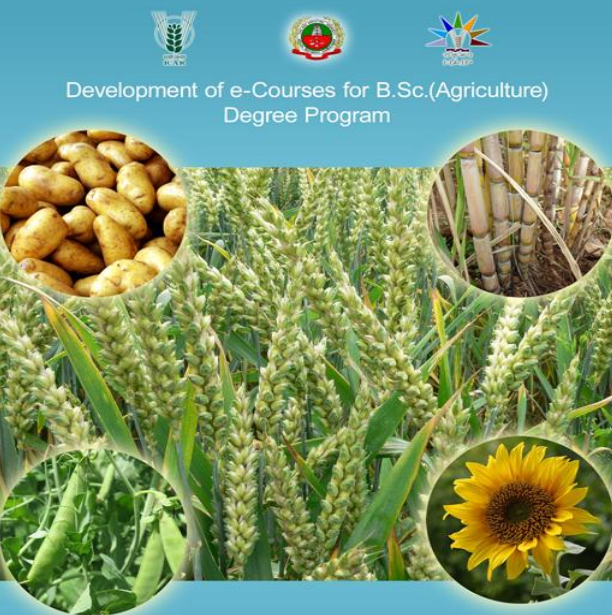

## Development of e-Courses for B Sc (Agriculture) Degree Program

<!-- p. 1 -->

# AGRO 301 FIELD CROPS (RABI)

<!-- p. 1 -->

# Author TNAU Tamil Nadu

<!-- p. 2 -->

AGRIMOoN.COM

All About Agriculture.

# Index

<!-- p. 3 -->

|   SN | Name                                                                                                                                                                            | Page No   |
|------|---------------------------------------------------------------------------------------------------------------------------------------------------------------------------------|-----------|
|    1 | Importance, area, production and productivity of major cereals, pulses, oilseeds, sugar crops, medicinal and aromatics and forage crops                                         | 5-13      |
|    2 | WHEAT TRITICUM SP                                                                                                                                                               | 14-25     |
|    3 | BARLEY Hordeum vulgare                                                                                                                                                          | 26-31     |
|    4 | TRITICALE                                                                                                                                                                       | 32-35     |
|    5 | RABI PULSES CHICKPEA                                                                                                                                                            | 36-40     |
|    6 | LENTIL Lens culinaris                                                                                                                                                           | 41-43     |
|    7 | FIELDPEA Pisum sativum                                                                                                                                                          | 44-48     |
|    8 | FRENCH BEAN Phaseolus vulgaris                                                                                                                                                  | 49-52     |
|    9 | Area, production, productivity and importance and byproducts utilization of oilseeds (groundnut, sesame, rapeseed and mustard, sunflower, safflower, castor, niger and linseed) | 53-57     |
|   10 | RAPESEED-MUSTARD Brassicas sp.                                                                                                                                                  | 58-66     |
|   11 | SUNFLOWER Helianthus annuus                                                                                                                                                     | 67-74     |
|   12 | SAFFLOWER Carthamus tinctorious                                                                                                                                                 | 75-82     |
|   13 | LINSEED Linum usitatissimum L.                                                                                                                                                  | 83-85     |
|   14 | Area, production, productivity and importance of Sugar crops and byproducts utilization (sugarcane and sugarbeet) in India and Tamil Nadu                                       | 86-89     |
|   15 | Saccharum officinarum                                                                                                                                                           | 90-112    |
|   16 | TROPICAL SUGARBEET Beta vulgaris spp. Vulgaris                                                                                                                                  | 113-117   |
|   17 | Area, production, productivity and importance of medicinal and aromatic crops in India                                                                                          | 118-120   |
|   18 | MENTHA (MINT)                                                                                                                                                                   | 121-126   |
|   19 | LEMON GRASS                                                                                                                                                                     | 127-131   |
|   20 | CITRONELLA (Cymbopogon winterianus)                                                                                                                                             | 132-136   |
|   21 | PALMAROSA (Cymbopogon martini var. motia)                                                                                                                                       | 137-141   |
|   22 | ISABGOL                                                                                                                                                                         | 142-145   |
|   23 | Area, production, productivity and importance of important tuber crops in India                                                                                                 | 146-148   |
|   24 | POTATO (Solanum tuberosum)                                                                                                                                                      | 149-154   |
|   25 | Area, production, productivity and importance of narcotics in India                                                                                                             | 155-158   |

|   26 | Tobacco Nicotiana tabacum                                                                                                                                           | 159-168   |
|------|---------------------------------------------------------------------------------------------------------------------------------------------------------------------|-----------|
|   27 | Forage crops, forage grasses and legumes - importance, soil and climatic requirement, agronomic practices, time of harvest, biomass production and nutrient content | 169-175   |
|   28 | BERSEEM Trifolium alexandriannium                                                                                                                                   | 176-181   |
|   29 | LUCERNE Medicago sativa)                                                                                                                                            | 182-185   |
|   30 | OATS (Avena sativa)                                                                                                                                                 | 186-188   |
|   31 | Preservation of fodder - hay & silage making                                                                                                                        | 189-195   |

# Lecture 01

<!-- p. 5 -->

# Importance, area, production and productivity of major cereals, pulses, oilseeds, sugar crops, medicinal and aromatics and forage crops

<!-- p. 5 -->

# Importance of cereals

<!-- p. 5 -->

-  Grains are generally classified as the seeds of cereal plants. They are characterized by their smallness, hardness and low water content.

-  Most of them belong to the family of grasses, known scientifically as the family of gramineas.

-  Most of Cereals have been the staple human diet from prehistoric times because of their wide cultivation, good keeping qualities, blend flavor and great variety.

-  The cultivation of grains for human consumption was probably developed around 10,000 B.C. It signified the commencement of the era of stable civilization from the primitive unsettled nomadic life.

-  Ground cereal converted into bread for meal revolved soon thereafter. Cereals have been modified and improved by centuries of cultivation and selective breeding.

# Food Value of Grain Cereals

<!-- p. 5 -->

-  The whole grains of all cereals have a similar chemical composition and nutritive value.

-  They are classified as carbohydrate rich foods, for their average carbohydrate content is 70 per cent per 100 gm. They provide energy and also some protein which is usually of good quality. The protein content of grains varies from 11.8 per cent for wheat to 8.5 per cent for rice per 100 gm.

-  Whole cereals are good sources of calcium and iron but they are totally devoid of ascorbic acid and practically devoid of vitamin A activity.

-  Yellow maize is the only cereal containing appreciable amounts of carotene. Whole grain cereals also contain significant amounts of B group of vitamins.

-  For a balanced diet, cereals should be supplemented by other proteins, minerals and vitamin A and C found in nuts, seeds, milk, fruits and fresh green vegetables.

-  Whole grain cereals play an important role in the diet. It sprouted, they provide an increase in protein balance, as well as in all other nutrients, especially vitamin C.

-  Their complex form of carbohydrate. When in the whole state, is valuable for digestive needs, especially in providing excellent sources of vital fibre.

# Importance of wheat

<!-- p. 6 -->

-  World's number one cereal in area

-  Cultivation of wheat is as old as civilization

-  It is the first mentioned crop in Bible

-  Used for bread, cakes, bakeries, also manufacture of dextrose, alcohol etc

-  A nutritious food of all

# Wheat: Indian Scenario

<!-- p. 6 -->

| State     |   Area ( '000 ha) |   Production ( '000 t) |   Productivity (kg/ha) |
|-----------|-------------------|------------------------|------------------------|
| UP        |            9163.9 |                24073.8 |                   2627 |
| MP        |            3692.8 |                 5957.7 |                   1613 |
| Punjab    |              3468 |                  14493 |                   4179 |
| Rajasthan |            2123.9 |                 5865.3 |                   2762 |
| Haryana   |              2304 |                   8857 |                   3844 |
| Bihar     |            2003.7 |                   3239 |                   1617 |
| All India |             26484 |                69354.5 |                   2619 |

(Ministry of Agriculture, Govt. of India, 2005-06)

# Area Expansion in wheat cultivation in India - In million

<!-- p. 7 -->

| Year    |   Area (ha) |   Production (t) |   Productivity (t) |
|---------|-------------|------------------|--------------------|
| 1950-51 |        9.75 |             6.45 |               0.66 |
| 1960-61 |       12.93 |            11.00 |               0.85 |
| 1967-68 |       15.00 |            16.54 |               1.10 |
| 1970-71 |       18.24 |            23.83 |               1.30 |
| 1980-81 |       22.28 |            36.31 |               1.63 |
| 1990-91 |       24.17 |            56.13 |               2.26 |
| 1998-99 |       27.40 |            70.78 |               2.58 |

# Rabi season pulses

<!-- p. 7 -->

# Cool season food legumes are

<!-- p. 7 -->

- o Chickpea, Filedpea, Lentil, , Frenchbean,

- o They contribute 60% world pulse production

-  28 million ha globally

-  They are concentrated on temperate and sub-tropical climate

-  Chickpea, lentil in developing countries

-  Peas in developed countries

India, Pakietan;

Bangladesh; Nepal &

Bhutan

Europe

2590

590

Canada

E4

China

USA

Turkoy,

East Asia_

USA,

Mexic 0

Brazil _

Atrica:

Australia

# Global Pulse production

<!-- p. 8 -->

# Demand for pulses in Tamil Nadu

<!-- p. 8 -->

Annual production

: 1.77 l.t

Requirement for the projected population : 7.0 l.t

Import

: 5.23 l.t

Countries

: Australia, Myanmar,Canada, Turkey,France and Tanzania

Indian States

: Maharashtra, A.P, Karnataka, Punjab and M.P

# Importance of Oilseeds

<!-- p. 8 -->

India is the fourth largest oilseed producing country in the world

The major oilseeds are Soybean, Cottonseed, Groundnut, Sunflower, Rapeseed, Sesame seed, Copra, Linseed, Castor seed and Palm Kernels.

In India, oilseeds are grown in an area of nearly 27 million hectares across the length and breadth of the country.

450

Sunilonerseed

Soyabean

400

Rapes eed

350

Groundnut

PalmKemnel

300

Cotonseed

250

4

200

150

100

50

0

Scue

"0405

'87/88

"8889

"02703

13.04

# World Oilseed Production Importance of sugar crops

<!-- p. 9 -->

-  In addition to providing the source for the manufacture of sugar, sugar crops are used to produce alcohol and ethanol.

-  In certain countries, sugar cane is eaten raw in minor quantities.

-  It also is used in the preparation of juices and for animal feed.

-  There are two major sugar crops: sugar beets and sugar cane. However, sugar and syrups are also produced from the sap of certain species of maple trees, from sweet sorghum when cultivated explicitly for making syrup and from sugar palm.

-  Sugar beets that are cultivated solely as a fodder crop and are classified as vegetable crops

-  Sugar cane is a perennial grass that is cultivated mainly in the tropics.

-  Sugar beet is an annual crop that is propagated by the seeds of the flowers, cultivated in cooler climates than sugar cane

-  Both sugar beets and sugar cane have high water content, accounting for about 75 percent of the total weight of the plants. The sugar content of sugar cane ranges from 10 to 15 percent of the total weight, while that of sugar beets is between 13 and 18 percent.

-  The traditional sources of sugar are sugar cane and sugar beets.

1

1

Ei

4276

MORD

# Importance of medicinal and aromatic crops

<!-- p. 10 -->

-  India is endowed with a rich wealth of medicinal plants. These plants have made a good

- contribution to the development of ancient Indian medicine.

-  One of the earliest treatises on Indian medicine the Charak Samhita (1000 B.C), records the use of over 340 drugs of vegetable origin.

-  Medicinal and aromatic plants are important for human health. These plants have been used from the prehistoric times to present day. These plants based medicines are consumed in all civilizations.

-  It is believed that the herbal medicine can give good effect to body without causing side effects to human's life. Besides, the usage of medical plants has been increasing as an important role that can support the economic system.

-  The medical and aromatic plants for health are used as herbal treatments and therapies that can be new habits for culture.

-  With the high consumption of medical plants, it is possible that the over exploitation of such plants could be happen.

-  Some of the medicinal plants can be cultivated well in a research centre, agricultural site or even in a house. But for the wild medical plants, it needs to be more concerned to avoid the over cropped and keep the sustainability of the medical and aromatic plants.

# Importance of forage crops

<!-- p. 11 -->

India is basically an agricultural country and about 70 per cent of its people live in villages. Their livelihood is dependent mainly on agriculture and animal husbandry. Though India has a huge livestock population of over 582 million, besides poultry, production of milk and other livestock products are the lowest compared to the production in the world.

# Livestock population in India

<!-- p. 11 -->

| S. No.   | Livestock   |   Population (million) |
|----------|-------------|------------------------|
| 1.       | Cattle      |                 245.73 |
| 2.       | Buffalo     |                 109.44 |
| 3.       | Sheep       |                  79.78 |
| 4.       | Goat        |                 125.60 |
| 5.       | Pig         |                  18.23 |
| 6.       | Others      |                   3.79 |
| 7.       | Poultry     |                 459.96 |
| Total    |             |                 582.61 |

# Balance-sheet of animal feed and fodder in India

<!-- p. 11 -->

| Feed & fodder   |   Availability (m.t) |   Requirement (m.t) |   Deficit (m.t) |
|-----------------|----------------------|---------------------|-----------------|
| Green fodder    |               224.08 |              611.99 |          387.91 |
| Crop residues   |               231.05 |              869.79 |          638.74 |
| Concentrates    |                31.60 |               65.40 |           81.80 |

It is seen from the Table, that there is a huge gap between demand and supply of all kinds of feeds and fodders.

On the other hand, the land resources available for growing fodder and forage crops, it is estimated that the average cultivated area devoted to fodder production is only 4.4 per cent of the total area. Similarly, the area under permanent pastures and cultivable wastelands is approximately 13 and 15 million hectares respectively. Likewise, the total area under forests is 2.51 crore hectares and that open to grazing is 2.1 crore hectares. All these resources are able to meet the forage requirements of the grazing animals only during the monsoon season. But for the remaining periods of the year, the animals have to be maintained on the cropresidues or straws of jowar, bajra, ragi, wheat, barley, sugarcane trash etc. either in the form of whole straw or bhusa, supplemented with some green fodder, or as sole feed.

To attain the goal of rearing hybrid cows, feeding them with nutritious fodder is the most important aspect. Nutritious feed improves the health of the animal. In order to improve the quality and quantity of forage in India, location specific fodder varieties and species have been identified and also developed suitable cultivation technology for economic production.

One of the agriculture most limiting resources is water. A huge quantity of waste water (Effulent, sewage) is available. Identification of optimum forage production strategies for recycling water and plant nutrients along with monitoring of fodder quality, antinutritional/toxic principles and heavy metals will not only help to promote forage production but also prevent pollution hazard.

1. The most cultivated crop in India among cereals

- Rice

- Wheat

- Maize

- World production of wheat is __________ million tonnes

- 578.34

- 478.34

- 678.34

- ___________ leads as highest productivity of wheat in the world

- India

- USA

- China

- 70% of area and 75% of the production of groundnut in India is in

- A.P

- Tamil Nadu

- Both

- Production of wheat is __________ million tonnes in India

- 71

- 81

- 61

- Highest productivity of wheat is in ________ state of India

- Tamil Nadu

- Punjab c. Maharastra

- In India, productivity of sugarcane is highest in the state

- Tamil Nadu

- Punjab

- None

- Mention the Rabi season pulse

- Chick pea b. Green gram c. Red gram

*****☺*****

-  De Candolle believed - Valley of Euphrates and Tigris

-  But Vavilov

- o Origin of Durum wheat probably Abyssinia

- o Soft wheat groups - In the region of Western Pakistan, SW Afghanistan, and S parts of mountainous Babshara

-  World's number one cereal in area

-  Cultivation of wheat is as old as civilization

-  It is the first mentioned crop in Bible

-  Used for bread, cakes, bakeries, also manufacture of dextrose, alcohol etc

-  A nutritious food of all

# Classification of wheat

<!-- p. 14 -->

-  Genus Tricum can be classified into 3 groups

- o Diploids = 7 pairs of chromosomes

- o Tetraploids = 14 pairs

- o Hexaploids = 21 pairs

# Commonly cultivated wheat sp

<!-- p. 14 -->

-  There are 7 in the world, only 4 is important in India, they are:

- o Common wheat ( T vulgare / aestivum)

-  Bread wheat

-  Most suited for chapati and bakery

-  Cultivated throughout India

-  Common wheat may be sub-divided

-  Hard red winter wheat - commercial class

-  Hard red spring - where winter is too severe, high protein and excellent bread making characteristics

# Lecture 02

<!-- p. 14 -->

# WHEAT TRITICUM SP

<!-- p. 14 -->

-  Soft red winter - grown in humid conditions, grains are soft, low protein, flour more suitable for cakes, cookies

-  White wheat - mainly for pasty purpose

- o Duram (T durum)

-  Macroni wheat

-  Best suited for noodles, vermicelli

-  Spring habit

-  Cultivated in Central & Southern India

- o Emmer wheat (T dicoccum)

- o Winter / spring wheat

-  Wheat suitable for TN

-  Preferred for granular preparation

-  Gujarat, Maharastra, AP & TN

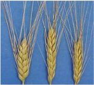

- o Shot wheat (T sphaerococcum)

-  Indian dwarf wheat

-  Practically gone out of cultivation due to low productivity

-  Small extent N. India and W Pak for local consumption

- o Sonak - to replace Sonalika

- o HD 2285

- o PBW 343, HD 2687, WH 542, UP 2336, Raj 3077, CPAN 3004, PDW 215

- o Many more like

-  Varieties for irrigated late sown

-  Varieties for salt affected areas etc

#  Adaptation and distribution

<!-- p. 16 -->

- o Widely cultivated cereal

- o 47ºS to 57ºN latitude

- o Cultivated in wide range of soils but

- o Well suited to fertile well drained silt and clay loam soils

- o Poorly suited to sandy or poorly drained soils

#  Climate

<!-- p. 16 -->

- o Wheat has hardening ability after germination

- o It can germinate at temp just above 4ºC

- o After germination it can withstand freezing temperatures by-

-  Spring wheat - as low as (-9.4ºC)

-  Winter wheat - as low as (-31.6ºC)

- o Normal process starts above 5ºC under the presence of adequate sunlight

- o During the process of hardening there is gradual increase in the dry matter, sugars, amide nitrogen, and amino nitrogen in the tissues

- o As a result there is greater tolerance to freezing of proteins

- o Hardened plants have lower moisture in the leaves and

- o Water is held more tightly within the cells

-  Response to photo period and growth

- o It is long day plant

- o Long day hastens the flowering

- o Short day increase the vegetative period

- o But no more varieties after the release of photo-insensitive

-  Temperature and growth

- o Wheat can be exposed to low temp during vegetative and high temp and long days during reproductive phases

- o Optimum is 20-22ºC

-  Optimum for vegetative - 16-22 º C

-  Leaves are largest at 22 º C

- o Temp above 22 ºC decreases the plant height, root length and tiller number

- o Heading is accelerated as temp rose from 22 to 34 ºC but retarded above 34 ºC

- o At grain development 25 ºC for 4- 5 weeks is optimum

-  Temp above 25 ºC reduce the grain weight

# Growth stages in wheat in North India

<!-- p. 17 -->

#  Vegetative

<!-- p. 17 -->

- o Germination : 5-7 days

- o CRI : 20-25 DAS

- o Tillering: from 15 days at 4-5 days until 45 DAS

- o Jointing: Peak plant growth 45-60 DAS

-  Internode elongation period

#  Reproductive

<!-- p. 17 -->

- o Boot leaf 70-75 DAS

- o Flowering : 85-90 DAS

- o Milking: 100-105DAS

- o Dough: 105-110

- o Maturity: 115 - 120

Harvost

Sowing

#  Coordinating Research Zones

<!-- p. 18 -->

- o There are 6 zones in India for wheat improvement and coordination

- o Northern Hills Zone

- o North Western Plans Zone

- o North Eastern Plains Zone

- o Central Zone

- o Peninsular Zone

- o Southern Hills Zone

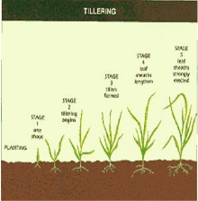

*Different growth stages of wheat*

tilleaing

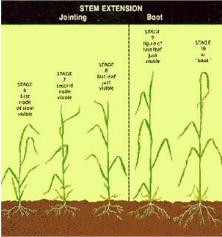

Jointing

Boot

# Wheat cultivation practices

<!-- p. 19 -->

- o Time of sowing decides yield potential in wheat

- o Irrigated long duration varieties (135-140d)

-  Nov 10-30th

- o Short duration varieties (120-125)may be sown up to Dec 15

- o Later than Dec 15th there is drastic reduction in yield

- o Zone wise there is slight variation

- o Usually after harvest of Kharif crops

- o Field is prepared by disking once and harrowing

- o Moderate to fine tilth is suitable

- o Zero tillage also possible

-  After rice dibbling in lines may be an option

RIPENING

HEADING

#  Methods of sowing

<!-- p. 20 -->

- o Broad casting

- o Zero / No-tillage sowing

- o Behind the plough

- o Drilling

- o Dibbling

- o FIRB - Furrow irrigated raised bed system

- o Normal recommendation 100-125 kg /ha

- o Increase seed rate by 25% when

-  Under late sown

-  When the soil moisture is less

- o Broadcast requires higher seed rate - 150 kg

- o For dibbling 25-30kg is sufficient

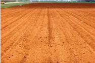

#  Spacing

<!-- p. 21 -->

- o Varies with varieties

- o Tillering variety requires wider spacing

- o Irrigated wheat spaced 22.5 cm and 8-18 cm between plants

- o Rainfed wheat - 25-30 cm x 5-6cm

- o When late sown closer spacing 15-16cm

#  Mineral Nutrition

<!-- p. 21 -->

- o Nitrogen

-  Critical leaf N conc is 2.5%

-  Poor tillering and small ear heads are deficiency

-  Indian soils lack N

-  General recommendation

-  For irrigated crop -s 120-150 kg

-  Rainfed - 40-60kg

-  Irrigated 2-3 equal splits

-  Heavy soils 2 splits

-  Light soils three

-  Basal, 1st irrigation and 2nd irrigation are time

-  In rainfed crop if moisture availability is sufficient

-  Additional dose may be - 40kg/ha

-  All the nitrogenous may be used

-  For calcarious and strongly alkaline soils

-  Ammonium sulphate is better than Urea

# o Phosphorous

<!-- p. 21 -->

-  It is also critical nutrient particularly for dwarf

-  If adequate P fertilization is done for

-  Maize-wheat

-  Sorghum - wheat

-  Rice-wheat

-  P may be reduced or avoided

-  But most of soils are responding

-  May be 0.1% dry leaf P conc be maintained

-  60kg P2O5 at planting is good

-  Source wise water soluble is preferred

-  Rock phosphate efficiency much lower

-  For acid soils

-  Use of rock phosphate with pyrites may be useful

-  When the water soluble (SSP / DAP) when placed near the root zone is more efficient than broadcasting

-  All P as basal

# o Potassium

<!-- p. 22 -->

-  There is response to applied K

-  In general Indo-Gangetic alluvium is rich in K and not recommended with K

-  General recommendation is 40-60kg /ha

-  May be basal or split along with 1st irrigation

# o Micro-nutrients

<!-- p. 22 -->

-  Zn, Fe, Cu, Mn and B are reported as deficient in certain soils and conditions

-  Zn is widely reported

-  <10ppm in leaves is acute deficiency

-  Higher P is interfering with Zn

-  Generally 25 kg Zn SO4 /ha

-  Foliar spray with 0.5%

-  5kg ZnSO4 along with 2.5kg slaked lime is dissolved in 1000 lit to spray 1 ha

# o INM

<!-- p. 22 -->

-  Green manure / FYM applied to Kharif crop

-  A pulse crop before wheat

-  Biofertlizers along the seeds and soil

#  Irrigation

<!-- p. 23 -->

- o Highly responds to irrigation

- o 4-6 irrigations are essential

- o 40-50% depletion of ASM

- o Appropriate IW :CPE ratio for wheat 0.7-0.9

- o On clay loam up to 80% depletion

- o Critical phases for irrigation are

-  CRI - 20-25 DAS)

-  Second most critical stage - Flowering

-  Third important stage - jointing and milk stages

#  For varying number irrigations

<!-- p. 23 -->

|   No of irrigations Stages | No of irrigations Stages   |
|----------------------------|----------------------------|
|                          1 | CRI                        |
|                          2 | CRI + LJ                   |
|                          3 | CRI + B + M                |
|                          4 | CRI + LT + F + M           |
|                          5 | CRI + LT + LJ + F + M      |
|                          6 | CRI + LT + LJ + F + M + D  |

CRI - Crown root initiation; LT - Late tillering; LJ - late jointing; F- Flowering; M- milking; D - Dough stages

#  Weed control

<!-- p. 23 -->

- o Deadly competitor

- o Should be controlled at the early

- o Better filed maintenance to previous crop

- o Problematic mono-cot weeds are

-  Phalaris minor - (Canary grass)

-  Avena fatua (Wild oat)

-  Polypogan monspliensis

- o Hand weeding is recommended

-  Before 20-25DAS

-  Second weeding 2 weeks later

- o Use of herbicides becomes handy

-  Dicots can be controlled by 2,4 D (EE) 0.3-0.4 kg /ha at 35DAS

-  Monocots can be controlled by

-  Isoproturon 1-1.5kg /ha or

-  Methabenzthiazuron 1.5 kg or

-  Metoxuron 1.5 kg /ha on 30-35 DAS

-  Pre-emergence application of Pendimethalin or Isoproturon is broad spectrum control

#  Harvesting and threshing

<!-- p. 24 -->

- o Yellow and dry straw is visual indicator

- o Shredding, breaking of spikes are over ripe

- o Most suitable stage is grain moisture of 20-25%

- o Combine harvester is ideal

- o Usually manually harvested or by reapers is dried for 3-4 days on threshing floor and threshed

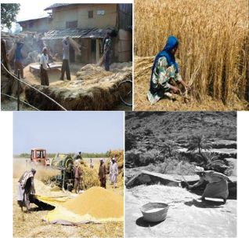

#  Wheat based cropping systems

<!-- p. 24 -->

- o Normally wheat is cultivated after Kharif crops under double crop sequence

- o Kharif crops may be

-  Rice, maize, sorghum, millet, mungbean, urdbean, cowpea, pigeonpea, cotton etc.,

- o A third crop of any catch crop is raised in certain pockets

- o In UP wheat is alternated with sugarcane

- Bread wheat is ___________

- Secale cereale

- Hordeum vulgare

- Triticum aestivum

- According to Vavilov the origin of Durum wheat is ________

- Abyssinia

- Asia

- Africa

- Permanent adventitious roots of wheat is called __________

- Primary roots

- Secondary roots c. Clonal roots

- Common wheat is ________

- Triticum durum

- Triticum dicoccum c. Triticum aestivum

- Duram wheat is ________

- Triticum durum

- Triticum dicoccum c. Triticum aestivum

- Emmer wheat is ________

- Triticum durum b. Triticum dicoccum

- Triticum aestivum

- Wheat is a _________ plant

- Short day

- long day

- day neutral

8. Duration of CRI stage in wheat is ________ DAS

- 45-60

- 20-25

- 30-45

- Duration of boot leaf stage in wheat is ________ DAS

- 45-60

- 70-75

- 30-45

- Duration of flowering stage in wheat is ________ DAS

- 85-90

- 70-75

- 100-105

- Duration of milking stage in wheat is ________ DAS

- 85-90

- 70-75

- 100-105

- Duration of dough stage in wheat is ________ DAS

- 105-110

- 115-120

- 100-105

- Duration of maturity stage in wheat is ________ DAS

- 105-110

- 115-120

- 100-105

14. Normal recommendation of seed rate for wheat is ________ kg/ha

- 75-90

- 90-100

- 100-125

15. The recommended seed rate for wheat under dibbling method is ________ kg/ha

- 25-30

- 30-45

- 45-60

*****☺*****

# Lecture 03

<!-- p. 26 -->

# BARLEY Hordeum vulgare

<!-- p. 26 -->

-  It is important next to rice, wheat, maize in area and production

-  It is more suitable than wheat in India

- o Due to hardy nature

- o Can withstand adverse agro-environments like

-  Drought, Salinity, Alkalinity

-  Varied topography like plain, hill

-  Under rainfed and irrigated

- o It is the crop preferred by farmers where wheat is not possible

#  Origin

<!-- p. 26 -->

- o ‗Near-East region' as probable place of origin

- o Abyssinia - one group

- o SE Asia (China, Tibet, Nepal) another group

-  Archeological remains dates back

-  8000 BC at Euphrates in Syria

-  Recent evidence from Aswan dam in Egypt about 16000BC

#  Economic importance

<!-- p. 26 -->

- o It is a Rabi cereal

- o Food for people of cooler and semi-arid part of the world

- o In India 90% as human food

- o Used for malt, beer, whisky and industrial alcohol, vinegar

- o Energy rich drinks like bournvita, boost, horlicks are from barley malt

- o Medicinal value

-  Reduce cholestral level in liver

-  It also stimulates fatty acid synthsis in liver

- o In USA as cattle feed and horse feed

- o Biscuit making

- o Great demand to malting industry

-  Good quality grain production may open foreign exchanges

- o Protein-11.5%, carbohydrate-74%, fat-1.3%

- o Crude fibre -3.9%, ash -1.5%

# Barley World scenario

<!-- p. 27 -->

| Continent   |   Area (m ha) |   Production (m t) |   Productivity (t ha-1) |
|-------------|---------------|--------------------|-------------------------|
| Africa      |          4.89 |               6.13 |                    1.25 |
| America     |          5.72 |              16.95 |                    2.96 |
| Asia        |         12.08 |              22.44 |                    1.86 |
| Europe      |         28.77 |              89.05 |                    3.09 |
| Oceana      |          4.05 |               4.07 |                    1.01 |
| India       |          0.70 |               1.22 |                    1.74 |
| World       |         55.52 |             138.64 |                    2.50 |

(FAOSTAT, 2006)

# Barley - Indian scenario

<!-- p. 27 -->

| State     |   Area ( '000 ha) |   Production ( '000 t) |   Productivity (kg/ha) |
|-----------|-------------------|------------------------|------------------------|
| UP        |             214.7 |                  413.4 |                   1925 |
| Rajasthan |             201.6 |                  492.1 |                   2441 |
| MP        |              77.5 |                   99.8 |                   1288 |
| Haryana   |                27 |                     76 |                   2815 |
| Punjab    |                19 |                     63 |                   3316 |
| HP        |              25.2 |                   18.4 |                    730 |
| All India |             629.9 |                   1221 |                   1938 |

(Ministry of Agriculture, Govt. of India, 2005-06)

#  Climatic requirement

<!-- p. 27 -->

- o Similar to wheat

- o Performs well cool climate

- o Warm and moist conditions are not conducive

- o Can't tolerate frost

- o Frost and hail storm at flowering are detrimental

#  Soil requirement

<!-- p. 27 -->

- o Tolerant to salinity and alkalinity but sensitive to acidity

- o Being salt tolerant best substitute for sodic soil

- o Drained, fertile deep loam soil with pH 7-8

- o Barley grown in high N often lodges

- o Rainfed before end of Oct

- o Irrigated I / II fortnight of Nov

- o Hilly zones as summer crop -Apr- May

- o Irrigated - 100 kg/ha

- o Rainfed - 80-100 kg/ha

#  Spacing

<!-- p. 28 -->

- o 22.5cm for irrigated and 22.5 to 25 for rainfed

-  Depth of sowing: 5cm, if rainfed - 6-8cm

-  Varieties

- o Two types Husk-less and Hulled barley

-  Husk-less preferred - Karan 18 & 19 -demand from farmers

- o Suited for hills

-  Himani - for medium to lower hills 140-145 days, 3-3.5t /ha

-  Dolma - Medium to high elevation, 140-145 days, 4.0t /ha

-  Kailash - six row hulled - medium to low elevation

- o Suited for rainfed areas

-  Ratna - six row-hulled, 125-130d, UP, WB, Bihar, 2.5 - 3.0t/ha

-  Vijay - 120-130d, UP, MP, Punjab, 3.0 -3.5t/ha

-  Azad - 115-120d, 3.5 - 3.8t/ha

-  Ameru - 130-133d, 2.5 03.0t/ha - best for malt

- o Suited for irrigated areas

-  Jyoti - six row hulled, 120-125d, 3.5-4.0t/ha

-  Ranjit - Six row, semi dwarf, non lodging, 125-130d, 3.0-3.5t'ha

-  Clipper - Two row, 135-140d, 2.8-3.0t/ha best for malt & brewing

-  Karan 18 & 19 - 5.0 - 5.6t/ha

- o Dual purpose (fodder and grain)-

-  Ratna, Karan2, Karan 5, Karan 10

#  Selection of variety for malt purpose

<!-- p. 28 -->

- o Plumpy medium good quality

- o Select the seeds having 1.2 to 1.5% N

- o Timely sown crop

- o Not from well fertilized soil

#  Land preparation

<!-- p. 29 -->

- o Similar to wheat

-  Seed treatment

- o Similar to wheat

#  Method of sowing

<!-- p. 29 -->

- o Similar to wheat

- o FYM 12.5t/ha

- o N- P2O5- K2O

-  Rainfed - 40-20-20

- o Method of application

-  N 50% basal + P&K, I split at I irrigation

-  Entire basal for rainfed

-  Light soil 3 splits - I & II irrigations

-  Irrigated - 60-30-20

-  Malt

- 30-20-20

#  Water management

<!-- p. 29 -->

- o 200-300mm

- o 2-3 irrigations

- o Critical periods

-  Seedling / sprouting

-  Active tillering

-  Flag leaf

-  Milking or soft dough stages

- o Tillering and grain filling so crucial

- o Up to 30 days

- o Post emergence herbicides Isoproturan 0.75kg/ha + 0.5 kg 2,4D EE 3-5 leaf stage

- o Or Pendimethalin (pre-emergence) 1.0kg/ha + one hand weeding

#  Cropping systems

<!-- p. 30 -->

- o Rice-barley

- o Jowar - barley

- o Bajra- barley

- o Cotton-barley

- o Blackgram-barley

- o Mixed crops:

-  with Chickpea, pea, mustard, linseed, lentil

#  Harvest

<!-- p. 30 -->

- o Similar to wheat

- o Storage

-  10-12% moisture

- o Yield

-  3.0 - 3.5t/ha,

-  straw 4.0-5.0t/ha

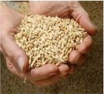

- Centre of origin of Barley is ___________

- America

- S. Africa

- Asia & Ethiopia

- In India the highest producer of barley is ________

- U.P

- Punjab

- W.bengal

- The inflorescence of barley is called __________

- Ear

- panicle

- spike

- Most critical stage of irrigation in barley is ________

- Tillering

- CRI

- Flowering

- Barley crop needs ________

- Cold & dry climate b. Hot & humid

- dry & hot

- Photoperiodically, barley is a type of plant is ________

- Short day

- Long day

- Day neutral

- Depth of sowing of barley is

- a.1-2cm

- 3-5 cm

- 5-6cm

- Shoot of barley is called

- Stem

- Culm

- Trunk

- Leaf of barley is

- Petiole

- Sessile

- both

- Salt tolerant variety of barley

- Amber

- Neelam

- RD137

11. ________ variety is suitable for malting

- Amber

- Neelam

- RD 137

*****☺*****

-  Man made cereal

-  First wheat x rye occurred in Scotland - 1875

- o Initial crosses were sterile

- o First fertile cross was made in Germany in 1888

- o The name Triticate first appeared in Germany in 1935

-  There are Octaploid, tetraploid, hexaploid cultivars

-  Hexaploid is most common

-  Hexaploids of wheat and rye are called primary hexaploid

-  While hexaploid triticale crossed from hexaploid wheat or octoploid triticale are called secondary hexaploids

-  Secondary hexaploids are

- o Increased genomic diversity

-  Triticale is either spring or winter suited

-  They tend to tiller less but have larger inflorescence

-  Majority of triticale cultivars are awned

-  Initial cultivars are

- o Low yielder

- o Tall week straw

- o Shrunken/shriveled kernels

- o High susceptibility to ergot

- o But high protein, high level of amino acids

- o Good for animal nutrition

# Lecture 04 TRITICALE

<!-- p. 32 -->

-  But today

- o They yielding better than wheat

- o Tiller producing

- o Resistance to lodging

- o Resistance to ergot

- o Plump kernels

- o Protein equal to wheat similar bread wheat

- o Suitable for spring and winter seasons

-  But triticale research is not much today

- o Importance to wheat and barley reduced the area and interest in Triticale

- o Nutritional quality is good / better than wheat, preferred by consumers but due reduced production

- o Hard white grain development in Triticale made scope for Triticale

# Speciality of Triticale

<!-- p. 33 -->

-  They can utilize water and nutrients more efficiently than winter wheat

-  Seeding, seed rate season etc are as wheat

-  Nutrient and water requirement are similar to wheat and they are responding well when grown for grain

-  For forage the seed rate may be enhanced than wheat -80-100 kg in rainfed and drylands

-  For irrigated 110kg

-  Scope for further development

# Alternate wheat cereals as food

<!-- p. 33 -->

-  Einkorn - AA

- o T. monococcum

-  Emmer - AABB

- o T. turgidum L. group dicoccum

-  Spelt - AABBDD

- o - T. spelta

-  Kamut - AABB

- o T. turgidun ssp turanicum

-  Triticale - AABBRR

- o xTricosecale

# Climate and soil requirements

<!-- p. 34 -->

Climatic and soil requirements are similar to that of wheat. It can also be grown under relatively higher temperature and wet soil conditions. In light soils it is suitable under rainfed condition.

# Cultivation practices

<!-- p. 34 -->

# As rainfed crop

<!-- p. 34 -->

-  It is sown during October and matures in 110 - 130days.

-  The seeds are sown continuously with a row spacing of 20 -30 cm.

-  The seed rate is 75 - 100 kg/ha.

-  Depth of sowing should be 8 to 9 cm.

-  The crop is matured with 40:40:0 kg NPK/ha.

# Under irrigated condition,

<!-- p. 34 -->

-  It is sown during middle of November and matures in 120 - 150days.

-  Seed requirement is 125 - 150 kg/ha. Seeds are dibbled at 15 to 20 cm row spacing continuously at 5 - 8 cm depth. The crop is given with 5-7 irrigation.

-  The crop is matured with 150:60:40 kg NPK/ha.

Harvesting, threshing and grain storage practices are similar to wheat.

- Triticale is a cross between ___________

- Wheat & Maize b. Wheat & Rice c. Wheat & Rye

- Mention the man made cereal ________

- Triticale

- Oats

- Barley

- Majority of triticale cultivars are________

- awnless

- awned

- both

- Sowing time for rainfed triticale is ________

- October b. June

- May

- Seeds of rainfed triticale is sown in a row spacing of

- 10-20cm

- 20-30 cm c. 50-60cm

- Seed rate of rainfed triticale is

- 100-150kg

- 75-100kg

- 50-60kg

- Seed rate of irrigated triticale is

- 100-150kg

- 125-150kg

- 75-100kg

*****☺*****

# Lecture 05 RABI PULSES CHICKPEA

<!-- p. 36 -->

# Rabi season pulse or Cool season food legumes are:

<!-- p. 36 -->

- o Chickpea, Filed pea, Lentil, , French bean

- o They contribute 60% world pulse production

-  28 million ha globally

-  They are concentrated on temperate and sub-tropical climate

-  Chickpea, lentil in developing countries

-  Peas in developed countries

# CHICKPEA / BENGALGRAM - Cicer arietinum

<!-- p. 36 -->

- Cicer derived from ‗Cicero' well known Roman family and 'arietinum' from 'aries' meaning ram's head shape

- Gram, Bengal gram, chana

- Mostly used pulse in many products

- Boiled, roasted, steamed, sprouted, flour made into many delicious food

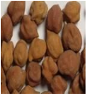

Chickpea

# World Scenario

<!-- p. 37 -->

| Country                                               |   Million ha |   Million t |   t/ha |
|-------------------------------------------------------|--------------|-------------|--------|
| Africa (Ethiopia, Malawi, Morocco, Tanzania, Tunisia) |         0.41 |        0.32 |   0.79 |
| Mexico                                                |         0.11 |        0.16 |   1.44 |
| Asia (India, Pak, Turkey, Iran, Myanmar)              |         9.82 |        7.37 |   0.75 |
| India                                                 |         6.93 |        5.60 |   0.81 |
| Europe                                                |         0.05 |        0.04 |   0.93 |
| Australia                                             |         0.09 |        0.11 |   1.09 |
| World                                                 |        10.67 |        8.24 |   0.77 |

# Indian Scenario

<!-- p. 37 -->

| State      |      c |   Production ( '000 t) |   Productivity (kg/ha) |
|------------|--------|------------------------|------------------------|
| MP         | 2560.7 |                 2371.2 |                    926 |
| Rajasthan  | 1081.1 |                  478.9 |                    443 |
| UP         |  739.6 |                  660.6 |                    893 |
| Maharastra |   1020 |                    705 |                    691 |
| Haryana    |    130 |                     72 |                    554 |
| Karnataka  |    418 |                    229 |                    548 |
| AP         |    394 |                    627 |                   1591 |
| All India  | 6896.2 |                 5575.4 |                    808 |

(Ministry of Agriculture, Govt. of India, 2005-06)

# 1. Origin

<!-- p. 37 -->

Gram is cultivated in India from a longer period. It is originated from South West asia or eastern Mediterranean. It is cultivated in Iran, Turkey,Central and Southern Africa, Rumania and Egypt.

# 1. Varieties

<!-- p. 37 -->

- o Two types Desi & Kabuli

- o Desi is small seeded

-  Angular shaped edge

-  Shape like chickens head

-  90% of the world's cultivated

(FAOSTAT, 2006)

- o Kabuli, large and round seeded with white pale cream seed coat

- o Duration 90-180 days

- o CO 2, CO 3, CO 4 are 90days

- o All India - many varieties , Vijay, Pusa 391, DCP 91-3 (HYV, High input response, 150d, 170mg seeds size)

# 1. Climate

<!-- p. 38 -->

- Comes well under dry tracts with an annual rainfall of 600 - 1000mm.

- Soil

- Sandy loam to clay loam soil.

# 3. Field preparation

<!-- p. 38 -->

- One deep ploughing followed by two harrowing

- Crop needs clodded and rough seed bed for aeration in root zone.

# 4. Sowing

<!-- p. 38 -->

- Second fortnight of October to first week of November

# 5. Seed rate

<!-- p. 38 -->

- 75 -100 kg/ha, depth of sowing - 8 to 10cm

- Spacing - 30 cm between rows for Desi types

4o to 45 cm for Kabuli types

# 1. Nutrient management

<!-- p. 38 -->

| Crop     | Ecosystem   | Planting time   |   N |   P2O5 |   K2O |   S |
|----------|-------------|-----------------|-----|--------|-------|-----|
| Chickpea | Rainfed     | Normal          |  20 |     40 |     0 |  20 |
|          | Irrigated   | Normal          |  20 |     60 |    20 |  20 |
|          |             | Late            |  40 |     40 |    20 |  20 |

# 1. Weed management

<!-- p. 38 -->

- 2 hand weedings at 25 to 30 DAS and after 60 DAS

- Basalin @ 1 kg a.i/ ha as pre emergence + 1 hand weeding at 60 DAS

# 2. Water management

<!-- p. 38 -->

- Light irrigation at flowering and grain development stage.

3. Nipping

Plucking the apical buds of the crop at about 30 to 40 DAS is done to stop the apical growth. It promotes the

lateral branching, plants to become more vigorous and produce more vigorous and produce more flowers

and pods and yield per plant is increased.

# 1. Harvesting

<!-- p. 39 -->

The matured plants are cut and dried under direct sun. The dried plants are threshed using sticks to separate

the grains.

# 1. Grain yield

<!-- p. 39 -->

Desi types - 1.5 to 2 t/ha

Kabuli types - 2.5 to 3.5 t/ha

- Centre of origin of chick pea is ___________

- America

- S. Africa

- S.W.Asia

2. The inflorescence of chick pea is ________

- Axilary raceme b. Panicle

- Ear

- The recommended seed rate for chick pea is __________

- 8-10 kg/ha

- 15-20 kg/ha

- 75-100 kg/ha

- Most critical stage of irrigation for chick pea is ________

- Tillering

- CRI

- Pre flowering

- The leading producer of chick pea is ________

- India

- Burma

- Bangladesh

- Photoperiodically, chick pea is a type of plant is ________

- Short day

- Long day

- Day neutral

- Chick pea belongs to the family

- Tiliaceae

- Leguminoceae c. Linaceae

- Ideal temperature for sowing of chick pea is

- 15-200c

- 10-250c

- 10-150c

- The recommended seed rate for kabuli gram is _____kg/ha

- 20-25

- 100-125

- 8-10

- Nipping in chick pea is a process of

- To enlarge branching

- To reduce plant height

- To protect plants against lodging

*****☺*****

# 1. Importance

<!-- p. 41 -->

- Consumed as dry seed

- In India as flour, dal (boiled, smashed in to soup), several snacks and sweets

- Rich source of ca, phosphorous and iron

- Protein 24-26%

- Also rich in vitamins

# 2. Global area production

<!-- p. 41 -->

- 5% of pulses

- 3.3 million ha &

- 2.9 million t

- Predominantly grown in Asia (80%)

- Also grown in N & E Africa, N-C America, S. Europe

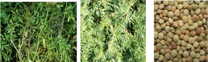

# Area in India

<!-- p. 41 -->

# 1. Origin

<!-- p. 41 -->

- o Egypt is its origin. It is grown in Spain, Pakistan, Bangladesh and Syria

- o Broadly classified as microsperma and macrosperma

# Lecture 06

<!-- p. 41 -->

# LENTIL Lens culinaris

<!-- p. 41 -->

| State     |   Area |   Production |   t/ha |
|-----------|--------|--------------|--------|
| UP        |   0.55 |         0.45 |   0.81 |
| MP        |   0.49 |         0.24 |   0.48 |
| Bihar     |   0.17 |         0.10 |   0.58 |
| WB        |   0.05 |         0.04 |   0.84 |
| Rajasthan |   0.01 |         0.03 |   1.01 |
| All India |   1.34 |         0.88 |   0.66 |

# 2. Climate

<!-- p. 42 -->

As the crop requires very cool climate it is cultivated in winter season. It can tolerate severe winter and frost condition also.

-  Soil

-  The suitable soil types are alluvial are black cotton soils.

-  Varieties

-  Pusa-1, Pusa-4, Pusa-6, Pusa-206, Pant-209, T-36, B-77, Pant L-639.

-  Cultivation practises

-  Lentil is grown as second crop after rice. The seeds are also sown broadcast in standing rice crop without any field preparation.

-  Seeds and sowing

-  The seeds are sown in lines at 20 -30 am apart using 30 -50kg seed/ha.

-  Fertilizer management

-  The crop may be grown on residual fertility. Application of 15 kg N and 40 kg P2o5 per hectare gives better yield.

-  Water management

-  If there is no winter rain one or two light irrigation at flowering and grain filling stages are given.

-  Yield

-  The crop produces 8 - 9 quintals/ha under rainfed and 18-20 quintals/ha under irrigated condition with god fertilizer management.

-  Microsperma are predominantly cultivated in India

-  Macrosperma are large sized grains cultivated in Mediterranean region

- o To mention some varieties in India

-  Pant L 406, 639, Pant L 4

-  DPL 15 and DPL 62

- Centre of origin of Lentil is ___________

- America

- S. Africa

- Mediterranean region

- The inflorescence in lentil is ________

- Raceme

- Spikelets

- Panicle

- The recommended seed rate for lentil is _________kg/ha

- 8-10

- 75-100

- 30-40

- Lentil crop needs

a. Cool & dry climateb. Warm & humidc. Dry & hot climate

5. The row to row spacing by pora method of sowing of lentil is_______cm

- 30

- 10

- 50

6. The row to row spacing for late sowing of lentil is_______cm

- 50

- 20

- 30

- Lentil contains about _______% protein

- 20

- 25

- 10

- Weed in lentil can be controlled by applying

- 2,4-D

- Fluchloralin

- both

9. The insect pod borer is commonly found on

- Wheat

- Lentil

- Maize

- Lentil belongs to family

- Leguminoceae

- Linaceae

- Tiliaceae

*****☺*****

- o Matar in Hindi

- o Third important cool season crop next to chickpea and French bean

- o Cultivated in about 6.51 million ha world wide with 10.95 million t annually

- o Distributed in Asia, Africa, Europe, N.America, & Auastralia

- o Usually cultivated for dry pods and variety of snacks

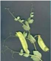

# World area production and productivity of Fieldpea

<!-- p. 44 -->

| Country            |   Million ha |   Million t |   T / ha |
|--------------------|--------------|-------------|----------|
| Europe             |         3.28 |        6.77 |     2.06 |
| France             |         0.53 |        2.57 |     4.84 |
| Russian Federation |         1.18 |        1.00 |     0.85 |
| Asia               |         1.58 |        1.87 |     1.19 |
| China              |         0.70 |        1.15 |     1.64 |
| India              |         0.62 |        0.56 |     0.91 |
| N C America        |         0.72 |        1.40 |     1.96 |
| Canada             |         0.63 |        1.26 |     2.00 |
| Australia          |         0.31 |        0.38 |     1.24 |
| South America      |         0.12 |        0.10 |     0.82 |
| World              |         6.52 |       10.95 |     1.68 |

# Lecture 07

<!-- p. 44 -->

# FIELDPEA Pisum sativum

<!-- p. 44 -->

# Indian scene of Fieldpea

<!-- p. 45 -->

| State     |   Million ha |   Million t |   T / ha |
|-----------|--------------|-------------|----------|
| UP        |         0.41 |        0.54 |     1.32 |
| MP        |         0.19 |        0.08 |     0.41 |
| Assam     |         0.03 |        0.02 |     0.61 |
| Rajasthan |         0.01 |        0.02 |     2.19 |
| All India |         0.73 |        0.72 |     0.95 |

#  Origin

<!-- p. 45 -->

- o Mediterranean region of Europe & West Asia

- o Before 3000 BC

#  Plant

<!-- p. 45 -->

- o There are two varieties

-  Gardenpea : P. sativum var. hortense

-  Filedpea : P. sativum var. arvense

- o Annual herbaceous well developed tap root system plant

#  Plant - gardenpea

<!-- p. 45 -->

- o Flowers auxiliary, long peduncle, raceme with 1-2 flowers

- o Pods are variable length and breadth, curved/ straight

#  Plant - Fieldpea

<!-- p. 45 -->

- o Flowers are purple or lavender colored

- o Short peduncle

- o Seeds smaller than garden pea, angular

- o Rachna, Pant Marter 5, HUP 2, DMR 11

- o Crop duration 110-140days

- o Seed weighs 160 - 240mg

- o All types of soil

- o Poor to fertile

- o Well drained soil is more suitable since sensitive to salinity and alkalinity

- o On heavy soils rough seed bed is suitable

- o Medium tillage is sufficient

#  Seed treatment

<!-- p. 46 -->

- o For seed borne pests and diseases

- o Rhizobium for nodulation

- o NW Plains - end of October

- o NE Plains - Second fortnight of November

-  Soil moisture availability decides the time

-  Delay in sowing end with terminal drought

- o Depends up on the size of the seeds & spacing

- o 50-60 kg for small seeded and 80-90 kg for bold seeded

#  Method of sowing

<!-- p. 46 -->

- o Broadcasting and planking

- o Drilling manually

- o Seed drill sowing

#  Depth of sowing

<!-- p. 46 -->

- o Since all cool season pulses are hypogeal can be planted deep depending on the moisture

| Ecosystem   | Planting time   |   N |   P2O5 |   K2O |   S |
|-------------|-----------------|-----|--------|-------|-----|
| Rainfed     | Normal          |  20 |     40 |     0 |  20 |
| Irrigated   | Normal          |  40 |     40 |    20 |  20 |
|             | Late            |  40 |     40 |    20 |  20 |

-  Crops are sown in residual soil moisture

-  They may face terminal drought

-  One or two supplemental irrigation is needed

-  May be moisture conservation practices

-  All methods to be employed

-  Herbicides can also be as per kharif pulses

-  Cropping systems

-  Cereal - legume is always good

-  They also under mixed community with winter cereals like wheat and barley

-  Harvest

-  Over ripening leads to great loss of yield

-  Staggered harvesting is one way

-  Cut entire plant and carry with moisture & then dry and thrash, clean

-  Store the seeds at 8-10% moisture

- Pea is commonly known as ___________

- Arhar

- Channa

- Matar

- Centre of origin of pea is ___________

- Mediterranean b.America

- W.bengal

- The inflorescence of pea is called __________

- Ear

- panicle

- Axilary raceme

- The recommended seed rate for pea is _____kg/ha

- 60-80 b. 75-100 c.40-50

- Pea crop needs ________

- Cold & dry climate b. Hot & humid

- dry & hot

- Pea should be treated with rhizobium inoculation of ________

- R. Japonicum b. R. leguminosarum c. R. glycine

- How much seed of Pea should be treated with one packet of rhizobium culture

- 5 kg

- 10 kg

c. 15 kg

- What is the ideal temperature for germination for pea

- 15-200c

- 22-250c

- 25-300c

- Maximum area under pea cultivation in India is in

- M.P

- U.P

- Bihar

- Higher yield of pea could be achieved by

- Use of higher dose of phosphate

- Adequate amount of N

- No nitrogen application

*****☺*****

# Area

<!-- p. 49 -->

-  It is extensively cultivated in 5 major continents

-  Brazil is the leading country

-  In India it is only a minor pulse

- o Cultivated in hills during Kharif

- o Small areas in northern plain during rabi

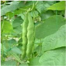

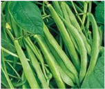

#  Origin

<!-- p. 49 -->

- o Highlands of middle America and Andes

- o Cultivated over a period of 7000-8000 years

- o Varieties in India are : PDR 14, HUR 15, VL 63

- o Duration 110-120 days, seed weight around 400mg

- o All types of soil

- o Poor to fertile

# Lecture 08 FRENCH BEAN Phaseolus vulgaris

<!-- p. 49 -->

-  Rajmash, kidney bean, common bean etc.,

-  In India

- o the fresh pods for vegetable is called as faras and dried pulse as rajmash

- o More fleshy tender pods of round types with less string are for vegetables compared to flat pods

- o Dried seeds are highly nutritious

- o Well drained soil is more suitable since sensitive to salinity and alkalinity

- o As for other pulses except rice-fallows

- o Medium tillage is sufficient

#  Seed treatment

<!-- p. 50 -->

- o For seed borne pests and diseases

- o Rhizobium for nodulation

- o NW Plains - end of October

- o NE Plains - Second fortnight of November

-  Soil moisture availability decides the time

-  Delay in sowing end with terminal drought

- o Depends up on the size of the seeds & spacing

- o French bean : 120-140 kg (350-450mg)

#  Method of sowing

<!-- p. 50 -->

- o Broadcasting and planking

- o Drilling manually

- o Seed drill sowing

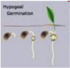

#  Depth of sowing

<!-- p. 51 -->

- o Since all cool season pulses are hypogeal can be planted deep depending on the moisture

| Ecosystem   |   N |   P2O5 |   K2O |   S |
|-------------|-----|--------|-------|-----|
| Irrigated   | 100 |     60 |    20 |  20 |

-  One or two supplemental irrigation is needed

-  All methods to be employed

-  Herbicides can also be as per kharif pulses

#  Cropping systems

<!-- p. 51 -->

-  Cereal - legume is always good

-  Cereals in Kharif

-  They also under mixed community with winter cereals like wheat & barley

-  Over ripening leads to great loss of yield in French bean

-  Staggered harvesting is one way

-  Cut entire plant and carry with moisture & then dry, thrash and clean

-  Store the seeds at 8 -10 % moisture

#  Harvest

<!-- p. 51 -->

- Common name of French bean in Hindi ___________

- Navy bean

- Kidney bean

- Rajmash

- Protein content in dried French bean seeds ________

- 18%

- 25%

- 23%

- French bean belongs to the family ________

- Tiliaceae

- Leguminoceae

- Papilionaceae

- Recommended seed rate for French bean is _____kg/ha

- 120

- 150

- 60

- Fertilizer recommendation for French bean is _____kg/ha NPK

- 100:60:20

- 100:20:0

- 150:50:50

*****☺*****

# Lecture 09

<!-- p. 53 -->

Area, production, productivity and importance and byproducts utilization of oilseeds (groundnut, sesame,

rapeseed and mustard, sunflower, safflower, castor, niger and linseed)

# Edible Oil Scenario in India

<!-- p. 53 -->

vIndia is the fourth largest oilseed producing country in the world, next only to USA, China and Brazil, harvesting about 25 million tons of oilseeds against the world production of 250 million tons per annum. Since 1995, Indian share in world production of oilseeds has been around 10 percent. Although, India is a major producer of oilseeds, per capita oil consumption in India is only 10.6 kg/annum which is low compared to 12.5 kg/annum in China, 20.8 kg/annum in Japan, 21.3 kg/annum in Brazil and 48.0 kg/annum in USA. Many varieties of oilseeds along with tree origin oilseeds are cultivated in India. Among these, the major oilseeds are Soybean, Cottonseed, Groundnut, Sunflower, Rapeseed, Sesame seed, Copra, Linseed, Castor seed and Palm Kernels. India occupies the place of pride as the world's largest producer of Groundnuts, Sesame seeds, Linseeds and Castor seeds. In India, oilseeds are grown in an area of nearly 27 million hectares across the length and breadth of the country. Depending on the period of cultivation, the oilseeds are classified as 'Kharif Crop' and 'Rabi Crop'. The Kharif Crop that is dependent on the Monsoon is harvested around October-November each year. On the other hand, the Rabi Crop is harvested around March-April each year.

The major oilseeds of India are groundnut, rape seed mustard, linseed, sesame and castor. Groundnut and rape seed mustard account about 85 percent of the total production of oilseeds in the country. In other words, groundnut among the major oilseeds is accounted as about two third, mustard seed one fourth of linseed and sesame five percent of castor, and three percent of total production. Soybean, sunflower, safflower, cotton seed and coconut are the other important oilseeds produced in India.

Rapidly increasing population and changes in dietary habits associated with urbanization increased demands for food and fuel. Non-true oilseed crops like cotton, maize, etc. are contributing up to 73% towards the national edible oil production in the country, while conventional oilseeds (rapeseed & mustard) rank second and contribute about 18-20% in the domestic edible oil production (GOP, 2006-07). Edible oil seed crops are classified as conventional (rapeseed, mustard, sesame, groundnut), non-conventional (sunflower, safflower, soybean) and non-true oilseeds (cotton, maize and rice bran). Non-true oilseed crops are contributing upto 70% towards the national edible oil production in the country whereas the nonconventional oilseed crops share about 6% in the local oil production (GOP, 2006-07).

# IMPORTANCE AND BYPRODUCTS UTILIZATION OF OILSEEDS

<!-- p. 54 -->

# Groundnut

<!-- p. 54 -->

-  Groundnut and its products have wide variety of uses as roasted nuts and proteinaceous products.

-  Groundnut oil and butter are good cooking material.

-  By products like cakes and meals are animal feed components contains 40-50% protein, 6-12% fat and traces of vitamins.

-  Groundnut milk acts as supplementary source to cattle milk.

-  Variety of biscuits and cookies are also prepared from groundnut.

# Sesame

<!-- p. 54 -->

-  Sesame oil is used to repel insect

-  Oil is good substitute for olive oil in salads, pickles and in cooking.

-  Oil is used in manufacture of soaps, paints as lubricants and illuminants

-  Sesame seed fried and cooked used in soups.

# Rapeseed and Mustard

<!-- p. 54 -->

Rapeseed and mustard play an important role in oil seed production, as they are the major group of winter oilseed crops and contribute upto 18% of the domestic edible oil production. Due to the presence of higher erucic acid and glucosinolates, rapeseed and mustard oil is not regular cooking oil. Glucosinolates are sulfur containing compounds that occur pre-dominantly in brassica spp. These substances can lower rapeseed cake palatability and thus produce a range of nutritional disorders in farm livestock.

Oilseed rape (Brassica napus L.) has become one of the most important oil crops and at present, is the third largest source of vegetable oil all over the world. Conventional rapeseed and mustard varieties impose health concerns due to the presence of erucic acid in oil and glucosinolate in meal. Canola has the advantage over other vegetable oils because it contains lowest content of saturated fatty acids and moderate content of poly-unsaturated fatty acids. Canola oil is low in erucic acid (<2% in oil), glucosinolates (<20 micromoles per gram in meal) and has a lower level of saturated fats (only 6%) than any other vegetable oil. It has a high proportion of un-saturated fats containing a favorable mix of both mono and poly-unsaturated fatty acids, which makes it favorite cooking oil.

# Sunflower

<!-- p. 54 -->

Sunflower is a robust oilseed crop, the seeds of which contain about 20% protein in addition to 40-50%, oil which has a mild taste, pleasant flavour, good keeping quality with acceptable amounts of vitamins A, D and E. Hulls obtained during decortication of sunflower have high fibre content and can be used as a roughage in certain animal feeds. Alternately, they can be used to produce heat by burning, as they yield the same amount at heat as lignite coal.

# Safflower

<!-- p. 55 -->

Large scale cultivation of safflower, containing 35 to 45 percent oil, has started about 25 years ago in India. Traditionally known as source of dye in ancient India, the safflower has attained considerable importance as an oliseed crop. It is cultivated in many states of India and numerous races of this crop are under cultivation, varying markebly in botanical features and in oil and dye contents. It is highly branched, herbaceous, thistle like annual, the spinous variety of which is valuable particularly for oil production. Unfortunately, being a crop identified for edible oil. The oil content in seeds is the most important product. The cake obtained from decorticated seeds (40% protein) is used for cattle feed while that obtained from undecorticated seeds is used for manurial purposes (20-22% protein). The cake does not get rancid, if stored in dry condition. Its application as manure greatly improves the physical properties of heavy soils. The

seed and cakes are used as poultry feed. Safflower flour also contains lignin glycosides which import a bitter flavour and has cathartic activity. These can be eliminated or reduced to a low level in the preparation of concentrates.

# Castor oil

<!-- p. 55 -->

- o Purgative as medicinally as cathartic & obstetrics

- o Skin ointment

- o Soothing agent to eye applied after removal of foreign bodies

- o As resins

-  Surface coating to household articles, furniture, refrigerators

-  Base materials for several paints, enamels & varnishes of super quality

- o Manufacture of leathers, adhesives, synthetic perfumes & flavors

- o Variety of rubber goods, hair oils

- o Clear bright colors in dying fabrics

-  For soaking raw skins in fur trade

# Niger

<!-- p. 55 -->

Niger is one of the minor oilseed crops in India grown on hill slopes and marginal lands mostly in tribal areas. Niger gives good cooking oil with nutty taste and pleasant odour which can also be used in cosmetics and perfume industry and for lubrication. Niger contains 85% poly unsaturated fatty acid mostly comprising of linoleic and oleic acid. Hence it is good edible oil. The edible oil is pale yellow in colour. Niger oil is used without any refining. Niger contains 37 to 43% oil. It is good cooking oil. After extraction of soil, the oilcake contains 24 to 34% protein and 8 to 24% crude fibres.

# Linseed

<!-- p. 55 -->

- o It is primarily considered for fibre - FLAX

- o In India primarily for oil seed

- o Entire plant has usage

- o Oil

-  80% for industrial purpose

-  Very small scale for direct consumption

-  Rich in Linolenic acid (66%)

-  Perfect drying oil, used in paint & varnish industry

-  Used for manufacture of lithographic inks and soaps and coating of high ways

-  After hydrogenation, substitute for tallow (hard fat from animals)

- o Oil cake good for milch animal & as manure

- o Stem yield good quality fibre (linen) having strength and durability

- o Fibres are lustrous and blend well with wool, silk, cotton

- o Strong canvas, suiting, shirting and various indispensable products for defense purposes

- o Woody matter for high quality paper

- India stands _______position in oilseed production in the world

- 5

- 6

- 4

- Edible conventional oil seed crops are ________

- Ground nut b. Sunflower c. Safflower

- Non-conventional oil seed crops are __________

- Groundnut

- Mustard c. Soybean

- Winter oilseed crop _____

- Groundnut

- Sunflower c. Rape seed

- ________is known as source of dye in ancient India

- Safflower

- b.Sunflower c. Linseed

- Linolenic acid content in Linseed

- 66%

- 56%

- 46%

*****☺*****

# Lecture10

<!-- p. 58 -->

# RAPESEED-MUSTARD Brassicas sp.

<!-- p. 58 -->

Brassicas are grown next to peanut in India. Rapeseed-mustard is a common name to three Genera :

- o Brassica

- o Eruca

- o Sinapsis

- o Brassica is more important

# Rape seed and mustard field

<!-- p. 58 -->

# Importance of Brassicas in India

<!-- p. 58 -->

- o It is main Rabi season crop in India

- o Green tender plant is used as vegetable

- o Whole seed is for preparing pickles and flavoring vegetables and curries

- o Oil for cooking, frying and pickles

- o Oil is also used for vegetable ghee, hair oil, soap, lubricating oil, and tanning industries

- o Seed & oil have peculiar pungency

- o Due to presence of glucose sinigrin

- o Oil cake is a cattle feed to be fed at smaller quantity Canola

- o It is a trade name to rapeseed oils which possess

- o <2% erusic acid

- o Solid components should contain

-  <30 micromoles /g of glucosinolates

- o May be Canadian oil like -Mazola‖ (maize oil - Corn oil), -Sanola‖ sunflower oil ( again brand name for PUFA content)

- o Of late refers to ‗generic' but

- o Those rapeseed varieties metingabove the specification

(Erusic acid causes heart lesions and

Glucosinolates cause thyroid enlargement)

# Brassicas grown in India

<!-- p. 59 -->

| Taxonomic name     | Common name                | Hindi          | Oil Content   |
|--------------------|----------------------------|----------------|---------------|
| B. Campestris      | Turnip rape                | Brown sarson   | Kali sarson   |
| Var. brown sarson  | Brown sarson               | Kali sarson    | 43%           |
| Var. yellow sarson | Yellow sarson              | Peeli sarson   | 45%           |
| Var. toria         | Indian rape                | Toria          | 35%           |
| B. napus           | Swede, summer, winter rape | Gobhi sarson   | Oilseed       |
| B. Juncea          | Indian mustard Mustard     | Rai, Raya Laha | 35%           |
| B. toumefortii     | Wild mustard               | Jungli rai     | 18%           |
| B. carinata        | Ethiopian mustard          | Karan rai      | Oilseed       |
| B. nigra           | Black mustrad              | Banarsi rai    | 29% Condiment |
| B.Oleratea         |                            |                | Vegetables    |
| Eruca sativa       | Rocket                     | Taramira       | 28%           |

# Rapeseed vs. Mustard

<!-- p. 59 -->

| Character         | Rapeseed (Sarson/Toria/Lahi)         | Mustard (Rai, Raya, Laha)       |
|-------------------|--------------------------------------|---------------------------------|
| Plant height (cm) | 45 - 150                             | 90-200                          |
| Leaves            | Sessile, leaf lamina claps the stalk | Leaves stalked but do not clasp |
| Siliquae (pod)    | Short or thicker                     | Long & slender                  |
| Pollination       | Cross pollinated                     | Self pollinated                 |
| Seed coat         | Smooth                               | Rough                           |

# Brown sarson vs. Yellow sarson

<!-- p. 59 -->

| Character      | Brown sarson                               | Yellow sarson             |
|----------------|--------------------------------------------|---------------------------|
| Leaves         | Pale, thin                                 | Dark green and fleshy     |
| Branching      | Erect, spreading                           | Erect                     |
| Siliquae (pod) | Thin, narrow                               | Thick and broad           |
| Seed coat      | Dark brown to reddish brown & mucilaginous | Yellow & non mucilaginous |

# Types of Mustard varieties

<!-- p. 60 -->

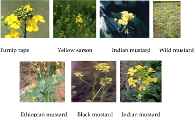

*Turnip rape Yellow sarson Indian mustard Wild mustard Ethiopian mustard Black mustard Indian mustard*

-  Rai - China

-  Toria - East Afghanistan

-  Brown sarson - E. Afghanistan & adjoining Indian sub-continent

-  Yellow sarson - N.E. India

Rapeseed: Area cultivated in the world (1997) - (Million ha &amp; million t)

| Country   |   Area |   Production |   Productivity |
|-----------|--------|--------------|----------------|
| India     |   7.28 |         8.13 |           1.12 |
| China     |   6.74 |        12.65 |           1.88 |
| Canada    |   5.32 |         9.11 |           1.71 |
| France    |   1.41 |         4.14 |           2.95 |
| Germany   |   1.43 |         5.34 |           3.73 |
| World     |  27.80 |        48.97 |           1.76 |

(FAOSTAT, 2006)

# Rapeseed-Mustard - Indian Scenario

<!-- p. 61 -->

| State     |   Area ( '000 ha) |   Production ( '000 t) |   Productivity (kg/ha) |
|-----------|-------------------|------------------------|------------------------|
| Rajasthan |            3665.3 |                 4416.9 |                   1205 |
| UP        |             790.2 |                  907.8 |                   1149 |
| Gujarat   |               338 |                    456 |                   1349 |
| Haryana   |               709 |                    792 |                   1117 |
| MP        |             809.4 |                  847.5 |                   1047 |
| WB        |             421.5 |                    383 |                    909 |
| Assam     |             212.5 |                     97 |                    456 |
| Punjab    |                49 |                     54 |                   1102 |
| India     |            7276.5 |                 8131.2 |                   1117 |

(Ministry of Agriculture, Govt. of India, 2005-06)

# Brassicas Area in India

<!-- p. 61 -->

- o Till independence area remained constant (2.0million ha)

- o From 50's area rose steadily

- o Due to increase in irrigated area

- o Increased productivity, varieties and agronomic practices

- o Maximum area was in 6.87 million ha -96-97

- o Major states growing are

- o Rajasthan, UP, Gujarat, Haryana, MP, WB, Assam & Punjab

- o A crop of temperate

- o Can be in higher elevation of tropics

- o Rabi season crop in India,

- o Sep-Oct to Mar-Apr

- o Temperature range 3 to 40°C

- o Optimum 18-25°C with cool, dry clear weather

- o High RF, high humidity, cloudy atmosphere at flowering undesirable

- o Most susceptible to frost

# Season

<!-- p. 62 -->

- o Sowing starts from August ends in November

- o Sowing of rapeseed is ahead of mustard

- o Taramira is sown from mid-Sep to Oct end

- o Region wise season varies

- o Mustrad

- o Varuna (T 59), TM 2, TM 4, Seetha

- o Brown sarson

- o KNS 3, KOS 1

- o Yellow sarson

- o PUSA GOLD, YS 93

- o Toria

- o Jawahar Toria, Panchali, TS 29

- o Taramira

- o RTM 13, TMC 1

-  Varying soil from sandy loam to clay

-  Thrives well in light soil

-  Mustard on any soil but rapeseed in light

-  Well drained soil is more suitable

-  Waterlogging should not be

-  Saline alkaline soils are unsuitable

-  pH 6.5 to 7.5, neutral soil is ideal

# Land preparation

<!-- p. 62 -->

-  Fine seed bed since seeds are small

-  Flat bed to perform ferti cum seed drill

# Seed rate & spacing

<!-- p. 62 -->

-  4-6 kg depending upon seed weight

- o 3-5 g/1000 depending upon crop and variety

-  30 x 10 to 30 x 15cm

- o 22.2 to 33.3 plants m-2

# Sowing

<!-- p. 63 -->

-  Treat the seeds with fungicides well before sowing

-  May be behind the country plough

-  Ferti cum seed drill

-  Depth of sowing 3-4cm

-  Avoid shallow sowing

-  Cover the seeds after sowing

-  Sowing may be on conserved soil moisture

-  Oil seed crops removes huge nutrients

-  S is removed in large and needs return

-  General recommendation varies to States

-  60-40-40 for irrigated

- o Half N 30 DAS

- o If SSP is applied S is taken care, if not

- o 20-40kg elemental sulphur, if soil analyzed with <10ppm

-  30-20-20 for rainfed (half of irrigated)

- o All basal

-  Nutrient requirement may be calculated by critical concentration

- o 6.07 - 6.62% N in top 2-3rd leaf at 60 DAS

- o 0.408 - 0.412% S in 4-5th leaf from top

-  Integration with biofertlizer ‗Azotobactor' is desirable

-  Total water requirement - 400mm

-  Moisture at pre-flowering and pod filling stage is critical

- o Two irrigations for mustard

-  One at rosette stage (20-30DAS)

-  Another at siliqua atage (50-60DAS)

- o In light soils three irrigations, the third at 90DAS

-  IW/CPE ratio of 0.6 is optimum

# Weed management

<!-- p. 64 -->

- o Dominant weeds

- o Chenpodium album

- o C. murale

- o Convolvulus arvensis

- o Melitotus alba

- o Intercultural operation 5-10days after 1st irrigation

- o Hand hoeing is desirable, it aerates the soil

- o Soil aeration is to conserve soil moisture

- o Herbicides can also be used

- o Pendimethalin pre-emergence 0.5-1.5 kg/ha based on soil

- o Fluchloralin 1.25kg pre-plant incorporation

- o Post emergence Isoproturan 0.75 kg /ha for

-  Wheat+mustard mixed systems

# Harvesting maturity

<!-- p. 64 -->

-  Color of leaves, stem and silique turn green to pale yellow

-  Lower silique looks - dried appearance

-  Upper may be green

-  Seeds in the silique makes rattling sound

- o Silique with 2 carpels and a false septum

- o During over maturity the two carpels split and seeds shed

- o Premature harvest leads to shriveled grains

- o After sun drying for few hours

- o Beating pods along with the plants

-  Either manually

-  Machine

-  Walking bullocks, or running tractor

- o Cleaning and drying to 8-10% moisture for storage

# Threshing

<!-- p. 64 -->

# o Average yield

<!-- p. 65 -->

|  Irrigated rapeseed   | 1.5 to 2.0 t   |
|------------------------|----------------|
|  Rainfed rapeseed     | 1.0 to 1.5t    |
|  Irrigated mustard    | 2.0 to 2.5     |
|  Rainfed mustard      | 1.5 to 2.0t    |

- o Fallow / millets / pulses - mustard

- o Rice - rapeseed

- o Intercroppings

-  Mustard + chickpea

-  Mustard + sugarcane

-  Mustard + barley / wheat / chickpea

-  Potato + mustard

1. Total production of rapeseed-mustard in the world is _________m tonnes

- 25.15

- 35.15

- c.45.15

2. Total production of rapeseed-mustard in India is _________m tonnes

- 8.15

- 6.96

- c.9.15

3. The peculiar pungency of rapeseed-mustard is due to the presence of _____

- erusic acid

- sinigrin

- Glucosinolates

- Oil content of Brassica juncea is ______

- 45 %

- 43 %

- 35 %

5. Oil content of Brassica campestris Var.yellow sarson is ______

- 45 %

- 43 %

- 35 %

- Oil content of Brassica campestris Var.brown sarson is ______

- 45 %

- 43 %

- 35 %

7. Seed rate of rapeseed-mustard is _______ kg/ha

- 6 - 8

- 4 - 6

- 2 - 4

8. Spacing recommended for rapeseed-mustard is _______

- 35 x 15 - 20 cm

- 30 x 15 - 20 cm c. 30 x 10 - 15 cm

9. Fertilizer dose for irrigated rapeseed-mustard is _______ kg NPK /ha

- 60-40-40

- 30-20-20

- 40-20-20

- Fertilizer dose for rainfed rapeseed-mustard is _______ kg NPK /ha

- 60-40-40

- 30-20-20

- 40-20-20

11. Rate of sulphur recommended for rapeseed-mustard is _______ kg /ha

- 10-20

- 20-40

- 30-40

*****☺*****

# Origin & spread

<!-- p. 67 -->

-  Probably from South - West America

-  Sunflower was introduced into Europe in 16th century

-  Reached Europe from Mexico via Spain

-  It was ornamental

-  Reached Russia via Holland in 18th century

-  First commercial production for oil -1830-40

# Sunflower world scenario in 1999 (Million ha & million t)

<!-- p. 67 -->

| Country            |   Area |   Production |   Productivity |
|--------------------|--------|--------------|----------------|
| Russian Federation |   5.94 |         6.75 |           1.14 |
| Argentina          |   2.19 |         3.80 |           1.73 |
| Ukraine            |   3.92 |         5.32 |           1.36 |
| India              |   2.13 |         1.12 |           0.53 |
| USA                |   0.71 |         0.96 |           1.36 |
| Romania            |   0.98 |         1.53 |           1.55 |
| China              |   1.03 |         1.82 |           1.77 |
| World              |  23.70 |        31.33 |           1.32 |

# Lecture 11

<!-- p. 67 -->

# SUNFLOWER Helianthus annuus

<!-- p. 67 -->

# IMPORTANCE OF SUNFLOWER OIL

<!-- p. 67 -->

-  Among the vegetable oils most suitable to coronary system

-  High level of linoleic acid and absence of linolenic acid

-  PUFA (Polyunsaturated fatty acid) - Linoleic content is more (67%) and about 90% unsaturated (+monounsaturated 21%)

-  Major ingredient in margarine and shortening products

(FAOSTAT, 2006)

# Indian Scenario of sunflower

<!-- p. 68 -->

| State      |   Area ( '000 ha) |   Production ( '000 t) |   Productivity (kg/ha) |
|------------|-------------------|------------------------|------------------------|
| Karnataka  |              1427 |                    787 |                    552 |
| Maharastra |               355 |                    206 |                    580 |
| AP         |               444 |                    298 |                    671 |
| Punjab     |              17.8 |                   28.7 |                   1612 |
| Bihar      |              22.6 |                   26.4 |                   1345 |
| UP         |              12.6 |                   16.1 |                   1278 |
| TN         |              17.1 |                   21.2 |                   1240 |
| India      |            2339.6 |                   1439 |                    615 |

# (Ministry of Agriculture, Govt. of India, 2005-06) Favourable features for growth of sunflower in India

<!-- p. 68 -->

-  Wide adaptability

-  Photoperiod insensitiveness

-  Shorter duration (60-100 days)

-  High quality edible oil (PUFA)

-  High seed multiplication ratio (>1: 80)

-  Easier & cheaper cultivation

-  Remunerative market price

-  Suitable for mechanization

# Stages of Sunflower

<!-- p. 68 -->

elpo

horvost

moeturo

7

Stcgos of cevelopmont

Jo

13

1

45

55

65

70

75

125

Gemmhatlon

mont

# Erect, tall usually un-branched

<!-- p. 69 -->

-  Plant height, head size, days to flowering & maturity are all vary due to environment

-  Root - tap root - but thick root mat with short tap root is common

- o May be problem in light soil to heavy mass - lodging

- o Limitations in the exploitation of soil moisture & nutrients

- o Earthing-up interferes with roots

- o Irrigation frequency should be short to meet the demand

- o Waterlogging adversely affects the crop due to weakening of anchorage and proliferation of fungal diseases

#  The stem

<!-- p. 69 -->

- o Mostly unbranched

- o Branching is not desirable

-  Basal branching may be useful

-  Leaf axil branching problem

-  N triggers branching

- o Green stem contributes for photosynthesis

- o Ht varies

-  80-120 short can accomododate more plants

-  120-150 medium

-  150-180 tall

#  The leaf

<!-- p. 69 -->

- o Varies with plant type and environment

- o Limited to number of nodes

- o 8 to as many as 70

- o Arranged alternate at right angle

-  The inflorescence

- o Capitulum borne terminally

- o Surrounded by one or more whorls of bracts called involucre (modified leaves)

- o Head diameter is yield deciding factor

-  Anthesis and fertilization

- o Flowering from periphery

- o Outermost opens first

- o Daily 1-5 rows continues up to 5-10 days

-  The seed

- o Seed is called ‗achene'

- o Seed size 7-25mm long, 4-13m long,3 -7.5mm thick

- o Dormancy normally 10-45 days

- o Oil content 36-37%

- o 1000 seed weight 43-45g

# The climate

<!-- p. 70 -->

Temp range 8-34°C

Optimum 20 & 25°C

Requires cooler (15-20°C) growing period and warmer maturing period (20-25°C)

Base minimum is 10°C

High temp (>38°C) in post-anthesis inhibit quantity and quality of oil

Rainfall of 500mm, with 300 mm it can yield

Avoid flowering coincide continuous drizzle

-  Can be in wide range of soils

-  Any soil with good drainage is more important

-  Neutral to moderately alkaline soils

-  pH ranges 6.5 to 8.0

-  Complete failure in sandy soil with pH 4.6

CO1, CO2, CO 3, CO 4 Modern, K2, K1, BSH 1 EC 68415

# Hybrids have advantage than varieties

<!-- p. 70 -->

-  High yield potential

-  Uniform crop stand

-  More self-fertile, less problem of seed set

- o MSFH 1, BSH 1

# Seasons

<!-- p. 70 -->

Rainfed

June-July, Kharif in North

Oct-Nov

Irrigated

-  Dec - Jan

-  April - May

# Field preparation

<!-- p. 71 -->

-  Fine tilth

-  Apply FYM / Compost incorporate

-  Ridges and furrows

-  30 to 60cm according to variety

-  10 to 15 cm for short & medium stature

-  15 to 30 cm for tall (>120cm)

# Seed rate

<!-- p. 71 -->

-  @ 2 seeds per hole

-  Seed weight of 45g/1000

- o 30 x 10 30 kg

- o 30 x 15 20kg

- o 30 x 30 10kg

- o 60 x 30 5kg

# Seed treatment

<!-- p. 71 -->

-  Trichderma 4 g /kg

-  Azospirillum 600 g to one ha

-  Soaking the seeds

- o 2% ZnSO4 for 12hrs and

- o Shade drying for rainfed sowing is desirable

# Sowing

<!-- p. 71 -->

-  Well prepared deep, friable seedbed is more preferable

-  Depth of sowing 3-5cm

# Plant population

<!-- p. 72 -->

-  55,000 to 98,000 /ha almost same yield

-  If the head diameter is <10cm more population

-  If >20cm less population

# Thinning

<!-- p. 72 -->

-  Highly sensitive to intra-specific competition

# Nutrient management

<!-- p. 72 -->

-  Fast growing high oil yielding thus requires more nutrients

-  Low yield in India is attributed to poor fertile soil, cultivated in rainfed conditions

-  A crop yielding 2 t seed, 3.2t stover and 0..8t root uptakes

82 kg N, 13 kg P, 60 kg K, 9.4 kg S, 37 kg Ca and 21 kg Mg.

# State wise nutrient recommendation

<!-- p. 72 -->

- o TN 40-20-20

- o UP 80-60-40

- o AP - Rainfed 60-30-0

- Irrigated Hybrids 60-90-30; Variety 30-60-30

# Weed management

<!-- p. 72 -->

- o Fluchloralin / Pendimethalin

-  2.0kg as pre-mergence

-  High volume spray

- o Hoeing and weeding on 15th day & 30th day

- o Within three days irrigate the filed

# Water management

<!-- p. 72 -->

- o Immediately after sowing

- o 4-5 days later once

- o Interval of 7-8 days

- o Seeding, flowering and seed development stages are critical

# Seed setting and filling

<!-- p. 73 -->

- o Problem is seen with poor seed setting

- o This problem is more in warmer regions

- o In India seed filling under good management is only 75%

- o It will be as low as 10-20%

- o Reasons

-  Genetic

-  Environmental

-  Physiological

-  Availability of pollinators

# Maturity

<!-- p. 73 -->

Physiological maturity (30-40% seed moisture

When the back of the head turns green to lemon yellow

There will be 5-6 green leaves at this stage

Harvest maturity (10-12%)

Delay beyond harvest maturity severe yield loss

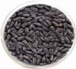

Sequential cropping

-  Southern India

-  Rainfed - Sunflower - millets/pulses

-  Irrigated- Rice - sunflower

-  North

-  Rainfed - SF - wheat / chickpea

- o Row intercrop

-  Groundnut + SF

-  Pigeanpea + SF

-  Castor + SF

-  Pulses + SF

- Origin of sunflower is _____

- India

- Argentina

- South west America

- Scientific name of sunflower is ______

- Helianthus annuus

- Carthamus tinctorious

- Sesamum indicum

- Total production of sunflower in the world is ____ m tonnes

- 22.27

- 28.48

- 33.23

- Total production of sunflower in India is ______ m tonnes

- 2.25

- b.1.25

- c.3.25

- Oil content of sunflower is _________

- 38-40 %

- 30-32 %

- 36-37 %

6. Nutrient recommendation for sunflower in Tamil Nadu is ________ kg NPK/ha

- 80:60:40

- 60:30:0

- c.40:20:20

- Saturated fatty acid content in sunflower is ________

- 12 %

- 15 %

- 10 %

- Mono unsaturated fatty acid content in sunflower is ________

- 16 %

- 15 %

- 10 %

*****☺*****

# Economic Importance

<!-- p. 75 -->

-  Rich in PUFA (78%) - to reduce blood cholesterols

-  Used for preparation of:

-  Margarine, and salad dressing

-  Varnishes, paints and surface coating materials

-  Oil (28-32%) is also used in:

-  Infant food and liquid nutrition formulations

-  Effective non-allergenic dispersant for injectable medicines

-  Charred oil is used to heal sores and rheumatism

-  For dye extraction -red dye

-  Cosmetics preparations

-  Petals reported to have effects on circulatory systems

-  Cake (30%)

-  Un decorticated cake as manure

-  Decorticated fed to ruminants and mono-gastric animals

-  Can be as human food, if bitter principles and phenolics are removed

-  Hulls (40%)can be used for manufacture of

-  cellulose, insulations, abrasions, hard boards and as fuel

-  Thinned young plants are used as vegetables

-  since contains carotene, riboflavin and vitamins

-  It is crop as border against animals

# Origin and distribution

<!-- p. 75 -->

- o Vavilow(1926): India, Afghanistan or Ethiopia

- o De Candole (1886): Arabia

- o Modern assessment:

-  Area encompassing S. USSR, W. Iran, Iraq, Syria, S. Turkey, Jordan and Israel

- o Distributed now:

-  Between 14° & 45° N and 15° & 35° S

-  Flowers

# Lecture 12

<!-- p. 75 -->

# SAFFLOWER Carthamus tinctorious

<!-- p. 75 -->

# World scenario -safflower (million ah & million t)

<!-- p. 76 -->

| Country   |   Area |   Production |   Productivity |
|-----------|--------|--------------|----------------|
| India     |   0.42 |         0.23 |           0.55 |
| Canada    |  0.002 |        0.002 |           1.00 |
| USA       |  0.086 |        0.087 |           1.02 |
| Ethiopia  |  0.009 |        0.006 |           0.67 |
| China     |  0.012 |         0.03 |           2.50 |
| Australia |  0.033 |        0.036 |           1.09 |
| World     |  0.822 |         0.58 |           0.71 |

# India Scenario - safflower

<!-- p. 76 -->

| State      |   Area ( '000 ha) |   Production ( '000 t) |   Productivity (kg/ha) |
|------------|-------------------|------------------------|------------------------|
| Maharastra |               263 |                    159 |                    605 |
| Karnataka  |                81 |                     60 |                    741 |
| AP         |                17 |                     80 |                    471 |
| Orissa     |               1.3 |                    0.8 |                    615 |
| MP         |               1.0 |                    0.3 |                    300 |
| India      |             364.6 |                  228.6 |                    627 |

(Ministry of Agriculture, Govt. of India, 2005-06)

-  A day neutral plant

-  But short day can prolong rosette stage

-  Temp is more important than day length

- o Thermo-sensitive

-  Extremes of cold and heat not suitable

- o Tolerance to low temp at vegetative

- o But susceptible to high temp during flowering

- o For germination 15°C

- o Vegetative : 20-21°C

- o Flowering: 24 to 32°C

(FAOSTAT, 2006)

-  Rainfall at flowering affects pollination

-  Excessive humidity at any stage affects

-  More suitable for rabi season in India

# The Plant

<!-- p. 77 -->

-  Highly branched, herbaceous

-  Annual height varying from 30-150cm

-  Well defined fleshy tap root system

-  Stem is stiff cylindrical fairly thick at base and thin at top

-  Central stem branches at 15-20cm to secondary

-  Each branch terminates in a flower head

-  The angle of branching is varietals but can be by environment also

-  The leaf deeply serrated on lower stem, short, stiff, ovate at the inflorescence

-  The inflorescence - numerous florets

-  Flower color may vary from whitish yellow to red-orange

-  The capitula, head size may vary from 1.25 to 4.0 cm

-  The fruit achene, resembles small slightly rectangular sunflower seeds

-  Seed weighs 250 - 800mg/grain

# Soils

<!-- p. 77 -->

-  Fertile, fairly deep and well-drained

-  pH range of 5-8

-  Shallow soils irrespective of fertility seldom produces high yield

-  In traditional belts it is black cotton soil

-  On heavy soils

- o This crop follows early Kharif crops

- o Or may often single crop in Rabi

-  It is considered as salt tolerant next to cotton

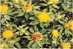

-  Tolerant to Na salts but < to Ca & Mg

-  Salinity reduces seed size and oil content

# Seeds and sowing

<!-- p. 78 -->

-  K1 120 days, CO 1 125 days

-  Bhima (33% oil) - Maharastra

-  JSF 1 (30%) - Rajasthan & MP

-  Manjira - AP

-  Nira - (30%) Maharastra & TN

-  HUS 305 (35%) for Peninsular India

# Seed rate

<!-- p. 78 -->

-  7-20 kg depending upon spacing and variety

-  45 x 15 cm in TN

-  45 x 20 cm

-  60 x 30 cm etc

# Seed treatment

<!-- p. 78 -->

-  Pre-sowing seed hardening

-  Use fresh seeds every year

# Sowing

<!-- p. 78 -->

-  From last week of Sep to end of Oct

-  Early sowing has advantage

-  Line sowing using improved seed drill

-  Ferti cum seed drill is more desirable

-  Seeds can be sown behind the plough also

-  Small furrow may be opened and seeds dropped and half coved

-  Depth of sowing may be 5-7.5cm

-  Light planking for the soils which looses moisture

# Nutrient management

<!-- p. 79 -->

# Rainfed crops

<!-- p. 79 -->

-  N ranges from 25 kg N to 50 kg

-  P2O5 - 20 to 50 kg

-  K2O - Mostly not recommended

-  General: 40:20:0

# Irrigated

<!-- p. 79 -->

-  60:30:20 (Chatisgarh) to

-  75:75: 35 (Karnataka)

# Time of fertilizer application

<!-- p. 79 -->

-  Rainfed - basal - deep placed by ferti-cum seed drill

-  Irrigated 50% N+ full P & K as basal

-  Remaining half N at 5th week during 1st irrigation

# Water management

<!-- p. 79 -->

- o It is deep rooted xerophytic plant, can thrive under scarce soil moisture

- o One or two irrigations (25 & 75 DAS) is optimum

- o Sensitive to excess moisture at any stage

- o If the soil profile contains 250mm ASM

- o ET of the season is 250-300mm- no response to irrigation

- o Under irrigated condition the crop may be sown under Broad beds of 1.35 to 1.8m and furrow

- o To drain the excess water

- o Points to remember:

- o If one irrigation is possible , provide it at critical period

- o Avoid contact of above ground parts with irrigation water

# Weed management

<!-- p. 79 -->

- o Being wider spaced

- o critical periods for weed management extends up to end of rosette (25-50DAS)

- o Hand weeding and hoeing

- o at 20 and 35 DAS is good

- o Herbicides

- o PPI - Fluchloralin 0.75 to 1.0 kg

- o PE - Oxadiazone - 0.75 -1.0 kg or

- o PE - Pentimethalin - 0.75 kg

# Important intercultural operations

<!-- p. 80 -->

- o Thinning to single plant and filling the gap at the early stage (before 15DAS)

- o Nipping of central shoot to induce branching

- o Bird damage

- o By parrots at Isolated pockets

- o Cultivate in contiguous block

- o Bird scaring - morning and evening during

-  Seed filling to physiological maturity

- o Duration of the crop varies due to regions

- o 115-140 days

- o 120-125 days in TN

- o Gujarat & Orissa - 140-150days

- o In cooler regions 150-180days

- o Maturity

- o When the lower leaves and most of the bracteoles dry and brown

- o Harvest in the early hours

-  Shattering minimum

-  Spines relatively soft

- o Combine harvester is becoming popular now since

-  Manual harvesting, bundling, threshing are all becoming problematic

- o Duration of the crop varies due to regions

- o 115-140 days

- o 120-125 days in TN

- o Gujarat & Orissa - 140-150days

- o In cooler regions 150-180days

- o Maturity

- o When the lower leaves and most of the bracteoles dry and brown

- o Harvest in the early hours

-  Shattering minimum

-  Spines relatively soft

- o Combine harvester is becoming popular now since

-  Manual harvesting, bundling, threshing are all becoming problematic

- o Yield

- o In improved agro-techniques are used

-  Under scanty moisture - 800-1200kg/ha

-  Under favourable 1500-2000 kg

-  Under irrigated - 1800-2800kg/ha

- o Storage

- o 5% moisture, clean and dry

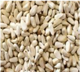

# Cropping system

<!-- p. 81 -->

- o It is potential crop to replace dry rabi crops

- o Wheat, coriander, linseed, chickpea, pulses

- o In traditional areas it is raised as intercrops

- o Sorghum, wheat, linseed, chickpea, coriander etc.

- o Sequence cropping

- o Farmers rarely raise more than one crop due to non availability of moisture

- o There is scope for double cropping either preceding with Kharif crop or after rabi by irrigation.

- Scientific name of safflower is ______

- Helianthus annuus

- Carthamus tinctorious c. Sesamum indicum

- Oil content of safflower is ______

- 24-28 %

- 26-28 %

- 28-32 %

3. Which of the following is used for dye extraction

- Sunflower

- Safflower

- Sesame

4. Total production of safflower in the world is _________ m tonnes

- 0.93

- 0.98

- 0.88

5. Total production of safflower in India is _________ m tonnes

- 0.70

- 0.43

- 0.67

6. Spacing followed for safflower in Tamil Nadu is______

- 40 x 20 cm

- 60 x 30 cm c. 45 x 15 cm

7. Seed rate for safflower varies from _______ to _______ kg/ha depending upon the variety and spacing

- 7 - 20

- 5 - 10

- 20 - 25

8. General fertilizer recommendation for rainfed safflower is ______ kg NPK /ha

- 60:30:20

- 40:20:0

- 75:75:35

9. Saturated fatty acid content in safflower is ________

- 12 %

- 15 %

- 10 %

10. Mono unsaturated fatty acid content in safflower is ________

- 12 %

- 15 %

- 14 %

*****☺*****

-  Origin - South western Asia

-  In India, it is grown in M.P., U.P., Maharashtra, Bihar, Rajasthan, Karnataka and West Bengal

-  Grown for fibre and oil extraction

#  Climate

<!-- p. 83 -->

- o Needs cooler climate

- o Temperature - 25 to 30º C during germination

- o 15 to 20º C during seed formation, but fibre requires still lower temperature

- o As a rainfed crop, grown in areas receiving 450-750mm of rainfall

o

- o Higher temp at this stage induces early flowering

- o Pearlmillet does not resist drought but cut shorts its life cycle and comes flowering early under adverse conditions

- o Rainfall during flowering & grain formation- poor grain setting

- o Rain at grain maturity - ergot disease due to high humidity & low temp.

- o Hence optimum time of sowing is very vital for this crop

- o Deep cotton soil of central India, alluvial loam soil of North India, soil must be well drained

#  Improved varieties

<!-- p. 83 -->

-  Neelam , K2, Himilini, Jawahar 17,18, Mukta, Chambal

-  Field preparation

- o Fine and smooth seed bed free from clods

- o Free of termites and ants

#  Sowing

<!-- p. 83 -->

- o Mid September to Mid October - rainfed crop

- o Mid October - Mid November

- o In U.P. Linseed is sown in standing rice crop as relay crop during September - October. This system of sowing is also called as paira or Utera cropping

- o 20-30 kg/ha for line sowing, 35-40 kg/ha for broad casting

- o Spacing - 20 to 30 cm of row spacing

# Lecture 13 LINSEED Linum usitatissimum L.

<!-- p. 83 -->

-  Irrigated - 30 to 40kg of N & P

-  Rainfed - 20 to 30 kg/ha of N & P

-  Relay cropping - 10 to 15 kg/ha of N

- o Weed free condition upto 25 DAS

- o 2 hand weedings at 21 DAS and after 35 to 40 DAS

#  Retting

<!-- p. 84 -->

- o It is a process of fibre extraction

- o Kinds of retting

-  Hot water, cold water, snow, dew retting

-  Temp decides duration of retting and quality

-  Standing warm water is more suitable than running cold water

-  Double retting is in practice in cold countries

-  Retting period is 4-6 days

- o After retting cleaned in running water, dried and ready for scutching

-  To separate the valuable fibers of (flax, for example) from the woody parts by beating

- o Rainfed areas in India water availability is problem hence they are not opting to fibre flax

#  Water management

<!-- p. 84 -->

- o Light irrigations at 35 DAS and 65 DAS

#  Harvesting

<!-- p. 84 -->

- o At red ripe stage for fibre crop

- o For grain and fibre at physiological maturity

- o Storage moisture - 10 to 12%

- o Oil content in seed - 36 to 42%

#  Grain yield

<!-- p. 84 -->

- o Irrigated

- to 1.2 t/ha

- 70% of the production of Linseed in India is in ___________

- M.P. & U.P

- Tamil Nadu

- Karnataka

- Soil type suitable for Linseed cultivation is ________

- Clay loam soils

- Loam soils

- Heavy soils

- The centre of origin of linseed is __________

- Africa

- America c. Mediterranean

- The inflorescence in linseed is ________

- Racemeb. Ear

- Cymose

5. Optimum temperature towards seed formation of linseed ranges between____

- 15-200c

- 20-220c c. 25-300c

- Optimum temperatures for proper germination of linseed is ________

- 20-220c

- 25-300c

- 150c

7. The recommended seed rate for line sowing of linseed is_________kg/ha

- 20

- 10

- 40

8. The recommended seed rate for sowing of linseed by broadcasting is_____ kg/ha

- 30-40

- 20-30

- 40-50

- Linseed is commonly known as ________ in western countries

- Fiber

- Flax

- Coir

- Linseed oil contains ________ % linolinic acid

- 50-60

- 20-30

- 40-50

- The linseed fruit is known as ________

- Caryopsis

- Head

- Capsule

- The linseed crop besides oil is grown for centuries for extraction of ________

- Fiber

- Dye

- Resins

13. Linseed seed normally contains protein and oil percent ________ respectively

- 40 & 20

- 20 & 40 c. 40 & 30

*****☺*****

# Lecture 14 Area, production, productivity and importance of Sugar crops and byproducts utilization (sugarcane and sugarbeet) in India and Tamil Nadu

<!-- p. 86 -->

Sugarcane is the second most important industrial crop in the country grown in over 4 million hectares. The growth of sugarcane agriculture in the country had been consistent during the past seven decades. There was increase in area, production, productivity and sugar recovery. During the period from 1930-31 to 2005-06, the area under sugarcane had gone up from 1.18 million ha to 4.24 million ha, productivity from 31 tonnes to 65.6 tonnes per hectare and total cane produced from 37 million tonnes to 323 million tonnes. Current sugar production in the country is about 20 million tonnes, while the domestic demand for sugar is about 19 million tonnes. Thus the domestic requirement for sugar is fully met by the industry, though our export share remains marginal.

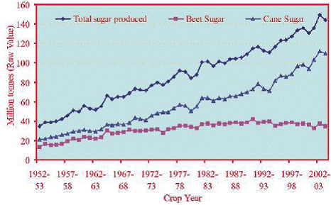

*Fig. 1. World sugar production*

Cane Sugat

140

120

80

60

1

40

20

1952-

1957 -

1962-

1967 -

1972-

1977 -

1982 -

1987 -

1992-

1997 -

2002-

53

58

63

68

73

78

88

93

98

03

Year

Crop

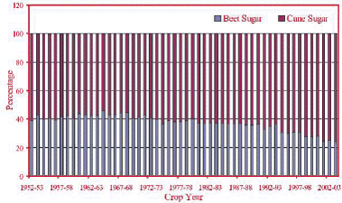

*Fig. 2. Percent contribution of cane and beet sugar to world production*

120

Caule

Ix

20

Year

Sugat

Crop

# Role of sugarcane in Indian economy

<!-- p. 87 -->

India is the fourth largest economy in the world, next to US, China and Japan. The contributions of the above four countries to the world GDP are US - 21.1%, China - 12.1%, Japan - 7% and India - 5.7%. Sugar industry is the second largest in the country after cotton textiles and contributes around 6% of the Agricultural GDP. Indian sugar industry contributes substantially to the rural economy as the sugar mills are located in rural areas and employ rural folk to a large extent. Sugar industry by-products viz., molasses and bagasse support other industries. Molasses is the cheapest feedstock for the distilleries. The bagasse has been accepted as a viable alternative raw material to wood in the paper and pulp industry. During the recent past, Government initiatives to encourage alternate renewable sources of energy have motivated most of the sugar mills to install cogeneration plants using bagasse as fuel with highpressure boilers, efficient condensers and waste heat recovery systems. The installed capacity of cogeneration plants is around 1500 MW and the potential has been estimated to be 5000 MW.

# Sugarbeet

<!-- p. 87 -->

# Economic Importance

<!-- p. 87 -->

Sugar : 45% world total sugar production

Bio- fuel : 10% Ethanol blending

Economics : Rs.10,000 crores foreign exchange saving / year

# Multiple uses of sugarcane based products / byproducts

<!-- p. 88 -->

|   S. No. | Product / byproduct   | Uses                                                                        |
|----------|-----------------------|-----------------------------------------------------------------------------|
|       1. | Sugar Gur Khandsari   | Domestic consumption Confectionaries Pharmaceuticals Biodegradable polymers |
|       2. | Molasses              | Industrial alcohol Cattle feed                                              |
|       3. | Bagasse               | Fuel Co generation of electricity Paper and paper boards                    |
|       4. | Bagasse ash(fly ash)  | Chemical Industry Special types of glasses                                  |
|       5. | Cane trash            | Manure Fodder                                                               |
|       6. | Press mud             | Manure Wax industry                                                         |
|       7. | Cane tops             | Fodder                                                                      |
|       8. | Stubbles              | Fuel in rural ovens                                                         |

- Sugarcane is the _______most important industrial crop in the country India

- First

- Third

- Second

- In India, the productivity of sugarcane is highest in the state

- Punjab

- Karnataka c. None

- The most cultivated sugar crop of the world is __________

- Sorghum

- Sugarbeet

- Sugarcane

- Sugarcane seed sets essentially have _____buds

- 1

- 2

- 3

- Molasses is used for _____ preparation.

- Alcohol

- Fuel

- Fertilizer

*****☺*****

# Introduction

<!-- p. 90 -->

Sugarcane is an industrial crop with acreage of about 4 million hectares and production to the tune of 300 million tonnes in India. It provides employment to over a million people directly or indirectly besides contributing significantly to the national exchequer. In commercial agriculture, the cane is subjected to various weather conditions and stresses. In Indian subtropics erratic availability of moisture and frequent occurrence of red rot disease severely impair the productivity of cane. Sugarcane is an industrial crop with acreage of about 4 million hectares and production to the tune of 300 million tonnes in India. It provides employment to over a million people directly or indirectly besides contributing significantly to the national exchequer. In commercial agriculture, cane is subjected to various weather conditions and stresses. In the Indian subtropics erratic availability of moisture and frequent occurrence of red rot disease severely impair the productivity of cane.

-  62% world's sugar is met from cane

-  Sugar requirement is projected at 150 million tonnes for the world

-  India alone requires 16-20 million t

-  Sugar industry is the largest agro-based industry next only to textiles in India

-  At present there are 450 sugar factories

-  Average productivity is 14.2 million t (1998)

-  Average sugar recovery of 11%

# By products in sugarcane industry

<!-- p. 90 -->

-  There are many end uses - probably more than 150

-  But many of them are of negligible economic interest

-  38 end-products are potentially important

-  But four main byproducts of the sugarcane are:

# Lecture 15 Saccharum officinarum

<!-- p. 90 -->

- o Cane tops

- o Bagasse

- o Filter mud / press mud and Spent Wash

- o Molasses

#  Cane tops

<!-- p. 91 -->

- o Cane tops have no real market value

- o They can be compared to fair quality fodder with an average feed value,

- o when fresh, of about 2.8 MJ of metabolizable energy per kilo of dry matter.

- o However cane tops should be collected and transported from the cane fields to the feedlot

#  Bagasse

<!-- p. 91 -->

- o It is the fibrous residue of the cane stalk left after crushing and extraction of the juice

-  It consists of fibres, water and relatively small quantities of soluble solids - mostly sugar

- o Utilizations are:

-  Electricity

-  Particle board

-  Paper

-  Furfural

-  It is a colorless, inflammable, volatile, aromatic liquid

-  25 tonnes of bagasse to produce 1 tonne of furfural

-  Furfural has many industrial uses:

-  Selective solvent for the refining of lubricating oils

-  As an intermediate in the production of nylon and resins

-  Methane

#  Filter mud / pressmud

<!-- p. 92 -->

- o The precipitated impurities contained in the cane juice, after removal by filtration, form a cake of varying moisture content called filter mud

- o This cake contains much of the colloidal organic matter anions that precipitate during clarification, as well as certain non-sugars included in these precipitates

#  Filter mud / pressmud

<!-- p. 92 -->

- o The use of filter mud

-  As animal feed has not proved economically rewarding, the main constraints being the magnitude of the drying process involved and the low digestibility of the dried scums

-  As soil nutrient there is limitations

-  Higher values of C.O.D. and B.O.D .

-  Wax percentage in substantial quantity which prevents microbial action

-  High concentration of various chemicals which are detrimental to survival of beneficial microflora

-  Bio-degradation being exothermic reaction survival of microbes except thermophiles is difficult

-  Due to above mentioned difficulties, bio-degradation of pressmud and spent wash is a difficult process

#  Molasses

<!-- p. 92 -->

- o Molasses is the final effluent obtained in the preparation of sugar by repeated crystallization

- o It is the residual syrup from which no crystalline sucrose can be obtained by simple means

- o The yield of molasses is approximately 3.0 percent per tonne of cane

-  but it is influenced by a number of factors (2.2 to 3.7 percent)

-  The specific gravity varies between 1.39 and 1.49, with 1.43 as indicative average

- o The composition of molasses varies but, on average, would be as follows:

-  Water 20%

-  Other carbohydrates 4%

-  Sucrose 35%

-  Nitrogenous compounds 4.5%

-  Fructose 9%

-  Non-nitrogenous acids 5%

-  Glucose 7%

-  Ash 12%

-  Other reducing sugars 3%

- o For distillery industry

- o Alcohol and related products

- o Export to some developed countries as raw materials

- o It is an ingredient to animals feed

-  India is considered as native to thin cane

-  Tropical thick canes from larger islands of Oceana with New Guinea as possible nucleus

- o Brandes (1956) - three different movements

-  Introduction to Solomon islands - 8000 BC

-  Westerly direction to Indonesia and Philippines - 6000 BC

-  Fiji, Tonga, Samoa, the Cook islands & Hawaii - 600-1100 AD

# World Scenario (Area, production, productivity, in million ha, tonne and t/ha)

<!-- p. 93 -->

| Country   |   Area |   Production |   Productivity |
|-----------|--------|--------------|----------------|
| Brazil    |   6.15 |        455.3 |           74.0 |
| India     |   4.20 |        281.2 |           66.9 |
| China     |   1.22 |        100.7 |           82.5 |
| Pak       |   0.91 |         44.7 |           49.2 |
| Asia      |   8.81 |        569.8 |           64.7 |
| America   |   9.48 |        688.3 |           72.6 |
| Africa    |   1.62 |         92.5 |           57.1 |
| World     |   20.4 |       1392.4 |           68.3 |

# Indian Scenario (Area, production, productivity)

<!-- p. 94 -->

(Ministry of Agriculture, Govt. of India, 2005-06)

| State      |   Area ( '000 ha) |   Production ( '000 t) |   Productivity (t/ha) |
|------------|-------------------|------------------------|-----------------------|
| UP         |            2155.8 |               125469.9 |                  58.2 |
| Maharastra |               501 |                  38853 |                  77.6 |
| TN         |             335.4 |                35106.5 |                   105 |
| Karnataka  |               219 |                  18267 |                  83.4 |
| AP         |               230 |                  17656 |                  76.8 |
| Punjab     |                84 |                   4860 |                  57.9 |
| Gujarat    |               197 |                  14580 |                    74 |
| Haryana    |               127 |                   8180 |                  64.4 |
| Bihar      |             101.3 |                 4337.9 |                  42.8 |
| MP         |              55.5 |                   2425 |                  43.7 |
| India      |            4201.1 |               281171.8 |                  66.9 |

# Species of sugarcane

<!-- p. 94 -->

-  Cultivated

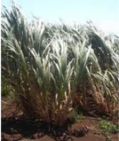

*Saccharum officinarum*

# Wild species

<!-- p. 95 -->

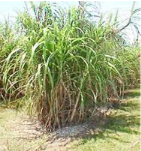

*o S. spontaneum S. barberi*

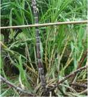

*S. sinense*

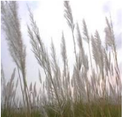

# The plant

<!-- p. 96 -->

-  Grass family with tillering capacity

-  Above ground parts are

- o Stem of stalk with nodes and internodes

- o Leaves

- o Inflorescence

#  Roots

<!-- p. 96 -->

- o Sett roots developed from root primordial

- o Shoot root , thicker branched

- o Buttress roots, fibrous branched

-  After the introduction of hybridization programme in early 20th century many improved varieties are available

-  Varieties for region and season are available in plenty

-  SBI, Coimbatore in collaboration with NARS has set up breeding programme

-  Breeders of NARS will visit and at a specified period and carry materials

# Seasons

<!-- p. 96 -->

-  There are four main seasons in TN

- o Early - Dec-Jan

- o Mid-season - Feb-Mar

- o Late - Apr - may

- o Special season - June-July

-  All India

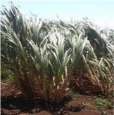

*S. robustum*

- o Spring - Feb-Mar

-  Suru in Maharastra, Eksali in Gujarat & AP

- o Autumn - Sep-Oct-

-  13-15 months, supplies sugar for early crushing

- o Adsali - July Aug

-  16-18 months

-  Increase in yield & sugar recovery

-  Though advantageous area is declining due to water problem

- o Late planting - beyond March, reduction in duration and yield

# Soils

<!-- p. 97 -->

-  Cultivated in wide range of soils

-  Moderately heavy medium deep (1-2m) loams are better than

- o Heavier and shallow soils

-  The soil must be of good depth and drainage

-  No salt and compaction

# Seed bed

<!-- p. 97 -->

-  Preparation of good seed bed is essential

- o Since the same field is retained for 2-3 years

- o Deep ploughing / sub-soiling is needed

#  Field Layout

<!-- p. 97 -->

- o In India - by adopting two systems viz.,

-  Ridge and furrows system

-  Flat system.

- o There are some special systems

-  Trench system

-  Deep Trench system

-  Paired - row system

-  Ring or pit system etc.

# Planting materials

<!-- p. 97 -->

-  Vegetative propagation

- o Known as seed pieces or setts

- o Buds on sugarcane germinate and give plants

- o Planting materials may be

-  Single bud sett or Chip bud

-  Two budded setts

-  Three budded

-  Seedlings raised from nursery

-  Seedlings raised by poly bags or

-  Tissue cultured seedlings

- o For sett planting

-  Sugarcane setts are prepared from nursery cane

-  Nursery cane is younger than (6-8 months) juice cane

# Ideal cane sett

<!-- p. 98 -->

-  Ultimate plant stand and yield depends on the type of seed material used. The characteristics of good seed cane material are

- o Free from disease and pest infestation

- o Age of seed crop is around eight months

- o Setts should have healthy buds without any damage in handling and transport

- o Buds with higher moisture content, adequate nutrients, higher amount of reducing sugars

- o Cane should be free from aerial roots and splits

- o Pure in quality

# Preparation of setts

<!-- p. 98 -->

-  Use of sharp knife to cut setts

-  Treat the setts immediately with fungicide solution

-  Machine cutting and mechanical planting is also followed in developed counties

-  Seed rates & spacing

-  Depends up on the spacing

-  Spacing varies due to

- o Climate

- o Method of establishment

-  In TN

- o 50,000 three budded setts

- o 75,000 two budded setts

- o 187,500 single budded setts

-  Row spacing may vary

- o 0.9m to 1.5m and 2.4m

# Method of planting Flat Planting

<!-- p. 99 -->

-  In this method, shallow (8-10 cm deep) furrows are opened with a local plough or cultivator at a distance of 75 to 90 cm

-  There should be adequate moisture in the field at the time of planting

-  The setts are planted in them end to end

-  Furrows are covered with 5-7 cm soil

-  In most parts of northern India and some tracts of Maharastra, cane is planted by this method

# Furrow Planting

<!-- p. 99 -->

-  In this method furrows are made with a sugarcane ridger about 10-15 cm deep in northern India and about 20 cm in south India

-  Setts are planted end to end

-  The furrows are covered with 5-6 cm soil, leaving upper portion of furrows unfilled

-  Immediately after covering the setts water is let into furrows

-  This method is practiced in parts of eastern UP and in Peninsular India, particularly in heavy soils

# Trench Method

<!-- p. 100 -->

-  In some coastal areas as well as in other areas where the crop grows very tall and the strong winds during rainy season cause lodging of cane, trench method is adopted to save the crop from lodging

-  Trenches at a distance of 75-90 cm are dug with the help of ridger or by manual labour

-  Trenches should be about 20-25 cm deep

-  Fertilizers (NPK) are spread uniformly in the trenches and mixed thoroughly in the soil

-  The setts are planted end to end in trenches

-  The tractor-drawn sugarcane planter is a very suitable device for planting cane in trenches

# Modified trench system

<!-- p. 100 -->

-  Ridges and furrows are opened at 120 cm using a tractor drawn ridger

-  The furrow bottom is widened

-  As the crop grows while each manuring, only slight earthing up is done so that a trough is maintained through the crop growth

- o Here irrigation is given in the cane row itself

-  The system has been found highly useful under :

- o Saline water irrigated and saline soil conditions

- o The salts are leached down from the root zone

- o Higher cane yield compared to conventional ridges and furrows

- o FYM or pressmud application and trash mulching in this system can further improve cane yield

# Special methods of establishment

<!-- p. 100 -->

Single bud direct planting

-  In this system single bud setts are planted directly in the field in the furrows at 30-45 cm spacing

-  This method is highly economical and sowing of seed material.

-  The buds should be healthy

# Transplanting technique (STP technique)

<!-- p. 100 -->

-  Seedlings are raised in a nursery bed using single bud setts.

-  About 6 weeks old seedlings are transplanted

-  Advantages by adopting this system are

- o Saving in the seed cost

-  Only about 2-3 t/ha against the normal 8-10 tonnes/ha.

- o Synchronous tillering leading to uniformly maturity

- o Sufficient time availability to prepare the main field

- o Saving of 2-3 irrigations

- o Possibility of increased cane yield

- o Better weed management

- o Efficient fertilizer management

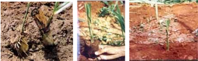

# Partha" method

<!-- p. 101 -->

-  A technique developed by Mr. S.V. Parthasaradhy an eminent sugarcane scientist.

-  Suggested for water logged or excess soil moisture conditions (coastal Andhra Pradesh and Tamil Nadu during N-E monsoon period)

-  In this method

- o three eye budded setts are planted in a slanting position, 60° to the vertical, in the wet furrow or half-way on the ridges

- o Usually one eye bud is thrust into the soil and the remaining two will be above, which will sprout

- o Once the monsoon recedes, the in situ sprouted setts are pressed down into the soil and made to lie horizontally

- o Soil is put to the base

- o At this stage, the crop is manured

Paired row double side planting system

-  Drippers at 75 cm spacing 12 mm laterals with a lateral spacing of 195 cm

Tractor drawn sugar cane planter Pit method /Ring pit method

A new method of sugarcane cultivation is called pit method or ring pit method, which is cost-effective and at the same time helps farmers get a higher yield is slowly catching on. Several farm trials have proved that by adopting this method, the yield can be increased to two or three times compared to the normal rowto-row planting technique. In the pit method, the crops are raised in pits at the spacing of 180 cm between rows and 150 cm between individual pits in a row. The pits are dug using specially designed tractor drawn power tillers.

The pits are then filled with top soil, 5 kg of farmyard manure (FYM), 100 gms gypsum and 125 gms super phosphate and watered well before planting. About 16 double budded or 32 single budded setts were used for planting. The setts were collected from the eight-month-old plants and were treated with 0.1 per cent carbendazim for 10 minutes before planting. About 60,000 double budded setts were required for planting in one hectare. The pits were irrigated daily for an hour through drip fertigation. Detrashing was done on fifth month after planting and the plants were tied without lodging by dried leaves.

The growth of the crop was vigorous and they matured at the eighth month after planting. Due to the equal spacing maintained on all the sides the plants grew steadily and the nutrition supplied through drip fertigation reduced the crop duration. The continuous supply of nutrition and spacing induces the early physiological maturity that was the major benefit. All the shoots are of the same age, so there is uniform growth and sugar accumulation in the canes. Sufficient space between the clumps and row to row allows sufficient light and air circulation, which is important for good growth of the crop.

The most important factor was that the sugarcane setts were placed at a depth, which were always moist, hence, in case of drought, or non-availability of water the yield was not affected. Under the conventional system, farmers in Tamil Nadu are at present harvesting about 130 tonnes a hectare Ring pit method

# Measures to obtain higher germination

<!-- p. 103 -->

-  Using disease free healthy setts

-  Careful preparation of setts without damaging the buds or setts

-  Planting freshly prepared and treated

-  Trash mulching under

- o moisture stress and hot weather and late planted conditions

-  Seed treatment using a fungicide

# Manures for Sugarcane

<!-- p. 103 -->

-  Apply FYM / Compost during field preparation

-  Inorganic fertilizers:

- o For Coastal and flow irrigated areas

-  N & K applied in three equal quantities at

-  30, 60 and 90 DAG

-  N may be coated with neem cake @20%

- o For Lift irrigated areas

- o For Jaggery producing areas

-  175 : 112.5: 60 N: P2O5: K2O kg /ha

-  For those soils deficient in …

-  Foliar application and drip fertigation can

- o Reduce N dose

- o Increase cane yield

- o Save ground water pollution by fertilizers

-  Azospirillum application can enhance the growth

-  Band placement of fertilizer is another method by which losses can be minimized

-  270 : 112.5: 60 N: P2O5: K2O kg /ha

-  225 : 112.5: 60 N: P2O5: K2O kg /ha

- o In iron : 100 kg ferrous sulphate /ha

- o In Zinc : 37.5 kg Zinc sulphate

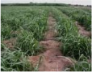

-  To support and sustain a vigorous nursery crop, irrigating at optimum levels in important

-  Any shortage in the irrigation would lead to reduced sett yield

-  Moisture stress would pre-dispose the crop to the attack of some pests and diseases

-  Irrigation at IW/CPE ratio of 1.0 is ideal

- o According to moisture depletion irrigating at 25% depletion of available soil moisture (ASM) may be ideal

- o This in practical terms means:

-  Once in 6-7days in a loamy soil and

-  At around 10-12 days in heavy clay soil

# Weed control

<!-- p. 104 -->

-  A weed-free environment is absolutely essential

-  Deep ploughing and removal of perennial weeds

-  Pre-emergence application of

- o Atrazine 1.75kg or Oxyflurofen 0.75 lit/ha on 3-4 days of planting using knapsack sprayer

-  Post-emergence application of

- o Gramaxone 2.5 lit + 2-4,D Sodium salt 2.5 lit/ha as directed spray on 21 DAP

-  Hand weeding before each manuring

-  Other cultural operations and precautions

# Cultural operations

<!-- p. 104 -->

-  Important cultural operations in sugarcane in addition to weeding, manuring and irrigation are

- o Earthing up

- o Detrashing

- o Propping and

- o Flowering control

# Earthing-Up

<!-- p. 104 -->

-  This practice is followed where furrows are practiced

-  Earthing up are 2-3times during crop period.

- o The first earthing-up is known as "partial earthing-up and

-  To cover the fertilizers

-  To provide anchorage to root system

- o The second operation is "full earthing-up".

-  Full earthing-up is done after final manuring (90-120 days coinciding with peak tillering)

-  The soil from the ridge is thrown on both sides towards cane rows and the furrows will become as ridges and ridges as furrows

-  The furrows so formed are used for irrigation

# Wet earthing up

<!-- p. 105 -->

-  Done around 6months age of the crop

-  The furrows are irrigated and the wet soil from furrows is taken and plaster the ridges

- o It checks late tillering and watery shoots

-  Heavy earthing up is useful during floods

- o When the flood water recedes, the excess water from earthed-up soil drains out quickly thus providing aeration

# Hoeing

<!-- p. 105 -->

-  This operation is done where soil crust formation is very common

-  In sub tropics hoeing is done after germination is over using a bullock drawn or a tractor - drawn harrows

-  While carrying out this operation some of the germinated setts may be uprooted and they are pressed down manually

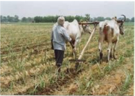

# Detrashing

<!-- p. 105 -->

-  On an average a stalk may produce30-35 leaves

-  All are not useful for effective photosynthesis

- o Only the top 8-10 leaves are sufficient

# Propping

<!-- p. 106 -->

-  Tying the canes by using the lower bottom leaves to check lodging of cane

-  Propping can be either done for each row or two rows can be brought together and tied

-  It is for:

- o Prevention the lodging

- o Extensively followed in coastal belt where cyclone effect is very severe

- o Lodging also very common in

-  Tall varieties

-  Top growth is heavy and where the growth habit is not erect, and

-  The varieties with less fibre content

- o Most of the bottom leaves are dried will not participate in photosynthesis

- o At the same time they drain out the food materials which otherwise could be used for stalk growth

-  Therefore it is important to remove the dry and lower leaves

-  This operation is known as detrashing

-  Detrashing helps in clean cultivation

-  Easy movement of air within the crop canopy

-  Reduce certain pests like scales mealy bugs, white fly etc.,

-  Easy entry into the field

-  Avoids bud germination due to accumulation of water in the leaf sheath

-  Easy to take up cultural operations including sprayings

-  Easy to harvest, obtaining clean canes for milling

-  Detrashed leaves can be used for

- o Mulching in the furrows or

- o Used for composting

- o Infested leaves with pest or disease may be burnt out

# Lodging leads to several problems

<!-- p. 107 -->

-  Cane breakage and thus loss of stalk number at harvest loss

-  Lodged canes are easily infested by certain pests and diseases

-  Damage by rats and rodents

-  Bud sprouting leads to reduced cane quality

-  Aerial root formation affects cane quality

-  difficult to irrigate and harvest the cup

# To prevent lodging

<!-- p. 107 -->

-  Heavy earthing up

-  Propping

-  Paired row planting with earthing up

-  Deep trench planting

-  Selection of varieties resist lodging

-  Raising wind breaks along the field borders

-  Application of potassium

# Removal of water shoots

<!-- p. 107 -->

-  Water shoots are late formed tillers or side shoots which are robust and fast growing.

-  They originate mainly due to excess water supply, heavy and late manuring, inadequate earthing up

-  These water shoots contain lot of water, low sucrose and more of reducing sugars

-  Water shoots affect the growth of adjacent stalks

-  They harbor insect pests and when they are milled sugar recoveries are low because of reduced juice quality

- o Therefore removal of water shoots whenever they appear

- o Water shoots can be used as cattle feed

# Control of flowering

<!-- p. 107 -->

-  In commercial sugarcane cultivation, flowering is not desirable

-  Once the plant flowered the cane growth stops and starts ripening

-  If not harvested immediately reversion of sugars, increase in fibre, pith formation, cane breakage etc.

-  The deterioration is much faster if it is summer

-  Solution

- o Non-flowering or shy flowering varieties can be used where flowering is a severe problem

- o Controlled irrigation

- o Change of planting period

- o Use of growth regulating substances

-  Spraying of ethrel at 500ppm, twice or 1000ppm once at floral initiation

# Ratoon Management

<!-- p. 108 -->

-  The crop raised from planting cane sett is called plant crop

-  After the harvest of plant crop stubble sprouts and gives rise to succeeding crop called as ratoon crop

-  The practice of taking up ratoon crop is called ‗ratooning'

# Ratooning ability

<!-- p. 108 -->

-  Is generic, based upon ability ratoon varieties are classified as:

- o Good or poor ratooner

- o Co 1148, Co 419, Co 740 are some examples for good ratooners

-  Ratooning has following advantages:

- o Reduction in the cost of field preparation, planting material, operation cost

- o Saving in field duration - ratoon matures earlier than plant crop

- o Ratoon may give equal yield that of plant crop

# Ratooning is common practice

<!-- p. 108 -->

-  Number ratoon varies

- o In Cuba 10-11 crops

- o South Africa & USA 4-6 crops

- o Hawaii, Brazil and Australia 2-3

- o In India ratoon yield is generally poor since

-  Very little attention to manure ratoon

-  30-40% area is under ratoon in India

-  The average productivity is low

# Ratoon management

<!-- p. 108 -->

-  Select variety suitable during plant crop

-  Plant crop should be harvested at right maturity

- o Delayed harvest to be avoided

-  Harvesting close to the ground with sharp cutting

- o Stubble shaving to 4-6cm is recommended if no uniform cut at harvest

-  Remove the trash but do not burn it

-  Irrigated the field properly

-  Shoulder breaking or off-barring to remove decayed stubbles

-  Gap filling with sprouted setts or seedlings

-  Ratoon is less efficient in N utilization hence 25% additional N from 5-7 days after ratooning is desirable

-  P & K should be judiciously

-  Spraying of FeSO4 @ 2.5kg/ha in 150 litres on 15th day if chlorotic symptom is noticed

- o If persists repeat twice at 15 days interval

- o In the last spray add 12.5kg urea

-  After cultivation practices to be done more effectively

-  Ratoon requires more plant protection

- o Grassy shoot disease, ratoon stunting

# Maturity and harvest

<!-- p. 109 -->

-  Ripening of sugarcane refers to rapid synthesis and storage of sucrose in the stalk

-  Accumulation of sugar in the stalk starts soon after completion of elongation phase

-  Glucose produced during photosynthesis is not utilized for conversion but stored as sucrose

-  When the concentration exceeds 16% in the juice and 85% purity the cane is said to be matured

-  As the crop advances in maturity:

- o Water content decreases

- o Sucrose content increases

- o Reducing sugars decreases

-  Both organic and inorganic non-sugars also decreases

- o At peak maturity sucrose content is at maximum and non-sugars at minimum

-  Assessing maturity

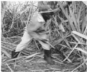

- o Use of hand refractometer - Brix reading

- o Assess the maturity by HR meter survey - 18-25% indicates optimum maturity

- o When the reading between top and bottom is 1:1 - is right time to harvest

-  If delayed

-  Sucrose content decreases

-  Non-sugars increases

-  Fibre content increases

-  Ripening is influenced by number of factors

- o Climate

- o Nutrition

- o Variety

-  Cool dry weather is the key factor

- o Bright sunshine

- o Day temp 28-30C

- o Night temp 12-14C

-  RTD (Relative temp disparity) decides

-  Ripeners

- o Spray Sodium metasilicate 4kg in 750 litres /ha 6 months after planting

- o Repeat at 8th & 10th months

-  and not at declining phase

- o Polaris and Ethrel are most extensively used in Hawaii

-  Polaris @ 5 kg in 600 l /ha

-  Intercropping

- o Since a slow grower during initial 2-3 months may be an intercrop raised

- o The crop should not affect cane yield

- o Marketability, ability and feasibility decides the short crops

- o Pulses, potato, onion etc are some

-  Sequential cropping - Rotations

- o After sugarcane 1 or 2 or 3 crops

-  Rice based cropping system for one year

-  Wheat based

-  Sugarcane-banana- rice based crop rotations

1. By product of sugarcane is _______

- Spentwash

- Bagasse c. Molasses d. all these

2. The fibrous residue of the cane stalk left after crushing and extraction of the juice is called _______

- Spentwash

- Bagasse c. Molasses d. all these

3. Bagasse is used for production of__________

- Electricity

- paper

- methane d. all these

4. The precipitated impurities contained in the cane juice, after removal by filtration is called _______

- Pressmud

- Bagasse c. Molasses d. all these

5. The final effluent obtained in the preparation of sugar by repeated crystallization is ________

- Pressmud

- Bagasse c. Molasses d. all these

6. The yield of molasses is approximately ________ % per tonne of sugarcane

- 5

- 7

- 3

- 10

7. Sucrose content of molasses is _______

- 45 %

b. 35 % c. 25 % d. 55 %

8. Glucose content of molasses is _______

- 5 %

- 7 %

- 10 % d. 12 %

9. Ash content of molasses is _______ <

- 12 %

- 7 %

- 10 % d. 15 %

10. Total world production of sugarcane is _______ m tonnes

- 1255

- 1155

- 1355

11. Total production of sugarcane in India is _______ m tones

- 275

- b .265

- 300

12. Productivity of sugarcane is high in which of the following state

- Maharastra

- Tamil Nadu

- Punjab

13. Average productivity of sugarcane in India is ______ t /ha

- 99

- 89

- 67

14. Cultivated species of sugarcane is ______

- S. spontaneum b. S. robustum

- S. officinarum

15. Wild species of sugarcane is ______

- S. barberi

- S. robustum c. S. officinarum

- Seed rate for two budded setts is ________ setts /ha

- 50,000

- 75,000

- 1,87,500

- Seed rate for three budded setts is ________ setts /ha

- 50,000

- 75,000

- 1,87,500

- Seed rate for single budded setts is ________ setts /ha

- 50,000

- 75,000

- 1,87,500

- Latest planting technique developed by TNAU in sugarcane is ______

- Furrow planting b. Trench method c. Pit method

- Fertilizer dose recommended for coastal and irrigated areas is _____ kg NPK/ha

a. 225 : 112.5 : 60 b. 270 : 112.5 : 60 c. 175 : 112.5 : 60

- Fertilizer dose recommended for lift irrigated areas is _____ kg NPK/ha

- 225 : 112.5 : 60 b. 270 : 112.5 : 60 c. 175 : 112.5 : 60

- Fertilizer dose recommended for jaggery producing areas is _____ kg NPK/ha

- 225 : 112.5 : 60 b. 270 : 112.5 : 60 c. 175 : 112.5 : 60

- Removal of dried and older leaves in sugarcane is called _______

- Mulching

- Propping

- Detrashing

- Tying the canes by using the lower bottom leaves is called _____

- Mulching

- Propping

- Detrashing

- The late formed tillers or side shoots which are robust and fast growing are called

- Sword suckers b. water shoots

- sprouts

- Flowering in sugarcane is called _______

- Arrowing

- Sprouting

- Tillering

- _________ % of brix reading indicates the maturity of sugarcane

- 16 - 18

- 18 - 25

- 25 - 27

- Ripening in sugarcane is enhanced by spraying _________

- Sodium metasilicate

- Polaris

- Ethrel d. all these are correct

*****☺*****

# Importance of sugarbeet

<!-- p. 113 -->

-  Tropical sugarbeet is a biennial sugar producing tuber crop, grown in temperate countries

-  This crop constitutes 30% of total world production and distributed in 45 countries.

-  Now tropical sugarbeet hybrids are gaining momentum in tropical and sub tropical countries including Tamil Nadu as a promising energy crop and alternative raw materials for the production of ethanol.

-  Apart from sugar production, the value added products like ethanol can also be extracted from sugarbeet.

-  The ethanol can be blended with petrol or diesel to the extent of 10% and used as bio-fuel.

-  The sugarbeet waste material viz., beet top used as green fodder, beet pulp used as cattle feed and filter cake from industry used as organic manure.

Tropical sugarbeet now emerged as commercial field crop because of the favourable characters like

-  tropical sugarbeet hybrids suitable for Tamil Nadu

-  Shorter duration of 5 to 6 months

-  needs moderate water requirement of 60-80 cm.(iv) higher sugar content of 12 - 15% (v) improve soil conditions because of tuber crop and

-  grow well in saline and alkali soil.

-  The harvesting period of sugarbeet coincides with March - June, the human resource of sugar factory in the off season may efficiently utilized for processing of sugarbeet in the sugar mills, which helps in continuous functioning of sugar mills.

# Hybrids and duration

<!-- p. 113 -->

The tropical sugarbeet hybrids suitable for cultivation in Tamil Nadu are

-  Cauvery,

-  Indus and

-  Shubhra.

# Lecture 16

<!-- p. 113 -->

# TROPICAL SUGARBEET Beta vulgaris spp. Vulgaris

<!-- p. 113 -->

-  The duration of these tropical hybrids will be 5 to 6 months depending on climatic conditions prevailing during crop growth period.

# Climate and season

<!-- p. 114 -->

-  Tropical sugarbeet require good sunshine during its growth period.

-  The crop does not prefer high rainfall as high soil moisture or continuous heavy rain may affect development of tuber and sugar synthesis.

-  Tropical sugarbeet can be sown in September- November coincide with North East monsoon with a rainfall of 300 - 350 mm well distributed across the growing period which favours vegetative growth and base for root enlargement.

-  The optimum temperature for germination is 20 - 250C,

-  for growth and development 30 - 350C and

-  For sugar accumulation in 25- 350C.

# Season

<!-- p. 114 -->

-  September to November and harvested during March and May.

# Field preparation

<!-- p. 114 -->

-  Well drained sandy loam and clayey loam soils having medium depth (45‖ cm) with fairly good organic status are suitable.

-  Tropical sugarbeet require deep ploughing (45 cm) and followed by 2 - 3 ploughing to obtain a good soil tilth condition for favorable seed germination.

-  Ridges and furrows are formed at 50 cm apart.

# Manures and Fertilizers

<!-- p. 114 -->

| Manures and Fertilizers                     | Basal Application                               | Top dressing                        |
|---------------------------------------------|-------------------------------------------------|-------------------------------------|
| Manures                                     | 12.5 tonnes /ha                                 | -                                   |
| Biofertilizers Azospirillum Phosphobacteria | 2 kg /acre (10 pockets) 2 kg /acre (10 pockets) | -                                   |
| Fertilizers Nitrogen Phosphorus Potassium   | 75kg /ha 75kg /ha 75kg /ha                      | 37.5 kg / ha each at 25 & 50 DAS -- |

# Seeds and sowing

<!-- p. 115 -->

-  Optimum population is 1,00,000-1,20,000 /ha.

-  Use only pellated seeds 1,20,000 Nos /ha which require 6 pockets (3.6kg / ha.-One pocket contains 20000 seeds (600 g)]

-  The recommended spacing is 50 x 20 cm.

-  The pellated seed is dibbled at 2 cm depth in the sides of ridges at 20 cm apart

# Weeding and Earthing up

<!-- p. 115 -->

-  The crops should be maintained weed free situation up to 75 days.

-  Pretilachlor 50 EC @ 0.5 kg /ha or Pendimethalin @3.75lit /ha can be dissolved in 300 litres of water and sprayed with hand operated sprayer on 0-2 day after sowing,

-  Followed by hand weeding on 25th day and 50th day after sowing.

-  The earthing up operations coincides with top dressing of N fertilizer.

-  Tropical sugarbeet is very sensitive to water stagnation in soil at all stages of crop growth

-  Irrigation should be based on soil type and climatic condition.

-  Pre-sowing irrigation is essential since at the time of sowing, sufficient soil moisture is must for proper irrigation.

-  First irrigation is crucial for the early establishment of the crop.

-  For loose textured sandy loam soil irrigation once in 5 to 7 days and for heavy textured clay loam soil once in 8 - 10 days is recommended.

-  The irrigation has to be stopped atleast 2 to 3 weeks before harvest.

-  At the time of harvest if the soil is too dry and hard it is necessary to give pre harvest irrigation for easy harvest. Light and frequent irrigation is recommended for maintaining optimum soil moisture

# Pest and diseases

<!-- p. 115 -->

-  Pests - Aphids, Tobacco caterpillar and Flea beetles

# Diseases

<!-- p. 115 -->

-  Root and crown rot, Cercospora leaf spot and Root knot nematode

# Integrated pest and disease management

<!-- p. 115 -->

-  Seed treatment with Pseudomonas fluorescens @ 10 g/kg of seed

-  Summer ploughing and exposing the field to sunlight

-  Crop rotation for 3 years with Marigold or gingelly or sunnhemp for root rot and nematode

-  Soil application of Trichoderma viride or Pseudomonas fluorescens @ 2.5 kg/ha mixed with 50 kg of FYM before planting

-  Sow castor as trap crop around and within fields to attract adult Spodoptera moth for egg laying

-  Set up light traps (1 mercury / 5 ha) for monitoring Spodoptera litura

-  Setting up pheromone -Pherodin SL @ 12/ha for Spodoptera litura

-  Removal and destruction of Spodoptera egg masses, early stage larvae formed in clusters

-  Hand picking and destruction of grown up Spodoptera caterpillar

# Need based

<!-- p. 116 -->

-  Spraying Spodoptera nuclear polyhedrosis virus at 1.5 x 1012 POB/ha

-  Spray NSKE 5% for aphids flea beetles and for early instar caterpillars

-  Use of poison bait pellets prepared with rice bran 12.5 kg, jaggery 1.25 kg, carbaryl 50% WP - 1.25 kg in 7.5 lit water for Spodoptera litura

-  Spray any one of the following insecticides using a high volume sprayer covering the foliage and soil surface

-  Chlorpyriphos 20 EC - 2 ml / lit,Dichlorvos 76 WSC - 1 ml/lit, Fenitrothion 50 EC - 1 ml/lit, Spray malathion 50 EC (2 ml/lit) for flea beetle and leaf webber, Spray Imidacloprid 200 SL (0.2 ml/lit) or methyl demeton 25 EC (2 ml/lit) or dimethoate 30 EC (2 ml/lit) for aphids

-  Applying neem cake @ 150 kg/ha for root rot

-  Foliar spray of Mancozeb 2.5 g / lit or Chlorothalonil 2 g / litre of water for Cercospora leaf spot

-  Neem cake @ 1 t/ha or carbofuran @ 33 kg/ha as spot application on 30 days after sowing for nematode management

# Harvest and yield

<!-- p. 116 -->

-  The Tropical sugarbeet crop matured in about 5 to 6 months. The yellowing of lower leaf whirls of matured plant, Nitrogen deficiency and root brix reading of 15 to 18% indicate the maturity of beet root for harvest.

-  The average root yield of tropical sugarbeet is 80 - 100 tonnes / ha.

-  Harvesting should be timed so as the roots reach the factory within 48 hours for processing.

-  Till such time the roots should not be harvested.

-  Apart from sugar, _______ can be extracted from sugarbeet

-  Methane

- Ethanol

- Dimethyl ether

-  Ethanol produced from sugarbeet can be blended with petrol or diesel to the extent of ______ as biofuel

-  12 %

- 10 %

- 15 %

-  Optimum seed rate for tropical sugarbeet is ______ kg/ha

-  5.6

- 3.0

- 3.6

-  Spacing recommended for sugarbeet is ______

-  50 x 20 cm b. 40 x 20 cm c. 50 x 10 cm

-  Fertilizer dose recommended for sugarbeet is ________ kg NPK /ha

-  100 : 75 : 75

- 100 : 100 : 100

- 75 : 75 : 75

-  ________ crop is used as trap crop to attract Spodoptera in sugarbeet

-  Gingelly

- Castor

- Marigold

-  _________ % of root brix reading indicates the maturity of sugarbeet

-  15 - 18 b. 18 - 25

- 25 - 27

-  Yield potential of sugarbeet is ________ tonnes/ha

-  100 -120 b. 80 - 100 c. 120 - 150

*****☺*****

# Lecture 17

<!-- p. 118 -->

# Area, production, productivity and importance of medicinal and aromatic crops in India

<!-- p. 118 -->

India has been considered as treasure house of valuable medicinal and aromatic plant species. Ministry of Environment and Forests have identified and documented over 9500 plant species considering their importance in the pharmaceutical industry. In the present context of ‗back to nature' in health care, it is relevant that these valuable plant species are not only preserved but also their cultivation developed in order to meet the entire demand of the domestic industries as also to exploit the bright prospect for export. Shift from collection to cultivation of medicinal & aromatic plants will also ensure purity, authenticity and sustainable supply of raw materials required for herbal drugs, including polyherbals.

Our foreign exchange earning potential from this group of plants is estimated to be over 3000 million US dollars per annum. Agro-techniques have been developed for large number of medicinal plants by the State Agricultural Universities. Due to unorganised marketing arrangements this sector has not exploited the full potential. A Medicinal Plants Board has been constituted in the Department of Indian Systems of Medicines & Homeopathy to address all the issues.

The diverse Agro-climatic situations in the Region offer excellent scope for growing different horticultural crops like fruits, vegetables, spices, plantation crops, medicinal and aromatic plants. Medicinal and aromatic plants constitute a major segment of the flora, which provides raw materials for use in the pharmaceuticals, cosmetics and drug industries. The indigenous systems of medicines, developed in India for centuries, make use of many medicinal herbs. These systems include Ayurveda, Siddha, Unani and many other indigenous practices.

More than 9,000 native plants have established and recorded curative properties and about 1500 species are known for their aroma and flavour. Even in many of the modern medicines, the basic composition is derived from medicinal plants and these have become acceptable medicines for many reasons that include easy availability, least side effects, low prices, environmental friendliness and lasting curative property.

India and China are the two major producing countries, having 40 per cent of the global biodiversity and availability of rare species. These are well known as the home of medicinal and aromatic crops that constitute a segment of the flora, and provide raw materials to the pharmaceutical, cosmetic, fragrance, flavour etc. industries.

India has one of the richest ethnobotanical traditions in the world with more than 7000 species of plants found in different agro-ecosystems and used by various indigenous systems of medicine and industries. Over 95% of the plants used by the herbal or pharmaceutical industry is collected from wild sources. Given the alarming rate of loss of biodiversity due to other well-known factors alongside the indiscriminate collection of wild medicinal plants, there is a real danger of extinction of many of our medicinal plant species. In the face of

serious threat to biodiversity, it is extremely important to take urgent steps to conserve and develop medicinal plant genetic resources alongside their cultural roots in all our diverse agro-ecosystems.

The aromatic and medicinal plants such as Patchauli, Stivia, Citronella, Cinnamon are also being grown in mild tropical areas i.e. plain and foot hills of the State. Temperate and alpine zones accommodate cultivation of geranium, texus, ginseng, saffron etc. Mizoram is well known for its exotic orchids and medicinal and aromatic plants.

# Area, Production and productivity of medicinal plants in Tamil Nadu (2007-08)

<!-- p. 119 -->

|   Area in lakh ha. |   Production in Lakh MT |   Productivity (MT/ha) |
|--------------------|-------------------------|------------------------|
|               0.09 |                    0.17 |                   2.01 |

# Status in India

<!-- p. 119 -->

The age old Indian systems of medicine have been neglected mainly because of the rapid expansion of the allelopathic system of medical treatment. This is despite the fact that our country has a long history of local health traditions, which are backed by thousands of scriptures left behind by practitioners of these systems of medicine. One of the earliest treatises of Indian medicine, the chakara samhita (1000 BC), mentions the use of 2000 vegetable herbs for medicinal use. Over 7000 different species of plants found in different ecosystems are said to be used for medicinal purposes in our country.

India has been a traditional exporter of medicinal plants for the past several decades and ranks as one of the foremost supplier of medicinal plants in the world.

- Area under medicinal plants in Tamil Nadu _______lakh ha.

- 0.11

- 0.05

- 0.09

- Production of medicinal plants in Tamil Nadu _______lakh MT.

- 0.15

- 0.25

- 0.17

- Productivity of medicinal plants in Tamil Nadu ______ MT/ha

- 4

- 5

- 2

- Major medicinal & aromatic crop producing countries are _____

- China & Africa b. India & America c. India & China

- Foremost supplier of medicinal plants in the world is ______

- India

- China

- Australia

*****☺*****

# Lecture 18 MENTHA (MINT)

<!-- p. 121 -->

English name: Mint

Family:

Lamiaceae; labiatae

Indian name:

Pudina (Tamil), Putiha (Sanskrit), Pudina (Hindi &

Kanada)

Species and Varieties :

Mentha arvensis (Japanese mint)

M.piperita L. (Peppermint)

M.Spicata L. (Spearmint) M.Citrata Ehrh. (Bergamot mint)

Himalaya, Kalka, Shivalik, Kosi, Gomati, EC-41911, Kulkrail, Kiran, MSS-1, MSS-5 Punjab

spearmint-1

Distribution:

Origin:

India, Brazil,Paraguay,USA

Mediterranean regions

Uses:

Cosmetics, Culinary purposes, Flavoring, Perfumery

Mints are a group of perennial herbaceous plants, belonging to the family Lamiaceae:Labiatae, which yield essential oil on distillation. The various species of mints which are commercially cultivated in different parts of the world are:Japanese mint or corn mint or field mint (Mentha arvensis subsp haplocalyx Briquet var.Piperscens Holmes var. Javanica), peppermint (M.Piperita L.) spearmint or garden mint or lamb mint (M.spicata L.) and bergamot mint or orange mint (M.citrata Ehrh.)

# Distribution

<!-- p. 121 -->

Mint is believed to have originated in the Mediterranean basin and, from there, spread to the rest of the world by both natural and artificial means. Among the mints, Japanese mint is cultivated on a large scale in Brazil, Paraguay, China, Argentina, Japan, Thailand, Angola and India. Peppermint is grown in the USA, Morocco, Argentina, Australia, France, USSR, Bulgaria, Czechoslovakia, Hungary, Italy, Switzerland and on a small scale in many Europe countries. USA is the major producer of peppermint and spearmint.

The total area under mint cultivation, which is mostly confined to Uttar Pradesh and the Punjab is around 10,000 ha.

# A) Japanese mint

<!-- p. 121 -->

Himalaya (MAS0-1): It is a selection released by the CIMAP Lucknow which contains 0.8 to 1.0% oil (FWB) with 81% methol content and a low congealing point.

Kalka (Hyb-77); It is a tall, vigorous variety evolved by the CIMAP Lucknow.

Shivalik: It was introduced from China and released by the CIMAP, Lucknow.

Ec-41911: This is a progeny selection of an interspecific cross between M.arvensis x M.piperita.

# B) Peppermint

<!-- p. 121 -->

Kukrail: This is a high yielding variety developed and released by the CIMAP Lucknow.

# C) Spearmint

<!-- p. 121 -->

MSS-1: This is a selection from the spearmint cultivars inteoduced from USA. This variety was released by the CIMAP, Lucknow.

MESS-5: It is a selection from MSS-1 made at the CIMAP,Lucknow.

Punjab spearmint-1: This variety is a clonal selection made at the CIMAP, Lucknow . Arka and Neera are the recently released variaties from CIMAP, Lucknow.

# Chemical Composition and Uses

<!-- p. 122 -->

# Japanese mint (M.arvensis)

<!-- p. 122 -->

Japanese mint is a primary source of menthol. The fresh leaves contain .4-6.0% oil. The main constituents of the oil are menthol (65-75%), menthone (7-10%) and menthyl acetate (12-15%) and terpenes (pipene, limonene and comphene).

# Peppermint (M.piperita)

<!-- p. 122 -->

The fresh herb contains essential oils ranging from 0.4 to 0.6%. The constituents of peppermint oil are almost similar to Japanese mint oil. However, the menthol content is lower in peppermint oil and varies between 3550%. The other constituents are menthyl acetate (14-15%), menthone (925%) menthoufuran and terpenes like pinene and limonene.

# Bergamot mint (M.citrate)

<!-- p. 122 -->

Linalool and linalyl acetate are the main constituents of Bergamot mint oil. The oil is used directly in perfumes. Cosmetic preparations like scents, soaps, after-shave lotions and colognes also contain this oil.

# Spearmint (M.spicata)

<!-- p. 122 -->

The principal constituent of spearmint oil is carvone (57.71%) and the other minor constituents are phellandrene, limonene,L-pinene and cinelole. The oil is used mostly as a flavouring in toothpastes and as food flavouring in pickles and spices, chewing gum and confectionery, soaps and sauces.

# Seasons

<!-- p. 122 -->

In the plains, planting is done during the winter months, whereas in temperate climates, planting is done in autumn or spring from the last week of December to the first week of March or from the first week of January to the third week of February. Late planting always gives poor yields.

Medium to fertile deep soil, rich in humus is ideal for the cultivation of mint. The soil should have a good water-holding capacity but water-logging should be avoided. A pH range of 6-7.5 is best.

Japanese mint can be grown in all tropical and subtropical areas under irrigation. However, it does not tolerate damp winters which cause root-rot. A temperature of 20-25⁰C promotes vegetative growth, but the essential oil and menthol are reported to increase at a higher temperature of 30⁰C under Indian conditions. Peppermint and spearmint cannot be grown profitably in tropical and sun tropical areas, especially those areas with very high summer temperatures (41⁰C) and the ideal yield is obtained only in humid and temperate conditions like in Kashmir and the hills of Uttar Pradesh and Himachal Pradesh. Open, sunny situations without excessive rains during the growing period are congenial for the good growth and development of the oil.

Bergamot mint can be grown both in temperate as well as subtropical area. However, the yield is higher in temperate climates.

# Land Preparation

<!-- p. 123 -->

Mints require thoroughly ploughed, harrowed, fine soil. All the stubble of weeds should be removed before the crop is planted. Manuring may be done at the time of land preparation by adding FYM @ 25 to 30 t/ha. Green manuring may also be done before the mint is planted. Sun-hemp (Crotalaria juncea L.) is an ideal green manure crop. Mints are planted on flat land or ridges. Hence, flat beds of convenient sizes or ridges are made according to the spacing recommended.

# Cultivation

<!-- p. 123 -->

Mints are propagated through the creeping stolons or suckers. In the case of peppermint and bergamot mint, even runners are planted. Stolen are obtained from the previous year's planting. A hectare of well-established mint, on an average, provides enough planting material for ten hectares. About 400 kg stolons are required for planting one hectare of land. The best time for obtaining stolons is during the months of December and January.

The stolons are cut into small pieces (7-10 cm) and planted in shallow furrows about 7-10 cm deep with a row-to-row distance of 45-60 cm, manually or mechanically. While planting on ridges, the stolons are planted half-way down on the inner sides of the ridges. The plot is irrigated immediately after planting.

# Fertilizer Application

<!-- p. 123 -->

Mint responds very well to a heavy application of nitrogenous fertilizers. The increase in herbage by the application of phosphorus is not as remarkable as in case of nitrogen. Generally, nitrogenous fertilizers @ 80120 kg P and K at 50 kg P2O5 and 40 kg K2O/ha is required for a good crop of mint. However, in M.arvensia an increase of up to 160 kg N/ha and, in M.piperate, 125 kg N/ha has given increased fresh herbage and essential oil-yield. An amount of 100-120 kg N/ha is recommended for producing the optimum herb and oilyield in M.citrata under Pantnagar conditions. A split application of 75 kg N/ha in combination with P at 60 kg P2O5/ ha is recommended under Kodaikanal conditions. Potassium application has no significant effect on herb and oil-yield. In M.spicata, the maximum herb-yield is obtained with the application of 100-120 kg N/ha. Nitrogen may be applied in three split doses at 1, ½-2 and 3 months after planting and the third dose after the first harvest of the crop.

Boron deficiency reduces both the yield of green herb and the essential oil in peppermint. Increased yields of herb, menthol content and essential oil content in peppermint have been obtained by using a combination of boron and zinc fertilizers, Visual symptoms have been documented for some cultivars of Japanese mint towards Fe and Zn deficiencies. With respect to Zn, the crop response was maximum at 20 kg/ha if Zn applied at planting. Similarly, experiments conducted at the CIMAP, Lucknow, have shown that the application of 20 kg/ha of sulphur will increase the herb and oil-yield in M.spicata. Among the different sources of S, calcium sulphate was best followed by ammonium sulphate and elemental sulphur.

The water requirement of mint is very high. Depending upon the soil and climatic conditions, the crop is irrigated 6-9 times before the first monsoon. The crop requires three irrigations after the monsoons during September, October and November. Sometimes another irrigation is required during winter, if the plant is dormant and there are no winter rains to encourage proper growth of the under ground stems. Experiments conducted at Pantnagar have revealed that fifteen irrigation are required to get the maximum herb and oilyield in Japanese mint. When mints are grown in temkperte climates, only 3-4 irrigation during the period from July to October are required.

# Inter-culture and Weed Control

<!-- p. 124 -->

Uninterrupted weed growth causes about 60% reduction in herb and oil-yields. Hence, mints require weeding and hoeing at regular intervals in the early stages of crop growth. One hand-weeding is required after the first harvest. Sinbar is the only herbicide which controls a large number of weeds effectively, when applied as a post-emergence spray @ 1 kg/ha. However, combining organic mulch with a combination of 0.5 kg/ha of Oxyfluorfen herbicide and weeding or application of Pendimethion herbicide at 1 kg/ha and weeding are found to give excellent weed control throughout the crop growth. Dalapon (4 kg/ha), or Gramaxone (2.5 1/ha) as post-emergent spray; Diuron (2 kg a.i/ha) or Terbacil treatment (2 kg a.i/ha) as preemergent treatment are also recommended for chemical weed control in mints.

In low temperature areas, the plants become dormant in November. In order to give a perennial crop (of 3 years only) in peppermint, recultivation is done either in autumn (November-December) or in spring (MarchApril). When peppermint is grown as a perennial crop, the first year crop is called ‗Row mint', while the second and third year crop is called ‗Meadow mint'. This practice is not followed in other mints which are to be planted every year.

# Crop Rotation

<!-- p. 124 -->

Crop rotations help to maintain a reasonable control on weed growth, preserve the fertility of the soil and to obtain higher returns from the land. The following crop rotations are in practice in Uttar Pradesh (a) Mintmaize-potato) (b) Mint-early paddy and potato and (c) Mint-late paddy and sweet pea. Whereas, in Punjab, the farmers practice mint-maize and rape seed/mustard and mint-maize and potato or mint and paddy rotation.

The recommendation for the Terai region of Uttar Pradesh is a 2-year rotation of mint-summer fallowing or millet (fodder) followed by mint on poor fertility lands and mint-wheat-paddy and mint on medium fertile lands.

Japanese mint is generally harvested after 100-120 days of planting, when the lower leaves start turning yellow. If the harvesting is delayed the leaves start falling, resulting in loss of oil. Further, harvesting should be done in bright sunny weather. Harvesting consists of cutting the green herb by means of a sickle 2-3 cm above the ground. A second harvest is obtained about 80 days after the first harvest and the third one after about 80 days from the second harvest. Whereas, in peppermint, spearmint and bergamot mints which are grown in temperate climates, the first crop is ready by the end of June and the second in September or October.

A good crop of Japanese mint can give as high a yield as 48 t/ha of fresh herb. However, the average yield of mints from three cuttings is 20-25 t/ha. The fresh herb contains 0.4% oil.

# Distillation of Oil

<!-- p. 124 -->

Mint oil is obtained by distilling either the fresh or the dry herb. The distillation is done both in primitive and modern stills; in the former the principle of water and steam-distillation is followed. While in the later steam

generated in a separate boiler is employed. The stems are removed from the dried material prior to distillation, because they constitute 30 to 50% of the material and contain only traces of the oil. The average yield of oil is 50-70 kg/ha. Although bergamot mint as well as Japanse mint give an average yield of 70-100 kg/ha, the yield of peppermint oil is lower with an average of 50 kg/ha.

# Storage of Oil

<!-- p. 125 -->

Mint oil is a light and golden-coloured, motile liquid and it should be completely free from moisture before storage. It is stored in large steel, galvanized steel or aluminium containers, filled up to the brim to protect against any air remaining inside and placed in a cool storage godown, away from light and humidity.

- Hindi name of Mint

- Pudina

- Putiha

- None

- The centre of origin of Mint is ________

- Mediterranean b. Russia

- S. Africa

- Planting of Mint is done during __________ month in plains

- Spring

- Summer c. Winter

- Planting of Mint is done during __________ season in temperate climates

- Kharif

- Summer c. autumn

- The fresh mint contains ________% oil

- 0.8

- 0.6

- 0.4

*****☺*****

# Area under cultivation

<!-- p. 127 -->

At present it is grown on northern districts of Travancore and Cochin, Assam, Maharashtra and parts of Uttar Pradesh.

Botanical Name: Cymbopogon flexuosus and Cymbopogon citrutus

## Family: Poaceae

<!-- p. 127 -->

# Plant distribution:

<!-- p. 127 -->

It is a perennial grass about 2 to 3m tall with profuse tillering habit having linear lanceolate leaves. The inflorescence is a highly branched terminal panicle.

## Centre of Origin: India

<!-- p. 127 -->

It flourishes on a wide variety of soils ranging from loam to poor laterite with best growth on welldrained sandy-loam soil.

The ideal elevation for commercial cultivation ranges from sea level to 300m. However in Kerala, it grows well at altitudes between 900 and 1200m, generally on poor soils along with hillslopes. Lemongrass requires warm and humid climate with sufficient sunshine and rainfall, ranging from 250-300 cm, uniformly distributed throughout the year. In the hilly areas of Kerala receiving heavy rainfall, the plant grows luxuriantly and is harvested more frequently but the oil and citral content are less as compared to the plants growing in the regions of less rainfall. Temperature range of 10-330C and sunshine is conducive to the development of oil in the plant.

# Sugandhi (OD 19)

<!-- p. 127 -->

It is adapted to a wide range of soil and climatic condition. A red stemmed variety with plant height 1 to 1.75 m and profuse tillering. The oil yield ranges from 80 to 100 kg per hectare with 85-88 per cent citral under rain-fed conditions. Aromatic and Medicinal Plants Research Station, Odakkali, Kerala released this variety.

# Pragati (LS48)

<!-- p. 127 -->

It is a tall growing variety with dark purple leaf sheath suitable for north Indian Plains and Tarai belt of subtropical and tropical climate. Average oil content is 0.63 per cent with 86 per cent. This variety is a clonal selection from OD19 developed at Central Institute of Medicinal and Aromatic Plants, Lucknow.

# Praman (Clone 29)

<!-- p. 127 -->

Evolved through clonal selection at Central Institute of Medicinal and Aromatic Plants, Lucknow and belong to species C. pendulus. It is a medium sized variety with erect leaves and profuse tillering. The oil yield is high with 82 per cent citral.

# RRL 16

<!-- p. 127 -->

Average yield of this variety is 15 to 20 tonnes/hectare/annum giving 100 to 110 kg oil. Oil content varies

# Lecture 19 LEMON GRASS

<!-- p. 127 -->

from 0.6 to 0.8 per cent with 80 per cent citral. Evolved from C. pendulus and released for cultivation from Regional Research Laboratory, Jammu as Jammu Lemongrass.

# CKP 25

<!-- p. 128 -->

A hybrid between C.khasianum X C.pendulus. Gives 60 t/ha herbage

# By Seeds

<!-- p. 128 -->

The common method employed in Kerala State is from seeds. The crop flowers during November-December and seeds are collected during January-February. For collection of seeds, the plants are left without harvest as the yield of seeds from plants subjected to regular harvest is less. On an average, a healthy plant gives about 100-200 g of seeds. At the time of seed collection, the whole inflorescence is cut and spread in the sun for drying for 2-3 days. These are then thrashed and seeds are again dried in the sin. These are finally stored in gunny bags. The seeds lose their viability if stored for a longer period

# Raising of Seedlings in Nursery

<!-- p. 128 -->

It is advantageous to raise the plantation through transplanting of seedlings whenever there is assured source of water. The transplanting of nursery raised seedlings is found to be superior to direct sowing of seeds. The seeds are sown by hand on well prepared raised beds of 1m to 1.5m width at the onset of monsoon and are covered with thin layer of soil. Recommended seed rate is 3-4kg/ha. The bed should be watered immediately after sowing and care should be taken to maintain adequate moisture in the soil. Seed germinates in 5-6 days and the seedlings are ready for transplanting at the age of 60 days.

# By Rooted Slips

<!-- p. 128 -->

For better quality and yield of oil it is recommended to grow lemon grass by slips obtained by dividing wellgrown clumps. Tops of clumps are cut off within 20-25 cm of the root. The latter is divided into slips and the lower brown sheath is removed to expose young roots.

Seedlings are planted at a distance of 45 cm in rows, 60 cm apart. It is better to plant on ridges in areas receiving high rainfall. In case of rooted slips one or two slips are placed into each hole, about 15 cm deep. Deeper planting is dangerous as the plants may develop root-rot during the rainy season. Slips are transplanted firmly into the ground. This is done at the beginning of the rainy season. In northern India, planting by slips may be done in February if irrigation is available. In such cases, field is irrigated immediately after planting.

Lemongrass has a high water requirement and frequent irrigations are essential for getting optimum yield in those areas where rainfall is restricted only to the monsoon. In northern India, 4-5 irrigations are required during February- June. As the plant cannot withstand any amount of water-logging, planting on ridges or open hill slopes is recommended.

# Manuring & Fertilization

<!-- p. 128 -->

It is recommended to apply 30 kg nitrogen, 30 kg P O and 30 kg K O per ha basal dose at the time of 2 5 2 planting. Remaining nitrogen (60 kg) can be applied as top-dressing in 3 split doses during the growing season. In soils having low fertility levels, the dose of nitrogen should be increased.

# Intercultural Operations Weed Control

<!-- p. 129 -->

Weeding and hoeing are very important as they affected the yield and quality of oil. Generally, 2-3 weedings are necessary during the year. In row-planted crops, inter-operations can be done by a tractor-drawn cultivator or hand-hoe. Distillation waste of this crop applied as organic mulch @ 3 tonnes/ha is found effective for controlling weeds in the crop. Among herbicides, Diuron @ 1.5 kg ai/ha and Oxyfluorfen @ 0.5 kg ai/ha are effective for weed control. Lemongrass has been found to be a weed smoothing crop. After it is established, it may inhibit weeds.

# Intercropping

<!-- p. 129 -->

The plant does not tolerate shade and oil yields were drastically reduced when the crop is grown under diffused light. However, intercropping of lemon grass in regularly pruned cinnamon plantation and newly planted cashew fields during initial 4-5 years is being widely practiced.

The time of harvesting affects the yield and quality of the oil. The first harvest is generally obtained after 4 to 6 months of transplanting. Subsequent harvests take place at intervals of 50-60 days depending upon the fertility of the soil and seasonal factors. Under normal conditions, 2-3 harvests are possible during the first year and 3-4 in subsequent years, depending on the management practices followed. Harvesting is done with the help of sickles, the plants being cut close to their bases about 10 cm above ground-level.

Depending upon soil and climatic conditions, plantation lasts on an average, for six years. The yield of oil is less during the first year. It increases in the second year and reaches a maximum in the third and fourth years, after which it declines. For economy, the plantation is maintained only for six years. On an average, 25 to 30 tonnes of fresh herbage are harvested per hectare per annum from 4 to 5 cuttings, which yields about 80 kg of oil. Under irrigated conditions an oil yield up to 150 kg/ha has been recorded. The percentage yield based on fresh weight varies between 0.2 to 0.4

In India, oil of lemongrass is primarily used for the isolation of citral for manufacturing Vitamin-A. Citral is the starting material for the manufacture of ionones and is also used in flowers, cosmetics and perfumes. A small amount of oil is used, as such in soaps, detergents and other preparations. The spent lemongrass is suitable for making paper. It is also used as fuel for the distillation of the grass. It is an excellent source of manure. It is applied either after composting or in the form of ash by burning. It may be used for mulching coffee. It is a good crop for checking soil erosion.

# Post Harvest Technology Distillation

<!-- p. 129 -->

The grass is either distilled afresh or is allowed to wilt for 24 hours. Wilting reduces the moisture content and allows a larger quantity of grass to be packed into the still, thus economizing the fuel use. The current

# www.AgriMoon.Com

<!-- p. 130 -->

method of distillation adopted in Kerala is primitive and obsolete and gives oil of poor quality, as it is based on hydro-distillation or direct-fired still. For good quality oil, it is advisable to adopt steam-distillation. The equipment for distillation consists of a boiler to produce steam, a distillation tub, a condenser and one to three separators. The distillation tub is made of mild steel and has a perforated bottom, on which the grass rests. The tub has a steam inlet pipe at the bottom. A removable lid is fitted on to the top. Charging and discharging can be done in perforated cages with iron chains, which can be lowered in the tub with the help of a chainpulley block. Different types of condensers are available, but tubular condensers are better than others. The condenser is provided with an inlet and outlet by means of which cold water is made to flow through the chamber to cool the pipes when the distillate flows through them. To obtain the maximum yield of oil and to facilitate release of oil, the grass is chopped into shorter lengths. Chopping the grass has further advantages that more grass can be charged into the still and even packing is facilitated. The grass should be packed firmly as this prevents the formation of steam channels. The steam is allowed to pass into the still with a steam pressure from 18 to 32 kg in the boiler. The mixture of vapours of water and lemongrass oil passes into the condenser. As the distillation proceeds, the distillate collects in the separator. The oil being lighter than water and insoluble floats on the top of the separator and is continuously drawn off. The oil is then decanted and filtered. Small cultivators can use direct-fire stills, but in such cases, properly resigned stills should be used. These stills are provided with a boiler at the bottom of the tub. This is separated by a false bottom from the rest of the tub. Water is poured at the bottom of the tub and grass is charged in the top portion. In the still, the water does not come in contact with the grass. The oil is stored in containers, preferably of glass or welltinned iron. Containers should completely be filled to exclude any air and protect from sunlight as they affect the citral content.

- Botanical name of Lemon grass

- Cymbopogon flexuosus b. Cymbopogon martini c. Plantago ovata

- The centre of origin of Lemon grass is ________

- India

- Russia

- S. Africa

- Suitable soil for Lemon grass cultivation

- Sandy loam

- Clayey loam

- Alluvial

*****☺*****

# Area under cultivation

<!-- p. 132 -->

The crop is grown in the states of Assam, Gujarat, Jammu & Kashmir, Karnataka, Maharashtra, Tamil Nadu,

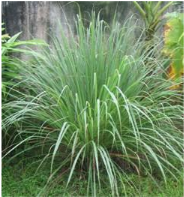

*Lecture 20*

1500 m.

Citronella thrives well under the tropical and subtropical conditions. It requires abundant moisture and sunshine for good growth. A good rainfall of about 2000-2500 mm well spread over the year and high atmospheric humidity, appear to influence the growth of the plant, yield and quality of the oil favourably.

# Mandakini

<!-- p. 132 -->

Clonal selection, gives a little less herb yield (35 t/ha) and oils (118 kg/ha). the variey is suitable for hills and Tarai tracts of Himalayas (CIMAP, Lucknow).

# Manjusha

<!-- p. 132 -->

Clonal selection, gives a herbage yield of 43 tons/ha. and 150 kg/ha of oil per annum. The variety is suitable for indo-gangetic plains (CIMAP, Lucknow).

# Manjiri

<!-- p. 132 -->

This variety has been released by University of Agriculture Sciences, Bangalore. It is an elite mutant clone of Manjusha M3-8. It has been found to possess 50-90% more oil, high cirtonellol and low elemol content. It has profuse tillering and rapid growing ability thus producing a high herb yields.

# CIMAP Bio-13, Java-2, Jorhat-2

<!-- p. 132 -->

High yielding varieties for the southern and eastern India released by CIMAP.

Citronella is a perennial grass, however, it does not produce viable seeds, therefore, the species can be propagated only vegetatively by slips. This is achieved by splitting well-grown clumps. It has been observed that an year old clump yields on an average about 50 slips. The clump is gently separated into a number of

West Bengal and Uttar Pradesh.

Family: Poaceae

## Plant Discription

<!-- p. 132 -->

It is a tufted aromatic perennial herb with fibrous roots, erect over 2 m tall, with smooth leaves and bearing a large inflorescence.

Centre of Origin: Sri Lanka

Soil

The species has been found to grow well under varying soil conditions, but the sandy loam soil with abundant organic matter is the most suitable. Heavy clay soils and sandy soils do not support good growth of the plant. The plant has been found to grow well under a pH range of 5.8-6.0. Although 180-120 m altitude is optimum, the plants are reported to grow well at the altitudes between 1000-

# CITRONELLA (Cymbopogon winterianus))

<!-- p. 132 -->

slips and each slip contains 1-3 tillers. These slips are the unit of propagation and on planting establish themselves as plants or bushes. Fibrous roots and leaves should be trimmed off the slips before planting.

# Season of Planting

<!-- p. 133 -->

Although the plantation of Java citronella can be initiated anytime during the year, onset of monsoon is the best time. The land should be prepared to fine tilth by discing and tilling. There should be enough moisture in the field at the time of planting.

The slips should be planted at a distance of 60 cm x 60 cm apart. However, in areas where the soil is very fertile and the climatic conditions support luxurious growth, a spacing of 90 cm x 90 cm may be followed.

# Method of Planting

<!-- p. 133 -->

The slips should be taken from healthy, vigorously growing and young bushes and should be planted soon after the bushes have been dug up and the slips have been separated out. If the planting is delayed, the slips may partially dry up resulting in poor plant population. The slips are planted vertically, about 10 cm deep. The planting should be done in such a way that the excess water is drained off quickly. This is because plants are extremely sensitive to temporary waterlogging, which adversely affects the growth of the plant. It is better to plant citronella on ridges to avoid waterlogging. The field should be irrigated immediately after planting if there are no rains within next 24 hours.

# Intercultural Operations

<!-- p. 133 -->

The citronella plantations should be kept weed free. When the plants have established themselves and formed bushes, the problem is not so severe because of the very nature of growth of the bushes. The bushes do not allow weeds to grow around them by cutting off the sunlight. However, in the newly established plantations and after each harvest, the weeds grow in the inter-row spaces and weeding is essential. This can be economically accomplished by running cultivator in between the rows.

Java citronella requires sufficient moisture for good growth and yield of the leaves. In the areas where annual rainfall is about 200-250cm, well distributed over the year and the humidity is high, supplemental irrigation is not necessary. In drier months, however, irrigation is provided twice a week during the first month of planting and thereafter once in 5 days.

# Manuring & Fertilization

<!-- p. 133 -->

Java citronella generally requires high dose of nitrogen for good growth. Under the agroclimatic conditions of North-Eastern India and North India, 80-120 kg N /ha per year is recommended. For the soils with high fertility level, the dose may be reduced. The recommended annual doses of P and K are 40 kg/ha each. It is beneficial to apply N in 4 equally split doses, the first about a month after planting and then after each harvest, at an interval of about three months. In poor soils, 200 kg N and 80 kg P 0 per ha should be applied. Nitrogen is applied in 5-6 split doses.

Citronella is cultivated for essential oil. Although, all the plant parts contain oil, leaves contain the maximum amount of oil. Therefore, only the leaves should be harvested. Harvesting is done by sharp sickle at about 2045cm above the ground. The number of harvests, which can be taken during a year, depends upon the growth of the plants. Under favourable conditions, upto 4 harvests can be obtained in a year. The leaves are ready for first harvest, about 6 months after planting. The second and subsequent harvests can be taken thereafter at 2.5 -3 months interval. Harvesting too soon and too late affects the quality of oil adversely. The delay also causes the leaves to dry up resulting in decrease in yield of oil. While harvesting, only the leaf blade should be cut and the sheath should be left. This is because the sheath contains only little and poor quality oil. Flowering should be discouraged as it causes aging in plants and reduces their life span. The same schedule of harvesting is to be followed during second and subsequent years. The Java citronella plantations remain productive for 5-6 years but the yield of leaves and oil is highest during second and third years, after which it starts decreasing. It is recommended that the plantation should be uprooted after 3-4 years and rotated with some small legume species. Horsegram is a very good rotational crop in south, cowpea or sunhemp (Crotalaria species) is recommended for north Indian plains.

On an average, the oil content is about 1% on the basis of fresh weight of leaves. Depending upon the nature of growth, the yield of fresh leaves is about 15-20 tonnes/ha in the first year and 20-25 tonnes/ha in the second as well as in the third year, after which the yield declines. The yield of oil obtained during the first year is about 100 kg/ha and 150 kg/ha during second and third years. Under very favourable conditions, yield of 200-250 kg oil/ha can be obtained.

The oil is used mostly in perfumery, both directly and indirectly. Soaps, soap flakes, detergents, household cleansers, technical products, insecticides, etc are often perfumed exclusively with this oil. It is also a valuable constituent in perfumery for soaps and detergents. Citronellal is occasionally used in traces in flower compositions of the citrus, cherry, ginger, etc. However, the greatest importance of Citronellal lies in its role as a starting material for further derivatives. Hydroxycitronellal can be prepared from citrinellal and it is a key ingredient in compounding. Hydroxycitronellal is one of the most frequently used floralizing perfume materials. It finds its way into almost every type of floral fragrance and great many non-floral ones. For soap perfumes, a slightly rougher grade is used. High grade is used in flavour compositions.

# Oil Contents

<!-- p. 134 -->

| Chemical constituents of Java type - Chemical   | Chemical constituents of Java type - Percentage   |
|-------------------------------------------------|---------------------------------------------------|
| Citronellal                                     | 32-45%                                            |
| Geraniol                                        | 12-18%                                            |
| Geranyl acetate                                 | 3-8%                                              |
| Citronellyl acetate                             | 2-4%                                              |
| Linalyl acetate                                 | 2%                                                |
| 1-limonene                                      | 2-5%                                              |
| Caryophyllene                                   | 2.1%                                              |
| Linalool                                        | 1.5%                                              |
| Farnesol                                        | 0.6%                                              |
| Methylisoeugenol                                | 2.3%                                              |

# Post Harvest Technology

<!-- p. 135 -->

# Distillation

<!-- p. 135 -->

The grass is steam-distilled for better recovery of oil and economical purposes. The distillation equipment consists of a boiler in which steam is produced, a distillation tub for distilling the grass, a condensor and 2-3 receivers /separators. The distillation tub is made steel with a perforated bottom, which of mint called false bottom, on which the grass rests. It has two opening: one at the bottom forsteam entry and the other at the top through which the oil vapour and steam escape. The top of the still is fitted with a lid, which is removable. Charging and discharging of the grass is done in perforated cages with chains. These cages may be lowered in the tub with the help of chain-pulley system. Tubular condensers oil vapours, coming out from the distillation tub, enter from the top of the condenser and cool down while passing through the tubular tubes. Oil and water vapour after condensation are led to a receiver where the oil separates out from the water and floats on the top and is drawn off.

The harvested grass sometimes contains dead leaves. These should be removed. The remaining leaves are cut into shorter lengths. This reduces the volume of the grass and facilities firm and even packing within the still. Further, chopping the grass gives a higher yield of oil compared to uncut grass. Generally, distillation is complete within 21/2 to 3 hours under normal pressure starting from the initial condensation of the oil. About 80% of the total oil yield is recovered in the first hour, 19% in the second hour and about 1% in the 3rd hour, of distillation. Larger percentages of the major components in the total oil, such as citronellal, geraniol, citronellal and geranyl acetate are recovered on the first hour of distillation.

Growers cultivating smaller areas can make use of properly designed direct-fired stills, in case they are not able to invest in the purchase of a boiler. In such cases, the lower portion of the distillation tub is filled with water and this function as a boiler. The water in the boiler is separated from the remaining part of the still by means of a false perforated bottom on which the grass rests. In the still, the water does not come in contact with the grass. The tub is heated from below either by wood or coal and the steam thus produced passes through grass place above in the tub carrying oil vapours with it. However, distillation in such direct-fire still takes a little more time and the quality of the oil is also inferior. Java citronella oil should preferably be stored in glass /aluminum containers.

- Citronella is a ___________

- Perennial

- Annual

- Biennial

- Method of citronella propagation is ________

- Vegetative

- Runners

- Stolons

- Soil suitable citronella cultivation is __________

- Sandy loam

- Clay loam

- sandy soil

*****☺*****

# Area under cultivation

<!-- p. 137 -->

It is cultivated in Uttar Pradesh, Madhya Pradesh, Jodhpur (Rajasthan), Karnataka, Maharashtra and Tamil Nadu.

Family: Poaceae

# Plant Description

<!-- p. 137 -->

Palmarosa is a wild growing plant related to lemongrass. It has fragrant leaves, long slender stems and terminal flowering tops. It is a drought hardy grass attaining a height of 1.5 to 2.5m having hairy and fibrous shallow root system with long linear lanceolate leaves. It produces large fawn coloured inflorescence containing while, hairy star like spiked flowers.

A well-drained sandy loam soil with soil pH of 7.5-8.5 is ideal for cultivation of Palmarosa and receiving rainfall of about 150 cm annually is an It can also be cultivated in well-drained clay loam soil which are free from water logging.

Warm tropical climate upto 300m elevation in the foothills is suitable for cultivation of Palmarosa. Temperature ranging from 10 - 360C with annual rainfall around 1000mm and ample sunshine are congenial for its growth. Moist and warm climate throughout the year accelerates its growth. Areas, which are affected by severe frost, are not suitable as the frost kills the grass and reduces the oil content.

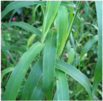

*Centre of Origin: India*

# Lecture 21 PALMAROSA (Cymbopogon martini var. motia)

<!-- p. 137 -->

| Varieties   | Characters                                                                                                                                                                                                                                              |
|-------------|---------------------------------------------------------------------------------------------------------------------------------------------------------------------------------------------------------------------------------------------------------|
| IW-31245    | Profuse tillering. 20-25t/ha of herbage under low irrigation. Oil yield-150bags in 3 cuts during 16-18 months. Oil contains 90% total geraniol. It has superior rosaceous green odour of palmarosa.                                                     |
| Trishna     | It possesses straw yellow clumps, long compact inflorescence and has profuse tillering. The oil contains 93% geraniol.                                                                                                                                  |
| Jamrosa     | It has vigorous growth, high yield of 35-45t/ha of herbage, it yields between 0.3-0.4% of oil in the herb which is rich in geraniol content (54-83%) and geranil acetate (17.89%). The oil yield was estimated between 130-150kg/ha in the second year. |

# Raising Seedlings in Nursery

<!-- p. 138 -->

Usually nursery is sown by end of April to mid of May under partial shade. Nursery beds are well prepared in May. The nursery beds are made by adding enough FYM , compost or organic matter. Channels are dug around the beds to provide irrigation. Normally 2 - 2.5 kg of seed is required to cover 100 sq.m nursery, which provides sufficient seedlings to plant one hectare area. As the seeds are small and light, they are mixed with fine soil for obtaining even distribution and ease in sowing. They are sown in lines, 15-20 cm apart. Seeds should not be sown densely to avoid overcrowding of seedlings The beds are watered lightly and regularly. Germination starts within two weeks. Later on, 0.2-0.5% solution of urea may be sprayed for good vegetative growth. In about 3-4 weeks, seedlings are ready for transplanting.

# By Slips

<!-- p. 138 -->

For better quality and yield of oil it is recommended to grow Palmarosa by slips obtained by dividing wellgrown clumps. Tops of clumps are cut off within 20-25 cm of the root. The latter is divided into slips and the lower brown sheath is removed to expose young roots. Slips should be taken from plants giving a good yield and a high quality of oil. However the rate of establishment of rooted slips is very poor as compared to nursery transplants. Slips should be planted in June-July or during the rainy season.

The field is prepared before the onset of monsoon. It is ploughed and harrowed so as to give a fine tilth. All the stubble and roots of weeds are removed. The seedlings are transplanted in the fields as soon as the rainy season sets in. They can be transplanted even earlier, if the weather is not very warm and irrigation is available. Healthy and established seedlings, which are about 15 cm in height, are carefully removed from the nursery and are planted at a spacing of 60 cmx60cm.

# Intercultural Operations

<!-- p. 138 -->

The plantation should be kept free from weeds by regular weeding and hoeing. Two weeding cum hoeing operations are recommended, first 40 days after transplanting and the second 30 - 40 days after the first weeding. Among herbicides, Diuron @ 1.5 kg ai/ha or Oxyfluorfen @ 0.5 kg ai/ha are effective for weed control.

Requirement of irrigation depends upon the climatic conditions. The grass requires irrigation fortnightly during the growing season. With an ample supply of water, growth is luxuriant. It is a drought hardy species. However its growth is slow under rainfed cultivation where the plants grow in height but seldom covers the entire field. Two irrigations in rainfed crop significantly increased herbage and oil yields.

# Manuring & Fertilization

<!-- p. 139 -->

Palmarosa is a long duration crop and removes substantial quantities of nutrients from the soil for producing herbage. Therefore, use of FYM @ 10 t /ha, 40 kg N, 50 kg P 0 and 40 kg K O as a 2 5 2 basal dose is recommended. About 60kg N/ha is applied in three split doses during the growing season. The application of NPK should be repeated in subsequent years. In fertile soils, manuring may not be required for the first two years. By manuring rich soils, the vegetative growth is increased and oil content may be slightly reduced.

The essential oil is distributed in all parts of the grass, viz., flower heads, leaves and stems, the flower heads containing the major portion. It is recommended to harvest the crop 7-10 days after opening of flowers. The number of harvest depends upon the climatic condition of the place of cultivation and method of crop management. During the first year, usually one crop is obtained in October-November, whereas 2-3 crops are obtained in the subsequent years in subtropical areas in the North Indian plains. Four harvests are taken in tropical areas of South and North-East. Usually, the grass is cut at a height of 5-8 cm from the ground level and the whole plant is used for distillation. The maximum yield of oil is obtained when the entire plant is at a full flowering stage. The harvested herbage is spread in the field for 4-6 hours to reduce its moisture by 50% and such semi-dry produce can be stacked in shady cool space for few days without much loss of its oil.

Palmarosa plantation remains productive for about eight years. However, the yield of grass and oil starts decreasing from the fourth year onwards. It is, therefore, recommended that the plantation be kept only for four years. Normally 200-250 q/ha of fresh herbage is obtained in first cutting and between 250-320q/ha in second and subsequent harvests upto three years under irrigated conditions. On an average, 200 kgs of oil are received during the growing period of 15-16 months.

The yield of oil for the first four years is as under:

1st year 60kg/ha 2nd year 80kg/ha 3rd year 80kg/ha 4th year 80kg/ha

Oil of Palmarosa is used in perfumery, particularly for flavoring tobacco and for blending of soaps due to the lasting rose-note it imparts to the blend. It also serves as a source for very high grade geraniol. Geraniol is highly valued as a perfume and as a starting material for large chemicals, viz., geranyl esters that have a permanent rose-like odour.

# Distillation

<!-- p. 139 -->

The grass is either distilled afresh or is allowed to wilt for 24 hours. Wilting reduces the moisture content and allows a larger quantity of grass to be packed into the still, thus economizing the fuel use. The current method of distillation adopted in Kerala is primitive and obsolete and gives oil of poor quality, as it is based on hydro-distillation or direct-fired still. For good quality oil, it is advisable to adopt steam-distillation. The equipment for distillation consists of a boiler to produce steam, a distillation tub, a condenser and one to three separators. The distillation tub is made of mild steel and has a perforated bottom over which the grass rests. The tub has a steam inlet pipe at the bottom. A removable lid is fitted on to the top. Charging and discharging can be done in perforated cages with iron chains, which can be lowered in the tub with the help of a chainpulley block. Different types of condensers are available, but tubular condensers are better than others. The condenser is provided with an inlet and outlet by means of which cold water is made to flow through the chamber to cool the pipes when the distillate flows through them.

To obtain the maximum yield of oil and to facilitate release of oil, the grass is chopped into shorter lengths. Chopping the grass has further advantages that more grass can be charged into the still and even packing is facilitated. The grass should be packed firmly as this prevents the formation of steam channels. The steam is allowed to pass into the still with a steam pressure from 18 to 32 kg in the boiler. The mixture of vapours of water and Palmarosa oil passes into the condenser. As the distillation proceeds, the distillate collects in the separator. The oil being lighter than water and insoluble floats on the top of the separator and is continuously drawn off. The oil is then decanted and filtered. Small cultivators can use direct-fire stills, but in such cases, properly resigned stills should be used. These stills are provided with a boiler at the bottom of the tub. This is separated by a false bottom from the rest of the tub. Water is poured at the bottom of the tub and grass is charged in the top portion. In the still, the water does not come in contact with the grass. The oil is stored in containers, preferably of glass or well-tinned iron. Containers should completely be filled to exclude any air and protect from sunlight as they affect the oil content

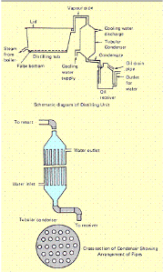

Ditilling tub

To fttort

- Palmarosa comes under the family of ___________

- Poaceae

- Euphorbiaceae

- Convulaceae

- Ideal soil pH for the cultivation of Palmarosa________

- 7.5-8.5

- 6-7

- 5.5-6.5

- Palmarosa is a__________ duration crop

- Short

- Medium

- Long

- Maximum yield of oil is obtained when the entire palmarosa is at________ stage

- Full flowering b. Partial flowering c. Maturation

- Which part of the palmorosa contain essential oil

- Flower heads

- leaves and stems c. Both

*****☺*****

# Common names

<!-- p. 142 -->

Ishagola, Isabghul, Spogel seed, Ispaghal, Psyllium seed, Flea seed, Plantain seed, Isabgol and Ishabgul Spogel seed.

# Origin and distribution

<!-- p. 142 -->

Plantago ovata Forsk. belonging to the family Plantaginaceae has good export potential and can be exploited commercially. It is indigenous to the Mediterranean region and West Asia, It has been introduced in India & Cultivated specially in Gujarat and some parts of Rajasthan. It is also found in Punjab plains and low hills from Sutlej westwards, Sindh and Baluchistan. The area under cultivation is estimated about 50,000 ha with a production of 48,000 tonnes of seeds. Psyllium is the common name used for several members of the plant genus Plantago whose seeds are used commercially for the production of mucilage. The genus Plantagocontains over 200 species. P. ovata and P. psyllium are produced commercially in several European countries, the former Soviet Union, Pakistan, and India. Plantagoseed known commercially as black, French or Spanish psyllium is obtained from P. psyllium and P. arenaria.

# Parts used

<!-- p. 142 -->

Husk from spikes and seeds

# Active principle

<!-- p. 142 -->

Protein, polysaccharides, cellulose, pectin, oil and muscilage

Husk is used as single drug for cure of constipation and dysentery. The drug is used in inflammatory conditions of the mucous membrane of gastro intestinal and genitourinary tracts and against irritation. It is also used as demulcent, cooling, diuretic.

# Species and Varieties

<!-- p. 142 -->

# Species

<!-- p. 142 -->

- Spanish or French Psyllium seed: Plantago psyrium Linn, or of Plantago indica Linn. (P. arenaric Wald.)

2. Blonde Psyllium or Indian Plantago: Plantago ovata Fork

RI-87, RI-89, AMB-2, GI-1, GI-2, MI-4, MIB-121, HI-34, HI-2, HI-1, HI-5, JI-4, NIHARIKA. Gujarat Isabgol-1, variety yields 800-900 kg of seeds per hectare. The new variety 'Gujarat Isabgol-2' has a potential to yield 1,000 kg of seeds per hectare.

It is an irrigated crop, which grows well on light soils, soil with poor drainage is not conducive for good growth of this crop. A silty-loam soil having a soil pH from 4.7 to 7.7 with high nitrogen and low moisture content is ideal for growth of plants and high yield of seeds.

Isabgol thrives well in warm- temperate regions. It requires cool and dry weather & is sown during winter months. Sowing during first week of November gives best yields. Early sowing makes the crop vulnerable to

# Lecture 22 ISABGOL

<!-- p. 142 -->

downy mildew disease, whereas late sowing provides lesser period of growth in winter along with possibility of shattering of seed due to summer rains in April-May. At maturity, if the weather is humid, its seeds shatter resulting reduction in yield. Heavy dew or even a light shower will proportionately decrease the yield, at times leading to even total loss of the crop. The temperature requirement for maximum seed germination is reported to be 20 to 300C.

Through Seeds

# Land preparation and planting

<!-- p. 143 -->

Field must be free of weeds and clods. The number of ploughings, harrowing and hoeing depend upon the soil conditions, previous crop and degree of weed infestation. About 10-15 tonnes of FYM per hectare is mixed into the soil at the time of last ploughing. The field should be divided into suitable plots of convenient size, depending upon the texture of the soil, the slope of the field and quantum of irrigation. For light soil with even contour, plot size of 8.0 m x 3.0 m will be convenient.

To obtain high percentage of germination, seed should be taken from the crop harvested at the end of the preceding crop season. Old seeds tend to lose viability under ordinary storage conditions. Seed at the rate of 4-8 kg per hectare is sown after treating it with any mercurial seed-dresser at the rate of 3 g/kg of seed, to protect the seedlings from the possible attack of damping off. The seeds are small and light. Hence before sowing, the seed is mixed with sufficient quantity of fine sand or sieved farmyard manure. The seeds are broadcasted because sowing in lines at different spacing does not increase the seed yield. After broadcasting, seeds are swept lightly with a broom to cover them with some soil. Broom however, should be swept in one direction only, to avoid deep burial of the seed for uniform germination. The sowing should immediately be followed by irrigation. Germination begins in four days after sowing. If delayed, it should be stimulated by another watering.

The medicinal plants have to be grown without chemical fertilizers and use of pesticides. Organic manures like, Farm Yard Manure (FYM), Vermi-Compost, Green Manure etc. may be used as per requirement of the species.

Immediately after sowing, light irrigation is essential. First irrigation should be given with light flow or shower of water otherwise, with fast current of water most of the seeds will be swept to one side of the plot and the germination and distribution will not be uniform. The seeds germinate in 6-7 days. If the germination is poor, second irrigation should be given. Later on irrigations are given as and when required. Last irrigation should be given at the time when maximum number of spikes shoots up. The crop requires totally 6-7 irrigations for its good productivity in medium sandy soils.

# Weeding

<!-- p. 143 -->

Periodical weeding and hoeing is required.

# Plant protection

<!-- p. 143 -->

To prevent diseases, bio-pesticides could be prepared (either single or mixture) from Neem (kernel, seeds & leaves), Chitrakmool, Dhatura, Cow's urine etc.

# Harvest

<!-- p. 144 -->

Blooming begins two months after sowing and the crop become ready for harvest in February-March (110-130 days after sowing). When mature, the crop turn yellowish and the spikes turn brownish. The seeds are shed when the spikes are pressed even slightly. At the time of harvest, the atmosphere must be dry and there should be no moisture on the plant, harvesting will lead to considerable seed shattering. Hence, the crop should be harvested after 10 am.

Seed: 900-1500 kg/ha, Husk: 225-375 kg/ha

# Post harvest technology

<!-- p. 144 -->

Harvested plants spread over and after 2 days they are threshed with tractor/bullocks. Pinkish type husk are removed from the seed coat by processing through a series of grinding in mills to separate husk.

- Isabgol belongs to the family___________

- Plantaginaceae b.Poaceae

- Chenopodiaceae

- Moisture content ideal for Isabgol plant growth ________

- Low

- Medium

- High

- Mode of propagation of Isabgol is through __________

- Runners

- Stolons

- Seeds

*****☺*****

# Present Scenario

<!-- p. 146 -->

-  The two hot spots of global biodiversity viz. North Eastern Himalayas and Western Ghats are particularly rich in wild relatives of tropical root and tuber crops.

-  The Central Tuber Crops Research Institute, Thiruvananthapuram initiated collection of tuber crops germplasm and wild relatives from all over India from 1963 onwards.

# Cassava

<!-- p. 146 -->

-  Cassava (Manihot esculenta) belongs to the family Euphorbiaceae and is believed to have originated in South America, most probably Brazil.

-  Wild species of cassava are found in the natural habitat in Brazil. The genus Manihot consists of about 98 species but none of the existing wild species can clearly be identified as the ancestor of cassava.

# Lecture 23

<!-- p. 146 -->

# Area, production, productivity and importance of important tuber crops in India

<!-- p. 146 -->

-  Root and Tuber Crops are the most important food crops after cereals. They have the highest rate of dry matter production per day and are major calorie contributors.

-  Tuber crops find an important place in the dietary habits of small and marginal farmers especially in the food security of tribal population.

-  Tuber crops not only enrich the diet of the people but also possess medicinal properties to cure many ailments or check their incidence.

-  Many tropical tuber crops are used in the preparation of stimulants, tonics, carminatives and expectorants. The tuber crops are rich in dietary fibre and carotenoids viz. â carotene and anthocyanin.

-  India holds a rich genetic diversity of tropical root and tuber crops viz. Cassava, Sweet potato, Aroids, Yams and several minor tuber crops.

-  Roots and tubers were critical components in the diet during the early evolution of mankind (~ 5 million years ago).

-  With the advent of agriculture, cultivated root and tuber crops became increasingly critical sources of food with the potato, cassava and sweetpotato representing the 3rd, 6th and 7th most important sources of food for humans worldwide today.

# Area (ha), prodution (Mt) and productivity (kg/ha) of cassava in India

<!-- p. 146 -->

|   Area (ha) |   Production (Mt) Productivity (t/ha) |   Production (Mt) Productivity (t/ha) |
|-------------|---------------------------------------|---------------------------------------|
|        0.24 |                                  6.70 |                                 27.92 |

# Sweet potato

<!-- p. 147 -->

-  The cultivated sweet potato ( Ipomoea batatas L.) and the wild species closely related to it belong to the family Convolvulaceae, genus Ipomoea.

-  Sweet potato is an ancient crop, originated in the north western part of South America.

# Yams

<!-- p. 147 -->

-  Dioscorea sp. are widely distributed in Tamil Nadu.

-  Food yams are believed to have originated in the tropical areas of three separate continents, Africa, South East Asia and South America.

-  The Asiatic yam (Dioscorea alata), probably originated in Indo Burma region.

-  Many of the Dioscorea species serve as a ‗life saving' plant group for the marginal farming and forest dwelling communities, during periods of food scarcity

India is rich in the floral diversity of root and tuber crops. It harbours two of the richest global biodiversity hot spots in the Western Ghats and the North eastern region, comprising part of the Indo- Burmese hotspot. These hotspots contain a large number of wild relatives of cultivated tuber crops as well as many underexploited tuber crops known to tribals.

- The most cultivated tuber crop of the world is ___________

- Sweet potato

- Yams

- Potato

- A potato tuber represents

- Enlarged underground stem

- Enlarged underground root

- Enlarged underground nodules

- Central Tuber Crops Research Institute is located at ___________

- Thiruvananthapuram b. Hyderabad

- New Delhi

- Cassava (Manihot esculenta) belongs to the family

- Euphorbiaceaeb. Convolvulaceaec. None

- Origin of Asiatic yam (Dioscorea alata) _______

- Indo Burma

- S. America

- Africa

*****☺*****

## Family: Solanaceae

<!-- p. 149 -->

The probable centre of origin of potato is in South America in the central Andean region. Evidence indicates that potatoes were cultivated for centuries by South American Indians and the tubers were used as a common article of food.

# Varieties/Hybrids

<!-- p. 149 -->

# Kufri Alankar

<!-- p. 149 -->

It is a derivatives of the cross (Kennebee x O.N .2090) x (Majestic x Ekishiraju), released in 1968 by Central Variety Release Committee for plains of Punjab, Haryana and Western Uttar Pradesh and specially suited for sandy soils.

# Kufri Anand

<!-- p. 149 -->

A derivative of PJ376 x PH/F 1430, released from CPRI, Shimla in 1999. KUFRI Ashoka

It is a wider adaptable variety released from CPIU, Shimla in 1996. It is a derivative of (EM/C-l 020 x Allerfi'uii lleste Gelbe).

# Kufri Badshah

<!-- p. 149 -->

It is a cross of Kufri Jyoti and Kufri Alankar and released in 1980 by Central Sub Committee on release in varieties for Indo - gangetic plains of North India, including Punjab, Haryana, Uttar Pradesh, Bihar, West Bengal, Madhya Pradesh and Plateau region. Kufri

# Bahar

<!-- p. 149 -->

It is a derivative of the cross Kufri Red x Ginek and released by :! Central Sub-Committee on Release of Varieties in 1980 for the plains of Haryana, Punjab and Western Uttar Pradesh.

# Kufri Chamatkar

<!-- p. 149 -->

A derivative of the cross Ekishiraju x Phulwa and released in 1967 by Central Variety Released Committee for the plains 01 Uttar Pradesh, Madhya Pradesh, Haryana, Punjab, where one crop of long duration is raised.

# Kufri Chandramukhi

<!-- p. 149 -->

It is a derivative of the cross S.4485 X Kufri Kuber and released in 1967 in Central Variety Release Committee for the plains of Punjab, Haryana, Uttar Pradesh, Madhya Pradesh, Rajasthan, Bihar, West Bengal and Maharashtra.

# Kufri Chipsona-L

<!-- p. 149 -->

It is a cross of MEX.750826 x MS/78- 79 and released from CPRI, Shimla in 1998.

# Kufri Chipsona-2

<!-- p. 149 -->

It is a derivative of F-6 x QB/B-92-4 and released from CPRI, Shimla in 1998.

# Kufri Dewa

<!-- p. 149 -->

It is a derivative of the cross Craigs Defiance x Phulwa and released by Central Sub-Committee on Release of Varieties in-1973 for Tarai area of Uttranchal and Shimla agroclimatic conditions. It is also suitable for Bihar and Orissa.

# Lecture 24 POTATO (Solanum tuberosum)

<!-- p. 149 -->

# Kufri Giriraj

<!-- p. 150 -->

It is north and south India adaptable variety. It is a cross of SLB/1-132 x EX/A 680-16 and released from CPRI, Shimla in 1998.

# Kufri Himalini

<!-- p. 150 -->

It is a derivative of cross SLB/H-140 x SLB/Z-389 (b) Recommended by 9th workshop of the All India Coordinated Potato Improvement Project for Hilly regions (hills of Northern India and Nilgiris in South) in the country.

# Kufri Jawahar

<!-- p. 150 -->

It is a derivative of Kufri Neelamani x Kufri Tyoti and released from Central Potato Research Institute, Shimla in 1996.

# Kufri Jeevan

<!-- p. 150 -->

It is a derivative of the cross M-I09-3 x D 698 and adopted for northwest hills of Himachal Pradesh and Uttar Pradesh.

# Kufri Jyoti

<!-- p. 150 -->

It is a derivative of the cross 3069d(4) x 2814 Q (1) and released in 1968 by the Central Variety Release Committee for Himachal Pradesh and Kumaon Hills of Uttranchal and also plains where late blight is a limiting factor.

# Kufriu Khashigaro

<!-- p. 150 -->

It is popular variety of hilly region and a derivative of the cross Taborky x SD 698 D.lt is adapted to hilly regions of Assam.

# Kufri Lali.Ma

<!-- p. 150 -->

It is a fast bulking variety and a derivative of the cross Kufri Red x CP 1362, which released in 1982 by Central Sub-Committee on Release of Varieties for the plains of Uttar Pradesh, Bihar, West Bengal, Orissa and Karnataka States.

# Kufri Lauvkai

<!-- p. 150 -->

It is a derivative of cross Serkoy x Adina released in 1973 by Central sub-committee on Release of Varieties for Decan Peninsula (Maharashtra).

# Kufri Muthu

<!-- p. 150 -->

It is a derivative of the cross 3046(1) x M-l09-C and released in 1971 by Central Sub Committee on release of Varieties for Nilgiri Hills for summer and autumn seasons. KUFRI Naveen

It is a derivative of the cross 0-692 x, 3070d (4) and adapted to northeast hills of Assam and high altitude of Himachal Pradesh.

# Kufri Pukhraj

<!-- p. 150 -->

It is a wider adaptable variety and a cross of Craig's Defiance x JEX/B-687, which released in 1998 from CPRI, Shimla.

# Kufri Sheetman

<!-- p. 151 -->

It is a derivative of the cross Craig Defiance x Phulwa, released in 1968 by Central Variety Release Committee for plains, especially frost affected areas of Punjab, Rajasthan, Haryana and Western Uttar Pradesh.

# Kufri Sherpa

<!-- p. 151 -->

It is a derivative of the cross Ultimus x Adina and recommended for cultivation in the hills to West Bengal State by 9th Workshop of All India Coordinated Potato Improvement Project.

# Kufri Sindhuri

<!-- p. 151 -->

It is derivative of the cross Kufri Kundan x Kufri Red and released by Central Variety Release Committee in 1966 for plains of Punjab, Jammu, Orisa, Bihar, Haryana, Uttar Pradesh, Madhya Pradesh and West Bengal.

# Kufri Sutlej

<!-- p. 151 -->

It is a derivative of Kufri Bahar x Kufri Alankar and released in 1996 from CPRI, Shimla.

# Kufri Swarna

<!-- p. 151 -->

It is a cross of Kufri Jyoti x (VIn) 2 (62.33.3) and released in tile year of 1985 from CPRI, Shimla.

# Climatic Requirements

<!-- p. 151 -->

Potato is basically cool season crop. It grows well from sea level to snow line, where sufficient moisture and fertile soil are available. It is grown in winter in plains of India. However, in northern hills, it is grown as summer season crop. Potato is a long day plant but cultivated as~ day plant. It requires favourable environmental conditions such as low temperature and short day conditions at the time of tuberization for rapid bulking rate. About 20 °C temperature is good for tuber formation and it reduces as the temperature increases. Tuberization is badly affected at about 300C temperature. At higher temperature, the respiration rate increases and the carbohydrates produced by photosynthesis are consumed rather than stored in tuber. High temperatures at any part of growing period affect the size of leaflets, thereby reducing the tuber formation. It grows best under long day conditions sunshine along with cooler nights are essential for reducing the spread of diseases.

# Soil Conditions

<!-- p. 151 -->

Potato can be produced on a wide range of soils, ranging from sandy loam, silt loam, loam and clay soil. Soil for potato should be friable, well aerated, fairly deep and well supplied with organic matter. Well- drained sandy loam and medium loam soils are most suitable for potato cultivation. Soil structure and texture has a marked effect on the quality of the tuber. Light soil is preferred, because they tend to promote more uniform soil temperatures and make harvesting of the crop easier. Alkaline or saline soil is not suitable for potato cultivation. They are well suited to acidic soils (pH 5.0 to 6.5) as acidic conditions tend to limit scab diseases.

# Planting Time

<!-- p. 151 -->

# 1. In Plains

<!-- p. 151 -->

Early Crop: Third week of September to first week of October.

Main crop: First week of October to third week of October.

Late Crop: Third week of October to first week of November

# II. In Hills

<!-- p. 152 -->

Potato is planted in hills from the third week of February to second week of April. In the southern hills near Ootacamund and in Nilgiris, planting is done three times in a year, i.e. in the month of February, April and September In the plateau regions of Maharashtra, Bihar Madhya Pradesh, potato is raised in rainy and winter seasons.. In the Mysore plateau, the summer and winter crop is planted in April-June and in OctoberDecember, respectively.

# Seed Rate, Methods of Sowing and Spacing

<!-- p. 152 -->

The seed requirements for a hectare on the basis of seed size are given below:

Large size- 25-30 q/ha; Medium size- 15-20 q/ha; Small size- 10-15 q/ha; Out tubers- 8-12 q/h2:-' Potato is planted mainly by two methods:

# 1. Ridge and Furrow Method:

<!-- p. 152 -->

In this method, the ridges are prepared.The length of the ridges depends on slope of the plot. Too long ridges and furrows arc not supplied with irrigation water conveniently. The potato tubers are planted on is let into furrows.

# 2. Flat Bed Method

<!-- p. 152 -->

In this method, the whole plot is divided into beds of convenient length and width. The shallow furrows are opened and potato tubers are planted at recommended distance. The tubers are covered with the original soil of furrows. When the germination is completed and plants become 10 to 12 cm height, earthing should be done. Suitable plant spacing in relation to potato seed grades are given below:

| Diameter of tuber from longer axis   | Planting distance (row x seed)   |
|--------------------------------------|----------------------------------|
| 2.5-3.5 cm                           | 50 x 20 cm or 60 x 15 cm         |
| 3.5-5.0 cm                           | 60 x 25 cm                       |
| 5.0-6.0 cm                           | 60 x 40 cm                       |

# Nutritional requirements and their management:

<!-- p. 152 -->

Soils poor in organic matter content should be supplied with 250 to 500 q/ha of farmyard manure or compost during land preparation, preferably a fortnight before planting. Potato plant is a heavy feeder. When it is grown in medium type of soils, it needs 100 to 150 kg nitrogen, 80 to 100 kg phosphorous and 80 to 100 kg potassium per hectare. Two - third to three fourth quantity of nitrogen along with whole quantity of phosphorus and potassium is applied at the time of planting. Remaining one fourth to one third nitrogen is applied 30 to 35 days after planting i.e. at the time of first earthing up or when plants become 25 to 30 cm in height either in the form of top dressing or as a foliar feeding. Spraying of essential micronutrients such as boron, zinc, copper, iron, manganese, molybdenum etc. is done when crop is showing deficiency symptoms.

# Intercultural Operations

<!-- p. 152 -->

In potato crop, both types of weeds are found i.e. broad-leaved weeds as well as narrow leaved weeds-The use of weedicides in potato crop in general is not essential because earthing up operation destroy almost all weeds, if some how, weed plants are growing on ridges, they may be pulled out by hands. Pre- emergence application of nitrofen @ 1.0 kg a.i./ha or alachlor @.2.0 kg a.i./ha or post emergence application of propanil @ 1.0 kg a.i./ha may be used ill solution fom1 (800-1000 litre/ha). Care should be taken while spraying of post- emergence herbicides that they should not come in the contact to potato plants. Proper development of

tubers depends upon aeration, moisture availability and proper soil temperature. Therefore, proper earthing up is necessary. Earthing should be done when the plants are 15 to 22 cm ill height. Generally earthing is done at the time of top dressing of nitrogenous fertilizers. The ridges should be high enough to cover up tubers. If necessary, a second earthing may be done after two -week of the first one. A mould board plough or a ridger may be used for earthing up in large area.

# Use of Plant Growth Regulators

<!-- p. 153 -->

Soaking of potato seed tuber in CCC at 500 mg/l (Schedule and Pandita, 1986), sodium ascorbate at 100 mg/l (Murti et al.. 1975) cytozyme at 5 per cent (Pandita and Hooda, 1979), Singh and Kaur, 1981) or foliar sprays with ethephon at 400 mg/l (Murti and Banerjee, 1978, Pandita and Hooda, 1979 a, Sekhon and Singh, 1985), CCC at 25 mg/l or garlic acid at 10-100 mg/l(Kumar and Agarwal, 1978) increased tuber yield. Sidda Reddy (1988) also obtained higher tuber yield with foliar sprays of mixtallol at 1 or 2 mg/l.

# Water Management

<!-- p. 153 -->

Before coming to the planting operation. it should be kept in mind that the sufficient soil moisture is available for satisfactory sprouting. If not then light pre-irrigation or just after planting may be given. The rate of water use is low till 30-35 days after planting; it means that the first irrigation is essentially done within 3035 days after planting. However, when soil moisture seems insufficient for sprouting, intervals of first irrigation should be reduced. Further, irrigation is done as and when crop needs. As regards method of irrigation in potato, the furrow method is commonly followed.

# Harvesting, Yield and Storage

<!-- p. 153 -->

Harvested potatoes are heaped under shade for a couple of days, so that their skin becomes hard and soil adhering with them is also separated out. Under good crop management, 350-450 quintals of marketable potatoes of good quality can be produced from one hectare land. The sorting operation is the most important, in that all cut tubers, bruised, injured by insects-pest and disease are removed. Sorted healthy tubers are graded in to different grades based on diameter of the tubers reduce the prices in the market. Therefore, such tubers should be sorted and marked separately. Over sized tubers are great in demand for chips making. Very small sized tubers are also not remaining unsold. These tubers are purchased by poor people for making vegetable by partially Cushing them before cooking. However, both the over sized and under sized are quite unsuitable for seed purposes. Potatoes can be stored in the cold storage at the temperatures of 4 to 7oC and relative humidity.

- Maximum acreage under Potato is in the state

- West bengal

- Tamil Nadu

- U.P

2. The centre of origin of Potato is ________

- Peru & Bolivia b. Russia

- S.Africa

- Best season for potato cultivation __________

- Kharif

- Summer c. Rabi

- Soil suitable for potato cultivation is ________

- Clay

- Clay loam c. Sandy loam

- Optimum temperature for tuberization of Potato ________

- 17 -200c

- 10 - 150c

- 20 - 250c

- Most common herbicide used for weed control in Potato is ________

- Pendimethalin b. Alachlor

- Oxyflurofen

*****☺*****

# Lecture 25

<!-- p. 155 -->

# Area, production, productivity and importance of narcotics in India

<!-- p. 155 -->

-  India has been considered as treasure house of valuable Tobacco is the most widely grown non-food crop in the world. Around 50 million growers in 23 developed and 94 developing countries grow tobacco. India is the world's third largest producer of tobacco next to China and USA.

-  Tobacco sector in India provides about 30 million jobs in agricultural operations including nurseries, cultivation, curing, processing, manufacturing and distribution of tobacco products in rural and urban areas.

-  Indian tobacco is exported to more than 80 countries spread over in all the continents accounting 4% of global tobacco exports. The total production of all tobacco varieties in India accounts for about 8.0% of total global production whereas it stands fifth in Flue Cured Virginia tobacco production registering only 3.3% of world production.

-  Tobacco as a single largest commodity is the fourth leading revenue earner for the central Government contributing about 10% of the total Excise revenue collection and around 5% of agricultural exports from India, corresponding to Rs.5000 crores and Rs.1000 crores respectively.

-  India produces 7-8% of world's tobacco, while China alone accounts for nearly 40%.

# Area (ha), prodution (Mt) and productivity (kg/ha) of tobacco in India

<!-- p. 155 -->

|   Area in Ha. - 2007 |   Area in Ha. - 2008 |   Production in Mt - 2007 |   Production in Mt - 2008 |   Productivity in Kg/ha - 2007 |   Productivity in Kg/ha - 2008 |
|----------------------|----------------------|---------------------------|---------------------------|--------------------------------|--------------------------------|
|               370000 |               370000 |                    520000 |                    520000 |                           1405 |                           1405 |

# Area, Production and Yield of Tobacco in Tamil Nadu (2007-08)

<!-- p. 155 -->

|   Area in 000' Ha. |   Production in 000' Tonnes |   Productivity (kg/ha) |
|--------------------|-----------------------------|------------------------|
|               0.20 |                        0.10 |                    500 |

# Present Scenario in Tamil Nadu

<!-- p. 155 -->

-  Tobacco is cultivated in around 10000 ha in Tamil Nadu.

-  The crop is transplanted during September - October and harvested in January - February.

-  Sun-cured tobacco varieties are transplanted from mid October to mid December.

-  High quality cheroot tobacco types are transplanted in November and December months.

-  Nattu tobacco is transplanted in Bhavani area in October and even during November - December after the harvest of rice.

-  In Sentharaipatti area, tobacco is transplanted from January to February.

-  High quality cheroot tobacco is grown is parts of Madurai district and around Dindigul and Vedasandur area.

-  Natu, cheroot type of variety Oosikkappal is cultivated in Sentharappatti area of Salem district and in Bhavani and Kurichi blocks of Erode district.

-  In other parts of the state mostly chewing type of tobacco are grown.

-  High quality cheroot tobacco is grown in red sandy gravel soils with irrigation water having total soluble salts is less than 100 ppm.

-  Natu cheroot tobacco are cultivated mostly in red loam soils with high fertility status.

-  In sandy clay loam soils with irrigation water having high chloride content, chewing tobacco varieties are grown.

-  In Bhavani block of Erode district and also in some parts of Coimbatore district chewing tobacco is grown even in black soils under canal irrigation. Chewing tobacco is also grown in Vedaranyam area in sandy soils.

-  High quality cheroot tobacco is mostly sun cured, Natu cheroot tobacco is processed both under sun and shade curing and chewing tobacco is cured by sun, smoke and pit curing methods.

-  In general in Tamil Nadu, sun cured chewing tobacco is cultivated around 60-65% of tobacco area. Tobacco area under smoke curing is about 30% and pit curing is done for the remaining 5% area under chewing tobacco.

-  The Central Tobacco Research Institute (CTRI) Research Station at Vedasandur is functioning from 1948 in Tamil Nadu.

-  Because of the continuous research and extension work of the CTRI research station at Vedasandur, the chewing tobacco yield is increased from 2000 kg/ha in 1948 to 2800 kg/ha in 1956-59, and 3250 kg/ha in 1977-78 and 3800 - 4000 kg/ha at present.

# Importance of narcotics

<!-- p. 156 -->

# Tobacco is currently the world's most important non-food crop &contributes substantially to the economy of more than 150 countries.

<!-- p. 156 -->

The tobacco value chain is most often depicted from the perspective of the cigarette industry and its health implications. However, from a more integrated perspective, one is able to appreciate the importance of this sector - as a whole - to the economy and, in particular, to tobacco growing regions.

Tobacco taxation is the main source of revenue for almost all governments. Few industries are as complete as the tobacco industry. The tobacco industry generally occupies an important role within a country's social and economic context. Even in countries that do not have cigarette factories, the distribution of tobacco products is a significant source of economic activity.

Though only 0.3% of the world's cultivable land is occupied by tobacco plantations - less than half the land occupied by coffee, for example - it is an important component of the agriculture industry in many countries and creates more employment per hectare of cultivated land than any other crop in the world. Price stability is one of the main attractions for tobacco growers, as well as greater profitability per hectare.

Good cultivation techniques also help tobacco farmers maximize land efficiency and help alternative crops grow, better enabling farmers to make the most of their land all year round.

Although tobacco is grown in more than 100 countries, four countries viz., Brazil, China, India and the United

States account for two thirds of total global production.

Imports of cigarettes and other manufactured tobacco products deprive many countries of badly needed foreign exchange. Out of 194 countries surveyed, two-thirds imported more than they exported in 1998. Ten countries lost more than $100 million, including Lebanon, Russia and Vietnam. And, of the 62 countries which had a positive balance of trade in manufactured tobacco products, half earned less than $20 million, while three (the United States, United Kingdom,

and the Netherlands) earned over $1 billion.2

The tobacco industry estimates that globally, 33 million people are engaged in tobacco cultivation. However, this figure includes not only farmers who rely entirely on tobacco, but also farmers who grow other crops besides tobacco, seasonal laborers, family members and other part-time workers. Of these 33 million, approximately 15 million are in China and 3.5 million in India.

- In India, the productivity of tobacco is highest in the state

- Punjab

- U.P

- Haryana

- Maximum acreage under tobacco cultivation is in the state ______

- Haryana

- U.P

- A.P

- Central Tobacco Research Institute (CTRI) is located in Tamil Nadu at

- Vedasandur

- Palani

- Veppankulam

- Natu cheroot tobacco are cultivated mostly in ______ soils

- Oct. - Dec.

- June - July

- Jan. - Feb.

*****☺*****

-  May be from America

-  Christopher Columbus in 1492

- o Carried some dried leaves to Spain?

-  But some others believe

- o 1560 a Spanish physician brought as medicine

-  Jean Nicot, French Ambassador to Portugal introduced from Lisbon to French

-  The botanical name Nicotine have been derived from his name

-  In India introduced only in 17th Century

# World Scenario (Figures in Million ha and tonne)

<!-- p. 159 -->

| Country   |   Area |   Production |   Productivity |
|-----------|--------|--------------|----------------|
| China     |   1.38 |         2.75 |           2.00 |
| India     |   0.37 |         0.55 |           1.49 |
| USA       |   0.14 |         0.34 |           2.50 |
| World     |   3.90 |         6.72 |           1.72 |

(FAOSTAT, 2006)

# Indian Scenario - 1998-(Figures in Million ha and tonne)

<!-- p. 159 -->

| State     |   Area |   Production |   Productivity |
|-----------|--------|--------------|----------------|
| AP        |   0.20 |         0.19 |           0.98 |
| Gujarat   |   0.11 |         0.18 |           1.66 |
| Karnataka |   0.07 |         0.06 |           0.87 |
| UP        |   0.02 |         0.15 |           6.83 |
| Bihar     |   0.02 |         0.01 |           0.72 |
| WB        |   0.01 |         0.01 |           0.57 |

# Lecture 26 Tobacco Nicotiana tabacum

<!-- p. 159 -->

#  Classification

<!-- p. 160 -->

- o Nicotiana is broadly classified in to three sub-groups

-  rustica

-  tabacum

-  Petunioides

- o In India tabacum is widely cultivated and discussed here

|    | Type                       | Area                             |
|----|----------------------------|----------------------------------|
|  1 | FCV (Flue cured Virginia)  | AP, Karnataka                    |
|  2 | Bidi                       | Gujarat, Karnataka,              |
|  3 | Cigar & Cherrot            | TN, WB                           |
|  4 | Hookah                     | Assam, WB, Bihar, UP, Punjab     |
|  5 | Chewing & snuff            | TN, WB, Bihar, Assam, UP, Punjab |
|  6 | Natu, Burley, Lanka, HDBRG | AP                               |
|  7 | Pikka                      | Orissa                           |

# Tobacco varieties cultivated in TN

<!-- p. 160 -->

-  Cigar & Binder

- o Vellaivazhai (VV 2)

- o Kuruvazhai (KV 1)

-  Country cheroot

- o Narrow leaf Oosikappal ((I 737)

- o Broad leaf Oosikappal (OK 1)

#  Chewing tobacco

<!-- p. 160 -->

- o Sun cured

-  Monnai (I 64)

-  Vazhaikappal (I 115)

-  Vaadamugam(VD 1)

-  Vattakkappal (VKT 1)

-  Vedaranyam (VR 2)

- o Smoke cured

-  Periya vaadamugam (PV 7)

- o Pit cured

-  Vattakkappal (VTK 1), Vadamugam (VD 1)

| TN    |   0.005 |   0.008 |   1.46 |
|-------|---------|---------|--------|
| India |    0.45 |    0.64 |   1.42 |

-  It is tropical in origin but successfully grown in temperate also

-  100-120 day frost free days

-  Average temp of 26°C

-  Sensitive Waterlogging

-  Rainfall / irrigation during active vegetative growth is essential

# Season

<!-- p. 161 -->

#  Rabi planting

<!-- p. 161 -->

- o 1st Fortnight of October

- o In Vedaranyam after 15th Dec

- o In Andra Pradesh

-  Mid Oct to Mid Nov

-  Early sowing ends with heavy rain

# Nursery

<!-- p. 161 -->

-  Well drained soil / raised bed

-  2.5m-2 for 1.0g seed

-  1.0g seed contains 10,000 seeds

-  Seeds to seedling is very wide (10 :1)

-  To transplant 20,000 seedlings 200,000 seeds in 50m-2 is more than sufficient

-  Farmers use more than this area and seed rate

-  Rabbing the nursery soil to prevent pest and disease is essential

-  Manuring the nursery

-  Irrigation by rose can

-  Seedling age

- o 7 weeks old

- o Pull out seedlings are pencil thickness

- o After pulling out selected seedlings top dress the remaining seedlings

# Field preparation

<!-- p. 161 -->

-  Soils of well drained

-  Deep summer ploughing

-  Ridges an furrows

-  Apply heavy FYM 25 t/ha before last ploughing

-  Chewing tobacco

- o 75 x 75 (17,777 plants/ha)

-  Cigar tobacco

- o 75 x 50 (26,666 plants/ha)

-  Cheroot tobacco

- o 60 x 45 (36,730 plants/ha)

-  Transplant single seedlings of pencil thickness

-  Irrigate the field prior to planting

-  Make a hole and plant

-  Cool hours or evening is preferable

-  Gap filling within 7-10 days

-  N 100 kg/ha as Ammonium sulphate

- o If brackish water restrict to 75kg

- o 50% on 45th day and 50% 60 DAP

-  Phosphorous

- o 100 kg P2O5 as SSP at planting

-  Potash

- o Chewing - 50 kg K2O

- o Cigar & Cheroot - 100 kg K2O

-  In two splits along with N

# Weeding and Intercultural operations

<!-- p. 162 -->

-  Hand weeding three weeks after transplanting

-  At 45 DAT soil mulching to make the ridge flat

-  A week later deep furrowing to heavy irrigation at Grand growth period

# Control of Orabanche

<!-- p. 162 -->

-  Remove as and when shoot appear

-  Removed shoots are to be burnt

-  Trap crops

- o Greengram, gingelly, sorghum

-  Chemical weed control

- o Fluchloralin @ 1.0 l/ha or

- o Oxyflourfen 0.5 l/ha

- o as pre-plant incorporation a week prior to planting

# Toping

<!-- p. 163 -->

-  Chewing tobacco: Top, leaving 10 leaves

# Desuckering

<!-- p. 163 -->

-  Removal of side shoots manually at weekly interval

-  Application of neem oil emulsion at 35% after topping completely suppresses the suckers

-  Neem oil 1.75 l + sandivit 0.5 l + water 2.75 l is needed for 1000 plants

# Maturity & harvest

<!-- p. 163 -->

-  Bulging of the intervenial portions of the leaf

-  Appearance of brown spot on the leaves

-  Cut the plant in the afternoon and allow it to wilt overnight

-  Mono-cropping is discouraged

- o Crop rotation helps to maintain the soil fertility

-  Intercropping is possible

- o Onion and coriander (greens) are more suitable

# POST HARVEST TECHNOLOGY FOR TOBACCO

<!-- p. 163 -->

Tobacco curing methods

-  Curing is a carefully controlled process used to achieve the texture, colour and overall quality of a specific tobacco type. During the cure, leaf starch is converted into sugar, the green colour vanishes and the tobacco goes through colour changes from lemon to yellow to orange to brown like tree leaves in autumn. There are four main curing methods.

# Flue-cured Tobacco

<!-- p. 164 -->

-  The most common curing process is known as flue-curing

-  Used mainly in the manufacture of cigarettes, the most common type of flue-cured tobacco is Virginia

-  This tobacco is also known as 'bright tobacco' because the heat-drying process gives the leaves a bright, golden colour

-  Originally from the south-eastern U.S. state of the same name, it is today the most grown tobacco variety in the world

-  Flue-cured tobacco is dried in a closed building with furnace driven heat directed from flues or pipes that extend from a furnace into the barn.

-  The temperature of the furnace is gradually raised until the leaves and stems are completely dried.

-  Flue-curing takes about a week and fixes the natural sugar of the leaf, which has a high sugar and a medium-to-high nicotine content.

-  Today, many farmers find that bulk curing flue-cured tobacco is far more cost-effective.

-  Racks of tobacco are placed in bulk barns where heat and ventilation are controlled while air is forced through the leaves.

-  Flue-cured varieties require warm weather, humidity, light rainfall and a sandy, loam soil for their four-month growing season.

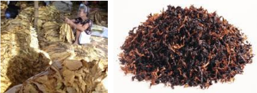

# Air-cured Tobacco

<!-- p. 164 -->

-  Some tobacco leaves are air-cured following their harvest.

-  Air-cured tobacco is traditionally cured hanging in structures with a roof, but with open sides to allow air to freely circulate.

-  As with flue-curing, the aim of air-curing is the timely removal of moisture from tobacco leaves. This process takes four to eight weeks:

-  If cured too fast, the leaf will become patchy, if cured too slowly, the leaf will rot away.

-  Commonly, air-cured tobacco is subdivided into dark air-cured and light air-cured tobacco.

-  Burley is the second most popular tobacco in the world, belonging to the light air-cured variety.

-  Burley, also known as White Burley tobacco, is primarily used to make cigarettes and aromatic blends, whereas dark air-cured tobaccos are mainly used in the production of chewing tobacco and snuff.

-  Burley is a slightly smaller plant than the flue-cured Virginia type, but with similarly broad leaves.

-  Once picked, its leaves are dried naturally - or ‗air-cured' - without the use of extra heat.

-  This gives the leaves a light brown to mahogany appearance and very low sugar content.

-  Burley tobaccos are somewhat cigar-like in taste and appearance, lending themselves to the production of flavoured, blended cigarettes commonly referred to as "American".

-  Burley tobacco can be grown in limestone soils and requires only light fertiliser.

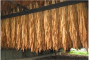

# Fire-cured Tobacco

<!-- p. 165 -->

-  Although curing methods may vary, all fire-cured tobaccos are subjected to wood smoke to dry the leaves. It is the type of wood used to smoke the tobacco leaves and the amount of smoke exposure that gives fire-cured tobacco leaves their distinctive flavours.

-  Fire-cured tobacco, generally darker in colour, is used mostly for pipe tobacco mixtures, snuff, and chewing tobacco and has a low sugar but high nicotine content. Fire curing uses an enclosed barn similar to that used for flue-curing. Small fires are built on the floor, and the leaves cure in a smokeladen atmosphere. Whereas flue-curing takes about a week, fire curing, using far lower temperatures, may take from a few days up to 4 weeks.

-  Fire-cured tobacco is dried with low-burning wood fires on the floors of closed curing barns. The leaves have low sugar content but high nicotine content. Fire-cured tobacco is a robust variety of tobacco used as a condimental for pipe blends, cigarettes, chewing tobacco, snuff and strong-tasting cigars.

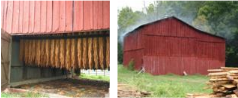

# Sun-cured Tobacco

<!-- p. 166 -->

-  A comparatively small amount of tobacco is sun-cured. Leaves are exposed to the sun to remove most of their moisture before being air-cured to complete the process. Of all sun-cured tobaccos, the best known are the so-called Oriental tobaccos of Turkey , Greece , Yugoslavia , and Balkans.

-  A more labour-intensive product to harvest, Oriental tobacco is characterised by high aroma from small leaves, being low in both sugar and nicotine.

-  The leaves are mostly sun-cured. Usually, the larger the leaf, the milder the aroma. Hence Oriental tobacco is regarded as expensive to harvest by many tobacco manufactures. Oriental tobaccos are often grown in poorer soils in southern Europe and the Middle East.

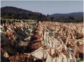

# Grading

<!-- p. 166 -->

-  Whereas after other curing processes tobacco is exposed to air to standardise the moisture content of the tobacco or -redry‖, Oriental tobaccos are stored in bales and allowed to ferment. After storage, moisture is added to this type of tobacco. Pure - Turkish cigarettes contain 100% unblended Oriental tobacco - or blended, Oriental tobacco is mostly used in cigarettes, cigars, pipe, snuff or chewing tobacco.

-  After curing, the farmer grades the leaves into different leaf positions, qualities and colours and packs his grades into what is known as a farmer bale of 30-50kg. He then takes his bales to a buying centre or auction for sale.

1. World production of tobacco is _________ m tonnes

- 8.07

- 9.07

- 7.07

2. Production of tobacco in India is _______ m tonnes

- 0.54

- 0.64

- 0.74

3. Tobacco variety suitable for cigar and binder making in Tamil Nadu is ____

- Oosikappal (I 737)

- Vellaivazhai (VV 2)

- Vazhaikappal (I 115)

4. Tobacco variety suitable for country cheroot making in Tamil Nadu is ____

- Oosikappal (I 737)

- Vellaivazhai (VV 2)

- Vazhaikappal (I 115)

5. Tobacco variety suitable for chewing tobacco in Tamil Nadu is ____

- Oosikappal (I 737)

- Vellaivazhai (VV 2)

- Vazhaikappal (I 115)

- Following is a pit cured tobacco variety

- Vedaranyam (VR 2)

- Vattakkappal (VTK 1) c. Periya vaadamugam (PV 7)

7. Following is a smoke cured tobacco variety

- Vedaranyam (VR 2)

- Vattakkappal (VTK 1) c. Periya vaadamugam (PV 7)

- Seed rate for tobacco is ______

- 1 kg/ha

- 1 g/ha

- 2 g/ha

- 2 kg/ha

9. Spacing recommended for chewing tobacco is _________

- 75 x 50 cm b. 75 x 75 cm c. 60 x 45 cm

- Spacing recommended for cigar tobacco is _________

- 75 x 50 cm b. 75 x 75 cm c. 60 x 45 cm

11. Spacing recommended for cheroot tobacco is _________

- 75 x 50 cm b. 75 x 75 cm c. 60 x 45 cm

12. Recommended dose of potash for chewing tobacco is _______ kg/ha

- 75

- 100

- 50

13. Recommended dose of potash for cheroot and cigar tobacco is _______ kg/ha

- 75

- 100

- 50

14. Recommended dose of N and P for tobacco is _______ kg/ha

- 75 : 100

- 100 : 100

- 50 : 75

15. Trap crop used to control Orabanche is _________

- Groundnut

- Maize

- Green gram

16. The most common type of flue-cured tobacco is _________

- Virginia

- Calcutta

- vilayati

17. _________ tobacco is also known as 'bright tobacco'

- Air-cured

- flue-cured

- fire cured

*****☺*****

# Forage grasses

<!-- p. 169 -->

# Guinea Grass - Panicum maximum

<!-- p. 169 -->

-  Season & varieties

- o Throughout year - CO 1

-  Field preparation

- o Well drained soil with ridges & furrows, not at heavy clay

- o FYM 25t

-  Seed rate

# Lecture 27

<!-- p. 169 -->

Forage crops, forage grasses and legumes - importance, soil and climatic requirement, agronomic practices, time of harvest, biomass production and nutrient content

# Importance of forages

<!-- p. 169 -->

-  Agriculture is the art and science of crop & animal production

- o Crop production is also to animal production

- o Animal production in turn for crop production

-  Animal population need to be re-oriented

- o Unproductive to be given away

- o We have approximately

-  20% of world's cattle

-  50% of buffaloes

-  More than 120 million goats and

-  60 million sheep (Deb Roy, 1993)

-  Natural gracing is limited

- o Crop wastes are recycled & but limited

-  Hence

- o Exclusive cultivation and agronomic managements like

-  Control of bushes and weeds

-  Pasture establishment

-  Introduction of legumes/grasses

-  Fertilizer application

-  Cutting and grazing management are need of the hour

- o 2.5 kg /ha, Slips - 66,000 nos.

-  Spacing

- o 50 x 30 cm

-  Fertilizer

- o 50-50-40 NPK

- o 25 kg N at every cut

-  Harvest

- o First cut at 75 DAS or 45 DAP, then at 45days

- o Green fodder 175 t from 8 cuts

- o May be intercropped with Hedge Lucerne for nutritious fodder

# Blou Buffel Grass / Anjan grass - Cenchrus glaucus

<!-- p. 170 -->

-  Season & varieties

- o NE Monsoon - CO 1 (Neela Kolukkattai)

-  Field preparation

- o Well drained soil high ca content with ridges & furrows

- o FYM 25 t

-  Seed rate

- o 6-8 kg /ha

-  Spacing

- o 50 x 30 cm, sow at shallow depth, break seed dormancy

-  Fertilizer

- o 25-40-20 NPK

- o 25 kg N at every cut

-  Harvest

- o First cut at 75 DAS, then 4-6 cuts depending upon growth

- o Green fodder 40 t from 4 cuts

# Bajra Napier Hybrid

<!-- p. 170 -->

-  Season & varieties

BN 2, NB 21, CO 1, CO 2

-  Field preparation

- o Well drained soil with ridges & furrows - not at heavy clay

- o FYM 25t

-  Seed rate

- o 40,000 slips

-  Spacing

- o 50 x 50 cm

-  Fertilizer

- o 50-50-40 NPK

- o 100 N kg after each cut

-  Harvest

- o Cut at 75-80 DAP subsequent at 45 days interval

- o Green fodder 250 - 400 t

# Deenanath Grass - Pennisetum pedicillatum

<!-- p. 171 -->

-  Season & varieties

- o Throughout the year - CO 1

-  Field preparation

- o Well drained soil with ridges & furrows

- o Heavy clay or water logging not suitable

- o FYM - 25t

-  Seed rate

- o 2.5 kg

-  Spacing

- o 30cm solid row

-  Fertilizer

- o 40-60-40 NPK

- o 20 N kg on 30th DAS

-  Harvest

- o 55-60 DAS

- o Green fodder 40 - 45 t also as rainfed 20-25 t

# Para grass / Water grass / Buffalo grass - Brachiaria mutica

<!-- p. 171 -->

-  Season & varieties

- o Thru' year

-  Field preparation

- o All type of soils more suited to moist and waterlogged soils

- o FYM 25t

-  Seed rate

- o 40,000 slips

-  Spacing

- o 50 x 50 cm

-  Fertilizer

- o 20-40-0 NPK

- o 20 N kg after each cut

-  Harvest

- o Cut at 60-90 DAP subsequent at 30-45 days interval

- o Green fodder 200 - 240 t

# Other grasses

<!-- p. 172 -->

-  Marvel grass

- o Dicanthium annulatum

-  Rhodes Grass

- o Chloris gayana

-  Elephant grass / Napier grass

- o Pennisetum purpureum

-  Johnson grass

- o Sorghum helepense

-  Sudan grass

- o Sorghum sudanense

# Forage legumes

<!-- p. 172 -->

# Lucerne - Medicago sativa

<!-- p. 172 -->

-  Season & varieties

- o Thru' year , CO 1

- o Not suitable for very hot and cold climate

-  Field preparation

- o Apply 12.5 t FYM

- o Beds & channels 10- 20 m

-  Seed rate

- o 20 kg /ha of cuscuta free seeds

-  Spacing

- o 25cm with solid row

-  Fertilizer

- o 25-120-40 NPK

-  Harvest

- o First cut at 75-80 DAS, subsequent cut at 25-30 days

- o Green fodder

-  70-80 t in 10 cuttings

# Hedge Lucerne - Desmanthus virgatus (Velimasal)

<!-- p. 172 -->

-  Season & varieties

- o Thru' year , Velimasal

-  Field preparation

- o Apply 12.5 t FYM

- o Ridges & Furrows

-  Seed rate

- o 20 kg /ha

-  Spacing

- o 50cm with solid row

-  Fertilizer

- o 10-60-30 NPK - to be applied below the seed rows

-  Harvest

- o First cut at 90 DAS at 50cm ht , subsequent cut at 45 days

- o Green fodder

-  125 t

# Hedge Lucerne +Grasses

<!-- p. 173 -->

-  Grasses suitable are Guinea and BN Hybrids

-  Ratio - 3:1

-  First cut at 50 DAS and further at 45 d

-  Cutting height of velimasal is 50cm

-  Additional fodder yield of 100-125t

-  Nutritious proportion

# Stylo - Stylosanthes scabra (Muyal masal)

<!-- p. 173 -->

-  Season & varieties

- o Jun, July to Sep, Oct, S. hamata annual & S. scabra perennial

-  Field preparation

- o Apply 12.5 t FYM

- o Beds & channels

-  Seed rate

- o 6 kg /ha

-  Spacing

- o 30 x 15cm

-  Fertilizer

- o 20-60-15 NPK - to be applied below the seed rows

-  Harvest

- o First cut at 75 DAS at flowering, subsequent cuts

- o Green fodder

-  First year low subsequent years 30 t/annum

# Fodder Cowpea

<!-- p. 174 -->

-  Season & varieties

- o June, July - CO 5

-  Field preparation

- o Apply 12.5 t FYM

- o Beds & channels

-  Seed rate

- o 40 kg /ha

-  Spacing

- o 30 x 10 cm

-  Fertilizer

- o 25-40-20 NPK - to be applied below the seed rows

-  Harvest

- o 50-55 days aftersowing(50% flowering)

- o Green fodder

-  18-20 t/ha

-  As soon flowering starts

# Sirrato - Macroptilium atropurpureum

<!-- p. 174 -->

-  Drought tolerant pasture

-  Compatibility with cereals & grass

-  Native of C & S America

-  Deep rooted perennial

-  Trailing, hairy stems

-  Can tolerate grazing pressure

-  Can tolerate shade

-  Wide range of soils

- Napier grass is native of ___________

- Abyssinia

- Asia

- Tropical Africa

- Crop comes up well under water undulated condition & with sewage water

- Para grass

- Guinea grass

- BN grass

- Dominant grass species found in India, called as Anjan grass in India __________

- Guinea grass

- Stylosanthes

- Cenchrus

- The planting of a hectare would need about ________r ooted sets of BN Hybrid

- 23000

- 43000

- 33000

- Queen of forage crops is ________

- Lucerne

- BN grass

- Guinea grass

*****☺*****

# Lecture 28 BERSEEM Trifolium alexandriannium

<!-- p. 176 -->

Berseem (Trifolium alexandrinum) is an annual leguminous fodder crop. It is one of the most suitable fodder crops for areas below 1700 m altitude with irrigation facilities. It remains soft and succulent at all stages of growth. It can be grown without irrigation in areas with high water table and under water-logged conditions. Berseem is believed to be indigenous to Egypt. It is the main forage legume and it is cultivated in Syria and Persia, where it forms the principal green forage for horses, donkeys and camels. It was introduced into India in 1904. Berseem is now a prominent fodder legume in irrigated areas of the Punjab, Delhi, Rajasthan and Uttar Pradesh and other parts of Western and Northern India. It is widely grown both for fodder and green manure. In peninsular India, it is less popular than Lucerne.

# Description

<!-- p. 176 -->

Berseem is a low shrubby annual growing 60 - 90 cm high. The main, succulent stem gives off branches terminating in two or three leaves. These stems become fibrous after the flowering stage. Leaves are small, oblong and rounded at the extremities, bright green and slightly hairy.

#  Climate

<!-- p. 176 -->

- o Prefers dry and cool climate

- o Grown during rabi season with high humidity

- o Cloudy days are not good

- o Temperature - 25 to 30º C for germination, 35 to 37º C for flowering

o Rabi - Oct - Nov

- o All soils with mild cold winter

- o It grows well in medium to heavy soil

- o Tolerant to alkali

- o Clay loam soil rich in calcium and phosphorus, soil must be well drained

#  Improved varieties

<!-- p. 177 -->

-  Pusa giant, IGFR-S-99-1, UPB-101,103,104 & 105

# Meseavi

<!-- p. 177 -->

It is a fast growing variety and attains plant height of about 75 cm at flower initiation stage. On an average, it gives 500-600 quintals green fodder and 100-125 quintals dry matter yields per hectare in about five cuttings. It contains about 20 per cent crude protein on dry matter basis at early flowering stage.

# BL-1

<!-- p. 177 -->

This is a long duration variety as compared to the commonly grown variety Mescavi. Because of this, one additional cutting may be obtained from this variety by the end of June. It gives, on an average, green fodder and dry matter yields of 600 and 130 q/ha, respectively.

# BL-22

<!-- p. 177 -->

This is a long duration variety which gives additional cut during June. It gives, on an average, green fodder and dry matter yields of 750 and 135 q/ha, respectively.

- o Fine and smooth seed bed free from clods

- o Free of termites and ants

- o The land should be well tilled, levelled and should be free from weeds.

- o 20-25 kg/ha is needed for sowing

- o Spacing - 25 cm apart by drilling and then planked

#  Sowing

<!-- p. 178 -->

- o October

- o Broadcasting/ line sowing

- o Since seeds are small in size mixed with mustard and sown

- o Sowing Methods

#  Inoculation

<!-- p. 178 -->

If berseem is going to be seeded for the first time in any field, the seed must be noculated with rhizobium

culture which is very essential for its growth.

#  Method of inoculation

<!-- p. 178 -->

Prepare 10% gur solution and heat it to boiling point and then cool at room temperature. Sprinkle a small quantity of gur solution over the seeds to moisten them nicely. Spread thin layer of culture over the gur treated seeds and mix thoroughly. Dry the culture treated seeds in shade before sowing.

#  Seed rate and method of sowing

<!-- p. 178 -->

- o Flooded fields

- o In dry fields

- o As relay cropping in rice field

Sowing should be done by broadcasting the seed at the rate of 25 kg per hectare in standing water. The seed should be free from seeds of weeds such as kasni. This can be done by dipping the seed in one per cent salt solution and decanting-off the floating seeds. If the mixture of Mescavi and tetraploid berseem is not being seeded, 500 g of Chinese sarson seed may be sown mixed with berseem to get higher yield in the first cutting. Mixture of berseem and oats (50:50 ratio) also gives higher yield. Under ultera conditions, seedling should be done 8-10 days before harvesting of paddy.

-  Organic manures - 15 to 20 tonnes/ha

-  Responds well to P

-  20 - 40 - 0 Kg NPK/ha & molybdenum - 1 kg/ha

- o Weed free condition upto 25 DAS

- o 2 hand weedings at 21 DAS and after 35 to 40 DAS

#  Water management

<!-- p. 179 -->

- o Interval of irrigation during October - 10 days, November to January - 15 days and there after 8 to 10 days

- o Totally 10 to 12 irrigations

#  Harvesting

<!-- p. 179 -->

- o First cutting 40 -45 DAS

- o Subsequent cuttings at an interval of 20 - 25 DAS

- o Number of harvest depends up on winter season

- o Total cuttings - 6 to 8 per year

- o 50-100 t green fodder

- o Green fodder - 60 to 80 t/ha/year

- o Seed yield - 300 to 500 kg/ha

*Yield The first cutting is obtained usually 60 days after sowing and subsequent cutting at the interval of 25 to 30 days. In the mid-hill zone during winter, interval between cutting is about 50 to 60 days. In all, 5 to 6 cuttings may be obtained. On an average, nearly 550 quintals of green fodder per hectare may be obtained.*

# Seed production

<!-- p. 180 -->

The final cutting should not be taken later than the end of February if crop is to be left for seed purpose. Kasni and other weeds should be eradicated. Irrigate frequently during the formation and ripening of seeds. On an average, 2.5 quintals seed may be obtained per hectare.

- Best season for Berseem cultivation is ________

- Rabi

- Kharif

- Summer

- The centre of origin of Berseem is __________

- S. Africa

- America

- Asia minor

- Soil suitable for Berseem cultivation is ________

- Heavy soilb. Sandy loam c. Clay loam

- Optimum temperature required for germination of Berseem is ____

- 300c

- 100c

- 200c

- Scientific name of Berseem is ________

- Pennisetum purpureum b. Trifolium alexandrium c. Medicago sativa

*****☺*****

# Lecture 29

<!-- p. 182 -->

# LUCERNE Medicago sativa)

<!-- p. 182 -->

Lucerne (Medicago sativa) is a perennial leguminous fodder crop for unirrigated areas including low, mid and high hills of the State. It has a good vegetative growth almost throughout the year except during heavy rains or when the temperature is near or below freezing point. It enriches and rejuvenates the exhausted soils.

#  Season & varieties

<!-- p. 182 -->

- o Thru' year , CO 1

- o Not suitable for very hot and cold climate

Sirsa-9 (Type-9): It is the recommended variety of lucerne. It is a quick growing variety attaining plant height of about one meter at early flowering stage. It has green foliage, slender stalks and purple coloured flowers. It gives, on an average, 400-600 qunitals green fodder and 80-120 qunitals dry matter yield per hectare per year in about four cuttings. It contains, on an average, 22 per cent crude protein on dry matter basis.

Anand-3 : It has dark green trifoliate leaves, medium thick stem, deep root system, tillers vary from 1015/plant, flowers are blue in colour and have quick regeneration capacity. On an average, it provides 400-500 q/ha of green fodder in 5-6 cuttings annually. Its herbage contains 23-24% CP(DM) and is very nutritive.

- o Apply 12.5 t FYM

- o Beds & channels 10- 20m

-  Soil

Deep and well drained loamy soils are best for this crop. It is very susceptible to acidic soil, therefore, it cannot be grown in soil with pH below 6.5 unless lime is applied. Liming should be done after getting soil samples analyzed for pH one month before seeding.

#  Sowing time

<!-- p. 183 -->

Best time of sowing is the first fortnight of October to end of November.

#  Seed rate and method of sowing

<!-- p. 183 -->

Seeding should be done in rows 40 cm apart at a seed rate of 15 kg per hectare. Because of their hard seed coat, seed should be soaked overnight in water before seeding. Like berseem, it must be inoculated with rhizobium culture, if the seeding is going to be done for the first time in any field.

- o 20 kg /ha of cuscuta free seeds

-  Spacing

- o 25cm with solid row

-  Irrigation

First irrigation should be applied about a month after sowing. The subsequent irrigations may be given at an interval of 15-30 days depending upon weather conditions. During rainy season, water should not be allowed to stagnate.

#  Fertilizer

<!-- p. 183 -->

- o 25-120-40 NPK

#  Harvest

<!-- p. 183 -->

- o First cut at 75-80 DAS, subsequent cut at 25-30 days

# o Green fodder

<!-- p. 184 -->

-  70-80 t in 10 cuttings

#  Yield

<!-- p. 184 -->

The newly grown crop is usually ready for first cutting in about 2-4 months after the seeding depending upon the altitude. The subsequent cuttings may be taken at intervals of 30 to 40 days. If may give, on an average, 350 quintals green fodder per hectare per year.

#  Seed production

<!-- p. 184 -->

The lucerne crop, which has not been cut for fodder, gives best seed yield. No cutting should be taken later than January from established crop if it is to be kept for seed purposes. On average, 0.5 qunitals seed is obtained per hectare.

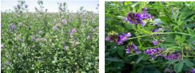

# Lucerne (Irrigated perennial)

<!-- p. 184 -->

|   1. | Season & Soil     | Throughout year, Loamy soil                                                                                                     |
|------|-------------------|---------------------------------------------------------------------------------------------------------------------------------|
|   2. | Field Preparation | 1 Iron Plough + 2 Country plough Ridges & furrows - 6m x 25 cm                                                                  |
|   3. | Manuring          | Basal : FYM/Compost : 25t/ha, 25:120:40 kg NPK                                                                                  |
|   4. | Seeds & Sowing    | 20 kg/ha (Rs.400/kg), 25 cm x Solid sowing, Rhizobium 3 pocket, 2 cm depth                                                      |
|   5. | After Cultivation | Weeding & gap filling 20th Day, Earthing up after 3 cuts, Cuscuta : Good seed, Remove & burn with host, Avoid sowing for 3 yrs. |
|   6. | Irrigation        | After sowing, Life irrigation, 7 days interval                                                                                  |
|   7. | Protection        | Aphide: Malathion 4-5 DAH                                                                                                       |
|   8. | Harvest           | Ist : 75 - 90 DAS, 25 - 30 Days (10 - 15% flower)                                                                               |
|   9. | Yield             | 80 - 100 t/ha (12-13 cut) - GFY 150 - 200 kg/ha - Seed yield                                                                    |

- Soil suitable for Lucerne cultivation is ________

- Loamy soil

- Clay soil

- Heavy soil

- The centre of origin of Lucerne is __________

- S. Africa

- America

- S.W.Asia

- One of the oldest cultivated fodder crop is ________

- Guinea grassb. BN grass

- Lucerne

- Ideal time of sowing of Lucerne is ____

- Oct.-Nov.

- May - June

- Jan. - Feb.

- Parasitic weed found in Lucerne is ________

- Orobanche

- Cuscuta

- Striga

*****☺*****

# Lecture 30

<!-- p. 186 -->

# OATS (Avena sativa)

<!-- p. 186 -->

Oat (Avena sativa) can be grown successfully for fodder purpose during the rabi season under both irrigated and rainfed conditions. Oat fodder is quite nutritive containing, on an average, 7.6 per cent crude protein at 50% flowering stage and about 14.6 per cent at very early stage of growth. Under adequate irrigated conditions, it may give three cuttings starting from January when green fodder is scarce.

# Palampur-1

<!-- p. 186 -->

It is a medium maturing variety with plant height of about 115 cm at 50 per cent flowering which comes in about 145 days. Leaves are broad and dark green in colour. It has uniform tillering with about 15 tillers per plant. It gives, on an average, 500 quintals green fodder per hectare. The seed crop matures in about 190 days.

# Kent

<!-- p. 186 -->

It is an early variety coming to flowering in about 125 days. It has moderate tillering and plant height with medium sized leaves. The seed crop matures in about 180 days. On an average, it gives 360 quintals green fodder per hectare.

Oat can be grown on all types of soils except on waterlogged ones.

# Seed rate and method of sowing

<!-- p. 186 -->

Seeding should be done in rows 25 cm apart at seed rate of 100 kg per hectare. The seeds should be treated with Vitavax 2 g/kg seed to ensure freedom from covered smut disease. Sowing of oats in lines 20 cm apart and broadcasting of pea gives higher green as well as dry fodder yield under rainfed conditions.

# Sowing time

<!-- p. 187 -->

The crop should be sown from mid September to mid December.

For multiple cutting, basal dressing of 40 kg N and 40 kg P2O5 should be done at the time of seeding and 30 kg N should be applied as top dressing each after first and second cutting.

Three to four irrigations are sufficient. In case of multiple cuttings, field must be irrigated after each cutting.

# Cuttings

<!-- p. 187 -->

For single cut plots, optimum time of harvesting is the fifty per cent bloom stage. For multiple cuttings, the first cutting is taken about three months after seeding and subsequent cutting at an interval of 40 days.

# Seed production

<!-- p. 187 -->

On average, about 15 quintals seed is obtained per hectare, if no cut for fodder is taken.

1. The recommended seed rate for oat is _______kg/ha

- 100

- 50

- 70

2. Optimum temperature for sowing of oat is __________

- 10 - 120c

- 25 - 300c

- 15 - 200c

- Oat crop needs ________ climate

- Warm and humidb. Dry and hot

- Cold and dry

- Optimum time of harvesting of oat is ____ per cent bloom stage

- 50

- 70

- 80

6. Optimum month of sowing of oat is ________

- Sep. - Dec.

- May - June

- Jan. - Feb.

*****☺*****

# Hay making

<!-- p. 189 -->

-Hay -refers to cereals, grasses or legumes that are harvested at appropriate stage, dried and stored‖

-  High quality hay is light grey color

-  Leafy, pliable & free from mustiness

-  Easy method of storing seasonal excess

- o Only way for farm by-products

-  Principle is to reduce water content

-  Legume, non-legume & mixed gay are the major three types

# Field method

<!-- p. 189 -->

-  In field there are two methods

- o Windrows - occupies 1/3rd land area

- o Swath - Entire field

-  Drying in ‗Windrows' faster than swath

-  For this, harvest few hrs after dew drying

-  Allowed to cure in the field itself

- o Turned after every 4-5 hrs

# Lecture 31

<!-- p. 189 -->

# PRESERVATION OF FODDER - HAY & SILAGE MAKING

<!-- p. 189 -->

- o By the evening moisture reduced (75% to 40%)

- o Next day requires 1 or 2 turnings

- o Moisture content in the 2nd day comes to 25%

- o Now ready for storage as bales or in tripod stand

- o End of curing moisture to be reduced to 20%

- o Normally 70-75 sunshine hrs require

-  Not suitable for rainy season

# Mechanical method

<!-- p. 190 -->

-  Fence method - wire fencing with angle iron posts are used

- o More suitable for berseem, Lucerne, groundnut haulms and legume fodders

- o Protein loss is minimized (2-3%)

-  Forced air batch - developed at IGFRI

- o Capacity 1 t /day

- o Cost Rs.60/t

# Chemical changes in hay making

<!-- p. 190 -->

-  Conversion of soluble sugars to CO2 & H2O

-  Loss of digestibility

-  Increase in cellulose and lignin content

-  Reduce in nutritive and keeping quality

# Loss in fodder value

<!-- p. 190 -->

-  Nutrient loss in late cutting

-  Shattering of leaves & finer parts (in legumes)

-  Fermentation loss leads to dry mass loss by 6%

-  Oxidation by sun bleaching leads to

- o Loss of chlorophyll and carotene

-  Carotene decreases from 150-200 to 5-10ppm

-  Carotene is to give aroma

-  Animals are color blind

-  Leaching leads to loss of

- o Protein, nitrogen free extract (NFE), minerals, and vitamins

- o Consequently crude fibre increases & digestibility deceases

- o In Berseem crude protein loss is from 22% to 16-18%

# Ensilage / Silage making

<!-- p. 191 -->

‗Silage' may be defined as the green succulent roughage preserved under controlled anaerobic fermentation in the absence of oxygen by compacting green chops in air and watertight receptacles

-  Silage leads to fermentation of water soluble carbohydrates to organic acids which increases acidity of the materials (pH - 4)

-  Such anaerobic acid (lactic acid) arrests the

- o growth of bacteria

- o Moulds

- o Inactivates putrefying organisms (act as preservative)

- o Consequently reduces nutrient losses and

- o Change in nutritive value

-  Best method than hay

# Crops suitable for silage

<!-- p. 191 -->

-  Crops suitable are based

- o Dry matter of 30-45%

- o Soluble sugar 8-10%

- o Ratio between water soluble CHOs and buffer capacity

- o Ratio of sugars to crude protein

-  All these decide production of lactic acid

- o Crops suitable for cut at 50% flowering and at milking

-  Crops like sorghum, maize

# Points for consideration while ensiling

<!-- p. 192 -->

- o Dry matter content for the materials should be 30-45%

- o More succulent materials may be taken after field drying only

- o Polythene layering on all sides improves the quality

- o Filling should be done on a clear day as quickly as possible

- o Filling should be in layers of 20-30cm at a time and uniformly

- o Compaction must be perfect

- o Trampling is useful to remove air pockets

- o Top must be convex / dome

- o Silage pit size

-  20 x 20 x 20 c. ft for 50-55 t

-  5 x 5 x 6 c. ft for 22.5 t

-  10 x 5 x 6 c. ft for 45.0 t

# Characteristics of good silage

<!-- p. 192 -->

-  No mould growth

-  Golden / greenish yellow

-  Pleasant fruity odour or acceptable aroma

-  Free flowering and non-sticky texture

-  3-4% increased palatability

-  Increased nutritive value

-  pH around 4.0 - 4.5

-  Lactic acid proportionally more than other acids

-  Decrease in nitrate-N and increase in ammoniacal-N

-  Ammoniacal N should not exceed more than 15% of the total N

# Haylage

<!-- p. 193 -->

-  It is low moisture silage (40-45%)

-  Made from grass / legume that is wilted to reduce moisture content

-  But for moisture it is almost silage

# Fortification of Fodder

<!-- p. 193 -->

‗Fortification or enriching is the direct addition of feed supplements to the poor quality roughage to improve its fodder value'

-  Mixing green legume with fodder

-  Mixing liquid ammonia (2.5 to 3.0%)

-  Mixing Urea molasses

- o 2-3% for concentrates

- o 1% of dry matter

-  After mixing similar to silage

# Fortifying materials and usage

<!-- p. 194 -->

-  Molasses for rice, wheat

-  Mineral mixture and salt for low grade grass hay

-  Urea for sorghum & maize green fodder

-  Tapioca powder/ maize powder for leguminous fodder

-  Bacteria and / fungi for dried ground nut haulms

# Advantages of Fortification

<!-- p. 194 -->

-  Improves palatability

-  Reduces wastage

-  Improves rumen environment

-  Increases crude protein

-  Cleavage of cell wall for increased digestibility

-  Neutralize or reduce the concentration of toxic principles

-  Increases digestibility

-  Milk protein and fat increase

1. Green succulent roughage preserved under controlled anaerobic fermentation

- Forage

- Hay

- Silage

- Cool-season grass is ________

- Rye

- Bermuda c. Corn

- Warm-season grass is __________

- Rye

- Blue grass c. Bermuda

4. Enriching is the addition of feed supplements to the poor quality roughage _____

- Silage

- Haylage c. Fortification

- Moisture content in silage is ________

- 40-45%

- 20 - 25% c. 25 - 35%

*****☺*****

# Disclaimer:

<!-- p. 196 -->

The information on this website does not warrant or assume any legal liability or responsibility for the accuracy, completeness or usefulness of the courseware contents.

The contents are provided free for noncommercial purpose such as teaching, training, research, extension and self learning.

# Connect With Us:

<!-- p. 196 -->

******☺******

# This Book Download From e-course of ICAR

<!-- p. 196 -->

# Visit for Other Agriculture books, News, Recruitment, Information, and Events at www.agrimoon.com

<!-- p. 196 -->

Give FeedBack & Suggestion at info@agrimoon.com

# Send a Massage for daily Update of Agriculture on WhatsApp

<!-- p. 196 -->

+91-8148663744

