# CROP PRODUCTION GUIDE HORTICULTURE CROPS 2020

<!-- p. 1 -->

# Directorate of Horticulture and Plantation Crops

<!-- p. 1 -->

# Chepauk, Chennai - 600 005

<!-- p. 1 -->

&

# Tamil Nadu Agricultural University

<!-- p. 1 -->

# Coimbatore - 641 003

<!-- p. 1 -->

# CONTENTS

<!-- p. 3 -->

|   S.No. | Crop                                              |   Page No. |
|---------|---------------------------------------------------|------------|
|         | I - Fruits                                        |            |
|      1. | Part Chapter A - Tropical and Sub Tropical Fruits |          1 |
|         | 1. Mango                                          |          1 |
|         | 2. Banana                                         |          7 |
|         | 3. Acid Lime                                      |         14 |
|         | 4. Sweet Orange                                   |         17 |
|         | 5. Mandarin Orange                                |         18 |
|         | 6. Grapes                                         |         20 |
|         | 7. Guava                                          |         28 |
|         | 8. Pineapple                                      |         30 |
|         | 9. Sapota                                         |         31 |
|         | 10. Papaya                                        |         33 |
|         | 11. Pomegranate                                   |         36 |
|         | 12. Jack                                          |         39 |
|         | 13. Ber                                           |         40 |
|         | 14. Amla                                          |         41 |
|      2. | Chapter B - Temperate Fruits                      |         43 |
|         | 1. Apple                                          |         43 |
|         | 2. Pear                                           |         45 |
|         | 3. Plum                                           |         46 |
|         | 4. Peach                                          |         47 |
|         | Part II - Vegetables                              |            |
|      3. | Chapeter A - Fruit Vegetables                     |         59 |
|         | 1. Tomato                                         |         59 |
|         | 2. Brinjal                                        |         65 |
|         | 3. Bhendi                                         |         71 |
|         | 4. Chilli                                         |         75 |
|         | 5. Capsicum                                       |         80 |
|         | 6. Paprika                                        |         83 |
|         | 7. Pumpkin                                        |         84 |
|         | 8. Snake Gourd                                    |         86 |
|         | 9. Ribbed Gourd                                   |         88 |
|         | 10. Bottle Gourd                                  |         91 |
|         | 11. Bitter Gourd                                  |         94 |
|         | 12. Ash Gourd                                     |         97 |

|   S.No. | Crop                                  |   Page No. |
|---------|---------------------------------------|------------|
|         | 13. Cucumber                          |        100 |
|         | 14. Gherkin                           |        102 |
|         | 15. Watermelon                        |        103 |
|         | 16. Muskmelon                         |        105 |
|         | 17. Tinda                             |        107 |
|         | 18. Chow Chow                         |        108 |
|         | 19. Cluster Bean                      |        109 |
|         | 20. Vegetable Cowpea                  |        110 |
|         | 21. Lab lab or Dolichos Bean          |        111 |
|         | 22. French Bean                       |        113 |
|         | 23. Broad Bean                        |        115 |
|         | 24. Peas                              |        116 |
|         | 25. Annual Moringa                    |        117 |
|         | 26. Baby Corn                         |        119 |
|      4. | Chapter B - Cole Vegetables           |        121 |
|         | 1. Cabbage                            |        121 |
|         | 2. Cauliflower                        |        126 |
|      5. | Chapter C - Root and Tuber Vegetables |            |
|         | 1. Carrot                             |        130 |
|         | 2. Radish                             |        132 |
|         | 3. Beetroot                           |        134 |
|         | 4. Potato                             |        136 |
|         | 5. Sweetpotato                        |        140 |
|         | 6. Tapioca                            |        141 |
|         | 7. Elephant Foot Yam                  |        145 |
|         | 8. Taro                               |        147 |
|         | 9. Dioscorea                          |        148 |
|         | 10. Chinease Potato                   |        149 |
|      6. | Chapter D - Bulb Vegetables           |        151 |
|         | 1. Multiplier Onion - Small Onion     |        151 |
|         | 2. Bellary Onion - Big Onion          |        153 |
|      7. | Chapter E - Leafy Vegetables          |        158 |
|         | 1. Amaranthus                         |        158 |
|         | 2. Curry Leaf                         |        160 |

| S.No.                                  | Crop                                   | Page No.                               |
|----------------------------------------|----------------------------------------|----------------------------------------|
| 8.                                     | Chapeter F - Minor Vegetable Crops     | 162                                    |
|                                        | Part III - Spices and Condiments       |                                        |
| 9.                                     | Chapter A - Major Spices               | 167                                    |
|                                        | 1. Pepper                              | 167                                    |
|                                        | 2. Cardamom                            | 170                                    |
|                                        | 3. Turmeric                            | 173                                    |
|                                        | 4. Ginger                              | 176                                    |
| 10.                                    | Chapter B - Tree Spices                | 176                                    |
|                                        | 1. Clove                               | 176                                    |
|                                        | 2. Nutmeg                              | 180                                    |
|                                        | 3. Cinnamon                            | 182                                    |
|                                        | 4. Tamarind                            | 184                                    |
|                                        | 5. Allspice                            | 186                                    |
| 11.                                    | Chapter C - Seed Spices                | 187                                    |
|                                        | 1. Coriander                           | 187                                    |
|                                        | 2. Fenugreek                           | 189                                    |
|                                        | 3. Fennel                              | 190                                    |
| 12.                                    | Chapter D - Other Spices               | 192                                    |
|                                        | 1. Vanilla                             | 192                                    |
| 13.                                    | Part IV - Plantation Crops             | 194                                    |
|                                        | 1. Tea                                 | 194                                    |
|                                        | 2. Coffee                              | 198                                    |
|                                        | 3. Cashew                              | 203                                    |
|                                        | 4. Cocoa                               | 205                                    |
|                                        | 5. Rubber                              | 209                                    |
|                                        | 6. Coconut                             | 214                                    |
|                                        | 7. Arecanut                            | 225                                    |
|                                        | 8. Oil Palm                            | 227                                    |
|                                        | 9. Palmyrah                            | 230                                    |
|                                        | 10. Betelvine                          | 232                                    |
| Part V - Medicinal and Aromatic Plants | Part V - Medicinal and Aromatic Plants | Part V - Medicinal and Aromatic Plants |

|   S.No. |                                                                        | Crop                                                                   |   Page No. |
|---------|------------------------------------------------------------------------|------------------------------------------------------------------------|------------|
|     14. | Chapter A - Medicinal Plants                                           | Chapter A - Medicinal Plants                                           |        235 |
|         | 1.                                                                     | Glory Lilly                                                            |        235 |
|         | 2.                                                                     | Coleus                                                                 |        237 |
|         | 3.                                                                     | Senna                                                                  |        238 |
|         | 4.                                                                     | Periwinkle                                                             |        239 |
|         | 5.                                                                     | Medicinal Solanum                                                      |        240 |
|     15. | Chapter B - Aromatic Plants                                            | Chapter B - Aromatic Plants                                            |        241 |
|         | 1.                                                                     | Lemongrass                                                             |        241 |
|         | 2.                                                                     | Citronella                                                             |        242 |
|         | 3.                                                                     | Palmarosa                                                              |        243 |
|         | 4.                                                                     | Geranium                                                               |        244 |
|         | 5.                                                                     | Patchouli                                                              |        245 |
|         | 6.                                                                     | Mint                                                                   |        246 |
|     16. | Chapter C - Production Techniques for other important Medicinal Plants | Chapter C - Production Techniques for other important Medicinal Plants |        248 |
|         | Part VI - Floriculture                                                 | Part VI - Floriculture                                                 |            |
|     17. | Chapter A - Loost Flowers                                              | Chapter A - Loost Flowers                                              |        250 |
|         | 1.                                                                     | Rose                                                                   |        250 |
|         | 2.                                                                     | Malligai (Gundumalli)                                                  |        252 |
|         | 3.                                                                     | Mullai                                                                 |        254 |
|         | 4.                                                                     | Jathi Malli (Pitchi)                                                   |        255 |
|         | 5.                                                                     | Crossandra                                                             |        256 |
|         | 6.                                                                     | Chrysanthemum                                                          |        258 |
|         | 7.                                                                     | Marigold (African Marigold)                                            |        260 |
|         | 8.                                                                     | Tuberose                                                               |        261 |
|         | 9.                                                                     | Nerium                                                                 |        263 |
|         | 10.                                                                    | Golden Rod                                                             |        264 |
|     18. | Chapter B - Cut Flowers                                                | Chapter B - Cut Flowers                                                |        265 |
|         | 1.                                                                     | Cut Roses                                                              |        265 |
|         | 2.                                                                     | Cut Chrysanthemum                                                      |        268 |
|         | 3.                                                                     | Carnation                                                              |        270 |
|         | 4.                                                                     | Anthurium                                                              |        272 |
|         | 5.                                                                     | Dendrobium Orchid                                                      |        274 |
|         | 6.                                                                     | Lilium                                                                 |        275 |
|         | 7.                                                                     | Gladiolus                                                              |        276 |
|         | 8.                                                                     | Gerbera                                                                |        278 |
|         | 9.                                                                     | China Aster                                                            |        280 |

|   S.No. | Crop                                                                                                           |   Page No. |
|---------|----------------------------------------------------------------------------------------------------------------|------------|
|     19. | Part VII - Particulars on Improved varieties of Horticultural Crops                                            |        281 |
|     20. | Part VIII - Drip Irrigation for Fruit Crops                                                                    |        299 |
|     21. | Part IX - Organic Cultural Practices                                                                           |        300 |
|     22. | Part X - Protected Cultivation of Vegetables (for information)                                                 |        302 |
|     23. | Part XI - Seed Production Technology of Horticultural Crops                                                    |        303 |
|     24. | Part XII - Important Plant Nutrients, their Deficiency symptoms and Remedial Measures                          |        327 |
|     25. | Part XIII - Mushroom Cultivation                                                                               |        336 |
|     26. | Part XIV - Season of Flowering and Fruting of Fruit Crops                                                      |        344 |
|     27. | Part XV - Chemical and Commerical Names of Insecticides and Nematicides                                        |        346 |
|     29. | Part XVII -Weed Management and Herbicides usage in Horticultural Crops                                         |        358 |
|     30. | Part XVIII - Cultural Tips for F1 Hybrid Vegetables                                                            |        364 |
|     31. | Part XIX - Farm Implements for Horticultural Crops                                                             |        371 |
|     32. | Part XX - Food Processing Technologies                                                                         |        392 |
|     33. | Part XXI - Soil Test Crop Response based Integrated Plant Nutrition System for Horticultural Crops (STCR-IPNS) |        398 |
|     34. | Part XXII - Appendicies                                                                                        |        405 |

khz; g[ kpF ntshz; ikj; Jiw mikr; rh; kw; Wk;

# jpU. ,uh. Jiuf; fz; q

<!-- p. 9 -->

,iz nte; jh; jkpH; ehL ntshz; ikg; gy; fiyf; fHfk; / brd; id - 600 002

# Kft[ iu

<!-- p. 9 -->

njhl; lf; fiy gaph; fspd; gaphpLk; gug; g[ Fiwe; J tUk; ,f; fhyj; jpy; gaphpd; cw; gj; jpia bgUf; fp cHthpd; ,yhgj; ij mjpfhpg; gJ vd; gJ kj; jpa kw; Wk; khepy muRfspd; Kf; fpakhd nehf; fkhf cs; sJ. ,jid mila g[ jpa bjhHpy; El; g'; fs; Kf; fpa g'; F tfpf; fpd; wd. ,j; jifa bjhHpy; El; g'; fis cHth; fSf; F bfhz; L bry; tJ xU Kf; fpakhd tsh; r; rpg; ghijahFk; . ,t; tifapy; gaph; cw; gj; jpf; ifnaL - njhl; lf; fiy 2020 xU cldo jPh; t[ f; fhz ghh; itf; ifnalhf cs; sJ. ,jpy; bjhFf; fg; gl; Ls; s jkpH; ehL ntshz; ikg; gy; fiyf; fHf njhl; lf; fiy gaph; fspd; Muha; r; rp Kot[ fs; filg; gpof; fg; gLk; nghJ gy; ntW gaph; fspd; cw; gj; jpj; jpwd; mjpfhpf; Fk; vd; gJ jpz; zkhFk; .

Kf; fpa kw; Wk; tzpfhPjpapyhd gHg; gaph; fs; / fha; fwpfs; / thrid kw; Wk; kiyj; njhl; l gaph; fs; / kUe; J kw; Wk; kyh; g; gaph; fs; cl; gl; l midj; J njhl; lf; fiy gaph; fSf; fhd fhyepiy/ ,uf'; fs; / gaph; nkyhz; ik/ gaph; ghJfhg; g[ kw; Wk; tpij cw; gj; jp Fwpg; g[ fs; ,f; ifnal; oy; Fwpg; gplg; gl; Ls; sd. ,it jtpu fhshz; cw; gj; jp/ m'; ff bray; Kiwfs; / fis eph; thfk; / gz; izf; fUtpfs; kw; Wk; cgfuz'; fs; / czt[ g; gjg; gLj; Jk; bjhHpy; Eqf; f'; fs; kw; Wk; kz; ghpnrhjid mog; gilapyhd xU'; fpize; j gaph; Cl; lr; rj; J eph; thfk; Mfpaita[ k; ,f; ifnal; oy; ,lk; bgw; Ws; sd.

,f; ifnaL njhl; lf; fiyj; Jiw fs mYtyh; fSf; F bghpJk; cjtpahf ,Ug; gJ kl; Lkd; wp eph; thfj; jpdh; fSf; Fk; / Muha; r; rpahsh; fSf; Fk; / njhl; lf; fiy khzhf; fh; fSf; Fk; kpft[ k; cjtpahf ,Uf; Fk; . ,f; ifnal; oid cUthf; f cWJizahf ,Ue; j midj; J jkpH; ehL ntshz; gy; fiyf; fHf njhl; lf; fiy tp"; "hdpfSf; Fk; bjhFg; ghfpa Muha; r; rp ,af; Fdh; mth; fSf; Fk; / tHpelj; jpa Jiz nte; jh; mth; fSf; Fk; vdJ kdkhh; e; j kfpH; r; rpiaa[ k; / ed; wpiaa[ k; bjhptpj; Jf; bfhs; fpnwd; .

Shri Gagandeep Singh Bedi, IAS Agricultural Production Commissioner & Principal Secretary Government of Tamil Nadu Secretariat, Agricultural Department, Chennai - 600 009

# PREFACE

<!-- p. 11 -->

The Indian Horticulture has grown exponentially over the years and the fruits and vegetable production has surpassed the food grain production of the country and reached the all time high of 315 million tonnes during 2018-19 which is the second largest next to China. Such a phenomenal achievement is made possible amidst a bundle of constraints such as declining per capita arable land availability, occurrence of regular droughts, low soil organic carbon, multi-nutrient deficiencies besides people quitting farming.

The Tamil Nadu Agricultural University, Coimbatore, plays a role in developing improved crop varieties and hybrids in fruits, vegetables, spices & plantation crops, medicinal crops besides flowers, technologies and farm mechanization. The varieties and technologies are well received by farmers across the country and TNAU serves as the torch bearer of cutting edge technologies like nanotechnologies for the preservation of fruits and vegetables. The technology package deserves continued revision and update to ensure recent technologies are infused for adoption. In this context, the TNAU under the dynamic leadership of the Vice Chancellor, Director of Research and other technical directors, the "Crop Production Guide (CPG) - Horticulture 2020" was updated and ready for adoption by the farmers of the State of Tamil Nadu.

The CPG - Horticulture 2020 carries complete package of practices of crops including varieties / hybrids, management techniques & technologies, protected cultivation of crops, drip fertigation, nematode management, integrated weed management practices, technology capsule for pests and diseases management, labour saving farm machineries and post-harvest management practices.

I take this opportunity to thank the Vice Chancellor, Director of Horticulture and Plantation Crops, Director of Research, Dean (Horticulture) other Technical Directors and Department officials for their tireless efforts to bring out the document that serve as the base for the growth and development of horticulture and allied sectors in the State of Tamil Nadu.

(Gagandeep Singh Bedi)

# PREFACE

<!-- p. 13 -->

The Tamil Nadu Agricultural University, Coimbatore, is known for its innovation to develop crop varieties, technologies and farm implements to enhance farm productivity and profitability. The TNAU has a well articulated and structured research framework to develop varieties and technologies to enable adoption by the farmers of the State. The growth of Horticulture in the State and the country has grown phenomenally increased that ensured nutritional security.

The Research Council, Annual Crop Scientists Meets and Scientific Workers Conference rigorously review and scout for the varieties or technologies to be recommended for adoption by the farmers of the State. Such a meticulous planning and execution help us in assembling basket of varieties and technologies that are packaged as the Crop Production Guide - Horticulture 2020. This covers the standard operational protocols for fruits, vegetables, spices & plantation crops, medicinal crops besides flowers with reference to varieties / hybrids, production technologies and farm mechanization.

The "Crop Production Guide (CPG) - Horticulture 2020" was revised and updated involving the Directors and Deans in the university besides Department of Horticulture and Plantation Crops and Department officials. The Department and University is working very closely to resolve the unresolved field problems. Such network helped us to improve the CPG as a technology package suitable for the farmers of the Tamil Nadu State.

I take this opportunity to thank the Agricultural Production Commissioner & Principal Secretary to the Government, Director of Horticulture and Plantation Crops, Director of Research, Dean (Horticulture), other Technical Directors, and Department officials for their contribution towards the publication of the CPG - Horticulture 2020.

*(N. KUMAR)*

Dr. N. Kumar, Ph.D., Vice Chancellor Tamil Nadu Agricultural University Coimbatore 641 003

# Part I Fruits Chapter A

<!-- p. 15 -->

# 1. Tropical and Sub Tropical Fruits

<!-- p. 15 -->

# 1. Mango (Mangifera indica L.); Anacardiaceae

<!-- p. 15 -->

Neelum, Bangalora, Alphonso, Rumani, Banganapalli, Kalepad, Peter, PKM 1, PKM 2, Sendura, Jahangir, Mulgoa, Himayuddin, Paiyur 1, Mallika, Amrapali and Salem Bangalora, Arka Anmol, Arka Aruna, Arka Neelkiran, Arka Puneeth.

Processing varieties : Alphonso, Banganapalli, Totapuri Export varieties : Alphonso, Banganapalli, Sendura

Red loamy soil with good drainage is preferable. pH range 6.5 to 8.

July to December.

Use plantable size grafts propagated through approach, soft wood or epicotyl grafting.

Dig pits of 1 m x 1 m x 1 m in size. Fill in with topsoil mixed with 10 kg of FYM.

Plant the grafts at the centre of the pits with ball of earth intact and keep the graft union 15 cm above the ground level. Stake and water the plants immediately after planting.

Spacing

Adopt any one of the following spacings depending on requirements.

- Under conventional system of planting: 7x7m or 10x10 m

- High Density Planting : 5 m x 5 m (400 plants / ha)

- Ultra High Density Planting: 3 x 2 m

- Double hedge row system : Adopt a spacing of 5 m x 5 m within double rows and 10 m between sucessive double rows (266 plants / ha)

Regular watering till establishment. For cultivation under irrigated conditions, adopt drip system of irrigation.

Short duration crops like legumes, vegetables, groundnut etc. can be raised during pre- bearing age.

# Manures and Fertilizers (kg per tree)

<!-- p. 16 -->

| Manures and Fertilizers   |   1 st Year |   Annual increase |   6 th year onwards |
|---------------------------|-------------|-------------------|---------------------|
| FYM                       |       10.00 |             10.00 |                  50 |
| N                         |        0.20 |              0.20 |                 1.0 |
| P                         |        0.20 |              0.20 |                 1.0 |
| K                         |        0.30 |              0.30 |                 1.5 |

Manures and fertilizers may be applied during September - October, 45 - 90 cm away from the trunk upto the peripheral leaf tip and incorporated.

# Fertigation Schedule for mango.

<!-- p. 16 -->

Minimum number of Fertigation dose for all stages are

| Nutrient   | After Harvest (June- Aug)   | Pre flowering (Sept-Oct )   | Flowering to Fruit set (Dec-Jan)   | Fruiting   | Total   |
|------------|-----------------------------|-----------------------------|------------------------------------|------------|---------|
| N          | 25 %                        | 40%                         | 20%                                | 15%        | 100%    |
| P          | 40%                         | 30%                         | 20%                                | 10%        | 100%    |
| K          | 25%                         | 20%                         | 25%                                | 30%        | 100%    |

# Fertigation technology under HDP

<!-- p. 16 -->

Apply 1.0:0.5:1.0 kg of NPK / bearing tree / year under HDP through drip fertigation adopting the following schedule:

| Nutrient   | Stage of application * - Immediately after harvest (2 months)   | Stage of application * - Pre- flowering (2 months)   | Stage of application * - Flowering to fruit set (2 months)   | Stage of application * - Fruit development (4 months)   | Stage of application * - Total   |
|------------|-----------------------------------------------------------------|------------------------------------------------------|--------------------------------------------------------------|---------------------------------------------------------|----------------------------------|
| N          | 25 %                                                            | 40 %                                                 | 20 %                                                         | 15 %                                                    | 100 %                            |
| P          | 50 %                                                            | 30 %                                                 | 20 %                                                         | -                                                       | 100 %                            |
| K          | 25 %                                                            | 20 %                                                 | 25 %                                                         | 30 %                                                    | 100 %                            |

- Avoid irrigation and fertigation for 30 days for induction of stress before flowering season; resume as soon as flowering commences.

Fertilizer recommendation for UHDP Mango planted in normal soil

| Age              |   Fertilizer g tree- 1 - N |   Fertilizer g tree- 1 - P |   Fertilizer g tree- 1 - K |   FYM kg tree-1 |
|------------------|----------------------------|----------------------------|----------------------------|-----------------|
| 1st year         |                         35 |                         15 |                         25 |               5 |
| 2nd year         |                         45 |                         25 |                         50 |               5 |
| 3rd year         |                         75 |                         50 |                         75 |              10 |
| 4th year onwards |                        120 |                         75 |                        100 |              15 |

# Fertigation schedule for UHDP Mango (to be applied at weekly interval)

<!-- p. 17 -->

|   Fertigation Schedule and Quantity (kg -1 dose -1 acre -1 ) - Age (Year) | Fertigation Schedule and Quantity (kg -1 dose -1 acre -1 ) - Month   |   Fertigation Schedule and Quantity (kg -1 dose -1 acre -1 ) - No. of Doses |   Fertigation Schedule and Quantity (kg -1 dose -1 acre -1 ) - Urea |   Fertigation Schedule and Quantity (kg -1 dose -1 acre -1 ) - H3 PO4 |   Fertigation Schedule and Quantity (kg -1 dose -1 acre -1 ) - MOP |   Fertigation Schedule and Quantity (kg -1 dose -1 acre -1 ) - MgSO4 |
|---------------------------------------------------------------------------|----------------------------------------------------------------------|-----------------------------------------------------------------------------|---------------------------------------------------------------------|-----------------------------------------------------------------------|--------------------------------------------------------------------|----------------------------------------------------------------------|
|                                                                         1 | July-Sep                                                             |                                                                          12 |                                                                 1.4 |                                                                   0.5 |                                                                0.8 |                                                                0.000 |
|                                                                         1 | Jan-May                                                              |                                                                          20 |                                                                 1.7 |                                                                   0.6 |                                                                0.9 |                                                                0.000 |
|                                                                         2 | July-Sep                                                             |                                                                          12 |                                                                 2.7 |                                                                   1.2 |                                                                2.3 |                                                                0.278 |
|                                                                         2 | Jan-May                                                              |                                                                          20 |                                                                 1.6 |                                                                   0.7 |                                                                1.4 |                                                                0.167 |
|                                                                         2 | 15 June- Aug                                                         |                                                                          12 |                                                                 4.5 |                                                                   2.3 |                                                                3.5 |                                                                0.555 |
|                                                                         3 | Sept                                                                 |                                                                           4 |                                                                 1.4 |                                                                   1.2 |                                                                3.1 |                                                                0.000 |
|                                                                         3 | Jan-May                                                              |                                                                          20 |                                                                 3.2 |                                                                   1.2 |                                                                1.5 |                                                                0.333 |
|                                                                         3 | 15 June- Aug                                                         |                                                                          12 |                                                                 7.2 |                                                                   3.5 |                                                                4.6 |                                                                0.833 |
|                                                                         4 | Sept                                                                 |                                                                           4 |                                                                 2.2 |                                                                   1.7 |                                                                4.2 |                                                                0.000 |
|                                                                         4 | Jan-March                                                            |                                                                          12 |                                                                 5.1 |                                                                   1.7 |                                                                3.2 |                                                                0.833 |

# (Source: Jain irrigation systems, Udumalpet)

<!-- p. 17 -->

# Canopy management

<!-- p. 17 -->

Remove rootstock sprouts and low lying branches nearer to ground to facilitate easy cultural operations. Remove overlapping, intercrossing, diseased, dried and weak branches in old trees to get good sunlight and aeration. Carry out judicious pruning of the internal branches during August - September, once in three years. Do not allow flowering upto three years by removing the inflorescences as and when they appear. Retain two healthy shoots by trimming away the weak shoots among the crowded terminal shoots during AugustSeptember annually. Prune back 20 cm of annual growth of the terminals immediately after harvest.

# Top working of senile orchards for rejuvenation

<!-- p. 17 -->

Use scions of choice varieties like Alphonso and Banganapalli for top working. Behead the trees to be top worked during July- August leaving the main trunk at a convenient height and allow for new shoots to develop. Adopt cleft method of grafting or softwood grafting on the emerging shoots from the cut end of the main stem during September- October.

Spray NAA @ 20 ppm at flowering to increase the fruit set and retention. During February 0.5% Urea (5 g / lit.) or 1% Potassium nitrate (10 g / lit.) may be sprayed to induce flowering, if trees do not flower by that time. Spray 2% KNO3 at mustard size to increase fruit size and retention of fruits. Spray 2 % sulphate of potash at pea stage and 15 days after to improve yield and quality.

During off year Paclobutrazol @ 0.75 g a.i. per metre of canopy radius in full bearing tree during first fortnight of September to get maximum number of fruits and yield.

# Off-season crop induction

<!-- p. 17 -->

This technology is recommended only for irrigated conditions to shift production from on- season to off- season. To induce off-season flowering, heading back of 10 cm terminal growth after the emergence of new growth (vegetative and floral growth) during December - January along with soil application of Paclobutrazol @ 0.75g a.i. per tree during March - April is recommended for mango cv.Neelum. Keeping good soil moisture conditions and nutrient health status of the plant are very important when Pacloburazol application is resorted.

# 1. Pests

<!-- p. 18 -->

# Hoppers

<!-- p. 18 -->

# Flower webber Stem borer

<!-- p. 18 -->

-  Remove criss-cross branches, infested shoots and dense branches.

-  Apply Metarrhizium anisopliae or Beauveria bassiana @ 10 8 cfu /ml on tree trunk once during off season and twice at 7 days interval during flowering season.

-  Spray any of the following insecticides first at the time of inflorescence emergence and the second two weeks after first spray.

-  Neem oil @ 5 ml/l of water can be mixed with any insecticides for the control of hopper.

-  Spray Maida 5% (1 kg Maida or starch) boiled with 1 l of water and diluted to 20 litres.

-  Avoid spraying during cloudy weather.

-  Spray Fish oil rosin soap @ 125g / 5l./tree

-  Release Australian ladybird beetle, Cryptolaemus montrouzieri @ 10 beetles/tree

-  Band the trees with 20 cm wide degradable polythene sheets (150 gauge)

-  Spray any one of the following insecticides:

-  Spray phosalone 35 EC 2ml/l.

-  Mechanically remove and kill the grub by introducing a needle or wire.

-  Apply carbofuran 3CG @ 5g per bore hole and plug with mud.

-  Plough the inter spaces to expose pupae.

-  Collect and destroy the fallen fruits.

-  Spray Neem oil @ 30ml/l. during initial stage of fruit maturation.

-  Prepare bait with methyl eugenol 1% solution mixed with malathion @ 2.0 ml/l. Take 10 ml of this mixture per trap and keep them in 25 different places in one hectare between 6 a.m. and 8 a.m. or keep methyl eugenol traps @25/ha.

| Insecticide          | Dose         |
|----------------------|--------------|
| Buprofezin 25SC      | 1.0 ml/l.    |
| Dimethoate 30EC      | 1.5 ml/l.    |
| Imidacloprid 17.8 SL | 2.0 ml/10 l. |
| Thiamethoxam 25WG    | 1.0 g/10 l.  |
| Malathion 50 EC      | 1.5 ml/l.    |
| Methyl demeton 25 EC | 1.0 ml/l.    |

| Insecticide      | Dose      |
|------------------|-----------|
| Dimethoate 30 EC | 1.6 ml/l. |
| Malathion 50 EC  | 1.5 ml/l. |

-  Spray wettable sulphur @ 0.2%

-  Spray carbendazim 46.27% SC @ 1 ml/l or hexaconazole 5% EC @ 1 ml/l or hexaconazole 5% SC @ 2 ml/l

# Anthracnose and Stalk end-rot

<!-- p. 19 -->

-  Spray mancozeb @ 2 g/l or carbendazim @ 1 g/l or thiophanate methyl @ 1 g/l or chlorothalonil @ 2 g/l as pre-harvest spray, three times at 15 days interval or spray Pseudomonas fluorescens immediately after flowering @ 5 g/ l five times at 21 days interval

# CIB recommendation for anthracnose

<!-- p. 19 -->

-  Spray copper oxychloride 50% WG @ 2.4 g/l

# CIB recommendation for combined infection of anthracnose and powdery mildew

<!-- p. 19 -->

-  Spray azoxystrobin 23% SC @ 1ml/l or carbendazim1.92%+mancozeb10.08%GR @1.5g/l or tebuconazole 50% + trifloxystrobin 25% WG @ 0.75-1 g/l

-  Spray maida 5% (1 kg maida or starch) boiled with 1 l of water and diluted to 20 l. Avoid spraying during cloudy weather

## Harvest Season: March to June.

<!-- p. 19 -->

Yield varies with varieties and spacing adopted. 8 -10 t / ha upto 15 years; 15-20 t / ha from 15-20 years.

# Post harvest treatment

<!-- p. 19 -->

Dip the fruits in 52 o ± 1 o C hot water immediately after harvest for 5 minutes followed by 8% plant wax (Fruitox or Waxol) to reduce anthracnose disease in mango during storage.Two pre-harvest sprays of 0.2% Mancozeb (2.0 g / lit) will also reduce the incidence.

# Waiting Period

<!-- p. 19 -->

Methyl demeton 0.05% - 14 days Fenthion 0.05% - 14 days Quinalphos 0.05 - 12 days

# Enhanced Preservation of Fruits using Nanotechnology

<!-- p. 19 -->

- Enhanced freshness formulation for pre-harvest spray and post-harvest dip

- Hexanal loaded nano stickers

- Hexanal loaded nano pellets

# Pre-harvest spray for mango and other fruits

<!-- p. 19 -->

- Dilute 20 ml of fruity fresh formulation in one litre of water or 200 ml of fruity fresh in 10 litre of water

- Spray over fruits and leaves when the fruits are at 60 - 70% maturity stage. For better results give one more spray after 10 days

- The spray solution should be used on the same day and ensure that the entire tree foliage and fruits are soaked

# Post-harvest dip for mango and other fruits

<!-- p. 20 -->

- Dilute 20 ml of fruity fresh formulation in one litre of water or 200 ml fruity fresh in 10 litre of water

- Dip fruits for five minutes in the diluted solution and dry the fruits before packing

# Benefits of the fruity fresh

<!-- p. 20 -->

- TNAU fruity fresh spray can delay the harvest for two weeks in case of preharvest spray

- Post-harvest dip in 2% TNAU fruity fresh extends the shelf life of fruits by two weeks in ambient storage condition and upto 4 weeks under cold storage

| Growing Districts               | Krishnagiri, Vellore, Dindigul, Thiruvallur, Dharmapuri, Theni                                                                                                                              |
|---------------------------------|---------------------------------------------------------------------------------------------------------------------------------------------------------------------------------------------|
| Major Markets in Tamil Nadu     | Theni, Dharmapuri, Salem, Tirunelveli.                                                                                                                                                      |
| Preferred Varieties and Hybrids | Banganapalli, Bangalora, Neelum, Rumani, Mulgoa, Alphonso, Totapuri                                                                                                                         |
| Grade Specification             | Firmness, lack of decay / defects, uniformity of size and shape, skin color, flesh color and flavor Small - Less than 200 g Medium - 201- 400 g Large -401- 600 g Extra-large - 601 - 800 g |
| Export Market                   | UAE, Kuwait and other Middle East countries.                                                                                                                                                |

# 2. Banana (Musa sp); Musaceae

<!-- p. 21 -->

# Varieties Dessert

<!-- p. 21 -->

Grand Naine, Robusta, Dwarf Cavendish, Rasthali, Vayal vazhai, Poovan, Nendran, Red Banana, Karpooravalli, Udhayam, CO 1, Matti, Sannachenkadali and Ney poovan. Cavendish groups are generally preferred for export.

# Culinary

<!-- p. 21 -->

Monthan, Nendran, Vayal vazhai, Ash Monthan and Chakkia.

# Hill areas

<!-- p. 21 -->

Virupakshi, Sirumalai, Namarai, Red Banana, Manoranjitham (Santhana vazhai) and Ladan.

Well drained loamy soils are suitable. Alkaline and saline soils should be avoided.

Wet lands: Feb - April: Poovan, Rasthali, Monthan, Karpooravalli and Ney poovan April - May: Nendran and Robusta

# Garden lands

<!-- p. 21 -->

January - February and November - December.

# Padugai lands

<!-- p. 21 -->

January - February and August - September.

# Hill Banana

<!-- p. 21 -->

April - May (lower Palani hills); June - August (Sirumalai)

# Selection and pre-treatment of suckers

<!-- p. 21 -->

Select sword suckers of 1.5 to 2.0 kg weight, free from diseases and nematodes. Trim the roots and decayed portion of the corm, cut the pseudostem leaving 20 cm from the corm and grade the suckers to size. To avoid wilt disease, infected portions of the corm may be pared, dipped for 5 minutes in carbendazim 0.1% (1 g in 1 lit of water) for Rasthali, Monthan, Neyvannan, Virupakshi and other wilt susceptible varieties. Pralinage with 40 g of carbofuran 3CG granules per sucker (Dip the corm in slurry solution of 4 parts clay plus 5 parts water and sprinkle carbofuran to control nematodes). Sow sunhemp on 45th day; incorporate it after about a month. This operation reduces nematode build up. Use well hardened tissue cultured banana plants with 5-6 leaves. At the time of planting, apply 25 g Pseudomonas fluorescens / plant.

# Wet lands

<!-- p. 21 -->

No preparatory cultivation is necessary.

# Garden land

<!-- p. 21 -->

2 - 4 ploughings.

# Padugai

<!-- p. 21 -->

One deep mammutti digging.

# Hill Banana

<!-- p. 22 -->

Remove scrub jungle and construct contour stone walls.

# Wet lands

<!-- p. 22 -->

Place the suckers at ground level and earth up.

# Digging pits

<!-- p. 22 -->

Garden land, Padugai and Hill Banana: Dig pits of 45 cm x 45 cm x 45 cm in size. The pits are refilled with topsoil, mixed with 10 kg of FYM, 250 g of Neem cake.

# Spacing (Conventional method)

<!-- p. 22 -->

|             | Variety                                          | Spacing                 | No. of plants / ha           |
|-------------|--------------------------------------------------|-------------------------|------------------------------|
| Garden land | Robusta, Nendran, Dwarf Cavendish                | 1.8 x 1.8 m 1.5 x 1.5 m | 3086 4444                    |
| Wet land    | Poovan, Monthan, Rasthali, Neyvannan, Ney poovan | 2.1 x 2.1 m             | 2267                         |
| Hills       | Virupakshi (Sirumalai), Namarai and Ladan        | 3.6 x 3.6 m             | 750 (When mixed with coffee) |

High density planting system (HDP)

Adopt high density planting for higher productivity - Plant 3 suckers / pit at a spacing of 1.8 x 3.6 m (4600 plants / ha) for Cavendish varieties and 2 m x 3 m for Nendran (5000 plants / ha).

Irrigate immediately after planting. Give life irrigation after 4 days. Subsequent irrigations are to be given once in a week for irrigated plantations of garden lands and once in 10 - 15 days for wet lands. Irrigate the fields copiously after every manuring. Use drip irrigation @ 15 litres / plant / day from planting to 4 th month, 20 litres / plant /day from 5 th month to shooting and 25 litres / plant / day from shooting till 15 days prior to harvest.

| Details                      | N - (g / plant / year)   | P - (g / plant / year)   | K - (g / plant / year)   |
|------------------------------|--------------------------|--------------------------|--------------------------|
| Garden land                  |                          |                          |                          |
| Varieties other than Nendran | 110*                     | 35*                      | 330*                     |
| Nendran                      | 150                      | 90                       | 300                      |
| Wet land                     | 210                      | 35                       | 450                      |
| Nendran, Rasthali            | 210                      | 50                       | 390                      |
| Poovan,Robusta               | 160                      | 50                       | 390                      |

# Hill bananas

<!-- p. 23 -->

After forming semi circular basins on uphill side, apply 375 g of 40:30:40 NPK mixture, plus 130 g muriate of potash per clump per application during October, January and April. Apply Azospirillum and Phosphobacteria 20 g each at planting and 5 th month after planting preceding chemical fertilizer application.

Apply N as neem-coated urea. Apply N and K in 3 splits on 3 rd , 5 th and 7 th month, Phosphorus at 3 rd month of planting. Apply Arbuscular mycorrhiza (250 g/plant), phosphate solubilising bacteria (50 g/plant), Azospirillum (50 g/plant) and Trichoderma harzianum (50 g/plant) at the time of planting. Apply 20 g in each of Azospirillum and Phosphobacteria again five months after planting (This should be applied prior to chemical fertilizer application).

For HDP with three suckers, apply 2.25 times of recommended dose per clump For Tissue culture banana, apply 50% extra fertilizers at 2nd, 4th, 6th and 8th month after planting.

For maximizing productivity follow fertigation technique - Apply 25 litres of water / day + 200:30:300 g N: P2O5: K2O / plant using water soluble fertilizers.

For economizing the cost of fertilizers, fertigate using normal fertilizers (Urea and Muriate of potash) with 50% of the recommended dose along with recommended dose of phosphorus as basal at 2nd month after planting. Fertigate at weekly intervals as per the following schedule:

| Weeks after planting   | N (% )   | P2O5 (% )   |   K2O (% ) |
|------------------------|----------|-------------|------------|
| 9-18 (10 weeks)        | 30       | 100         |         20 |
| 19-30 (12 weeks)       | 50       | --          |         40 |
| 31-42 (12 weeks)       | 20       | --          |         32 |
| 43-45 (3 weeks)        | --       | --          |          8 |
| Total                  | 100      | 100         |        100 |

# Organic nutrient schedule for banana cv. Grand Naine

<!-- p. 23 -->

Application of FYM @ 10 kg + Neem cake @ 1.25 kg + Vermicompost @ 5 kg and Wood ash @ 1.75 kg / plant + Triple green manuring with sunnhemp (one time) and Cowpea (two times) + biofertilizers viz., AM @ 25g, Azospirillum @ 50 g, PSB @ 50 g and Trichoderma harzianum @ 50 g/ plant is recommended for organic cultivation of banana cv. Grand Naine. The schedule for application of different components is as detailed below:

- Basal: FYM and neem cake.

- After 3months of planting: vermicompost

- After 5 months of planting: Potassium as wood ash

- Triple green manuring: Each manuring is done at 10 days interval, first with sunhemp for 45 days from planting and then twice with cowpea for 30days

# Aftercultivation Garden Land

<!-- p. 23 -->

Give spade digging at bi-monthly intervals and earth up. Prune the suckers at monthly intervals. The dry and diseased leaves are removed and burnt to control the spread of leaf spot diseases. Male flowers may be removed a week after opening of last hand. The plants at flowering may be propped. Cover the peduncle with flag leaf to prevent stalk end rot. Cover the bunches with banana leaves to avoid sun scald.

# Wet land

<!-- p. 24 -->

Form trenches in between alternate rows and cross trenches at every 5th row. The trenches are periodically deepened and the soil is spread over the bed. Surface diggings may be given at bi-monthly intervals and desuckering at monthly intervals. Remove the male flower a week after opening of last hand. Prop plants at or prior to flowering. Cover the peduncle with flag leaf and the bunch with leaves to avoid sun scald. For ratoon crops, in respect of Poovan, Monthan and Rasthali, allow the follower at flowering of the mother plant and remove the other suckers at harvest.

# Perennial banana

<!-- p. 24 -->

Give surface digging with spade once in two months. Give one deep digging with spade during January - February. Other operations as in garden land.

# Hill banana

<!-- p. 24 -->

Give four forkings in January, April, July and October. Remove outer sheaths to keep the corm inside the soil and ward-off borer. Maintain two bearing plants and two followers per clump along the contour.

To improve the grade of bunches, 2,4-D at 25 ppm (25 mg / l.) may be sprayed in Poovan and CO 1 banana after the last hand has opened. This will also help to remove seediness in Poovan variety. Spray CCC 1000 ppm at 4th and 6th month after planting. Spray Plantozyme @ 2ml / l at 6th and 8th month after planting to get higher yield.

Spray micronutrients viz., ZnSO4 (0.5%), FeSO4 (1.0%), CuSO4 (0.2%) and H3BO3 (0.2%) at 3 rd , 5 th and 7 th MAP to increase yield and quality of banana. Apply 25 kg ZnSO4 basally.

# Bunch cover

<!-- p. 24 -->

Use transparent recyclable polyethylene sleeves with 2% (during cool season) and 4% (during summer season) ventilation to cover the bunches immediately after opening of the last hand

Leguminous vegetables, beetroot, elephant foot yam and sunnhemp. Avoid growing cucurbitaceous vegetables.

-  Mulching with 100µm degradable polythene sheet immediately after planting conserves soil moisture and also suppresses weed growth. Surface digging and earthing up of soil at bi-monthly intervals facilitates better root system. Desuckering should be done at monthly intervals. Removal of dried leaves at periodical intervals reduces the disease spread. At the time of bunch emergence, prop the plants using bamboo or casuarina poles. After the completion of female phase, remove the male bud for better fruit development. After opening of the last hand, withered styles and perianth to be removed to avoid finger tip disease.

-  Bunch thinning i.e., removal of one to two small bottom hands from the bunch (keeping only 7 to 8 hands) facilitates uniform bunch development and this practice is recommended for export purpose. Cover the peduncle with flag leaf to prevent main stalk end rot. Cover the bunch with degradable polythene sleeves (2 - 4 % ventilation) or with white colour non-woven UV stabilized

polypropylene sleeves to avoid sunscald and to produce quality bunch. After harvesting, the pseudostem should be cut leaving a stump of about 0.6m height to nourish the developing daughter sucker.

(Source: Banana Expert System, TNAU Agritech portal)

-  Apply or sprinkle carbofuran 3G 33g/sucker at the time of planting.

-  Remove dried leaves periodically and keep the plantation clean.

-  Remove the side suckers up to eighth month and destroy.

-  Do not dump infested materials in the manure pit. Infested trees should be uprooted, chopped into pieces and burnt.

-  Trap and kill adult weevils by chopping pseudostem chopped into small pieces.

-  Carbofuran 3G @166g /plant

-  Dimethoate 30EC 1.0 ml/l.

-  Methyl demeton 25 EC 2.0ml/l.

-  The Banana Aphid, Pentalonia nigronervosa is the vector of Bunchy-top virus disease.

-  The spray may be directed towards the crown and pseudostem base upto ground level at 21 days interval at least thrice.

## Banana aphid

<!-- p. 25 -->

Apply any one of the following insecticides

# To prevent the disease,

<!-- p. 25 -->

- Use virus-free suckers

- ii) Paring and pralinage: Pare the corm and sprinkle 40 g of carbofuran 3 G over the corm (Before sprinkling, corm should be dipped in mud slurry).

- iii) Destroy virus affected plants.

-  Dimethoate 30 EC 1.0ml/l.

-  Methyl demeton 25 EC 1.0ml/l.

-  Quinalphos 25EC 4.0ml/l.

Lace wing bugs:

-  Spray dimethoate 30 EC 1.0ml/l.

Spray any of the following insecticides

Rhizome weevil

# Pseudostem borer

<!-- p. 25 -->

# Bunchy-top

<!-- p. 25 -->

Pre-treat the suckers with 40 g of carbofuran 3G. If pre-treatment is not done, apply 40 g of carbofuran around each plant one month after planting (refer selection and pretreatment for alternative technology). Then grow sunnhemp after 45 th day and incorporate one month later. Press mud application @ 15 t per ha one month after planting and neem cake 1.5 t per ha one month after planting. Intercrop with marigold @ 4:1 ratio. Apply Pseudomonas fluorescens (Pf1) liquid formulation @ 4 lit/ha @ 2 nd , 4 th and 6 th month after planting through drip system to manage panama wilt and nematode complex.

# Selection and pre-treatment of suckers

<!-- p. 26 -->

-  Select sword suckers of 1.5 to 2.0 kg weight, free from diseases and nematodes. Trim the roots and decayed portion of the corm, cut the pseudostem leaving 20 cm from the corm and grade the suckers to size. To avoid wilt disease, infected portions of the corm may be pared, dipped for 5 minutes in carbendazim 0.1% solution (1 g in 1 l of water) solution for Rasthali, Monthan, Neyvannan, Virupakshi and other wilt susceptible varieties.

-  Pralinage with 40 g of carbofuran 3 CG granules per sucker (dip the corm in slurry solution of 4 parts clay plus 5 parts water and sprinkle carbofuran to control nematodes).

-  Sow sunnhemp on 45 th day; incorporate it after about a month. This operation reduces nematode build up.

# Sigatoka leaf spot

<!-- p. 26 -->

-  Remove affected leaves and burn

-  Spray carbendazim @ 1 g/l or benomyl @ 1 g/l or mancozeb @ 2 g/l or copper oxychloride @ 2.5 g/l or ziram @ 2 ml/l or chlorothalonil @ 2 g/l at monthly interval from November onwards

-  Alternatively spray propiconazole @ 1 ml/l or 0.5 ml/l along with petroleum based mineral oil @ 10 ml/l or Pseudomonas fluorescens @ 0.5% three times at 15 days interval to control sigatoka leaf spot incidence. Always add 5 ml of wetting agent like Sandovit, Triton AE, Teepol etc. per 10 l of spray fluid.

-  Spray pyraclostrobin 133 g/l + epoxiconazole e 50g/l SE @ 3 g/l or tebuconazole 50% + trifloxystrobin 25% WG @ 300 g/ha

# Panama Disease (Fusarium wilt)

<!-- p. 26 -->

-  Uproot and destroy severely affected plants

-  Apply lime at 1 - 2 kg in the pits after removal of the affected plants

-  Corm injection: Remove a small portion of soil to expose the upper portion of the corm. Make an oblique hole at 45° angle to a depth of 10 cm. Immediately insert a gelatin capsule containing 60 mg of carbendazim or of 50 mg of Pseudomonas fluorescens or inject 3 ml of 2 % carbendazim solution into the hole with the help of ‗corm injector' on 2 nd , 4 th and 6 th months after planting

-  Apply press mud at 5 kg per plant to reduce the wilt incidence or apply Pseudomonas fluorescens (Pf1) liquid formulation @ 4 l/ha at 2 nd , 4 th and 6 th months after planting through drip system to manage panama wilt and nematode complex.

# Cigar end rot

<!-- p. 26 -->

-  CIB recommendation: Spray mancozeb 75% WP @1.5-2.0 kg/ha

# Bunchy-top

<!-- p. 26 -->

-  Use virus-free suckers for planting

-  The banana aphid, Pentalonia nigronervosa is the vector of bunchy-top virus disease

-  Destroy virus affected plants by inserting a gelatin capsule containing 200 mg 2,4 - D into the corm 7 cm deep using capsule applicator or inject 5 ml 2,4 - D solution (125 gm/lit of water) into the pseudostem by using the injection gun. The plant collapses and topples in 3 - 5 days

-  Apply carbofuran 3G @ 166 g /plant or spray dimethoate 30EC @ 1 ml/l or methyl demeton 25 EC @ 2 ml/l to control vector

-  The spray may be directed towards crown and pseudostem base upto ground level at 21 days interval at least thrice.

Kottaivazhai in Poovan: Spray 2,4 - D @ 25 ppm within 20 days after opening of last hand (1g / 40 lit / 200 bunches) or 1.2 g of sodium salt of 2,4 - D dissolved in 40 lit of water for 200 bunches.

Crop duration: The bunches will be ready for harvest after 12 to 15 months of planting.

Harvest: Bunches attain maturity from 100 to 150 days after flowering depending on variety, soil, weather condition and altitude.

Yield (t / ha / year): Poovan & Rasthali : 40 - 50 t / ha Monthan : 30 - 40 t / ha Ney Poovan : 30 - 35 t / ha Robusta : 50 - 60 t / ha Grand Naine : 70 - 80 t / ha Grand Naine uner HDP : 115-130 t / ha

| Growing Districts               | Coimbatore, Erode, Thoothukudi, Tirunelveli, Trichy, Vellore, Kanyakumari and Karur districts                                                                         |
|---------------------------------|-----------------------------------------------------------------------------------------------------------------------------------------------------------------------|
| Major Markets in Tamil Nadu     | Trichy, Coimbatore, Theni                                                                                                                                             |
| Preferred Varieties and Hybrids | Grand Naine, Dwarf Cavendish, Robusta, Rasthali, Poovan, Nendran, Red Banana, Ney Poovan, Pachanadan, Monthan, Karpuravalli, Neyrannan.                               |
| Grade Specification             | The hands are graded based on the number and size of fingers in each hand. Over ripe and injured fruits are discarded. Banana is sent to the local market as bunches. |

# 3. Acid Lime: Citrus aurantifolia (Christm) Swingle; Rutaceae

<!-- p. 28 -->

Varieties: PKM 1, VRM 1 Tahithi lime, Balaji (Tenali), Vikram, Rasraj, NRCC -7, NRCC -8 , Phule Sharbathi

Soil and Climate: Areas with dry climate and moderate rainfall (<750 mm) are best suited. Deep well drained medium black, loamy or alluvial soils rich in organic matter and devoid of calcium carbonate are good. The optimum pH is 6.5 -7.0

Season: December - February and June - September.

Propagation: Budded plants on Rough lemon or Rangpur lime rootstocks are good. Since seeds are highly polyembryonic and seedlings are true to type, propagation by seeds is also recommended. Layering is adopted for VRM 1 Tahithi lime.

Planting: Healthy seedlings are planted during June to December at 6 x 6 m spacing in 75 cm x 75 cm x 75 cm pits.

Irrigation: Young plants need regular watering during post-monsoon period at an interval of 8-10 days and at 5-7 days during summer months. Water is applied around the periphery of the tree in a ring and basin system (double ring) so that tree trunk should not come in direct contact with water. Avoid water stagnation. Adopt drip system for new plantations.

Manures and Fertilizers per plant: 'N' to be applied in two doses during March and October.FYM, P2O5 and K2O are to be applied in October. Pseudomonas @ 20 g and VAM @ 200 g per plant may be added along with FYM application.

# Manures and Fertilizers (per plant)

<!-- p. 28 -->

| Ist year   | Annual increase   | From 6th year   |
|------------|-------------------|-----------------|
| FYM 10 kg  | 5 kg              | 30 kg           |
| N 200 g    | 100 g             | 600 g           |
| P 100 g    | 25 g              | 200 g           |
| K 100 g    | 40 g              | 300 g           |

After cultivation: Remove branches of main stem up to 45 cm from ground level. Periodical removal of dried twigs along with one inch length of basal green wood and destroying them by burning should be done. Spray Zinc sulphate @ 0.5% (500 g /100 lit of water) thrice in a year (March, July and October) after the emergence of new flushes. The basins should be mulched with dry leaf waste or paddy husk with about 10 cm thickness so as to arrest weed growth and also to conserve soil moisture, thereby improving the fruit

quality.

Intercropping: Legumes and vegetable crops can be raised during pre-bearing age.

Growth regulator: To increase fruit set, spray 2, 4 - D @ 20 ppm (200 mg / 10 l) during flowering. For fruit retention, spray 2, 4 - D @ 20 ppm or NAA 30 ppm (300 mg / l) after fruit set (marble size).

Harvest: Starts bearing from 3 - 4 years after planting. The tree flowers and produces fruits almost all the year round, but there are three major flushes in June-July (Mrig Bahar), September-October (Hast Bahar) and January - February (Ambi Bahar). Fruits of September-October flowering (Hast Bahar) harvested during summer months are most remunerative. The fruits mature in 5-6 months after flowering and are harvested when the colour just starts changing. Peak harvesting period is July-September and NovemberJanuary.

# Post harvest handling

<!-- p. 29 -->

Harvested fruits are graded according to size and colour and packed in bamboo baskets or wooden crates lined with green foliage. Treating the fruits with 4% wax emulsion followed by pre-packing in 200 gauge polythene bags with 1 % ventilation improves the shelf life for more than 10 days.

Yield: .25 t /ha /year.

| Growing Districts               | Dindigul, Tirunelveli, Trichy, Perambalur   |
|---------------------------------|---------------------------------------------|
| Major Markets in Tamil Nadu     | Dindigul, Tirunelveli, Trichy, Perambalur   |
| Preferred Varieties and Hybrids | PKM 1, Balaji, Vikram                       |
| Grade Specification             | Good size with golden yellow colour         |

# Rust mite

<!-- p. 29 -->

# Fruit sucking moth

<!-- p. 29 -->

# Shoot borer

<!-- p. 29 -->

# Citrus Butterfly

<!-- p. 29 -->

# Citrus Psyllid

<!-- p. 29 -->

Apply/spray any one of the following

-  Carbofuran 3 G @ 50 kg /ha

-  Neem seed kernel extract (NSKE) 5 %

-  Neem cake extract 5%

-  Neem oil 3 %

-  Imidacloprid 17.8 SL @ 5.0 ml/10 l.

-  Thiodicarb 75 WP @ 1g /l.

Spray any one of the following

-  Dimethoate 30 EC 1.0ml/l.

-  Fish oil rosin soap 25 g/l.

-  Neem oil @ 3 ml/l

Spray any one of the following

-  Diafenthiuron 50 WP @ 2 g/l.

-  Destroy Tinospora weed host of larva.

-  Bait with fermented molasses with malathion 50 EC 1 ml/l.

-  Bag the fruits with degradable polythene bags (150 gauge) punctured at the bottom.

-  Apply smoke and set up light traps or food lures (pieces of citrus fruits).

-  Prune the withered shoots 4 cm below the dried portions.

-  Plug the fresh holes on the shoots with cotton soaked in kerosene.

Spray two rounds of any of the following during new flush formation

-  Bacillus thuringiensis @ 1g/l.

-  Neem oil 30 ml/l.

-  Quinalphos 25 EC 3.0 ml/l.

Spray any one of the following

-  Thiamethoxam 25 WG @1gm/10 l.

-  Imidacloprid 17.8 SL 5.0ml/10 l.

-  Set up bait with methyl eugenol 0.1% solution mixed with malathion 50 EC 1 ml/lit between 6 a.m. and 8 a.m.

# Mealy bugs

<!-- p. 30 -->

# Citrus root nematode:

<!-- p. 30 -->

-  Apply Pseudomonas fluorescens @ 20g per tree at a depth of 15 cm and 50 cm away from the trunk for the management of slow decline due to the citrus root nematode, Tylenchulus semipenetrans. Soil application of carbofuran 10G @ 2g followed by drenching with metalaxyl plus mancozeb 72 WP @ 0.1% 50 ml/ cutting/ poly bag/ kg of nursery soil for citrus decline.

# Twig blight

<!-- p. 30 -->

-  Prune dried twigs and spray copper oxychloride@ 0.3% or carbendazim @ 0.1% at monthly intervals to reduce the spread of disease

Scab : Spray 1% Bordeaux mixture

# Canker

<!-- p. 30 -->

-  Immediately after pruning one spray with copper oxychloride @ 0.3% followed by 4 sprayings with streptocyclin @ 100 ppm + copper oxychloride @ 0.3% at monthly intervals

-  Spray streptocycline @ 50 to 100 ppm repeatedly at an interval of 15-20 days after appearance of new growth. Cover young foliage and fruits fully

# CIB recommendation for combined infection of leaf spot and canker

<!-- p. 30 -->

-  Spray with copper oxychloride 50% WP @ 2.5 gm/l

# Tristeza virus

<!-- p. 30 -->

-  Use pre-immunized acid lime seedlings for planting

-  Remove the infected trees and destroy

-  Spray dimethoate 30 EC 1 ml/l or fish oil rosin soap @ 25 g/l or monocrotophos 36SL @ 1 ml/l or neem oil @ 3 ml/l to control the aphids which spread the disease

-  Application of Carbofuran 3G @ 75 g/tree to control citrus nematodes in severe infestations.

-  Application of 20 g Pseudomonas fluorescens formulation per tree at a depth of 15 cm and 50 cm away from the trunk once in four months. Soil application of carbofuran 10G @ 2 g followed by drenching with metalaxyl plus mancozeb 72 WP @ 1% 50 ml/ cutting/ poly bag/ kg of nursery soil for citrus decline.

-  Use degradable polythene bag (150 gauge) fish meal trap with 5 gm of wet fish meal + 1 ml malathion in cotton. 50 traps are required/ha, fish meal + malathion soaked cotton are to be renewed once in 20 and 7 days respectively.

-  Neem oil 30 ml

-  Debark the branches

-  Use sticky trap on the shoot bearing the fruits at a length of 5 cm.

-  Use fish oil rosin soap (25g/l) as spray or for dipping the fruits for two minutes.

-  Dissolve Fish oil rosin soap @ 25g /l, initially in luke warm water, then in required quantity of spray fluid in the sprayer.

-  Verticillium lecanii 1.15 WP 5g/l.

# 4. Sweet Orange (Citrus sinensis (L) Osbeck) ; Rutaceae

<!-- p. 31 -->

Varieties : Sathugudi, Batavian, Mosambi, Malta blood red, Cutter Valencia.

Deep well drained loamy soils are the best for the cultivation of Citrus. pH of soil should be 6.5 to 7.5 and EC of water less than 1.0. A dry climate with about 50 - 75 cm of rainfall from June - September and with well defined summer and winter season is ideal.

Season : July to September.

Budded plants (Rootstock: Rangpur lime is the best, now rough lemon is also preferred).

Dig pits at 75 cm x 75 cm x 75 cm in size at 7 x 7 m spacing. Fill up the pits with top soil and 10 kg of FYM. Plant the budded plants in the centre of the pits and stake it. Plants should be trained during first 3 years to have a well distributed frame work at 45 cm height on a single trunk.

Immediately after planting, irrigate copiously and continued once in 10 days. Irrigations should be regular during fruit development. Avoid water stagnation near the plant. Water should never come in direct contact with the trunk of the tree; for this reason, double ring or check bund method is best suited for this crop. Drip irrigation is advisable in saving of irrigation water. Stopping irrigation 1 or 2 months prior to flowering is beneficial

# Manures and Fertilizers per plant

<!-- p. 31 -->

N to be applied in two doses during March and October.FYM, P2O5 and K2O are to be applied in October.

| Ist year   | Annual increase   | From 6th year   |
|------------|-------------------|-----------------|
| FYM 10 kg  | 5 kg              | 30 kg           |
| N 200 g    | 100 g             | 600 g           |
| P 100 g    | 20 g              | 200 g           |
| K 100 g    | 40 g              | 300 g           |

Manures are applied in the basin 70 cm away from the trunk and incorporated in the soil. Spray solution containing Zinc Sulphate (0.5%), Manganese (0.05%), Iron (0.25%), Magnesium (0.5%), Boron (0.1%) and Molybdenum (0.003%) once in 3 months at the time of new flush production. In addition to that, apply 50 g in each of Zinc Sulphate, Manganese and Iron per tree per year.

No regular pruning except removing dead, diseased and over crowding branches after harvesting of the fruit. The basins should be mulched with dry leaf waste or paddy husk with about 10 cm thickness so as to arrest weed growth and also to conserve soil moisture, thereby improving the fruit quality.

Intercropping: Legumes and vegetable crops can be raised during pre-bearing age.

Harvest: Starts bearing from 5th year after planting. Sweet orange takes 9-12 months for maturity. Being non-climacteric fruits should be harvested only after full maturity.

Yield: 30 t / ha.

## Pest : Sweet Orange

<!-- p. 32 -->

Leaf miner

# Citrus root nematode:

<!-- p. 32 -->

-  Apply Pseudomonas fluorescens @ 20g per tree at a depth of 15 cm and 50 cm away from the trunk for the management of slow decline due to the citrus root nematode, Tylenchulus semipenetrans. Soil application of 10G @ 2g followed by drenching with metalaxyl plus mancozeb 72 WP @ 0.1% 50 ml/ cutting/ poly bag/ kg of nursery soil for citrus decline.

# 5. Mandarin Orange (Citrus reticulata Blanco); Rutaceae

<!-- p. 32 -->

Varieties : Coorg Orange and Kodai Orange.

Sub tropical climate with an elevation of 500- 1500 m above MSL. A rainfall of about 150 cm to 250 cm is required. The winter should be mild and there should be no strong, hot winds during summer. Deep well drained loamy soils are the best. Soil pH should be between 5.5 and 6.5.

Season : November - December.

Planting : Seedlings and budded plants.

Spacing : 6x6m, pit size 75x75x75 cm. Planting during May - June and Sep - Oct.

Manures and Fertilizers: Apply twice in a year during June and October.

# For Palani Hills

<!-- p. 32 -->

| Manures & Fertilizers   |   1 st year - kg / plant / year |   2 nd year - kg / plant / year |   3 rd year - kg / plant / year |   4 th year - kg / plant / year |   5 th year - kg / plant / year |   6 th year onwards - kg / plant / year |
|-------------------------|---------------------------------|---------------------------------|---------------------------------|---------------------------------|---------------------------------|-----------------------------------------|
| FYM                     |                          10.000 |                          15.000 |                          20.000 |                          25.000 |                          25.000 |                                  30.000 |
| N                       |                           0.100 |                           0.200 |                           0.300 |                           0.400 |                           0.500 |                                   0.600 |
| P                       |                           0.040 |                           0.080 |                           0.120 |                           0.160 |                           0.160 |                                   0.200 |
| K                       |                           0.050 |                           0.100 |                           0.200 |                           0.300 |                           0.300 |                                   0.400 |

For Shervaroyan hills (for trees above 6 years old):

Apply 700:375:600 g / tree NPK along with AM fungi (Glomus fasiculatus) @ 1 kg / tree. Manures are to be applied in the basin 70 cm away from the trunk and incorporated. Apply micronutrients as suggested for sweet orange. Apply agricultural lime or Dolomite at 4 kg / tree during January - February once in 2 - 3 years. This should not be combined with other chemical fertilizers.

-  Spray Dimethoate 30 EC 2 ml / lit

-  5% of Neem Seed Kernel Extract (NSKE)

-  Neem oil 3%.

After cultivation: Remove water shoots, rootstock sprouts, dead and diseased shoots. Remove laterals of the main stem up to 45 cm from ground level. Basins should be provided for each tree with gradient slope.

# Pests Leaf miner

<!-- p. 33 -->

# Fruit sucking moth

<!-- p. 33 -->

# Shoot borer Stem borer

<!-- p. 33 -->

# Green scale

<!-- p. 33 -->

-  Apply sulphur dust @ 25 - 30 kg (350 mesh) in the early morning hours to protect new flush or spray wettable Sulphur @ 0.3% or triademefon @ 0.1% three times at 15 days interval

-  Boil 1 kg maida or starch with 5 l of water, cool, dilute to 20 l and spray

-  Avoid spraying during cloudy weather

Growth regulators: To increase the fruit retention spray the trees at flowering and again at marble stage with 2, 4 - D at 20 ppm or NAA 30 ppm.

Harvest: Budded plants start bearing from 3 - 5 years after planting while seedlings take 5-7 years.

Yield: 15 - 20 t / ha / year.

-  Neem seed kernel extract 5% (NSKE)

-  Neem oil 3%

-  Neem oil 3%

-  Fish oil rosin soap @ 25 g/l.

-  Destroy Tinospora weed host. Bait with fermented molasses plus malathion 50 EC @ 1 ml/l.

-  Bag the fruits with degradable polythene bags (150 gauge) punctured at the bottom.

-  Apply smoke and set up light traps or food lures (pieces of citrus fruits).

-  Prune the withered shoots 4 cm below the dried portions

-  Prune the branches containing grubs.

-  Collect and destroy fallen fruits.

-  Set up methyl eugenol trap 0.1% solution mixed with malathion 50 EC @ 1 ml/lit between 6 a.m. and 8 a.m.

-  Use degradable polythene bag (150 gauge) fish meal trap with 5 gm of wet fish meal + 1 ml. malathion in cotton. 50 traps are required/ha, fish meal + malathion soaked cotton are to be renewed once in 20 and 7 days respectively

-  Neem oil @ 3 % as foliar spray as need based

-  Apply carbofuran 3 G 15 g/plant

-  Spray quinalphos 25 EC 4.0ml/l.

-  Boil 1 kg maida or starch with 5 l of water, cool, dilute to 20 lit and spray. Avoid spraying during cloudy weather.

# 6. Grapes (Vitis vinifera L.); Vitaceae

<!-- p. 34 -->

Muscat Hamburg (Panneer) is the major variety grown in Tamil Nadu.

# Table varieties

<!-- p. 34 -->

Muscat Hamburg (Panneer / Gulabi), Pachadraksha, Anab-e-Shahi, Dil Kush, Thompson Seedless, Red Globe, Tas-A-Ganesh, Manik Chaman, Sonaka, Sharad Seedless, Nana Saheb Purple, Crimson Seedless, Fantasy Seedless, Italia, Flame Seedless and Clone A-18/3.

# Juice varieties

<!-- p. 34 -->

Manjari Medika, Punjab MACS Purple (H-516), Bangalore Blue, Concord, Arka Shyam,

# Raisin varieties

<!-- p. 34 -->

Thompson Seedless, Tas-A-Ganesh, Manik Chaman, Merbein Seedless, Kishmish Rozavis White (KR White), 2A Clone, Kishmish Bailey, Black Monukka

# Wine varieties

<!-- p. 34 -->

Red wine: Cabernet Sauvignon, Shiraz, Merlot, Zinfandel, Pinot Noir White wine: Chenin Blanc, Sauvignon Blanc, Viognier, Temperanillo

Grapes prefer dry humid condition for better growth and yield. Areas within the temperature range of 15 to 40 o C and rainfall lies between 500 and 900 mm are suitable for this crop. Rain should not coincide with vine growth after pruning and bunch ripening phase. Cloudy weather with high relative humidity, fog and low temperature are not suitable for flowering and fruit set. This results in build up of fungal diseases which ultimately leads to loss in yield. Well-drained rich loamy soil with a pH of 6.5 - 7.0 with low water table with EC less than 1.0 is congenial for its cultivation. The soil depth should be atleast 1 m for proper root development and vine establishment. The rootstocks viz., Dogridge and 110 R can be used to overcome the high soil pH, drought and salinity in irrigation water with EC upto 8 m.mhos cm 2 . The day time temperature ranging from 20 o C to 35 o C is optimum for proper vine growth and establishment.

The grapevine can be trained over pandal system or improved ‗'Y'' trellis training system. ‗'Y'' trellis system facilitates mechanization inside the grape vineyard for ploughing, bed formation, interploughing and tractor mounted spray of plant protection chemicals, foliar nutrients and plant growth regulators. The dogridge rootstocks or own rooted cutting of varieties are used as planting materials for the establishment of grape vineyards. Trenches of 2.5 ft depth and 2.5 ft width has to be opened in North-South direction based on the field length to get proper root zone development. This helps in harvest of maximum sunlight for photosynthesis and fruit bud differentiation. Fill the trenches with top soil, FYM, sheep manure, green manure, super phosphate etc., and irrigate copiously. This should be done one month prior to the planting of rootstocks or rooted cuttings. The best time for planting rootstocks in the field is during January - February. The rootstock after planting in the soil requires regular irrigation at periodical interval in its field capacity. In light textured soils, the rootstocks should be irrigated daily. There is no fertilizer requirement upto one month after planting since the roots are not active and require some time for settling. The rootstock plant once settled in the soil should be allowed to grow as such till 50 days from the planting time. The number of shoots sprouted from each plant helps in increasing the root density. These plants are cut back from the base. One month after sprouting, the plants should be retained with 2-3 healthy disease free and vigorous shoots. These shoots are tied with bamboo or casuarina poles with the help of korai fibre or jute thread. On 5-6 months old grown up rootstocks, in situ grafting is done with the scion sticks with 2-3 healthy buds of 15-25 cm length. The in situ grafting can be performed during June to September. The rootstocks are decapitated at 1.5 feet height from the ground level before grafting. At the time of grafting, temperature of 32-35 O C and high relative humidity of 80 per cent in the atmosphere and rootstocks with high sap flow are preferred for getting high graft take. Simple wedge grating is the best method for in situ grating for getting maximum success for the establishment of grapes vines. Whereas the best time for planting the own rooted cuttings is June-July.

Spacing interval of 4 x 2 m for commercial grape varieties and 3 x 2 m for Muscat Hamburg.

Irrigate immediately after planting and on the 3rd day and then once in a week. Withheld irrigation 15 days before pruning and also 15 days before harvest.

# Irrigation water requirement for grapes through drip irrigation for table grapes varieties

<!-- p. 35 -->

| Growth stage                             | Duration (Days after pruning)   | Water requirement (lpd/hectare)   |
|------------------------------------------|---------------------------------|-----------------------------------|
| Shoot growth                             | 1- 40                           | 33,600 - 50,400                   |
| Fruit bud differentiation                | 41 - 60                         | 11,200 -14,000                    |
| Cane maturity and Fruit bud development* | 61 - 120                        | 0 - 8,400                         |
| 121days - fruit pruning *                |                                 | 0 - 8,400                         |
| Shoot growth                             | 1 - 40                          | 33,200 - 42,000                   |
| Bloom to shatter                         | 41 - 55                         | 5,600 - 8,400                     |
| Berry growth and development             | 56 -105                         | 12,600 - 25200                    |
| Ripening to harvest                      | 106 - harvest                   | 33,600 - 42,000                   |
| Rest period                              | Harvest to foundation pruning   | -                                 |

# Training

<!-- p. 35 -->

Once new shoots are started from the scion portion after grafting or from the own rooted cuttings, train the shoots straight by tying them to bamboo sticks or casuarina poles. The girth of the graft union tend to increase during the graft growth, during this time the polythene strips have to be removed to avoid the girdling damage or constriction over the main stem. For getting uniformity in growth of grapevines by giving recut at 3 rd node position above the graft joint. Immediately after the recut, faster sprouting will be noticed and this needs proper management for the cordon development by adopting ‗'Halt and Go'' method. The growth is nipped of one feet below the level of pandal or ‗'Y'' trellis and then trained to form trunk, primary and secondary arm (cordon) of the grapevine. In this method, the newly growing shoots are cut at 6-7 leaf stage when the growth attains 8-9 leaf. The vines are trained with single stem upto pandal with a stalk on tipping at 2 m height. The main arms are developed and trained on opposite directions. On further tipping, secondary and tertiary arms are developed for spreading all over pandal.

In general, four bud level of pruning for Pachadraksha, Bangalore Blue, Anab- e-Shahi, Dil Kush and Arka hybrids, five bud level for Red Globe, five to seven bud level for Muscat Hamburg and two bud level for Sharad Seedless, Thompson Seedless and its clones (After sub cane formation at 7 th node) may be adopted. Before pruning, the pruning severity and bud level can be determined by bud forecasting technique. Canes of weak and immature nature should be pruned back to one or two buds to induce vegetative growth.

# Pruning Season

<!-- p. 36 -->

Summer crop: Pruning in December - January and harvesting during April - May. Winter crop: Pruning in May-June and harvesting during August - September

# Double pruning for double cropping in Muscat Hamburg (Panneer)

<!-- p. 36 -->

For getting high yield with quality fruits, adoption of double pruning and double cropping system is the best for Muscat Hamburg (Panneer). The first pruning for getting summer crop can be practiced during December - January and harvesting is made during in April - May. The second pruning can be practised during May-June and harvesting during August - September. The vines are allowed for 2-3 months period of rest after harvesting till December. Apart from Muscat Hamburg, the varieties like Anab-e-Shahi, Clone A-18/3, Manjari Medika and H-516 are also highly suitable for adoption of double pruning for double cropping.

# Double pruning for single cropping in commercial grapes varieties

<!-- p. 36 -->

For commercial grapes varieties viz., Red Globe, Thompson Seedless and its clones, Crimson Seedless, Flame Seedless, Fantasy Seedless and Sharad Seedless, adoption of double pruning for single cropping is the best practice for harvesting good quality fruits with high yield. The first pruning (Back pruning) is done at one to two bud level during August - September and allowed for vegetative growth. The second pruning is done on grown up vines (Forward or fruit pruning) during January-March and harvesting is made from May-August depending on the duration of varieties for attaining maturity. For example, the grapes variety Sharad Seedless matures in 100 to 110 days, whereas the Crimson Seedless takes 150 days for maturity.

# Manures and Fertilizers (kg per vine)

<!-- p. 36 -->

# Seedless grapes varieties

<!-- p. 36 -->

Requirement of nutrients for the grapevine is influenced by variety, age of the grapevine, soil, climatic behaviour and irrigation water quality. Nutrient application based on soil, water and petiole analysis will be appropriate and reduces unwanted / excess use of fertilizers. Excess nitrogen is responsible for vegetative growth and restricts the flower bud formation, number of bunches and yield. High phosphorus is directly useful for flower bud initiation and differentiation. The cane maturity is hastened by the application of potash which in turns responsible for flowering and bunch quality. Recommended nutrient dose of fertilizers for grapes varieties viz., Thompson Seedless and its clones and Sharad Seedless should be applied 2 feet away from the main trunk base

in trenches or in rings of 3-4 inch depth for better absorption.

# Recommended nutrient dose for table grapes varieties through soil application

<!-- p. 37 -->

| Variety                                |   Year - I - FYM (kg) |   Year - II - FYM (kg) |   Year - III - FYM (kg) |   Year - I - Green leaves (kg) |   Year - II - Green leaves (kg) |   Year - III - Green leaves (kg) |   Year - I - Nitrogen (kg) |   Year - II - Nitrogen (kg) |   Year - III - Nitrogen (kg) |   Year - I - Phosphorus (kg) |   Year - II - Phosphorus (kg) |   Year - III - Phosphorus (kg) |   Year - I - Potash (kg) |   Year - II - Potash (kg) |   Year - III - Potash (kg) |
|----------------------------------------|-----------------------|------------------------|-------------------------|--------------------------------|---------------------------------|----------------------------------|----------------------------|-----------------------------|------------------------------|------------------------------|-------------------------------|--------------------------------|--------------------------|---------------------------|----------------------------|
| Thompson Seedless Sonaka, Manik Chaman |                    50 |                     50 |                     100 |                             50 |                              50 |                              100 |                       0.20 |                        0.40 |                         0.60 |                         0.08 |                          0.16 |                           0.24 |                     0.40 |                      0.80 |                       1.20 |

# Recommended nutrient dose for table grapes varieties through fertigation

<!-- p. 37 -->

| Growth stage (Days after pruning         | Nitrogen (kg/ha)   | Phosphorus (kg/ha)   | Potash (kg/ha)   |
|------------------------------------------|--------------------|----------------------|------------------|
| Back pruning for vegetative growth       |                    |                      |                  |
| Pre-bud differentiation (1-30 days)      | 80                 | -                    | -                |
| Bud differentiation (31-60 days)         | -                  | 213.3                | -                |
| Post bud differentiation (61-120 days)   | -                  | -                    | 80               |
| Forward pruning for fruiting             |                    |                      |                  |
| Pre-bloom (1-40 days)                    | 80                 | -                    | -                |
| Bloom set and shatter (41-70 days)       | -                  | 106.6                | -                |
| Berry growth upto veraison (71-105 days) | 80                 | -                    | 80               |
| Veraison to harvest (106-130 days)       | -                  | -                    | 80               |
| After harvest (Rest period > 20 days)    | 26.6               | 35.5                 | 26.6             |
| Total                                    | 266.6              | 355.2                | 266.6            |

# Muscat Hamburg (Panneer)

<!-- p. 37 -->

Immediately after harvesting, the vines are allowed for short term rest for a period of 15 days. During this period, irrigation and fertilizer application should be followed for recouping the vines. A trench of 3 to 4 inch depth with 2 feet width between two vines should be opened and 500 g single superphosphate and 25 kg FYM should be applied in the trenches. The trench should be covered with the soil and earthing up is done for the formation of more white absorbent roots.

# Recommended nutrient dose for grapes var. Muscat Hamburg (Panneer) through soil application

<!-- p. 37 -->

| Variety        |   Year - I - FYM (kg) |   Year - II - FYM (kg) | Year - III - FYM (kg)   |   Year - I - Green leaves (kg) |   Year - II - Green leaves (kg) |   Year - III - Green leaves (kg) |   Year - I - Nitrogen (kg) |   Year - II - Nitrogen (kg) |   Year - III - Nitrogen (kg) |   Year - I - Phosphorus (kg) |   Year - II - Phosphorus (kg) |   Year - III - Phosphorus (kg) |   Year - I - Potash (kg) |   Year - II - Potash (kg) |   Year - III - Potash (kg) |
|----------------|-----------------------|------------------------|-------------------------|--------------------------------|---------------------------------|----------------------------------|----------------------------|-----------------------------|------------------------------|------------------------------|-------------------------------|--------------------------------|--------------------------|---------------------------|----------------------------|
| Muscat Hamburg |                    50 |                     50 | 10 0                    |                             50 |                              50 |                              100 |                       0.10 |                        0.20 |                         0.20 |                         0.08 |                          0.16 |                           0.16 |                     0.30 |                      0.40 |                       0.60 |

The manures should be applied twice after pruning. Apply half the dose of potash immediately after pruning and the other half after 60 days of pruning. Foliar spray of 0.1%

boric acid + 0.2% ZnSO4 + 1.0% urea twice before flowering and 10 days after first spray to overcome nutrient deficiency in Muscat Hamburg.

-  Apply 25 kg ZnSO4, 10kg borax, 50 kg FeSO4 + FYM, if the soil is deficient in respective nutrients.

-  Foliar spraying of 0.2% ZnSO4 +0.1% boric acid + 0.5 % FeSO4 + 0.1 % citric acid twice during blooming and after 10 days

# Special viticultural practices

<!-- p. 38 -->

# Shoot thinning

<!-- p. 38 -->

There will be lot of new shoots of more than 100 at faster rate after pruning from the buds of vines. More number of shoots will result in overcrowding which compete for nutrients and water and prone for pest and disease incidence with poor productivity. For growing the seedless varieties for export, less than 0.75 shoot, domestic market purpose 1 shoot and for Muscat Hamburg (Panneer) 2 shoots per square feet area should be retained. Shoot thinning should be practised at 4-5 leaf stage.

# Sub cane development

<!-- p. 38 -->

Commercial seedless grapes varieties with high vigour require sub cane development to achieve high degree of fruitfulness. The vines supplied with high nitrogenous fertilizers and more irrigation also result into vigorous vegetative growth. To avoid the faster vegetative growth, the shoots are pinched at particular node position. Then the lateral is allowed to take lead with slow growth with short internodes at base. This practice is known as sub cane development.

# Training the shoots

<!-- p. 38 -->

To ensure proper micro climate inside the canopy the growing shoots are trained at proper distance in the ‗'Y'' trellis or pandal. Training the shoots will be helpful for light penetration and proper aeration to trigger the uniform cane maturity and also to avoid the pest and disease incidence.

# Tipping

<!-- p. 38 -->

Tipping is practised by the retention of 9-11 leaves above the last cluster and tying of clusters in the pandal after the fruit set for berry development and maturity in the bunches. Further tendrils are also removed.

# Nipping

<!-- p. 38 -->

Nipping is practised by removing the emerged shoots from axillary buds and terminal growth at 12 th to 15 th bud position from the base.

# Cluster and berry thinning

<!-- p. 38 -->

Thinning of excess number of clusters prior to anthesis and thinning the compact bunches by removing 20 - 30 per cent of the berries at pea stage (3-4 mm size berries) using hand scissors should be followed. Dip the clusters in solution containing Brassinosteroid 0.5 ppm and GA 3 25 ppm at 10-12 days after fruit set to maintain vigour, yield and quality parameters.

Pests

Flea beetles

Thrips

Mealybug

Mite

-  Remove loose bark at the time of pruning to prevent egg laying.

-  Spray any one of the following

-  Imidacloprid 17.8% SL 4ml/10 l.

-  Cyantraniliprole 10.26% OD 7ml/10 l.

-  Malathion 50EC 1.0 ml/l.

Spray any one of the following

-  Cyantraniliprole 10.26 OD 7ml/10l.

-  Emamectin benzoate 5 SG 4g/10l.

-  Fipronil 80WG 1.5g/10l.

-  Release coccinellid beetle, Cryptolaemus montrouzieri @ 10 per vine.

-  Spray Buprofezin 25 % SC @ 1.0 ml/l. or Methomyl 40 SP 1.25g/l.

-  Spray Abamectin 1.9 EC 0.75 ml/l of water

# Nematodes

<!-- p. 39 -->

Apply 60 g of carbofuran 3G or 20g of per vine a week before pruning and the plots are irrigated profusely. The soil should not be disturbed for at least 15 days. Thereafter normal manuring may be done. Application of neem cake @ 200g/vine also can be administered to control nematodes. Alternatively, application of Pseudomonas fluorescens formulation in talc containing 15 x 10 8 colony forming units/g @ 100g/vine 30 cm away from base of the vine at least 15cm depth at the time of pruning.

-  Spray wettable sulphur @ 0.3% or dust sulphur @ 6 -12 kg/ha in the morning or azoxystrobin @ 150 a.i./ha (600 ml/ha) at 30 days after pruning five times at 10 days interval

-  Spray carbendazim 46.27 SC @ 1 ml/l or hexaconazole 2% SC @ 1.5-3 l/ha or hexaconazole 5% EC @ 1 ml/l or hexaconazole 5% SC @ 1ml/lit or lime sulphur 22% @ 1% or myclobutanil 10% WP @ 4 ml/10 l or penconazole 10% EC @ 5 ml/10 l or sulphur 40% WP @ 3 kg/ha or sulphur 55.16% SC @ 3 ml/l or sulphur 80% WP @ 2.5-5 kg/ha or sulphur 80% WG @ 1.8-2.5 kg/ha or metrafenone 500g/l SC @ 2.5 g/7.5 l of water or tetraconazole 3.8% w/w EW @ 7.5 ml/10 l or triadimefon 25% WP @1 g/10l or fluxapyroxad 250 g/l + pyraclostrobin 250 g/l SC @ 2 g/10 l

-  Spray Pseudomonas fluorescens @ 20 g/l on 25th and 45th days after pruning followed by spraying of azoxystrobin @ 1 ml/l on 35 and 55 days after pruning

-  Remove infected tendrils and spray Pseudomonas fluorescens @ 20 g/l at 65 days after pruning

-  Apply FYM @ 20 kg + Pf1 100 g/vine after pruning followed by spray with Pseudomonas fluorescens (Pf 1) on 25, 35, 45, 55 and 65 days after pruning to check the downy mildew

-  Spray metalaxyl M 4% + mancozeb 64% WP @ 2.5 g/l or metalaxyl 18% + mancozeb 64% WP @ 5 g/l or copper oxychloride 50% WG @ 2.4g/l or copper hydroxide 53.8% DF @ 3 g/l or cymoxanil 50% WP @ 2.4 g/l or mandipropamid 23.4% SC @ 0.8 ml/l or zineb 75% WP @ 1.5-2 kg/ha or ziram 80% WP @ 1.5-2 kg/ha or dimethomorph 50% WP @ 10 g/7.5l or dimethomorph 12%+ pyraclostrobin 6.7% WG @ 1.5 g/10 l or fosetyl-AL 80% WP @ 2 g/l or amectotradin + dimethomorph 20.27% W/W SC @ 1 ml/7.5 l or oxathiapiprolin 10.1% W/W OD @ 4 g/l or propineb 70% WP @ 3 g/l or famoxadone 16.6% + cymoxanil 22.1 % SC @ 5 ml/l or fenamidone 4.44% + fosetyl Al 66.7 % WG @ 3 g/l or fenamidone 10% + mancozeb 50% WG @ 3 g/l or metiram 55% + pyraclostrobin 5% WG @3 g/1.5 l

-  Spray 1 % Bordeaux mixture or copper fungicide @ 0.25 % or fluopicolide and forestyl aluminium formulation (profiler-fluopicolide 4.44% + fosetyl aluminium 66.7% - 71.14% WG) @ 0.2 % three times [First spray 15 days after pruning at 4-5 leaf stage) and the second and third spray at 10 days interval depending upon disease severity]

-  Depending upon the weather conditions the sprays have to be increased

-  Spray carbendazim 50% WP @ 0.5 g/l or iprodione 50% WP @ 1-2 kg/ha or kitazin 48% EC @ 2 ml/l

# CIB recommendation for combined infections Downy mildew, powdery mildew and anthracnose

<!-- p. 40 -->

-  Spray carbendazim 12% + mancozeb 63 % WP @ 1.5 g/l or dust iprodione 50% WP @ 1-2 kg/ha or copper sulphate 47.15% + mancozeb 30 WDG 5 g/l or mancozeb 75% WP @1.5-2 kg/ha

# Powdery mildew and downy mildew

<!-- p. 40 -->

-  Spray azoxystrobin 23% SC @ 1 ml/l of water or kresoxim -methyl 44.3% SC 600-700 ml in 500 l/ha or picoxystrobin 22.52% W/W SC @ 4ml in 10l of water or boscalid 25.2% + pyraclostrobin 12.8 % @ 5 g/10 l

# Downy mildew and anthracnose

<!-- p. 40 -->

-  Spray mancozeb 75% WP @ 1.5 -2 kg/ha or ziram 80% WP @ 1.5-2.0 kg/ha

# Powdery mildew and anthracnose

<!-- p. 40 -->

-  Spray difenoconazole 25% EC @ 3 ml/10 l or benomyl 50% WP @ 300 g/750 l/ha or dimethomorph 50% @ 1000 g/750 l/ha or fluopicolide 4.44% + fosetyl aluminium 66.67% WG @ 0.5 g/l

# Powdery mildew,anthracnose and rust

<!-- p. 40 -->

-  Spray thiophanate methyl 70% WP @ 7.15 g/10 l or azoxystrobin 8.3% + mancozeb 66.7% WG @ 3 g/l

# Anthracnose and bacterial leaf spot

<!-- p. 40 -->

-  Spray kasugamycin 5% + copper oxychloride 45% WP @ 7.5 g /10 l

# Preparation of 1% Bordeaux mixture

<!-- p. 40 -->

A quantity of 500 g of copper sulphate should be dissolved in 25 l of water and 500 g of lime in another 25 lit of water separately. The copper sulphate solution should be added to the lime solution constantly stirring the mixture. Earthern or wooden vessels and plastic containers alone should be used and metallic containers should not be used. To find out whether the mixture is in correct proportion, a polished knife should be dipped in the mixture for one minute and taken out. If there is reddish brown deposit of copper, additional quantity of lime should be added till there is no deposit in the knife.

# Quality improvement in Muscat Hamburg

<!-- p. 41 -->

To get uniform ripening in Muscat, spray the bunches with 0.2% Potassium chloride (2 g /l) at 20th day after berry set, followed by another spray on 40th day. Dip the clusters of Thompson seedless and other seedless varieties at calyptra fall stage with 25 ppm GA (25 mg / l) and repeat again at pepper stage to increase the size of berries.

Retention of 9 leaves above the last cluster with the foliar application of 10 ppm GA3 when the berries at parrot green stage and 0.5 ppm of homobrassinolide was found to be the best for high yield and quality.

Foliar application of chelated EDTA calcium @ 0.2 % combined with boric acid @ 0.1 % during early berry development was highly effective for getting high yield and for reducing berry cracking.

# Quality improvement in seedless grapes varieties

<!-- p. 41 -->

Extensive use of various plant growth hormones in seedless commercial grapes varieties is very common for enhancing the yield land quality. But one should be very careful about the stage of use and the concentration of these hormones. Gibberellic acid (GA3) application reduces number of flowers and also results in elongation of berries and bunches. Plant growth regulators like Brassinolide, Benzyl Amino Purine (6-BAP) and CPPU increase the size of berries. The schedule and the concentration of different hormones for balanced crop, quality bunches and berries in seedless grape varieties

| Days after pruning   | Stage of bunch                      | Hormone                                   | Concentration (ppm)   |
|----------------------|-------------------------------------|-------------------------------------------|-----------------------|
| 28 - 30              | Pre-bloom                           | GA3                                       | 10                    |
| 32 - 35              | Full bloom                          | GA3                                       | 20 - 25               |
| 40 - 42              | Post set                            | GA3                                       | 30 - 40               |
| 45 - 50              | 1 week later (Berry size of 3-4 mm) | GA3 + Brassinolide                        | 25 + 1                |
| 50 - 55              | 1 week later (Berry size of 6-8 mm) | GA3 + Brassinolide or Benzyl Amino Purine | 25 + 1 5 - 10         |

Use of GA3 during cloudy weather should be avoided. This results in excess flower dropping and reduces the fruit set. Likewise GA3 should not be used during full bloom stage to fruit set period. To ensure better results for GA3 on berry size and elongation, may be applied by spraying or dipping bunches.

Thompson Seedless and its clones : 25 t / ha/ year

Muscat Hamburg (Panneer)

: 30 t / ha / year

Red Globe

: 20 t / ha / year

Crimson Seedless

: 15 t / ha / year

Anab-e-Shahi and Arka hybrids

: 20 t / ha / year

# 7. Guava (Psidium guajava L.); Myrtaceae

<!-- p. 42 -->

Allahabad Safeda, Lucknow 49, Arka Amulya, Arka Mirdula, Banarasi, TRY (G) 1, Arka Kiran, Lucknow 46, Arka Reshmi, Lalit

Guava grows well both in wet and dry regions but it does better under irrigation in the dry tracts. It can be grown upto 1000 m altitude. Well drained soils are the best. Tolerates salinity and alkalinity. In saline soils, add 3 kg gypsum/plant during planting and once in three years after planting.

# Propagation materials/ Planting material

<!-- p. 42 -->

Layers and grafts

June - December.

5 - 6 m either way.

Plant the layers/grafts with the ball of earth in the center of pit of 45 cm x 45 cm x 45 cm size filled with FYM 10 Kg

Irrigate copiously immediately after planting, again on third day and afterwards once in 10 days or as and when necessary.

FYM 50 kg and one kg in each of N, P and K per tree in two split doses during March and October. To increase the yield, spray Urea 1 % + Zinc sulphate 0.5% twice a year during March and October. To correct the boron deficiency (reduction in size of leaves and fruit cracking and hardening), spray 0.3% borax (3 g / l) during flowering and fruit set stages.

# Micronutrients spray for controlling bronzing of leaves

<!-- p. 42 -->

Spraying a combination of micro nutrients viz., ZnSO4, MgSO4 and MnSO4 @ 0.5 % and CuSO4 and FeSO4 @ 0.25% plus Teepol @ 1ml per 5 lit of solution at following growth stages:

- During new flush

- One month after first spray

- During flowering

- During fruit set

Legumes and short duration vegetable crops may be raised during pre-bearing stage.

Pruning of past season's terminal growth to a length of 10-15 cm is to be done during September - October and February - March to encourage more laterals. The erect growing branches are to be bent by tying on to pegs driven on the ground. Old unproductive but healthy trees may be either pollarded or cut the trunks at 75 cm from ground level or dehorned by cutting the secondary branches at a distance of 75 cm from their origin.

# Crop Regulation - Bahar Treatment

<!-- p. 43 -->

-  There are three distinct flowering seasons with corresponding harvesting periods-rainy, winter and spring. It is desirable to take only one crop in a year.

-  In South India the rainy season crop is preferred even though it is of poor quality, since the price is high at this time.

-  Guava is a current season bearer. Inducing flowering or bahar treatment in guava includes management practices like withholding of water, irrigation, fertilization and use of growth regulators in association with pruning technique.

| Bahar                 | Months - Water stress   | Months - Flowering   | Months - Fruiting   |
|-----------------------|-------------------------|----------------------|---------------------|
| Ambe bahar (February) | December-January        | February-March       | July-August         |
| Hasta bahar(October)  | August-September        | October-November     | March-April         |
| Mrig bahar (June)     | 3rd week of April       | June-July            | November - December |

(Source: NHB)

# Plant protection Pests Tea Mosquito Bug

<!-- p. 43 -->

# Aphid Mealy bug Fruit fly

<!-- p. 43 -->

# Diseases Red rust

<!-- p. 43 -->

-  Spray copper oxy chloride @ 2.5 g/l or 0.5 % Bordeaux mixture or wettable sulphur @ 2 g/l

# CIB recommendation for fruit rots

<!-- p. 43 -->

-  Spray mancozeb 75% WP @ 2 g/l or zineb 75% WP @ 2 g/l or metiram 55% + pyraclostrobin 5% WG @ 3 g/l

# Nematodes

<!-- p. 43 -->

The propagating materials such as ground layers, grafts, rootstocks used for grafting, clones and rooted cuttings infested with root knot nematode, M.enterolobii in guava act as sources for dissemination into main field. Use of air layers and sterilized soil media or adopting soil less media (vermiculite and coir pith) can keep the nematodes from entering the root system at nursery stage. Intercropping with marigold around the basin of the tree.Apply Purpureocillium lilacinum @ 60 g mixed with FYM 5 kg and neem cake @250 g per tree once in three months.

Harvest: Grafts/ layers come to bearing within 2-3 years after planting

First crop : February - July.

Second crop : September - January.

Yield: 25 t / ha.

-  Spray malathion 50 EC 2ml/l. or neem oil 3 %.

-  Spraying should be done in early mornings or late evenings, at least four times at 21 days interval during fruiting season

-  Spray dimethoate 30EC 2ml/l

-  Release Cryptolaemous predatory beetles @10/tree

-  Collect and destroy fallen fruits.

-  Set up methyl eugenol 0.1% solution mixed with malathion 50 EC @ 1 ml/lit between 6 a.m. and 8a.m.

-  Install methyl eugenol trap @ 4/acre

-  Neem oil 3 %

| Growing Districts           | Dindigul, Madurai, Virudhunagar,Villupuram, Vellore,Tirunelveli   |
|-----------------------------|-------------------------------------------------------------------|
| Major Markets in Tamil Nadu | Palani, Madurai, Koyambedu, wholesale market, Chennai             |

# 8. Pineapple (Ananas sativus); Bromeliaceae

<!-- p. 44 -->

Kew, Mauritius, Queen, Amritha and MD 2

Mild tropical climate as found in the humid hill slopes is best suited.It can be grown in plains under shade. Elevation from 500 m to 700 m is ideal. A light well drained soil with pH of 5.5 to 7.0 is preferable. Heavy soils can also be used if drainage facilities are available.

Plant in double rows either in beds or in trenches with the plants into the second rows set in the middle of the plants in the first row. The spacing between two trenches will be 90 cm. Row to row spacing in the same bed per trench will be 60 cm and plant spacing within the row is 30 cm.

Use suckers (500 - 750 g) and slips (350 - 450 g) for planting. Pineapple suckers are allowed to dry at least for 30- 35 days before planting. To facilitate better rooting, it is necessary to strip off the scale leaves from the basal portions of the planting materials. Give a slanting cut to the suckers before planting and dip in Mancozeb 0.3 % or Carbendazim 0.1%.

## Season: July - September

<!-- p. 44 -->

FYM 40-50 t / ha. N 16 g, P 4 g and K 12 g / plant in two equal splits at 6th and 12th month after planting. Apply as foliar spray 0.5% - 1.0 % Zinc sulphate and Ferrous sulphate at 15 days interval to overcome the deficiencies in the early crop phase.

To have uniform flowering, apply the following when the crop attains 35 - 40 leaf stage. NAA 10 ppm + 2 % urea (20 g in 1 lit of water) @ 50 ml / plant poured into crown or 2 % urea + 0.04 % Sodium carbonate + 20 ppm Ethephon (ethrel) @ 50 ml / plant poured into the crown. To increase the size of the fruit, 200 - 300 ppm NAA should be sprayed after fruit formation. To avoid calcium induced Iron chlorosis, provide adequate shade. Mulching of pineapple field with black polythene, followed by thatch grass/saw-dust gives better yield and quality and suppresses the weed growth.

Pest

Mealy bug

-  Spray Methyl demeton 2 ml / lit

Crop duration: 18 - 24 months.

Harvest: Fruits can be harvested from 18 to 24 months. Slight colour change at the base of the fruit indicates maturity.

## Yield: 50 t / ha.

<!-- p. 45 -->

A plant crop and two ratoon crops are normally taken. In Mauritius variety, upto five crops can be taken.

# 9. Sapota (Manilkhara achras); Sapotaceae

<!-- p. 45 -->

Oval, Cricket Ball, Kirtibarti, Guthi, CO 1, CO 2, CO 3, PKM 1, PKM 2, PKM 3, PKM 4, PKM (Sa) 5 and Kalipatti.

It is a tropical crop and can be grown up to an altitude of 1000 m. It can be grown in all types of soils.

# Planting materials

<!-- p. 45 -->

Grafted on Manilkhara hexandra (Pala) rootstock.

June - December

8 x 8 m (156 plants / ha) for conventional planting. Adopt high density planting at 8 x 4 m (312 plants / ha) for high productivity

Dig pits of 1 m x 1 m x 1 m in size. Fill up with top soil mixed with 10 kg of FYM, 1 kg of neem cake and 100 g. Plant the grafts in the center of the pit with ball of earth intact. The graft joint must be atleast 15 cm above the ground level. Stake the plants properly to avoid bending or damage to graft joint.

Irrigate copiously immediately after planting and on the third day and once in 10 days afterwards till the graft establishes.

# Manures and Fertilizers (kg / tree)

<!-- p. 45 -->

| Manures and Fertilizers   |   one year old |   Annual increase |   6 th year onwards |
|---------------------------|----------------|-------------------|---------------------|
| FYM                       |          10.00 |             10.00 |               50.00 |
| N                         |           0.20 |              0.20 |                1.00 |
| P                         |           0.20 |              0.20 |                1.00 |
| K                         |           0.30 |              0.30 |                1.50 |

Manures and fertilizers may be applied in September - October, 45 cm away from the trunk upto the leaf tip and incorporated.

Remove the rootstock sprouts, water shoots, criss-cross and lower branches.

Legumes and short duration vegetable crops may be raised as intercrop during prebearing stage.

# Leaf webber Hairy caterpillars

<!-- p. 46 -->

# Bud worm

<!-- p. 46 -->

# Diseases Sooty mould

<!-- p. 46 -->

-  Boil 1 kg of maida or starch with 5 l of water, cool, dilute to 20 l (5 %) and spray on leaves. Avoid spraying during cloudy weather

A mature fruit is dull brown in colour and the colour immediately below the skin when scratched is of lighter shade, while in the immature fruits it is green. The mature fruits are harvested by hand picking.

February - June and September - October. Ripen the fruits in air tight room by keeping a beaker containing 5000 ppm Ethrel + 10 g NaOH pellets in an air tight chamber (5 ml Ethrel in one lit of water is 5000 ppm). Alternatively, fruits can be exposed to ethylene gas at 100 - 200 ppm for 18 - 20 hrs to induce ripening.

20-25 t / ha / year.

| Growing Districts               | Dindigul, Coimbatore, Virudhunagar, Theni, Namakkal         |
|---------------------------------|-------------------------------------------------------------|
| Major Markets in Tamil Nadu     | Dindigul, Coimbatore, Anna Fruit Market, Koyambedu, Chennai |
| Preferred Varieties and hybrids | Cricket Ball, PKM 1, Kalipatti, PKM 4                       |
| Grade Specification             | Based on size and shape, large, medium and small            |

-  Spray phosalone 35 EC 2 ml / lit.

-  Spray Phosalone 35 EC 2 ml / lit of water

-  Spray neem seed kernel extract 5 %.

# 10. Papaya (Carica papaya L.); Caricaceae

<!-- p. 47 -->

CO 2, CO 3, CO 4, CO 5, CO 6, CO 7 and TNAU Papaya CO 8. The papaya varieties CO 3 and CO 7 are gynodioecious (bisexual + female) types highly suitable for table purpose and CO 2, CO 5, CO 6 and CO 8 are dual-purpose varieties for table and papain production. ‗Red Lady' is also being grown for commercial purposes.

It is a tropical fruit and grows well in regions where summer temperature ranges from 35o C - 38o C. Tolerates frost and comes up to an elevation of 1200 m. Well drained soils of uniform texture are preferable. If drainage is not adequate, collar - rot disease may occur.

500 g of seeds are required for planting one ha. Seed rate Gynodioecious and Dioecious variety : 500 grams per ha (200g /acre) Sowing should be taken in the poly bags 4-6 seeds per bag is recommended dioecious variety 2-4 seeds per bag for gynodioecious varieties June - September is the best season for planting. Avoid planting during rainy season.

Treat the seeds with Captan @ 2 g / kg of seeds. Dibble 5-6 seeds for dioecious varieties and 3-4 seeds for gynodioecious varieties in polythene bags at a depth not exceeding one cm. Raise the seedlings in a protected structure to avoid Papaya Ring Spot Virus incidence. Provide partial shade. Water the bags with rose can. Seedlings will be ready in about 60 days.

Plant the seedlings at 1.8 m either ways in pits of 45 cm x 45 cm x 45 cm size. Avoid planting in severe summer as well as in peak rainy season. Avoid water stagnation in the basin.

Irrigate copiously after planting. Irrigate the field once in a week.

Apply FYM 10 kg / plant as basal. Apply 50 g in each of N, P and K per plant at bimonthly intervals from the third month of planting after removing unwanted sex forms. Apply Arbuscular mycorrhizae (50 g/plant), phosphate solubilising bacteria (25 g/plant), Azospirillum (50 g/plant) and Trichoderma harzianum (50 g/plant) at the time of planting. Apply 20 g in each of Azospirillum and Phosphobacteria again six months after planting.

# Fertigation technique

<!-- p. 47 -->

Apply 10 litres of water per day + 13.5 g urea and 10.5 g muriate of potash / week through drip irrigation and soil application of super phosphate 300 g per plant at bimonthly intervals starting from 3-4 months after planting immediately after thinning of plants is recommended.

Male plants should be removed after the emergence of inflorescence maintaining one male plant for every 20 female plants for proper fruit-set. In each pit, only one vigorously growing female / hermaphrodite plants should be retained and other plants should be removed.In gynodioecious types like CO 3 and CO 7, keep one hermophrodite type / pit and remove female plants.

Spray 0.5% Zinc sulphate and 0.1% Boric acid at 4 th and 8 th MAP to improve growth and yield.

# Plant protection Nematodes

<!-- p. 48 -->

-  To control nematodes in the nursery, apply carbofuran 3G @ 1 g/polythene bag after germination.

-  Apply neem cake @250 g /plant or Pseudomonas fluorescens @ 4 g /plant to minimize reniform and root knot nematode population in the main field

# Root rot and wilt

<!-- p. 48 -->

-  In water stagnated areas root-rot may appear and good drainage is vital

-  It is advisable to drench the soil with 1% Bordeaux mixture or metalaxyl @ 0.2% at fortnightly intervals 2 to 4 times

# Papaya ringspot disease

<!-- p. 48 -->

-  Raise papaya seedlings in insect proof net house

-  Spray with a systemic insecticide 3 days before transplanting

-  Grow two rows of border crop with maize at one month before transplanting of seedlings

-  Apply FYM @10 kg/pit

-  For vector management, spray dimethoate @1.5 ml / l at monthly intervals up to 5 months after planting followed by zinc sulphate @ 0.5% + boron @0.1% at 4 th and 7 th month after planting

# Crop duration: 24 - 30 months.

<!-- p. 48 -->

Harvest: Fruits should be picked at colour break stage. Yield: The average yield is as follows CO 2 : 200 - 250 t / ha CO 3 : 100 - 120 t / ha CO 5 : 200 - 250 t / ha CO 6 : 120 - 160 t / ha CO 7: 200 - 225 t / ha CO 8: 220 - 230 t / ha

# Papain extraction

<!-- p. 48 -->

Papain has several industrial uses, the important one being in brewing industries. It is used as -meat tenderiser‖ and in textile and leather -sanforization‖ processes and drugs.The method of extraction of papain from papaya fruits is simple. The latex should be tapped from immature papaya fruits. Select 75 to 90 days old fruits. On the selected fruit, give incisions (cut) with a razor blade or stainless steel knife. The cuts should be given from stalk to tip of the fruit. The depth of the cut should not be more than 0.3 cm. Four such cuts are given spaced equally on the fruit surface. Tap the latex early in the morning and complete the tapping before 10.00 A.M. Repeat the tapping four times on the same fruit at an interval of three days. The cut should be given on the fruit surface in places not covered by previous cuts. The latex collected from all the plants in a day should be pooled, shade dried in an aluminium pan or tray and passed through a 50 mesh sieve to remove all foreign matter. In large plantations, vacuum driers can be adopted with advantage. Papain produced by artificial heating will have better colour and high quality. Add Potassium meta-bi-sulphite (KMS) at 0.5 % for better colour and keeping quality. The latex should be dried very rapidly at temperatures of 50 to 55oC. Stop drying when the dried product comes off as flakes having a porous texture. Powder the dried papain by means of wooden mallets or in electrically operated granulators and sieve the powder through 10 mesh sieve. Pack the powder in polythene bags in convenient quantities and seal them. Put the sealed bags in a tin container and seal it after evacuating air. Exposure to air deteriorates the quality of papain and vacuum sealing is therefore necessary. For large scale manufacture of papain, vacuum sealing machine and a granulator will be useful.The green papaya fruits after extraction of papain can be used for pectin manufacture and -tuity fruity‖ or they can be allowed to ripen and made into other products. The CO 2, CO 5 and CO 8 varieties of papaya released by Tamil Nadu Agricultural University, Coimbatore are ideal for papain production.

The yield of crude papain is as follows: CO 2: 600 kg / ha, CO 5 & CO 8: 800 kg / ha.

# Seed Technology

<!-- p. 49 -->

# Germination improvement

<!-- p. 49 -->

Store the seeds in airtight containers. Soak the seeds in 100 ppm GA3 for 16 hours or in 2% fresh leaf extract of arappu or 1% pungam leaf extract or pellet the seeds with arappu leaf powder.

# Optimum depth of sowing

<!-- p. 49 -->

Sow seeds at 1 cm depth for better germination and seedling growth.

# Grading

<!-- p. 49 -->

BSS 6 wire mesh sieve.

# Storage

<!-- p. 49 -->

Dry seeds to 8-10% moisture and treat with halogen mixture containing CaOCl2, CaCO3 and arappu leaf powder (at 5:4:1 ratio) @ 3 g / kg and pack in cloth bag to maintain viability upto 5 months.

# Invigoration of old seeds

<!-- p. 49 -->

Stored seeds can be invigorated by soaking them in dilute solution of disodium phosphate (10-4 M) adopting 1:8 seed to solution ratio for 4 hours, followed by drying back to original moisture content.

# 11. Pomegranate (Punica granatum L.); Punicaceae

<!-- p. 50 -->

Jyothi, Ganesh, Arakta, Rudhra, Mridhula, Bhagwa, Ruby, YCD-1, G 137, Solapur Lal and Solapur Anardana, Bacterial blight tolerant varieties: Nayana, Kalpitiya, Nana and Daru.

It is grown in a wide range of soils; drought resistant and tolerant to salinity and alkalinity. Cool winter and dry summer are necessary for product ion of high quality fruits.It performs well up to1800m elevation.

Rooted cuttings or layers of 12 to18 months age can be planted during June to December in pits of 60 cm x 60 cm x 60 cm at 2.5 to 3 m spacing either way.

Hardwood cutting of 15 cm length and 6 mm thickness. Pre-treat with Carbendazim (0.1%) + Bactronol (2 -Bromo, 2- Nitropropane, 1-3 diol) @ 0.05% for 10 minutes, followed by one washing with tap water and dipping the lower half of the cuttings for 5 minutes in 2000 ppm IBA. Maintain 85% relative humidity

# Flower regulation

<!-- p. 50 -->

NAA 10 mg/l as foliar spray during September when new flush initiation occurs.

Copious irrigation is essential during fruiting season.

# Application of fertilizers (kg / plant)

<!-- p. 50 -->

| ManuresandFertilizers   |   1 st year (kg) |   2 nd to 5 th year (kg) |   6 th year on wards (kg) |
|-------------------------|------------------|--------------------------|---------------------------|
| FYM                     |            10.00 |                    20.00 |                     30.00 |
| N                       |             0.20 |                     0.40 |                      0.60 |
| P                       |             0.10 |                     0.25 |                      0.50 |
| K                       |             0.40 |                     0.80 |                     1.200 |

Fruits are borne terminally on shoots emerging from mature wood. To promote new shoots on all sides, annual pruning is done after harvest is completed during December by shortening of past season shoot by removing one third of the shoot. Besides, dried, disease affected, criss-cross branches and root suckers/ water sprouts are removed. The plant is trained to get a single stem up to 60 cm with 3 or 4 scaffold branches.

# Other practices

<!-- p. 50 -->

-  Thinning of flower clusters ensures better size of the fruit.

-  Spraying liquid paraffin at 1%concentration at 15days interval twice during June reduces fruit cracking.

# Crop Regulation - Bahar Treatment

<!-- p. 50 -->

Pomegranate flowers continuously when watered regularly. The plants under such conditions may continue bearing flowers and bear small crop irregularly at different period of the year, which may not be desirable commercially. To avoid this trees are given bahar treatment. In this treatment, the irrigation is withheld two months prior to the bahar followed by light earthing up in the basin. This facilitates the shedding of leaves. The trees are then medium pruned 40-45 days after withholding irrigation. The recommended doses of fertilizers are applied immediately after pruning and irrigation is resumed. This leads to profuse flowering and fruiting. The fruits are ready for harvest 4-5 months after flowering.

In tropical condition, there are three flowering seasons, viz., January-February (ambia bahar) June -July (mrig bahar) and September-October (hasta bahar). The choice of flowering/fruiting is regulated taking into consideration the availability of irrigation water, market demand and pest/disease incidence in a given locality.

| Bahar   | Flower initiation month   | Harvesting month     | Remarks                                                                                                                                                 |
|---------|---------------------------|----------------------|---------------------------------------------------------------------------------------------------------------------------------------------------------|
| Ambe    | January-February          | June to September    | More flowering and high yield                                                                                                                           |
| Mrig    | September- October        | December to February | More prone to diseases and insect pests. Fruit Quality is not very good. It should be avoided increases receiving high rainfall during July - September |
| Hasta   | June -July                | March to April       | Flowering good. Fruit colour and quality best as fruits mature in cold season, fetches higher market price. Preferred for export                        |

(Source: NHB)

The avoid can be taken depending on water availability, peat and disease incidence and market demand. Ambe Bahar is most commonly preferred by the growers because of high yield as compared to other flowering season.

# Process of bahar treatment

<!-- p. 51 -->

-  Irrigation is withheld two months prior to the bahar. In case of light sandy and shallow soils, withhold water for 4-5 weeks. Such results in water stress, leaves show wilting and fall on the ground

-  Application of ethrel spray at 2 to 2.5 ml/l mixed with 5 g/l of DAP

-  The trees medium pruned 40-45 days after withholding irrigation

-  Cover the roots with a mixture of soil and FYM and give light irrigation

# Fruit Borer

<!-- p. 51 -->

-  Release first instar larvae of green lace wing predator Chrysoperla carnea @ 50 grubs/ flowering branch four times at 10 days interval starting from flower initiation during April.

-  Remove calyx to discourage egg laying wherever possible

-  Cover fruits with neem oil dipped cloth bags during flowering period to prevent egg-laying.

-  Spray neem oil 3 % or NSKE 5% or spinosad @ 0.4 ml/lit at the time of butterfly activity.

-  When the fruits are in marble stage, release Trichogramma chilonis @ 1 lakh/acre

| Scales   |  Spray quinalphos 25 EC 4ml/ l.              |
|----------|-----------------------------------------------|
| Thrips   |  Spray cyantraniliprole 10.26 OD 7.5 ml/10l. |
| Whitefly |  Spray cyantraniliprole 10.26 OD 9.0 ml/10l. |
| Aphids   |  Spray cyantraniliprole 10.26 OD 9.0 ml/10l. |

The propagating materials such as ground layers, grafts, rootstocks used for grafting, clones and rooted cuttings infested with root knot nematode, M.incognita in pomegranate act as sources for dissemination of these nematodes into main field. Use of air layers and sterilized soil media or adopting soil less media (vermiculite and coir pith) can keep the nematodes from entering the root system at nursery stage.

# CIB recommendation for fruit rot:

<!-- p. 52 -->

-  Spray difenaconazole 25% EC @ 1 ml/l or pyraclostrobin 133g/l+epoxiconazole 50g/l SE @ 3 g/l

# CIB recommendation for Anthracnose

<!-- p. 52 -->

-  Spray kitazin 48% EC @ 0.2%

20-25 t /ha/year

# Storage

<!-- p. 52 -->

The fruits can be stored up to 6 months at 0 to 4.5°C and 80% RH.

| Growing Districts               | Dindigul, Erode, Coimbatore, Tirunelveli   |
|---------------------------------|--------------------------------------------|
| Major Markets in Tamil Nadu     | Coimbatore, Chennai                        |
| Preferred Varieties and Hybrids | Bhagwa, Ruby (IIHR)                        |
| Grade Specification             | Size, Shape , Colour, Softness of seeds    |

# 12. Jack (Artocarpus heterophyllus); Moraceae

<!-- p. 53 -->

Velipala, Singapore, Hybrid jack, Panruti selection, Thanjavur jack, Burliar 1, PLR 1 and PLR (J) 2 and PPI 1.

Deep well drained soil is necessary. Soil pH around 5.5 at the time of planting is desirable. Otherwise treat the soil with 1% Aluminium sulphate in the pit to reduce the pH. Comes up well in the plains and upto an elevation of 1200 m.

Softwood grafting approach grafting method: Large scale propagation of jack can be done by cleft grafting during July - August on 4 month old seedling rootstock

# Preparation of field and planting

<!-- p. 53 -->

Dig pits of 1 m x 1 m x 1 m in size. Fill up the pits with top soil mixed with 10 kg of FYM and 1 kg of neem cake per pit. Plant preferably grafts during June - December at 8 x 8 m spacing.

Irrigation : Once in a week till the plant is established. Thereafter irrigate as and when necessary.

To be applied in two splits during May - June and September - October.

| Manures & Fertilizers   | 1 year old (kg)   |   Annual Increase (kg) |   6 th year and above (kg) |
|-------------------------|-------------------|------------------------|----------------------------|
| FYM                     | 10.00             |                  10.00 |                      50.00 |
| N                       | .000 0.15         |                   0.15 |                       0.75 |
| P                       | 0 0.08            |                   0.08 |                       0.40 |
| K                       | 0 0.10            |                   0.10 |                       0.50 |

# Plant protection - Pest

<!-- p. 53 -->

# Spittle bug

<!-- p. 53 -->

# Rhizopus rot

<!-- p. 53 -->

-  Spray 1 % Bordeaux mixture or copper oxychloride @ 2.5 g/l three times at 15 days interval

Yield commences from 5th year in grafts and 8th year in seedling trees. Harvest during March-July.

0

-  Spread yellow sticky sheets to trap bugs (3ftx2ft)

-  Methyl demeton 25 EC 2 ml / lit.

-  Quinalphos 1.5 % D

30-40 t / ha.

| Growing Districts               | Cuddalore, Kanyakumari, Dindigul, Pudukottai, Namakkal, Tirunelveli, Nilgiris   |
|---------------------------------|---------------------------------------------------------------------------------|
| Major Markets in Tamil Nadu     | Panruti, Coimbatore                                                             |
| Preferred Varieties and Hybrids | PLR 1 and Local                                                                 |

# 13. Ber (Zizyphus mauritiana Lam); Rhamnaceae

<!-- p. 54 -->

Goma Kirti, Thar Sevika, Thar Bhubhraj, Kaithali, Umran, Gola and Banarasi.

The ber plant comes under arid and semi-arid situation. Tolerates salinity and alkalinity.

‗T' budding and patch budding

Plant during July - August with a spacing of 7 x 7 m in pits of 1m x 1m x 1m.

Irrigate the plants initially for establishment. Provide 5 % slope towards the base of the tree for in situ water harvesting.

# Manures and fertilizers (kg / plant / year)

<!-- p. 54 -->

| Manures and Fertilizers   |   1 st year (kg) |   2 nd year onwards (kg) |
|---------------------------|------------------|--------------------------|
| FYM                       |            20.00 |                    50.00 |
| N                         |             0.20 |                     0.50 |
| P                         |             0.10 |                     0.20 |
| K                         |             0.20 |                     0.50 |

Manuring should be given immediately after pruning. Spray 2% KNO3 thrice at monthly intervals in January, February and March.

Remove the rootstock sprouts and have a straight stem upto 75 cm from the ground level. During February - March almost unproductive upper part of the past seasons main shoot and its secondary branches as well as undesirable, weak, crisscrossing, diseased and broken branches are removed so that the most healthy and vigorous growth is induced at the most productive nodes

# Plant protection - Pest

<!-- p. 54 -->

Fruit fly

# Scale insects

<!-- p. 54 -->

# Leaf hopper

<!-- p. 54 -->

-  Collect and destroy fallen and infested fruits by dumping in a pit and covering with a thick layer of soil.

-  Plough interspaces to expose pupae.

-  Use methyl eugenol lure trap @ 25/ha to monitor and kill adults of fruit flies.

-  Destroy infested fruits.

-  Neem oil 30 ml/l.

-  Prune all the affected materials and burn.

-  Spray quinalphos 25 EC 2.5 ml /l.

-  Spray chlorpyriphos 20 EC 1.5ml/l.

# Black leaf spot (Isariopsis indica)

<!-- p. 55 -->

-  Spray carbendazim @ 1 g/l or chlorothalonil @ 2 g/l or propiconazole or difenoconazole @ 1 g/l twice at 15 days interval from the initial appearance of the symptom

# CIB recommendation for Powdery mildew

<!-- p. 55 -->

-  Spray carbendazim 50% WP @ 10 g/10 l per tree

Yield: 70 - 80 kg of fruits / tree / year

# Seed Technology

<!-- p. 55 -->

Seeds of ber attain physiological maturity 13 weeks after anthesis. It is indicated by yellowish red colour of fruit pericarp. Stones can be size graded using 22 / 64" round perforated metal sieve. Ber stones can be stored upto 30 months without any treatment under ambient conditions.

# 14. Amla/ Aonla (Phyllanthus emblica); Euphorbiaceae

<!-- p. 55 -->

BSR 1, Goma Aiswarya, Banarasi, NA 7, Krishna, Kanchan, Chakaiya,

Amla is a sub tropical plant and prefers dry climate. Hardy plant, it can be grown in varied soil conditions. Tolerates salinity and alkalinity.

Softwood grafting and patch budding

Plant during July - August with a spacing of 6 m x 6 m in pits of 1 m x 1 m x 1 m or 1.25 m x 1.25 m x 1.25 m.

Irrigate the plants initially for establishment. No irrigation is required during rainy and winter season. Drip irrigation is appropriate with water saving of 40-45%.

# Manures and fertilizers (kg / plant / year)

<!-- p. 55 -->

| Manures and Fertilizers   |   Bearing tree (kg) |
|---------------------------|---------------------|
| FYM                       |               10.00 |
| N                         |                0.20 |
| P                         |                0.50 |
| K                         |                0.20 |

Manuring to be given immediately after pruning.

The main branches should be allowed to appear at a height of 0.75-1 m above the ground level. Plants should be trained to modified central leader system. Two to four branches with wide crotch angle, appearing in the opposite directions should be encouraged in early years. During March - April, prune and thin the crowded branches to provide maximum fruit bearing area in the tree.

# Plant protection Pests Gall caterpillar

<!-- p. 56 -->

-  Cut the infected apices

- Bark eating caterpillar  Clear the affected portion and apply a few drops of kerosene in holes to keep this in control.

# Ring Rust or Aonla Rust

<!-- p. 56 -->

-  Spray mancozeb @ 0.2% at an interval of 7 to 28 days during July to September

# Fruit Rot / Bird's eye spot

<!-- p. 56 -->

Foliar spray copper oxychloride @ 2.5g/lit at flowering stage and post harvest treatment of fruits with borax or NaCl at 20g/lit to control this disease.

# Yield: 100 kg / tree annually

<!-- p. 56 -->

# Chapter B

<!-- p. 57 -->

# 2. Temperate Fruits

<!-- p. 57 -->

# 1. Apple (Malus domestica Borkh.); Rosaceae

<!-- p. 57 -->

Warm winter resistant varieties with low chilling requirements alone are suitable to the hills of Tamil Nadu.

# Early varieties

<!-- p. 57 -->

Irish Peach and Zouches Pipin.Yield: April - May

# Mid season varieties

<!-- p. 57 -->

Carrington and Winterstein.Yield: June - July

# Late varieties

<!-- p. 57 -->

Rome Beauty, Parlin's Beauty and KKL 1.Yield: August - September.

Red lateritic soils with good drainage and high organic matter are more suitable. The soil pH should be around 5.8 to 6.2.Liming is essential to correct the pH of acidic soil. A minimum depth of 1.6metre is desirable and can be grown from 1200 to 2000 m MSL.

One year old grafts on M.778 and M.779 rootstocks during June - July.

June to December.

4 x 4 m in pits of 60 cm x 60 cm x 60 cm.

Water the plants till establishment.

# Application of fertilizer

<!-- p. 57 -->

Apply FYM 25 kg. N 500 g and 1 kg in each of P and K per bearing tree.

The tree is trained to open center system.Prune the tree every year during the month of December - January.

# Wooly aphids

<!-- p. 57 -->

-  Use resistant rootstocks M 778, M 799, MM 104, MM 110, MM 112, MM 113, MM 114 and MM115.

-  Conserve parasitoid, Aphelinus mali and the coccinellid predators

-  Apply carbofuran 3G @ 166 g/tree or spray any one of the following insecticides

-  Malathion 50EC 1.0 ml/l.

# Stem borer European Red Mite/ two

<!-- p. 58 -->

# spotted mite

<!-- p. 58 -->

# San jose scale

<!-- p. 58 -->

# Disease Scab

<!-- p. 58 -->

The spray schedule for apple scab is as follows

-  Silver tip to green tip : Spray captafol or mancozeb @ 2 g/l

-  Pink bud or after 15 days : Spray mancozeb @ 2 g/l

-  Petal fall : Spray carbendazim @ 0.5 g/l

-  10 days after petal fall : Spray mancozeb @ 2 g/l

-  14 days after fruit set : Spray captafol @ 2 g/l

Add stickers like triton AE or teepol at 10 ml/10 l of spray fluid Use low volume sprayers

-  Spray captan 50% WP 2.5 kg/ha or captan 75% WP @ 1667 g/ha or carbendazim 50%WP @ 2.5 g/l or difenoconazole 25% EC @ 15 ml/100 l or dodine 65% WP @ 7.5 g in 10 l/tree or fenarimol 12% EC @ 40 ml/100l (10 l/tree) or mancozeb 75% WP @ 30 g/tree or penconazole 10% EC @ 5ml/10 l/tree or propineb 70% WP @ 2 g/l or sulphur 80% WG @ 1.8 -2.5 kg/ha or thiophanate methyl 70%WP @715 g/ha or zineb 75% WP @ 1.5-2 kg/ha or ziram 80% WP @ 1.5-2 kg/ha

# CIB recommendation for Powdery mildew

<!-- p. 58 -->

-  Spray lime sulphur 22% SC @ 2-5 l/ha or sulphur 80% WP @ 2.5 kg/ha

# CIB recommendation for fire blight

<!-- p. 58 -->

-  Spray streptomycin sulphate 90% + tetracycline hydrochloride 10% SP or streptocycline @ 25 to 50 ppm at 20-30% bloom. It is advisable to spray trees every 3 to 4 days during blossom time.

# Premature leaf fall and powdery mildew

<!-- p. 58 -->

-  Spray tebuconazole 50% + trifloxystrobin 25% WG @ 4 g/10 l

Add stickers like Triton AE or Teepol at 10 ml / 10 lit of spray fluid. Use low volume sprayers.

# Lichens

<!-- p. 58 -->

Spray quick lime 1 kg / 20 lit of water after pruning to control lichens growth.

10 - 20 kg / tree / year. The tree starts bearing from 4 th year of planting.

-  Methyl demeton 25EC 1.0 ml/l.

-  Quinalphos 25EC 3.0 ml/l.

-  Dimethoate 30EC 1.0 ml/l.

-  Spray dimethoate 30EC 1.0 ml/l.

-  Fenazaquin 10 EC 0.4ml/l.

-  Propargite 57 EC 2.0-3.0 ml/l.

-  Spiromesifen 22.9 SC 0.3 ml/l.

-  Hexythiazox 5.45EC 4ml/10 l.

-  Malathion 50 EC 1.5ml/l.

-  Methyl demeton 25 EC 3.0ml/l.

-  Thiacloprid 21.7 SC 5.0-6.0 ml/10 l.

# 2. Pear (Pyrus communis L.); Rosaceae

<!-- p. 59 -->

Ooty 1, Common pear, Kieffer, New Pear, William and Jargonelle.

Red laterite soil with good drainage and high organic matter content. Can be grown at an elevation of above 1200 m. pH 5.8 to 6.2.

Plant one year old grafts / rooted cuttings.

June - December.

5 x 5 m or 6 x 6 m in pits of 60 cm x 60 cm x 60 cm in size.

Apply FYM 25 kg, N 500 g and 1 kg in each of P and K per bearing tree / year.

Remove stock sprouts regularly. Train the plants to open centre system and prune every year in November - December. Top working on country pear with choice varieties can be done during December - January with cleft grafting.

# Plant protection: Fruit fly

<!-- p. 59 -->

Early varieties will come to harvest in May - June and late varieties in July - October.

100 to 120 kg per tree per year in common pear, 70 to 80 kg per tree per year in Kieffer and New Pear, 30 to 40 kg per tree per year in William and Jargonelle and 90 kg per tree per year in Ooty 1.

-  Set up methyl eugenol 1 % trap with malathion 50 EC 1 ml/lit.

-  Neem oil 30ml/lit.

# 3. Plum (Prunus salicina L); Rosaceae

<!-- p. 60 -->

# Early

<!-- p. 60 -->

Rubio, Parsons, California Blue and Giant

# Mid - season

<!-- p. 60 -->

Hale, Gaviota, Santa Rosa, Satsuma and Abundance. (June - July)

# Late

<!-- p. 60 -->

Shiro, Formosa, Kelsey and Satsuma. Hale has to be planted along with other varieties to enhance pollination and fruit set (July - August).

Deep well drained loamy soils are best. Depth of soil should be atleast 1.5 m and red lateritic soil with good drainage is ideal. The soil pH should be around 5.8 to 6.2 and rich in organic matter. It can be grown above 1200 m elevation.

One year old budded plants may be planted during June - July or December with a spacing of 4 x 4 m in pits of 60 cm x 60 cm x 60 cm in size.

June - November.

# Application of fertilizer

<!-- p. 60 -->

Apply FYM 30 kg and 500 g of N and 1 kg in each of P and K for bearing tree during October - November.

The growing points are tipped at a height of 50 - 60 cm to allow the side shoots to develop. Train to open centre system. Prune the trees during December - January. Dried, dead, diseased, water shoots and criss-cross branches are removed.

# Plant protection Pests Fruit fly

<!-- p. 60 -->

Yield

-  Set up methyl eugenol 1 % trap with malathion 50 EC 1 ml/l.

-  Neem oil 30ml/l.

: 25 - 30 kg / tree / year.

# 4. Peach (Prunus persica L.); Rosaceae

<!-- p. 61 -->

Early : Florida Sun. (April - May) Mid season : Shaw Pasand. (June - July) Late : Red Shanghai. (July - August)

Highly susceptible to water logging. Red lateritic soil with good drainage and high organic matter is suitable. Grown at an elevation of 2000 m. Soil pH should be around 5.8 to 6.2.

One year old grafts on own rootstock is highly preferable.

June - December.

4 x 4 m in pits of 60 cm x 60 cm x 60 cm.

Apply FYM 25 kg. N 500 g and 1 kg in each of P and K per bearing tree.

Train to open centre system. The trees are pruned annually during December - January. Dried, diseased, water shoots and criss-cross branches may be removed.

Against lichens growth, spray 1 kg of quick lime / 20 l of water immediately after pruning.

# Pest

<!-- p. 61 -->

# Leaf curl aphids

<!-- p. 61 -->

-  Spray carbendazim @ 0.5 g / l or use sulphur dust @ 25 kg / ha

Yield

: 10 - 15 kg / tree / year.

-  Set up methyl eugenol 1 % trap with malathion 50 EC @ 2 ml/l.

-  Spray neem oil 30ml/l.

-  Apply carbofuran 3 CG 33 kg /ha

-  Spray methyl demeton 25 EC 1.0 ml/l.

# Chapter C Minor Fruits

<!-- p. 62 -->

| Name of fruit with Botanical Name - 1   | Varieties - 2   | Method of propagation - 3                                                                                                                                 | Spacing - 4                                                                                                                  | Manure and fertilizers - 5                                                                                                                                                                                                              | After cultivation (Spl. practices if any) - 6                                                                                                                                                                                                                                                        | Plant protectio n - 7   | Harvest - 8                                                                               | Yield - 9                                                                                                                                                                                                                    | Remarks - 10                                                                                                                                                                                                                                           |
|-----------------------------------------|-----------------|-----------------------------------------------------------------------------------------------------------------------------------------------------------|------------------------------------------------------------------------------------------------------------------------------|-----------------------------------------------------------------------------------------------------------------------------------------------------------------------------------------------------------------------------------------|------------------------------------------------------------------------------------------------------------------------------------------------------------------------------------------------------------------------------------------------------------------------------------------------------|-------------------------|-------------------------------------------------------------------------------------------|------------------------------------------------------------------------------------------------------------------------------------------------------------------------------------------------------------------------------|--------------------------------------------------------------------------------------------------------------------------------------------------------------------------------------------------------------------------------------------------------|
| Mangosteen (Garcinia mangostana)        |                 | Seedlings (Freshly extracted large, plumpy seeds are sown. When the seedlings attain 2 leaf stage they should be transplanted to 30cm deep earthen pots.) | 7 x 7 m (Planting season June - July after onset of monsoon. Two year old vigorously growing seedling or grafts are planted) | From 2 nd year, each plant should be applied with 10 kg F.Y.M., 50 g N, 50 g P2O5 and 50 g, K2O. This dose is increased every year and from 15 year onwards, each plant may be given 50 kg F.Y.M., 1.4 kg N, 1.4 g P2O5 and 1.4 kg K2O. | Suckers that grow up from the base of the trunk should be pruned. Mulching with grass or dried leaves helps to conserve soil moisture. Mangosteen needs regular irrigation in places where rainfall is less. The frequency of irrigation should be decided on the basis of weather and soil moisture |                         | April - June August - October (Fruits are picked with peduncle when colour change starts) | 500 - 600 fruits / tree (Mangosteen can be stored for 2-3 weeks at room temperature and at optimum conditions (4-6 o Cwith 85-90% relative humidity) fruits can be kept up to 50 days without much loss in aroma and flavour | Disorders: Gamboge is characterized by yellow exudation of gum on the fruits and branches by direct sun light. • Fruit splitting results in swollen arils with a mushy pulp.. Heavy and continuous rains during fruit ripening favour fruit splitting. |

| Name of fruit with Botanical Name      | Varieties                                                                  | Method of propagation                           | Spacin g                         | Manure and fertilizers                                                   | After cultivation (Spl. practices if any)                | Plant protect ion                                                                                  | Harvest                                | Yield                | Remarks                      |
|----------------------------------------|----------------------------------------------------------------------------|-------------------------------------------------|----------------------------------|--------------------------------------------------------------------------|----------------------------------------------------------|----------------------------------------------------------------------------------------------------|----------------------------------------|----------------------|------------------------------|
| Strawberry (Fragaria vesca)            | Phenomen - al, Majestic, Chandler, Labella, Sujatha, Winter, SweetCha rley | Runners/ Slips                                  | 40 x 25 cm(doubl e row planting) | FYM : 3kg/m² N:8gP:8g and K:8 g/plant, apply during October and February | Removal of flower buds till Jan. Mulching with dry grass | Spray Methyl demeton against mealy bugs and aphids. Spray Copper fungicide s against leaf diseases | Harvest at three months after planting | 1 kg/m² or 10 t/ha   | -                            |
| Passionfruit (Passiflora edulis Sims.) | Purple for hills, yellow for plains. Cavery - hybrid                       | Rooted cuttings or seedlings, layers and grafts | 2 x 2 m                          | FYM 10 kg, N 20 g, P 20 g and K 15 g/plant                               | Tying vine on trellies                                   | Spray Methyl demeton against mealy bug and aphids                                                  | May - September                        | 60 - 80 fruits/ vine | Train on trellies or pandal. |

| Litchi (Litchi chinensis Sonner.)   | Muzaffarp ur, Shahi, Dehradun, Calcutta, Early & Late Seedles, Rose Scented, Swuarna Roopa, Saharanp ur,   | Seedlings / air layers   | 10 x 8 m   | FYM : 60 kg, N:100 g, P:40 g and K:400 g for 10 year old tree. Apply N in two split doses in Feb. & April. FYM, P and K to be applied in Dec.   | For Zinc deficiency spray Zinc sulphate (0.5%)   | Spray dicofol 18.5 EC 2.5 ml/l against mites.   | June - August   | 80 - 100 kg/tree Application of two foliar sprays of 20 ppm. NAA,at pea stage and second ten days after the first spray and boric acid (0.4 %) and 2,4- D (10 ppm.) is effective in minimizing the fruit cracking   |
|-------------------------------------|------------------------------------------------------------------------------------------------------------|--------------------------|------------|-------------------------------------------------------------------------------------------------------------------------------------------------|--------------------------------------------------|-------------------------------------------------|-----------------|---------------------------------------------------------------------------------------------------------------------------------------------------------------------------------------------------------------------|

| Name of fruit with Botanical Name   | Varieties                                                                                                                                | Method of propagatio n   | Spacin g                                       | Manure and fertilizers                                     | After cultivation (Spl. practices if any)   | Plant protection                                 | Harvest      | Yield          | Remarks   |
|-------------------------------------|------------------------------------------------------------------------------------------------------------------------------------------|--------------------------|------------------------------------------------|------------------------------------------------------------|---------------------------------------------|--------------------------------------------------|--------------|----------------|-----------|
| Bilimbi (Averrhoa bilimbi)          | -                                                                                                                                        | Seedlings and air layers | 8 x 8m, accommo dating 156 plants per hectare. | FYM at 25kg N : 80 g P : 50 g K : 100 g/ bearing tree/year | -                                           | -                                                | Sep - Dec    | 50 kg/tree     | -         |
| Carambola (Averrhoa carambola)      | Sour and sweet                                                                                                                           | Seedlings and air layers | 6X6 m                                          | N : 100 g,P : 50 g andK : 100 g/tree                       | -                                           | -                                                | Sep - Dec 50 | - 80 kg / tree | -         |
| Karonda (Carissa caranda)           | Pant Manohar, Pant Sudarshan, Pant Suvarna are pickle type varieties Konkan bold, CHES K-II-7 and CHESK- 35 are table purpose varieties. | Seedlings & layers       | 2 x 2 m                                        | FYM : 10 kg 200:75:125/g NPK /tree                         | Training and pruning is required            | copper oxychloride (0.2% )to control anthracnose | Apr - June   | 4-5 kg/tree    | -         |

| Name of fruit with Botanical Name   | Varieties                                                                                 | Method of propagation                           | Spacing                                        | Manure and fertilizers                               | After cultivation (Spl. practices if any)                                                                              | Plant protection   | Harvest                                                        | Yield                                               | Remarks   |
|-------------------------------------|-------------------------------------------------------------------------------------------|-------------------------------------------------|------------------------------------------------|------------------------------------------------------|------------------------------------------------------------------------------------------------------------------------|--------------------|----------------------------------------------------------------|-----------------------------------------------------|-----------|
| Loquat (Eriobotrya japonica)        | Mammoth, Safed Batia, Golden Red, Tanaka, California, Advance, Pale Yellow, Golden Yellow | Seedlings / Rooted cuttings / Grafts / Buddings | -                                              | N : 50 g, P : 30 g,K : 150 g and Ca : 40 g per tree  | Trained on modified leader system of training.                                                                         | -                  | Yield after third year. Harvest fruits with a sharp secateurs. | 40 kg/tree                                          | -         |
| Jamun (Eugenia jambolana)           | Goma Priyanka Thar Kranti                                                                 | Grafts / budded plants                          | 10 x 10 m                                      | FYM : 20 kg, N : 100 g, P : 100 g and K : 100 g/tree | -                                                                                                                      | -                  | Yield 8 - 10 years after planting, harvest in June - July      | 50 - 80 kg /tr ee                                   | -         |
| Phalsa (Grewia asiatica)            | Thar Pragati                                                                              | Seedlings / Rooted hard wood Cuttings / layers  | Spacing 5 x 5 m; Pit size 60cm x 60 cm x 60 cm | : : N : 100 g, P : 50 g andK : 100 g/plant           | Pruning at 0.75 m to 1.25m height from ground level; dormant during Dec Jan. Irrigation once in 7 to 10 days in summer | - -                | Yield in third year. Pick ripe fruits on alternate days        | 2 - 3 kg fruits / bush, fruits mature by May - June | -         |

| Name of fruit with Botanical Name                         | Varieties                                                          | Method of propagation                                                | Spacing                                    | Manure and fertilizers                                                                                                                                                                                | After cultivation (Spl. practices if any)                                                                  | Plant protection                                              | Harvest                | Yield                   | Remarks   |
|-----------------------------------------------------------|--------------------------------------------------------------------|----------------------------------------------------------------------|--------------------------------------------|-------------------------------------------------------------------------------------------------------------------------------------------------------------------------------------------------------|------------------------------------------------------------------------------------------------------------|---------------------------------------------------------------|------------------------|-------------------------|-----------|
| Mulberry (Morus nigra)                                    | Black mulberry, Thar Lohit and Thar Harit                          | Seedlings / Rooted cuttings                                          | Spacing :5mx5m Pits : 0.5m x 0.5 m x 0.5 m | FYM : or Tank silt10 kg, N:50g, P:50 g and K:50 g per plant                                                                                                                                           | Pruning in December - January                                                                              | -                                                             | -                      | 12 - 22kg / tree / Year | -         |
| West Indian Cherry (Malphigia punicifolia)                | -                                                                  | Seedlings / Rooted hard wood cuttings / grafts / air layering layers | Spacing : 5 x 5 m Pit size : 1m x 1m x 1m  | FYM 10 kg, N:200 g, P:50 g and K:100 g/tree                                                                                                                                                           | Pruning is done once in a year. Pruning consists of removal of dried, diseased wood and drooping branches. | Spray Methyl demeton 2 ml / lit against mealy bugs and aphids | Harvest in April - May | 10 - 15 kg / tree       | -         |
| Annona (Annona squamosa; ) (A.cherim noya; A.reticulata ) | Balanagar, Mammoth, Atemoya, APK-1 Arka Sahan Dharur 6 and Roydurg | Seedlings / grafts                                                   | 6 x 6 m                                    | FYM : 10 kg, neem cake one kg, BHC 10 % 100 g, N:250 g, P:125 g and K:250 g/tree Apply 30 gm each of Azotobacter, VAM, Azospirillum, Phosphobac- teria and 50% of 125:65:125 g N, P2O5, K2O per tree. | -                                                                                                          | -                                                             | Yield after - 5 years  | 4 80 - 100 Nos./tree    | -         |

| Name of fruit with Botanical Name   | Varieties                                                                                                       | Method of propagation                                                           | Spacing       | Manure and fertilizers                                            | After cultivation (Spl. practices if any)                                                        | Plant protection                                       | Harvest                                      | Yield                        | Remarks   |
|-------------------------------------|-----------------------------------------------------------------------------------------------------------------|---------------------------------------------------------------------------------|---------------|-------------------------------------------------------------------|--------------------------------------------------------------------------------------------------|--------------------------------------------------------|----------------------------------------------|------------------------------|-----------|
| Lemon (Citrus limon)                | Malta, Nepali Oblong, Nepali Round, Lisbon, Willafranka, Italian, Eureka, Seedless, Seville Mayor, Pant Lemon 1 | Layers                                                                          | 5 x 5 m       | FYM:30 kg N 400 g, P : 200 g and K : 300 g/tree twice in a year   | Spraying Zinc sulphate, Manganese sulphate, Ferrous sulphate, Magnesium sulphate each at 0.125 % | Spraying Zinc, Manganes e, Iron, Magnesiu m at 0.125 % | Harvest 1 1/2 to 2 years after planting      | 50 kg/tree                   | -         |
| Rambutan (Nephelium lappaceum)      | Rapiah, Lebak Bulus Binjai Garuda                                                                               | Layering and inarching on own root stock                                        | 7X10m         | -                                                                 | -                                                                                                | -                                                      | Crops are obtained in September and December | 10-20 kgs of fruits per tree | -         |
| Durian (Durio zibethinus)           | D24, D99 Chanee Berserah Ganyau                                                                                 | Seeds inarching on its own root stock as well as on seedling of Cullenia excels | 8X8 m, 10X10m | N- 38.3kg/ha P -8.2kg/ha K - 20.9kg/ha (bearing tree)             |                                                                                                  | -                                                      | August - September                           | 40-50 fruits per tree        | -         |
| Avocado (Persea americana)          | TKD-1 Pollock, Fuerte, Peradenia PurpleHybrid, Trapp, Pinkerton, Hass.                                          | Inarching, soft wood grafting or budding on own root stock                      | 5X5m          | 40-45 kg FYM 1 kg Urea 1kg super phosphate 1.5 kg MOP 1.0kg /tree | -                                                                                                | -                                                      | August - September                           | 200-300 fruits/tree          | -         |

| Name of fruit with Botanical Name   | Varieties                                      | Method of propagation          | Spacing   | Manure and fertilizers                                                                                                                 | After cultivation (Spl. practices if any)                                                                                 | Plant protection                           | Harvest                          | Yield                     | Remarks   |
|-------------------------------------|------------------------------------------------|--------------------------------|-----------|----------------------------------------------------------------------------------------------------------------------------------------|---------------------------------------------------------------------------------------------------------------------------|--------------------------------------------|----------------------------------|---------------------------|-----------|
| Fig (Ficus carica)                  | Capri fig, Smyrna fig, White san, Pedro        | Cuttings , air layering        | 6X6m 8X8m | 30 kg FYM 2.25 kg Neem cake, Urea 1kg super phosphate 2.5kg                                                                            | Light pruning last week of December                                                                                       | To control fig rust spray Bordeaux mixture | 4 th year of planting            | 10- 12kg/tree             | -         |
| Persimmon (Diospyros kaki)          | Gasho, Imoto, Suruga, Fuyu, Jiro               | Inarching on its own rootstock | 5X5 m     | 500g:500g 500g NPK per tree                                                                                                            | Tipping past season shoots annually in December                                                                           |                                            | Harvest starts 5 th year onwards | 150 - 200 kg/ tree / year | -         |
| Kiwi (Actinidia delicious)          | Abbott, Allison, Bruno, Hayward, Monty, Tomuri | Stem cuttings                  | 6 x 6m    | 20 kg FYM basal dose,0.5 kg NPK mixture containing 15 % N is applied each year. After years,N- 850- 900gP - 500- 600gK- 800- 900g/vine | 5 T baror Pergola system of training .Pruning in winter for 4-5 fruiting shoots at 4-5 bud interval between 2 such shoots | -                                          | Harvest from 5th year onwards    | 50-100kg /vine            | -         |

| Name of fruit with Botanical Name   | Varieties                                                           | Method of propagation      | Spacing   | Manure and fertilizers                      | After cultivation (Spl. practices if any)                                                           | Plant protection                                | Harvest                                              | Yield                 | Remarks   |
|-------------------------------------|---------------------------------------------------------------------|----------------------------|-----------|---------------------------------------------|-----------------------------------------------------------------------------------------------------|-------------------------------------------------|------------------------------------------------------|-----------------------|-----------|
| Apricot (Prunus americana)          | New Castle, Early Shipley, Kaisha, Nugget, Alfred, Baiti and Beladi | Grafting or budding        | 6 x 6 m   | 40 kg FYMN- 500gP2O5- 250gK- 200g           | Trained to open vase and modified leader system25-30 % thinning of old shoots or 1/3rd hedding back | -                                               | Harvest from 7th year onwards                        | 50-80 kg / tree       | -         |
| Breadfruit (Artocarpus incise)      | Aravei, Havana                                                      | Root cuttings- Air layeing | 10 x 10 m | 25 kg FYM7: 10 : 5 NPK mixure @ 1-2 kg/tree | -                                                                                                   | Spray Bordeaux mixture 1 % to control fruit rot | Harvest from 3rd year onwardsFeb -- Mar-June- August | 500-2000 fruits/ tree | -         |
| Eggfruit (Pouteria campechian-      | a) Round and elongated type                                         | Seeds, grafting, budding   | 6 x 6m    | 25 kg of FYM and 250g of N/tree/year        | -                                                                                                   | -                                               | Harvest from 3-4 year onwards                        | 300-400 fruits/tree   | -         |

# Part II Vegetables Chapter A 3. Fruit vegetables

<!-- p. 71 -->

- Tomato (Solanum lycopersicum L.); Solanaceae

PKM 1, CO 3 (Marutham) and Paiyur 1

TNAU Tomato Hybrid CO 3, Arka Rakshak, Arka Samrat

Well drained loamy soil rich in organic matter with a pH range of 6.5 - 7.5.

May - June and November - December

# Nursery bed preparation

<!-- p. 71 -->

Apply FYM 10 kg, Neemcake 1 kg, VAM 50 g, enriched Superphosphate 100 g and Furandon 10 g per square metre before sowing. Pseudomonas fluorescens @ 10g/m 2

Varieties : 300-350 g / ha Hybrids : 100-150 g / ha

Treat the seeds with Trichoderma viride 4 g or Pseudomonas fluorescens 10 g or Carbendazim 2 g per kg of seeds 24 hours before sowing. Just before sowing, treat the seeds with Azospirillum @ 40 g / 400 g of seeds. Sow in lines at 10 cm apart in raised nursery beds and cover with sand.

-  Prepare the nursery area of 3 cents with slanting slope of 2 % for the seedling production to cover 1 ha.

-  Cover the nursery area with 50 % shade net and cover the sides using 40/50 mesh insect proof nylon net.

-  Form raised beds of 1 m width and convenient length and place HDPV pipes at 2m interval for further protection with polythene sheets during rainy months.

-  Mix sterilized cocopeat @ 300 kg with 5 kg neem cake along with Azospirillum and Phosphobacteria each @ 1 kg. Approximately 1.2 kg of cocopeat is required for filling one protray. 238 protrays (98 cells) are required for the production of 23,334 seedlings, which are required for one hectare adopting a spacing of 90 x 60 x 60 cm in paired row system.

-  Sow the treated seeds in protrays @ one seed per cell.

-  Cover the seeds with cocopeat and keep the trays one above the other and cover with a polythene sheet till germination starts

-  After six days, place the protrays with germinated seeds individually on the raised beds inside the shade net

-  Water with rosecan everyday and drench with NPK 19:19:19 @ 0.5% (5g/l) at 18 days after sowing

Plough the land to fine tilth. Thoroughly prepare the field with the addition of FYM @ 25 t/ ha and form ridges and furrows at a spacing of 60 cm. Apply 2 kg/ha of Azospirillum and 2 kg/ha of Phosphobacteria by mixing with 50 kg of FYM. Irrigate the furrows and transplant 25 days old seedlings on the sides of ridges. Life irrigation to be given on 3 rd day of planting.

Spacing

PKM 1, Paiyur 1, COTH 2, TNAU Tomato Hybrid CO 3 : 60 x 45 cm CO 3 : 45 x 30 cm

Mulch with black LDPE sheets of 25 micron thickness and bury both the ends into the soil to a depth of 10 cm

Apply Pendimethalin 1.0 kg a.i./ha or Fluchloralin 1.0 kg a.i / ha as pre-emergence herbicide, followed by hand weeding once at 30 days after planting.

After establishment of seedlings, irrigate at weekly intervals.

# Layout and planting for drip irrigation & fertigation

<!-- p. 72 -->

-  Apply FYM @ 25 t / ha as basal before last ploughing.

-  Apply 2 kg/ha of Azospirillum and 2 kg/ha Phosphobacteria by mixing with 50 kg of FYM.

-  Apply 75 % total recommended dose of superphosphate ie 1172 kg / ha as basal.

-  Install the drip irrigation with main and sub main pipes and place lateral tubes at an interval of 1.5 m.

-  Place the drippers in lateral tubes at an interval of 60 cm and 50 cm spacing with 4 LPH and 3.5 LPH capacities respectively.

-  Form raised beds of 120 cm width at an interval of 30 cm and place the laterals at the centre of each bed.

-  Before planting, wet the beds using drip system for 8-12 hrs.

-  Planting to be done at a spacing of 90 x 60 x 60 cm in the paired row system, using ropes marked at 60 cm spacing.

-  Spray Pendimethalin 1.0 kg a.i. / ha or Fluchloralin 1.0 kg a.i / ha as pre-emergence herbicide at 3 rd day after planting.

-  Gap filling has to be done at 7 th day after transplanting.

Basal dose : FYM 25 t/ha, NPK 75:100:50 kg / ha Borax 10 kg, Zinc sulphate 50 kg / ha Top dressing : 75 kg N/ha on 30 th day of planting or during earthing up.

Basal dose : FYM 25 t/ha, NPK 50:250:100 kg/ha Borax 10 kg, Zinc sulphate 50 kg/ha, Copper sulphate 3.75kg/ha Top dressing : N and K each 150 kg/ha in 3 equal splits at 30, 45 and 60 days after planting.

Foliar spray

: 0.3% Boric acid at flowering and 10 days later

# Fertigation schedule for tomato hybrids

<!-- p. 73 -->

Recommended dose: 200:250: 250 kg / ha

| Crop stage                                 |   Dura tion in days | Fertilize r grade             | Total Fertilize r (kg/ha)   | Nutrient applied - N   | Nutrient applied - P   | Nutrient applied - K   | % of requirement - N   | % of requirement - P   | % of requirement - K   |
|--------------------------------------------|---------------------|-------------------------------|-----------------------------|------------------------|------------------------|------------------------|------------------------|------------------------|------------------------|
| Transplanting to plant establishment stage |                  10 | 19:19:1 9 13:0:45 Urea (46%N) | 65.78 27.77 8.44            | 12.50 3.61 3.88        | 12.5 0 - -             | 12.50 12.50 -          | 10.0 0                 | 5.00                   | 10.0 0                 |
| Transplanting to plant establishment stage |                  10 | 19:19:1 9 13:0:45 Urea (46%N) | 65.78 27.77 8.44            | 19.99                  | 12.5 0                 | 25.00                  |                        |                        |                        |
| Flower initiation to flowering             |                  30 | 12:61:0 13:0:45 Urea (46%N)   | 40.98 222.22 100.27         | 4.92 28.89 46.12       | 25.0 0 - -             | - 100.0 0 -            | 40.0 0                 | 10.0 0                 | 40.0 0                 |
| Flower initiation to flowering             |                  30 | 12:61:0 13:0:45 Urea (46%N)   | 40.98 222.22 100.27         | 79.93                  | 25.0 0                 | 100.0 0                |                        |                        |                        |
| Flowering to fruit set                     |                  30 | 19:19:1 9 13.0:45 Urea (46%N) | 65.78 138.88 63.90          | 12.50 18.05 29.39      | 12.5 0 - -             | 12.50 62.50 -          | 30.0 0                 | 5.00                   | 30.0 0                 |
| Flowering to fruit set                     |                  30 | 19:19:1 9 13.0:45 Urea (46%N) | 65.78 138.88 63.90          | 59.94                  | 12.5 0                 | 75.00                  |                        |                        |                        |
| Alternate day from picking                 |                  80 | 12:61:0 13:0:45 Urea (46%N)   | 20.49 111.11 50.14          | 2.46 14.44 23.06       | 12.5 0 - -             | - 50.00 -              | 20.0 0                 | 5.00                   | 20.0 0                 |
| Alternate day from picking                 |                  80 | 12:61:0 13:0:45 Urea (46%N)   | 20.49 111.11 50.14          | 39.96                  | 12.5 0                 | 50.00                  |                        |                        |                        |
|                                            |                     |                               |                             | 199.8 2 or 200.0 0     | 62.5 0                 | 250.0 0                | 100                    | 25                     | 100                    |

75% of RD of P applied as superphosphate as basal application= 1172 kg/ha

- 19:19:19 = 132 kg / ha

- 12:61:0 = 62 kg / ha

- 13:0:45 = 500 kg / ha

- Urea = 223 kg / ha

-  Spray 1.25 ppm (625 ml in 500 litres of water) Triacontanol at 15 days after transplanting and at full bloom stage to increase the yield.

# Training of hybrids

<!-- p. 74 -->

-  Stake the plants 30 days after planting with 1 - 1.5 m tall stakes.

-  Remove the side branches up to 20 cm from ground level.

# Micronutrient spray

<!-- p. 74 -->

-  Foliar spray of ZnSO4 @ 0.5 per cent thrice at 10 days interval from 40 days after planting.

-  Spray 19:19:19 + Mn @ 1 % at 60 days after planting.

-  0.3% Boric acid at flowering and 10 days later

# Protected cultivation

<!-- p. 74 -->

# Production practices for cultivation of tomato under shade net

<!-- p. 74 -->

During summer, the hybrid tomato can be grown in a shade level of 35 per cent under paired row planting system (80 x 40 x 60 cm - between pairs, rows and plants) with a basal application of 50 kg each of N and K and 250 kg of P / ha and fertigation of 200 kg each of N and K through straight fertilizers.

## Fruit borer:

<!-- p. 74 -->

Helicoverpa armigera

# Spodoptera litura

<!-- p. 74 -->

# Serpentine leaf miner

<!-- p. 74 -->

Pin worm

-  Grow simultaneously by planting 40 days old American tall marigold and 25 days old tomato seedlings @ 1:16 rows.

-  Set up pheromone traps @ 12/ha.

-  Collect and destroy damaged fruits and grown up caterpillars.

-  Release Trichogramma chilonis @ 1 lakh/ha at an interval of 7 days starting from flower initiation stage.

-  Spray HaNPV 1.5 x 10 12 POBs/ha

-  Spray Azadirachtin 1.0 % EC (10000 ppm) 2.0 ml/ lit. or apply Bacillus thuringiensis 2g/lit. during evening hours.

Spray any one of the following

| Insecticide                 | Dose           |
|-----------------------------|----------------|
| Indoxacarb 14.5 SC          | 8 ml/10 lit.   |
| Flubendiamide 20 WG         | 2g/10 lit.     |
| Flubendiamide 39.35 SC      | 2ml/10 lit.    |
| Novaluron 10 EC             | 7.5 ml/10 lit. |
| Phosalone 35 EC             | 13 ml/10 lit.  |
| Quinalphos 25 EC            | 10 ml/10lit.   |
| Chlorantraniliprole 18.5 SC | 3.0ml/10 lit.  |
| Cyantraniliprole 10.26 OD   | 18ml/10lit.    |

-  Grow castor as trap crop. Collect and destroy egg masses and early instar larvae

-  Set up pheromone traps @ 12/ha.

-  Spray SlNPV 1.5 x 10 12 POBs/ha

-  Spray Azadirachtin 1.0 % EC (10000 ppm) 2.0 ml/ lit. or apply Bacillus thuringiensis 2g/lit. during evening hours.

-  Spray Neem Seed Kernel Extract 5 %.

-  Cyantraniliprole 10.26 OD 1.8ml/lit.

-  Cyantraniliprole 10.26 OD 1.8ml/lit.

# Aphid

<!-- p. 75 -->

# Two Spotted spider mite Whitefly

<!-- p. 75 -->

-  Treat the seeds with antagonistic fungus, Trichoderma viride @ 4g/kg of seed along with pressmud @ 5kg/m 2 or carbofuran 3G @ 10g /m 2 for nematode disease complex.

-  Applying nematode-egg parasitic fungus, Purpureocillium lilacinum as seed treatment @ 10g/kg of seed followed by soil application @ 50g/m 2 reduced root knot nematode, Meloidogyne incognita in tomato grown under polyhouse conditions.

# Damping off (nursery)

<!-- p. 75 -->

-  Treat the seeds with Trichoderma asperellum @ 4 g/kg or Pseudomonas fluorescens @ 10 g/kg of seeds 24 hours before sowing

-  Apply P. fluorescens to soil @ 2.5 kg/ha with 50 kg of FYM. Avoid stagnation of water. Drench with copper oxychloride @ 2.5 g/l @ 4 l/sq.m.

-  Treat the seeds with metalaxyl-M 31.8% ES @ 2ml/ kg of seeds 24 hours before sowing.

-  Spray zineb or mancozeb @ 2 g/l.

# Tomato early blight

<!-- p. 75 -->

-  Spray hexaconazole 5% SC @ 1ml/l or propiconazole 25% EC @ 1 ml/l at 30 and 50 days after planting.

# Fusarial wilt and root knot nematode

<!-- p. 75 -->

-  Soil solarization before preparation of nursery bed

-  Cyantraniliprole 10.26 OD 1.8ml/lit.

-  Dimethoate 30 EC 6ml/10 lit.

-  Thiamethoxam 70 WS 6ml/10 lit.

-  Cyantraniliprole 10.26 OD 1.8ml/lit.

-  Thiamethoxam 70 WS 6ml/10 lit.

-  Fenazaquin 10 EC 2.5ml/lit.

-  Spiromesifen 22.9 SC 1.25ml/lit.

-  Install yellow sticky traps @ 12 /ha to attract the adult.

-  Remove alternate weed host Abutilon indicum

-  Apply or spray any one of the following insecticides

| Insecticide               | Dose           |
|---------------------------|----------------|
| Carbofuran 3 CG           | 40 kg /ha      |
| Dimethoate 30 EC          | 1.0ml/lit.     |
| Malathion 50 EC           | 1.5 ml/ lit.   |
| Methyl demeton 25 EC      | 1.0 ml/ lit.   |
| Thiamethoxam 25 WG        | 4.0 ml/10 lit. |
| Cyantraniliprole 10.26 OD | 1.8ml/lit.     |
| Imidacloprid 17.8 SL      | 3.0ml/10lit.   |
| Spiromesifen 22.9 SC      | 1.25ml/lit.    |

-  Seed treatment with Pseudomonas fluorescens @ 10 g/kg of seeds followed by nursery application of P. fluorescens @ 20 g/m 2 ; seedling dip with P. fluorescens @ 5g/l and soil application of P. fluorescens @ 2.5 kg with 50 kg of FYM/ha at 30 days of transplanting.

# Leaf curl

<!-- p. 76 -->

-  Install yellow sticky traps @ 12 /ha to attract the adult.

-  Remove alternate weed host Abutilon indicum

-  Apply or spray carbofuran 3 CG@ 40 kg /ha or dimethoate 30 EC @ 1 ml/l or malathion 50 EC @ 1.5 ml/ l or methyl demeton 25 EC @ 1.0 ml/l or thiamethoxam 25 WG @ 4 ml/10 l or cyantraniliprole 10.26 OD @ 1.8 ml/l or I midacloprid 17.8 SL @ 3 ml/10l or spiromesifen 22.9 SC @ 1.25 ml/l to control white fly vector

# Tomato spotted wilt

<!-- p. 76 -->

-  Selection of healthy seedlings for transplanting and rouging of PBNV infected plants up to 45 days of planting

-  Spray cyantraniliprole 10.26 OD @ 1.8 ml/l or thiamethoxam 70 WS @ 6ml/10 l to control thrips vector

# Duration

<!-- p. 76 -->

110- 115 days from transplanting (135 - 140 days from sowing)

Varieties

: 30-40 t / ha

Hybrids

: 80-95 t / ha

Spray of bloom flower - N @ 2ml / litre at - 30, 55 and 75 days planting increase the yield.

# IPM Package for Tomato

<!-- p. 76 -->

-  Seed treatment with Pseudomonas fluorescens @ 10g/kg of seeds

-  Nursery application with Trichoderma viride and Pseudomonas fluorescens

-  Application of Neem cake @ 250kg/ha

-  Soil application of Pseudomonas fluorescens @ 2.5kg/ha

-  Selection of good and virus disease free seedlings for planting

-  Roguing out of virus infected plants upto 45 days of transplanting

-  Grow marigold as a border crop

-  Set up Helicoverpa / Spodoptera pheromone traps @ 12 numbers / ha

-  Release Trichogramma chilonis @ 50000/ha

-  Install yellow sticky traps

-  Spraying Neem formulations (1%) / Neem seed kernel extract (5%)

# 2. Brinjal (Solanum melongena L.) ; Solanaceae

<!-- p. 77 -->

CO 2, MDU 1, PKM 1, PLR 1, PLR (B) 2, KKM 1, PPI 1, Annamalai and TNAU Brinjal VRM 1

COBH 1and COBH 2

# Regional Specific Cultivars

<!-- p. 77 -->

-  CO 1, CO2, COBH .1 and COBH.2 - Coimbatore, Erode, Tirupur and Salem

-  MDU-1-Madurai

-  PKM-1-Theni and Madurai

-  PLR 1, PLR (Br) 2- Cuddalore

-  KKM 1-Tirunelveli

-  PPI-1-Kanyakumari

-  TNAU Brinjal VRM-1-Vellore and Thiruvannamalai

Well drained soil rich in organic matter with pH of 6.5-7.5.

December - January and May - June

# Nursery bed preparation

<!-- p. 77 -->

Apply FYM 10 kg, neem cake 1 kg, VAM 50 g, enriched super phosphate 100 g and furadon 10 g/m 2 before sowing. Area required for raising seedling for planting 1.0 ha is 100 sq.m.

Varieties

Hybrids

: 400 g / ha

: 200 g / ha

Treat the seeds with Trichoderma viride @ 4 g / kg or Pseudomonas fluorescens @ 10 g / kg of seed. Treat the seeds with Azospirillum @ 40 g / 400 g of seeds using rice gruel as adhesive. Irrigate with rose can. In raised nursery beds, sow the seeds in lines at 10 cm apart and cover with sand. Transplant the seedlings 30 - 35 days after sowing at 60 cm apart in the ridges.

-  Prepare the nursery area of 3 cents with slanting slope of 2 % for the seedling production to cover 1 ha.

-  Cover the nursery area with 50 % shade net and cover the sides using 40 / 50 mesh insect proof nylon net.

-  Form raised beds of 1 m width and convenient length and place HDPV pipes at 2m interval for further protection with polythene sheets during rainy months.

-  Mix sterilized cocopeat @ 300 kg with neem cake 5 kg along with Azospirillum and phosphobacteria each @ 1 kg. Approximately 1.2 kg of cocopeat is required for filling one protray. 200 protrays are required for the production of 18,700 seedlings, which

- are required for one hectare adopting a spacing of 90 x 60 x 75 cm in paired row system.

-  Sow the treated seeds in protrays @ 1 seed per cell.

-  Cover the seeds with cocopeat and keep the trays one above the other and cover with a polythene sheet till germination starts.

-  After 6 days, place the protrays with germinated seeds individually on the raised beds inside the shade net.

-  Water with rose-can everyday and drench with 19:19:19 @ 0.5% (5g/l) at 18 days after sowing.

Thoroughly prepare the field with the addition of FYM @ 25 t / ha and form ridges and furrows at a spacing of 60 cm. Apply 2 kg / ha of Azospirillum and 2 kg / ha of Phosphobacteria by mixing with 50 kg of FYM. Irrigate the furrows and transplant 30-35 days old seedlings at 60 cm apart on the ridges.

Varieties : 60 x 60 cm Hybrids : 90 x 60 cm

Mulch with black LDPE sheets of 25 micron thickness and bury both the ends into the soil to a depth of 10 cm.

Apply Pendimethalin 1.0 kg a.i. / ha or Fluchloralin 1.0 kg a.i / ha as pre-emergence herbicide, followed by hand weeding once at 30 days after planting.

After establishment of seedlings, irrigate at weekly intervals.

# Layout and planting for drip irrigation and fertigation

<!-- p. 78 -->

-  Apply FYM @ 25 t / ha as basal dose before last ploughing.

-  Apply 2 kg/ha of Azospirillum and 2 kg/ha Phosphobacteria by mixing with 50 kg of FYM.

-  Apply 75 % total recommended dose of superphosphate i.e. 703 kg / ha as basal.

-  Install the drip irrigation with main and sub main pipes and place lateral tubes at an interval of 1.5 m.

-  Place the drippers in lateral tubes at an interval of 60 cm and 50 cm spacing with 4 LPH and 3.5 LPH capacities respectively.

-  Form raised beds of 120 cm width at an interval of 30 cm and place the laterals at the centre of the each bed.

-  Before planting, wet the beds using drip system for 8-12 hrs.

-  Planting to be done at a spacing of 90x60x75 cm in the paired row system, using ropes marked at 75 cm spacing.

-  Spray Pendimethalin 1.0 kg a.i./ha or Fluchloralin 1.0 kg a.i/ha as pre-emergence herbicide at 3 rd day after planting.

-  Gap filling to be done at 7 th day after transplanting.

Apply 2 kg each of Azospirillum and Phosphobacteria in the mainfield at planting.

Basal dose : FYM 25 t/ha, NPK 50:50:30 kg/ ha. Top dressing

Basal dose : FYM 25 t/ha, NPK 100:150:100 kg/ha. Top dressing

: 50 kg N/ha on 30th day of planting or during earthing up.

: 100 kg N/ha on 30th day of planting or during earthing up.

# Fertigation schedule for hybrids

<!-- p. 79 -->

Recommended dose: 200:150: 100 kg / ha

| Crop stage                           |   Durat ion in - days | Fertiliz er - grade       | Total Fertiliz er (kg/ha)   | Nutrient applied - N   | Nutrient applied - P   | Nutrient applied - K   | % of requirement - H   |   % of requirement - P | % of requirement - K   |
|--------------------------------------|-----------------------|---------------------------|-----------------------------|------------------------|------------------------|------------------------|------------------------|------------------------|------------------------|
| Transplanting to plant establishment |                    10 | 19:19:19 +MN 13:0:45 Urea | 39.47 5.50 25.65            | 7.50 0.70 11.80        | 7.50 - -               | 7.50 2.50 -            | 10.0                   |                   5.00 | 10.0                   |
| Transplanting to plant establishment |                    10 | 19:19:19 +MN 13:0:45 Urea | Subtotal                    | 20.00                  | 7.50                   | 10.0                   |                        |                        |                        |
| Vegetative                           |                    30 | 12:61:0 13:0:45 Urea      | 24.50 88.89 142.4           | 2.94 11.56 65.50       | 15.0 - -               | 40.0 - -               | 40.0                   |                   10.0 | 40.0                   |
| Vegetative                           |                    30 | 12:61:0 13:0:45 Urea      | subtotal                    | 80.00                  | 15.0                   | 40.0                   |                        |                        |                        |
| Flower initiation to first picking   |                    30 | 19:19:1 9 +MN 13.0:45     | 39.47 50.00 100.00          | 7.50 6.50 46.00        | 7.50 - -               | 7.5 22.5 -             | 30.0                   |                   5.00 | 30.0                   |
| Flower initiation to first picking   |                    30 | Urea                      | subtotal                    | 60.00                  | 7.50                   | 30.0 0                 |                        |                        |                        |
| Harvesting                           |                    80 | 12:61:0 13:0:45 Urea      | 12.30 44.40 71.13           | 1.48 5.80 32.72        | 7.50 - -               | - 20.0 -               | 20.0 - -               |                   5.00 | 20.0 0                 |
| Harvesting                           |                       |                           | subtotal                    | 40.00                  | 7.50                   | 20.0                   |                        |                        |                        |
|                                      |                       |                           |                             | 200.0                  | 37.5                   | 100.0                  | 100                    |                     25 | 100                    |

75% RD of Phosphorus applied as superphosphate = 703 kg / ha. 1. 19:19:19 = 79 kg / ha 2. 13:0:45 = 189 kg/ ha 3. 12:61:0 = 37 kg / ha 4. Urea = 340 kg / ha

Spray 2 ppm (1 ml in 500 lit) Triacontanol plus Sodium Borate or Borax 35 mg/l of water 15 days after transplanting and at the time of full bloom to increase the yield. Micro nutrient spray: 0.5% Zn sulphate thrice at 10 days interval if deficiency noticed in

plants

Hand weeding, top dressing and earthing up on 30 th day of planting.

# Epilachna beetle:

<!-- p. 79 -->

-  Collect the beetles, grubs, pupae and destroy.

-  Spray any one of the following insecticides

# Whitefly:

<!-- p. 80 -->

Monitor the whitefly with yellow sticky trap @ 12/ha. Spray Neem oil 3% plus Teepol 1 ml/lit or spray Neem Seed Kernel Extract 5 % or spray any one of the following insecticides

| Insecticide          | Dose        |
|----------------------|-------------|
| Thiamethoxam 25 % WG | 4.0 g/10 l. |

# Shoot & fruit borer:

<!-- p. 80 -->

-  Remove the affected terminal shoot showing boreholes.

-  Remove the affected fruits and destroy.

-  Avoid using synthetic pyrethroids.

-  Spray Neem Seed Kernel Extract 5 % or any one of the following chemicals starting from one month after planting at 15 days interval

| Insecticide                       | Dose         |
|-----------------------------------|--------------|
| Azadirachtin 1.0% EC (10000 ppm)  | 3.0 ml/l.    |
| Azadirachtin 0.03 % WSP (300 ppm) | 5.0 g/l.     |
| Dimethoate 30 % EC                | 7.0 ml/10 l. |
| Emamectin benzoate 5 % SG         | 4 g/10 l.    |
| Flubendiamide 20 WDG              | 7.5 g/10 l.  |
| Phosalone 35 % EC                 | 1.5 ml/l.    |
| Quinalphos 20 % AF                | 1.7ml/ l.    |
| Quinalphos 25 % EC                | 1.5 ml/l.    |
| Thiodicarb 75 % WP                | 2.0 g/l.     |
| Thiometon 25 % EC                 | 1.0 ml/l.    |
| Trichlorofon 50 % EC              | 1.0 ml/l.    |

# Aphid:

<!-- p. 80 -->

-  Release 1 st instar larvae of Green lace wing predator (Chrysoperla carnea) @ 10,000/ ha.

# Red Spider mite:

<!-- p. 80 -->

-  Spray any one of the following insecticide

| Insecticide            | Dose           |
|------------------------|----------------|
| Dicofol 18.5 % SC      | 2.0 ml/lit.    |
| Spiromesifen 22.9 % SC | 8.0 ml/10 lit. |

# Damping off (nursery)

<!-- p. 80 -->

-  Treat the seeds with Trichoderma asperellum @ 4 g / kg or Pseudomonas fluorescens @ 10 g /kg of seeds 24 hours before sowing

-  Apply P. fluorescens to soil @ 2.5 kg/ha with 50 kg of FYM

-  Avoid stagnation of water. Drench with copper oxychloride at 2.5 g/l @ 4 l/sq.m

-  Treat the seeds with metalaxyl-M 31.8% ES @ 2ml/ kg of seeds 24 hours before sowing

-  Spray mancozeb @ 2 g/l

# Little Leaf

<!-- p. 80 -->

-  Remove the affected plants in the early stages and spray dimethoate 30 EC @ 1 ml/l to control the vector

# Nematode and Damping off disease complex

<!-- p. 81 -->

-  Seed treatment with antagonistic fungus viz. Trichoderma harzianum@ 4 g/kg seed or T. viride @ 4 g/kg seed along with application of pressmud @ 5 kg/m 2 or carbofuran 3G @10 g/m 2 .

-  Application of carbofuran 3G @ 10g/m 2 at the time of sowing. Intercrop with marigold at 4:1 ratio. Apply Pseudomonas fluorescens @ 10g/m 2 for nematodes and damping off disease complex.

# Yield:

<!-- p. 81 -->

Varieties

Hybrids

: 25 - 30 t/ha

: 60 t/ha

| Crop Growing districts      | Vellore, Salem, Krishnagiri, Dindigul, Coimbatore                                                                                                              |
|-----------------------------|----------------------------------------------------------------------------------------------------------------------------------------------------------------|
| Major markets in Tamil Nadu | Ottanchatram, Dindigul, Tirunelveli, Tuticorin and Nagercoil                                                                                                   |
| Grade Specification         | Colour, Size, Glossy, smooth and tender. Colour: light purple or dark purple, green, purple coloured with white stripes. Size: 25-30 cm long, oblong or round. |

# IPM Package for Brinjal

<!-- p. 81 -->

-  Seed treatment with Trichoderma viride (4g/kg) and Pseudomonas @ 10 g/ kg of seed

-  Nursery + seedling dip treatment with Pseudomonas @ 10 g/ lit of water

-  Soil application with Neemcake @250 kg/ha

-  Maize as boarder crop against movement of whiteflies/ Liriomyza

-  Use of yellow sticky traps against White flies and Liriomyza

-  Clipping of shoot borer infested terminals

-  Leucinodes adult monitoring with pheromone traps

-  Trichogramma release after each brood emergence of Leucinodes

-  Application of Neem oil formulations 10000ppm @1% / Neem seed kernel extract (5%)

# Brinjal grafting technology

<!-- p. 81 -->

Well drained soil rich in organic matter with pH of 6.5-7.5.

December - January and May - June

Thirty days old brinjal seedlings of desirable variety/hybrid are used as scion and grafted on fifty five to sixty days old Solanum torvum seedlings by cleft grafting method.

Rootstock

Scion

- Non bitter Solanum torvum

- COBH 2

Method of grafting - Cleft grafting

The grafted plants are to be placed in the mist chamber for 15 days and in the shade net for 15 days for hardening.

Thoroughly prepare the field with the addition of FYM @ 25 t / ha and form ridges and furrows at a spacing of 60 cm. Apply 2 kg / ha of Azospirillum and 2 kg / ha of Phosphobacteria by mixing with 50 kg of FYM.

The established grafts are to be planted in the main field at a spacing of 1.0 x 1.0 m.

# Plant Population

<!-- p. 82 -->

10000 grafts are required for one ha.

The recommended fertilizer dose of NPK @ 125:175:125 kg/ha has to be applied as basal and125 kg N/ha as top dressing on 30th day of planting.

Mulch with black LDPE sheets of 25 micron thickness and bury both the ends into the soil to a depth of 10 cm.

Apply Pendimethalin 1.0 kg a.i. / ha or Fluchloralin 1.0 kg a.i / ha as pre-emergence herbicide, followed by hand weeding once at 30 days after planting.

After establishment of seedlings, irrigate at weekly intervals.

Spray 2 ppm (1 ml in 500 lit) Triacontanol plus Sodium Borate or Borax 35 mg/l of water 15 days after transplanting and at the time of full bloom to increase the yield.

Hand weeding, top dressing and earthing up on 30 th day of planting.

# Ratooning in grafted Brinjal

<!-- p. 82 -->

First ratoon crop can be retained for four months. The fertilizer dose of 100:150:200 kg NPK / ha has to be applied for ratoon crop. In the same manner second ratoon crop can also be raised. The crop can be retained for 6 months and after that ratooned by cutting back of main branches to 20 cm height from the base.

The yield for hybrids in the main crop will be 70 t/ ha. First ratoon crop will be 45 t/ha and second ratoon crop will be 40 tonnes/ ha by adopting this technology.

# 3. Bhendi (Abelmoschus esculentus (L) Moench) ; Malvaceae

<!-- p. 83 -->

Arka Anamika, Arka Abhay ,Parbhani Kranti and Varsha Uphar

# Hybrid

<!-- p. 83 -->

Soil It is adaptable to a wide range of soils from sandy loam to clayey loam.

June - August and February

Varieties

Hybrids

: 8.0 kg / ha

: 2.5 kg / ha

Seed treatment with Trichoderma viride @ 4 g/kg or Pseudomonas fluorescens @ 10 g/ kg of seeds and again with 400 g of Azospirillum using starch as adhesive and dried in shade for 20 minutes.

Plough the land 4 - 5 times and form ridges and furrows at 45 cm apart.

Sow three seeds per hill at 30 cm apart and then thin to 2 plants per hill after 10 days.

## Spacing : 45 x 30 cm Layout ,sowing and drip irrigation

<!-- p. 83 -->

-  Apply FYM @ 25 t / ha as basal before last ploughing.

-  Apply 2 kg/ha of Azospirillum and 2 kg/ha Phosphobacteria by mixing with 50 kg of FYM.

-  Apply 75 % total recommended dose of super phosphate ie. 469 kg / ha as basal.

-  Form raised beds of 120 cm width at an interval of 30 cm.

-  Install the drip irrigation with main and sub main pipes and place lateral tubes at the centre of the each bed at an interval of 1.5 m.

-  Place the drippers in lateral tubes at an interval of 60 cm and 50 cm spacing with 4 LPH and 3.5 LPH capacities respectively.

-  Before planting, wet the beds using drip system for 8-12 hrs.

-  Sowing to be done at a spacing of 90 x 45 x 45 cm in the paired row system, using ropes marked at 45 cm spacing.

-  Spray Oxyflourfen at 0.15 kg ai / ha or Fluchloralin @ 1.0 kg ai / ha or Metolachlor @ 0.75 kg a.i / ha as pre emergence application on third day of sowing.

-  Gap filling to be done at 7 th day after transplanting.

After germination, irrigate at weekly intervals.

Apply Azospirillum and Phosphobacteria each at 2 kg/ha mixed with 100 kg of FYM before sowing.

COBhH 1, COBhH 3 and Bhendi Hybrid CO 4

Basal dose FYM @ 25 t/ha, N @ 20 kg, P @ 50 kg and K @ 30 kg/ha as basal and 20 kg N/ha at 30 days after sowing.

Basal dose FYM @ 40 t / ha, N @ 100 kg, P @ 100 kg and K @ 100 kg/ha as basal and 100 kg N / ha 30 at days after sowing.

# Foliar nutrition

<!-- p. 84 -->

1 % urea (10 g/l) + muriate of potash (10 g/l) on 30 and 45 days after planting.For hybrids, foliar application of water soluble fertilizer 19-19-19 three times @ 0.5% (5 g/l) at 10 days interval from 30 days after planting.

# Fertigation schedule for hybrids

<!-- p. 84 -->

Recommended dose: 200:100: 100 kg / ha

75% RD of Phosphorus applied as super phosphate = 469 kg/ha.

| Crop stage                     |   Duration in days | Fertilize r grade         | Total Fertilize r (kg/ha)   | Nutrient applied - N   | Nutrient applied - P   | Nutrient applied - K   | % of requirement - H   |   % of requirement - P |   % of requirement - K |
|--------------------------------|--------------------|---------------------------|-----------------------------|------------------------|------------------------|------------------------|------------------------|------------------------|------------------------|
| Sowing to plant establishm ent |                 10 | 19:19:19 +MN 13:0:45 Urea | 26.30 5.50 25.65            | 7.50 11.10 29.48       | 5.00 - -               | 5.00 5.00 -            | 10.00                  |                   5.00 |                  10.00 |
| Sowing to plant establishm ent |                 10 | 19:19:19 +MN 13:0:45 Urea | Subtotal                    | 20.00                  | 5.0                    | 10.0                   |                        |                        |                        |
| Flower initiation to flowering |                 30 | 12:61:0 13:0:45 Urea      | 16.39 88.88 144.52          | 1.97 11.55 66.48       | 10.0 - -               | - 40.0 -               | 30.0                   |                   10.0 |                   30.0 |
| Flower initiation to flowering |                 30 | 12:61:0 13:0:45 Urea      | Subtotal                    | 80.00                  | 10.0                   | 40.0                   |                        |                        |                        |
| Flowering to fruit set         |                 30 | 19:19:19 +MN 13.0:45 Urea | 26.30 55.55 103.87          | 5.00 7.22 47.78        | 5.0 - -                | 5.00 25.0 -            | 30.0                   |                   5.00 |                   30.0 |
| Flowering to fruit set         |                 30 | 19:19:19 +MN 13.0:45 Urea | Subtotal                    | 60.00                  | 5.0                    | 30.0                   |                        |                        |                        |
| Alternate days from picking    |                 30 | 12:61:0 13:0:45 Urea      | 8.20 44.44 72.26            | 0.98 5.78 33.24        | 5.0 - -                | - 20.0 -               | 30.0 - -               |                   5.00 |                   30.0 |
| Alternate days from picking    |                    |                           | Subtotal                    | 40.00                  | 5.0                    | 20.0                   |                        |                        |                        |
| Total duration                 |                100 |                           |                             | 200.0                  | 25.0                   | 100.0                  | 100                    |                     25 |                    100 |

1. 19:19:19 =

54 kg / ha

2. 13:0:45 =

200 kg / ha

3. 12:61:0 =

25 kg / ha

4. Urea

=

350 kg / ha

Spray Oxyflourfen @ 0.15 kg ai/ha or Fluchloralin @ 1.0 kg ai / ha or Metolachlor @ 0.75 kg a.i / ha as pre emergence application on third day after sowing. Herbicide application should be integrated with hand weeding once on 30 days after sowing.

# Fruit borers

<!-- p. 85 -->

# Integrated pest management

<!-- p. 85 -->

# Leaf hopper

<!-- p. 85 -->

# Aphid

<!-- p. 85 -->

Red spider Mite

Whiteflies

-  Set up pheromone trap @ 12 / ha.

-  Collect and destroy affected fruits.

-  Release egg parasitoid, Trichogramma chilonis @ 1.0 lakh / ha.

-  Release 1 st instar larvae of green lace wing predator Chrysoperla carnea @ 10,000/ha.

-  Release Chelonus blackburnii and Bracon brevicornis at 1000 adult each /ha at fortnight interval thrice from flower initiation

-  Spray Bacillus thuringiensis @ 2 g/l or spray any one of the following insecticides:

-  Treat the seeds with imidacloprid 48 FS or 70 WS @ 7g / kg or Thiamethoxam 70 WS @ 2.8g / kg of seed. Apply/ spray any one of the following insecticides.

| Insecticide                               | Dose         |
|-------------------------------------------|--------------|
| Azadirachtin 0.03 %                       | 5.0g / l.    |
| Azadirachtin 5 % Neem Extract Concentrate | 5.0ml /10 l. |
| Buprofezin 70 DF                          | 5.5 ml/10 l. |
| Emamectin benzoate 5 SG                   | 3.0g /10 l.  |
| Malathion 50EC                            | 3.3ml/10 l.  |
| Pyridalyl 10 EC                           | 1.0ml / l.   |
| Quinalphos 20 AF                          | 1.5ml / l.   |
| Quinalphos 25 EC                          | 8.0ml /10 l. |

| Insecticide                              | Dose        |
|------------------------------------------|-------------|
| Azadirachtin 0.03 WSP                    | 5.0 g /10l. |
| Azadirachtin 5% Neem Extract concentrate | 5.0 ml /10l |
| Dimethoate 30 EC                         | 2.0 ml /l.  |
| Imidacloprid 17.8 SL                     | 2ml/10l.    |
| Imidacloprid 70 WG                       | 0.7g /10l.  |
| Malathion 50 EC                          | 1.25 ml /l. |
| Thiamethoxam 25WG                        | 1.0 g /10l. |
| Methyl demeton 25 EC                     | 1.6 ml / l. |
| Quinalphos 25 EC                         | 1.0 ml / l. |

| Acetamiprid 20 SP   | 1.5g/10l.   |
|---------------------|-------------|
| Dimethoate 30 EC    | 2.0 ml /l.  |
| Malathion 50EC      | 1.25 ml /l. |
| Tolfenpyrad 15EC    | 2.0/l.      |

| Dicofol 18.5 EC     | 2.7 ml/l.   |
|---------------------|-------------|
| Quinalphos 25 EC    | 2.0 ml/l.   |
| Spiromesifen 22.9SC | 8ml/10l.    |

| Azadirachtin 0.03 WSP   | 5.0 g /10l.   |
|-------------------------|---------------|
| Methyl demeton 25 EC    | 1.6 ml /l.    |
| Thiamethoxam 25WG       | 2.0g/10l.     |

# Yellow vein mosaic

<!-- p. 86 -->

-  Spray azadirachtin 0.03 WSP @ 5 g/10l or methyl demeton 25 EC @ 1.6 ml/l or thiamethoxam 25 WG @ 2 g/lit to kill the insect vector, whitefly

-  Dust sulphur @ 25 kg / ha or spray dinocap @ 2 ml / l or tridemorph @ 0.5 ml / l or carbendazim @ 1 g / l or wettable sulphur @ 2 g / l or triademephon @ 0. 5g/l immediately after noticing the disease and repeat after 15 days if necessary

Application of carbofuran 3G 1 kg a.i /ha or neem cake @400 kg/ha at sowing in furrows along with fertilizers.

12 - 15 t / ha

| Crop Growing districts      | Vellore, Salem, Coimbatore, Dindigul                                                                                      |
|-----------------------------|---------------------------------------------------------------------------------------------------------------------------|
| Major markets in Tamil Nadu | Periyar Vegetable Market Koyambedu, Chennai Gandhi Market, Oddanchathiram Natchipalayam vegetable market, Coimbatore      |
| Grade Specification         | Light green or dark green, hairy or tender smooth surface, 5-ridged and remain tender for a longer period, medium length. |

# IPM Package for Bhendi

<!-- p. 86 -->

-  Seed treatment with Trichoderma viride (4g/kg) and Pseudomonas (10 g/ kg)

-  Soil application of Pseudomonas and Trichoderma (each 2.5kg/ha)

-  Soil application with neem cake @250 kg/ha

-  Maize as border crop against movement of whiteflies/ Liriomyza

-  Use of yellow sticky traps

-  Periodical removal of yellow vein mosaic virus infected plants

-  Helicoverpa and Earias adult monitoring with pheromone traps

-  Trichogramma release after each brood emergence of Helicoverpa and Earias

-  Application of neem oil formulations 10000ppm @1% / neem seed kernel extract (5%)

# 4. Chilli (Capsicum annuum L.); Solanaceae

<!-- p. 87 -->

K 1, K 2, CO 1,CO 2,CO 3, CO 4 (vegetable type), PKM 1, PMK 1 (for semi-dry conditions in Southern Districts), PLR1 (for coastal regions of North - East Tamil Nadu) and KKM (Ch) 1.

Hybrids : TNAU Chilli Hybrid CO 1

Soil : Well drained loamy soil rich in organic matter with pH range 6.5-7.5.

January - February, June - July and September - October

Varieties : 1.0 kg / ha. Hybrids : 200 - 250 g / ha. Nursery area : 100 sq.m / ha.

Treat the seeds with Trichoderma viride @ 4 g / kg or Pseudomonas fluorescens @ 10 g/ kg and sow in lines spaced at 10 cm in raised nursery beds and cover with sand. Watering with rose can has to be done daily. Drench the nursery with Copper oxychloride @ 2.5 g/l of water at 15 days interval against damping off disease. Apply Carbofuran 3 G at 10 g/sq.m. at the time of sowing.

-  Prepare the nursery area of 3 cents with slanting slope of 2 % for the seedling production to cover 1 ha.

-  Cover the nursery area with 50 % shade net and cover the sides using 40 / 50 mesh insect proof nylon net.

-  Form raised beds of 1 m width and convenient length and place HDPV pipes at 2m interval for further protection with polythene sheets during rainy months.

-  Mix sterilized cocopeat @ 300 kg with 5 kg neem cake along with Azospirillum and phosphobacteria each @ 1 kg. Approximately 1.2 kg of cocopeat is required for filling one protay. 300 protrays (98 cells) are required for the production of 29,000 seedlings, which are required for one hectare adopting a spacing of 90 x 60 x 45 cm in a paired row system.

-  Sow the treated seeds in protrays @ 1 seed per cell.

-  Cover the seeds with cocopeat and keep the trays one above the other and cover with a polythene sheet till germination starts.

-  After 6 days, place the protrays with germinated seedlings individually on the raised beds inside the shade net.

-  Water with rose-can every day upto seed germination. Drench with 19:19:19 @ 0.5% (5g/l) at 18 days after sowing.

Thoroughly prepare the field with the addition of FYM @ 25 t/ ha and form ridges and furrows at a spacing of 60 cm. Apply 2 kg/ha of Azospirillum and 2 kg / ha of Phosphobacteria by mixing with 20 kg of FYM. Irrigate the furrows and transplant 40-45 days old seedlings, with the ball of earth on the ridges.

Varieties : 60 x 45 cm Hybrids : 75 x 60 cm

Apply Pendimethalin 1.0 kg a.i. / ha or Fluchloralin 1.0 kg a.i. / ha as pre-emergence herbicide followed by hand weeding once 30 days after planting.

Irrigate at weekly intervals.

# Layout and planting for drip irrigation and fertigation

<!-- p. 88 -->

-  Apply FYM @ 25 t / ha as basal before last ploughing.

-  Apply 2 kg / ha of Azospirillum and 2 kg/ha Phosphobacteria by mixing with 20 kg of FYM.

-  Apply 75 % total recommended dose of superphosphate i.e. 375 kg / ha as basal.

-  Install the drip irrigation with main and sub main pipes and place lateral tubes at an interval of 1.5 m.

-  Place the drippers in lateral tubes at an interval of 60 cm and 50 cm spacing with 4 LPH and 3.5 LPH capacities respectively.

-  Form raised beds of 120 cm width at an interval of 30 cm and place the laterals at the centre of each bed.

-  Before planting wet the beds using drip system for 8-12 hrs.

-  Planting to be done at a spacing of 90 x 60 x 45 cm in the paired row system, using ropes marked at 60 cm spacing.

-  Spray Pendimethalin 1.0 kg a.i. / ha or Fluchloralin 1.0 kg a.i / ha as pre-emergence herbicide at 3 rd day after planting.

-  Gap filling to be done at 7 th day after transplanting.

Basal dose : FYM 25 t/ha, NPK 30:60:30 kg/ ha. Potassium as K2SO4 for quality improvement. Application of potassium in the form of potassium sulphate will increase quality of chilli.

Top dressing

: 30 kg N/ha in equal splits on 30, 60 and 90 days after planting.

Basal dose : FYM 30 t / ha, NPK 30:80:80 kg / ha. Top dressing : 90 kg N / ha in equal splits on 30, 60 and 90 days after planting. Micronutrients : 12.5kg Borax /ha for boron deficient soils

# Chilli F1 hybrid

<!-- p. 88 -->

Recommended Dose: 120:80:80 kg / ha

| Crop stage                             |   Duration in days | Fertilize r grade        | Total Fertilize r kg/ha)   | Nutrient supplied - N   | Nutrient supplied - P   | Nutrient supplied - K   |   % requirement - N |   % requirement - P |   % requirement - K |
|----------------------------------------|--------------------|--------------------------|----------------------------|-------------------------|-------------------------|-------------------------|---------------------|---------------------|---------------------|
| Transplanti ng to plant establishme nt |                 10 | 19:19:19 MN 13:0:45 Urea | 21.05 8.88 14.86           | 4.00 1.15 6.83          | 4.00 - -                | 4.00 3.98 -             |                10.0 |                5.00 |               10.00 |
| Transplanti ng to plant establishme nt |                    |                          | Subtotal                   | 11.9                    | 4.00                    | 7.98                    |                     |                     |                     |

| Flower initiation to flowering   |   30 | 12:61:0 13:0:45 Urea   | 13.11 71.04 80.72   | 1.57 9.24 37.1     | 8.00 - -         | - 31.97 -        |   30.00 |   10.0 |   20.00 |
|----------------------------------|------|------------------------|---------------------|--------------------|------------------|------------------|---------|--------|---------|
|                                  |      |                        | Subtotal            | 47.9               | 8.00             | 31.9             |         |        |         |
| Fruit set to first picking       |   30 | 19:19:1 9 13.0:45      | 21.05 44.40 56.91   | 4.00 5.77 26.1     | 4.00 - -         | 4.00 19.9        |   30.00 |   5.00 |   20.00 |
|                                  |      | Urea                   | Subtotal            | 35.9               | 4.00             | 23.9             |         |        |         |
| Alternate day from picking       |   80 | 12:61:0 13:0:45 Urea   | 6.52 35.52 40.38    | 0.75 4.62 18.5     | 3.81 - -         | - 15.98 -        |   30.00 |   5.00 |   50.00 |
|                                  |      |                        | Subtotal            | 23.9               | 3.81             | 15.98            |         |        |         |
|                                  |      |                        |                     | 119. 81 (or) 120.0 | 19.8 1 (or) 20.0 | 79.91 (or) 80.00 |   100.0 |   25.0 |   100.0 |

75% RD of Phosphorus applied as superphosphate = 375 kg / ha

- 19:19:19 =

42 kg/ha

- 13:0:45 =

160 kg/ha

- 12:61:0 = 20 kg/ha

- Urea = 193 kg/ha

# Effect of Endoroot soluble and Mycorrhizae on Chilli

<!-- p. 89 -->

Apply 250g of Endoroot Soluble in two split doses at 15 DAT and 45 DAT along with 100 % N and K and 50% P for higher yield and saving of Phosphorus.

Apply 250g of Mycorrhiza in two splits at transplanting and 30 DAT along with 100% N and K and 50% P for higher yield and saving of Phosphorus.

-  Spray Triacontanol @ 1.25 ml/l on 20, 40, 60 and 80 th day of planting. Spray NAA 10 ppm (10 mg/l of water) on 60 and 90 days after planting to increase fruit set.

# Micronutrient spray

<!-- p. 89 -->

-  Foliar spray of Zn SO4 @ 0.5 per cent thrice at 10 days interval from 40 days after planting.

-  Spray 19:19:19 + Mn @ 1 % at 60 days after planting.

Spray Fluchloralin @ 1 lit a.i/ha or Pendimethalin @ 1 kg a.i/ ha. or Oxyflourfen @ 0.15 kg a.i./ha as pre-emergence herbicide and may be combined with hand weeding once and earthing up 45 days after planting. Raise intercrop of onion in paired row system to get additional income.

# Plant protection Fruit borer

<!-- p. 89 -->

Integrated pest management of fruit borer

-  Set up pheromone traps for Helicoverpa armigera / Spodoptera litura @ 12 no. / ha.

-  Collect and destroy damaged fruits and grown up caterpillars.

-  Spray Bacillus thuringiensis @ 2 g / lit.

-  Spray any one of the following insecticides.

Aphids

| Insecticide                 | Dose            |
|-----------------------------|-----------------|
| Chlorantraniliprole 18.5 SC | 3.0ml/10 lit.   |
| Cyantraniliprole 10.26 OD   | 1.8ml/lit.      |
| Emamectin benzoate 5SG      | 4g/10 lit.      |
| Fipronil 5 SC               | 2.0 ml /lit.    |
| Flubendiamide 20 WDG        | 6.0 g /10 lit.  |
| Flubendiamide 39.35SC       | 2.5ml/10lit.    |
| Indoxacarb 14.5 SC          | 6.5 ml /10 lit. |
| Lufenuron 5.4 EC            | 1.2ml/lit.      |
| Novaluron 10 EC             | 7.5 ml /10 lit. |
| Spinetoram 11.7 SC          | 1.0ml/lit.      |
| Spinosad 45 SC              | 3.2 ml /10 lit. |
| Thiodicarb 75 WP            | 2.0 g /lit.     |

-  Grow Agathi as intercrop.

-  Treat seeds with imidacloprid 70 WS @ 12g /kg of seed or Thiamethaxm 30FS

-  Apply or spray any one of the following insecticides.

-  Treat seeds with imidacloprid 70% WS @12 g /kg of seed.

-  Spray any one of the following insecticides.

| Insecticide               | Dose            |
|---------------------------|-----------------|
| Carbofuran 3CG            | 33 kg /ha       |
| Imidacloprid 17.8 SL      | 3.0 ml/10 lit.  |
| Dimethoate 30 EC          | 1.0 ml /lit.    |
| Emamectin benzoate 5 % SG | 4 g /10 lit.    |
| Ethion 50 % EC            | 2.0 ml /lit.    |
| Fipronil 5 % SC           | 1.5 ml /lit.    |
| Methyl demeton 25 % EC    | 1.0 ml /lit.    |
| Spinosad 45 % SC          | 3.2 ml /10 lit. |
| Spinetoram 11.7 SC        | 1.0ml/lit.      |
| Thiacloprid 21.7 SC       | 6.0 ml /10 lit. |
| Acetamiprid 20 SP         | 1.0g/10lit.     |

| Insecticide          | Dose            |
|----------------------|-----------------|
| Carbofuran 3CG       | 33 kg /ha       |
| Fipronil 5 SC        | 1.0 ml /lit.    |
| Imidacloprid 17.8 SL | 3.5 ml /10 lit. |
| Methyl demeton 25 EC | 1.6 ml /lit.    |
| Quinalphos 25 EC     | 1.0 ml /lit.    |
| Quinalphos 1.5 DP    | 20kg/ha         |

# Yellow Muranai mite  Spray any one of the following insecticide:

<!-- p. 90 -->

| Insecticide             | Dose            |
|-------------------------|-----------------|
| Buprofezin 25 SC        | 8.0 ml /10 lit. |
| Diafenthiuron 50 WP     | 1.0g/lit.       |
| Emamectin benzoate 5 SG | 4 g /10 lit.    |
| Ethion 50 EC            | 2.0 ml /lit.    |
| Fenazaquin 10 EC        | 2.0 ml /lit.    |
| Fenpyroximate 5 EC      | 1.0 ml /lit.    |
| Hexythiazox 5.45 EC     | 1.0 ml /lit.    |

# Damping off

<!-- p. 91 -->

-  Treat the seeds with Trichoderma asperellum @ 4 g / kg or Pseudomonas fluorescens @ 10 g /kg of seeds 24 hours before sowing

-  Apply P. fluorescens to soil @ 2.5 kg/ha with 50 kg of FYM

-  Avoid stagnation of water

-  Drench with copper oxychloride at 2.5 g/l @ 4 l/sq.m

-  Spray mancozeb @ 2 g/l or copper oxychloride @ 2.5 g/l

-  Spray wettable sulphur @ 3 g/l or carbendazim @ 1 g/l three sprays at 15 days interval from the first appearance of symptoms

-  Spray myclobutanil 10% WP @ 0.04% or azoxystrobin 18.2% w/w + difenoconazole 11.4% w/w SC @ 1ml/l three times at 15 days interval from the first appearance of symptoms

-  Spray mancozeb @ 2 g/l

# Die-back and fruit rot

<!-- p. 91 -->

-  Spray mancozeb @ 2 g/l or copper oxychloride @ 2.5 g/l thrice at 15 days interval starting from noticing the die-back symptoms

-  Spray difenoconazole 25% EC @ 0.05% or azoxystrobin 18.2% w/w + difenoconazole 11.4% w/w SC @ 0.1% or metiram 55% + pyraclostrobin 5% WG @ 0.3% thrice at 15 days interval starting from noticing the die-back symptoms

# Chilli mosaic

<!-- p. 91 -->

-  Raise two rows of maize or sorghum for every five rows of chilli crop against wind direction

-  Spray recommendations given for controlling the vector

| Milbemectin 1 EC     | 6.5 ml /10 lit.   |
|----------------------|-------------------|
| Methyl demeton 25 EC | 2.0 ml /lit.      |
| Propargite 57 EC     | 2.5 ml /lit.      |
| Quinalphos 25 EC     | 1.5 ml /lit.      |
| Spiromesifen 22.9 SC | 5.0 ml /10 lit.   |
| Chlorfenapyr 10SC    | 2.0ml/lit.        |

Root knot nematode: Apply TNAU formulation of arbuscular mycorrhizal fungus, Glomus mosseae containing 1spore/g @10g/m 2 to control root knot nematode in nursery.

Varieties : 2 - 3 t/ha of dry pods or 10 - 15 t/ha of green chillies. Hybrids : 25 t / ha of green chillies.

| Crop Growing districts      | Ramanathapuram (gundu), Thoothukudi (samba), Sivagangai (samba), Virudhunagar (samba), Tirunelveli (samba)                                             |
|-----------------------------|--------------------------------------------------------------------------------------------------------------------------------------------------------|
| Major markets in Tamil Nadu | Virudhunagar, Chennai, Ramanathapuram, Paramakudi, Thoothukudi                                                                                         |
| Grade Specification         | i. Dry Chilli Well dried -12 % moisture Big size Bright red colour without white chillies Uniform size Length - 1.5-2 inches ii. Green Chilli Pungency |

- Capsicum (Sweet pepper / Bell pepper): Capsicum annuum; Solanaceae

: Arka Basant, Arka Gaurav, Arka Mohini, Green Gold, Bharath.

: Well drained loamy soil rich in organic matter.

Season of sowing : September - February

# Seed rate Varieties : 1.25 kg/ha

<!-- p. 92 -->

# Hybrids : 200 g / ha

<!-- p. 92 -->

# : 3 cents /ha

<!-- p. 92 -->

Treat the seeds with of Carbendazim @ 2 g /kg of seed and sow in lines across the bed at a spacing of 2.5 cm and then cover with top soil and then paddy straw. Watering with rose can has to be done daily. On 20 th day of sowing, 300g of carbofuran 3G granules have to be applied in between the seedling lines across the bed, the soil has to be stirred and then the beds are irrigated.

-  Prepare the nursery area of 3 cents with slanting slope of 2 % for the seedling production to cover 1 ha.

-  Cover the nursery area with 50 % shade net and cover the sides using 40/50 mesh insect proof nylon net.

-  Form raised beds of 1 m width and convenient length and place HDPV pipes at 2m interval for further protection with polythene sheets during rainy months.

-  Mix sterilized cocopeat @ 300 kg with 5 kg neem cake along with Azospirillum and phosphobacteria each @ 1 kg. Approximately 1.2 kg of cocopeat is required for filling one protray. 238 protrays (98 cells) are required for the production of 23,324 seedlings, which are required for one hectare adopting a spacing of 90 x 60 x 60 cm in a paired row system.

-  Sow the treated seeds in protrays @ 1 seed per cell.

-  Cover the seeds with cocopeat and keep the trays one above the other and cover with a polythene sheet till germination starts.

-  After 6 days, place the protrays with germinated seeds individually on the raised beds inside the shade net.

-  Water with rose-can every day and drench with 19:19:19 @ 0.5% (5g/l) at 18 days after sowing.

Plough the field to a fine tilth. Form ridges and furrows 45 or 60 cm apart. Transplant 40-45 days old seedlings at 30 cm spacing.

Irrigation at weekly or 10 days interval.

# Layout and planting for drip irrigation and fertigation

<!-- p. 93 -->

-  Apply FYM @ 25 t / ha as basal before last ploughing.

-  Apply 2 kg/ha of Azospirillum and 2 kg/ha of Phosphobacteria by mixing with 20 kg of FYM.

-  Apply 75 % total recommended dose of super phosphate i.e. 703 kg / ha as basal.

-  Install the drip irrigation with main and sub main pipes and place lateral tubes at an interval of 1.5 m.

-  Place the drippers in lateral tubes at an interval of 60 cm and 50 cm spacing with 4 LPH and 3.5 LPH capacities respectively.

-  Form raised beds of 120 cm width at an interval of 30 cm and place the laterals at the centre of the each bed.

-  Before planting, wet the beds using drip system for 8-12 hrs.

-  Planting to be done at a spacing of 90 x 60 x 60 cm in the paired row system, using ropes marked at 60 cm spacing.

-  Spray Pendimethalin 1.0 kg a.i. /ha or Fluchloralin 1.0 kg a.i/ha as pre-emergence herbicide at 3 rd day after planting.

-  Gap filling to be done at 7 th day after transplanting.

Apply FYM 25 t/ha and NPK 40:60:30 kg /ha as basal and 40 kg N/ha each on 30, 60 and 90 days of planting as top dressing.

Fertigation schedule for capsicum F1 Hybrid Recommended dose: 250:150:150 kg / ha

| Crop stage                 |   Durati on in - days | Fertilizer grade         | Total Fertilizer - (kg/ha)   | Nutrient supplied - N   | Nutrient supplied - P   | Nutrient supplied - K   |   % requirement - N |   % requirement - P |   % requirement - K |
|----------------------------|-----------------------|--------------------------|------------------------------|-------------------------|-------------------------|-------------------------|---------------------|---------------------|---------------------|
| Transplanti ng to nt stage |                    10 | 19:19:19 MN 13:0:45 Urea | 39.47 16.66 33.28            | 7.50 2.16 15.3          | 7.50 -                  | 7.50 7.50 -             |               10.00 |                5.00 |               10.00 |
| plant establishme          |                       |                          |                              |                         | -                       |                         |                     |                     |                     |
|                            |                       |                          | Subtotal                     | 24.9                    | 7.50                    | 15.00                   |                     |                     |                     |

| Vegetative stage                   |   30 | 12:61:0 13:0:45 Urea   | 24.60 133.33 173.00   | 2.95 17.3 3 79.5   | 15.0 0 - -   | - 60.00 -    |   30.00 |   10.00 |   20.00 |
|------------------------------------|------|------------------------|-----------------------|--------------------|--------------|--------------|---------|---------|---------|
| Vegetative stage                   |   30 | 12:61:0 13:0:45 Urea   | Subtotal              | 99.8               | 15.0         | 60.00        |         |         |         |
| Flower initiation to first picking |   30 | 19:19:19 13.0:45 Urea  | 39.47 83.33 122.97    | 7.50 10.8 56.5     | 7.50 - -     | 7.50 37.50 - |   20.00 |    5.00 |   20.00 |
| Flower initiation to first picking |   30 | 19:19:19 13.0:45 Urea  | Subtotal              | 74.9               | 7.50         | 45.00        |         |         |         |
| Harvesting stage                   |   95 | 12:61:0 13:0:45 Urea   | 12.30 66.66 86.51     | 1.48 8.67 39.7     | 7.50 - -     | - 30.00 -    |   40.00 |    5.00 |   50.00 |
| Harvesting stage                   |   95 | 12:61:0 13:0:45 Urea   | Subtotal              | 49.9               | 7.50         | 30.00        |         |         |         |
| Total                              |  165 |                        |                       | 249. 66 (or) 250.0 | 37.5         | 150.00       |   100.0 |    25.0 |   100.0 |

75% RD of Phosphorus applied as Superphosphate = 703 kg / ha

- 19:19:19 =

79 kg /ha

- 13:0:45 =

300 kg /ha

- 12:61:0 =

37 kg /ha

- 4 Urea =

416 kg /ha

On 30 th day, hoeing and weeding has to be done once and the plants are earthed up.

# Growth regulator

<!-- p. 94 -->

Spray 1.25 ppm Triacontanol (12.5 mg /10 l of water) on 20 th , 40 th , 60 th and 80 th day after transplanting. Spray NAA 10 ppm (10 mg/l of water) on 60 and 90 days after planting.

-  Spray wettable sulphur @ 0.3%

-  Spray myclobutanil 10% WP @ 0.04% or azoxystrobin 18.2% w/w + difenoconazole 11.4% w/w SC @ 1ml/l

-  Spray mancozeb 2 g/l or azoxystrobin 18.2% w/w + difenoconazole 11.4% w/w SC @ 0.1% or metiram 55% + pyraclostrobin 5% WG @ 0.3%

# Die-back and fruit rot

<!-- p. 94 -->

-  Spray mancozeb @ 2 g /l

-  Spray difenoconazole 25% EC @ 0.05%

Nematodes and sucking pests

Apply carbofuran 3 G @10-12kg/ha at 15 days after transplanting, followed by dimethoate @ 1ml/lit at 25 days interval.

Harvest fully matured green fruits before ripening. Yield: 15 tonnes/ha in 150-160 days.

# 6. Paprika (Capsicum annuum L.); Solanaceae

<!-- p. 95 -->

Variety : Arka Abir, Kt-Pl-18, Kt-Pl-19, Byadagi Kaddi

Soil: Well drained, light fertile loam soil with moisture holding capacity is ideal. pH 6-7

Long, warm growing season, frost free for 4-5 months is ideal. In tropical southern India the crop is raised during winter months (August - December) with temperature of 21ºC at night & 27 ºC in day.

Optimum temperature for seed germination is 18-24 ºC.

Seed Rate : 600 g / ha

-  Prepare 10 -12 beds of 7 m long, 1.2 m wide and 15 cm height.

-  Apply 15 - 20 kg well decomposed compost and 500 g of 15:15:15 NPK complex fertilizer to each bed 15 to 20 days before sowing.

-  Sow the seeds in rows 10 cm apart at 0.5 cm deep.

Prepare the main field to a fine tilth. Add FYM 20 to 25 t/ha before last ploughing.

# Transplanting

<!-- p. 95 -->

35 - 40 days old seedlings are ready for transplanting

Hills: 45 x 45 cm

Plains: 60 x 45 cm

## Hardening

<!-- p. 95 -->

Seedlings are first hardened by gradually withholding the Water 6-8 days before transplanting and exposing them to direct sunlight. Water the seedling 12-14 hr before transplanting

## Fertilizers: (kg /ha)

<!-- p. 95 -->

| Time of application                   |   N |   P |   K |
|---------------------------------------|-----|-----|-----|
| Basal dose                            |  60 | 100 |  60 |
| Top dress 3 weeks after transplanting |  20 |   0 |  20 |
| Top dress 6 weeks after transplanting |  40 |   0 |  40 |
| Total                                 | 120 | 100 | 120 |

Mites: Apply wet able sulphur 2 kg / ha

Nematode: Apply carbofuran 3G in soil @ 25 kg /ha

Damping off : Drenching the beds with metalaxyl MZ @ 0.1 %

Seed treatment with carbendazim (2 g / kg seed) and spray with mancozeb 2 g/lit.

Fruit rot : Spray copper oxychloride @ 2.5 g/lit.

Powdery mildew : Spray wettable sulphur @ 0.3%

Chilli leaf curl complex : Sorghum leaf extract @ 5.0% + dicofol 2.5 ml /l

The matured fruits are ready for harvest after 70-80 days of planting. Fruits are harvested 3 to 6 times in a crop. The harvesting is spread over a period of 3-4 months.

Yield : 25 - 35 t/ha

# 7. Pumpkin (Cucurbita moschata Duch Poir.); Cucurbitaceae

<!-- p. 96 -->

CO 1, CO 2, Arka Suryamuki and Arka Chandan. Puas Viswas, Ambili

Sandy loam rich in organic matter and with good drainage. The pH range from 6.57.5 is found ideal.

June- July and December- January.

Soak the seeds in double the quantity of water for 30 minutes and incubate for 6 days. Sow the seeds (3 seeds/pit) treated with Azospirillum just before sowing and thin the seedlings to two per pit after 15 days.

Seed rate : 1.0 kg /ha.

Spacing : 2 m x 2 m. Pit size 30 cm x 30 cm x 30 cm.

Apply 10 kg of FYM (20 t/ha) and 100 g of NPK 6:12:12 mixture as basal and 10 g of N per pit after 30 days of planting. Apply Azospirillum and Phosphobacteria @ 2 kg/ha and Pseudomonas 2.5 kg/ha along with FYM 50 kg/ha and neem cake @ 100 kg/ha before last ploughing.

Hoe and weed thrice. Spray Ethrel 250 ppm (2.5 ml per 10 l of water) four times at weekly intervals commencing from 10 to 15 days after sowing.

# Quality seedling production

<!-- p. 96 -->

In hi-tech horticulture, use 12 days old healthy seedlings obtained from shade net houses for planting. Raise the seedlings in protrays having 98 cells. Use well decomposed cocopeat as medium. Sow one seed per cell. Water regularly twice a day.

Apply a dose of 60:30:30 kg NPK/ha throughout the cropping period through split application. Apply 75% of the phosphorus as superphosphate as basal dose.

-  For Leaf miner - Liriomyza trifolii,

-  Red pumpkin beetle - Aulacophora foveicollis,

-  Aphids- Aphis gossypii,

-  Thrips- Thrips palmi,

-  White fly - Bemesia tabaci,

-  Pumpkin caterpillar - Diaphania indica and

-  Fruit fly- Bactrocera cucurbitae,

Spray cyantraniliprole 10.26 OD @1.8ml/lit. or Azadirachtin 0.03%

Imidacloprid 70 WG

1.0g/10lit.

Chlorantraniliprole 18.5 SC

2.0ml/10lit.

Dicofol 18.5 EC

2.0ml/lit.

- Collect the affected fruits and destroy.

- The fly population is low in hot day conditions and it is peak in rainy season. Hence adjust the sowing time accordingly.

- Expose the pupae by ploughing.

- Install cucurbit fruit fly trap @ 4/ acre

- Neem oil @ 3.0 %

Do not use copper and sulphur dust, as these are phytotoxic

Nematode: Treat the seed with P. fluorescens @ 50g/kg seed followed by soil application @ 100g/pit with neemcake @ 50g/pit or FYM @ 50kg/pit to control root knot nematode.

-  Spray dinocap @ 1 ml/l or carbendazim 0.5 g/l

Spray mancozeb or chlorothalonil @ 2 g/l twice at 10 days interval

-  Spray ametoctradin + dimethomorph 20.27% w/w SC @ 0.04%

Harvest when the fruits turn from green to yellow and easy detachment of stalks from the stem. Yield in 18-20 t/ha in 140 days (Varieties) and 30-40t/ha in hybrid.

| Crop Growing districts      | Coimbatore, Tiruppur, Theni, Dindigul                                                                                 |
|-----------------------------|-----------------------------------------------------------------------------------------------------------------------|
| Major markets in Tamil Nadu | Periyar Vegetable Market, Koyambedu, Chennai Gandhi Market, Oddanchathiram Natchipalayam vegetable market, Coimbatore |
| Grade Specification         | Clean and glossy, bright appearance, peel changes from green to yellow, yellowish flesh colour                        |

# 8. Snake gourd (Trichosanthes cucumerina. L.); Cucurbitaceae

<!-- p. 98 -->

CO1, CO 2, PKM 1, PLR 1, PLR 2 and Baby.

# Hybrid

<!-- p. 98 -->

Sandy loam rich in organic matter with good drainage and a pH range of 6.5-7.5.

## Season and sowing: July and January.

<!-- p. 98 -->

Sow the seeds (3 seeds/pit) treated with Trichoderma viride @ 4 g/kg or Pseudomonas fluorescens @ 10 g/kg or carbendazim @ 2 g/kg and thin the seedlings to two per pit after 15 days.

Seed rate: 1.5 kg/ha.

Plough the field to fine tilth. Dig pits of size 30 cm x 30 cm x 30 cm at 2.5 x 2 m spacing and form basins.

Irrigate the basins before dibbling the seeds and thereafter once in a week.

Apply 10 kg of FYM, 100 g of NPK 6:12:12 mixture as basal dose per pit and N @ 10 g pit 30 days after sowing. Apply Azospirillum and Phosphobacteria @ 2 kg/ha and Pseudomonas 2.5 kg/ha along with FYM 50 kg/ha and neem cake @ 100 kg/ha before last ploughing.

Hoe and weed thrice. Provide stakes for the plants to reach the pandal (2 m). Spray Ethrel 100 ppm (1 ml in 10 lit of water) four times starting from 10 to 15 days after sowing at weekly intervals.

Snake gourd COH1

# Quality seedling production

<!-- p. 99 -->

Sow the snake gourd seeds in protrays containing well decomposed cocopeat medium. Sow only one seed per cell. Keep the trays under shadenet house. Water regularly with the help of rose can. Transplant about 12 days old seedlings to main field.

Spread the lateral tubes on the raised beds of 120cm wide at 150cm spacing. Irrigate the beds by operating the drip system continuously for 8-12 hrs. Plant the seedlings in the holes made at 60cm spacing.

Apply a dose of 75:100:100 kg NPK/ha throughout the cropping period through split application. Apply 75% of the phosphorus as superphosphate as basal dose.

-  For Leaf miner - Liriomyza trifolii,

-  Red pumpkin beetle - Aulacophora foveicollis,

-  Aphids- Aphis gossypii,

-  Thrips- Thrips palmi,

-  White fly - Bemesia tabaci,

-  Pumpkin caterpillar - Diaphania indica and

-  Fruit fly- Bactrocera cucurbitae,

Spray cyantraniliprole 10.26 OD @1.8ml/lit. or Azadirachtin 0.03%

Imidacloprid 70 WG

1.0g/10lit.

Chlorantraniliprole 18.5 SC

2.0ml/10lit.

Dicofol 18.5 EC

2.0ml/lit.

- Collect the affected fruits and destroy.

- The fly population is low in hot day conditions and it is peak in rainy season. Hence adjust the sowing time accordingly.

- Expose the pupae by ploughing.

- Install cucurbit fruit fly trap @ 4/ acre

- Neem oil @ 3.0 %

Do not use copper and sulphur dust, as these are phytotoxic

Nematode: Apply neemcake @ 30g/plant as spot treatment 10 days prior to sowing. Soil application of P. fluorescens @ 2.5kg/ha

-  Spray dinocap @ 1 ml/l or carbendazim 0.5 g/l

-  Spray mancozeb or chlorothalonil @ 2 g/l twice at 10 days interval

-  Spray ametoctradin + dimethomorph 20.27% w/w SC @ 0.04%

Yield: Variety:18 t/ha in 135 - 145 days.

Hybrid: 65-70 t/ha in 135 - 175 days

| Crop Growing districts      | Cuddalore, Coimbatore, Dindigul                                                                                       |
|-----------------------------|-----------------------------------------------------------------------------------------------------------------------|
| Major markets in Tamil Nadu | Periyar Vegetable Market, Koyambedu, Chennai Gandhi Market, Oddanchathiram Natchipalayam vegetable market, Coimbatore |

# 9. Ribbed gourd (Luffa acutangula Roxb.); Cucurbitaceae

<!-- p. 100 -->

Varieties : CO 1, CO 2 and PKM 1.

Hybrid : Ridge gourd COH1

Soil : Sandy loam rich in organic matter with good drainage and a pH range from 6.5-7.5.

July and January.

Variety: 2 kg/ha and hybrids -1kg/ha. Sow the seeds (3 seeds/pit) treated with Trichoderma viride @ 4 g or Pseudomonas fluorescens @ 10g/kg of seeds and thin the seedlings to two per pit after 15 days.

Plough the field to fine tilth. Dig pits of 30 cm x 30 cm x 30 cm size at 2.5 x 2 m spacing and form basins.

Irrigate the basins before dibbling the seeds and thereafter once a week.

Apply 10 kg of FYM, 100 g of NPK 6:12:12 mixture as basal per pit and N @ 10 g per pit 30 days after sowing. Apply Azospirillum and Phosphobacteria @2 kg/ha and Pseudomonas 2.5 kg/ha along with FYM 50 kg/ha and neem cake @ 100 kg/ha before last ploughing.

Install drip system with main and sub-main pipes and place the inline lateral tubes at an interval of 1.5 m. Place the drippers in lateral tubes at an interval of 60 cm and 50 cm spacing with 4 LPH and 3.5 LPH capacities respectively.

Dig pits of size 45 x 45 x 45 cm at spacing of 1.5 m between row 2 m between plant. Sow three seeds in each pit. After germination, thin to 2 healthy seedlings. Instead of direct sowing, the seeds can be sown in poly bags @ 2 seeds / bag and 15 days after germination, they can be planted @ 2 seedlings per pit.

Apply a dose of 250:100:100 kg NPK/ha throughout the cropping period through split application.

# Fertigation Schedule- Ribbed gourd (Hybrid) Recommended dose: 250:100:100 Kg/ha

<!-- p. 101 -->

| Crop Stage                         | Duration in Days   | Fertilizer Grade     | Total Fertilizer (Kg/ha)   | Nutrient Supplied - N   | Nutrient Supplied - P   | Nutrient Supplied - K   |   % Requirement - N |   % Requirement - P |   % Requirement - K |
|------------------------------------|--------------------|----------------------|----------------------------|-------------------------|-------------------------|-------------------------|---------------------|---------------------|---------------------|
| Crop establishment                 | 10                 | 12-61-0 13-0-45 Urea | 32.79 22.00 39.49          | 3.93 2.87 18.20         | 5.00 - -                | - 10.00 -               |               10.00 |                5.00 |               10.00 |
|                                    |                    |                      | Subtotal                   | 25.00                   | 5.00                    | 10.00                   |                     |                     |                     |
| Vegetative                         | 30                 | 19:19:19 + MN Urea   | 157.89 97.67               | 29.99 45.00 -           | 7.50 - -                | - 29.99 -               |               30.00 |                7.50 |               30.00 |
|                                    |                    |                      | Subtotal                   | 74.99                   | 7.50                    | 29.99                   |                     |                     |                     |
| Flower initiation to first picking | 20                 | 12-61-0 13-0-45 Urea | 49.17 44.00 137.52         | 5.91 5.72 63.84         | 7.50 - -                | - 20.00 -               |               30.00 |                7.50 |               20.00 |
|                                    |                    |                      | Subtotal                   | 75.47                   | 7.50                    | 20.00                   |                     |                     |                     |
| Harvesting                         | 60                 | 12-16-0 13-0-45 Urea | 32.79 88.00 129.39         | 3.93 11.44 59.63        | 5.00 - -                | - 40.00 -               |               30.00 |                5.00 |               40.00 |
| Total duration                     | 120 days           |                      | Subtotal                   | 75.00                   | 5.00                    | 40.00                   |                     |                     |                     |
| Total                              | Total              | Total                | Total                      | 250.46 (or) 250.00      | 25.00                   | 99.99 (or) 100.00       |                 100 |                  25 |                 100 |

*75% RD of Phosphorus applied as superphosphate = 469 Kg/ha.

- 19:19:19 = 158 kg/ha

- 13:0:45 = 154 kg/ha

- 12:61:0 = 115 kg/ha

- Urea = 405 kg/ha

Hoe and weed thrice and provide support for the plants to reach the pandal erected at a height of 2 m. Spray Ethrel 250 ppm (2.5 ml/10 lit. of water) four times commencing from 15th day of sowing at weekly interval to increase yield.

# Plant protection Pest

<!-- p. 102 -->

-  For Leaf miner - Liriomyza trifolii,

-  Red pumpkin beetle - Aulacophora foveicollis,

-  Aphids- Aphis gossypii,

-  Thrips- Thrips palmi,

-  White fly - Bemesia tabaci,

-  Pumpkin caterpillar - Diaphania indica and

-  Fruit fly- Bactrocera cucurbitae,

Spray cyantraniliprole 10.26 OD @1.8ml/lit. or Azadirachtin 0.03%

Imidacloprid 70 WG

1.0g/10lit.

Chlorantraniliprole 18.5 SC

2.0ml/10lit.

Red Spider mite Dicofol 18.5 EC

2.0ml/lit.

- Collect the affected fruits and destroy.

- The fly population is low in hot day conditions and it is peak in rainy season. Hence adjust the sowing time accordingly.

- Expose the pupae by ploughing.

- Install cucurbit fruit fly trap @ 4/ acre

- Neem oil @ 3.0 %

Do not use copper and sulphur dust, as these are phytotoxic

-  Spray dinocap @ 1 ml/l or carbendazim @ 0.5 g/l

-  Spray mancozeb or chlorothalonil @ 2 g/l twice at 10 days interval

-  Spray ametoctradin + dimethomorph 20.27% w/w SC @ 0.04%

Variety: 14 - 15 t/ha in 125 days.

Hybrid: 35-40 t/ha in 135 - 175 days

| Crop Growing districts      | Erode, Coimbatore, Tiruppur                                                                                            |
|-----------------------------|------------------------------------------------------------------------------------------------------------------------|
| Major markets in Tamil Nadu | Periyar Vegetable Market Koyambedu, Chennai, Gandhi Market, Oddanchathiram, Natchipalayam vegetable market, Coimbatore |

# 10. Bottle gourd (Lagenaria siceraria (Mol) Standl.); Cucurbitaceae

<!-- p. 103 -->

Pusa Summer Prolific Long, Pusa Summer Prolific Round, Pusa Manjari, Pusa Megdoot and Arka Bahar, PLR 2, PLR 1(salad type).

Hybrid: TNAU Bottle gourd Hybrid CO1

Sandy loams rich in organic matter with good drainage and a pH range from 6.5 to 7.5.

July and January. Sow the seeds (3 seeds/pit) treated with Trichoderma viride @ 4 g or Pseudomonas fluorescens 10 g or carbendazim 2 g/kg of seeds and thin the seedlings to two per pit after 15 days.

Variety: 2 kg/ha and hybrid: 1 kg/ha

Plough the field to fine tilth. Dig pits of 30 cm x 30 cm x 30 cm size at 2.5 x 2 m spacing.

Irrigate the field before dibbling the seeds and thereafter once a week.

Apply 10 kg of FYM (20 t/ha) and 100 g of NPK 6:12:12 mixture as basal and 10 g of N per pit 30 days after sowing. Apply Azospirillum and Phosphobacteria 2 kg/ha and Pseudomonas 2.5 kg/ha along with FYM 50 kg/ha and neem cake @ 100 kg/ha before last ploughing.

Install drip system with main and sub-main pipes and place the inline lateral tubes at an interval of 1.5m. Place the drippers at an interval of 60 cm and 50 cm spacing with 4LPH and 3.5LPH capacities respectively.

Form raised beds of 120cm width and place laterals in the centre of bed.

In hi-tech horticulture, plant 15 days old healthy seedlings raised in shade net houses. Raise the seedlings in protrays having 98 cells or in polythene bags. Transplant about 15 days old seedlings in the main field.

Apply a dose of 200:100:100 kg NPK/ha throughout the cropping period through split application.

# Fertigation Schedule-Bottle gourd (Hybrid)

<!-- p. 104 -->

## Recommended Dose: 200:100:100 Kg/ha

<!-- p. 104 -->

| Crop Stage                         | Duratio n in Days   | Fertilizer Grade         | Total - Fertilizer (Kg/ha)   | Nutrient Supplied - N   | Nutrient Supplied - P   | Nutrient Supplied - K   |   % Requirement - N |   % Requirement - P | % Requirement - K   |
|------------------------------------|---------------------|--------------------------|------------------------------|-------------------------|-------------------------|-------------------------|---------------------|---------------------|---------------------|
| Crop establishme nt stage          | 10                  | 19:19:19 MN 13-0-45 Urea | + 26.81 11.00 29.03          | 5.00 1.43 13.35         | 5.00 - -                | 5.00 4.95 -             |               10.00 |                5.00 | 10.0 0              |
|                                    |                     |                          | Subtotal                     | 19.78                   | 5.00                    | 9.95                    |                     |                     |                     |
| Vegetative stage                   | 30                  | 12-61-0 13-0-45 Urea     | 12.28 66.00 109.00           | 1.47 8.58 50.14         | 7.50 - -                | - 29.70 -               |               30.00 |                7.50 | 30.0 0              |
|                                    |                     |                          | Subtotal                     | 60.19                   | 7.50                    | 29.70                   |                     |                     |                     |
| Flower initiation to first picking | 30                  | 12-61-0 13-0-45 Urea     | 12.28 44.00 115.00           | 1.47 5.72 52.90         | 7.50 - -                | - 19.80 -               |               30.00 |                7.50 | 20.0 0              |
|                                    |                     |                          | Subtotal                     | 60.09                   | 7.50                    | 19.80                   |                     |                     |                     |
| Harvesting stage                   | 45                  | 19:19:19 MN 13-0-45 Urea | + 26.31 78.00 97.52          | 5.00 10.14 44.86        | 5.00 - -                | 5.00 35.10 -            |               30.00 |                5.00 | 40.0                |
| Total duration                     | 115 days            |                          | Subtotal                     | 60.00                   | 5.00                    | 40.10                   |                     |                     |                     |
| Total                              | Total               | Total                    | Total                        | 200.0                   | 24.9 (or) 25.0          | 99.35 (or) 100.0        |                 100 |                  25 | 100                 |

*75% RD of Phosphorus applied as superphosphate = 469 Kg/ha.

- 19:19:19

- =

53 kg/ha

- 13:0:45 =

199kg/ha

- 12:61:0 =

25 kg/ha

- Urea

- =

351 kg/ha

Weeding can be done by hoeing as and when necessary. Fruit rot during rainy season can be checked by training the plants over the bamboo stick or dried branches.

## Plant protection: Pests

<!-- p. 104 -->

-  For Leaf miner - Liriomyza trifolii,

-  Red pumpkin beetle - Aulacophora foveicollis,

-  Aphids- Aphis gossypii,

-  Thrips- Thrips palmi,

-  White fly - Bemesia tabaci,

-  Pumpkin caterpillar - Diaphania indica and

-  Fruit fly- Bactrocera cucurbitae,

Spray cyantraniliprole 10.26 OD @1.8ml/lit. or Azadirachtin 0.03%

Imidacloprid 70 WG

1.0g/10lit.

Chlorantraniliprole 18.5 SC

2.0ml/10lit.

Dicofol 18.5 EC

2.0ml/lit.

- Collect the affected fruits and destroy.

- The fly population is low in hot day conditions and it is peak in rainy season. Hence adjust the sowing time accordingly.

- Expose the pupae by ploughing.

- Install cucurbit fruit fly trap @ 4/ acre

- Neem oil @ 3.0 %

Do not use copper and sulphur dust, as these are phytotoxic

-  Spray dinocap @ 1 ml/l or carbendazim @ 0.5 g/l or tridemorph @ l ml/l

-  Spray mancozeb or chlorothalonil @ 2 g/l twice at 10 days interval

-  Spray ametoctradin + dimethomorph 20.27% w/w SC @ 0.04%

Variety: 15 - 20 t/ha in 135 days.

Hybrid: 75-80 t/ha in 135 - 175 days

| Crop Growing districts      | Dindigul,Thiruvallur,Coimbatore,Thoothukudi                                                                          |
|-----------------------------|----------------------------------------------------------------------------------------------------------------------|
| Major markets in Tamil Nadu | Periyar Vegetable Market Koyambedu, Chennai Gandhi Market, Oddanchathiram Natchipalayam vegetable market, Coimbatore |

# 11. Bitter gourd (Momordica charantia L.); Cucurbitaceae

<!-- p. 106 -->

CO 1, MDU 1, Arka Harit, VK1, Priya and Preethi.

# Hybrids : COBgoH1

<!-- p. 106 -->

Sandy loam rich in organic matter with good drainage and pH range of 6.5-7.5.

July and January. Sow the seeds (3 seeds/pit) treated with Trichoderma viride @ 4 g or Pseudomonas fluorescens @ 10 g or carbendazim @ 2 g/kg of seeds and thin the seedlings to two per pit after 15 days.

Variety: 2.2 kg/ha and hybrid: 1.5 kg/ha.

Plough the field to fine tilth. Dig pits of 30 cm x 30 cm x 30 cm size at 2 x 1.5 m spacing and form basins.

Irrigate the basins before dibbling the seeds and thereafter once in a week.

Apply 10 kg of FYM (20 t/ha) and 100 g of NPK 6:12:12 mixture per pit as basal and 10 g of N per pit 30 days after sowing. Apply Azospirillum and Phosphobacteria 2 kg/ha and Pseudomonas @ 2.5 kg/ha along with FYM 50 kg/ha and neem cake @ 100 kg/ha before last ploughing.

# Quality seedling production

<!-- p. 106 -->

Bitter gourd is a direct sown vegetable but polythene bag nursery is more advantageous to get early marketing and to avoid more gap filling. Use 200 gauge poly bags of 10 cm diameter x 10 cm height for sowing the seeds. Transplant about 15 days old seedlings to the main field.

Install drip system with main and sub-main pipes and place the inline lateral tubes at an interval of 1.5m. Place the drippers in lateral tubes at an interval of 60 cm and 50 cm spacing with 4LPH and 3.5 LPH capacities respectively.

Form the raised beds of 120cm width and spread the lateral tubes in the centre of each bed. Irrigation is done in the beds by operating the drip system continuously for 8-12 hrs. Spray pre emergence herbicide like Pendimethalin @ 1 Kg a.i/ha just before planting. Planting or sowing is done at the holes made at 2 m distance.

Apply a dose of 200:100:100 kg NPK/ha throughout the cropping period through split application.

# Fertigation Schedule- Bitter gourd (Hybrid)

<!-- p. 107 -->

Recommended dose: 200:100:100 kg/ha

| Crop Stage                         | Duration in Days   | Fertilizer grade           | Total Fertilizer (Kg/ha)   | Nutrient Supplied - N   | Nutrient Supplied - P   | Nutrient Supplied - K   |   % Requirement - N |   % Requirement - P |   % Requirement - K |
|------------------------------------|--------------------|----------------------------|----------------------------|-------------------------|-------------------------|-------------------------|---------------------|---------------------|---------------------|
| Crop establishment                 | 10                 | 19:19:19 + MN 13-0-45 Urea | 26.81 11.00 29.03          | 5.00 1.43 13.35         | 5.00 - -                | 5.00 4.95 -             |               10.00 |                5.00 |                10.0 |
|                                    |                    |                            | Subtotal                   | 19.78                   | 5.00                    | 9.95                    |                     |                     |                     |
| Vegetative                         | 30                 | 12-61-0 13-0-45 Urea       | 12.28 66.00 109.00         | 1.47 8.58 50.14         | 7.49 - -                | - 29.70 -               |               30.00 |                7.50 |                30.0 |
|                                    |                    |                            | Subtotal                   | 60.19                   | 7.49                    | 29.70                   |                     |                     |                     |
| Flower initiation to first picking | 30                 | 12-61-0 13-0-45 Urea       | 12.28 44.00 115.00         | 1.47 5.72 52.90         | 7.49 - -                | - 19.80 -               |               30.00 |                7.50 |                20.0 |
|                                    |                    |                            | Subtotal                   | 60.09                   | 7.49                    | 19.80                   |                     |                     |                     |
| Harvesting                         | 45                 | 19:19:19 + MN 13-0-45 Urea | 26.31 78.00 97.52          | 5.00 10.14 44.86        | 5.00 - -                | 5.00 35.10 -            |               30.00 |                5.00 |                40.0 |
| Total duration                     | 115 days           |                            | Subtotal                   | 60.00                   | 5.00                    | 40.10                   |                     |                     |                     |
| Total                              | Total              | Total                      | Total                      | 200.0 6                 | 24.9 8 (or) 25.0        | 99.35 (or) 100.0        |                 100 |                  25 |                 100 |

- 19:19:19 =

- 13:0:45 =

53 kg/ha

199kg/ha

- 12:61:0 =

25 kg/ha

- Urea

- =

351 kg/ha

Hoe and weed thrice. Provide stakes for the plants to reach the pandal (2 m). Spray Ethrel 100 ppm (1 ml dissolved in 10 lit of water) four times from 15th day after sowing at weekly intervals.

-  For Leaf miner - Liriomyza trifolii,

-  Red pumpkin beetle - Aulacophora foveicollis,

-  Aphids- Aphis gossypii,

-  Thrips- Thrips palmi,

-  White fly - Bemesia tabaci,

-  Pumpkin caterpillar - Diaphania indica and

-  Fruit fly- Bactrocera cucurbitae,

Spray cyantraniliprole 10.26 OD @1.8ml/lit. or Azadirachtin 0.03%

Imidacloprid 70 WG

1.0g/10lit.

Chlorantraniliprole 18.5 SC

2.0ml/10lit.

Red Spider mite Dicofol 18.5 EC

2.0ml/lit.

- Collect the affected fruits and destroy.

- The fly population is low in hot day conditions and it is peak in rainy season. Hence adjust the sowing time accordingly.

- Expose the pupae by ploughing.

- Install cucurbit fruit fly trap @ 4/ acre

- Neem oil @ 3.0 %

Do not use copper and sulphur dust, as these are phytotoxic

-  Spray dinocap @ 1 ml/l or carbendazim @ 0.5 g/l

-  Spray mancozeb or chlorothalonil @ 2 g/l twice at 10 days interval

-  Spray ametoctradin + dimethomorph 20.27% w/w SC @ 0.04%

Varieties : 14 t/ha in 140 - 150 days.

Hybrids : 40 t/ha in 180 days

| Crop Growing districts      | Coimbatore, Dindigul, Cuddalore, Thoothukudi, Tiruppur                                                                |
|-----------------------------|-----------------------------------------------------------------------------------------------------------------------|
| Major markets in Tamil Nadu | Periyar Vegetable Market, Koyambedu, Chennai Gandhi Market, Oddanchathiram Natchipalayam vegetable market, Coimbatore |
| Grade Specification         | 20-25 cm long green fruits with short neck and tubercles are preferred                                                |

# 12. Ash gourd (Benincasa hispida Cogn.); Cucurbitaceae

<!-- p. 109 -->

# Varieties/ Hybrids

<!-- p. 109 -->

CO 1, CO 2, TNAU Ash Gourd Hybrid CO 1

Varieties

Hybrids

: 2.5 kg/ha.

: 1.50 kg /ha

Hydropriming for 24 h with seed to water ratio of 1:4.

Treat the seeds with Trichoderma viride @ 4g/kg or Pseudomonas fluorescens @10g/kg before sowing.

A deep loamy soil with pH range of 6.5-7.5 is suitable.

Plough the field 3 - 4 times. Dig pits of 30 cm x 30 cm x 30 cm at a spacing of 2 x 1.5 m and form basins.

For varieties, apply FYM @ 10 kg/ pit along with 100 g of NPK mixture (6:12:12) per pit as basal and 10 g N/pit as top dress on 30 days after sowing.

Hybrids Apply NPK @ 200:100:100 kg per hectare.

Basal Dose

Top dressing

: 50% of N&K and full of P

: 50% of N & K, 30 DAS

Irrigate the basins before dibbling the seeds and thereafter once a week.

# Foliar application

<!-- p. 109 -->

Application of ethrel at 250 ppm at 2 leaf stage and 5 leaf stage enhances female flower production.

Seeds attain physiological maturity at 80 - 85 days after anthesis when fruit stalk becomes dry and ashy coat on the fruit surface is prominent. Under sized fruits should be rejected.

# Fruit yield

<!-- p. 109 -->

Varieties

Hybrids

: 30 - 35 t/ha

: 80-90 t/ha

# Fruit storage

<!-- p. 109 -->

Matured fruits can be stored over sand bed at ambient condition.

# Quality seedling production:

<!-- p. 110 -->

In hi-tech horticulture, use 12 days old healthy seedlings obtained from shade net houses for planting. Raise the seedlings in protrays having 98 cells. Use well decomposed cocopeat as medium. Sow one seed per cell. Water regularly twice a day. Transplant about 12 days old seedlings in the main field

Apply 60:30:30 kg of NPK/ha throughout the cropping period through split application. 75% of phosphorus is applied through superphosphate as basal dose.

# Fertigation Schedule- Ash gourd (Hybrid)

<!-- p. 110 -->

Recommended Dose: 200:100:100 kg/ha

| Crop Stage                         | Duration in Days   | Fertilizer - Grade         | Total Fertiliz - er (kg/ha)   | Nutrient Supplied - N   | Nutrient Supplied - P   | Nutrient Supplied - K   |   % Requirement - N |   % Requirement - P | % Requirement - K   |
|------------------------------------|--------------------|----------------------------|-------------------------------|-------------------------|-------------------------|-------------------------|---------------------|---------------------|---------------------|
| Crop establishme nt                | 10                 | 19:19:19 + MN 13-0-45 Urea | 26.81 11.00 29.03             | 5.00 1.43 13.35         | 5.00 - -                | 5.00 4.95 -             |               10.00 |                5.00 | 10.0                |
|                                    |                    |                            | Sub total                     | 19.78                   | 5.00                    | 9.95                    |                     |                     |                     |
| Vegetative                         | 30                 | 12-61-0 13-0-45 Urea       | 12.28 66.00 109.00            | 1.47 8.58 50.14         | 7.50 - -                | - 29.70 -               |               30.00 |                7.50 | 30.0                |
|                                    |                    |                            | Sub total                     | 60.19                   | 7.50                    | 29.70                   |                     |                     |                     |
| Flower initiation to first picking | 30                 | 12-61-0 13-0-45 Urea       | 12.28 44.00 115.00            | 1.47 5.72 52.90         | 7.50 - -                | - 19.80 -               |               30.00 |                7.50 | 20.0                |
|                                    |                    |                            | Sub total                     | 60.09                   | 7.50                    | 19.80                   |                     |                     |                     |
| Harvesting                         | 45                 | 19:19:19 + MN 13-0-45 Urea | 26.31 78.00 97.52             | 5.00 10.14 44.86        | 5.00 - -                | 5.00 35.10 -            |               30.00 |                 5.0 | 40.0 0              |
| Total duration                     | 115 days           |                            | Sub total                     | 60.00                   | 5.00                    | 40.10                   |                     |                     |                     |
| Total                              | Total              | Total                      | Total                         | 200.06                  | 25.0                    | 100.0                   |                 100 |                  25 | 100                 |

*75% RD of Phosphorus applied as superphosphate = 469 Kg/ha.

- 19:19:19 =

- 13:0:45 =

53 kg/ha

199kg/ha

- 12:61:0 =

25 kg/ha

- Urea =

351 kg/ha

-  For Leaf miner - Liriomyza trifolii,

-  Red pumpkin beetle - Aulacophora foveicollis,

-  Aphids- Aphis gossypii,

-  Thrips- Thrips palmi,

-  White fly - Bemesia tabaci,

-  Pumpkin caterpillar - Diaphania indica and

-  Fruit fly- Bactrocera cucurbitae,

Spray cyantraniliprole 10.26 OD @1.8ml/lit. or Azadirachtin 0.03%

Imidacloprid 70 WG

1.0g/10lit.

Chlorantraniliprole 18.5 SC

2.0ml/10lit.

Dicofol 18.5 EC

2.0ml/lit.

-  Collect the affected fruits and destroy.

-  The fly population is low in hot day conditions and it is peak in rainy season. Hence adjust the sowing time accordingly.

-  Expose the pupae by ploughing.

-  Install cucurbit fruit fly trap @ 4/ acre

-  Neem oil @ 3.0 %

Do not use copper and sulphur dust, as these are phytotoxic

Nematode: Apply neemcake @ 30g/plant as spot treatment 10 days prior to sowing. Soil application of P. fluorescens @ 2.5kg/ha

-  Spray dinocap @ 1 ml/l or carbendazim @ 0.5 gm/l

-  Spray mancozeb or chlorothalonil @ 2 g/l twice at 10 days interval

-  Spray ametoctradin + dimethomorph 20.27% w/w SC @ 0.04%

| Crop Growing districts          | Erode, Coimbatore, Villupuram                                                           |
|---------------------------------|-----------------------------------------------------------------------------------------|
| Major markets in Tamil Nadu     | Periyar Vegetable Market, Koyambedu, Chennai Natchipalayam vegetable market, Coimbatore |
| Preferred Varieties and hybrids | Co 1 and Co 2                                                                           |

# 13. Cucumber (Cucumis sativus L.); Cucurbitaceae

<!-- p. 112 -->

Japanese Long Green, Straight Eight and Poinsette.

Hybrids: KPCH 2, Pant C 2

Sandy loam rich in organic matter with good drainage and pH range of 6.5-7.5.

Plough the field four times. Form long channels at 1.5 m apart.

Sow the seeds during June or January to April at 2.5 kg/ha after treating with Trichoderma viride 4 g or Pseudomonas fluorescens 10 g or carbendazim 2g/kg on one side of channel giving a spacing of 0.6 m between hills. Thin the seedlings to two per hill.

Irrigate the field before dibbling the seeds and thereafter once in a week.

Apply FYM 40 t/ha as basal and 35 kg of N/ha at 30 days after sowing. Apply Azospirillum and Phosphobacteria 2 kg/ha and Pseudomonas 2.5 kg/ha along with FYM 50 kg/ha and neem cake @ 100 kg/ha before last ploughing.

Install drip system with main and sub-main pipes and place the inline lateral tubes at an interval of 1.5m. Place the drippers in lateral tubes at an interval of 60 cm and 50 cm spacing with 4 LPH and 3.5 LPH capacities respectively.

Form raised beds of 120 cm width at an interval of 30 cm and the laterals are placed at the centre of each bed.

Sow the seeds at an interval of 60 cm distance at the centre of the bed along the laterals. Sow the seeds in polybags @ one per bag for gap filling. Spray pre emergence herbicide like fluchloralin 1 kg a.i. or metalachlor 0.75 kg a.i./ha on third day of sowing.

Apply a dose of 150:75:75 kg NPK/ha throughout the cropping period through split application for F1 hybrid. In respect of phosphorus, 75% has to be applied as a basal dose.

Hoe and weed twice or thrice.

# Plant protection Pests Fruit fly

<!-- p. 112 -->

- Collect the affected fruits and destroy.

- The fly population is low in hot day conditions and it is peak in rainy season. Hence adjust the sowing time accordingly.

- Expose the pupae by ploughing.

- Install cucurbit fruit fly trap @ 4/ acre

- Neem oil @ 3.0 %

Do not use copper and sulphur dust, as these are phytotoxic

Aphids & Jassids : Spray Imidacloprid 70 WG 1.0g/10lit

Yield: 8 - 10 t/ha in 80 to 90 days for salad.

| Crop Growing districts      | Kanyakumari, Dindigul, Tirunelveli,Theni                                                                              |
|-----------------------------|-----------------------------------------------------------------------------------------------------------------------|
| Major markets in Tamil Nadu | Periyar Vegetable Market, Koyambedu, Chennai Gandhi Market, Oddanchathiram Natchipalayam vegetable market, Coimbatore |

## Fertigation Schedule - Cucumber (Hybrid)

<!-- p. 113 -->

Recommended Dose: 150:75:75 Kg/ha

| Crop Stage                         | Duratio n in - Days   | Fertilize r Grade          | Total - Fertilizer (Kg/ha)   | Nutrient Supplied - N   | Nutrient Supplied - P   | Nutrient Supplied - K   | % Requirement - N   |   % Requirement - P | % Requirement - K   |
|------------------------------------|-----------------------|----------------------------|------------------------------|-------------------------|-------------------------|-------------------------|---------------------|---------------------|---------------------|
| Crop establishme nt                | 10                    | 19:19:19 + MN 13-0-45 Urea | 19.72 8.24 22.11             | 3.75 1.07 10.19         | 3.75 - -                | 3.75 3.75 -             | 10.0 0              |                5.00 | 10.0 0              |
|                                    |                       |                            | Subtotal                     | 15.01                   | 3.75                    | 7.50                    |                     |                     |                     |
| Vegetative                         | 20                    | 12-61-0 13-0-45 Urea       | 9.21 49.49 95.27             | 1.09 - 43.91            | 5.63 - -                | - 22.4 9 -              | 30.0 0              |                7.50 | 30.0 0              |
|                                    |                       |                            | Subtotal                     | 45.00                   | 5.63                    | 22.4                    |                     |                     |                     |
| Flower initiation to first picking | 20                    | 19:19:19 + MN 13-0-45 Urea | 29.61 20.61 80.00            | 5.62 2.62 36.71         | 5.63 - -                | 5.63 9.37 -             | 30.0 0              |                7.50 | 20.0 0              |
|                                    |                       |                            | Subtotal                     | 45.00                   | 5.63                    | 15.0                    |                     |                     |                     |
| Harvesting                         | 40                    | 19:19:19 + MN 13-0-45 Urea | 6.13 66.00 77.47             | 0.73 8.57 35.69         | 3.75 - -                | - 30.0 -                | 30.0 0              |                5.00 | 40.0 0              |
| Total duration                     | 90 days               |                            | Subtotal                     | 44.99                   | 3.75                    | 30.0                    |                     |                     |                     |
| Total                              | Total                 | Total                      | Total                        | 150.0                   | 18.7                    | 75.0                    | 100                 |                  25 | 100                 |

*75% RD of Phosphorus applied as superphosphate = 352 Kg/ha

- 19:19:19 = 55 kg/ha

- 13:0:45 = 144 kg/ha

- 12:61:0 = 9 kg/ha

- Urea = 275 kg/ha

# 14. Gherkin (Cucumis sativus var. anguria); Cucurbitaceae

<!-- p. 114 -->

Soil : Well-drained sandy loam with a pH range of 6.0 to 6.8 is optimum.

Seed rate : 800 g per hectare.

Sowing : Sow the seeds at 30 cm spacing on sides of the ridges with 2 seeds per hill after treating with Trichoderma viride @ 4 g or Pseudomonas @ 10 g or carbendizim @ 2 g/kg of seeds.

Preparatory cultivation : Apply 25 t/ha of FYM. Prepare ridges and furrows one metre apart.

Manuring : Apply N - 150 kg, P - 75 kg and K - 100 kg/ha in 3 equal splits i.e., basal, three and five weeks after sowing.

After cultivation : Earth up the plants 25 days after sowing. Provide support to plants as and when vines start trailing.

Install drip system with main and sub-main pipes and place the inline lateral tubes at an interval of 1.5m. Place the drippers in lateral tubes at an interval of 60 cm and 50 cm spacing with 4 LPH and 3.5 LPH capacities respectively.

Field preparation : Raise beds of 120 cm width at an interval of 30 cm and place the laterals at the centre of each bed.

Apply the recommended dose of fertilizers viz., 150:75:100 Kg NPK / ha through fertigation on every third day after sowing.

| Pests                                    | Control measure                                     |
|------------------------------------------|-----------------------------------------------------|
| Leaf miner, white fly, aphids and thrips | Spray Dimethoate 1.5 ml/lit. or Malathion 1.5 ml/l. |

Diseases : Spray carbendazim @ 0.05 % to control fungal diseases

The crop is ready for harvest in 30-35 days. As the tender immature fruits are meant for canning the price of the produce is decided by the stage of maturity. Smallest fruit (stage 1) which will weigh approximately 4.0g (250 fruits per kg) will fetch the maximum price followed by stage 2 and stage 3. To maintain the grade, the harvesting of fruits should be done every day. A day's break would end up with outsized or overgrown gherkin means loss to farmer. Avoid sharp sun and high temperature while harvesting. For this picking of fruits must be none in the very early morning or late evening. Harvest the fruits by retaining the stalk on the plant. Harvested fruits must be collected under shade. Flower head has to be removed from fruit. Water should not be sprinkled on harvested fruits at any stage. Even if there is surface water during harvest it should be dried by aeration. For collection of fruits jute bags alone have to be used and plastic bags should be totally avoided. The harvested produce should be transported to the factory on the same day before dusk. Leaving the gherkin unprocessed overnight would result in poor quality produce.

Yield : 10 - 12 tonnes/ha in 90 days.

# 15. Watermelon (Citrullus lanatus (Thumb) Matsum and Nakai.); Cucurbitaceae

<!-- p. 115 -->

Sugar Baby and Arka Manik.

Arka Jyoti, Sonna and Suvarnima.

Sandy loam rich in organic matter with good drainage and pH range of 6.5-7.5.

Treat the seeds with Trichoderma viride @ 4 g or Pseudomonas fluorescens 10 g or Carbendazim 2g/kg of seed. Sow the seeds during November-December @ 3.5 kg/ha on one side of the channel with a spacing of 0.9 m between hills. Thin the seedlings 2 per hill 15 days after sowing.

Plough the field to a fine tilth and form long channels 2.5 m apart.

Irrigate the field before dibbling the seeds and thereafter once a week.

Apply FYM 20 t/ha, P 55 kg and K 55 kg as basal and N 55 kg/ha 30 days after sowing. Apply Azospirillum and Phosphobacteria @ 2 kg/ha and Pseudomonoas @ 2.5 kg/ha along with FYM 50 kg/ha and neem cake 100 kg/ha before last ploughing.

# Nursery preparation

<!-- p. 115 -->

Nursery for watermelon can be prepared either with polythene bags of 200 gauge, 10 cm diameter and 15 cm height size or through protrays under protected nursery. In polybag nursery, fill the bags with 1:1:1 ratio of red soil, sand and farmyard manure mixture. Use protrays, each having 98 cells for raising seedlings. Transplant about 12 days old seedlings in the main field.

Install drip system with main and sub-main pipes and place the inline lateral tubes at an interval of 1.5 m. Place the drippers in lateral tubes at an interval of 60 cm and 50 cm spacing with 4 LPH and 3.5 LPH capacities respectively.

Raise beds of 1.2 m width and 30cm height for sowing.

Spread the lateral tubes in the centre of each bed. Irrigate the beds by operating the drip system continuously for 8-12 hrs. Spray pre-emergence herbicide (Pendimethalin @ 1 kg a.i/ha) just before planting. Plant the seedlings in the holes made at 60 cm distance.

Apply a dose of 200:100:100 kg NPK/ha throughout the cropping period through split application

# Recommended Dose: 200:100:100 Kg/ha

<!-- p. 116 -->

| Crop Stage                         | Duratio n in Days   | Fertilizer Grade           | Total Fertilizer   | Nutrient Supplied   | Nutrient Supplied   | Nutrient Supplied   | % Requirement   | % Requirement   | % Requirement   |
|------------------------------------|---------------------|----------------------------|--------------------|---------------------|---------------------|---------------------|-----------------|-----------------|-----------------|
| Crop Stage                         | Duratio n in Days   | Fertilizer Grade           | (Kg/ha)            | N                   | P                   | K                   | N               | P               | K               |
| Crop establishme nt                | 10                  | 19:19:19 + MN 13-0-45 Urea | 26.81 11.00 29.03  | 5.00 1.43 13.35     | 5.00 - -            | 5.00 4.95 -         | 10.0 0          | 5.0 0           | 10.0 0          |
|                                    |                     |                            | Subtotal           | 19.78               | 5.00                | 9.95                |                 |                 |                 |
| Vegetative                         | 30                  | 12-61-0 13-0-45 Urea       | 12.28 66.00 109.00 | 1.47 8.58 50.14     | 7.49 - -            | - 29.7 0            | 30.0 0          | 7.5 0           | 30.0 0          |
|                                    |                     |                            | Subtotal           | 60.19               | 7.49                | 29.7                |                 |                 |                 |
| Flower initiation to first picking | 30                  | 12-61-0 13-0-45 Urea       | 12.28 44.00 115.00 | 1.47 5.72 52.90     | 7.49 - -            | - 19.8 0            | 30.0 0          | 7.5 0           | 20.0 0          |
|                                    |                     |                            | Subtotal           | 60.09               | 7.49                | 19.8                |                 |                 |                 |
| Harvesting                         | 45                  | 19:19:19 + MN 13-0-45 Urea | 26.31 78.00 97.52  | 5.00 10.14 44.86    | 5.00 - -            | 5.00 35.1 0 -       | 30.0 0          | 5.0 0           | 40.0 0          |
| Total duration                     | 115 days            |                            | Subtotal           | 60.00               | 5.00                | 40.1                |                 |                 |                 |
| Total                              | Total               | Total                      | Total              | 200.06              | 24.9 (or) 25.0      | 99.3 (or) 100.      | 100             | 25              | 100             |

*75% RD of Phosphorus applied as superphosphate = 469kg/ha.

- 19:19:19 =

- 13:0:45

- =

53 kg/ha

199kg/ha

- 12:61:0 =

25 kg/ha

- Urea = 351kg/ha

Spray ethrel 250 ppm (2.5 ml/10 l of water) 4 times at weekly intervals commencing from 15 days after sowing. Hoe and weed thrice.

# Plant protection - Pests Fruit fly

<!-- p. 116 -->

- Collect the affected fruits and destroy.

- The fly population is low in hot day conditions and it is peak in rainy season. Hence adjust the sowing time accordingly.

- Expose the pupae by ploughing.

- Install cucurbit fruit fly trap @ 4/ acre

- Neem oil @ 3.0 %

Do not use copper and sulphur dust, as these are phytotoxic

# Aphids & Jassids

<!-- p. 117 -->

-  Foliar spray of imidacloprid 70% WG @ 35 ml//ha

Yield: Varieties

Hybrids

: 25 - 30 t/ha in 120 days.

: 80-90 t/ha

| Crop Growing districts          | Kancheepuram, Villupuram, Thiruvallur                                                                                                                            |
|---------------------------------|------------------------------------------------------------------------------------------------------------------------------------------------------------------|
| Major markets in Tamil Nadu     | Coimbatore, Chennai                                                                                                                                              |
| Preferred Varieties and hybrids | Mithila, Suganthi, Kiran, Simran, Vishal                                                                                                                         |
| Grade Specification             | Symmetrical and uniform in appearance. The surface should be waxy and bright in appearance devoid of scars, sunburn, transit abrasions or other surface defects. |

# 16. Muskmelon (Cucumis melo L.); Cucurbitaceae

<!-- p. 117 -->

Pusa Sharbati, Hara Madhu, Durgapura Madhu, Arka Rajhans and Arka Jeet.

Sandy loam rich in organic matter with good drainage and pH range of 6.5-7.5.

November to February. Sow the seeds @ 3.0 kg/ha after treating with Trichoderma viride @ 4g or Pseudomonas fluroscens @ 10 g or carbendazim@ 2g/kg of seed on one side of the channel giving a spacing of 0.6 m between hills. Thin the seedlings after 15 days, to maintain two per hill.

Plough the field to a fine tilth and form long channels at 2.5 m apart.

Irrigate the field before dibbling the seeds and thereafter once in a week.

Apply FYM 20 t/ha, NPK 40:60:30 kg/ha as basal and N @ 40 kg/ha 30 days after sowing. Apply Azospirillum and Phosphobacteria @ 2 kg/ha and Pseudomonas @ 2.5 kg/ha along with FYM 50 kg/ha and neem cake 100 kg/ha before last ploughing.

# Nursery preparation

<!-- p. 117 -->

Nursery for muskmelon can be prepared either with polythene bags of 200 gauge, 10 diameter and 15 cm height or through protrays under protected nursery. Use protrays, each having 98 cells for raising seedlings. Transplant about 12 days old seedlings in the main field.

Install drip system with main and sub-main pipes and place the inline lateral tubes at an interval of 1.5m. Place the drippers in lateral tubes are at an interval of 60 cm and 50 cm spacing with 4 LPH and 3.5 LPH capacities respectively.

Around 250 protrays are required for the production of 23,334 (22,223 + 5%) seedlings, which are required for one hectare at spacing of 1.5 m x 30 cm in a raised bed single row system. Raise beds of 120 cm width at an interval of 30 cm and place the laterals at the centre of each bed. Direct sowing or transplanting is done at a spacing of 1.5 m along the laterals and 30 cm interval in the raised bed single row system, using ropes marked at 30 cm spacing.

Apply a dose of 200:100:100 kg NPK/ha throughout the cropping period through split application.

## Recommended dose: 200:100:100 Kg/ha

<!-- p. 118 -->

| Crop Stage                         | Duratio n in Days   | Fertilizer Grade           | Total Fertiliz - er (Kg/ha)   | Nutrient Supplied - N   | Nutrient Supplied - P   | Nutrient Supplied - K   |   % Requirement - N |   % Requirement - P |   % Requirement - K |
|------------------------------------|---------------------|----------------------------|-------------------------------|-------------------------|-------------------------|-------------------------|---------------------|---------------------|---------------------|
| Crop establishme nt                | 10                  | 19:19:19 + MN 13-0-45 Urea | 26.81 11.00 29.03             | 5.00 1.43 13.35         | 5.00 - -                | 5.00 4.95 -             |               10.00 |                 5.0 |                10.0 |
|                                    |                     |                            | Sub total                     | 19.78                   | 5.00                    | 9.95                    |                     |                     |                     |
| Vegetative                         | 30                  | 12-61-0 13-0-45 Urea       | 12.28 66.00 109.00            | 1.47 8.58 50.14         | 7.49 - -                | - 29.7 -                |               30.00 |                7.50 |                30.0 |
|                                    |                     |                            | Sub total                     | 60.19                   | 7.49                    | 29.7                    |                     |                     |                     |
| Flower initiation to first picking | 30                  | 12-61-0 13-0-45 Urea       | 12.28 44.00 115.00            | 1.47 5.72 52.90         | 7.49 - -                | - 19.8 -                |               30.00 |                7.50 |                20.0 |
|                                    |                     |                            | Sub total                     | 60.09                   | 7.49                    | 19.8                    |                     |                     |                     |
| Harvesting                         | 45                  | 19:19:19 + MN 13-0-45 Urea | 26.31 78.00 97.52             | 5.00 10.14 44.86        | 5.00 - -                | 5.00 35.1 -             |               30.00 |                5.00 |                40.0 |
| Total duration                     | 115 days            |                            | Sub total                     | 60.00                   | 5.00                    | 40.1                    |                     |                     |                     |
| Total                              | Total               | Total                      | Total                         | 200.06                  | 24.9 (or) 25.0          | 99.3 (or) 100.          |                 100 |                  25 |                 100 |

*75% RD of Phosphorus applied as superphosphate = 75 x 6.25 = 469 kg/ha.

- 19:19:19 =

- 13:0:45 =

53kg/ha

199kg /ha

- 12:61:0 =

25kg/ha

- Urea =

351kg/ha

Hoe and weed thrice.

- Collect the affected fruits and destroy.

- The fly population is low in hot day conditions and it is peak in rainy season. Hence adjust the sowing time accordingly.

- Expose the pupae by ploughing.

- Install cucurbit fruit fly trap @ 4/ acre

- Neem oil @ 3.0 %

Do not use copper and sulphur dust, as these are phytotoxic

# White fly

<!-- p. 119 -->

-  Spray neem seed kernel extract 5 %.

White fly: Spray neem seed kernel extract 5 %.

Yield: 20 t/ha in 120 days.

# 17. Tinda (Citrullus vulgaris var. fistulosus Schrad); Cucurbitaceae

<!-- p. 119 -->

Annamalai and Arka Tinda.

Sandy loam rich in organic matter with good drainage and pH range of 6.5-7.5.

January-February. Sow the seeds on one side of the channel

3.5 kg/ha.Treat the seeds with Trichoderma viride @ 4g or Pseudomonas @ fluorescens 10 g or carbendazim 2g/kg of seeds. Thin the seedlings after 15 days to maintain two per pit at 0.9 m spacing.

Plough the field to fine tilth and form long channels at 1.5m apart.

Irrigate the field before dibbling the seeds and thereafter once a week.

Apply FYM 10 t/ha, N 20 kg/ha as basal and N 20 kg/ha 30 days after sowing. Apply Azospirillum and Phosphobacteria @ 2 kg/ha and Pseudomonas @ 2.5 kg/ha along with FYM 50 kg and neem cake @ 100 kg before last ploughing.

After cultivation: Hoe and weed thrice.

## Pest

<!-- p. 119 -->

Beetles: Spray Malathion 50 EC 1 ml/l at weekly intervals

- Collect the affected fruits and destroy.

- The fly population is low in hot day conditions and it is peak in rainy season. Hence adjust the sowing time accordingly.

- Expose the pupae by ploughing.

- Install cucurbit fruit fly trap @ 4/ acre

- Neem oil @ 3.0 %

Do not use copper and sulphur dust, as these are phytotoxic

# White fly

<!-- p. 120 -->

-  Spray Neem Seed Kernal Extract 5 %.

Yield: 10 t/ha in 90 days.

# 18. Chow chow (Sechium edule); Cucurbitaceae

<!-- p. 120 -->

Green fruited and White fruited.

Requires well drained acidic soil with a pH of 5.5 - 6.5 and thrives best in a temperature range of 18 - 22 0 C and at an altitude of 1200 - 1500m. In plains, it comes up well during winter season.

Dig pits of 45 cm x 45 cm x 45 cm at a spacing of 2.4 x 1.8 m. Fill up the pits with 10 kg of FYM, 250 g of urea, 500 g of superphosphate and 500 g of muriate of potash.

April - May. Fully matured and sprouted fruits collected from high yielding vines are planted in pits @ 2 -3 per pit.

Hoeing and weeding are done as and when necessary. At initiation of vine growth, stake the plants. Provide pandal at a height of 2m. Prune the plants to ground level during winter from second year after planting. In hills, pruning period is January. Apply 250 g of urea to each vine after pruning and at the time of flowering.

# Plant protection Scales, mealybugs and aphids

<!-- p. 120 -->

-  Spray dimethoate 30 EC 1 ml/l.

- Collect the affected fruits and destroy.

- The fly population is low in hot day conditions and it is peak in rainy season. Hence adjust the sowing time accordingly.

- Expose the pupae by ploughing.

- Install cucurbit fruit fly trap @ 4/ acre

- Neem oil @ 3.0 %

Do not use copper and sulphur dust, as these are phytotoxic

Spray dimethoate 30 EC @ 1.5 ml/l or methyl demeton 25 EC @ 1.5 ml/l thrice at fortnightly intervals to control insect vector.

25 - 35 tonnes/ha.

# 19. Cluster bean (Cyamopsis tetragonoloba L); Fabaceae

<!-- p. 121 -->

Varieties : Pusa Mausmi, Pusa Sadabahar, Pusa Naubahar and MDU 1

Well drained sandy loam with pH range of 7.5-8.0 is required. The crop tolerates salinity. It is highly adopted to regions with low precipitation and high temperature

June - July and Oct. - Nov. Dibble the seeds on the sides of the ridges 15 cm apart.

Spacing : 45 x15 cm

Seed rate : 10 kg per ha.

Treat the seeds with Rhizobial culture @ 600 g/ha using rice gruel as binder. Dry the treated seeds in shade for 15 - 30 minutes before sowing.

Plough the field to fine tilth and form ridges and furrows 45 cm apart.

Irrigate the field immediately after sowing then at weekly intervals.

Apply FYM 25 t, Azospirillum @ 2 kg and Phosphobacteria @ 2 kg /ha, N 25, P 50 and K 25 kg/ha as basal and 25 kg N/ha 30 days after sowing.

# Staking

<!-- p. 121 -->

Provide staking for MDU 1 variety

# Leaf hoppers, aphids and glasshouse whitefly

<!-- p. 121 -->

-  Spray methyl demeton 25 EC or dimethoate 30 EC 1 ml/lit.

# Ash weevils

<!-- p. 122 -->

-  Spray Azadirachtin 0.03% (300ppm) @ 2.5 ml/lit

-  Spray mancozeb @ 2 g/l

-  Spray wettable sulphur @ 2 g/l or dust sulphur @ 25 kg/ha and repeat it at15 days interval

Harvesting starts at 45 days in early varieties and at 100 days in late varieties. The early varieties is 80-60 days and late varieties is 135-145 days Yield- 5 - 7 t/ha in 90 days.

| Crop growing districts      | Dindigul,Coimbatore,Namakkal                                                                                         |
|-----------------------------|----------------------------------------------------------------------------------------------------------------------|
| Major markets in Tamil Nadu | Periyar Vegetable Market Koyambedu, Chennai Gandhi Market, Oddanchathiram Natchipalayam vegetable market, Coimbatore |

# 20. Vegetable Cowpea (Vigna unguiculata (L) Walp.); Fabaceae

<!-- p. 122 -->

CO 2, VBN 2, Pusa Komal , PKM 1 and Arka Garima

Well drained soil with high organic matter is required. It is a warm season crop, it can not tolerate very low temperature.

June - July (Rainfed), February - March (irrigated).

20 kg/ha. Treat the seeds with 600 g of Rhizobium bacterial culture before sowing as in cluster beans. Dibble the seeds on both sides of the ridges or in lines in the beds.

Plough the field to fine tilth. Form ridges and furrows at 45 cm apart or beds of convenient size.

45 x 15 cm

Give irrigation immediately after sowing and on 3rd day, thereafter once a week.

Apply FYM 25 t, Azospirillum @ 2 kg and Phosphobacteria @ 2 kg /ha, and N 25 kg and P 50 kg/ha for irrigated crop. Apply FYM at 12.5 t/ha and N 12.5 kg and P 25 kg/ha for rainfed crop. Fertilizers can be applied in several split doses at fortnightly intervals. Apply 25kg Zn SO4, 10kg borax as soil application basally.

Before flowering, the tendrils should be pinched thrice for getting bushy plants.

Give one hoeing and weeding on 25 th day after sowing.

# Pests Aphids

<!-- p. 123 -->

-  Dimethoate 30 EC 1 ml/lit.

-  Methyl demeton 25 EC 1 ml/lit.

- Dust sulphur @ 25 kg/ha or spray wettable sulphur @ 2 g/l

The tender pods can be harvested from 40-50 days after sowing. Yields is 2,500 kg (rainfed) and 5,000 kg (Irrigated) in a crop duration of 75 to 90 days.

# 21. Lab lab or Dolichos bean (Lab lab purpureus var. typicus) ; Fabaceae

<!-- p. 123 -->

# Varieties - Bush types

<!-- p. 123 -->

CO 6, CO 7, CO 8, CO 9, CO 10, CO 11, CO 12, CO 13, CO (GB) 14, Arka Jay and Arka Vijay.

# Pandal types

<!-- p. 123 -->

CO 1, CO 2, CO 3, CO 4, CO 5 and Pusa Early Prolific.

Well drained loamy soil with pH range of 6.5-8.5 is required. It can be grown in tropical and subtropical region. But, it is susceptible to frost and very high temperature.

# Rhizobial treatment

<!-- p. 123 -->

Treat the seeds with three packets (600 g) of rhizobial culture per ha using rice gruel as binder. Dry the treated seeds in shade for 15 - 30 minutes before sowing.

Bush type - Throughout year; Pandal type - July - August.

# Seed rate and sowing

<!-- p. 123 -->

25 kg/ha for Bush type and 5 kg/ha for pandal type. Dibble single seed 30 cm apart on one side of the ridge formed at a spacing of 60 cm for bush type. For pandal type, 2 - 3 seeds/pit at 2 x 3 m spacing. Spacing for CO 1 Dolichos bean is 1 x 1 m.

Plough the land to a fine tilth. Form ridges and furrows 60 cm apart for bush types. Dig pits of 30 cm x 30 cm x 30 cm at required spacing and fill it up with FYM and soil for pandal type.

Immediately after sowing and on 3rd day, thereafter once a week.

Hoe and weed thrice. Provide stakes to reach pandal of 2 m height and train the vines on pandal.

# (a) Basal dressing for bush type

<!-- p. 124 -->

| Manures and fertilizers   | Irrigated   | Dry        |
|---------------------------|-------------|------------|
| FYM                       | 12.5 t/ha   | 12.5 t/ha  |
| N                         | 25 kg/ha    | 12.5 kg/ha |
| P                         | 50 kg/ha    | 25 kg/ha   |
| K                         | -           | -          |

# b) For pandal type

<!-- p. 124 -->

Apply 10 kg FYM per pit (20 t/ha), 100 g of NPK 6:12:12 mixture as basal and 10 g N per pit after 30 days. Apply 2 kg each of Azospirillium and Phosphobacteria per ha at the time of sowing.

# Bush type

<!-- p. 124 -->

Basal soil application of 25kg ZnSO4 + 10kg Borax per ha 25kg FeSO4/25kg MnSO4/5kg CuSO4 per ha if the soil is deficient in the particular micronutrients

# Pandal type

<!-- p. 124 -->

25 kg of ZnSO4 + 10 kg Borax as basal soil application

# Plant protection - Pests

<!-- p. 124 -->

# Pod borer

<!-- p. 124 -->

Spray Azadirachtin 0.03% (300ppm) @ 2.5 ml/lit thrice at fortnightly intervals.

# Sucking pests

<!-- p. 124 -->

Spray Malathion 50 EC @ 1 ml/l or Dimethoate 30 EC @ 1 ml/l or Methyl demeton 25 EC @ 1 ml/l at 15 days interval to control aphids and other sucking insects.

Spray wettable sulphur @ 2 g/l or carbendazim @ 0.5 g/ l

Bush type can be harvested two months after sowing. But pandal type takes three months after sowing

Pandal type: 12 - 13 t/ha

Bush type : 8 - 10 t/ha

| Crop growing districts      | Dindigul, Erode, Salem, Theni                                                                                          |
|-----------------------------|------------------------------------------------------------------------------------------------------------------------|
| Major markets in Tamil Nadu | Periyar Vegetable Market, Koyambedu, Chennai Gandhi Market, Oddanchathiram, Natchipalayam vegetable market, Coimbatore |

# 22. French bean (Phaseolus vulgaris L); Fabaceae

<!-- p. 125 -->

## Bush type varieties

<!-- p. 125 -->

Hills YCD 1, Ooty (FB) 2, Ooty 3 (Pole type) and Premier.

Arka Komal, (Sel.9) and Premier.

Well drained loamy soils with pH range of 5.5-6.0 is required. The optimum temperature is 15-21°C.

Hills : February - March

Plains : October - November

Treat the seeds with Trichoderma viride @ 4 g/kg or Thiram or Carbendazim @ 2 g/kg of seed 24 hours before sowing to control fungal diseases. If the crop is raised for the first time, it should be treated with Rhizobium as in cluster beans. In hills, sow the seeds in lines or in beds. In plains, sow the seeds on the sides of the ridges.

# Seed rate and spacing

<!-- p. 125 -->

Hills: 80 kg/ha (2 seeds/hill) and 30 x 15 cm.

Plains: 50 kg/ha (2 seeds/hill) and 45 x 30 cm.

Hills: Dig the soil thoroughly and incorporate FYM. Form beds of convenient size.

Plains: After two ploughings form ridges and furrows.

Immediately after sowing, third day and thereafter once a week.

Apply FYM 25 t/ha at the last ploughing. N at 90 and P at 125 kg/ha should be applied on one side of the ridges. For rainfed conditions of Shevaroy hills, apply as a basal dose of 62.5 kg/ha of Phosphorus as superphosphate and with another half of 62.5 kg/ha Phosphorus as FYM enriched super phosphate. Soil application of 25kg of ZnSO4 + 10 kg Borax as basal

Weeding should be given 20 - 25 days and 40 - 45 days after sowing. The crop should be earthed up after each weeding.

-  Whitefly: Place 20 yellow sticky traps coated with castor oil in polythene sheet to attract the whiteflies.

-  White grub: Carbofuran 3 CG 23.3kg/ha

-  Stem weevil: Carbofuran 3 CG 33.3kg/ha

-  Stem fly: Quinalphos 25EC 2.0ml/lit., Quinalphos 1.5DP 20Kg/ha

-  Leaf hoppers, aphids, and glasshouse whitefly: Spray methyl demeton 25 EC or dimethoate 30 EC @ 1 ml/lit.

-  Ash weevils: Spray Azadirachtin 0.03% (300ppm) @ 2.5 ml/lit.

-  Pod borer: Spray Azadirachtin 0.03% (300ppm) @ 2.5 ml/lit thrice at fortnightly intervals

-  Spray wettable sulphur @ 2 g/l or dust sulphur @ 25 kg/ha

Rust : Dust sulphur @ 25 kg/ha

Anthracnose : Spray mancozeb @ 2 g/l or carbendazim @ 1 g/l or chlorothalonil @ 2 g/l

Leaf spot : Spray mancozeb @ 2 g/l

# Root rot

<!-- p. 126 -->

-  Drench carbendazim @ 1 g/l

-  Select disease free planting materials

-  Spray dimethoate 30 EC @ 1 ml/l or methyl demeton @ 25 EC 1 ml/l thrice at fortnightly intervals

It is ready forharvest in 50 days after sowing. 9 - 10 t/ha of green pods in 90 - 100 days.

# Pole type

<!-- p. 126 -->

Varieties : TKD 1, KKL 1, Ooty 1, Murungai beans.

Soil : Well drained loamy soils with pH range of 5.5-6.0 is required. The optimum temperature is 15-21°C

Hills : February - March and July - August.

Prepare the land to fine tilth. Sow the seeds at a spacing of 20 cm between plants in double rows of 30 cm apart with a distance of 1.5 metre between each pair of rows.

Seed rate : 50 - 55 kg/ha. Treat the seeds with Rhizobium @ (4 packets/ha).

Irrigation : Immediately after sowing, on 3rd day and thereafter once in a week.

FYM 25 t/ha, 90 kg each of NPK as basal and 45 kg each 20 days after sowing.

First weeding and staking 20 days after sowing.

# Whitefly

<!-- p. 127 -->

Place 20 yellow sticky traps coated with castor oil in polythene sheet to attract the white flies.

# Leaf hoppers, aphids, and glasshouse whitefly

<!-- p. 127 -->

Spray Methyl demeton @ 25 EC or Dimethoate 30 EC @ 1 ml/l.

# Ash weevils

<!-- p. 127 -->

Spray Phosalone 35 EC @ 1.5 ml/l.

-  Remove the affected plants and spray dimethoate 30 EC @ 1 ml/l or methyl demeton @ 25 EC 1 ml/l thrice at fortnightly intervals

-  Spray wettable sulphur @ 2 g/l or dust sulphur @ 25 kg/ha

# Rust

<!-- p. 127 -->

-  Dust sulphur @ 25 kg/ha

-  Remove the affected plants and pods and spray mancozeb @ 2 g/l

Harvest and yield: It is ready for harvest in 60-75 days. Green pods 12 - 15 t/ha in 90 to 110 days.

# 23. Broad beans (Vicia faba L.); Fabaceae

<!-- p. 127 -->

SWS 1 (Suttan White Seeded), BR 1 (Bihar Black Seeded) and BR 2 (Bihar Yellow Seeded).

Thrives in almost all soils with a pH range of 6.5-7.5 in hills only. It is a winter vegetable and can withstand temperature as low as 4°C.

Sow the seeds during July - August and November - December at 25 kg/ha at 45 x 15 cm spacing.

Plough the land to a fine tilth, level and form beds.

Once in 5 days.

Apply 25 t of FYM and 50 kg P and 25 kg K/ha as basal dose. 25 kg N and 25 kg of K/ha are applied between 20 - 25 days after sowing and application of remaining 25 kg of N is done between 40 and 45 days.

Earthing up is done on 45th day after sowing. As soon as the plants grow, flowering top is pinched off which causes the pods to develop early.

Tender pods can be harvested 3-4 months after sowing. Yied is 400 - 500 kg of beans/ha in 10 - 12 months.

# 24. Peas (Pisum sativum L.); Fabaceae

<!-- p. 128 -->

Ooty 1, Bonneville, Arkel, Azad.

Well drained loamy soil with optimum pH range of 6-7.5. For flowering and pod set, a temperature of 12-15°C is ideal.

Sow the seeds during February - March and October - November in plains. Treat the seeds with Trichoderma@ 4 g/kg or Thiram or Captan@ 2 g/kg of seeds a to avoid seed borne diseases. Treat the seeds with Rhizobium culture @ of 2 kg and apply 2 kg Phosphobacteriaas soil application just before sowing.

Dig the land thoroughly to fine tilth.

45 x 10 cm.

100 kg/ha.

Once in a week.

Apply FYM @ 20 t/ha and 60 kg N, 80 kg P and 70 kg K/ha as basal and 60 kg N/ha 30 days after sowing.

Weeding should be done 15 days after sowing. Subsequent weedings as and when necessary. Stake the plants on 30th day of sowing.

-  Pod borer: Spray Azadirachtin 0.03% (300ppm) thrice at fortnightly intervals.

-  Aphids: Spray Methyl demeton 25 EC or Dimethoate 30 EC @ 1 ml/l of water or Cyantraniliprole 10.26 OD @ 0.6 ml/l of water

# Diseases - Powdery mildew

<!-- p. 128 -->

-  Spray wettable sulphur @ 2 g/l or dinocap @ 1 ml/l or dust sulphur @ 25 kg/ha thrice at 15 days interval

Harvest can be done on 75 days after sowing. High temperature during harvest affects the quality of peas.Yield: 8 -12 t/ha

| Crop growing districts      | Nilgiris, Dindigul                                                                                                                     |
|-----------------------------|----------------------------------------------------------------------------------------------------------------------------------------|
| Major markets in Tamil Nadu | Mettupalayam, Periyar Vegetable Market, Koyambedu, Chennai Gandhi Market, Oddanchathiram, Natchipalayam vegetable market, Coimbatore   |
| Grade Specification         | The edible-pods should be uniformly bright green (light to deep green but not yellowgreen), fully turgid, clean, and free from damage. |

# 25. Annual moringa (Moringa oleifera L.); Moringaceae

<!-- p. 129 -->

PKM 1 and PKM 2.

Come up well in a wide range of soils. A deep sandy loam soil with a pH of 6.5 - 8 is ideal. It puts fourtle luxurtant growth at 25-30°C.

July - October.

500 g/ha

Sow one seed per pit at a depth of 2.5-3.0 cm. The seeds can also be sown in polybags containing pot mixture and transplanted after 35 -40 days of sowing.

# Preparatory cultivation

<!-- p. 129 -->

Dig pits of size 45 cm x 45 cm x 45 cm with a spacing of 2.5 m either way. Apply 15 kg of compost or FYM/pit after mixing with top soil.

# High density planting and fertigation in moringa PKM 1

<!-- p. 129 -->

High density planting at 1.5 X 1.0 m spacing with two plants/hill and plant population of 13,333 / ha along with the application of fertilizer dose of 135: 23 :45 g of NPK/pit (150%) through drip increases the yield of moringa. In this phosphorus should be applied basally as soil application. N and K can be applied in the form of urea and muriate of potash through

- drip.  For PKM-2, the closest spacing of 1.2 x 1.2 m is ideal to obtain the highest yield of 138 t/ha. The pinching of main shoots on 80 th day after sowing will also help register the highest yield of fruits.

Gap filling may be done within a month. Pinch off the seedlings when they are about 75 cm in height to facilitate more branching. Short duration vegetables like cowpea, bhendi and tomato can be grown as intercrop.

-  For perennial moringa, medium pruning of shoots at 70 cm from the tip has to be followed to regulate flowering and obtain the highest yield of 37 kg/ tree.

A fertilizer dose of 45:15:30 g of NPK/pit may be applied 3 months after sowing. Apply 45 g of N/pit after 6 months when the crop is in bearing.

Irrigate before sowing, on 3rd day after sowing and subsequently at 10 to 15 days interval according to soil type.

# Moringa pod fly

<!-- p. 130 -->

-  Soil application of thiamethoxam 25 WG @ 200g a.i. / ha on 150, 180 and 210 days after planting

-  Setting up of fermented tomato fruit trap @ 25 / ha

-  Spray Spinosad 45 SC 2.5ml/10lit.

# Bud worm, leaf caterpillar and leaf webber :

<!-- p. 130 -->

-  Spray Bacillus thuringiensis @ 2 ml/lit.

# Hairy caterpillar

<!-- p. 130 -->

-  Use flame torch when the caterpillars settle on the tree trunk

# Ratoon crop

<!-- p. 130 -->

Cut back the trees at 90 cm from ground level after the harvest is over. In another 4 - 5 months, plants will again come for harvest. Two ratoon crops can be taken. Apply the fertilizer dose of 45:15:30 g NPK/plant, within a week after cutting back along with 25 kg of FYM or compost every time.

Harveting starts 4 th month after transplanting.

Yield: 50 - 55 tonnes of pods/ha (220 pods/tree/year).

| Crop growing districts          | Dindigul, Thoothukudi, Theni, Karur, Tiruppur                                                                                    |
|---------------------------------|----------------------------------------------------------------------------------------------------------------------------------|
| Major markets in Tamil Nadu     | Dindigul, Periyar Vegetable Market, Koyambedu, Chennai Gandhi Market, Oddanchathiram, Natchipalayam vegetable market, Coimbatore |
| Preferred Varieties and hybrids | PKM 1, PKM 2                                                                                                                     |

# 26. Baby corn (Zea mays); Poaceae

<!-- p. 131 -->

# Variety

<!-- p. 131 -->

COBC 1

All maize growing soils with a pH range of 6-7. It grows in a temperature range of 25-32°C.

Irrigated : Throughout the year. Rainfed : June - July and September - October.

25 kg/ha.

Plough the field to fine tilth. Form ridges and furrows at a spacing of 45 cm and sow the seeds at a spacing of 25cm on one side of the ridge.

First irrigation after sowing, second on third day and thereafter once in ten days.

Apply FYM 12.5 t/ha, NPK 75, 60, 20 kg/ha as basal, 75 kg N and 20 kg K top dressed on 25th day after sowing.

First weeding : 15 days after sowing. Earthing up and top dressing : 25 days after sowing. De-tasseling (removal of male flowers) : 40 - 45 days before pollen shedding

# Shoot fly Atherigona orientalis

<!-- p. 131 -->

Seed treatment with Imidacloprid 48% FS @1kg/100 kg seeds or thiamethoxam 30% FS @ 8 g/kg of seeds or Spray Methyl demeton -25 EC@ 1 ml/lit

# Spodoptera frugiperda - New invasive pest

<!-- p. 131 -->

Good Agricultural practices for management of Spodoptera frugiperda

- Deep Ploughing in order to expose the pupae of FAW to sun light and avian predators thereby curtailing the chance of emergence of next brood of FAW and occurrence of FAW for the next season.

- Application of neem cake @ 250 kg per ha in soil at the time of ploughing to reduce the emergence of adults from pupae.

- Seed treatment with Beauveria bassiana 10 gram per kg of seed (or) imidacloprid 70 WS (or) thiamethoxam 70 WS @ 10 gram per kg of seed.

- Adopt a spacing of 60 x 25 cm for irrigated maize and 45 x 20 cm for rainfed maize. Closer planting always facilitates for quick movement or spread of the larvae in between plants

- Leave rogue spacing of 75 cm for every 10 rows of maize mainly to facilitate easy spraying during cob formation stage and to minimize FAW damage during cob formation and cob maturity stages

- Use solar light trap / battery chargeable light trap / ordinary electric light fitted over a wide pot or bowel containing kerosene mixed water @ 2-3 no. per hectare at random places in the length and breadth of the field. This can be shifted to various places in the field in rotation to monitor / mass trap the adults.

- Cultivation of short duration varieties of cowpea, sunflower, gingelly, sorghum and mari gold as border crop to attract, conserve and enhance the activity of natural enemies like parasitoids and predators

- Manual collection and destruction of egg mass and various stages of larvae of FAW from early stages of crop to reduce the population build up of the pest.

- Conservation of existing natural enemies like dragon flies, damsel flies, green lace wing flies, and lady bird beetles by avoiding non-recommended insecticides, incorrect method of application of insecticides, excess dosage of insecticides, and mixture of pesticides.

- Application of Metarrhizium @ 1 Kg per hectare (or) 1 litre per hectare

- Apply Metarrhizium anisopliae formulation @ 4 kg /ha (1x10 8 CfUs/gm) or 3 litre/ha ((1x10 9 CfUs/gm) or Need based spraying of azardirachtin 1 EC - 2 ml per litre

# Harvesting and yield

<!-- p. 132 -->

The picking of cobs can be done from 50 days after sowing. Crop duration is 65 days.

Tender cob (baby corn)

Green fodder

: 6660 kg/ha

: 32.2 t/ha

# Chapter B

<!-- p. 133 -->

# 4. Cole Vegetables

<!-- p. 133 -->

# 1. Cabbage (Brassica oleracea var. Capitata); Brassicaceae

<!-- p. 133 -->

## Varieties Hills

<!-- p. 133 -->

Pusa Mukta

Golden Acre and Pusa Drum Head

It is grown in varied types of soils ranging from sandy loam to clay. It requires a pH range of 5.5 to 6.5.

Hills : January - February, July - August and September - October. Plains : August - November.

650 g/ha.

100 sq.m nursery area/ha. Apply FYM at 300 kg and 10 kg of No.5 mixture (9:9:9) along with 50 g of sodium molybdate and 100 g of borax. Sow the seeds in rows drawn at 10 cm spacing in raised seed beds after drenching it with Copper oxychloride (2.5 g/l). Seedlings will be ready for transplanting in 40-45 days after sowing. Avoid land infected with ‗club root disease'.

Raise the seedlings in shade net house. A nursery area of 5 cents with a slanting slope of 2% is required for the production of seedlings for 1 ha. Cover the nursery area with 50 per cent shade net and the sides with 40/50 mesh insect proof nylon net. Form the raised beds of 1m width and convenient length inside the nursery and above the beds, the portrays are placed.

# Protray

<!-- p. 133 -->

The Protrays of 98 cells are ideal for cabbage seedling production. Around 300 protrays are required for the production of 29,400 seedlings required for one hectare at spacing of 60 x 45 x 45 cm in three row planting

# Growing medium

<!-- p. 133 -->

The sterilized cocopeat @ 720kg / ha is mixed with 10 kg of neem cake and Azospirillum and Phosphobacteria each @ 1kg. About 1.25 kg of the cocopeat medium is required for each tray.

250 g of hybrid cabbage seeds are required for the production of seedlings for 1 ha. Treat the seeds in hot water @ 50C for 30 minutes. 25g of Azospirillum is required for the seed treatment of 250g cabbage seeds.

Sow the seeds in protrays @ 1 seed per cell. Cover the seeds with cocopeat and keep the tray one over the other (8-10Nos) and covered with polythene sheet for 5 days or till germination starts. After 5 days when the seeds are germinated arrange the protrays on the raised beds inside the shade net nursery. Water the tray by rose can everyday (twice / day) upto seed germination. Drench with 19:19:19 + MN @ 0.5 % (5g/lit) solution using rose can or spray micro nutrient of 0.5 % at 18 days after sowing. The cabbage seedlings are ready for transplanting in 25 days

Bring the soil to a fine tilth. Pits should be taken up at a spacing of 40 cm either way in Hills. Ridges and furrows are formed at 45 cm apart in plains.

Hills : 40 x 40 cm Plains : 45 x 30 cm

Provide continuous supply of moisture.

Install drip system with main and sub-main and place the inline laterals at the interval of 1.5 m. Place the drippers at the interval of 60 cm for 4 LPH or 50 cm for 3.5 LPH in the lateral system. Form the raised beds at 120 cm width at an interval of 30cm and place the laterals at the centre of each bed.

# Application of fertilizers Hills

<!-- p. 134 -->

Apply 30 t/ha FYM, 90 kg N, 90 kg P and 90 kg K as basal and 45:45:45 kg NPK/ha 30 to 45 days after planting. Apply departmental micronutrient mixture (borax & molybdenum) @ 2 kg per ha as basal dressing.

Apply 20 t/ha of FYM. 50 kg N, 125 kg P and 25 kg K/ha along with 2 kg Azospirillum as basal and 50 kg N after one month of planting and earth up.

-  Basal soil application of 50kg ZnSo4 ha -1 or 37.5 kg ZnSo4 enriched with FYM (1:10 ratio)

-  10 kg borax ha -1 for B deficient soil.

-  10 kg CuSo4 as basal or 7.5 kg CuSo4 as enriched FYM (1:10 ratio)

-  1 kg Sodium molybdate ha -1 as soil application

-  Foliar Spraying: - 0.5 % ZnSo4 twice on 45 days after planting and 10 days later

60x 45x45cm in paired row system

After cultivation: Deep hoeing should be avoided, as the Cabbage roots are surface feeders.

Fertigation requirement for F1 hybrid: 200: 125:150 kg of NPK / ha. Apply once in three days throughout the cropping period.

- 0.2% CuSo4 twice on 45 days after planting and 10 days later

Recommended Dose: 200:125:150 kg/ha

| Crop Stage                           |   Durati on in - days | Fertilizer grade          | Total fertilize - rs   | Nutrient supplied - N   | Nutrient supplied - P   | Nutrient supplied - K   |   % Requirement - N |   % Requirement - P |   % Requirement - K |
|--------------------------------------|-----------------------|---------------------------|------------------------|-------------------------|-------------------------|-------------------------|---------------------|---------------------|---------------------|
| Transplanting to plant establishment |                    10 | 19:19:19 +MN 13-0.45 Urea | 32.87 19.42 24.36      | 6.25 2.52 11.21         | 6.25 - -                | 6.25 8.74 -             |               10.00 |                5.00 |               10.00 |
|                                      |                       |                           | Sub total              | 19.98                   | 6.25                    | 14.99                   |                     |                     |                     |
| Head initiation                      |                    30 | 12-61-0 13-0-45 Urea      | 20.37 133.20 130.74    | 2.44 17.32 60.14        | 12.5 0 -                | - 59.9 -                |                30.0 |                10.0 |                30.0 |
|                                      |                       |                           | Sub total              | 79.90                   | - 12.5 0                | 59.54                   |                     |                     |                     |
| Head initiation to development       |                    30 | 19:19:19 +MN 13-0.45 Urea | 32.87 86.02 92.37      | 6.25 11.18 42.49        | 6.25 - -                | 6.25 38.7 -             |                20.0 |                5.00 |                20.0 |
|                                      |                       |                           | Sub total              | 59.92                   | 6.25                    | 44.96                   |                     |                     |                     |
| Harvesting                           |                    35 | 12-61-0 13.0-45 Urea      | 10.18 66.60 65.38      | 1.22 8.66 30.07         | 6.25 - -                | - 29.9 -                |               40.00 |                5.00 |               40.00 |
| Total duration                       |                   105 |                           | Sub total              | 39.95                   | 6.25                    | 29.9                    |               100.0 |                25.0 |               100.0 |
|                                      |                       |                           | Total                  | 199.75 (or) 200.00      | 31.2                    | 149.8 (or) 150.0        |                     |                     |                     |

75% RD of Phosphorus applied as superphosphate in plains and rock phosphate in hills (589 kg/ha)

- 19:19:19 = 66 kg / ha

- 13:0:45 = 305 kg / ha

- 12:61:0 = 31 kg / ha

- Urea = 313 kg / ha

-  Install yellow sticky trap @12 no/ha to monitor -macropterous‖ adults (winged adult).

-  Spray neem oil 3 %

-  Spray any one of the following insecticides

| Insecticide                      | Dose           |
|----------------------------------|----------------|
| Azadirachtin 0.03% WSP (300 ppm) | 2.5 g/lit.     |
| Acetamiprid 20 SP                | 1.5 g /10 lit. |
| Cyantraniliprole 10.26 OD        | 1.2 ml/lit.    |
| Dimethoate 30 EC                 | 1.5 ml/ lit.   |
| Malathion 50 EC                  | 3 ml/lit.      |

| Phosalone 35 EC   | 3.0 ml/lit.   |
|-------------------|---------------|
| Tolfenpyrad 15 EC | 2 ml/lit.     |

# Leaf eating caterpillars

<!-- p. 136 -->

| Insecticide                      | Dose       |
|----------------------------------|------------|
| Azadirachtin 0.03% WSP (300 ppm) | 2.5 g/lit. |
| Chlorfluazuron 5.4 EC            | 3 ml/lit.  |

# Tobacco caterpillar- Spodoptera litura

<!-- p. 136 -->

| Cyantraniliprole 10.26% OD               | 1.2 ml /lit.   |
|------------------------------------------|----------------|
| Azadirachtin 5% Neem Extract Concentrate | 5.0 ml/10 lit. |

# Diamondback moth

<!-- p. 136 -->

-  Grow mustard as intercrop at 20:1 ratio to attract diamond back moth for oviposition.

-  Periodically spray the mustard crop with insecticide to avoid the dispersal of the larvae.

-  Install pheromone traps @ 12/ha.

-  Spray Bacillus thuringiensis @ 2 g/lit at primordial stage (ETL 2 larvae/plant).

-  Spray NSKE 5 % at primordial stage or

-  Beauveria bassiana 10 SC 2 ml /lit.

Spray any one of the following insecticides

| Insecticide                                | Dose           |
|--------------------------------------------|----------------|
| Azadirachtin 0.03% WSP (300 ppm)           | 2.5 g/lit.     |
| Azadirachtin 5% Neem Extract Concentrate   | 5.0 ml/10 lit. |
| Bacillus thuringiensis var kurstaki 5 % WP | 1.0 g/lit.     |
| Chlorantraniliprole 18.5 SC                | 5.0 ml/10 lit. |
| Chlorfenapyr 10 SC                         | 1.5 ml/lit.    |
| Chlorfluazuron 5.4 EC                      | 3 ml/lit.      |
| Chlorpyriphos 20 EC                        | 2.0 ml/lit.    |
| Cyantraniliprole 10.26 OD                  | 1.2 ml/lit.    |
| Diafenthiuron 50 WP                        | 1.2 g/ lit.    |
| Emamectin benzoate 5 SG                    | 3 g/10 lit.    |
| Fipronil 5 SC                              | 1.6 ml/lit.    |
| Fipronil 80 WG                             | 2 g/ lit.      |
| Flubendiamide 20 WDG                       | 1 g/10 lit.    |
| Flubendiamide 39.35 SC                     | 1 g/10 lit.    |
| Indoxacarb 14.5 SC                         | 6.6 ml/10 lit. |
| Indoxacarb 15.8 SC                         | 5.3 ml/10 lit. |
| Lufenuron 5.4 EC                           | 1.2 ml/ lit.   |
| Metaflumizone 22 SC                        | 1.5 ml/lit.    |
| Novaluron 10 EC                            | 1.5 ml/ lit.   |
| Pyridalyl 10 EC                            | 1.0 ml/lit.    |
| Spinosad 2.5 SC                            | 1.2 ml/lit.    |
| Thiodicarb 75 WP                           | 2.0 g/lit.     |
| Tolfenpyrad 15% EC                         | 2.0 g/lit.     |

# Diseases Club root disease Biological control

<!-- p. 137 -->

-  Seed treatment with Pseudomonas fluorescens at 10 g/ kg of seeds followed by seedling dip @ 5 g/ l and soil application @ 2.5 kg/ha with 50 kg FYM before planting

# Chemical control

<!-- p. 137 -->

-  Dip the seedlings in carbendazim solution @ 2 g/l for 20 minutes

-  Drench the soil around the seedlings in the main field with carbendazim @ 1 g/l

-  Follow crop rotation

-  Crucifers should be avoided for three years

# Leaf spots

<!-- p. 137 -->

-  Spray mancozeb @ 2 g/l or carbendazim @ 1 g/l

# Leaf blight

<!-- p. 137 -->

-  Spray mancozeb @ 2.5 g/ l

# Ring spot

<!-- p. 137 -->

-  Spray mancozeb @ 2 g/l or carbendzim @ 1 g/l or copper oxychloride @ 2.5 g/l

-  Spray metalaxyl + mancozeb @ 2 g/l thrice at 10 days interval

# Black rot

<!-- p. 137 -->

-  Dip the seeds in 100 ppm streptocycline for 30 minutes

-  Two sprays with copper oxychloride @ 2 g/l + streptomycin @ 100 ppm after planting and head formation

Hills: 70 - 80 t/ha in 150 days.

Plains: 25 - 35 t/ha in 120 days.

| Crop Growing districts      | Nilgris, Krishnagiri, Theni, Erode               |
|-----------------------------|--------------------------------------------------|
| Major markets in Tamil Nadu | Mettupalayam, Ottanchathiram, Hosur and Dindigul |
| Grade Specification         | Size and Weight                                  |

# 2. Cauliflower (Brassica oleracea var. botrytis); Brassicaceae

<!-- p. 138 -->

Ooty 1, Pusa Deepali.

Early Synthetic, Pawas

# Climate and Soil

<!-- p. 138 -->

It requires cool moist climate. Deep loamy soils are good with high organic matter and good drainage. It can be grown in a pH range of 5.5 to 6.6.

The early varieties may tolerate higher temperature and long days. This can be grown in plains during September to February. Late Varieties Snowball types can be grown in hills.

100 sq.m nursery area/ha. Apply FYM at 300 kg and 10 kg of No.5 mixture (9:9:9) along with 50 g of sodium molybdate and 100 g of borax. Sow the seeds at 10 cm between rows in raised seed beds after drenching with Copper oxychloride (2.5 g/l). Transplant 30 to 40 days old seedlings at a spacing of 45 cm. Avoid land infected with ‗club root disease'.

375 g/ha.

Sow the seeds in raised beds and transplant 25 days (early varieties), 45 days (late varieties) old seedlings at 45 cm apart

Raise the seedlings in shade net house. A nursery area of 5 cents with slanting slope of 2% is required for the production of seedlings for 1 ha.Cover the nursery area with 50 per cent shade net and the sides with 40/50 mesh insect proof nylon net. Form the raised beds of 1m width and convenient length inside the nursery and above the beds, place the protrays.

# Protray

<!-- p. 138 -->

The Protrays of 98 cells are ideal for cauliflower seedling production. Around 600 protrays are required for of 29,400 seedlings required for one hectare at a spacing of 60 x 45 x 45 cm in three row planting

# Growing medium

<!-- p. 138 -->

The sterilized cocopeat @ 720kg / ha is mixed with 10kg of neem cake and Azospirillum and Phosphobacteria each @ 1kg. About 1.25 kg of the cocopeat medium is required for each tray.

250 g of hybrid cauliflower seed is required for the production of seedlings for 1 ha. Treat the seeds in hot water @ 50C for 30 minutes. 25g of Azospirillum is required for the seed treatment of 250g cauliflower seeds.

Sow the seeds in protrays @ 1 seed per cell. Cover the seeds with cocopeat, keep the tray one over the other (8-10Nos) and cover with polythene sheet for 5 days or till germination starts. After 5 days when the seeds are germinated, arrange the protrays on the raised beds inside the shade net nursery. Water the tray by rose can everyday (twice / day) and drench with 19:19:19 + MN @ 0.5 % (5g/l) solution using rose can or spray micronutrient at 0.5 % at ,18 days after sowing. The cauliflower seedlings are ready for transplanting in 25 days

Bring the soil to fine tilth. Pits should be taken at a spacing of 45 cm either way in hills. Form ridges and furrows at 60 cm in plains.

Hills: Once in a week during January and February.

Plains: Once in a week.

Install drip system with main and sub-main and the inline laterals placed at the interval of 1.5 m. Place the drippers at the interval of 60 cm for 4 LPH or 50 cm for 3.5 LPH, in the lateral system. Form the raised beds at 120 cm width at an interval of 30cm and place the laterals at the centre of each bed.

# Application of fertilizers Hills

<!-- p. 139 -->

Apply 30 t/ha of FYM and 90 kg N, 90 kg P and 90 kg K as basal dose and 45:45:45 kg NPK/ha after 45 days.

Apply 15 t of FYM/ha and 50 kg N, 100 kg P and 50 kg K as basal and 50 kg N after 45 days. Apply 2 kg of Departmental vegetable micronutrient mixture without mixing with the chemical fertilizers.

-  Soil application of 50kg ZnSo4 ha -1 or 37.5 kg ZnSo4 enriched with FYM (1:10 ratio)

-  3.75 kg CuSo4 as soil application

-  10 kg borax ha -1

-  0.25 kg Sodium molybdate

Fertigation requirement for F1 hybrid: 200: 125: 125 kg of NPK / ha. Apply once in every three days throughout the cropping period.

60x 45x45cm in paired row system

Recommended Dose: 200:125:125 kg/ha

| Crop Stage                     |   Dura tion in Days | Fertilize r Grade                 | Total Fertilize r (kg/ha)   | Nutrient supplied - N   | Nutrient supplied - P   | Nutrient supplied - K   |   % Requirement - N |   % Requirement - P |   % Requirement - K |
|--------------------------------|---------------------|-----------------------------------|-----------------------------|-------------------------|-------------------------|-------------------------|---------------------|---------------------|---------------------|
| Transplanting to establishment |                  10 | 19:19:19 +MN 13-0-45 Urea (46% N) | 62.66 7.33 15.33            | 11.906 0.953 7.866      | 11.906 - -              | 11.906 3.300 -          |               10.00 |                9.70 |               12.00 |
|                                |                     | Sub total                         | 85.333                      | 19.913                  | 11.906                  | 15.206                  |                     |                     |                     |

75% of RD of P applied as superphosphate = 586 kg/ha

| Curd initiation   |   25 | 13-0-45 12-61-0 Urea (46% N)   | 111.333 31.333 204.00   | 14.473 3.760 93.84   | - 19.113 -   | 50.100 - -   |   56.00 | 15.3 0   |   40.00 |
|-------------------|------|--------------------------------|-------------------------|----------------------|--------------|--------------|---------|----------|---------|
|                   |      | Sub total                      | 346.666                 | 112.07               | 19.113       | 50.100       |         |          |         |
| Curd development  |   35 | Urea (46% N) 0-0-50            | 148.00 120.666          | 333 68.08 -          | - -          | - -          |   34.00 | -        |   48.00 |
|                   |      | Sub total                      | 268.666                 | 68.080               | -            | 60.333       |         |          |         |
| Total Duration    |   70 |                                | Total                   | 200.06               | 31.019       | 125.63       |     100 | 25       |     100 |

- 1.19: 19: 19+MN = 63 kg

2.13: 0: 45

= 119 kg

3. Urea

= 368 kg

4. 0-0-50

= 121 kg

5. 12:61:0

= 32 kg

Gap filling after 20 days of planting to maintain the population and uniform growth. Hoeing and weeding on 30th and 45th day. Avoid deep intercultivation as it is a shallow rooted crop.

# Aphids:

<!-- p. 140 -->

-  Install yellow sticky traps @ 12 no./ha to monitor Macropterous adults (winged adult).

-  Spray neem oil 3 % with 0.5ml teepol/lit or

-  Spray any one of the following insecticide

| Insecticide                              | Dose           |
|------------------------------------------|----------------|
| Azadirachtin 5% Neem Extract Concentrate | 5.0 ml/10 lit. |
| Dimethoate 30 % EC                       | 1.2 ml/ lit.   |

# Diamondback moth

<!-- p. 140 -->

-  Grow mustard as intercrop at 20:1 ratio.

-  Install pheromone traps @ 12 No/ha.

-  Spray NSKE 5 % or

-  Spray any of the following insecticides

| Insecticide                              | Dose           |
|------------------------------------------|----------------|
| Azadirachtin 5% Neem Extract Concentrate | 5.0 ml/10 lit. |
| Lufenuron 5.4 EC                         | 1.2 ml/ lit.   |
| Spinosad 2.5 SC                          | 1.2 ml/lit.    |

-  Stem borer: Quinalphos 25 EC 2 ml/lit.

-  Spodoptera : Azadirachtin 5% W/W min. NSKE 5.0 ml/10 lit.

-  Painted bug : Dimethoate 30 % EC 1.2 ml/lit.

# Club root disease

<!-- p. 141 -->

# Biological control

<!-- p. 141 -->

-  Seed treatment with Pseudomonas fluorescens at 10 g/ kg of seeds followed by seedling dip @ 5 g/ l and soil application @ 2.5 kg/ha with 50 kg FYM before planting

# Chemical control

<!-- p. 141 -->

-  Dip the seedlings in carbendazim solution @ 2 g/l for 20 minutes

-  Drench the soil around the seedlings in the main field with carbendazim @ 1 g/l

-  Follow crop rotation

-  Crucifers should be avoided for three years

-  Spray mancozeb @ 2 g/l or carbendazim @ 1 g/l

# Leaf blight

<!-- p. 141 -->

-  Spray mancozeb @ 2.5 g/ l

# Physiological disorders

<!-- p. 141 -->

# Browning or brown rot

<!-- p. 141 -->

This is caused by boron deficiency. It appears as water soaked areas and later change into rusty brown. Spray one kg of borax in 500 l of water 30 days after planting.

# Whip tail

<!-- p. 141 -->

This results from the deficiency of molybdenum. It is more pronounced in acidic soil. The leaf blades do not develop properly. In severe cases, only the midrib develops and it can be corrected by spraying 100 g of Sodium molybdate in 500 l of water 30 days after planting.

# Buttoning

<!-- p. 141 -->

The term buttoning is applied to the development of small curds or buttons. The plants do not develop normally and leaves remain small and do not cover the developing curds. Deficiency of nitrogen and planting the early varieties late may cause these symptoms. Avoid transplanting of aged seedlings.

# Blindness

<!-- p. 141 -->

Blind-cauliflower plants are those without terminal buds. The leaves are large, thick, leathery and dark green. It is due to the prevalence of low temperature when the plants are young or due to damage to the terminal bud during handling the plants or due to injury by pests.

Hills : 20 - 30 t/ha

Plains : 15 - 20 t/ha

| Crop Growing districts      | Dindigul, Theni, Coimbatore, Tiruppur               |
|-----------------------------|-----------------------------------------------------|
| Major markets in Tamil Nadu | Mettupalayam, Coimbatore, Ottanchathiram, Koyambedu |
| Grade Specification         | Size and colour                                     |

# Chapter C 5. Root and Tuber vegetables

<!-- p. 142 -->

# 1. Carrot (Daucus carota L.); Umbelliferae

<!-- p. 142 -->

# Varieties Hills

<!-- p. 142 -->

Ooty-1, Early Nantes and New Korda.

India Gold, Pusa Kesar and Half Long Danvers.

# Climate and Soil

<!-- p. 142 -->

The Carrot is a cool season crop and when grown at 15°C to 20°C will develop a good colour. The carrot crop needs deep loose loamy soil. It requires a soil pH range of 6.0 to 7.0.

At elevation above 1500 metres, carrot can be grown throughout the year under assured irrigation. At elevations between 1000 - 1500 metres. Carrot can be grown in July - February.

# Plains: August.

<!-- p. 142 -->

4 kg/ha. Mark the rows with spacing of 25 - 30 cm. Sow the seeds mixed with sand (One part of seed with 4 parts of sand).

# Thinning

<!-- p. 142 -->

Hills: 10 cm between plants. Plains: 5 cm between plants.

Prepare the land to a fine tilth and form raised beds of one metre breadth and convenient length.

Two ploughings are given and ridges and furrows are formed at 30 cm spacing.

Once in five days.

30 t of FYM and 90:90:90 kg of NPK per ha as basal dose and 45:45:45 kg of NPK after 45 days. Apply 25 kg of ZnSO4/ha as basal.

-  10 kg borax as basal soil application.

-  Foliar spraying of 0.50 % ZnSo4 thrice on 45 days and 10 days after for each spray

Spray Fluchloralin 1 l a.i./ha immediately after sowing the seeds to control weeds or first weeding to be done on 15 th day. Thinning and earthing up should be given on 30 th day.

Splitting of roots is a physiological disorder which is usually seen when there is a sudden increase in soil moisture after prolonged drought. Forking is another phenomenon where in the hard soil does not allow the straight growth of tap root which results in formation of forked root. Forked roots and split roots fetch poor price in market. Keeping the soil moisture at optimum condition will help to keep the soil also loose thereby help to avoid splits and forked roots.

Plant protection: Carrot is not much affected by pests.

Nematode: Application of neem cake @ 1 ton/ha at planting. Biofumigation of mustard plants followed by application of neemcake @ 250kg/ha along with Purpureocillium lilacinum @ 5kg/ha or application of P. lilacinum as seed treatment @ 20g/kg of seed followed by soil application @ 2.5kg/ha along with FYM @ 2.5 t/ha.

-  Spray mancozeb @ 2 g/l

Yield: 25 - 30 t/ha in 100 - 120 days.

| Growing districts           | Nilgiris, Dindigul and Krishnagiri             |
|-----------------------------|------------------------------------------------|
| Major markets in Tamil Nadu | Mettupalayam, Dindigul, Coimbatore and Chennai |
| Grade Specification         | Size, diameter or length.                      |

# 2. Radish (Raphanus sativus L.); Brassicaceae

<!-- p. 144 -->

White Icicle, Scarlet Globe, Rapid Red White Tipped

CO 1, Pusa Rashmi, Pusa Chetki, Pusa Desi, Japanese White and Arka Nishant.

Sandy loam soils with high organic matter. The optimum soil pH is 5.5 to 6.8. Roots of best size, flavour and texture are developed at about 15°C.

June -July in hills and September in plains.

10 kg/ha.

The land should be prepared to fine tilth and levelled.

15 x 10 cm.

Once in a week.

Install the drip system with main and sub-main pipes and place the inline lateral tubes at an interval of 1.5. Place the dripper in lateral tubes at an interval of 60cm and 50cm spacing with 4LPH and 3.5 LPH capacities respectively. Form the raised beds at 120 cm width at an interval of 30cm and place the laterals at the centre of each bed.

Apply FYM at 25 t/ha and 25 kg N, 100 kg P and 50 kg K/ha as basal dressing and 25 kg N/ha after 30 days.  Soil application of ZnSO4, 10 kg Borax and foliar spraying of 0.5% ZnSO4 thrice on 30 days and 10 days after each spray.

30x15x10 cm in paired row system. A total of 10 rows are accommodated in one

bed.

After cultivation: Weeding and hoeing should be done at the second week; thinning of thickly sown plants should be done.

# 1. Aphids, flea beetle and mustard saw fly

<!-- p. 144 -->

Spray Malathion 50 EC 1 ml/ lit twice or thrice at 10 days intervals.

# 2. Stem borer

<!-- p. 144 -->

Malathion 50 EC @ 1 ml / lit.

# Diseases White rust

<!-- p. 145 -->

-  Spray mancozeb @ 2 g/l or copper oxychloride @ 2 g/l

Yield: 20 - 30 t/ha in 45 - 60 days.

| Crop Growing districts      | Vellore, Dindigul, Thanjavur, Niligris         |
|-----------------------------|------------------------------------------------|
| Major markets in Tamil Nadu | Mettupalayam, Dindigul, Coimbatore and Chennai |
| Grade Specification         | Size, Shape                                    |

# Fertigation schedule Recommended Dose: 50:100:50kg NPK/ha

<!-- p. 145 -->

| Crop Stage             |   Duratio n in - Days | Fertiliz er - Grade            | Total Fertilize r   | Nutrient supplied - N   | Nutrient supplied - P   | Nutrient supplied - K   |   % Requirement - N |   % Requirement - P |   % Requirement - K |
|------------------------|-----------------------|--------------------------------|---------------------|-------------------------|-------------------------|-------------------------|---------------------|---------------------|---------------------|
| Vegetative             |                    15 | 19:19:1 9+MN 13-0.45 Urea      | 40 5.5 4.0          | 7.5 0.7 1.8             | 7.5 - -                 | 7.5 2.5 -               |                  20 |                7.50 |                  20 |
|                        |                       |                                | subtotal            | 10                      | 7.5                     | 10                      |                     |                     |                     |
| Early Root development |                    20 | 19:19:1 9+MN 13-0.45 Urea Urea | 66 28 20            | 12.5 3.6 8.9            | 12.5 - -                | 12.5 12.5 -             |                  50 |               12.50 |                  50 |
|                        |                       |                                | subtotal            | 25                      | 12.5                    | 25                      |                     |                     |                     |
| Root maturity          |                    10 | 19:19:1 9+MN 13-0.45 Urea      | 26 22 16            | 5.0 2.9 7.1             | 5.0 - -                 | 5.0 10.0 -              |                  30 |                 5.0 |                  30 |
| Total                  |                    45 |                                | subtotal            | 15                      | 5                       | 15                      |                     |                     |                     |
|                        |                       |                                | Total               | 50                      | 25                      | 50                      |                 100 |                  25 |                 100 |

75% RD of Phosphorus applied as super phosphate = 500kg /ha.

- 19:19:19 = 125 kg / ha

- 13:0:45 = 50 kg / ha

- Urea = 50 kg / ha

# 3. Beetroot (Beta vulgaris L.); Chenopodiaceae

<!-- p. 146 -->

Ooty 1, Crimson Globe, Detroit Dark Red and Red Ball.

It comes up well in all types of friable soils. The suitable soil pH is 6.0-7.0.

July - August.

6 kg of seeds are required for an area of one hectare when directly sown in ridges at a spacing of 10 cm

Plough to a fine tilth and form ridges and furrows 30 cm apart.

30 x30 x10 cm as four rows in each paired row / raised bed system.

Irrigate the field copiously immediately after sowing and afterwards as and when necessary.

Install the drip system with main and sub main pipes and place the inline lateral tubes at an interval of 1.5 m. Place the drippers in lateral tubes at an interval of 60 cm and 50cm spacing with 4 LPH and 3.5 LPH capacities respectively.Form the raised beds at 120 cm width at an interval of 30cm and place the laterals at the centre of each bed.

Apply FYM at 20 t/ha and 60:160:100 kg NPK/ha as basal and 60 kg N/ha after 30 days.

-  Apply 25 kg ZnSO4, 10 kg Borax and 40 kg S ha -1 as basal.

-  Foliar spraying of 0.5% ZnSO4 thrice on 30, 45 and 60 days after sowing.

Fertigation schedule

Recommended Dose: 120:160:100kg NPK/ha

| Crop Stage                       |   Duration in days | Fertilizer grade                  | Total fertilizer - (kg/ha)   | Nutrient supplied - N   | Nutrient supplied - P   | Nutrient supplied - K   |   % Requirement - N |   % Requirement - P |   % Requirement - K |
|----------------------------------|--------------------|-----------------------------------|------------------------------|-------------------------|-------------------------|-------------------------|---------------------|---------------------|---------------------|
| Vegetative stage                 |                 30 | 19:19:19 +MN 13-0.45 12-61-0 Urea | 42.11 4.44 19.67 80.44       | 8.0 0.58 2.36 37.0      | 8.0 - 12.0 -            | 8.0 2.0 - -             |                40.0 |                12.5 |               10.00 |
|                                  |                    |                                   | subtotal                     | 48.0                    | 20.00                   | 10.0                    |                     |                     |                     |
| Early phase of Root developm ent |                 60 | 13-0-45 12-61-0 Urea 0-0-50 Urea  | 88.89 19.67 73.96 40.00      | 11.55 2.36 34.02 -      | - 12.0 - -              | 40.00 - - 20.00         |                40.0 |                7.50 |               60.00 |
|                                  |                    |                                   | subtotal                     | 48.00                   | 12.00                   | 60.00                   |                     |                     |                     |
| Maturity                         |                 30 | 12-61-0                           | 13.12                        | 1.57                    | 8.00                    | -                       |                20.0 |                 5.0 |               30.00 |

| stage   | 13-0-45 Urea   | 66.67 29.85   |   8.67 13.76 |   - - |   30.0 - |       |      |     |
|---------|----------------|---------------|--------------|-------|----------|-------|------|-----|
|         |                | subtotal      |         24.0 |   8.0 |     30.0 |       |      |     |
| Total   |                |               |        120.0 |  40.0 |    100.0 | 100.0 | 25.0 | 100 |

*75% RD of P applied as super phosphate=810 kg/ha.

- 19:19:19 = 42 kg / ha

- 12:61:0 = 52 kg / ha

- 13:0:45 = 160 kg / ha

- 0:0:50 = 40 kg / ha

- Urea = 184 kg / ha

20 days after sowing thin the plants to single seedling per hill.

# Leaf miner and flea beetle

<!-- p. 147 -->

Spray Malathion 50 EC 2 ml/l.

# Cercospora leaf spot

<!-- p. 147 -->

-  Spray mancozeb @ 2 g/l

# Rhizoctonia root rot

<!-- p. 147 -->

-  Spot drenching with carbendazim @ 1 g/l

20 - 25 t/ha in 120 days.

| Crop Growing districts      | Tiruppur, Coimbatore ,Nilgiris, Dindigul,Theni,   |
|-----------------------------|---------------------------------------------------|
| Major markets in Tamil Nadu | Mettupalayam, Coimbatore, Erode                   |
| Grade Specification         | Size                                              |

# 4. Potato (Solanum tuberosum L.); Solanaceae

<!-- p. 148 -->

Kufri Gridari, Kufri Jyoti, Kufri Muthu, Kufri Swarna, Kufri Thangam and Kufri Malar

The soil should be friable, porous and well drained. The optimum pH range is 4.8 to 5.4. It is a cool weather crop. Potato is mostly grown as a rainfed crop. Cultivated in regions receiving a rainfall of 1200 - 2000 mm per annum.

# Season and planting Hills

<!-- p. 148 -->

Summer : March - April Autumn : August - September Irrigated : January - February

October - November. Use disease free, well sprouted seed tubers weighing 40 - 50 g. Use Carbon disulphide 30 g/100 kg of tubers for breaking the dormancy and inducing sprouting of tubers. Plant the tubers at 20 cm apart.

3,000 - 3,500 kg/ha.

Prepare the land to fine tilth. Provide drainage channel along the inner edge of the terrace. Form ridges and furrows with a spacing of 45 cm between ridges.

60 x 30 x 20cm in paired row system

Irrigate the crop 10 days after planting. Subsequent irrigation should be given once in a week.

Install drip system with main and sub-main and place the inline laterals at the interval of 1.5. Place the drippers at the interval of 60 cm for 4 LPH or 50 cm for 3.5 LPH in the lateral system. Form the raised beds at 120 cm width at an interval of 30cm and place the laterals at the centre of each bed.

Apply 15 t of FYM/ha, and 2 kg each of Azospirillum and Phosphobacteria as basal and 120 kg N, 240 kg P and 120 kg K/ha in two splits; half as basal and the balance as top dressing 30 days after sowing. Apply magnesium sulphate at 60 kg/ha, 75 kg S and 25 kg Znso4 ha -1 as basal dose.

# Fertigation requirement

<!-- p. 148 -->

120: 240:120 kg of NPK / ha. Apply once in every three days throughout the cropping period.

Fertigation schedule: Potato (Variety)

Recommended dose: 120:240:120 kg NPK/ha

| Crop Stage                     |   Durat ion in days | Fertiliz er grade         | Total fertilize r (kg/ha)   | Nutrient supplied - N   | Nutrient supplied - P   | Nutrient supplied - K   |   % Requirement - N |   % Requirement - P |   % Requirement - K |
|--------------------------------|---------------------|---------------------------|-----------------------------|-------------------------|-------------------------|-------------------------|---------------------|---------------------|---------------------|
| Planting to crop establishment |                  20 | 19:19:1 9+MN              | 63.15                       | 12.00                   | 12.0                    | 12.0                    |                10.0 |                 5.0 |                10.0 |
|                                |                     |                           | subtotal                    | 12.00                   | 12.0                    | 12.00                   |                     |                     |                     |
| Vegetative                     |                  30 | 12-61-0 13-0.45 Urea      | 39.34 106.67 63.82          | 4.72 13.87 29.36        | 0 24.0 - -              | - 48.0 -                |                30.0 |                10.0 |                30.0 |
|                                |                     |                           | subtotal                    | 47.95                   | 24.0                    | 48.00                   |                     |                     |                     |
| Tuber formation                |                  35 | 19:19:1 9+MN 13-0-45 Urea | 63.15 53.33 37.04           | 12.00 6.93 17.04        | 0 12.0 - -              | 12.00 24.00 -           |               40.00 |                5.00 |               30.00 |
|                                |                     |                           | subtotal                    | 35.9                    | 12.0                    | 36.0                    |                     |                     |                     |
| Tuber development              |                  35 | 12-61-0 13-0-45 Urea      | 19.67 53.33 31.92           | 2.36 6.93 14.68         | 12.0 - -                | - 24.0 -                |               20.00 |                 5.0 |               30.00 |
|                                |                     |                           | Sub total                   | 23.9                    | 12.0                    | 24.0                    |                     |                     |                     |
|                                |                     |                           | Total                       | 119.8                   | 60.0                    | 120.0                   |               100.0 |                25.0 |               100.0 |

75% RD of Phosphorus applied as superphosphate = 1125 kg/ha as basal dose.

In hills rock phosphate is the source for P

- 19:19:19 = 126 kg/ha

- 13:0:45 = 213 kg / ha

- 12:61:0 = 59 kg / ha

- Urea = 133 kg / ha

# After cultivation Weed control

<!-- p. 149 -->

Spray Gramaxone @ 2.5 l/ha in 500 lit of water as post - emergence. The critical period of weed-competition is upto 60 days and it is essential to keep the field weed-free during that period. Take up the first hoeing on 45 th day without disturbing stolons and second hoeing and earthing up on 60 th day.

# Cut worms

<!-- p. 149 -->

-  Plough soil during summer months

-  Set up light trap between 7-10 pm to attract the adults.

-  Set up pheromone traps @ 8/acre to monitor and attract male moths.

-  Collect the first instar larvae from lace-like damaged leaves.

-  Collect the grown up larvae from the soil (near the damaged stem) and destroy.

-  Set up sprinkler system during day time to expose the hidden larvae for predation by birds.

-  Apply NSKE 5% or neem oil @ 2 lit/acre using 500 litres of spray fluid.

-  Collect grown up caterpillars mechanically or spray Bacillus thuringiensis @ 2g/litre

# Potato tuber moth

<!-- p. 150 -->

-  Select healthy tubers and plant at 15 cm depth to avoid oviposition.

-  Set up pheromone traps @ 5/acre. Septa can be replaced once in a year.

-  Release egg-larval parasitoid, Chelonus blackburnii @12,000 parasites/acre twice (on 40 and 70 days after planting)

-  Earth up and cover the tubers to prevent oviposition in exposed tubers.

-  Cover the top layers of seed tubers with Lantana or Euclayptus branches to repel the ovipositing female moths.

-  Spray quinalphos 25 EC @ 1 lit /ha at ETL of 5% leaf damage

-  Apply carbofuran 3CG @ 17 kg /ha or drench thiamethoxam 25 WG @ 200 g in 500 lit of water per ha or spray any one of the following Insecticide

-  Dimethoate 30% EC 1.0 ml/ lit.

-  Thiamethoxam 25 WG 2.0g/10lit.

-  Methyl demeton 25 EC 2.0ml/lit.

-  Carbofuran 3 CG 16.6 kg/ha

# Jassids

<!-- p. 150 -->

Carbofuran 3 CG 33.3 kg/ha

Spray dimethoate 30 EC 1.0ml/lit.

Nematode: Avoid growing potato year after year in the same field; seed treatment with P. fluorescens @ 20g/kg followed by soil application of P. fluorescens or Purpureocillium lilacinum @ 5kg/ha mixed with 250kg FYM.

# Late blight

<!-- p. 150 -->

-  Carefully select seed tubers

-  Remove ground creepers which serve as a source of infection

-  Spray mancozeb @ 2 g/l or chlorothalonil @ 2 g/l on 45, 60 and 75 days after planting

-  Grow late blight resistant varieties like Kufri Jyothi, Kufri Malar and Kufri Thangam.

# Brown rot

<!-- p. 150 -->

-  Select disease free seeds

-  Give proper drainage facilities

-  Remove and destroy the affected plants

# Early blight

<!-- p. 150 -->

-  Spray hexaconazole 2% SC @ 0.06% or mancozeb @ 2 g/l or chlorothalonil @ 2 g/l at 45, 60 and 75 days after planting

# Virus diseases

<!-- p. 151 -->

-  Use virus free potato seed tubers

-  Rogue out the virus affected plants regularly

-  Control the aphid vectors by application of carbofuran 3CG @ 17 kg /ha or drench with thiamethoxam 25 WG @ 200 g in 500 lit of water per ha or dimethoate 30% EC

- ml/ l or thiamethoxam 25 WG @ 2 g/10l or methyl demeton 25 EC @ 2.0 ml/l

Yield: 15 - 20 t/ha in a duration of 120 days.

| Crop Growing districts          | Dindigul, Nilgiris                                                                              |
|---------------------------------|-------------------------------------------------------------------------------------------------|
| Major markets in Tamil Nadu     | Ottanchathiram, Koyambedu, Mettupalayam, Coimbatore                                             |
| Preferred Varieties and hybrids | Kufri Jyoti, Kufri Swarna                                                                       |
| Grade Specification             | Hardness, higher shelf life, pure yellow colour Thala - 40-60 mm Rasi- 20-40 mm Podi - 10-20 mm |

# 5. Sweetpotato (Ipomoea batatas (L) Lam); Convolvulaceae

<!-- p. 152 -->

CO 3, CO - CIP 1, CO 5, IGSP-14, Sree Nandini, Sree Vardhini, Kiran, Sree Bhadra, Sree Rethna, Gouri and Sankar.

Soil : Can be grown in loamy soil with a pH range of 5.6-6.6.

June - July and September. Plant the terminal vine cuttings (80,000/ha) at 20 cm spacing. The cuttings should be 10-15 cm in length with 2-3 nodes and to be collected from matured vines aged 3 months and above. Dip the vine cuttings in a solution by mixing 400 g of Azospirillum in sufficient quantity of water.

Plough the field to fine tilth. The soil depth should be at least 30 cm. Form ridges and furrows 60 cm apart or beds.

Irrigate before planting, on 3rd day and then after once a week. Stop irrigation one week before harvest.

Apply 25 t FYM/ha and 20:40:60 kg NPK/ha as basal and 20:40:60 kg NPK/ha after 30 days. If 20 kg/ha Azospirillum is applied, apply only 2/3rd dose of N. It is preferable to apply N and P in the form of diammonium phosphate.

The field should be kept clean by hand weeding till vines are fully developed. Earth up the field on 25th, 50th and 75th day after planting. The vines are lifted and turned on 50 th and 75th day after planting but before earthing up to prevent root formation at nodes and to make the originally formed roots to increase in size. Spray Ethrel five times at 250 ppm at fortnightly intervals commencing from 15 days after planting.

# Pests Sweetpotato weevil

<!-- p. 152 -->

-  Remove previous sweetpotato crop residues and alternate host , Ipomoea sp. and destroy them.

-  Install sex pheromone trap right from beginning of the crop establishment.

-  Use pest free planting materials.

-  Rake up the soil and earth up at 50 days after planting.

-  Harvest the crop immediately after maturity and destroy the crop residues.

# Diseases Soft rot

<!-- p. 152 -->

-  Spot drench with carbendazim @ 1 g/l

20-25 t/ha of tubers in 110 - 120 days.

# 6. Tapioca (Manihot esculenta Crantz.) ; Euphorbiaceae

<!-- p. 153 -->

CO 2, CO 3, CO (Tp) 4, CO (Tp ) 5, MVD 1, H 165, H 226, Sree Visakham (H.1687), Sree Sahya (H.2304), Sree Prakash (S. 856), Sree Vijaya, Sree Jaya, Sree Rekha, Sree Prabha, Sree Athulya, Sree Raksha (CMD resistant), Yethapur 1 (YTP 1)

# Climate and soil

<!-- p. 153 -->

Well drained soil preferably red lateritic loam with a pH range of 5.5-7.0 is ideal. Thrives best in tropical, warm humid climate with well distributed rainfall of over 100 cm per annum. Cultivated upto an elevation of 1000 m.

Plant throughout the year under irrigation. Plant during April for rainfed crop. Select healthy mosaic free vigorous plants for taking planting materials. Prepare setts of 15 cm long with 8 - 10 nodes from the middle portion of the stem. Avoid mechanical damage while preparation and handling of setts. The cut end should be uniform. Dip the setts in Carbendazim 1 g in one liter of water for 15 minutes before planting to prevent tuber rot. Dip the setts in Dimethoate @ 2 ml/litre of water + Carbendazim @ 2 g/litre of water for 15 minutes before planting. Scale insects and mealy bug adhering to the planting materials may be destroyed by the sett treatment Plant the setts vertically with buds pointing upward on the sides of ridges. 12,500 setts are needed for planting one ha. For rainfed conditions, treat the setts with a mixture of potassium chloride @ 5 g/lit and micronutrients viz., ZnSO4 and FeSO4 each @ 0.5% for 20 minutes.Dip the setts for 20 minutes in Azospirillum and Phosphobacteria each at 30 g/l.

# Virus elimination through tissue culture in cassava

<!-- p. 153 -->

The protocol for virus elimination through tissue culture has been standardized for the varieties MVD 1 and H 226 by using meristem culture. The Murashige and Skoog (MS) medium supplemented with BAP at 0.1 mg/l for meristem establishment and shoot growth, and MS medium without growth regulators for rooting have to be followed. The in vitro plantlets are to be hardened in sterile pot mixture (sand : soil : FYM in 1 : 1: 1) under mist chamber for 10-15 days and later kept under shade net for 10 days before transferring them to the open field.

Plough the field 4 - 5 times to get a fine tilth. The soil depth should be atleast 30 cm. Form ridges and furrows at the following spacings:

# Irrigated

<!-- p. 153 -->

75 x 75 cm (17,777 setts) and 90 x 90 cm (12,345 setts).

# Rainfed

<!-- p. 153 -->

60 x 60 cm (27,777 setts)

# Under Kanyakumari conditions

<!-- p. 153 -->

90 x 90 cm (12,345 setts).

First irrigation is given at the time of planting. Life irrigation is given on the 3 rd day followed by once in 7 - 10 days upto 3 rd month and once in 20 - 30 days upto 8 th month.

Install drip system with main and sub-main and place the inline laterals at the interval of 1.5 m. Place the drippers at the interval of 60 cm for 4 LPH and 50 cm for 3.5 LPH in the lateral system. Form the raised beds at 120 cm width at an interval of 30cm and place the laterals at the centre of each bed.

# Sequential cropping

<!-- p. 154 -->

Raise CO 2 vegetable cowpea during March and harvest green pods before planting cassava during June -July. After green pod harvest, incorporate the cowpea haulms into the field by disc ploughing. Through sequential cropping, 50% reduction in application of FYM (12.5 t/ha) and P (30 kg/ha) is ensured.

# Irrigated crop

<!-- p. 154 -->

Apply 25 t FYM/ha and incorporate at the time of planting. Apply 45:90:120 kg NPK/ha as basal and 45:120 kg NK/ha 90 days after planting during earthing up. Apply 25kg ZnSo4, 20 kg S as gypsum, 10 kg Borax ha -1 as basal soil application.

# Rainfed crop

<!-- p. 154 -->

Apply FYM at 12.5 t/ha along with 50 kg N, 65 kg P and 125 kg K/ha as basal. Apply 2 kg of Azotobactor through soil application at 30 - 60 days after planting on receipt of showers (2.0 kg Azotobacter + 20 kg FYM + 20 kg soil per hectare).

# Fertigation requirement

<!-- p. 154 -->

90: 90 :240 kg of NPK / ha. Apply once in every three days throughout the cropping period.

60 x 90cm in paired row system.

# Fertigation schedule: Tapioca (variety)

<!-- p. 154 -->

| Crop Stage                     | Durati on in Days   | Fertilizer Grade           | Total Fertilizer (kg/ha)   | Nutrient supplied - N   | Nutrient supplied - P   | Nutrient supplied - K   | % Requirement - N   |   % Requirement - P |   % Requirement - K |
|--------------------------------|---------------------|----------------------------|----------------------------|-------------------------|-------------------------|-------------------------|---------------------|---------------------|---------------------|
| Planting to crop establishment | 20                  | 19:19:19+MN 13-0-45 0-0-50 | 23.57 34.67 7.87           | 4.48 4.50 -             | 4.48 - -                | 4.48 15.6 3.93          | 10.0 0              |                5.00 |               10.00 |
|                                |                     |                            | Sub total                  | 8.98                    | 4.48                    | 24.0                    | 47.3 -              |                     |                     |
| Vegetative                     | 70                  | 12-61-0 13-0-45 Urea       | 11.40 105.33 26.80         | 1.34 13.69 12.33        | 6.80 - -                | - 47.3 -                | 30.0                |                 7.5 |               20.00 |
|                                |                     |                            | Sub total                  | 27.36                   | 6.80                    | 47.3                    |                     |                     |                     |
| Tuber formation                | 60                  | 12-61-0 0-0-50 Urea        | 11.40 144.00 55.73         | 1.34 - 25.64            | 6.80 - -                | - 72.0 -                | 30.0                |                7.50 |               30.00 |
|                                |                     |                            | Sub total                  | 26.98                   | 6.80                    | 72.0                    |                     |                     |                     |
| Tuber development              | 90                  | 19:19:19+MN 0-0-50 Urea    | 23.57 182.67 48.87         | 4.48 - 22.48            | 4.48 - -                | 4.48 92.3 -             | 30.0                |                5.00 |               40.00 |
| Total duration                 | 240                 |                            | sub total                  | 26.96                   | 4.48                    | 96.8                    |                     |                     |                     |
| Total                          | Total               | Total                      | Total                      | 90.28 (or) 90           | 22.56 (or) 22.50        | 240.2 (or) 240          | 100                 |                  25 |                 100 |

-  75% RD of Phosphorus applied as superphosphate 421.88 kg/ha.

# Chlorosis

<!-- p. 155 -->

Foliar spray of 1% FeSO4 + 0.5% ZnSO4 at 60 and 90 DAP.

Fill up the gaps within 20 days of planting. Carry out first weeding 20 days after planting. Subsequent weeding should be done once in a month upto 5 months depending upon the weed intensity. Thin to two shoots per plant during 60th day. Grow aggregatum onion, coriander, short duration pulses and short duration vegetables as intercrops from planting date upto 60 days

Mites: Soaking spray with dicofol 18.5 EC 2.5 ml/l during 3rd and 5th month.

# White fly (Bemisia tabaci)

<!-- p. 155 -->

Integrated pest management practices:

- Remove alternate weed hosts viz., Abutilon indicum.

- Install yellow sticky trap at 12 Nos/ha.

- Use nitrogen judiciously.

- Avoid excessive irrigation.

- Spray neem oil 3 % or fish oil rosin soap 25 g/l or Methyl demeton 25 EC 2 ml/l. While using neem oil, teepol or sandovit should be added at 1 ml/l for better contact with foliage.

Apply Methyl demeton in the early stage and Phosalone in the later stages of crop growth.

- Avoid use of synthetic pyrethroids.

- Avoid extending the crop growth beyond its duration.

# Spiralling whitefly

<!-- p. 155 -->

- Install sticky cum light trap and operate between 4 and 6 am to attract adults.

- Conserve parasitoids Encarsia haitiensis and E. guadeloupae.

# Papaya mealy bug

<!-- p. 155 -->

Release of mealy bug parasitioid (Acerophagus papayae) @100 Nos./acre.

- 19:19:19 = 47kg / ha.

- 13:0:45 = 140kg/ha.

- 12:61:0 = 23kg/ha

- 0:0:50 = 335kg / ha

- Urea = 132 kg / ha.

-  Select the planting materials from healthy plants

-  Remove alternate weed hosts viz., Abutilon indicum

-  Install yellow sticky trap at 12 Nos/ha

-  Use nitrogen judiciously

-  Avoid excessive irrigation

-  Spray neem oil @ 3 % or fish oil rosin soap @ 25 g/l or methyl demeton 25 EC @ 2 ml/l. While using neem oil, teepol should be added at 1 ml/l for better contact with foliage

-  Apply methyl demeton in the early stage and phosalone in the late stages of crop growth

-  Avoid extending the crop growth beyond its duration

# Cercospora Leaf spot

<!-- p. 156 -->

-  Spray mancozeb @ 2 g/l twice at 15 days interval

# Tuber rot

<!-- p. 156 -->

-  Avoid water stagnation

-  Give good drainage facilities

-  Spot drench with copper oxychloride @ 2.5 g/l or soil application of Trichoderma asperellum @ 2.5 kg/ha as basal and at 3rd and 6th month after planting

Crop duration: 9 to 11 months.

Crop can be harvested at 9 to 11 months after planting. During tuber maturity, the leaves become yellow and 50 % of leaves become dried and sheds off. The soil near the stem base of the stem shows cracking. Tubers can be uprooted by using fork or crow bar.

Irrigated : 40 - 50 t/ha

Rainfed : 20 - 25 t/ha

| Crop Growing districts      | Salem, Namakkal, Erode, Dharmapuri, Villupuram   |
|-----------------------------|--------------------------------------------------|
| Major markets in Tamil Nadu | Salem, Dharmapuri, Erode                         |

# 7. Elephant foot yam (Amorphophallus campanulatus Blume); syn: (A. paeoniifolius); Araceae

<!-- p. 157 -->

Gajendra, Sree Padma

Rich red-loamy soil with a pH range of 5.5-7.0 is preferred. It is a tropical and subtropical crop. It thrives well with a mean annual temperature of 30-35 0 C. It requires well distributed rainfall of 1000-1500 mm spread over a period of 6-8 months, with humid and warm weather during vegetative phase and with cool and dry weather during the corm development period.

It undergoes a dormancy period of 45 to 60 days. Traditionally farmers take advantage of the dormancy period by planting during February-March so that the setts would sprout with the pre-monsoon showers. April - May is the planting season.

The tuber is cut into 750-1000g small bits in such a way that each bit has atleast a small portion of the ring around each bud. Whole corms of 500 g size can also be used as a planting material. Use of cormels and minisett transplants of 100 g size as planting material at a closer spacing of 45 x 30 cm is also suggested. There are also projections with tender buds called -Arumbu‖. These are removed before planting as they do not give vigorous growth.

An ordinary sized yam gives about 6 to 8 bits for planting. The cut pieces are dipped in cow dung solution to prevent evaporation of moisture from cut surface. In some places, the small round daughter corms are also planted. The cut pieces are planted in beds at 45 cm x 90 cm spacing or pit of 60 x 60 x 45 cm size is dug and planted. The pit should be filled with top soil and farm yard manure (2kg/pit) prior to planting. The pieces are planted in such a way that the sprouting region (the ring) is kept above the soil. About 3500 kg of corms will be required to plant one hectare. Sprouting takes place in about a month.

The land is brought to fine tilth and beds of convenient size are formed.

Vegetable cowpea var. CO 2 is recommended as suitable intercrop in elephant foot yam. It can be intercropped profitably in coconut, arecanut, rubber, banana and robusta coffee plantations at a spacing of 90 x 90 cm. Half quantity of FYM (12.5 t/ha) and one third of NPK (27:20:33) will be sufficient for the intercrop.

It is mostly raised as a rainfed crop. However, irrigation is required when monsoon fails, where it is grown on a large scale. Water stagnation is harmful to the crop. Wherever irrigation facility is available, irrigation can be given once a week.

Mulching immediately after planting not only conserves soil moisture and regulates soil temperature but also suppresses weed growth.

Apply 25 tonnes of FYM/ha during last ploughing. The recommended dose of NPK/ha is 80:60:100 kg. Apply 40:60:50 kg NPK/ha at 45 days after planting along with weeding and intercultural operations. Top dress with 40:50 N and K one month later along with shallow intercultural operations.

Weeding and earthing up as and when necessary.

# Diseases Collar rot

<!-- p. 158 -->

The disease is caused by a soil borne fungus Schlerotium rolfsii. Water logging, poor drainage and mechanical injury at collar region favour the disease incidence. Brownish lesions first occur on collar regions, which spreads to the entire pseudostem and cause complete yellowing of the plant. In severe case, the plant collapses leading to complete crop loss.

# Management

<!-- p. 158 -->

Use disease free planting material, remove infected plant materials, improve drainage conditions, incorporate organic amendments like neem cake, drench the soil with carbendazim (1g/l of water). or apply biocontrol agents like Trichoderma harzianum @ 2.5 kg/ha mixed with 50 kg of FYM.

It becomes ready to harvest in about 8-9 months after planting. The crop attains maturity when total senescence takes place.

30 - 35 t/ha in 240 days. For seed purpose, the yams can be left in the field itself till planting the next crop or the lifted yams can be stored in sand or paddy straw.

# 8. Taro (Colocasia esculenta L. Scott.) Araceae

<!-- p. 159 -->

CO 1, Panchamukhi and Satamukhi (Kovvur), Sree Pallavi, Sree Rashmi, Sree Kiran.

It comes up well in loamy soils with a pH range of 5.5-7.0 and a combination of warm and moist climate with a mean temperature of 21-27 0 C. It can be grown up to 1500 m elevation with well distributed rainfall of about 1000 mm during growth period. In areas where rainfall is less, a good amount of supplementary irrigation is required for successful production.

# Planting material and seed rate

<!-- p. 159 -->

Cormels weighing about 20-25 g form good planting material. Seed rate of 800 kg/ha is required.

Under rainfed condition, planting during April - June is ideal. June - July and February - March is ideal. If grown as irrigated crop, it can be raised throughout the year.

Plough the field to a fine tilth and form ridges and furrows at a spacing of 45 cm. In sandy loam soil, pit method is followed. Plant at a spacing of 45 cm in furrows. The cormels may be planted to a depth of 2.5 to 7.5 cm.

Planted seed tubers take 30 to 45 days for sprouting. Mulching helps to hasten sprouting and control weed growth.

# Gap filling

<!-- p. 159 -->

Under field condtions, 5-10 per cent of the seed tubers fail to sprout. To overcome this situation, about 2000-3000 corms / cormels per hectare may be planted in a nursery at a close spacing so that sprouted tubers from the nursery can be used for gap filling.

Once in a week.

Apply 25 tonnes of FYM, 20 kg N, 30 kg P and 60 kg K/ha as basal and 20 kg N, 30 kg P and 60 kg K/ha 45 days after planting.

Weeding and earthing up should be done 45 to 60 days after planting. Deep cultivation should be avoided. Small inefficient suckers from the mother plants have to be removed along with the second weeding. It requires profuse irrigation and shade.

# Crop protection Aphids

<!-- p. 159 -->

Spray Dimethoate 0.05%.

# Mealy bugs and scale insects

<!-- p. 160 -->

Dip corms in Dimethoate 0.05% solution for 10 minutes

# Leaf blight (Phytophthora colocasiae):

<!-- p. 160 -->

Oval or irregular purplish or brownish necrotic lesions with watersoaked periphery appear on leaves. In severe cases, the entire leaf lamina and the petioles are affected giving a blighted appearance and collapse of the plant. Heavy incidence causes up to 50 per cent crop loss.

# Management

<!-- p. 160 -->

Use of field resistant varieties viz., Muktakeshi and Jankhri, early planting to avoid heavy monsoon rains, use of healthy planting materials, removal of self-grown colocasia plants, spray with fungicides viz., Mancozeb (0.2%) or metalaxyl+ mancozeb @ 2 g/l of water and treating the seed tubers with biocontrol agents viz., Trichoderma viride

Crop will be ready for harvest in 6-8 months after planting. One month prior to harvest, all the suckers may be wrapped around the base of the mother plant and covered with soil by earthing up, for arresting further vegetative growth and sprouting of tubers. After this, irrigation has to be withheld to hasten maturity. Harvesting is done by carefully uprooting the plants and the mother corms and cormels are separated.

8 - 10 t/ha in 180 days.

# 9. Dioscorea (Dioscorea alata L. and Dioscorea esculenta L.) Dioscoreaceae

<!-- p. 160 -->

Peruvalli (D.alata) : CO 1, Sree Roopa, Sree Keerthi, Sree Shilpa. Siruvalli (D.esculenta) : Sree Latha, Sree Kala.

It requires warm and humid conditions with a mean temperature of 30 0 C and a well distributed annual rainfall of 1200-2000 mm. Sandy loam soil with a pH of 6.0 to 6.5 is preferred with good drainage and cool weather.

# Season and planting : March - June.

<!-- p. 160 -->

Greater yeam: Use mature tubers or pieces of 250-300 g tubers taken from the previous crop as seed material at the rate of 1875 - 2500 kg/ha. Mini setts of 25 g are recommended for planting directly in the field or raising a nursery and planting plants after 60 days.

Lesser yam: medium sized tuber of 100-150 g is sufficient. Planting is done in beds or in ridges or in mounds or in rows 75 cm apart either way.

Preparation of field : Plough the field to a fine tilth and form ridges and furrows at 75 cm spacing for raising lesser yam. Ridges and furrows at 75 cm spacing or pits of 45 x 45 x 45 cm for planting greater yam at 90 x 90 cm. Fill the pits with top soil and FYM.

Method of planting : To plant greater yam, 3,000-3,700 kg and for lesser yam 1800-2700 kg of seed material is required.

Irrigation : Copious watering once in a week is necessary.

Apply FYM @ 25 t/ha at the time of last ploughing. Follow fertilizer schedule of 40:60:120 kg NPK/ha as basal and 4 kg/ha of Azospirillum (mixed with 40 kg of soil) 30 days after planting. Apply 50 kg N and 120 kg K/ha 90 days after planting. Go for weeding before top dressing, followed by earthing up.

The vines should be trained on bamboo poles. Weeding has to be done as and when necessary. It can be intercropped profitably in coconut, arecanut, rubber, banana and robusta coffee plantations at a spacing of 90 x 90 cm. In Robusta banana + Dioscorea system, banana should be manured at the full recommended dosage and for yams, manuring at the 2/3 rd recommended level is sufficient.

# Trailing

<!-- p. 161 -->

Trailing is necessary to expose the leaves to sunlight. It is done within 15 days after sprouting by coir rope attached to artificial supports in the open area or to the trees where it is raised as an intercrop.

# Crop protection

<!-- p. 161 -->

Yam scale is found to occur on the tubers both under field and storage conditions. Use scale free seed tuber for planting.

Greater yam and white yam become ready for harvest by 9-10 months after planting. Lesser yam takes 8-9 months for attaining maturity. Carefully dig out the tubers without causing injury.

Yield : 20 - 25 t/ha in 240 days.

# 10. Chinese potato (Coleus parviflorus L.; Syn : Solenostemon rotundifolius); Labiatae

<!-- p. 161 -->

CO 1, Sree Dhara.

Red, loamy and well drained soils. Comes up well in shade with warm humid climate. It requires very good rainfall for its growth and cannot withstand drought conditions. In case rains are not received, irrigation has to be provided for satisfactory growth.

# Raising nursery

<!-- p. 161 -->

Raise a nursery, approximately one and half months prior to planting. An area of 500 m 2 is required to produce vines for planting one hectare of land. Cattle manure or compost may be applied @ 1 kg/m 2 and ridges / mounds may be prepared at a closer spacing of 45/60 cm. Healthy tubers that weigh about 15-20 g may be planted at 5cm spacing on the ridges / mounds so as to accommodate 750-1200 kg tubers in 500 m 2 area during MarchApril. Top-dress with urea (5 kg / 500 m 2 ) at about three weeks after planting to encourage good vine growth. Stem cutting of 15-20cm length from these sprouts also used as planting material. To enable rapid multiplication of the planting material, single node cuttings can be planted directly in the secondary nursery. Such single node cuttings produce axillary shoots within one week which can be planted in the main field.

# Preparation of main field and planting

<!-- p. 162 -->

The field is ploughed 4 to 5 times to a fine tilth and form ridges and furrows 60 cm apart. Use herbaceous cuttings of 10 cm length taken from the nursery beds and plant in the main field during July - October at a spacing of 30 cm on the ridges either in vertical or horizontal position. Horizontal planting of vines to a depth of 4-5 cm and exposing the terminal bud ensures quick establishment and promote tuber yield. In loose soils having good drainage, planting can also be done on flat beds with provision for drainage.

At weekly intervals.

FYM at 25 t/ha as basal and NPK at 30:60:150 kg/ha. Apply 30 kg N 30 days after planting at the time of earthing up along with 2 kg of Azospirillum. In case, the soil has eroded from the base of the plant, give one more earthing up at 30 days later to promote tuber formation.

2 or 3 weedings and earthing up 2 months after planting.

# Crop protection

<!-- p. 162 -->

# Leaf folding caterpillars and vine borers

<!-- p. 162 -->

Dipping the vines in insecticide solution (Dimethoate @ 1.7 ml/litre) for 10 minutes prior to planting is helpful. In case, severe damage is noticed in the field, field spraying may be adopted with Malathion.

Harvest the crop when the vines dry up at 4-5 months after planting. Pull out the plants and dig out the left over tubers in the field. Separate the tubers from the plant and destroy the crop residues by burning.

15 to 20 t/ha in 120 days.

# Chapter D

<!-- p. 163 -->

# 6. Bulb vegetables

<!-- p. 163 -->

# 1. Onion - Small onion (Aggregatum) (Allium cepa var. aggregatum); Alliaceae

<!-- p. 163 -->

CO 1, CO 2, CO 3, CO 4 and MDU 1, CO (On) 5 is a free flowering and seed setting type.

Red loam to black soils with good drainage facilities are ideal. The germination and bulb maturation are affected in clayey soil. It grows well in pH range of 6- 7 and a mild season without extremes of heat and cold.

Plant the medium sized bulbs during April - May and October - November. It requires sufficient soil moisture during its growing period but heavy rains during bulb sprouting and bulb formation affects the crop growth.

Seed bulbs 1000 kg/ha. Medium sized bulbs are to be chosen for planting. Seeds @ 2.5 kg/ha.

# Raising seedlings and transplanting

<!-- p. 163 -->

This is the most common method practised for irrigated crop as it results in high yield and large size bulbs. In plains, seeds are sown during October-November for a rabi crop. In hills, seeds are sown from March to June. Seeds are first sown in well prepared nursery beds of 90-120 cm width, 7.5-10.0 cm height and convenient length. Ratio between nursery area and main field is about 1:20. Seedlings of 15 cm height and 0.8 cm neck diameter are ideal for transplanting and this is achieved in 8 weeks. However, it varies from 6-10 weeks depending on soil, climate and receipt of rain. There is a practice of topping seedlings at the time of transplanting if seedlings are over-grown.

Plough the land four times to a fine tilth. Form ridges and furrows at 45 cm spacing. Plant the bulbs or seedlings on both the sides of the ridges at 10 cm apart.

Irrigate at the time of planting of seedlings and third day and later at weekly intervals. Withhold irrigation 10 days before harvest.

Apply FYM 25 t/ha, Azospirillum 2 kg and Phosphobacteria 2 kg/ha, N 30 kg, P 60 kg and K 30 kg/ha as basal and 30 kg N/ha on 30 th day of sowing.

-  Apply 25 kg ZnSO4, 2.50 kg CuSO4, 30kg S, and 25 kg MnSO4 /ha as soil application, if the soil is deficient in respective micronutrients.

-  Foliar spraying of 0.5% ZnSO4, 1% MnSO4 thrice on 30, 40 & 50 days after sowing.

Apply a dose of 75% of the total recommended dose of superphosphate i.e. 285 kg/ha as basal dose. Azospirillum and Phosphobacteria each @ 2 Kg/ha along with FYM 50 Kg and Neem cake @ 100 kg are applied before last ploughing. Raised beds of 120 cm are formed at an interval of 30 cm and the laterals are placed at the centre of each bed.

# Planting design

<!-- p. 164 -->

Bulbs or seedlings are planted in rows of 20 cm spacing and 12 cm between plants. Planting is done at 6 rows in each bed, thereby it accommodates 55,560 plants in one hectare. Irrigation is done after transplanting or planting the bulbs. Complete wetting is necessary to maintain uniform moisture level.

# Plant protection - Pests

<!-- p. 164 -->

-  Clean cultivation, regular hoeing

-  Flooding of infested field will check the thrips population

-  Spray any one of the following insecticides: Dimethoate 30 EC @ 1.3 ml/lit. / Fipronil 80 WG @1.5 g/10 lit. /Methyl demeton 25 EC 2 ml/lit.

# Onion fly

<!-- p. 164 -->

-  Adopt proper crop rotation

# Root grub

<!-- p. 164 -->

-  Drench the soil with chlorpyriphos 20 EC @ 5 lit/ha

# Leaf spot / purple blotch

<!-- p. 164 -->

-  Spray mancozeb @ 2 g/l or copper oxychloride @ 2.5 g/l or tebuconazole 25.9% m/m EC @ 1 g/l or metiram 55 % a.i. + pyraclostrobin 5 % a.i. @ 2 g/ l. Add Teepol @ 0.5 ml/l of spray fluid

-  Spray tebuconazole 25.9% m/m EC @ 1 g/l or metiram 55 % a.i. + pyraclostrobin 5 % a.i. @ 2 g/ l

# Basal rot

<!-- p. 164 -->

-  Seed or bulb treatment with Trichoderma asperellum @ 4 g/kg and basal application of T. asperellum @2.5 kg/ha along with VAM @ 12.5 kg/ha

# IPM practices for pest and disease management

<!-- p. 164 -->

-  Growing two rows of maize as barrier crops around field border

-  Selection of healthy onion seed bulbs

-  Bulb treatment with Pseudomonas fluorescens @ 5 g/kg + Trichoderma asperellum @ 5 g/kg

-  Soil application of P. fluorescens @ 1.25 kg/ha + T. asperellum @ 1.25 kg/ha + VAM Fungi @ 12.5 kg/ha + Azophos @ 4kg/ha + neem cake @ 250 kg/ha

-  Installation of yellow sticky traps at 12 numbers / ha for thrips and leaf miner trapping

-  Installation of pheromone traps at 12 numbers /ha for cut worm (S. litura)

-  Spray application of P.fluorescens @ 5 g/l + Beauveria bassiana @10 g/l on 30 days after planting

-  Spray application of azadairachtin 1% @ 2 ml/l on 40 days after planting

-  Need based application of dimethoate @ 2 ml/l for thrips / leaf miner / cut worm management

-  Need based application of tebuconazole @ 1.5 ml/l or mancozeb @ 2 g/l or zineb @ 2g/l for purple blotch disease management.

Spray Cycocel @ 200 ppm + carbendazim @ 1000 ppm 30 days before harvest to extend the shelf life of onion. Harvesting is done by pulling out plants when tops are drooping but still green. During hot days when soil is hard, bulbs are pulled out with a handhoe. Yield is 12-16 t/ha in 70 to 90 days. 18 t/ha in 90 days for CO (On) 5 onion. Clean and dry the bulbs for 4 days in shade soon after harvest.

| Crop Growing districts      | Perambalur, Trichy, Dindigul, Namakkal, Coimbatore, Erode, Tirunelveli              |
|-----------------------------|-------------------------------------------------------------------------------------|
| Major markets in Tamil Nadu | Dindigul, Palani, Palladam, Madurai, Trichy, Ottanchathiram, Coimbatore and Chennai |
| Preferred Varieties         | Co (On) 5                                                                           |
| Grade Specification         | Shape, Size, skin colour, moisture content                                          |

# 2. Big onion or common onion (Allium cepa var. cepa); Alliaceae

<!-- p. 165 -->

Bellary Red, Pusa Red, NP 53, Arka Niketan, Arka Kalyan, Agri Found Light Red and Agri Found Dark Red

Red loam to black soils with good drainage facilities. The optimum pH is 5.8-6.5.

May - June. Mild season is preferred.

Seed rate and Sowing: 7.5 kg/ha. Treat the seeds with Azospirillum @ 400 g/kg of seed using rice gruel as adhesive, dry under shade for 30 minutes and sow them. Apply VAM 1 kg/sq. m in the beds along with FYM 10 kg/sq.m before sowing.

Preparation of main field: Plough the land to a fine tilth and incorporate 25 t/ha of FYM at the time of last ploughing. Form ridges and furrows at 45 cm spacing. Plant 45 days old seedlings at 10 cm apart on both the sides of the ridges.

Irrigate at planting and on third day and later at weekly intervals.

Apply FYM 25 t/ha, Azospirillum 2 kg and Phosphobacteria 2 kg/ha, N 50 kg, P 150 kg and K 75 kg/ha as basal dose and N 50 kg/ha as top dressing 30 days after planting. Apply Zinc sulphate as basal dose @ 50 kg/ha at the time of last ploughing.

-  Apply 10 kg CuSO4 as enriched FYM (1:10 ratio) as basal.

-  Foliar spraying of 0.2 % CuSO4 twice on 30 days after sowing and 10 days later.

-  Spray any one of the following insecticides: Dimethoate 30 EC @ 1.3 ml/lit. / Fipronil 80 WG @ 1.5 g/10 lit. /Methyl demeton 25 EC 2 ml/lit.

# Root grub

<!-- p. 165 -->

-  Drench the soil with chlorpyriphos 20 EC @ 5 lit/ha

Application of Carbofuran 3 G at 10 days after transplanting.

# Leaf spot / purple blotch

<!-- p. 165 -->

-  Spray mancozeb @ 2 g/l or copper oxychloride @ 2.5 g/l or tebuconazole 25.9% m/m EC @ 1 g/l or metiram 55 % a.i. + pyraclostrobin 5 % a.i. @ 2 g/ l. Add teepol @ 0.5 ml/l of spray fluid.

-  Spray tebuconazole 25.9% m/m EC @ 1 g/l or metiram 55 % a.i. + pyraclostrobin 5 % a.i. @ 2 g/ lit

Yield: 15 - 18 t/ha in 140 - 150 days.

| Crop Growing districts      | Perambalur,Trichy,Tiruppur,Dindigul,Namakkal,Tirunelveli                                                                  |
|-----------------------------|---------------------------------------------------------------------------------------------------------------------------|
| Major markets in Tamil Nadu | Ottanchathiram, Koyambedu, Dindigul, Coimbatore                                                                           |
| Grade Specification         | Colour and Size Extra large onion (>6 cm dia.), Medium (4-6 cm dia.), Small (2-4 cm dia.), Light Red, light purple colour |

# Big onion and aggregatum onion production through fertigation

<!-- p. 166 -->

# Quality seedling production:

<!-- p. 166 -->

-  The seedlings of big / common bellary onion are produced in raised nursery beds. Nursery area of 12.5 cents with slanting slope of 2% is required for the seedling production to cover 1 ha.

-  For open / protected nursery, raised beds may be used, since the seeds are too small and the number of seedlings required is very high.

-  Raised beds of 30 cm height and convenient length at an interval of 30cm between beds must be formed for sowing the seeds.

-  The beds are inoculated with Arbuscular mycorrhizae @ 1 kg / sq. m.

# Seed treatment and seed rate:

<!-- p. 166 -->

-  2.5 kg of onion seeds are required to raise seedlings for one hectare of land. The seeds are treated with Pseudomonas fluorescens @ 10g/ kg of seeds.

# Sowing :

<!-- p. 166 -->

-  The seeds of onion are small, and hence the seeds should be mixed with fine sand and sown in lines 10 cm apart.

-  After sowing, the seeds are covered by thin layer of sand and then by paddy straw. The nursery is watered through rose can twice a day regularly.

-  On tenth day, copper oxychloride @ 2g / litre of water is sprayed to protect the seedlings from damping off disease.

-  Installation of drip system is done with main and sub-main pipes and the inline lateral tubes are placed at an interval of 1.5 m.

-  The drippers in lateral tubes are placed at an interval of 60 cm and 50cm spacing with 4LPH and 3.5 LPH capacities respectively.

-  The field selected for planting should be ploughed thoroughly by using chisel plough, disc plough and cultivator.

-  FYM @ 25t / ha and 75% of the total recommended dose of single superphosphate (285kg.) Azospirillum, phosphobacteria 2 kg / ha and Pseudomonos 2.5 kg / ha along with FYM 50 kg and neem cake @ 100g are applied before last ploughing.

-  Along with biofetilizers, 50kg each of zinc suphate and ferrous sulphate are applied before last ploughing.

-  Raised beds of 1.2 m width and 30 cm height are formed for transplanting.

-  Drip irrigation is done @ 8-12 hours depending upon the soil condition to get field capacity.

-  Transplanting is done in rows at the spacing of 15 cm between rows (of 7 rows within the bed) and 10 cm between plants.

-  A total population of 4,70,000 seedlings are required to cover one hectare of land.

# After care

<!-- p. 167 -->

-  Drip irrigation is done @ 1-2 hours per day depending upon the soil and climatic condition.

-  Weeding: First weeding is done on 30 th day after transplanting. Then weeding is done as and when necessary.

-  Fertigation: For big onion, 60:60:30kg of NPK/ha is applied throughout the cropping period. The nutritients are applied approximately once in three days.

# Harvesting and post harvest management

<!-- p. 167 -->

-  The harvesting is done 75 to 160 days after planting depending upon the varieties.

-  The irrigation is stopped 15 days before harvesting and sprayed with 2500 ppm of maleic hydrazide. This will prevent sprouting of the bulbs in storage, by which they can be stored even for 6-7 months.

-  The correct time of harvest is one week after 50% top fall. After lifting, the bulbs with tops should be cured in shade for 10-15 days before storage to remove field heat. Then proper sorting and grading is done.

Recommended dose: 60:250: 250 kg / ha

| Crop stage           | Durati on in - days   | Fertilizer grade         | Total Fertilizer - (kg/ha)   | Nutrient supplied - N   | Nutrient supplied - P   | Nutrient supplied - K   |   % Requirement - H |   % Requirement - P | % Requirement - K   |
|----------------------|-----------------------|--------------------------|------------------------------|-------------------------|-------------------------|-------------------------|---------------------|---------------------|---------------------|
| Sowing establishment | to 10                 | 19:19:19 MN              | 15.79 6.50                   | 3.00 3.00               | 3.00 -                  | 3.00 -                  |               10.00 |                5.00 | 10.00               |
|                      | to 10                 | Urea                     | Subtotal                     | 6.00                    | 3.00                    | 3.00                    |                     |                     |                     |
| Vegetative           | 25                    | 12:61:0 13:0:45 Amm.So 4 | 7.46 13.20 76.67             | 0.89 1.72 15.33         | 4.55 - -                | 5.94                    |               30.00 |                7.50 | 20.00               |
|                      | 25                    | 12:61:0 13:0:45 Amm.So 4 | Subtotal                     | 17.94                   | 4.55                    | 5.94                    |                     |                     |                     |
| Bulb formation       | 25                    | 12:61:0 13:0:45 Amm.So 4 | 7.46 19.80 72.33             | 0.89 2.57 14.47         | .4.55 - -               | - 8.99 -                |               30.00 |                7.50 | 30.00               |
|                      | 25                    | 12:61:0 13:0:45 Amm.So 4 | Subtotal                     | 17.93                   | 4.55                    | 8.99                    |                     |                     |                     |
| Bulb development     | 30                    | 19:19:19 MN Amm.So 4     | 15.79 19.80 62.00            | 3.00 2.57 12.40         | 3.00 - -                | 3.00 8.91 -             |               30.00 |                5.00 | 40.00               |
|                      | 30                    | 19:19:19 MN Amm.So 4     | Subtotal                     | 17.97                   | 3.00                    | 11.91                   |                     |                     |                     |
| Total duration       | 90                    |                          |                              | 59.84 (or) 60.00        | 15.00                   | 27.76 (or) 30.00        |                 100 |               25.00 | 100.0 0             |

75% of RD of Phosphorus applied as superphosphate = 45 kg x 6.25 = 281.25 kg/ha

- 19:19:19 = 32 kg/ha

- 12:61:0 = 14.92 kg / ha (or) 15.00 kg /ha

- 13:0:45 = 53 kg / ha

- Urea = 7 kg / ha

- Ammonium Sulphate = 211 kg / ha

# Effect of Endoroots soluble and Mycorrhizae on Onion

<!-- p. 168 -->

Apply 1000g Endo roots soluble in two splits doses at 15 DAT and 45 DAT along with 100% N and K and 50% P for higher yield and saving of phosphorous

Apply mycorrhiza roots 1000g in two splits at transplanting and 30 DAT along with 100% N and K and 50% P for higher yield and saving of phosphorus.

Garlic (Allium sativum) ; Alliaceae

| Soil                      | :   | Well drained friable soil rich in organic matter with a pH range of 6 - 7 is ideal. Extreme acidic soils as well as heavy soils are not suited                                                                                                                 |
|---------------------------|-----|----------------------------------------------------------------------------------------------------------------------------------------------------------------------------------------------------------------------------------------------------------------|
| Climate                   | :   | It can be grown at an elevation of 1200 - 2600 m from the Mean Sea Level (MSL). It requires short days, cool (12-18 °C) moist period during vegetative growth and bulb formation phase                                                                         |
| Season                    | :   | In hilly areas it is grown in two seasons Irrigated : March-April and Oct - Nov Rainfed : June - July                                                                                                                                                          |
| Variety                   | :   | Ooty 1 and Ooty 2                                                                                                                                                                                                                                              |
| Seed rate                 | :   | 1500 - 1600 kg/ha                                                                                                                                                                                                                                              |
| Seed treatment            | :   | Seeds are to be treated with Pseudomonas and Trichoderma @ 2 kg/ha                                                                                                                                                                                             |
| Spacing                   | :   | Cloves are planted at 15 x 7.5cm spacing                                                                                                                                                                                                                       |
| Fertilizer                | :   | During last ploughing 50 t/ha of FYM; Apply Azospirillum 2 kg and Phosphobacteria 2 kg/ha 75:40:40 kg/ha NPK and 40 Kg Sulphur are to be applied. Nitrogen should be applied in the form of Ammonium sulphate                                                  |
| Controlling rubberisation | :   | N should not be applied in the form of urea. Spray 1500 ppm of CCC or MH on 30 th day of planting. Frequency of irrigation is reduced to minimise rubberisation , 0.2 % Boron, 0.25 % Zinc sulphate are applied on 30 th , 60 th and 90 th days after planting |
| Weeding                   | :   | Post emergence weedicide application of oxyfluorfen 0.1 % three days after sowing . Weeding should be done on 30 th and 60 th days after planting                                                                                                              |
| Harvest                   | :   | Turning of tops to yellowish or brownish colour and commencement of drying is the ideal harvest index for harvesting garlic.                                                                                                                                   |
| Yield                     | :   | 16-17 t/ha                                                                                                                                                                                                                                                     |
| Plant Protection          |     | Thrips :Thrips can be controlled by spraying Imidacloprid @ 25 EC 0.1% and the spread of viral infestation may be controlled.                                                                                                                                  |
|                           |     | Nematode :Nematode can be controlled by the application of Carbofuran 3 G 1 kg a.i./ha during 30 days after planting or by application of Paecilomyces lilacinus @ 2.5 kg/ha                                                                                   |

Purple blotch : Seeds are treated with captan or thiram @ 3 g per kg seed

Clove rot: Before planting the cloves are treated with carbendazim@ 2 g/kg of seed bulbs

Well drained loamy soils with slightly acidic nature and warm climate are suitable.

Can be sown throughout the year.

2.5 kg/ha and 3.0 kg/ha for PLR 1 Sirukeerai

Broadcast the seeds evenly on the bed after mixing with 10 parts of sand. In the case of PLR 1 Sirukeerai, thin the seedlings to a spacing of 10 to 12 cm on 7 th or 8 th day after sowing.

The field is prepared to a fine tilth and bed size of 2 x 1.5 m are formed. After germination, thin the seedlings to have a spacing of 12 - 15 cm.

Irrigate before and after sowing and at weekly intervals after germination. Irrigate immediately after sowing and on third day after sowing and thereafter at weekly intervals for Sirukeerai.

Apply FYM 25 t/ha, Azospirillum 2 kg and Phosphobacteria 2 kg/ha, N - 75 kg and K - 25 kg per ha as basal dose. For Sirukeerai, apply N 50 kg/ha, K 25 kg/ha as basal dose during last ploughing.

# Leaf eating caterpillar

<!-- p. 170 -->

-  Collect and destroy affected plant parts with caterpillars

-  Set up light trap @1/ha to attract and collect and kill the adults

# Amaranthus weevil (Hypolixus truncatulus)

<!-- p. 170 -->

-  Collect and destroy wild amaranthus hosts in the vicinity of cultivated crop

-  Collect and destroy affected plant parts along with grubs and adults

# Leaf webber (Psara basalis)

<!-- p. 170 -->

-  Collect and destroy affected plant parts with caterpillars

-  Set up light trap @ 1/ha to attract and kill the adults

# Chapter E

<!-- p. 170 -->

# 7. Leafy Vegetables

<!-- p. 170 -->

# 1. Amaranthus (Amaranthus sp L.); Amaranthaceae

<!-- p. 170 -->

CO 1 (Mulaikeerai and Thandukeerai) CO 2 (Mulaikeerai and Thandukeerai) CO 3 (Clipping type) CO 4 (Grain type) CO 5 (Mulaikeerai and Thandukeerai) PLR 1 (Sirukeerai)

-  Spray carbendazim @ 1 g/l Spraying of sulphur compounds should be avoided

# Leafy types

<!-- p. 171 -->

-  25 days after sowing for Mulaikeerai (10 t/ha)

-  40 days after sowing for Thandukeerai (16 t/ha)

# Clipping types

<!-- p. 171 -->

10 clippings at weekly intervals (30 t/ha)

# Grain types

<!-- p. 171 -->

CO 4 - 2.4 t grains/ha + 8 tonnes of tender greens/ha

# Sirukeerai

<!-- p. 171 -->

20-21 days after sowing, slight irrigation may be given before uprooting . Yieldranged from 8 to 9 t/ha as tender greens in 20-21 days and 200 kg /ha for seed crop in 50-55 days.

# 2. Curry Leaf (Murraya koenigii Linn. Sprengal); Rutaceae

<!-- p. 172 -->

Sen Kaambu, Dharwad-1, Dharwad-2

Red sandy loam soils with good drainage will be ideal for its normal and fleshy growth, which will result in better leaf yield. The optimum temperature requirement is 26 to 37 o C.

# Season of sowing and planting

<!-- p. 172 -->

The main season of availability of curry leaf fruits is July- August. After collection of fruits within 3-4 days, the seeds should be pulped and sown in nursery beds or poly bags. One year old seedlings are suitable for planting. One seedling is planted at the centre of the pit.

The field is ploughed 3-4 times to get a fine tilth. Before last ploughing, well decomposed FYM is applied @ 20 tonnes/ha. Pits of 30 x30x30cm are dug one to two months before planting at a spacing of 1.2 to 1.5 m

Immediately after planting the pits has to be irrigated. On the third day the second irrigation is given, then the irrigation is given once in week.

After each harvest, 20 kg of FYM/plant is applied and mixed with soil.

Periodical hoeing has to be given. During first year, one intercrop like pulses can be grown. After attaining 1 m height, the terminal bud is nipped off to encourage basal branching. In total, 5-6 branches are maintained per bush. The first harvest start from ten to twelve months after planting.

# Plant protection Pests Citrus butterfly

<!-- p. 172 -->

-  Collect and destroy the larvae.

-  Spray two rounds of Bacillus thuringiensis @ 1g/lit or neem oil @ 10 ml/lit during new flush formation

# Citrus psyllid

<!-- p. 172 -->

-  Spray thiamethoxam 25 WG @ 1g /10 lit.

# Bio-intensive Integrated Pest Management module for Psyllids and leaf roller

<!-- p. 172 -->

-  Yellow sticky traps (30 X 15 cm) @ 50 / ha for psyllids

-  Light trap @ 1 /ha for monitoring leaf roller moths

-  Release of Trichogramma chilonis @ 5cc/ha (2 releases at 35 and 50 days after pruning-DAP), Chrysoperla zastrowi sillemi @ 10,000 eggs / ha (two releases at 40 and 55 DAP) to manage leaf roller.

-  Use of NSKE 2.5% + mineral oil 0.25%, to manage psyllids and leaf roller

-  For Psyllid : Thiamethoxam 25 WG @ 2g/ 10 lit.

-  For leaf roller: Chlorantraniliprole 18.5 SC @ 3g / 10 lit.

-  Border cropping /intercropping with sorghum or cowpea to conserve natural enemies

# Diseases Leaf spot

<!-- p. 173 -->

-  Spray carbendazim @ 1 g/l

-  Spraying sulphur compounds should be avoided

Harvest and yield : At the end of first year, 250-400 kg of leaves/ha can be harvested. In II year : Once in 4 months, every time 1800 kg/ha, which would work out to 5400 kg/ha/year. III year : Yield 5400 kg/ha IV year : 2500 kg/ha once in 3 months, which would work out to 10,000 kg/ha/year V year onwards : 5000 kg/ha once in 3 months, which work out to 20,000 kg/ha/year.

# 8. CHAPTER F - MINOR VEGETABLE CROPS

<!-- p. 174 -->

| Name of crop                      | Varieties          | Method of propogatio n                             | Spacing                       | Manures and Fertilisers                 | After cultivation including special practices                                                                                              | Cropping and harvest                                                                                                                | Yield                  |
|-----------------------------------|--------------------|----------------------------------------------------|-------------------------------|-----------------------------------------|--------------------------------------------------------------------------------------------------------------------------------------------|-------------------------------------------------------------------------------------------------------------------------------------|------------------------|
| Coccinia (Coccinia grandis)       | TNAU Coccinia CO 1 | Rooted cuttings are used as propagati ng materials | 2x2m with pit size of 30 cm 3 | 30 t FYM , 75kg N,40kg P and 75 kg K/ha | Pruning can be done after nine months of planting. It can be done by cutting all the branches at the pandal level leaving the single stem. | Planting to first flowering 40-45 days and planting to first harvest 50-55 days and maintained for 3 years by pruning every year 83 | t/ha/ year             |
| Chekurmanis (Sauropus androgynus) | -                  | Stem cuttings                                      | 45 x 60 cm                    | 5 - 10 kg FYM per plant                 | Weeding, pruning once in a year                                                                                                            | Yields four months after planting throughout the year                                                                               | 5 kg leave s per plant |

| Name of crop                           | Varieties                 | Method of propogati on                               | Spacing    | Manures and Fertilisers                      | After cultivation including special practices   | Cropping and harvest                                                       | Yield                  |
|----------------------------------------|---------------------------|------------------------------------------------------|------------|----------------------------------------------|-------------------------------------------------|----------------------------------------------------------------------------|------------------------|
| Breadfruit (Artocarpus altilis)        | Seedless and seeded types | Root cuttings/air layering of root suckers/seedli ng | 12 x 12 m  | -                                            | -                                               | First harvest 5 to 6 years after planting. February - March, June - August | 300 - 500 fruits/ tree |
| Ceylon spinach (Talinum triangulare)   | -                         | Tender herbaceous stem cuttings                      | 15 x 15 cm | -                                            | Grows well under shade                          | Harvest within a month after planting and continues throughout the year    | 4000 - 6000 kg/ha      |
| Mint (Mentha virides)                  | -                         | Cuttings                                             | 15 x 15 cm | -                                            | -                                               | Harvest one month after planting and continues through out the year        | 2000 kg/ha             |
| Palak (Beta vulgaris var. bengalensis) | Ooty 1                    | Seeds 20 - 25 kg/ha                                  | 20 x 10 cm | FYM 25 t/ha, N 60 kg, P 60 kg and K 60 kg/ha | -                                               | First harvest of leaves one month after sowing. Total duration 3 months    | 20000 kg/ha            |

| Name of crop                                        | Varieties                                              | Method of propogatio n   | Spacing                                         | Manures and Fertilisers           | After cultivation including special practices   | Cropping and harvest                                                                       | Yield             |
|-----------------------------------------------------|--------------------------------------------------------|--------------------------|-------------------------------------------------|-----------------------------------|-------------------------------------------------|--------------------------------------------------------------------------------------------|-------------------|
| Basella(Green : Basella alba) (Pink: Basella rubra) | -                                                      | Stem cuttings and seeds  | 2 x 2 m in pits                                 | 10 kg FYM per pit                 | Train the vines on trellis or pandals           | Harvest 2 months after planting and continues throughout the                               | 4000 - 6000 kg/ha |
| Brussels sprout (Brassica oleracea var. gemmifera)  | Jade cross                                             | Seeds 500 g/ha           | 60 x 50 cm                                      | -                                 | -                                               | year Starts yielding in 6 months; continues for 3 years                                    | 4 - 5 t/ha        |
| Asparagus (Asparagus officinalis var.altilis)       | Marth Washington, Mary Washington.                     | Seeds and Crowns         | 30 x 30 cm                                      | N 50 kg, P 10 kg and K 75 kg/ha   | -                                               | Harvest from third year of planting                                                        | 1250 - 3750 kg/ha |
| Celery (Apium graveolens)                           | Standard Bearer, Wright Grove Grant Giant Pascal       | Seeds (125 g/ha)         | 60 x 15 cm                                      | N 140 kg, P 55 kg and K 220 kg/ha | -                                               | Crop duration 4-5 months                                                                   | 10 t/ha           |
| Rhubarb (Rheum rhaponticum)                         | Victoria, Cherry, Mc Donald, Ruby, Valentino & Sunrise | Root cuttings            | Betwee n plants 60 - 120 cm; between rows 1-2 m | Fertilizer mixture of 1:1:1       | -                                               | Stalks are harvested 2 years after planting, 5-6 stalks per plant for further growth. Crop | -                 |

duration 5

years t/ha tender pods.

| Name of crop                           | Varieties                                                                                                            | Method of propogatio n   | Spacing                                          | Manures and Fertilisers                                                            | After cultivation including special practices   | Cropping and harvest                | Yield             |
|----------------------------------------|----------------------------------------------------------------------------------------------------------------------|--------------------------|--------------------------------------------------|------------------------------------------------------------------------------------|-------------------------------------------------|-------------------------------------|-------------------|
| Chakravathi keerai (Chenopodium album) | Ooty 1                                                                                                               | Seeds (50 kg/ha)         | 30 x 15 cm or Broadca sting followed by thinning | Basal FYM -25 t/ha NPK -25-25-25 kg/ha Azospirillum & Phosphobacteria 2 kg/ha each | -                                               | 50-60 days harvest once             | 30 t/ha her ba ge |
| Lettuce (Lactuca sativa)               | Head, Leaf, Cos types                                                                                                | Seed (500 g/ha)          | 30 x 15 cm                                       | Basal and Top: FYM 30 t/ha, N 50/50 kg/ha, P 30/30 kg/ha and K 30/30 kg/ha         | Top dressing 60 days after planting             | Crop duration 2 months              | 10-15 t/ha        |
| Knol-khol (Brassica caulorapa)         | White Vienna, Purple Vienna                                                                                          | Seed (1.5 kg/ha)         | 30 x 25 cm                                       | Basal 30 t/ha and Top: 180:120:100 kg NPK/ha                                       | -                                               | Crop duration 75 days in main field | 20 - 25 t/ha      |
| Turnip (Brassica rapa)                 | i) Temperate Types: Purple Top, White Globe, Snow Ball ii). Tropical Types: Pusa Chandrima, Pusa Sweti, Pusa Kanchan | Seed (4 kg/ha)           | 30 x 15 cm                                       | Basal: FYM 30 t/ha, N 90 kg, P 125 kg and K 100 kg/ha.Top: N 90 kg/ha              | Thinning of seedlings                           | Crop duration 75- 90 days           | -                 |

| Name of crop                              | Varieties                                             | Method of propogatio n   | Spacing    | Manures and Fertilisers                                              | After cultivation including special practices   | Cropping and harvest   | Yield                             |
|-------------------------------------------|-------------------------------------------------------|--------------------------|------------|----------------------------------------------------------------------|-------------------------------------------------|------------------------|-----------------------------------|
| Winged Bean (Psophocarpus tetragonalobus) | -                                                     | Seeds                    | 1 x 0.5 m  | Basal: FYM 10 t/ha, N 40 kg, P 100 kg and K 25 kg/ha                 | Staking                                         | Duration 10- 12 months | 10-12 t/ha                        |
| Chinese cabbage (Brassica pekinensis)     | Brassica campestris sp. Pekinensis Michihili as Veg-I | Seeds (375 g/ha)         | 45 x 45 cm | Basal: FYM 10 t/ha, N 90 kg, P 125 kg and K 100 kg/ha. Top: 90 kg/ha | Earthing up 60 days after planting              | Crop duration 4 months | 25 - 35 t/ha                      |
| Butter bean (Phaseolus lunatus)           | KKL-1                                                 | 25 to 35 kg/ha           | 35 x 25 cm | FYM 20-30 t/ha 40:50:50 NPK kg/ha                                    | -                                               | 80-85 days             | 500 - 1000 kg/ha of grains 5 - 10 |

# Part III Spices and Condiments Chapter A

<!-- p. 179 -->

- Major Spices

# 1. Pepper (Piper nigrum L.) ; Piperaceae

<!-- p. 179 -->

Panniyur 1, Panniyur 2, Panniyur 3, Panniyur 4, Panniyur 5, Panniyur 6, Panniyur 7, Karimunda, Sreekara, Subhakara, Panchami, Pournami, IISR Thevam, IISR Malabar Excel, IISR Girimunda, IISR Sakthi, PLD-2.

-  Lower elevation and less shady areas- Panniyur 1

-  Higher elevation and more shady areas - Karimunda

-  Intercropping in Arecanut - Panniyur 5

Pepper is grown mainly as a rainfed crop. Pepper requires heavy rainfall (150 - 250 cm), high humidity and warm climate. Thrives best on virgin soils rich in humus content and the crop can be grown at elevations up to 1500 m.

June - December.

Slopes facing West and South should be avoided. Pits of 50 cm x 50 cm x 50 cm size are dug at a spacing of 2 to 3 m in either direction (Panniyur 1 - 3 x 3 m).

5 to10 kg of FYM/Compost is mixed with top soil and the pits are filled. Rooted cuttings of black pepper are planted in June-July @ two per standard. Silver oak, Dadap and Jack can be used as standards and should be planted at a spacing of 7-8 m.

Apply cattle manure or compost @ 10 kg/vine - before the onset of South West monsoon. Apply 100:40:140 g of NPK per vine in two split doses during May - June and September - October. Slaked lime at 500 g per vine is applied in alternate years during May - June. Apply Azospirillum @ 100 g/vine one month after the application of chemical fertilizers. Integrated nutrient management - Inorganic N 50 % of the recommended dose + FYM 10 kg + 50 g Azospirillum + 50 g Phosphobacteria + 200 g VAM per plant. The manures and fertilizers are applied around the vine at a distance of 30 cm from the base

and incorporated into the soil.

Protective irrigation in basins during December - May at 10 days interval.

Two weedings are given during the months of June - July and October - November. The vines are to be trained to the standards. Excessive foliage of the standards may be pruned and the height of the standards may be limited to about 6 m. To increase the berry size, spray NAA @ 40 ppm.

# Fruit drop

<!-- p. 180 -->

The spike shedding can be reduced by foliar spray of Diammonium Phosphate 1.0 % four times viz., before flower initiation (May), during new leaves and flower emergence (June) before spike initiation (July) and pinhead stage of berries (August).

# Marginal gall thrips

<!-- p. 180 -->

-  Spray dimethoate 30 EC or chlorpyriphos 20 EC @ 2 ml/lit three rounds at monthly interval starting from new flush formation.

# Pollu beetle and leaf caterpillars

<!-- p. 180 -->

-  Spray quinalphos 25 EC @ 2 ml/lit once in July and again in October.

# Top shoot borer

<!-- p. 180 -->

-  Spray quinalphos 25 EC @ 2 ml/lit on terminal shoots at monthly interval (during July - October) to protect emerging new shoots.

# Diseases Foot rot

<!-- p. 180 -->

-  Apply Trichoderma asperellum or Pseudomonas fluorescens @ 1 g/ kg of pot mixture

-  Mulch the pot mixture with 150 gauge polythene sheet for 30 days before use

# Main field

<!-- p. 180 -->

Any of the following packages can be adopted twice (May - June and October - November)

-  Neem cake @ 500 g/vine + swabbing of Bordeaux paste upto one meter from the ground level

-  Trichoderma asperellum @ 20 g/vine + FYM or Bordeaux mixture 1% or metalaxyl - M 4% + mancozeb 64% WP @ 2 g/l

-  Neem cake @ 2 kg/vine + 0.1% metalaxyl (pre monsoon foliar spray and soil application)

-  Pseudomonas fluorescens (50 g) (pre and post monsoon) + neem cake @2 kg (post monsoon) + 0.1 % metalaxyl

-  Metalaxyl - M 4% + mancozeb 64% WP @ 2 g/L/vine as foliar spray or 3 g/L/vine as soil drench

# Slow wilt

<!-- p. 180 -->

-  copper oxychloride @ 0.2 % (soil drenching) or potassium phosphonate @ 0.3% or metalaxyl @ 0.1 %

-  Foliar spray with 1% Bordeaux mixture or mancozeb @ 0.2 %

Soil application Bacillus subtilis (BbV 57) or Pseudomonas fluorescens @ 10 g/vine is recommended for the management of root knot and reniform nematode population in black pepper.

Harvesting commences from third year onwards. The harvesting season is from November to March. Harvest is done by hand picking the whole spikes when few berries in the spike start turning red. The berries are separated and dipped in hot water (80°C) for one minute and sun dried for 7 to 10 days.

2 to 3 kg/vine/year.

| Growing districts           | Kanyakumari, Nilgiris, Kolli hills of Namakkal, Lower pulney hills of Dindigul                                                                                                             |
|-----------------------------|--------------------------------------------------------------------------------------------------------------------------------------------------------------------------------------------|
| Major markets in Tamil Nadu | Kanyakumari, Nagarkovil                                                                                                                                                                    |
| Grade designation           | Garbled Malabar Black Pepper, Ungarbled Malabar Black Pepper, Garbled Light Black Pepper, Ungarbled Light Black Pepper,Tellichery Garbled Black Pepper, Alleppey and Malabar Garbled (MGI) |
| Grade specification         | Pungency and aroma                                                                                                                                                                         |

# Bush Pepper

<!-- p. 181 -->

One year old lateral branches with 2-3 nodes with the bit of orthotropic portion intact.

3-5 well rooted cuttings planted at a spacing of 2 m x 2 m or it is raised in pots

.

# Manures and Manuring

<!-- p. 181 -->

-  2-5 kg of FYM along with 10g of NPK 1:1:2 mixtures may be given per bush at 3 months interval.

-  15 and 33 g of groundnut cake and neem cake per pit or pot.

Pruning of hanging shoots to maintain the bushy nature, repeating at every two years interval.

1.5kg of green pepper in a span of 2-3 years.

# 2. Cardamom (Elettaria cardamomum L.); Zingiberaceae

<!-- p. 182 -->

# Malabar types

<!-- p. 182 -->

Mudigere-1 and Mudigere-2, PV 1, ICRI 1, ICRI 3, TKD 4, IISR Suvasini, IISR Vijetha, IISR Avinash, Appangala-2

# Mysore types

<!-- p. 182 -->

ICRI 2

# Vazhukka types

<!-- p. 182 -->

PV2, Njallani Green Gold, Panikulangara Green Bold No.1 (PGB-1), Thiruthali

Cardamom is generally grown in forest loam soil with medium to high available phosphorous and potassium. Well drained forest loamy soil and red lateritic soil rich in organic matter with good drainage is preferable. The soil pH of 5.5 to 6.0 is highly ideal for cultivation. Cardamom cannot tolerate water logging. Small cardamom is a pseophytic plant and prefers to grow under warm humid climate. It requires 40-60 per cent shade. An annual rainfall ranging from 1500 to 4000 mm with even distribution is essential. Summer showers during February-April are very much important for the initiation of new panicles. Temperature range of 10 o C to 32 o C and an altitude of 600-1200 m above MSL are suited for cultivation. However, good productivity is achieved when the cardamom is grown from 900-1200 m above MSL. Areas with heavy winds should be avoided

June - December.

# Seeds and sowing Propagation through seeds

<!-- p. 182 -->

Collect seeds from healthy and high yielding plants.

600g/ha (fresh seeds)

-  Treat with commercial grade Sulphuric acid or Hydrochloric acid for 20 minutes.

-  Wash with water.

-  Prepare the beds with equal quantity of well rotten cattle manure, wood ash and jungle soil.

-  Sow the seeds in beds and cover with a thin layer of fine sand.

-  Mulching and shading may be provided to seed beds. The beds should be kept moist but not too wet. Germination starts usually a month after sowing and continues upto three months. One year old seedlings are transplanted to secondary nursery.

# Secondary nursery

<!-- p. 182 -->

-  Prepare the beds. As that of primary nursery, shade is provided by erecting overhead pandal.

-  Seedlings are planted at a distance of 20 x 20 cm.

-  18-22 months old seedlings are used for transplanting

-  Polybags of 20 x 20 cm size can be used

# Propagation from suckers

<!-- p. 183 -->

-  Suckers from high yielding plants are planted in clonal gardens.

-  Spacing 1.8 m x 0.6 m (6800 plants/ha of clonal nursery)

-  Shade and Irrigation are provided and 32 - 42 suckers are obtained from each planting unit in 12 months

# Preparation of the field

<!-- p. 183 -->

Dig pits of 60 x 60 x 60 cm and fill with compost and top soil. Contour planting may be done in slopy areas.

Mysore type: 3m x 3m (1,111plants/ha), Malabar type: 2m x 2m (2,500plants/ha) and Vazhukka type: 2.4m x 2.4m (1,736plants/ha)

Generally Cardamom is grown as a rainfed crop, but sprinkler irrigation may be provided during summer for increased yields.

Apply compost 25 t/ha; 75:75:150 kg of NPK per ha in two split doses during June - July and October - November.

# After cultivation Shade regulation

<!-- p. 183 -->

-  Moderate shade - 50-60 %

-  Rainfed - 40 - 50 %

-  Irrigated - 55-60 %

Mixed population of medium sized shade trees- Karona, Red cedar, konikonna, Jack, Vellakil, Thempavu, Thambahom, Bolongi, Elangi.

# Weeding

<!-- p. 183 -->

Weeding is done as and when necessary. Towards the end of monsoon rains, a light raking or digging and mulching is given around the plant to a radius of about 75 cm to conserve moisture during the dry period.

# Plant protection Pests Thrips

<!-- p. 183 -->

-  Apply any one of the following insecticides

-  Diafenthiuron 50 WP 8 g/10 lit or

-  Quinalphos 25 EC 12 ml /10 lit.

# Shoot/Panicle/Capsule borer

<!-- p. 183 -->

-  Set up pheromone trap @ 12/ha to attract and destroy the female moths.

-  Spray Diafenthiuron 50 WP 8 g/10 lit

# Mosaic or Katte disease

<!-- p. 184 -->

-  This is transmitted by banana aphid which can be controlled by regular spraying with methyl demeton 25 EC or dimethoate 30 EC @ 1.5ml/lit.

# Hairy caterpillar

<!-- p. 184 -->

## Mites

<!-- p. 184 -->

Spray Phosalone 35 EC 1 ml/lit.

Spray Dicofol 18.5 EC 2 ml/lit.

# Mosaic or Katte disease

<!-- p. 184 -->

-  This is a serious disease affecting the productivity of cardamom

-  It is transmitted by banana aphid, which can be controlled by regular spraying with methyl demeton 25 EC or dimethoate 30 EC @ 1.5 ml/l

# Damping off or clump rot or rhizome rot

<!-- p. 184 -->

-  Pythium: Prophylactic drenching with 0.25% mancozeb or 1% Bordeaux mixture immediately after germination

-  Rhizoctonia: Soil drenching with 0.05% carbendazim at 15 days after germination

# Capsule rot or panicle rot or azhukal

<!-- p. 184 -->

-  Three sprays with 1% Bordeaux mixture or copper oxychloride @ 0.25 % or mancozeb @ 0.2 % during August - September

-  Drench the soil with 1% Bordeaux mixture

-  Spraying of fosetyl-AL 80% WP @ 2.25 to 3.0 kg/ha

Harvesting commences from third year onwards. Economic yields from 5 th year. Harvesting is done once in a month. Pick only those fruits which are just ripe but not fully ripe. Fully ripe fruits tend to split on drying and do not develop the desirable dark green colour.

200 - 250 kg/ha.

| Growing districts           | Theni                                                                                                                                         |
|-----------------------------|-----------------------------------------------------------------------------------------------------------------------------------------------|
| Major markets in Tamil Nadu | Bodinayakanur, Kumily, Thekkady, Kumbum                                                                                                       |
| Grade Designation           | Alleppey Green Cardamom, Coorg Green Cardamom, Bleached or Half Bleached Cardamom, Bleachable white Cardamom, Mixed Cardamoms, Cardamom seeds |
| Grade specification         | Freshness, colour, aroma and size                                                                                                             |

# 3. Turmeric (Curcuma longa Val.); Zingiberaceae

<!-- p. 185 -->

CO 1, BSR 1, BSR 2, CO 2, Roma,Suroma, Suvarna, Sudarshana, Suguna, Sugandham, Ranga, Rasmi, Rajendra Sonia, Krishna, IISR Allepy Supreme, IISR Kedaram, IISR Prabha, IISR Prathiba, IISR Pragati, Erode local and Salem local

A friable well drained red loamy soil in wet or garden lands under tropical conditions is ideal.

May-June

-  Seed rhizomes dipped in phosalone 35 EC 2ml/lit + 0.3% copper oxychloride for 30 min or

-  Seed treatment with P. fluorescens 10 g/kg and T. viride as 4 g/kg.

Mother rhizome & finger rhizomes. Seed rate of finger rhizome-2,000kg/ha.

# Production of turmeric transplants

<!-- p. 185 -->

The technique involves raising transplants from single bud rhizomes (5-7g) in the protray and planting in the field after 30-40 days. The advantages of this technology are production of healthy planting materials and reduction in seed rhizome quantity and eventually reduced cost on seeds.

# Technology

<!-- p. 185 -->

-  Select healthy turmeric rhizomes for seed purpose

-  Treat the selected rhizomes with mancozeb (0.3%) and quinalphos (0.075%) for 30 min and store in well ventilated place

-  One month before planting, the seed rhizomes are cut into single bud rhizomes (4g) with small piece of bud sprout weighing 5-7 g.

-  Treat the single bud sprouts (Mancozeb 0.3%) for 30 min before planting

-  Fill the protrays (98 cells) with nursery medium containing partially decomposed coir pith and vermicompost (75:25), enriched with PGPR/Trichoderma 10g/kg of mixture

-  Plant the turmeric bud sprouts in protrays

-  Maintain the protrays under shade net house (50%)

-  Adopt need based irrigation with rose can or by using suitable sprinklers

-  Transplants will be ready within 30-35 days for transplanting

# Main field preparation

<!-- p. 186 -->

Main field is ploughed four times with chisel and disc plough each one time and cultivator twice. Ridges and furrows are formed at spacing of 45 cm (or) raised beds of 120 cm width are formed at an interval of 30 cm and the laterals are placed at the centre of each bed. The beds are wetted for 8-12 hours through drip irrigation depending upon soil moisture level.

45 x 15 cm. 25-30 g weight rhizomes are to be dibbled at a depth of 4 cm.

Recommended dose of fertilizer: 150:60:108 kg NPK/hec. (Basal + top dressing)

FYM - 25 t /ha, neem or groundnut cake - 200 kg/ha, 25:60:18 kg of NPK per ha; 30 kg of FeSO4 and 15 kg of ZnSO4, 10 kg in each of Azospirillum and Phosphobacteria per ha to be applied at the time of planting.

-  Apply 50 kg ZnSO4, 100 kg FeSO4 + FYM basally if the soil is deficient.

-  Foliar spraying of 0.5% ZnSO4, 1% FeSO4 + 0.1 % Citric acid thrice at 60, 90 and 120 DAP.

-  Apply TNAU Micronutrient mixture @ 10kg/ha as in enriched FYM (1:10 ratio) at 50% basal and 50% on 90 DAP.

25:18 kg of N and K/ha applied on 30, 60, 90, 120 and 150 days after planting.

# Micronutrient application

<!-- p. 186 -->

Apply 375g each of Boron, Iron and Zinc, at rhizome development stage, as Borax, Ferrous sulphate, Zinc sulphate + 375 g of Urea in 250 lit of water/ha. Spray twice at 25 days interval. The above micronutrients are dissolved in Superphosphate (15 kg Superphosphate solution is dissolved in 25 lit of water stored overnight and the supernatant solution is made upto 250 lit). In this solution, the micronutrients are added.

Fertigation is done as per the recommended dose with 150:60:108kg of NPK/ha and is applied throughout the cropping period once in three days. 75% of the recommended dose of phosphorus is applied as basal dose. Water soluble fertilizers like 19:19:19, Mono ammonium phosphate (12:61:0), Multi K (13:0:45) and urea are used.

# Inter cultivation

<!-- p. 186 -->

Onion, Chilli, Elephant foot yam, Coriander and Fenugreek can be planted as intercrop on the sides of the ridges 10 cm apart. Redgram and Castor can also be planted at wider spacing. First weeding after three weeks and subsequently whenever necessary. The plants are earthed up at the time of 2 nd and 4 th top dressings

# Plant protection Pre planting treatment

<!-- p. 186 -->

The seed rhizomes are dipped in carbendazim 1g/lit and phosalone 35 EC 2 ml/lit for controlling rhizome rot and scales

# Rhizome scale

<!-- p. 187 -->

-  Apply well rotten sheep manure @ 10 t/ha in two splits (one basally and other at earthing up) or Poultry manure in 2 splits followed by drenching with dimethoate 30 EC @ 2 ml/lit or phosalone 35 EC @ 2 ml/lit.

-  Dimethoate 30 EC 2 ml/lit.

-  Methyl demeton 25 EC 2 ml/lit.

Avoid planting turmeric after banana or solanaceous vegetables. Apply carbofuran 3G @ 1kg a.i./ha twice on the third and fifth month after planting the rhizomes.

# Rhizome rot

<!-- p. 187 -->

-  Treat the seed rhizomes with copper oxychloride @ 0.3% for 30 minutes or drench with 1% Bordeaux mixture or copper oxychloride @ 0.25 % or metalaxyl - M4 % + mancozeb 64% WP @ 0.1%

-  Seed treatment with P. fluorescens @ 10 g/kg or T. asperellum @ 4 g/kg of rhizome and soil application of 2.5 kg/ha each of P. fluorescens and T. asperellum with 50 kg of FYM as basal and top dressing on 150 days after planting

# Leaf blotch and Leaf spot

<!-- p. 187 -->

-  Spray carbendazim @ 500 g/ha or mancozeb @ 1 kg/ha or copper oxychloride @ 1.25 kg/ha or propiconazole @ 500 ml/ha

The plants will start lodging, yellowing and drying on crop maturity. The rhizomes are dug with spade or digging forks.

Yield : Fresh rhizomes: 25-30 t/ha, Cured rhizomes: 5-6 t/ha

# Storage of seed rhizomes

<!-- p. 187 -->

Seed rhizomes can be stored in open sand media with partial shade.

| Growing Districts           | Karur, Villupuram, Coimbatore, Salem, Dharmapuri, Krishnagiri, Erode                                                |
|-----------------------------|---------------------------------------------------------------------------------------------------------------------|
| Major markets in Tamil Nadu | Erode, Karur, Coimbatore, Salem and Dharmapuri                                                                      |
| Grade designation           | Alleppey Finger Turmeric, Rajapure Finger Turmeric                                                                  |
| Grade specification         | Bright Yellow colour, size above 3cm length, hard, when broken gives metal sound , smooth skin , without impurities |

# 4. Ginger (Zingiber officinale Rosc.); Zingiberaceae

<!-- p. 188 -->

Rio de Janeiro, Maran, Nadan, Suruchi, Surabi, Suprabha, IISR Varadha, IISR Rejatha, IISR Mahima, Athira, Karthika Varieties for intercrop in coconut plantation : IISR- Rejatha, Athira, Maran & Rio de Janeiro

May-June.

A friable well drained loamy soil rich in humus with warm and humid conditions with 150cm of annual rainfall are preferable. Grown as an irrigated crop in humid zones under tropics. Ginger can be grown from sea level to an altitude of 1500m.

1500 - 1800kg of rhizome/ha.

Treat the seed rhizomes with mancozeb or copper oxychloride 3 g/lit or 200 ppm streptocycline for 30 minutes

Irrigated crop - 40 x 20 cm in ridges and furrows.

Rainfed crop - Raised beds of 20 x 20 cm or 25x 25 cm

# Manures and Manuring

<!-- p. 188 -->

FYM 25-30 t + 30 tonnes of green leaves as mulch in three splits: 15 tonnesimmediately after planting, 7.5 tonnes - 60 days and 120 days after planting, 50: 25 kg of P and K per ha.

37.5: 12.5 kg of N and K per ha applied on 45 th and 90 th day after planting.

Mulching is done at the time of planting with green leaves. After each top dressing, earthing up of plants is done.

# Shoot borer

<!-- p. 188 -->

-  Spray dimethoate 30 EC 2 ml/lit

# Leaf roller:

<!-- p. 188 -->

-  Spray quinalphos 25 EC 2 ml/lit.

# Soft rot

<!-- p. 189 -->

-  Provide adequate drainage facilities

-  Select healthy and disease - free seed rhizomes

-  Treat the seed rhizomes with mancozeb or copper oxychloride @ 3 g/l or 200 ppm streptocycline for 30 minutes

-  In the field, drench the beds with copper oxychloride @ 2.5 g/l or 1% Bordeaux mixture or metalaxyl - M 4% + mancozeb 64% WP @ 4 g/l

# Rhizome rot

<!-- p. 189 -->

Rhizome treatment with P. fluorescens @ 20 g/kg of rhizome + soil application @ 2.5 kg/ha immediately after planting and 45 days after planting followed by pre monsoon drenching with metalaxyl @ 0.1%

-  Spray with 1 % bordeaux mixture or copper oxychloride @ 0.25%

The crop can be harvested after 8 - 9 months when leaves start yellowing and drying.

12 - 15 t/ha.

# Grade designation

<!-- p. 189 -->

-  Garbled Non-bleached Calicut Ginger

-  Ungarbled Non-bleached Calicut Ginger

-  Garbled Non-bleached Cochin Ginger

-  Ungarbled Non-bleached Cochin Ginger

-  Garbled Bleached Cochin Ginger

-  Ungarbled Bleached Cochin Ginger

-  Garbled Bleached Calicut Ginger and

-  Ungarbled Bleached Calicut Ginger

# Chapter B 10. Tree Spices

<!-- p. 190 -->

# 1. Clove (Syzigium aromaticum (L.) Merrill & Perry); Myrtaceae

<!-- p. 190 -->

Deep rich loams with high humus content and lateritic soils are best suited. Humid tropical climate with an annual rainfall of 150 - 250 cm and a mean temperature range of 20 0 C to 30 0 C and elevation up to 1000 m are suitable.

June - December. Slopes facing South and West should be avoided. North and North-Eastern slope is preferred.

Seeds

# Nursery practices

<!-- p. 190 -->

The seeds are sown in beds at 2 to 3 cm spacing and a depth of about 2 cm. The germination commences in about 5 to 6 weeks. The germinated seedlings are transplanted in polythene bags (30 x 15cm) containing a mixture of soil,sand and well decomposed cow dung (3:3:1 ratio).The seedlings are ready for transplanting in the field when they are 18 to 24 months.

Seeds are extracted from ripe fruits and sown immediately in poly bags. The seeds germinate in five to six weeks. Take 30 x 30 x30cm pits @ 6m x 6m spacing. Fill the pits with top soil, 50 g Azospirillum and FYM 10 kg/pit. Two years old seedlings are planted in pits.

-  Provide shade for seedlings.

-  Mulch the basins with dried leaves.

-  Weeding is done as and when necessary.

-  Provide shade during the initial establishment by raising banana.

-  Small temporary pandal may also provide partial shade during initial establishment.

-  Dead and diseased shoots should be removed periodically.

Frequent watering is essential in the initial stages in the absence of rains. Apply 8 litres of water either through drip or through basin during the months of January - May.

One year old plants can be applied with FYM 15 kg, 20:20:60 g of NPK per plant in two splits during June - July and September - October.Every year the dosage is correspondingly increased and a bearing tree of 7 years old may be applied with FYM 50 kg, 300:300:960 g of NPK per plant. 50 g in each of Azospirillum and Phosphobacteria to be applied one month after manuring.

-  Stem borer: Pour quinalphos 25 EC 1 ml/lit in to the bore hole and plug it

-  Black scale: Spray dimethoate 30 EC @ 1ml/lit

[

-  Pre-monsoon spray of Pseudomonas fluorescens @ 0.2% + 5% Lawsonia leaf extracts or spray copper oxychloride @ 0.25 %

Bearing starts from sixth year onwards. The flower buds should be harvested when they are fully mature but before opening. Flower buds are produced on young flush.It takes about 4 to 6 months for the buds to become ready for harvest.The buds are harvested as clusters and separated and dried in the sun for five to seven days.

2 - 3kg dried buds/tree.

# 2. Nutmeg (Myristica fragrans Houtt.); Myristicaceae

<!-- p. 192 -->

Vishwashree, Konkan Sugandha, Konkan Swad, Konkan Shrimanti and Keralashree.

Friable, well drained clay to red soils are suitable. It can be grown up to an elevation of 1000m with 150-250cm of rainfall under humid tropical climate.

Seeds /grafts/ budded plants.

# Seed Propagation

<!-- p. 192 -->

Seeds are collected from regular bearing and high yielding trees (more than 10,000 fruits per tree per year) and having 30 g weight/fruit, 1 g wet mace /fruit and 10 g wet weight of nuts / fruit. Seeds are harvested during June - July. Sown immediately after extraction in beds at a spacing of 30 cm and 2.5 - 5.0 cm deep. Germination commences from 40 days, extends up to 90 days after sowing and transplanted to poly bags (35 x 15 cm). One year old seedlings are transplanted to bigger poly bags (35 x 20 cm). Seedlings are transplanted to main field after 18-24 months.

# Vegetative propagation

<!-- p. 192 -->

Epicotyl grafting or Grafting (Approach method) or budding (Patch method) is recommended to perpetuate high yielding nutmeg types. Best season is from October to January.Use only orthotropic shoots as scion materials.

# Precuring of scion

<!-- p. 192 -->

-  The scions with 2 to 3 leaves, collected from the high yielding tree can be used for grafting purpose

-  Straight growing shoots (orthotropic or chupon) should be always used as scion to get normal shaped nutmeg trees.

-  Plagiotrophs are used to get bushy type plant

Plant 12 - 18 months old seedlings/ grafts/ budded plants in pits of 60x 60x 60cm size. Take pits at a spacing of 8 m x 8 m. Fill with equal parts of forest soil and cattle manure. Season of planting is June - December.

Apply FYM 15 kg, 20:20:60 g of NPK per tree during first year and FYM 50 kg, 300:300:960 g of NPK for adult trees (15 years onwards) in two splits June - July, September - October. Apply 50 g in each of Azospirillum and Phosphobacteria one month after manuring.

[

Irrigation is given once in 5 - 7 days during summer months.

Keep the area around the plant weed free. It requires medium shade especially during the initial stages of growth. Fast growing shade trees like Erythrina indica, Erythrina lithosperma,Gliricidia maculata or banana are planted in between them a few months prior to planting and can be thinned out later. It can be grown as mixed crop with arecanut and coconut. In Arecanut plantations, Nutmeg can be planted after every third row of Arecanut.

-  Black scale and shield scale: Spray quinalphos 25 EC @ 1.25 ml/lit. in nursery

# Loranthus

<!-- p. 193 -->

-  It is a serious plant parasite affecting the growth of the nutmeg plant

-  Mechanically remove the plant parasite

-  Remove severely affected branches and twigs of nutmeg trees

-  Protect the cut ends with Bordeaux paste

The seedling trees start bearing from seven to eight years, while grafts start bearing in four to five years.They attain full bearing stage 15 to 20 years and may yield up to 60 years after planting. The mature fruits are harvested when they start splitting. The aril commonly known ‗mace' and ‗seed' are separated and dried.

Fruits: 1000 - 2000 Nos. /tree Dried nuts: 5 - 7 kg/tree Dried mace: 0.5 - 0.7 kg/tree.

# 3. Cinnamon (Cinnamomum zeylanicum Blume.); Lauraceae

<!-- p. 194 -->

YCD 1, PPI - 1, IISR Nithyasree, IISR Navasree, Konkan Tej, Sugandhini and RRL(B)C-6.

Sandy or lateritic soils with high humus are suitable. Can be grown at an altitude of 800 - 1000 m MSL with an annual rainfall of 150 to 250 cm.

June - December.

Seeds / Semi hardwood cuttings

Seeds collected from selected mother trees are sown immediately in nursery beds in rows of 12 cm apart. July - August is the best season for sowing.Germination occurs within 15 to 20 days.Six months old seedlings are transplanted to polythene bags when they attain a height of 15 cm.

Take pits of 60x 60x 60cm at 2 m x 2 m spacing. Fill the pits with top soil and FYM 10 kg. One year old seedlings or rooted cuttings are transplanted under partial shade.

Protective watering during summer is beneficial.

# Manuring per plant

<!-- p. 194 -->

| Manures and fertilizers   | 1st year   |   Annual increase |   10 th year onwards |
|---------------------------|------------|-------------------|----------------------|
| FYM (kg)                  | -          |               2.0 |                   20 |
| N (g)                     | 20         |                20 |                  200 |
| P (g)                     | 18         |                18 |                  180 |
| K (g)                     | 25         |                25 |                  250 |

-  Provide temporary shade after transplanting.

-  Weeds are removed as and when necessary.

-  Young trees are cut close to the ground to produce side shoots from second or third year onwards. This process is called -Coppicing‖. By stooling around the stumps, more side shoots are encouraged from the base of the trees.

Pests

Shoot borer: Smear stem and branches with dimethoate 2 ml/lit of water once in a month.

-  Spray 1 % bordeaux mixture or copper oxychloride @ 0.25 %

The harvest starts from 4 th or 5 th year after planting. Cut the shoots in May and November for bark harvest. Young shoots spring up from the stump are ready for removal in subsequent season within 18 months when they attain one metre long and 1 to 2 cm thick. Terminal ends of shoots are removed. Peeling is done by knives after scraping off the outer bark. Cutting is followed by scraping and peeling operations. It is done by using a specially made knife which has a small and round end with a projection on one side to facilitate ripping of the bark. A knife fabricated at TNAU, Horticultural Research Station, Thadiyankudisai facilitates easy extraction of bark and it saves 30 to 40% time in extraction. Harvested produce is called as ‗Quills'. From leaves, Cinnamon oil can be extracted by steam distillation.

100 g of dried bark/ bush/ year. 35 kg of leaf oil/ ha/ year.

# 4. Tamarind (Tamarindus indicus L.); Caesalpiniaceae

<!-- p. 196 -->

PKM 1, Urigam, Prathisthan, Yogeshwari

It can be grown on a variety of soils, ranging from poor, degraded, eroded, gravelly, saline and alkaline soils.Productivity is higher in red loamy, deep well drained soils. Tamarind always prefers a warm climate. The maximum day temperature varies from 3647.5 0 C and the minimum night temperature varies from 5.0- 17.5 0 C. Annual rainfall required is about 750-1900 mm. It comes up very well in an altitude of 100 m above MSL.

It can be propagated through seed. Grafted plants are earlier to flowering and yield. Approach grafting and soft wood grafting can be practised.

Fresh seeds are sown in nursery beds in March -April. Soaking of seeds in 10 per cent cow urine or in cow dung solution (500 g in 10 lit of water) for 24 hours will hasten the seed germination. 1½ to 2 year old seedlings may be transplanted to the main field. Grafted plants of 10 months to one year old are ready for planting.

# Vegetative propagation

<!-- p. 196 -->

# Approach grafting

<!-- p. 196 -->

May - June. Approach grafting gives 90 % success.

# Patch budding

<!-- p. 196 -->

Patch budding on 9 months old saplings with 80 - 90 % success

June - November

Grafts are planted at a spacing of 8m x 8m.

Take pits of 1x1x1m and fill with FYM (10 kg/pit) and top soil. Immediately after planting, support the graft with stakes.

Regular watering should be given once in seven days.

Apply 200:150:250g of NPK per tree per year along with 25 kg of FYM and 2 kg of neemcake as two split application i.e., first application during the monsoon and second application during flowering and pod development stage.

Periodically rootstock sprouts may be removed. The dried and diseased parts are to be removed after pod harvest. Intercrops like leguminous crops, short duration vegetables, annual moringa, sesamum and sorghum may be raised in the alley spaces up to four years.

# Training

<!-- p. 197 -->

Early training during first year is necessary to form a high head and uniform scaffold branches in all the directions.

Removal of dried, diseased and criss-cross branches during the month of April - May.

Disease

-  Spray dinocap 1 g/l or wettable sulphur 2 g/l

Grafts start yielding from 4 to 6 years after planting.Pods are harvested during March-April months. About 150 - 250 kg of dry pods/tree/year (after 10 years of planting) can be harvested.

| Concentrated pockets of growing districts   | Dindigul, Theni, Madurai, Ramnathapuram, Sivagangai and Trichy   |
|---------------------------------------------|------------------------------------------------------------------|
| Major markets in Tamil Nadu                 | Madurai, Trichy, Sivagangai                                      |
| Preferred varieties                         | PKM 1,Urigam                                                     |

# 5. Allspice (Pimenta dioica Lindl.); Myrtaceae

<!-- p. 198 -->

Deep rich loams with high humus content and lateritic soils are best suited.

Altitude: 1000 m above mean sea level.

Annual rainfall: 100-200 cm

Ideal temperature: 27 o C

# Seeds

<!-- p. 198 -->

Seeds are collected from high yielding and regular bearing trees. Seeds are extracted after soaking the fruits overnight in water and rubbing them in a sieve and washing with clean water. The seeds are ready for sowing after drying them in shade.

Nursery beds of 1.2 m width are prepared with light soil incorporated with organic matter or a mixture of sand and coir dust or coir dust alone. After sowing, the beds are mulched to hasten germination. Dried leaves, paper and damp sacks are used as mulches. Germination takes place 15 days after sowing. After three weeks, the seedlings may be transferred to polybags.

# Vegetative propagation

<!-- p. 198 -->

Air layering in the month of January.

9-10 months old seedlings of 25-30 cm height are used for field planting

6 m x 6 m. Since the plant is dioecious in nature, it is desirable to keep a male: female ratio of 1:10 in plantation.

FYM (10 Kg) + 20:180:50 g of NPK per tree in the first year. For grown up trees of 15 years or more, FYM (50 kg) + 300:250:750 g of NPK / tree are applied in two split doses. Apply manures in shallow trenches dug around the plant 1-1.5 m away from the tree.

Clonally propagated plants start flowering in three years while the seed propagated plants in 6 years. Soil application of paclobutrazol (1.25g/tree) induces flowering, increased number of panicles, flowers and setting of berries which in turn resulting in higher yield. Fully developed green berries are harvested.

20-25 kg dry berries per year/ tree.

0.7 to 2.9 per cent oil yield from dried leaves 0.35 to 1.25 per cent oil yield from fresh leaves

# Chapter C

<!-- p. 199 -->

# 11. Seed Spices

<!-- p. 199 -->

# 1. Coriander (Coriandrum sativum L.) ; Apiaceae

<!-- p. 199 -->

CO 1, CO 2, CO 3, CO (CR) 4, GAU 1, UD 1, UD 2, UD 20 and UD 21

Well drained black cotton soil and red loamy soil

Cool and comparatively dry, frost free climate

June - July and October - November.

Irrigated crop: 10 - 12 kg/ha Rainfed crop: 20 - 25 kg/ha

Soak the seeds in water for 12 hours. Treat the seeds with Azospirillum @ 1.5 kg /ha for better crop establishment + Trichoderma viride @ 50 kg/ha to control wilt disease. Pre-sowing seed hardening treatment with Potassium Dihydrogen Phosphate @ 10 g/lit of water for 16 hours is to be done for rainfed crop.

# Field preparation and sowing

<!-- p. 199 -->

Prepare the main field to a fine tilth.Add FYM 10 t/ha before last ploughing. Form beds and channels (for irrigated crop). Sow the split seeds at a spacing of 20 x 15 cm. Spray preemergence herbicide Fluchloralin 700 ml in 500 lit of water per ha. The seeds will germinate in about 8-15 days.

# Manuring Basal

<!-- p. 199 -->

Apply 10: 40: 20 kg of NPK/ ha basally for rainfed and irrigated crops. Apply 25 kg ZnSo4, 100 kg FeSo4 + FYM basally if the soil is deficient in the respective nutrients

Top dressing may be done at 10 kg N/ha 30 days after sowing for the irrigated crop only.

First irrigation immediately after sowing and the second on the third day. Subsequent irrigations at 7-10 days interval.

Thinning is done 30 days after sowing by keeping 2 plants per hill. Weeding is done as and when necessary. Spray CCC @ 250 ppm one month after sowing for inducing drought tolerance in rainfed crops.

# Off season production of leafy coriander under 50 % shadenet house

<!-- p. 199 -->

Coriander for leaf purpose can be cultivated during summer months (March- April) under 50 % shadenet houses. Cultivation of leafy coriander fetches higher price with a leaf yield of 5.84 t/ha as against open cultivation (2.49 t/ha) in summer months

March - April

Shade level

50 per cent agro shade net

Variety

CO (CR) 4

Harvest

Physiologically matured leaf on 45 days after sowing

Pests

# Aphid

<!-- p. 200 -->

Spray methyl demeton 25 EC @ 2 ml/lit or dimethoate 30 EC @ 2 ml/lit

-  Seed treatment with Pseudomonas fluorescens @ 10 g /kg and foliar spray of P. fluorescens @ 2 g/l or wettable sulphur @ 1 kg/ha or dinocap @ 250 ml/ha at the time of initial appearance of the disease and 2 nd spray at 10 days interval

-  Spray neem seed kernel extract @ 5% thrice (1 st spray immediately after the appearance of disease, 2 nd and 3 rd at 10 days interval)

# Wilt

<!-- p. 200 -->

-  Seed treatment with P. fluorescens @ 10 g/kg followed by soil application of P. fluorescens @ 2.5 kg/ha

# Grain mould

<!-- p. 200 -->

-  Spray carbendazim @ 0.1 % at 20 days after grain set

| Grain yield   | kg/ha     |
|---------------|-----------|
| Rainfed       | 300-400   |
| Irrigated     | 500-600   |
| Leaf yield    | 6000-7000 |

| Concentrated pockets of growing districts   | Thoothukudi,Virudhunagar,Ramanathapuram and Coimbatore            |
|---------------------------------------------|-------------------------------------------------------------------|
| Major markets in Tamil Nadu                 | Virudhunagar                                                      |
| Preferred varieties                         | CO3, CO (CR)4                                                     |
| Grade specification                         | Pungent, golden colour, Well dried and matured , without shrivels |

# 2. Fenugreek (Trigonella foenum-graecum L.); Leguminosae

<!-- p. 201 -->

CO 1,CO 2, Rajendra Kanti, Kissar Sonali, RMT 303,305 and Lam sel.1

A rich well drained loamy soil is best suited.pH should be 6.0 to 7.0 for its better growth and development

It can be cultivated both in the tropics and temperate regions.Cool and comparatively dry, frost free climate is ideal.

12 kg/ha.

Azospirillum 1.5 kg + Trichoderma viride @ 50 g for 12 kg of seeds.

# Field preparation and sowing

<!-- p. 201 -->

Prepare the main field to a fine tilth. Add FYM 20 - 25 t/ha before last ploughing. Form beds and channels of 3.5 x 1.5 m. Seeds are sown at a spacing of 20 X 15 cm. Spray preemergence herbicide Fluchloralin 700 ml in 500 lit of water per ha.

Plains: September to November.

Hills: March

Apply 25:25:50 kg of N, P, K/ha.

Apply 25 kg of N at 30 days after sowing.

Give first irrigation immediately after sowing, second on the third day and subsequently at 7 - 10 days intervals.

-  Hoeing and weeding during the early stages of plant growth are required to encourage proper growth.

-  Plants are thinned at 20-25 days after sowing to keep the distance between the plants at 10-15 cm and to retain 1 to 2 plants per hill.

-  Young shoots are nipped off 4-5 cm above ground level and subsequent cuttings of leaves may be taken after 15 days.

-  It is advisable to take 1 to 2 cuttings before the crop is allowed for flowering and fruiting.

# Plant protection Diseases

<!-- p. 202 -->

# Root rot

<!-- p. 202 -->

-  Soil application of neem cake @ 150 kg/ha and seed treatment with T. asperellum @ 4 g/kg or drenching with carbendazim @ 0.5 g/l or copper oxychloride @ 2 g/l or T. asperellum @ 5 kg/ha

-  Dust sulphur @ 25 kg/ha or foliar spray with wettable sulphur @ 2 g/l at the time of appearance of disease

# Crop duration and harvest

<!-- p. 202 -->

20 - 25 days for greens.

90 - 100 days for grains.

Green yield: 4 - 5 t/ha.

Grain yield: 500 - 700 kg/ha.

# 3. Fennel (Foeniculum vulgare Mill.); Apiaceae

<!-- p. 202 -->

CO 1, UF 32, PF 35, Gujarat Fennel 1, Ajmer Fennel-1, Ajmer Fennel-1,RF-101, RF125, RF-143, RF-205, RF-178, RF-281, Hisar Swarup,Rajendra Sourabha, Pant Madhurika.

Well drained loamy or black or sandy soil rich in organic matter.

It comes up well in fairly mild with frost free climate.

Hills: May - June.

Plains: October - November.

Direct sowing: 9 - 12 kg/ha.

Transplanting: 3 - 4 kg/ha

Nursery area: 100 m 2 .

Prepare the main field to a fine tilth. Add FYM 10 t/ha before last ploughing. Form beds and channels. Pre-emergence application of pendimethalin @ 1 kg a.i./ha. 5- 6 weeks old seedlings are transplanted at a spacing of 60 x 30 cm.

# Thinning

<!-- p. 203 -->

In direct sown crop, thin 4 - 5 weeks old seedlings to 25 - 30 cm spacing

Basal : Apply 25:10 kg N and P/ha.

Top dressing : Apply 25 kg N/ ha at the time of flowering.

First irrigation immediately after sowing, second on the third day and subsequent irrigations at 7 - 10 days interval.

# After cultivation:

<!-- p. 203 -->

Two or three weedings are necessary. The plants are earthed up after 3 months.

Pests

Aphids: Spray dimethoate 30 EC 2 ml/lit or methyl demeton 25 EC 2 ml/lit.

# Disease Powdery mildew

<!-- p. 203 -->

-  Dust sulphur @ 25 kg/ha or foliar spray with wettable sulphur @ 2 g/l at the time of appearance of disease

The crop matures in 7 - 8 months. The umbels are harvested 4 - 5 times at 10 - 15 days intervals and dried in sun for 4 - 5 days and seeds are thrashed.

500 - 750 kg/ha.

# Chapter D

<!-- p. 204 -->

# 12. Other Spices 1. VANILLA (Vanilla planifolia); Orchidaceae

<!-- p. 204 -->

Lateritic soil rich in humus having good drainage.

Humid tropical climate with an annual rainfall of 150 - 300 cm (well distributed for a period of 9 months and dry period of 3 months). Elevation: 700 - 1500 m MSL and with latitude of 10 0 N and 20 0 S. Temperature: 21 0 C - 32 0 C.

# Standards

<!-- p. 204 -->

Glyricidia sp, Erythrina indica, Jatropha curcus, Plumeria alba and Casuarina equisetifolia. Planting during on-set of rain after summer during May and June.

# Season for vanilla planting

<!-- p. 204 -->

6 months after planting standards (i.e.) September - November.

Stem cuttings of 60 - 120 cm

Plains : 2.0 to 2.5 m X 1.2 - 1.5 m

Hills : 1.5 x 1.5 m

Pit size 30x30x30cm for standards and for planting of vanilla cuttings. Place 2 nodes of unrooted cuttings below the soil surface.

# Training

<!-- p. 204 -->

Train the vines to a height of 1.2 to 1.5 m. Then trained horizontally or allowed to grow downward towards the ground. Horizontally trained vines are coiled round the pole connecting the two supporting trees. Vines trained to grow downward is allowed to touch the soil and allowed to root and again brought back upward on the same supporting tree and the same procedure is repeated.

Mulch the vine with pruned vegetation 2 - 3 times in a year.

# Recommended dose of fertilizers

<!-- p. 204 -->

Apply 40 - 60: 20 - 30: 60 - 100 g of NPK per vine per year. It is given in 2 to 3 splits. Spray 1 % solution of 17: 17: 17 NPK mixture once in a month for boosting growth and flower production.

# Flowering

<!-- p. 204 -->

Flowering starts in the third year of planting during December - January. Pinching of top 7.5 - 10 cm of vine 6 - 8 months before flowering seasons encourages flower bud initiation. Pruning of older fruiting branches also encourages flower production. Each inflorescence consists of 15 - 20 flowers.

# Pollination

<!-- p. 205 -->

The artificial pollination is useful in vanilla and pollination must be done on the same day as flowers start opening from 4.00 am and extend upto 1.00 pm. About 10 to 20 inflorescences may be pollinated in a vine. Normally 5 to 6 flowers in the lower side of inflorescence are pollinated. Hand pollination is done using a needle or a piece of pointed wood or a tooth pick to lift the hood covering the anther cap so that the anthers are brought into contact with stigma. A skilled worker can pollinate 1000 - 1500 flowers in a day.

# Plant Protection Pest

<!-- p. 205 -->

# Leaf eating beetles, Feeding bugs and Caterpillars:

<!-- p. 205 -->

Spray quinolphos @ 0.05 %.

# Fusarium wilt

<!-- p. 205 -->

Drenching of 0.1% carbendazim

# Phytophthora rot

<!-- p. 205 -->

Spray 1% bordeaux mixture or soil drenching with copper oxychloride @ 0.2 %

# Sclerotium rot

<!-- p. 205 -->

Soil drenching with carbendazim 0.1 %

The pods are ready for harvest in 6 to 9 months after flowering. The matured beans change colour from green to pale yellow. The right picking stage is when the distal end of the pod turns yellow. Daily picking of matured pod is essential. The pods are harvested by cutting with a knife.

Average cured bean yield is 300 to 600 kg / ha / year. 6 kg of green pods produce 1 kg of cured beans. The economic life of vine is 12 - 14 years.

# Part IV 13. Plantation crops

<!-- p. 206 -->

# 1. Tea (Camellia sinensis L. O. Kuntze.); Camelliaceae

<!-- p. 206 -->

Pandian, Sundaram, Golconda, Jayaram, Evergreen, Athrey, Brookeland, BSS 1,BSS 2, BSS 3, BSS 4, BSS 5

Tea requires well drained soil with high amount of organic matter and pH 4.5 to 5.5. The performance of tea is excellent at elevations ranging from 1000- 2500 m. Optimum temperature is 20-27 o C.

The nursery soil should be well drained and deep loam in nature with pH of 4.5 to 4.8. The rooting medium should be tested for pH and free from nematode infestation.

# Pre-treatment of rooting medium

<!-- p. 206 -->

Treating with Aluminium sulphate can reduce soil pH. For this purpose, the nursery soil is formed into beds of one metre width and about 8 cm height and of a convenient length. Then the beds are drenched with 2 % solution of Aluminium sulphate applied at 10 litres per 2.5 m 2 of area. Over this another layer of soil of 8 cm height is spread and again drenched with equal quantity of water twice. Then the soil is allowed to dry and the pH is checked before use in the nursery.

# Preparation of sleeves

<!-- p. 206 -->

Polythene bags of 30 - 45 cm length, 10 cm width and 150 or 200 guage thickness may be used. Drainage holes may be provided. The lower 3/4 of the sleeves should be filled with 1:3 sand and soil mixture and the top 1/4 with 1:1 sand and soil mixture and staked in rows. Overhead shade is provided.

# Selection and preparation of mother bush

<!-- p. 206 -->

Healthy and vigorously growing high yielding bushes should be selected. For selected bush, application of 0.5 % AlSO4+ 1 % MgSO4 as foliar spray is recommended. One week later, apply 2 % ZnSO4. After one week apply 1 % Urea. Then 40 g of young tea mixture 60:90 NK mixture per bush may be applied upto 5 years.

# Preparation of cuttings

<!-- p. 206 -->

Cuttings are taken on April - May and August - September. Semi hardwood cuttings are prepared with one full leaf and an internode with a slanting cut at the bottom.

# Planting of cuttings

<!-- p. 206 -->

The sleeves are watered thoroughly and holes are made in the soil. The cuttings are inserted in the hole and the soil around is pressed firmly to avoid airspace followed by watering. Small polythene tents may be provided which maintain high humidity and regulate the temperature inside. Cuttings may take 10 - 12 weeks for rooting. After 90 days - when all the cuttings have rooted, the polythene tent may be removed gradually over a period of 10 - 15 days.

# Manuring of nursery

<!-- p. 207 -->

After the tent is removed, the cuttings are sorted and staked. 30 g of Nursery soluble mixture of the following composition dissolved in 10 litres of water may be applied over an area of 4 sq.m. This should be done fortnightly.

# Composition of the fertilizer

<!-- p. 207 -->

| Ammonium phosphate (20:20)   | 35 parts by Weight   |
|------------------------------|----------------------|
| Potassium sulphate           | 15 parts by Weight   |
| (or) MOP                     | 12 parts by Weight   |
| Magnesium sulphate           | 15 parts by Weight   |
| Zinc sulphate                | 3 parts by Weight    |
| Total                        | 80 parts by Weight   |

# Hardening of the cuttings

<!-- p. 207 -->

Hardening of 4 - 6 months old young cuttings should be done by removing shade gradually in stages over a period of 4 - 6 weeks starting from a few hours exposure to sun every day initially and extending the time of exposure gradually.

# Methods of planting

<!-- p. 207 -->

# Single Hedge System

<!-- p. 207 -->

Planted at the spacing of 1.20 x 0.75 m accommodating 10,800 plants/ha.

# Double Hedge System

<!-- p. 207 -->

Planted at the spacing of 1.35 x 0.75 x 0.75 m accommodating 13,200 plants/ha.

May - June or September - October. Sleeves should be opened lengthwise without injuring the roots and planted in the pit and the soil is gently pressed.

Sub-soil irrigation may be given for young tea during summer months.

Manuring should be done 2 months after planting. Phosphorus should be applied at 80 - 100 kg/ha as rock phosphate once in a year by placement at 15 - 25 cm depth upto the first pruning and thereafter once in two years. N: K ratio of 2: 3 should be adopted for the first 3 years and a ratio of 1: 1 thereafter may be followed.

| Year of application   |   kg/ha/year - N |   kg/ha/year - K |   No. of applications |   g/plant/year - Ammonium Sulphate |   g/plant/year - Urea |
|-----------------------|------------------|------------------|-----------------------|------------------------------------|-----------------------|
| I year                |              180 |              270 |                     5 |                                 13 |                    27 |
| II year               |              240 |              360 |                     6 |                                 23 |                    15 |
| III year              |              300 |              450 |                     6 |                                 29 |                    18 |
| IV year onwards       |              300 |              300 |                     6 |                                 33 |                    19 |

Application of fertilizers should be done before the onset of monsoon. Fertilizers should be broadcast around the drip circle avoiding contact with the collar.

Control perennial grasses (Forbicot weeds) by spraying Glyphosate 1.75 lit + Kaoline 2 lit + 2 kg of wetting agent in 450 lit of water followed by Gramoxone 500 ml in 200 lit of water to control dicot weeds.

# Training young tea

<!-- p. 208 -->

# Centering

<!-- p. 208 -->

To induce more laterals, centering should be done 3 - 5 months after planting. The main leader stem should be cut, leaving 8 - 10 matured leaves.

# Tipping

<!-- p. 208 -->

First tipping at a height of 35 cm and second tipping at 60 cm respectively from ground level.

To maintain convenient height and vegetative growth and to remove dead and diseased branches, pruning is done.

Area to be pruned every year = Total extent of the garden

Pruning cycle

Pruning interval = (Elevation in feet / 1000) + 1 Pruning should be done in April - May and August - September respectively in S.W and NE monsoon areas.

# Types of pruning

<!-- p. 208 -->

# Rejuvenation pruning

<!-- p. 208 -->

The whole bush should be cut near the ground level less than 30 cm with a view to rejuvenate the bushes.

# Hard pruning

<!-- p. 208 -->

Formation pruning of young tea at 30 to 45 cm (12" to 18") for proper spread of bushes.

# Medium pruning

<!-- p. 208 -->

To check the bush growing to an inconvenient height this type of pruning is done in order to stimulate new wood and to maintain the foliage at lower levels less than 60 cm.

# Light pruning

<!-- p. 208 -->

Pruning depends on the previous history of the bush raising the height of medium pruning by an inch or less to manageable heights for plucking (less than 65 cm).

# Skiffing

<!-- p. 208 -->

This is the lightest of all pruning methods. Remove the top 5 - 8 cm new growth to obtain a uniform level of pruning surface (more than 65 cm).

# Shade regulation

<!-- p. 208 -->

Pollarding of shade trees should be done prior to heavy rains at a height of 8 - 10 m from the ground level.

# Annual lopping

<!-- p. 209 -->

Cutting the erect type branches on the laterals in shade trees before monsoon season.

Pests

# Scales

<!-- p. 209 -->

Spray phosalone 2 ml/lit or quinalphos 25 EC 2 ml/lit or chlorpyriphos 20 EC 2 ml/lit.

# Sahydrassis/Phassus borer

<!-- p. 209 -->

- o Locate the particle mat covering at the base tea bush and remove

- o Insert a thick wire in the bore hole to kill the larvae

Spray any one of the following insecticide

| Insecticide                               | Dose           |
|-------------------------------------------|----------------|
| Azadirachtin 5 % Neem extract concentrate | 5.0 ml/10 lit. |
| Azadirachtin 1.0 % EC (neem based)        | 2.0 ml/lit.    |
| Ethion 50%EC                              | 5.0 ml/10 lit. |
| Profenofos 50 % EC                        | 2.0 ml/lit.    |
| Quinalphos 25 % EC                        | 7.5 ml/10 lt.  |

Spray phosalone 35 % EC @ 2.0 ml/lit

# Red spider mite, Pinkmite, scarlet mite

<!-- p. 209 -->

| Insecticide                              | Dose          |
|------------------------------------------|---------------|
| Azadirachtin 5% Neem extract concentrate | 5.0 ml/10 lit |
| Azadirachtin 1.0% EC (neem based)        | 2.0 ml/lit    |
| Dicofol 18.5 % SC                        | 2.0 ml/lit    |
| Fenazaquin 10 % EC                       | 1.6 ml/lit    |
| Fenpyroximate 5 % EC                     | 1.2 ml/lit    |
| Hexythiazox 5.45% EC                     | 1.2 ml/lit.   |
| Phosalone 35 % EC                        | 1.0 ml/lit.   |
| Propargite 57 % EC                       | 2.0 ml/lit.   |
| Spiromesifen 22.9 % SC                   | 1.0 ml/lit.   |

# Tea mosquito bug

<!-- p. 209 -->

-  Monitoring the incidence of tea mosquito bugs at regular intervals.

-  Removal of alternate hosts like neem, cashew, guava in the surroundings

-  Spray any one of the following:

- o Imidacloprid (0.6 ml/l)

- o Thiamethoxam (0.6 g /l)

# Blister blight

<!-- p. 209 -->

-  Spray hexaconazole @ 200 ml + copper oxychloride @ 210 g/ha at 5 days interval or copper oxychloride @ 210 g + propiconazole @ 200 ml/ha at 10 days interval

-  Spray carbendazim 12% + mancozeb 63% WP @ 1.25 to1.5 kg/ha

# Crop duration and harvest

<!-- p. 210 -->

Plucking commences when the tea bush is 3 years old. The plucking of extreme tip of the growing branch consists of an unopened bud together with two leaves is popularly known as -Two leaves and a bud‖ while fine plucking is anything less than this. Plucking continues throughout the year in South at weekly intervals during March - May and at intervals of 10 -14 days during the other months.

Rush period - harvesting of 2 - 3 leaves with a bud at 7 to 10 days interval Lean period - harvesting of two leaves and a bud at 10 - 15 days interval

The yield of green leaves is 10 t/ha.

| Growing Districts           | Nilgiris, Coimbatore, Dindigul, Theni, Kanyakumari and Tirunelveli districts                                                      |
|-----------------------------|-----------------------------------------------------------------------------------------------------------------------------------|
| Major markets in Tamil Nadu | Coimbatore, Nilgiris                                                                                                              |
| Grade specification         | Size of the tea leaves : Whole, large tea - Higher grading Method of production : CTC process (Crush, Tear and Curl) and Orthodox |

# 2. Coffee (Coffea arabica L.; Coffea canephora Pierre ex Frechna) ; Rubiaceae

<!-- p. 210 -->

# Arabica varieties

<!-- p. 210 -->

Sln 795, Sln 7, Sln 9, Sln 10, Cauvery and its selections HRC (Hawaian Red Cuturra), Chandragiri and San Ramon

# Robusta varieties

<!-- p. 210 -->

Sln 274, Sln 270, Sln 3.

Soil should be deep, friable, open textured rich in plant nutrients with plenty of humus and of slightly acidic nature (pH - 4.5 to 6.5)

| Varieties                                                             | Elevation (m)                                                         | Rainfall (mm)                                                         | Distribution                                                          |
|-----------------------------------------------------------------------|-----------------------------------------------------------------------|-----------------------------------------------------------------------|-----------------------------------------------------------------------|
| Robusta                                                               | 500 - 1000                                                            | 1000 - 2000                                                           | Blossom shower - February - March                                     |
| Arabica                                                               | 1000 - 1500                                                           | 1600 - 2500                                                           | Blossom shower - March - April                                        |
| Backing shower during April - May is required for both the varieties. | Backing shower during April - May is required for both the varieties. | Backing shower during April - May is required for both the varieties. | Backing shower during April - May is required for both the varieties. |

By seeds.

# Preparation of seeds

<!-- p. 210 -->

Healthy and well developed fully ripe berries are harvested from specially identified plants for use as seed bearers. After discarding the floats, the sound fruits are depulped, sieved and mixed with sieved wood ash and dried in shade. The seed is then graded to remove all cut, triangular and elephant beans. Prior to planting, the seeds are treated with agrosan or any organomercurial compound to prevent fungal infection.

# Nursery practices

<!-- p. 211 -->

Select light loamy soil of good drainage and high organic matter content with water and shade facilities. Form raised beds of 15 cm height, 1m width and of convenient length. Incorporate 30 - 40 kg of well rotten compost, 2 kg of finely sieved agricultural lime and 400 g of rock phosphate to a bed of 1 x 6 m size. In heavy soils, it is necessary to add coarse sand for drainage and aeration.

Pre-sowing seed treatment with Azospirillum and Phosphobacteria can be done. Seeds are sown in December - January in the bed 1.5 - 2.5 cm apart with the flat side down wards in regular rows. Then they are covered with a thin layer of fine soil and a layer of paddy straw. Water the beds daily and protect from direct sunlight by an over head pandal. Seeds germinate in about 45 days after which they are transplanted to secondary nursery beds for raising ball or bag nursery.

# Bag nursery

<!-- p. 211 -->

Polythene bags with adequate number of holes in the bottom half are taken and are filled with a prepared mixture containing jungle soil, FYM in the proportion of 6:2:1. An area of 12 x 8 m can accommodate 5000 seedlings. Seedlings are planted in polythene bags.

June - September.

Selective felling may be done while retaining a number of desirable shade trees. Terracing should be done in deep slopy areas. After the summer showers, pits of 45x45x45cm are dug. The pits are left open for weathering and then filled and heaped for planting. At the time of filling, apply 500 g of rock phosphate per pit along with top soil. Planting is done along the contour in slopy areas.

Arabica coffee: 1.5 to 2.0 m either way. Dwarf varieties: San Ramon: 1 x 1 m. Robusta coffee: 2.5 m either way.

# Planting shade trees

<!-- p. 211 -->

Dadap is commonly used as a lower canopy shade. Stakes of 2 m length are planted for every two coffee plants. Silver Oak and Dadaps are planted during June when South-West monsoon commences. During summer the stem of young Dadaps are painted with diluted lime or wrapped with polythene sheets in order to prevent them from sun scorch. Regulate shade by cutting criss-cross branches during monsoon season. Silver oak trees are planted at 6x6m for permanent shade.

It is generally grown as a rainfed crop. But irrigation with sprinkler during March - April increases blossoming and results in higher yields.

| Species                                                              | Pre- blossom March N:P2O5:K2O (kg/ha)   | Post - blossom May N:P2O5:K2O (kg/ha)   | Mid- monsoon August N:P2O5:K2O (kg/ha)   | Post- monsoon October N:P2O5:K2O (kg/ha)   | Total (kg/ha)   |
|----------------------------------------------------------------------|-----------------------------------------|-----------------------------------------|------------------------------------------|--------------------------------------------|-----------------|
| ARABICA                                                              |                                         |                                         |                                          |                                            |                 |
| Young coffee 1 st year After planting                                | 15:10:15                                | 15:10:15                                | ---                                      | 15:10:15                                   | 45:30:45        |
| 2 nd and 3 rd year                                                   | 20:10:20                                | 20:10:20                                | ---                                      | 20:15:20                                   | 60:45:60        |
| 4 th year                                                            | 30:20:30                                | 20:20:20                                | ---                                      | 30:20:30                                   | 80:60:80        |
| Bearing coffee 5 years and and above for less than one tonne/ha crop | 40:30:40                                | 40:30:40                                |                                          | 40:30:40                                   | 140:90:120      |
| For one tonne/ha and above                                           | 40:30:40                                | 40:30:40                                | 40:30:40                                 | 40:30:40                                   | 160:120:160     |

| ROBUSTA                          | ROBUSTA   | ROBUSTA   | ROBUSTA   | ROBUSTA   | ROBUSTA    |
|----------------------------------|-----------|-----------|-----------|-----------|------------|
| For less than one tonne/ ha crop | 40:30:40  | ---       | ---       | 40:30:40  | 80:60:80   |
| For 1 tonne /ha and above        | 40:30:40  | 40:30:40  | ---       | 40:30:40  | 120:90:120 |

Centering and desuckering should be carried out for 5-6 years after planting.Done immediately after the harvest (June-July and September - October) and till the onset of monsoon. Unproductive wood between all primaries, secondaries and tertiaries should be removed.

# Rejuvenation / collar Pruning

<!-- p. 212 -->

Removal of dead, exhausted, dried and worn out branches. Done immediately after the harvest.

# Hard pruning

<!-- p. 212 -->

Plants are cut at 5-20 cm above the ground level and one leader shoot is allowed.

# Medium Pruning

<!-- p. 212 -->

Removal of lateral shoots to regulate shade.

# Light pruning

<!-- p. 212 -->

Removal of Suckers.

Orange, Pepper, Banana, Pineapple, Avocado, Custard apple.

Weeding and mulching should be done as and when necessary. Digging is done to a depth of 30 cm towards the end of monsoon (October - November). The weeds and vegetative debris are completely turned under and buried in the soil, while the stumps are removed. This is known as the cover digging. In slopy areas, dig trenches on the contour 45 cm wide and 30 cm deep of any convenient length. Prune water shoots and disease affected shoots.

# White stem borer

<!-- p. 213 -->

Attacks arabica coffee grown under inadequate shade.

-  Maintain/create optimum shade

-  Borer infested plants should be thoroughly traced, uprooted during March and September, burnt to avoid economic loss during the subsequent years.

-  Install pheromone traps @ 25 /ha, if the incidence is high.

-  Remove the loose scaly bark on the main stem and thick primaries using coir glove or coconut husk.

-  Pad with chlorpyriphos 25% EC @ 5 ml by making a window in the stem at 5 cm x 5 cm and fill it with absorbant cotton dipped in insecticide solution and close it.

# Berry borer

<!-- p. 213 -->

-  Carry out timely and thorough harvest.

-  Avoid gleanings as far as possible.

-  Pick up and destroy the gleanings.

-  Meticulously remove the leftover berries.

-  Remove offseason berries to save main crop.

-  Avoid excessive shade.

-  Prune plants properly to facilitate better ventilation and illumination.

-  While processing at the estate level, dry coffee berries to the prescribed moisture level :

Arabica / robusta parchment 10 %, Arabica cherry 10.5 % and robusta cherry 11.0 %.

# Shot hole borer beetle

<!-- p. 213 -->

Attacks branches and suckers of robusta coffee. This pest thrives under heavy shade and can be controlled by pruning the branches

# Green scales and mealy bugs:

<!-- p. 213 -->

-  Release coccinellid predator Cryptolaemus montrouzieri @ 300 beetles/acre.

-  Spray Lecanicillium lecanii @ 6 x 10 6 spores/ml or spray any one of the following insecticide

| Insecticide                | Dose        |
|----------------------------|-------------|
| Oxydemeton -Methyl 25 % EC | 2.5 ml/lit. |
| Quinalphos 25 % EC         | 2.5 ml/lit. |

Spray Oxydemeton -Methyl 25 % EC @ 2.5 ml/lit.

# Rust

<!-- p. 213 -->

-  Spray 0.5 % bordeaux mixture in February - March (Pre-bloom) followed by 0.03 % oxycarboxin in May - June (Pre-monsoon).

-  Repeat in July - August (mid-monsoon) and September - October (Post-monsoon) with any one of the above fungicides or

-  Spray 0.5 % bordeaux mixture during the month of June followed by 0.02 % triadimefon during September and 0.5 % bordeaux mixture during the month of December

-  Spray tebuconazole 50% + trifloxystrobin 25% WG @ 300 g/ha or pyroclostrobin 133 g/l+ epoxiconazole 50 g/l SE @ 750 ml/ha

# Black rot or Koleroga

<!-- p. 214 -->

-  Centering and handling of the bushes should be done prior to the onset of South-West monsoon

-  Remove affected twigs

-  Spray 1% bordeaux mixture during break in monsoon

-  Spray tebuconazole 50 % + trifloxystrobin 25 % WG @ 300 g/ha

# Collar rot

<!-- p. 214 -->

-  Treat the seeds with carbendazim @ 1 g/kg or carboxin @ 0.7 g/kg

-  Maintain filtered shade in nursery

-  Drench nursery beds with mancozeb or captan 0.5 g/l before sowing

# Brown eye spot

<!-- p. 214 -->

-  Spray mancozeb @ 2 g/l or carbendazim @ 0.5 g/l durinf September month

# Black root rot

<!-- p. 214 -->

-  Dig out and burn infected bushes

-  Dig a trench 30 cm deep around affected spot along with a ring of healthy bushes

-  Prune the healthy bushes within and outside the trench to allow sunlight

-  Keep the trench free from fallen leaves

-  Do not replant for 18 months

Harvest starts during October and extends upto February. Coffee fruits should be harvested as and when they become ripe. Coffee is just ripe when on gently squeezing the fruits the beans inside come out easily.

# Fly picking

<!-- p. 214 -->

Small scale picking of ripe berries during October to February

# Main picking

<!-- p. 214 -->

Well formed and ripened berries are harvested during December. Bulk of the yields are obtained from this picking.

# Stripping

<!-- p. 214 -->

Picking of all the berries left irrespective of ripening.

# Gleanings

<!-- p. 215 -->

This is collection of fruits that have been dropped during harvesting. Unripe fruits should be scrupulously sorted out before using the fruits for pulping. They may be dried separately as cherry.

Dry parchment 750 - 1000 kg/ha.

| Growing Districts           | Dindigul, Nilgiris, Salem and Theni                               |
|-----------------------------|-------------------------------------------------------------------|
| Major markets in Tamil Nadu | Coonoor, Bodinayakanur, Mettupalayam                              |
| Types                       | Arabica, Robusta                                                  |
| Grade specification         | Washed, Unwashed, Monsooned, Instant, Ground, Roasted, Speciality |

# 3. Cashew (Anacardium occidentale L.); Anacardiaceae

<!-- p. 215 -->

Varieties : VRI 1, VRI 2, VRI 3, VRI 4 and VRI (CW) H1

It grows up well in all soils. Red sandy loam is best suited. Plains as well as hill slopes upto 600 - 700 feet elevation are suitable for cultivation.

Season: June - December.

# Seed Treatment for Nursery

<!-- p. 215 -->

The cashew seeds should be soaked in water for 12-24 hours before sowing and the floats are removed those which sink to the bottom should be used for planting.

Propagation : Soft wood grafting, air layer and epicotyl grafting.

Requirement of plants : 200 plants/ha.

Pits of 45x45x45cm size are dug and filled up with a mixture of soil + 10 kg FYM + one kg neem cake.

Spacing: 7 m either way.

# High density planting

<!-- p. 215 -->

Spacing of 5 x 4 m accommodating 500 plants per hectare is recommended. Prune the interlocking branches during July-August to maintain the frame.

# Manuring (per tree)

<!-- p. 215 -->

| Manures and fertilizers   |   I year |   II year |   III year |   IV year |   V year onwards |
|---------------------------|----------|-----------|------------|-----------|------------------|
| FYM or Compost (kg)       |       10 |        20 |         20 |        30 |               50 |
| N(g)                      |       70 |       140 |        210 |       280 |              500 |
| P(g)                      |       40 |        80 |        120 |       160 |              200 |
| K(g)                      |       60 |       120 |        180 |       240 |              300 |

Fertilizer application may be done during October - November in the East Coast areas. Wherever possible the fertilizer can be applied in two equal split doses during June- July and October-November periods under east coast, with a fertilizer schedule of 1000:125:250 g NPK per tree.

Normally grown as a rainfed crop. Irrigation once in a week from flowering to fruit maturity stage is good to increase the yield.

Plough the interspaces after the receipt of rain and raise either groundnut or black gram or bhendi till the trees reach bearing age.

Develop the trunk to a height of 1 m by removing low lying branches. The dried twigs and branches should be removed every year.

# Rejuvenation of cashew orchards

<!-- p. 216 -->

In older cashew plantations, removal of dried or dead wood, criss-cross branches, water shoots etc. should be done at least once in 2-3 years. Redevelopment of canopy is possible by heading back of existing senile trees which have exhausted canopies and erratic growth resulting in reduced yield. Heading back if done at 1.0-1.5 m height of the trees new flushes will emerge from dormant buds on remaining trunk and develops into a vigorous new canopy. By and large old cashew plantations are of seedling origin and have become senile. Such trees can be rejuvenated by grafting with scion sticks of improved and high yielding varieties on new shoots arising on beheaded stumps. May-June is the right time for beheading and July-August is for grafting. However, preventative measures need to be taken to monitor each plant for the attack of cashew stem and root borer on the top worked trees.

# Plant protection Pests Stem borer

<!-- p. 216 -->

-  Collect and destroy affected shoots.

-  Swabbing the bark of exposed roots and shoots with dimethoate 2 ml/lit twice a year before the onset of South West Monsoon (March - April). After cessation of monsoon (November), painting of coal tar + kerosene mixture (1:2) or swabbing with a suspension upto one metre height in the exposed trunk region after shaving the bark or swab the tree trunk with neem oil 5% thrice during January-February, May-June, and September-October

-  Remove grubs from the infested trees at early stage and drench the damage portion with Chlorpyriphos 0.2% @ 10 ml/lit or Neem oil 5%

# Tea mosquito bug

<!-- p. 216 -->

-  Spray application of phosalone 35 EC @ 2.0 ml, at vegetative flush stage, panicle initiation stage and nut formation stage respectively are recommended for the management of tea mosquito bug.

-  Spray schedule involving three rounds of spray viz., first spraying with profenophos (0.05%) at flushing stage, second spraying with chlorpyriphos (0.05%).



-  Root borer

Pour chlorpyriphos 10 ml/tree in the bore holes split into two halves (insecticide 5 ml + 5 ml water).

# Die back or pink disease

<!-- p. 217 -->

-  Prune the affected shoots just below the affected portion and apply bordeaux paste

-  Spray 1% bordeaux mixture or copper oxychloride @ 0.25 % twice in May- June and October as a prophylactic measure

The plant starts yielding from 3 rd year onwards. The peak picking months are March to May. Good nuts are grey green, smooth and well filled. After picking, the nuts are separated from the apple and dried in the sun for two to three days to bring down the moisture content to 10 to 12 %. Properly dried nuts are packed in alkathene bags. This will keep for 6 months.

| Growing Districts           | Cuddalore, Ariyalur, Pudukottai, Tirunelveli, Villupuram, Theni   |
|-----------------------------|-------------------------------------------------------------------|
| Major markets in Tamil Nadu | Jayankondam, Vridhachalam, Panruti                                |
| Grade specification         | White/ Pieces, splits, butts, 320,240,180                         |

# 4. Cocoa (Theobroma cacao L.); Malvaceae

<!-- p. 217 -->

There are three varietal types in cocoa namely Criollo, Forastero and Trinitario. Forastero types are known to perform well under Indian conditions.

| KAU, Kerala - Varieties                                  | KAU, Kerala - Hybrids   | CPCRI- RS, Vittal - Varieties   | CPCRI- RS, Vittal - Hybrids           |
|----------------------------------------------------------|-------------------------|---------------------------------|---------------------------------------|
| CCRP 1, CCRP 2, CCRP 3, CCRP 4, CCRP5, CCRP 6 and CCRP 7 | CCRP 8, CCRP 9, CCRP 10 | VTLCC 1                         | VTLCH 1, VTLCH 2, VTLCH 3 and VTLCH 4 |

Potash rich alluvial soils friable in nature with high humus and moisture retentivity with a pH of 6.6 - 7.0 are suitable. Cocoa is normally cultivated at altitudes upto 1200 m above MSL with an annual rainfall of 150 cm and a relative humidity of 80 % and annual mean temperature of 24 0 C to 25 0 C. Cocoa can be grown as intercrop in coconut and arecanut gardens.

Season :

June - July and September - October.

# Seeds and sowing

<!-- p. 217 -->

Propagated by seeds. Before sowing the seeds the pulp adhering to the seeds has to be removed. Cocoa seeds are individually sown in polybags soon after extraction.

# Pot mixture

<!-- p. 217 -->

The bags are filled with pot mixture containing.

-  Red soil -2 parts

-  Sand -1 part

-  FYM- 1 part

-  Superphosphate - 5 kg/t of the above mixture

This can be filled in 320 gauge polythene bag with 30 cm height and 20 cm width provided with two holes in the bottom. Nursery plants are ready for transplanting at 6 months of age when they attain a height of 60 cm.

Seedlings are transplanted with a ball of earth in 45x45x45cm pits at a spacing of 3 x 3 m either way. Stake the plants to ensure upright growth and early establishment. Periodical mulching with leaves and watering should be done. Temporary shade has to be provided.

# Time and method of planting

<!-- p. 218 -->

Cocoa is a shade loving plant. During its seedling period it requires about 50% shade and later the shade requirement is about 40%. The plant is grown as a mixed crop with other plants like spices and rubber mainly under rainfed conditions. Cocoa is planted as an intercrop in coconut and arecanut gardens.

| Main crop   | Spacing (m)   | Cocoa as inter crop                                                                                                                                                                                  |
|-------------|---------------|------------------------------------------------------------------------------------------------------------------------------------------------------------------------------------------------------|
| Coconut     | 7.5 x 7.5     | One cocoa row of plants at 3m interval at the center of two coconut rows and one cocoa at the center of two coconut plants along the coconut row. This layout will hold about 500 plants per hectare |
| Arecanut    | 2.7 x 2.7     | One cocoa row of plants at 2.7m interval at the center of two arecanut rows. Likewise alternate gaps of recanut rows should be filled in. This layout will hold about 686 plants/ha.                 |
| Oil palm    | 4.5 x 4.5     | Five cocoa plants would come between four oil palm plants resulting in 400 plants per hectare.                                                                                                       |

# Irrigation in cocoa

<!-- p. 218 -->

Cocoa is usually grown in areas where water availability is adequate. Cocoa plants are sensitive to drought, irrigation in such cases becomes essential. During summer, as it exists in Southern India, the crop requires irrigation at weekly intervals. When it is grown as mixed crop with arecanut, the crop is to be irrigated once in a week during NovemberDecember, once in 6 days during January-March and once in 4-5 days during April-May with 175 litres of water.

| Age of the plant    | Water requirement (litre/ plant / day)   |
|---------------------|------------------------------------------|
| 1 st year           | 3-5                                      |
| 2 nd year           | 10                                       |
| 3 rd year and later | 20-25                                    |

Trees of 3 years of age and above are manured with 100 g N, 40 g P and 140 g K per tree in two split doses during April - May and August - September. Trees younger than three years may be applied with half of this dose.

| Fertilizer          | I year after planting(g)                        | II Year after planting(g)                                  | III Year after planting(g)                                  |
|---------------------|-------------------------------------------------|------------------------------------------------------------|-------------------------------------------------------------|
| Urea                | 75                                              | 145                                                        | 200                                                         |
| Super phosphate     | 85                                              | 165                                                        | 250                                                         |
| Muriate of Potash   | 80                                              | 160                                                        | 240                                                         |
| Time of application | 2 split doses / year (Feb - March & July - Aug) | 3 split doses / year (Feb - March, May - June & Aug - Sep) | 3 split doses / year (Feb - March & May - June & Aug - Sep) |

Micronutrient application: Foliar application of FeSO4 @ 0.5% + Zn SO4 @ 0.5% in 2 split doses/ year.

Fertilizers can be applied through drip irrigation system (fertigation). Weighed quantity of fertilizers as per schedule was dissolved in water and then injected to sub-main through venturi and then to lateral lines as per treatment. Drip irrigation was resorted once in 2 days. The fertilizers are applied through drip irrigation at weekly intervals. 100:40:140kg of N, P and K are applied through drip and fertigation in different stages of crop growth as detailed below.

*Water soluble fertilizers : All 19 (19% N: 19 % P: 19 % K), Mono - Ammonium Soluble form of N and K fertilizers containing 13% N and 45

| Phases of crop                                            | Months              | Weeks   |   No. of weeks |   *Water soluble fertilizers (NPK (%)) |
|-----------------------------------------------------------|---------------------|---------|----------------|----------------------------------------|
| 1 st season flower initiation                             | January & February  | 1-8     |              8 |                                   12.5 |
| Fruit set                                                 | March               | 9-13    |              5 |                                   10.0 |
| Fruit development                                         | April and May       | 14-22   |              9 |                                   12.5 |
| Fruit maturity, harvest and 2 nd season flower initiation | June and July       | 23-30   |              8 |                                   20.0 |
| Fruit set                                                 | August              | 31-35   |              5 |                                   12.5 |
| Fruit development                                         | September & October | 36-43   |              8 |                                   15.0 |
| Fruit maturity and harvest                                | November & December | 44-52   |              9 |                                   17.5 |
| Total                                                     |                     |         |                |                                    100 |

# Formation pruning

<!-- p. 219 -->

Done in young plants of cocoa (1 year after planting). The height of first jorquette is kept at 1-1.5m from the ground.

# Structural pruning

<!-- p. 219 -->

Done generally 16-24 months after planting. Done to maintain tree at optimum height.

# Maintenance pruning

<!-- p. 219 -->

Starts from second year of planting. Remove low and hanging branches. Remove excess number of chupons regularly. Remove unproductive branches, dead, diseased and badly damaged branches in periodical intervals.

Phosphate (MAP - 12:61:00 % NPK), Proprietary water % K (Multi ‗K') and Urea (46% N)

Weeding is done as and when necessary. The unproductive shoots, dead, diseased twigs should be removed periodically. Banana is better raised as a primary shade plant in the early years of plantation.

# Tea mosquito bug

<!-- p. 220 -->

-  Monitoring the incidence of tea mosquito bugs at regular intervals.

-  Removal of alternate hosts like neem, cashew, guava in the surroundings

-  Spray any one of the following:

- o Imidacloprid (0.6 ml/l)

- o Thiamethoxan (0.6 g /l)

-  Monitoring the incidence of mealy bugs at regular intervals.

-  Removal of alternate weed hosts like Parthenium.

-  Collection and destruction of infested plant parts before spraying.

-  When the infestation is lesser: Spraying of neem oil 2 % or fish oil rosin soap 25 g/l.

-  On severe incidence, spraying of any one of the following chemicals is recommended.

- o Dimethoate (2 ml/l)

- o Chlorpyriphos (5 ml/l)

- o Imidacloprid (0.6 ml/l)

- o Thiamethoxam (0.6 g/l).

-  Release coccinellid predator Cryptolaemus montrouzieri @ 10 nos/tree.

Spray dimethoate 35 EC 1 ml/lit at monthly intervals.

# Rodents

<!-- p. 220 -->

# Rats & squirrels

<!-- p. 220 -->

Keep 10g of Bromodiolone (0.005%) wax cakes on the branches twice at an interval of 10-12 days.

# Black pod

<!-- p. 220 -->

-  Spray 1% Bordeaux mixture or 0.2% mancozeb or 0.25 % copper oxychloride at 20 days interval

# Stem canker

<!-- p. 220 -->

-  Remove the infected areas (main trunk, jorquettes or fan branches) and apply Bordeaux paste

# Dieback

<!-- p. 220 -->

-  Spray 1% Bordeaux mixture or copper oxychloride @ 0.25 %

# Charcoal pod rot

<!-- p. 220 -->

-  Spray 1% Bordeaux mixture or copper oxychloride @ 0.25%

# Cherelle wilt

<!-- p. 221 -->

-  Spray carbendazim @ 0.1% or mancozeb @ 0.2 % or copper oxychloride @ 0.25 %

# Pink disease

<!-- p. 221 -->

-  Prune the affected branches and swab the cut ends regularly with Bordeaux paste

Bearing starts from 3 rd year but economic yield starts from 6 th year onwards. The season of harvest is April - May and November - December.

500 - 1000 kg of dry beans/ha.

# 5. Rubber (Hevea brasiliensis Muell-Arg.) ; Euphorbiaceae

<!-- p. 221 -->

South Tamil Nadu : RRII 430, RRII 105 and RRII 429

Kerala :

RRII 422, RRII 430, RRII 429 and RRII 417

Other clones : Tjir 1, PB 86, BD 5, BD 10, PR 17, GT 1, RRIM 600, PB 28/59, PB 217, PB

235, RRIM 703, RRII 5, PCK-1, 2 and PB 260.

It requires deep and fertile soil with pH of 4.5 to 6.0. Requires tropical temperature of 20 - 30 0 C with the well distributed rainfall of 2000 - 5000 mm and an elevation of 300 - 800 m above MSL is ideal.

June - July

Propagated by green budding and brown budding

Bed size: 60-120 cm width and of convenient length.

Seedling stumps - 23 x 23 cm, 30 x 30 cm and 34 x 20 cm

Budded stumps - 30 x 30 cm

Stump budding - 60 x 60 cm

Bud wood nursery - 60 x 90 cm or 60 x 120 cm

# Seedling Nursery

<!-- p. 221 -->

Basal - 2.5 t/ha of FYM and 350 kg/ha of Rock phosphate. 1.5 - 2 months after planting -10:10:4:1.5 N P K Mg mixture -2500 kg/ha. Urea @ 550 kg /ha -3 to 3.5 months Planting: Pit size of 1 m 3 are dug and filled up with top soil and compost.

| Planting material   | Spacing (m)   |   Population / ha |
|---------------------|---------------|-------------------|
| Budded plants       |               |                   |
| Hilly areas         | 6.7 X 3.4     |               445 |
| Plains              | 4.9 X 4.9     |               420 |
| Seedlings           |               |                   |
| Hilly areas         | 6.1 X 3.0     |               539 |
| Plains              | 4.6 X 4.6     |               479 |

# In situ sowing

<!-- p. 222 -->

Germinated seeds are sown in situ in the pits. Healthy ones are retained and the others removed.

Manuring is done for immature rubber trees at pre-tapping stage. Apply 12 kg of compost or FYM and 120 g of rock phosphate in each pit before planting. Apply 10:10:4:1.5 NPK and Mg as per schedule given below:

|   Months after planting | Period of application   |   NPK and Mg mixture (10:10:4:1.5) - g/plant |   NPK and Mg mixture (10:10:4:1.5) - kg/ha |
|-------------------------|-------------------------|----------------------------------------------|--------------------------------------------|
|                       3 | September/ October      |                                          225 |                                        100 |
|                       9 | April / May             |                                          445 |                                        200 |
|                      15 | September/ October      |                                          450 |                                        200 |
|                      21 | April / May             |                                          450 |                                        250 |
|                      27 | September/ October      |                                          550 |                                        250 |
|                      33 | April / May             |                                          550 |                                        200 |
|                      39 | September/ October      |                                          450 |                                        200 |

Apply 400 kg of mixture per ha in 2 doses, once in April/May and another in September/October from the 5th year till the tree is ready for tapping. For matured rubber trees under tapping, apply NPK 10:10:10 grade mixtures at the rate of 900 g/tree (300 kg/ha) every year in two split doses. Add 10 kg commercial Magnesium sulphate for every 100 kg of the above mixture, if there is magnesium deficiency.

Growing of cover crops, incorporation of cover crops and weeding are important operations for soil conservation. Pueraria phaseoloides, Calopagonium muconoides, Centrosema pubescens and Desmodium evalifolium are common cover crops.

# Intercrops

<!-- p. 223 -->

Banana, pineapple, tuber crops (Amorphophallus, dioscorea, colocasia and arrowroot), ginger, turmeric, vegetables (cowpea, cucumber, bhendi, amaranthus), cocoa, medicinal plants (Strobilanthus haenianus (Karimkurinji), Adhatoda vasica (Valiya Adalodakam)

and Plumbago rosea (Chuvanna Koduveli) can be grown in the initial 4 to 5 years.

Mulching or covering the plant basin with dry leaves, cover crop cuttings, grass cuttings, paddy straw etc is recommended. Protection of young rubber plants from strong sun: Using plaited coconut leaf tree guards and white washing brown portions of the main stem

# Branch induction

<!-- p. 223 -->

The rubber plants should be induced to produce branches at a height of 2.5 - 3 m to achieve high rate of growth with increased girth through leaf cap or leaf folding method. In young green tissues, the leaf folding or leaf cap method can be used. In the leaf folding method, the leaves of the top whorl are folded down at the point of contact of the petiole with the lamina using only the upper few leaves to enclose the apical bud. The leaves are then tied with a rubber band. After three to four weeks they are released. In plants where the terminal whorl of leaves is in the leaflet or bud break stage, the leaf cap method is recommended. Here, three mature leaflets are taken to form a cap to enclose the terminal bud and tied with a rubber band. The cap is then removed three to four weeks later.

# Tapping

<!-- p. 223 -->

Trees attain tappable stage in about 7 years. First tapping in seedling trees will commence when the trunk attains a girth of 55 cm at 50 cm height from the ground. In budded trees, the girth should be 50 cm at 125 cm height from the bud union. The depth of tapping should be 1 mm close to cambium, since greater number of latex vessels are concentrated near the cambium

# Tapping system

<!-- p. 223 -->

| S/2 d/2         | (Half spiral, alternate day for 6 months and rested for 3 months)                       | 100% Intensity   |
|-----------------|-----------------------------------------------------------------------------------------|------------------|
| S /2 d/2 6m /9  | (Half spiral, alternate day for 6 months and rested for 3 months)                       | 67% Intensity    |
| S /2d/3         | (Half spiral, third day)                                                                | 67% Intensity    |
| S/2 d/3 1m/2    | (Half spiral, daily for one month and rested for next month)                            | 100% Intensity   |
| S /1 d/4        | Full spiral,fourth day                                                                  | 100% Intensity   |
| V /2 d/2 12m/16 | Half circumstances and cut alternate day for 12 months and rested for the next 4 months | 75% Intensity    |

# Rain guarding

<!-- p. 223 -->

Fixing a polythene rain guard to the trunk of the tree above the tapping panel during the raining season is recommended in areas where the annual yield is 700 kg/ha or more.

# Ethrel treatment

<!-- p. 224 -->

Ethrel is recommended to increase latex yield of trees tapped on panel D. It is applied at 5 % a.i. concentration with a brush below the tapping cut to a width of 5 cm after light scraping of the outer bark. The first application may be done after a drought period preferably after a few pre-monsoon showers and subsequent applications may be done in September and November. However, continuous application of Ethrel is not recommended for periods of more than 3 years at a stretch.

# Tapping panel dryness (Brown blast)

<!-- p. 224 -->

Syndrome characterized by prolonged dripping of latex with the gradual decline in volume yield, pre coagulation of latex and partial or complete drying of tapping area (10-25 per cent).

Control : Reduce tapping intensity or give a tapping rest for 3 to 12 months.

Pests

# Scale insect

<!-- p. 224 -->

When severe infestation is noticed, spray malathion 50 EC@ 2 ml/lit.

-  Spray fish oil rosin - soap 25 g/lit.

-  Release Australian lady bird beetle, Cryptolaemus montrouzieri @ 10/tree.

# Termite (White ant)

<!-- p. 224 -->

Drench the soil at the base of affected plants with chlorpyriphos 20 EC @ 2 ml/litre.

# Cockchafer grub

<!-- p. 224 -->

Drench soil at the base of plants in the affected area with the solution of Chlorpyriphos 20 EC @ 2 ml/litre.

# Mites

<!-- p. 224 -->

Spray Dicofol 18.5 EC @ 2.5 ml/lit.

# Abnormal leaf fall and Secondary leaf fall

<!-- p. 224 -->

-  Prophylactic spraying of the foliage prior to the onset of South-West monsoon with 1% bordeaux mixture at 4000 - 5000 l/ha using high volume sprayer

-  Oil based copper oxychloride using low volume sprayer or through aerial application. Two rounds of spray using about 17 to 22 l of fungicide oil mixture per ha per round (1:6 proportion) at 10 to 15 days interval or a single round of spray with about 30 - 37 l of fungicide oil mixture per ha (1:5 proportion)

-  Dusting during the defoliation period commencing from the bud break in about 10% of the trees, giving 3 to 5 rounds at weekly to fortnightly intervals before 10 a.m. using 11 to 14 kg of 325 mesh fine sulphur dust/round/ ha

-  Sulphur dust can be mixed with talc in the proportion of 7:3

-  Wettable sulphur (1 kg in 4000 l of water) is also effective in nurseries and for young plants as a spray

# Bird's eye spot

<!-- p. 225 -->

-  Repeated sprayings with 1% bordeaux mixture or mancozeb or copper oxychloride @ 0.2 %

-  Spray 1% bordeaux mixture or mancozeb @ 0.2% or carbendazim @ 0.1% at fortnightly intervals

# Pink disease

<!-- p. 225 -->

-  Frequent tree to tree inspection during July - September period for detecting the infected trees and application of Bordeaux paste in the early stages upto 30 cm above and below the affected region

-  In advanced cases apply Bordeaux paste and when it dries up scrape off the superficial mycelium and damaged bark and apply Bordeaux paste once again

-  Prune off and burn the dried-up branches after disinfecting by Bordeaux mixture spraying

# Patch or bark canker

<!-- p. 225 -->

-  The affected region may be scraped to remove all the rotting bark and the coagulated rubber and the wound washed well with mancozeb @ 0.75 %

-  When the fungicide dries up apply wound dressing compound

# Dry rot, stump rot, collar rot or charcoal rot

<!-- p. 225 -->

-  Clean up affected areas by washing with carbendazim @ 0.1%

-  Scrape out the fructifications. Affected bark and wood show black lines. Wash the wound again with fungicide solution.When it dries up apply a wound dressing compound

-  Avoid accumulation of rubber at the base of the trees

# Brown root

<!-- p. 225 -->

-  Open up the root system

-  Completely killed and dried roots may be traced and pruned

-  Partially affected and healthy roots washed with carbendazim @ 0.1%

-  Drench the base with carbendazim @ 0.1%

Rubber yield steeply increases year by year, reaching a peak after 14 years of planting.

# Annual yield

<!-- p. 225 -->

- o 375 kg/ha from seedling tree

- o 800 - 1000 kg/ha from budded plants.

# 6. Coconut (Cocos nucifera); Palmae Climate

<!-- p. 226 -->

T_Max o C T_Min o C Optimum

| T_Max o C   | T_Min o C   | o C     | Rainfall mm   | Altitude m MSL   |
|-------------|-------------|---------|---------------|------------------|
| 38 - 40     | 10 - 15     | 25 - 30 | 800 - 2500    | up to 600        |

Tropical and subtropical climate. Withstand water logging. Minimum sunshine should be 2000 hours per year.

# VARIETIES AND HYBRIDS Varieties

<!-- p. 226 -->

- East Coast Tall

- West Coast Tall

- VPM-3 (Selection from Andaman Ordinary Tall)

- ALR (CN -1) (Selection from Arasampatty Tall)

- ALR (CN-2) (Selection from Tiptur Tall)

- COD (Dwarf for tender coconut purpose only)

- VPM 4 (Selection from WCT)

- ALR 3 (Dwarf for tender nut purpose only and Selection from Kenthali Dwarf)

# Tall x Dwarf

<!-- p. 226 -->

(To be grown under well managed conditions)

- VHC 2 - ECT X MYD

- VHC 3 - ECT X MOD

- VPM 5 - LCT x CCNT

(Besides, the hybrids of ECT x COD, WCT x COD and WCT x MYD are also produced by the State Department of Agriculture. The dwarf x tall type (COD x WCT) which has to be grown under well-managed conditions with assured irrigation is also produced by State Department of Agriculture).

# CROP MANAGEMENT

<!-- p. 226 -->

Red sandy loam, laterite and alluvial soils are suitable. Heavy, imperfectly drained soil is unsuitable.

# Seasons

<!-- p. 226 -->

June-July, December - January. The planting can also be taken up in other seasons wherever irrigation and drainage facilities are available.

Adopt a spacing of 25' x 25' (7.5 x 7.5 m) with 175 plants/ha. For planting in field border as a single row, adopt 20' spacing between plants.

Dig pit size of 3' x 3' x 3'. In the pits. Fill the pit to a height of two feet (60 cm) with FYM, red earth and sand mixed in equal proportions. At the center of the pit, remove the soil mixture and plant the seedling after removing all the roots. Press the soil well around the seedling and provide the seedling with shade by using plaited coconut leaves or palmyrah leaves. Keep the pits free from weeds. Remove soil covering the collar region. As the seedlings grow and form stem, fill up the pits gradually by cutting the sides.

# Water management

<!-- p. 227 -->

From 5 th year onwards, adopt the following irrigation schedule based on pan evaporation for drip irrigation and basin irrigation.

# Western region

<!-- p. 227 -->

| Months                             | Normal condition (for best yield)   | Moderate water scarcity condition   | Severe water scarcity condition   |
|------------------------------------|-------------------------------------|-------------------------------------|-----------------------------------|
| A. Drip irrigation                 |                                     |                                     |                                   |
| February to May                    | 65 lit / day                        | 45 lit/ day                         | 22 lit / day                      |
| January, August and September      | 55 lit / day                        | 35 lit / day                        | 18 lit/day                        |
| June and July, October to December | 45 lit / day                        | 30 lit/ day                         | 15 lit / day                      |
| B. Basin irrigation                |                                     |                                     |                                   |
| February to May                    | 410 lit / 6                         | days*                               | days*                             |
| January, August and September      | 410 lit /7                          | days*                               | days*                             |
| June and July, October to December | 410 lit /9                          | days*                               | days*                             |

# Eastern region

<!-- p. 227 -->

| Months              | Normal condition (for best yield)   | Moderate water scarcity condition   | Severe water scarcity condition   |
|---------------------|-------------------------------------|-------------------------------------|-----------------------------------|
| A. Drip irrigation  |                                     |                                     |                                   |
| March - September   | 80 lit / day                        | 55 lit / day                        | 27 lit/day                        |
| October - February  | 50 lit / day                        | 35 lit/ day                         | 18 lit /day                       |
| B. Basin irrigation |                                     |                                     |                                   |
| March - September   |                                     | 410 lit / 5 days*                   | 410 lit / 5 days*                 |
| October - February  | 410 lit /8 days*                    |                                     |                                   |

For drip irrigation, open four pits size of 30 x 30 x 30 cm opposite to each other at one meter distance from the trunk. Place 40 cm long PVC conduit pipe (16 mm) in a slanting position in each pit and place the drippers inside the conduit tube and allow the water to drip 30 cm below the soil surface. Fill the pits with coir pith to prevent evaporation.

In the first year, irrigate on alternate days and from the second year to the time of maturity irrigate twice in a week based on the water requirement.

# Drought management and soil moisture conservation Mulching with coconut husks/leaves/coir pith

<!-- p. 227 -->

Apply coconut husks with convex surface facing upwards (100 Nos.) or dried coconut leaves (15 Nos) or coir pith up to a height of 10 cm in the basin of 1.8 m radius around the palms as mulch for soil moisture conservation particularly during summer season.

# Burial of coconut husk or coir pith

<!-- p. 227 -->

Husk burial can be done in coconut basins or in the interspaces to overcome drought and button shedding. Bury husks @ 100 Nos. with concave surface facing upwards or 25 kg of coir pith/palm in circular trenches, dug 30 cm width and 60 cm depth at 1.5 metres radius. The husk can be also buried in the trenches at a distance of 3 m from the palm with a size of 45 cm deep and 150 cm width in between two rows of coconut. The soaking of the coconut husk or coir pith as the case may be preserves the monsoon rains.

From 5 th year onwards, apply 50 kg of FYM or compost or green manure.1.3 kg Urea (560 g N), 2.0 kg Superphosphate (320 g P2O5) and 2.0 kg Muriate of potash (1200 g K2O) in two equal splits during June - July and December - January. Apply manures and fertilizers in circular basins of 1.8 m from the base of the palm, incorporate and irrigate. During 2nd, 3rd and 4th year ¼, ½ and ¾ doses of the above fertilizer schedule should be adopted respectively. Sufficient moisture should be present at the time of manuring. Fertigation may be done at monthly intervals with 75% of the recommended dose of the above fertilizers. Phosphorous may be applied as super phosphate in the basins and incorporated or as DAP through drip when good quality of water is available. TNAU micronutrient mixture is recommended @ 1.0kg/tree/year.

# TNAU coconut tonic nutrition

<!-- p. 228 -->

For nut bearing coconut Palm, root feed TNAU coconut tonic @200ml/palm once in six months.

# Bio-fertilizer recommendation

<!-- p. 228 -->

At the time of planting, apply 50g of Azospirillum, 50 g of Phosphobacteria (or) 50 g of Azophos and 50 g of AM fungi. Mix all the contents with sufficient quantity of FYM or any compost. After planting apply the above biofertilizers once in 6 months/palm near to the feeding roots as that of fertilizer application

# Organic recycling

<!-- p. 228 -->

Any one of the green manure crops like sunnhemp, wild indigo, calapagonium or daincha may be sown and ploughed in situ at the time of flowering as a substitute of compost to be applied. Sow sunnhemp @ 50 g/palm in the basin and incorporate before flowering. Coir pith compost/vermicompost made from coir pith/ coconut leaves/ other wastes from coconut grove can be applied.

# Intercultural operation weed management

<!-- p. 228 -->

The interspace in the coconut garden has to be ploughed twice in a year in June-July and December - January. Intercultural operation is essential to keep weed population under check, to enhance the utilisation of the applied plant nutrients by the coconut trees, to facilitate proper aeration to the roots of coconut, to induce fresh root growth.

For the broad-leaved weeds, pre-emergence spraying of atrazine @1.0 kg a.i./ ha for the control of grasses and sedges, post emergence spraying of glyphosate @ 10 ml and 20 g Ammonium sulphate/litre of water.

# Inter cropping

<!-- p. 228 -->

Inter/mixed crops may be selected based on the climatic requirement of the inter/mixed crop, irrigation facilities and soil type. The canopy size, age and spacing of the coconut are also to be considered. Market suitability should be taken into consideration before selecting an intercrop.

Below 7 years of age: Any suitable annual crop for particular soil type and climatic condition may be raised as intercrops upto 5 years after planting depending upon the canopy coverage. Groundnut, sesamum, sunflower, tapioca, turmeric and banana can be grown. Avoid crops like paddy and sugarcane etc.

7 - 20 years of age: Green manure crops and fodder crops (Napier grass and guinea grass) alone can be grown.

Above 20 years of age (20 years of age has to be adjusted based on the sunlight transmission of above 50% inside the canopy).

The following crops can be grown depending on the soil and climatic suitability. (i) Annuals : Groundnut, bhendi, turmeric, tapioca, sweetpotato, sirukizhangu, elephant foot yam, ginger, pineapple (ii) Biennials : Banana varieties, poovan and monthan are suitable. (iii) Perennials : Cocoa*, pepper* (Panniyur 1 or Panniyur 2 or Panniyur 5 or Karimunda), nutmeg* and vanilla* *Suitable areas are Pollachi tract of western region and Kanyakumari district. For vanilla, use disease free planting material and maintain high vigilance to maintain a disease free

crop.

# Multiple cropping system

<!-- p. 229 -->

Coconut + banana + sirukizhangu + bhendi is suitable system for the eastern region. Crops like banana, pepper, cocoa, nutmeg, vanilla can be tried under multiple cropping system in suitable areas in the western region. In all the systems, apply recommended quantity of water and manures and fertilizers to the intercrops separately.

# Crop physiology

<!-- p. 229 -->

Root feeding of TNAU coconut tonic @ 200 ml / palm twice a year at six months interval decreases button shedding and increases the number and size of nuts.

# Crop protection- Pest management

<!-- p. 229 -->

| Pests                                | Management strategies                                                                                                                                                                                                                                                                                                                                                                                                                                                                                                                                                                                                                                                                                                                                                                                                                                                                                                                |
|--------------------------------------|--------------------------------------------------------------------------------------------------------------------------------------------------------------------------------------------------------------------------------------------------------------------------------------------------------------------------------------------------------------------------------------------------------------------------------------------------------------------------------------------------------------------------------------------------------------------------------------------------------------------------------------------------------------------------------------------------------------------------------------------------------------------------------------------------------------------------------------------------------------------------------------------------------------------------------------|
| Rhinoceros beetle Oryctes rhinoceros |  Remove and burn all dead coconut trees in the garden (which are likely to serve as breeding ground) to maintain good sanitation.  Collect and destroy the various bio-stages of the beetle from the manure pits (breeding ground of the pest) whenever manure is lifted from the pits.  Incorporate the entomopathogen i.e, fungus (Metarrhizium anisopliae) in manure pits to check the perpetuation of the pest.  Soak castor cake at 1 kg in 5 l of water in small mud pots and keep them in the coconut gardens to attract and kill the adults.  Treat the longitudinally split tender coconut stem and green petiole of fronds with fresh toddy and keep them in the garden to attract and trap the beetles.  Examine the crowns of tree at every harvest and hook out and kill the adults.  For seedlings, apply 3 naphthalene balls/palm weighing 3.5 g each at the base of inter space in leaf sheath in the 3 inner |

|                                             | most leaves of the crown once in 45 days. Set up light traps following the first rains in summer and monsoon period to attract and kill the adult beetles.  Field release of Baculovirus inoculated adult rhinoceros beetle @ 15/ha reduces the leaf and crown damage caused by this beetle.  Apply mixture of either neem seed powder + sand (1:2) @150 g per palm or neem seed kernel powder + sand (1:2) @150 g per palm in the base of the 3 inner most leaves in the crown.  Set up rhinolure pheromone trap @ 1/ 2 ha to trap and kill the beetles.                                                                                                                                                                                                                                                                                                                                                                                                                                                                                                                                                                                                                                                                                                                                                                                                                                                                                                                                                                                                                                                                                                                    |
|---------------------------------------------|---------------------------------------------------------------------------------------------------------------------------------------------------------------------------------------------------------------------------------------------------------------------------------------------------------------------------------------------------------------------------------------------------------------------------------------------------------------------------------------------------------------------------------------------------------------------------------------------------------------------------------------------------------------------------------------------------------------------------------------------------------------------------------------------------------------------------------------------------------------------------------------------------------------------------------------------------------------------------------------------------------------------------------------------------------------------------------------------------------------------------------------------------------------------------------------------------------------------------------------------------------------------------------------------------------------------------------------------------------------------------------------------------------------------------------------------------------------------------------------------------------------------------------------------------------------------------------------------------------------------------------------------------------------------------------|
| Black headed caterpillar Opisina arenosella |  The incidence of the pest is noticed from the month of November to May and from August to November after rainfall. The coconut trees of all ages are attacked.  Release the larval (Bethylid, Braconid and Ichneumonid) and pupal (Eulophid) on (chalcid) parasitoids and predators periodically from January, to check the build up of the pest during summer.  Among the larval parasitoids, the bethylid Goniozus nephantidis is the most effective in controlling the pest. The optimum level of release is 1:8 of host-parasitoid ratio. The parasitoi should be released @3000/ha under the coconut trees when the pest is in the 2nd or 3rd instar larval stage. Parasitoid release trap may be used to release the parasitoid at the site of feeding. Parasitoids should not be released in the crown region since they will be killed by predators like spiders and reduviid bugs.  Remove and burn all affected leaves/leaflets.  Spray Malathion 50 EC 0.05% (1mi/lit) to cover the undersurface of the leaves thoroughly in case of severe epidemic outbreak of the pest in young palms.  Root feeding for the control of coconut Black headed caterpillar: Select a fresh and live root, cut sharply at an angle and insert the root in the insecticidal solution containing monocrotophos 36 WSC 10 ml + water 10 ml in a 7 x 10 cm polythene bag. Secure the bag tightly to the root with a cotton thread. Twenty four hours later, check whether there is absorption. If there is no absorption select another root. These methods should not be resorted to as a routine practice and it is suggested only for cases of severe epidemic outbreak of the |
| Red palm weevil Rhynchophorus ferrugineus   | pest and when the survival of the tree is threatened.  Remove and burn all wilting or damaged palms in coconut gardens to prevent further perpetuation of the pest.  Avoid injuries on stems of palms as the wounds may serve as oviposition sites for the weevil. Fill all holes in the stem with cement.  Avoid the cutting of green leaves. If needed, they should be cut about 120 cm away from the stem.  Fill the crown and the axils of top most three leaves with a mixture of fine sand and neem seed powder or neem seed kernel powder (2:1) once in three months to prevent the attack of rhinoceros beetle damage in which the red palm weevil lays eggs.  Setting up of attractant traps (mud pots) containing sugarcane molasses 2½ kg or toddy 2½ litres + acetic acid 5 ml + yeast 5 g                                                                                                                                                                                                                                                                                                                                                                                                                                                                                                                                                                                                                                                                                                                                                                                                                                                                     |

|                                     | + longitudinally split tender coconut stem/logs of green petiole of leaves of 30 numbers in one acre to trap adult red palm weevils in large numbers.  Install pheromone trap @1/2 ha Root feeding: As under black headed caterpillar                                                                                                                                    |
|-------------------------------------|---------------------------------------------------------------------------------------------------------------------------------------------------------------------------------------------------------------------------------------------------------------------------------------------------------------------------------------------------------------------------|
| Termites Odontotermes obesus        |  Locate termite mounds in or near the coconut nursery or garden and destroy.  Swabbing with neem oil 5% once on the base and upto 2 m height of the trunk for effective control.  Spray copper sulphate 1% or cashew nut shell oil 80% or spray chlorphyriphos @ 3ml/lit of water, neem oil 5% or NSKE 20% to preserve plaited coconut leaves from the termite attack. |
| Scale insect Aspidiotus destructor  |  Pluck mature nuts and spray monocrotophos 36 WSC 1 ml/ha.  Do not harvest nuts for 45 days after spraying.                                                                                                                                                                                                                                                             |
| Mealy bugs Pseudococcus longispinus |  Remove leaflets harbouring these insects and destroy them  Spray any one of the following : Malathion 50 EC 2 ml/lit Dimethoate 30 EC 1 ml/lit Methyl demeton 25 EC 1 ml/lit  Monocrotophos 36 WSC 1 ml/lit Neem oil 30ml/lit.                                                                                                                                        |

| Leaf caterpillars Turnaca acuta Nut caterpillar Nut coreid bug   |  Collect and destroy the immature stages of the insects by conducting study (or neem compaign) wherever possible and spray carbary 50 WP 2 gm/lit .  Root feeding with monocrotophos 36 WSC @ 10 ml + 10 ml water at 45 days interval for 3 times for control of leaf caterpillar.  Set up light trape to trap and collect adult moths  Spray Dichlorvas 76 WSC 2 ml / lit.   |
|------------------------------------------------------------------|-----------------------------------------------------------------------------------------------------------------------------------------------------------------------------------------------------------------------------------------------------------------------------------------------------------------------------------------------------------------------------------|
| Slug caterpillar Contheyla rotunda                               | Spray any one of the following:  Dichorvos 76 WSC 2 ml/lit  Bacillus thuringiensis 2 g/lit,  Methyl demeton 25 EC 4 ml/lit  Root feeding with monocrotophos 15 ml + 15 ml of water                                                                                                                                                                                            |
| Scolytid bark borer beetles Xyleborus parvulus                   |  Stem injection through a stove wick soaked in dimethoate 1ml/lit and plugging the hole and repeating the treatment using the same wick and hole a month after.                                                                                                                                                                                                                  |
| Eriophyid mite Aceria guerreronis                                | Manurial and fertilizer recommendation (Soil application/tree/year) Urea 1.3 kg Superphosphate 2.0 kg Muriate of potash* 3.5kg * Increased quantity is recommended to increase the plant resistance to the mite. Neem cake application @ 5 kg Organic manure (well rotten FYM) @ 50 kg                                                                                            |

|                                                       | 1. Micronutrients (Soil application / tree / year) Borax 50 g Gypsum 1.0 kg Magnesim sulphate 500g Grow sunnhemp as intercrop twice a year (Seed rate 30 kg/ha)                                                                                                                                                                                                                                                                                                                                                                                                                                                                                                                | 1. Micronutrients (Soil application / tree / year) Borax 50 g Gypsum 1.0 kg Magnesim sulphate 500g Grow sunnhemp as intercrop twice a year (Seed rate 30 kg/ha)                                                                                                                                                                                                                                                                                                                                                                                                                                                                                                                | 1. Micronutrients (Soil application / tree / year) Borax 50 g Gypsum 1.0 kg Magnesim sulphate 500g Grow sunnhemp as intercrop twice a year (Seed rate 30 kg/ha)                                                                                                                                                                                                                                                                                                                                                                                                                                                                                                                | 1. Micronutrients (Soil application / tree / year) Borax 50 g Gypsum 1.0 kg Magnesim sulphate 500g Grow sunnhemp as intercrop twice a year (Seed rate 30 kg/ha)                                                                                                                                                                                                                                                                                                                                                                                                                                                                                                                |
|-------------------------------------------------------|--------------------------------------------------------------------------------------------------------------------------------------------------------------------------------------------------------------------------------------------------------------------------------------------------------------------------------------------------------------------------------------------------------------------------------------------------------------------------------------------------------------------------------------------------------------------------------------------------------------------------------------------------------------------------------|--------------------------------------------------------------------------------------------------------------------------------------------------------------------------------------------------------------------------------------------------------------------------------------------------------------------------------------------------------------------------------------------------------------------------------------------------------------------------------------------------------------------------------------------------------------------------------------------------------------------------------------------------------------------------------|--------------------------------------------------------------------------------------------------------------------------------------------------------------------------------------------------------------------------------------------------------------------------------------------------------------------------------------------------------------------------------------------------------------------------------------------------------------------------------------------------------------------------------------------------------------------------------------------------------------------------------------------------------------------------------|--------------------------------------------------------------------------------------------------------------------------------------------------------------------------------------------------------------------------------------------------------------------------------------------------------------------------------------------------------------------------------------------------------------------------------------------------------------------------------------------------------------------------------------------------------------------------------------------------------------------------------------------------------------------------------|
|                                                       |                                                                                                                                                                                                                                                                                                                                                                                                                                                                                                                                                                                                                                                                                | Spot application Round                                                                                                                                                                                                                                                                                                                                                                                                                                                                                                                                                                                                                                                         | of ecofriendly Eco-friendly Botanical                                                                                                                                                                                                                                                                                                                                                                                                                                                                                                                                                                                                                                          | botanicals Quantity / tree                                                                                                                                                                                                                                                                                                                                                                                                                                                                                                                                                                                                                                                     |
|                                                       |                                                                                                                                                                                                                                                                                                                                                                                                                                                                                                                                                                                                                                                                                | 1                                                                                                                                                                                                                                                                                                                                                                                                                                                                                                                                                                                                                                                                              | Azadirachtin 1%                                                                                                                                                                                                                                                                                                                                                                                                                                                                                                                                                                                                                                                                | 5 ml in one lit. of water                                                                                                                                                                                                                                                                                                                                                                                                                                                                                                                                                                                                                                                      |
|                                                       |                                                                                                                                                                                                                                                                                                                                                                                                                                                                                                                                                                                                                                                                                | 2                                                                                                                                                                                                                                                                                                                                                                                                                                                                                                                                                                                                                                                                              | Neem oil + Teepol                                                                                                                                                                                                                                                                                                                                                                                                                                                                                                                                                                                                                                                              | 30 ml in one lit. of water                                                                                                                                                                                                                                                                                                                                                                                                                                                                                                                                                                                                                                                     |
|                                                       |                                                                                                                                                                                                                                                                                                                                                                                                                                                                                                                                                                                                                                                                                | 3                                                                                                                                                                                                                                                                                                                                                                                                                                                                                                                                                                                                                                                                              | Azadirachtin 1%                                                                                                                                                                                                                                                                                                                                                                                                                                                                                                                                                                                                                                                                | 5 ml in one lit. of water                                                                                                                                                                                                                                                                                                                                                                                                                                                                                                                                                                                                                                                      |
|                                                       | Method of application  The botanicals should be applied in the sequence indicated above at 45 days interval using a one litre hand sprayer. Rocker or Pedal sprayer can be used for spraying small trees.  The spray should be applied at the crown region by a climber covering only the top six bunches during non rainy season  The bunches must be covered well by the spray fluid and approximately one litre of spray fluid may be required per tree Precautions and safety measures Spraying should be avoided during windy season to prevent                                                                                                                        | Method of application  The botanicals should be applied in the sequence indicated above at 45 days interval using a one litre hand sprayer. Rocker or Pedal sprayer can be used for spraying small trees.  The spray should be applied at the crown region by a climber covering only the top six bunches during non rainy season  The bunches must be covered well by the spray fluid and approximately one litre of spray fluid may be required per tree Precautions and safety measures Spraying should be avoided during windy season to prevent                                                                                                                        | Method of application  The botanicals should be applied in the sequence indicated above at 45 days interval using a one litre hand sprayer. Rocker or Pedal sprayer can be used for spraying small trees.  The spray should be applied at the crown region by a climber covering only the top six bunches during non rainy season  The bunches must be covered well by the spray fluid and approximately one litre of spray fluid may be required per tree Precautions and safety measures Spraying should be avoided during windy season to prevent                                                                                                                        | Method of application  The botanicals should be applied in the sequence indicated above at 45 days interval using a one litre hand sprayer. Rocker or Pedal sprayer can be used for spraying small trees.  The spray should be applied at the crown region by a climber covering only the top six bunches during non rainy season  The bunches must be covered well by the spray fluid and approximately one litre of spray fluid may be required per tree Precautions and safety measures Spraying should be avoided during windy season to prevent                                                                                                                        |
| New invasive pest - Coconut Rugose spiraling whitefly | The coconut rugose spiraling whitefly was noticed in serious proportion in various district coconut gardens of Tamil Nadu. The insects suck the sap and cause damage in the leaf fronts with copious honey dew secretions on the leaves. It induce development of sooty mould fungus there by leaves become completely black and reduces the photosynthesis rate. The following TNAU technologies can be adopted to manage the spiraling whitefly,  Release of Encarsia guadeloupae @ 100 parasitoids /ac (10 leafbits/ac)  Installation of yellow sticky traps (5 ft. x 1.5 ft.) smeared with castor oil @ 5/ ac  Release of Chrysoperla zastrowi sillemi eggs @ 500/ac in | The coconut rugose spiraling whitefly was noticed in serious proportion in various district coconut gardens of Tamil Nadu. The insects suck the sap and cause damage in the leaf fronts with copious honey dew secretions on the leaves. It induce development of sooty mould fungus there by leaves become completely black and reduces the photosynthesis rate. The following TNAU technologies can be adopted to manage the spiraling whitefly,  Release of Encarsia guadeloupae @ 100 parasitoids /ac (10 leafbits/ac)  Installation of yellow sticky traps (5 ft. x 1.5 ft.) smeared with castor oil @ 5/ ac  Release of Chrysoperla zastrowi sillemi eggs @ 500/ac in | The coconut rugose spiraling whitefly was noticed in serious proportion in various district coconut gardens of Tamil Nadu. The insects suck the sap and cause damage in the leaf fronts with copious honey dew secretions on the leaves. It induce development of sooty mould fungus there by leaves become completely black and reduces the photosynthesis rate. The following TNAU technologies can be adopted to manage the spiraling whitefly,  Release of Encarsia guadeloupae @ 100 parasitoids /ac (10 leafbits/ac)  Installation of yellow sticky traps (5 ft. x 1.5 ft.) smeared with castor oil @ 5/ ac  Release of Chrysoperla zastrowi sillemi eggs @ 500/ac in | The coconut rugose spiraling whitefly was noticed in serious proportion in various district coconut gardens of Tamil Nadu. The insects suck the sap and cause damage in the leaf fronts with copious honey dew secretions on the leaves. It induce development of sooty mould fungus there by leaves become completely black and reduces the photosynthesis rate. The following TNAU technologies can be adopted to manage the spiraling whitefly,  Release of Encarsia guadeloupae @ 100 parasitoids /ac (10 leafbits/ac)  Installation of yellow sticky traps (5 ft. x 1.5 ft.) smeared with castor oil @ 5/ ac  Release of Chrysoperla zastrowi sillemi eggs @ 500/ac in |
| Palm civet Vivera zibatha                             |  Use of Palm civet trap                                                                                                                                                                                                                                                                                                                                                                                                                                                                                                                                                                                                                                                       |  Use of Palm civet trap                                                                                                                                                                                                                                                                                                                                                                                                                                                                                                                                                                                                                                                       |  Use of Palm civet trap                                                                                                                                                                                                                                                                                                                                                                                                                                                                                                                                                                                                                                                       |  Use of Palm civet trap                                                                                                                                                                                                                                                                                                                                                                                                                                                                                                                                                                                                                                                       |
| Rat Rattus rattus wroughtoni                          |  Tree banding with inverted iron cones or Prosophis thorns. Baiting with bromodialone 0.005% at 10 g/tree at crown region twice at an interval of 12 days.                                                                                                                                                                                                                                                                                                                                                                                                                                                                                                                    |  Tree banding with inverted iron cones or Prosophis thorns. Baiting with bromodialone 0.005% at 10 g/tree at crown region twice at an interval of 12 days.                                                                                                                                                                                                                                                                                                                                                                                                                                                                                                                    |  Tree banding with inverted iron cones or Prosophis thorns. Baiting with bromodialone 0.005% at 10 g/tree at crown region twice at an interval of 12 days.                                                                                                                                                                                                                                                                                                                                                                                                                                                                                                                    |  Tree banding with inverted iron cones or Prosophis thorns. Baiting with bromodialone 0.005% at 10 g/tree at crown region twice at an interval of 12 days.                                                                                                                                                                                                                                                                                                                                                                                                                                                                                                                    |

# Diseases management

<!-- p. 233 -->

# Basal stem rot (Ganoderma lucidum)

<!-- p. 233 -->

-  Aureofungin-sol @ 2g + copper sulphate @ 1g dissolved in 100 ml water or hexaconazole @ 2 ml with 100 ml of water, applied as root feeding for 3 times at 3 months interval. (The active absorbing root of pencil thickness be selected and a slanting cut is made. The solution is taken in a polythene bag or bottle and the cut end of the root is dipped in the solution)

-  Forty liters of 1% Bordeaux mixture should be applied as soil drench around the trunks in a radius of 1.5 meter

-  Neem cake @ 5 kg/tree can be applied along with fertilizers and azotobactor @ 200 g/tree

# Bud rot (Phytophthora palmivora)

<!-- p. 233 -->

-  The infected tissues from the crown region should be removed and protected with Bordeaux paste

-  Spray 1% bordeaux mixture or copper oxychloride @ 0.25 % on crown region as pre-monsoon spray

-  Spray copper oxychloride @ 0.25 % after the onset of monsoon

# Stem bleeding (Ceratocystis paradoxa)

<!-- p. 233 -->

The bark of the trunk should be removed in the bleeding area and Bordeaux paste should be applied in this area

# Preparation of 1% bordeaux mixture

<!-- p. 233 -->

Copper sulphate @ 400g should be dissolved in 20 litres of water and 400 g of lime in another 20 litres of water separately. The copper sulphate solution should be added to the lime solution constantly stirring the mixture. Earthen or wooden vessels alone should be used and metallic containers should not be used. To find out whether the mixture is in correct proportion, a polished knife should be dipped in the mixture for one minute and taken out. If there is reddish brown deposit of copper, additional quantity of lime should be added till there is no deposit in the knife.

# Preparation of bordeaux paste:

<!-- p. 233 -->

Take 200 g of copper sulphate and dissolve it in one litre of water and 200 g of lime in one litre of water separately, both are mixed simultaneously in a third vessel and the resultant mixture can be used as a paste.

# SPECIAL PROBLEMS IN COCONUT

<!-- p. 233 -->

# Rejuvenation of existing garden

<!-- p. 233 -->

The low yield in vast majority of gardens is due to thick population, lack of manuring and irrigation. These gardens could be improved if the following measures are taken.

- Thinning of thickly populated gardens

In the farmer's holdings where thick planting is adopted, many trees give an yield of less than 20 nuts/palm/year. By cutting and removal of these trees, the yield could be increased. Besides, there is saving in the cost of cultivation and increase in net profit. After removal of low yielding trees, the populations should be maintained at 175 palms/ha.

- Ensuring adequate manuring and irrigation:

The yield can be increased in the existing gardens when manuring + irrigation + cultural practice is adopted as per recommendation.

# Pencil point disorder (Micronutrient deficiency)

<!-- p. 234 -->

Because of micronutrient deficiency, the stem will taper towards its tip with lesser number of leaves. The leaf size will be greatly reduced and the leaves will be pale and yellow in colour. Along with the recommended fertilizer dose, 225 g each of Borax, Zinc sulphate, Manganese sulphate, Ferrous sulphate, Copper sulphate and 10 g of Ammonium molybdate may be dissolved in 10 litres of water and poured in the basin of 1.8 m radius. This disorder can be corrected if noticed early. Severely affected palms may be removed and replanted with new seedlings.

# Button shedding

<!-- p. 234 -->

Shedding of buttons and premature nuts may be due to any one of the following reasons:

- Excess acidity or alkalinity

- ii) Lack of drainage

- iii) Severe drought

- iv) Genetic causes

- Lack of nutrients

- vi) Lack of pollination

- vii) Hormone deficiency

- viii) Pests

- ix) Diseases

The following remedial measures are suggested.

# Rectification of soil pH

<!-- p. 234 -->

Excess acidity or alkalinity of soil may cause button shedding. If the soil pH is less than 5.5, it is an indication of excess acidity. This could be rectified by adding lime. Increase in alkalinity is indicated by soil pH higher than 8.0. This situation could be rectified by adding gypsum.

# Providing adequate drainage facilities

<!-- p. 234 -->

Lack of drainage results in the roots of coconut trees getting suffocated for want of aeration. Shedding of buttons occur under such condition. Drainage channels have to be dug along the contours to drain the excess water during rainy season.

# Management of young coconut gardens under waterlogged conditions

<!-- p. 234 -->

- (i) A trench between two rows of young coconut palms should be dug during onset of the monsoon rains. The size of the trench is 3 m width, 30 - 45 cm depth to entire length of field. The soil excavated from the trench should be placed along the rows of palms to make a raised bed.

- (ii) Form mound around the young palms to a radius of 1.2 m width with height of 30 -45 cm.

# Genetic causes

<!-- p. 234 -->

In some trees button shedding may persist even after ensuring adequate manuring, irrigation and crop pest and disease management. This is an indication of inherent defect of the mother palm from which the seed material was obtained. This underlines the need for proper choice of superior mother palm for harvesting seed coconut to ensure uniformly good yielding trees.

# Lack of nutrition

<!-- p. 234 -->

Button shedding occurs due to inadequate or lack of manuring. The recommended dose of manurial schedules and proper time of application are important to minimise the button shedding. Apply extra 2 kg of muriate of potash with 200 g of Borax/palm over and above the usual dosage of fertilizer to correct the barren nuts in coconut for period of 3 years.

# Boron deficiency or crown choke disorder

<!-- p. 235 -->

Apply 200 g of borax/palm/year in two splits.

# Lack of pollination

<!-- p. 235 -->

Button shedding also occurs due to lack of pollination. Setting up of beehives @ 15 units/ha may increase the cross pollination in the garden. Further the additional income obtained through honey, increases the net profit per unit area.

# Hormone deficiency

<!-- p. 235 -->

The fertilised female flowers i.e., buttons shed in some cases. By spraying 2, 4- D at 30 ppm or NAA 20 ppm (30 mg per litre of water) on the inflorescence one month after opening of the spathe, the setting percentage could be increased.

Button shedding may happen due to the attack of bug. Spraying of systemic insecticides like Methyldematon 0.025% (1ml/lit) or Dimethoate 0.03% (1ml/lit) may reduce the occurrence.

Button shedding also occurs due to disease incidence such as basal stem rot. Adoption of control measures suggested for the disease reduces not only spread of the disease but also prevents shedding of buttons.

# Coconut mother palm selection and nursery management

<!-- p. 235 -->

The need for collecting seed materials from high yielding coconut palms is highly essential in a perennial crop like coconut.

The following points may be remembered.

# Mother palm selection

<!-- p. 235 -->

- Select seed gardens, which contain large proportion of high yielding trees with uniformity in yielding ability. Trees growing closer to households, cattle shed, compost pits and other favorable conditions should be avoided.

- High yielding mother palms giving not less than 100nuts/palm/annum should be chosen for collecting seednuts. Alternate bearers should be avoided. The age of the palm chosen be middle age i.e., from 25 to 40 years. Even trees with 15 years age can be selected, if it is high yielding and has stabilized yield.

- The mother palm should have straight trunk, spherical or semi spherical crown, high rate of leaf and spathe production, short and stout petiole, more number of female flowers regular bearing habit, non - buckling bunches, high setting parentage, medium in nut size, high copra outturn and free from pest and diseases. A good regular bearing mother palm produces on an average one leaf and an inflorescence in its axil every month. So, there will be twelve bunches of varying stages of maturity at any one time. Avoid trees producing habitually barren nuts.

- Harvest seednuts during the months of February - August to get maximum germination and good quality seedlings. Harvest the bunches intended for seednut by lowering them to the ground using a rope to avoid injury to seednuts

- The seednuts should be round in shape and when tapped by finger should produce metallic sound. Fully ripe nuts develop twelve months after fertilisation.

- To get more quality seedlings, the seednuts of tall and hybrid are to be air cured for one month followed by sand curing for two months. For dwarf varieties, the air curing should be lesser than one month followed by sand curing for two months.

# Nursery management

<!-- p. 236 -->

- Select nursery area in a well drained plot with coarse texture soil near water source for irrigation. Nursery can be raised in the open space with artificial shade or in the adult coconut garden.

- Plant seednuts in long and narrow beds at a spacing of 30 x 30 cm either horizontally or vertically in deep trenches with 20-25 cm depth. Five rows of nuts may be planted in each bed accommodating 50 nuts per row.

- Irrigate the nursery beds once in three days.

- Keep the nursery free of weeds. To manage the weed problem in coconut nursery, growing sunnhemp 2 times (each harvested at flowering stage) followed by one hand weeding at 6 th month was found to be very effective besides yielding green manure for manuring the adult coconut palms.

- Provide shade to the nursery by raising Sesbania or Leucaena on the sides of beds.

- The seednuts start germination 6 - 8 weeks after planting and germination continues upto six months. Select seedlings that germinate before 5 months after planting. Remove those nuts which do not germinate 5 months after sowing.

- Regularly survey for pest and diseases

- Select seedlings 9 to 12 months after planting. Seedlings, which have germinated earlier, having good girth at collar and early splitting of leaflets, should be selected for planting. Do not select the so called Kakkamukku Pillai i.e., seednuts which have just germinated. Eliminate the seedlings which are deformed or having stunted growth.

- Remove the seedlings from the nursery by lifting with spade. Do not pull out the seedlings by pulling leaves or stem.

- Select quality seedlings with a minimum of 6 leaves and girth of 10 cm at collar.

# 7. Arecanut (Areca catechu L.) ; Palmae

<!-- p. 237 -->

Mangala, Sumangala, Subamangala, Mohitnagar, Srimangala, Samruthi (Andaman), Hirehalli dwarf, VTLAH 1, VTLAH 2 and Thirthahalli dwarf.

Arecanut is capable of growing in a variety of soils. It thrives best in well drained soils. Adequate protection from exposure to South-Western sun is essential to avoid sunscorch. Quick growing shade trees have to be planted on the southern and western sides well in advance of planting seedlings. It is sensitive to moisture deficit and should be grown where adequate water facilities are available. Grows in a wide range of temperature ranging from minimum of 4 0 C to a maximum of 40 0 C. Altitude upto 1000 m above MSL. Rainfall - 750 - 4500 mm.

June - December.

# Seeds and sowing

<!-- p. 237 -->

For raising seedlings seed nuts from pre-marked and pre-potent mother palms of outstanding performance are selected. Sown immediately after harvest at a spacing of 5 - 6 cm apart in sand beds under partial shade with their stalk end pointing upwards. After the sprouts have produced two to three leaves (90 days old), they are transplanted to Secondary nursery beds at a spacing of 30 x 30 cm or polythene bag of 30 x 10 cm filled with forest soil and are allowed to grow for 12 to 18 months under partial shade. Periodical watering should be given.

Dwarf and compact seedlings with more number of leaves of 1 - 2 years age should be selected. Plant in pits of 90x90x90cm at a spacing of 2.75 m either way and covered with soil to the collar level and pressed around. Provide shade during summer months. Growing Banana or other crops in advance may also provide shade.

Irrigate weekly once during November - February, once in 4 days during March - May. Flood irrigation 175 lit/ tree/ day. In drip irrigation 16 - 20 lit/ tree/ day.

Apply to each bearing palm (5 years and above) 10 - 15 kg of FYM or green leaf. 100:40:140 g of NPK/ tree/ year. To palms less than five years old, half of the above dose is recommended. Manures are applied during January - February after the North - East monsoon in a basin of 0.75-1.00 m radius around the tree to a depth of 20 - 30 cm.

Weeding is done twice or thrice in a year. Wherever the land is slopy terracing has to be done to prevent soil erosion.

Cocoa, black pepper, coffee, cinnamon, clove and citrus

[

Mites Spray Dicofol 18.5 EC at 2.5 ml/lit of water.

# Spindle bug

<!-- p. 238 -->

Spray with Dimethoate 1.5 ml/lit.

Soil application of P. fluorescens (Pfbv 22) and B. subtilis (Bbv 57) each @ 10 g / vine was found to be effective in reducing the root knot and lesion nematode population.

# Bud rot or mahali disease

<!-- p. 238 -->

-  Infected tissues of the bud should be scooped off and treated with Bordeaux paste

-  Destruction and removal of seed palms and bunches

-  Drenching crowns of surrounding healthy palms with 1% Bordeaux mixture

# Foot rot

<!-- p. 238 -->

-  Affected palms have to be isolated by digging trenches all round

-  The severely affected palms should be cut and destroyed

-  The stumps should be pulled out by digging and improved the drainage

-  Soil drenching with 1% Bordeaux mixture

# Stem breaking

<!-- p. 238 -->

-  Wrapping up of the green portion of the stem which are exposed to the SouthWest sun to protect against sun-scorch

# Yellow leaf disease

<!-- p. 238 -->

-  Application of balanced nutrients with additional quantity of superphosphate

-  Apply 1 kg of lime/tree/year

-  Apply organic manures @ 12 kg/ tree/year

-  Foliar spray with 1% bordeaux mixture or mancozeb @ 0.2 %

The bearing starts after 5 years of planting. Nuts are harvested when they are three quarters ripe. The number of harvests will vary from three to five in one year depending upon the season and place of cultivation.

Yield: 1250 kg/ha

# 8. Oil Palm (Elaeis guineensis Jacq); Palmae

<!-- p. 239 -->

Dura, Tenera, Pisifera.

-  Tenera is the ruling hybrid and it is a cross between thick-shelled Dura and shell less Pisifera.

-  Tenera has a thin shell, medium to high mesocarp content and high oil content.

-  Temperature is 21 0 C to 32 0 C with bright sunlight for at least 5 hours per day, annual rainfall- 200 cm with relative humidity - 75 - 100 % and Altitude - 450 -900 m above MSL.

-  Moist deep, loamy soils, rich in humus with good water permeability are suitable. Soil pH: 4 - 6.

# Nursery techniques

<!-- p. 239 -->

-  Fruits are separated from the bunch. Remove the exocarp and mesocarp with knife. Dry the seeds on concrete or wooden floors under shade for 2 days and stored for 39 months. Seeds are soaked in water for 5 days (changing the water daily) and spread out to dry for 24 hours.

-  Dried seeds are put in 250 guage thickness and 23 X 13 cm size polythene bags filled with top soil, sand and well decomposed cattle manure in equal proportions and placed for germination. Germination (90-95 %) starts 10-12 days. Apply fertilizer mixture containing 15:15:6 of NPK @ 8 g in 5 litres of water for 100 seedlings.

-  Best season for planting is May - June i.e., during monsoon.

-  12 -14 months old healthy seedlings with 1-1.3 m height and 13 functional leaves are recommended for planting.

-  While planting, 143 plants per hectare should be maintained with a spacing of 9 m x 9 m x 9 m (triangular planting). Planting should be done in pit size of 60 cm x 60 cm x 60 cm (length, breadth and depth). Immediately after planting, form basin and give copious irrigation

[

-  Mulching of oil palm basins is essential to conserve moisture as well as to control weeds. Empty bunches, male flowers, coconut husk, sugarcane trash can be used as mulch.

# Irrigation Management

<!-- p. 239 -->

-  Oil palm requires sufficient irrigation, as it has to grow with assured and adequate irrigation facility.

-  For grown up yielding palms of 3 years age and above, a minimum of 150 to 200 litres of water per day is required. However, in older plantations during hot summer this quantity may be increased up to 300 litres. Basin method of irrigation is to be taken up when irrigation water is not a constraint.

-  Drip or Micro sprinkler irrigation: If drip irrigation is installed, four drippers are to be placed for each palm. Each dripper discharges 8 litres of water per hour, 5 hour of irrigation per day is sufficient to discharge 160 lit/day.

# Basin Management:

<!-- p. 240 -->

-  During first year, basins of 1-m radius, second year 2- m radius, and the third year 3m radius are to be taken around the palm by removing the soil from inside so that the soil will not accumulate at the collar region.

-  Basin area of oil palm represents its active root zone. Hence it must be kept clean and weed free to avoid competition for nutrients and water.

For five year old palm, apply 50 kg compost or FYM or green leaves.

# Fertilizer schedule: N: P: K: Mg SO4 (g/palm/year)

<!-- p. 240 -->

-  1st year = 400:200:400:125

-  2nd year = 800:400:800:250

-  3rd year onwards = 1200:600:1200:500 (2 equal split doses on July- Aug & Dec - Jan)

# Leaf pruning

<!-- p. 240 -->

-  Severe pruning will adversely affect both growth and yield of palm, cause abortion of female flowers and also reduce the size of the leaves.

-  It was suggested that the palms aged 4 - 7 years should retain 6-7 leaves per spiral (48-56 leaves), those aged 8 - 14 years 5-6 leaves per spiral (40- 49 leaves) and those above 15 years should have 4-5 leaves per spiral (32 - 40 leaves).

# Ablation

<!-- p. 240 -->

-  Ablation is the removal of male and female flowers produced in the early stages of plantation. This enables the plant to gain adequate stem girth, vigour and develop adequate root system.

-  Flowering starts from 14 th to 18 th month after planting. Start ablation immediately after the appearance of inflorescences on the palms. They can be removed easily by hand pulling or using the tool developed at DOPR. Ablation can be extended up to 2-1/2 to 3 years depending upon the plant growth and vigour. Ablation is done at monthly intervals by pulling out the young inflorescence.

# Weeding

<!-- p. 240 -->

-  Take up regular weeding manually or with the use of only recommended herbicides.

-  Use preferably contact herbicides. Glyphosate (750ml/ha/ year or 17.5 ml/basin) is recommended for effective weed control.

-  Herbicide mixtures of Paraquat with Atrazine, Monuron and Diuron sprayed on ground, twice a year can control the weeds effectively.

-  Oil palm is a wide spaced perennial crop with a long juvenile period of 3 years. Any remunerative crop can be grown, but the most suitable crops are vegetables, banana, flowers, tobacco, chillies, turmeric, ginger, pineapple etc.

-  While growing intercrops in mature oil palm gardens of 8- 12 years age or palms attained a height of 3 metres, intercrops should be able to grow under partially shaded conditions and should not compete with oil palm for water, sunlight and nutrients (eg. cocoa, pepper, heliconia and ginger lilly).

-  Do not cut the oil palm fronds. Do not tie oil palm fronds close to the stem for intercropping, which will reduce photosynthetic activity. Do not plough close to the palm base, which will cut the absorbing roots and thereby reduce intake of water and nutrients.

-  Maximum number of green leaves should be retained on the palm.

# Cover cropping

<!-- p. 241 -->

Pueraria phaeseoloides, Calopogonium muconoides, Centrosema pubescens, Mimosa invisa, Mucana sp.

# Flowering

<!-- p. 241 -->

-  Oil palm comes to flowering 14-18 months after planting. It produces both male and female flowers separately on the same palm. Male and female phases do occur naturally in consequent cycles in a palm.

# Pollination

<!-- p. 241 -->

-  Oil palm is a highly cross-pollinated crop. Wind and insects assist pollination, but wind pollination is not adequate.

-  Effective pollinating insects like Elaeidobius kamerunicus helps in good pollination and fruit set. Release of this weevil after 2-1/2 year of planting is advisable. If the plants are not having good girth and vigour, release the weevils after 3 years.

# Rhinoceros beetle

<!-- p. 241 -->

Trap the adults with fermented castor cake or pheromone bait. Use Bio agents like virus (Baculovirus oryctes) and Fungi (Metarrihizium anisopliae). Treat the compost pit with quinalphos @ 0.025 % to kill the young stages of pest.

# Red palm weevil

<!-- p. 241 -->

Removal of damaged and rotten bunches and apply tar to the wounds and cuts on the stem portion to avoid egg laying. Trap the adult beetles using pheromone baits.

# Diseases Bud rot

<!-- p. 241 -->

-  The affected crown should be removed and drenched with carbendazim or thiram @ 0.1 %

# Basal stem rot

<!-- p. 241 -->

-  Removal and destruction of diseased palms

-  Apply 5 kg of neem cake/ tree/year

-  Root feeding with 10 g Aureofungin sol in 100 ml of water/tree/year

First harvest can be done 3.5 to 4 years after planting. Few ripe fruits are loose/fall off indicates the bunch is ready for harvest. In Young palms, Chisel harvesting is followed. If palms become taller (from 10th year onwards), then harvesting is done by hook. Harvesting rounds should be made as frequent as possible to avoid over ripening of bunches. Harvesting rounds of 10-12 days are generally practised. During rainy season harvesting rounds of 6-7 days are followed.

25 - 30 tonnes of fresh fruit bunches/ ha

# 9. Palmyrah (Borassus flabellifer); Palmae

<!-- p. 242 -->

SVPR - 1

Arid, deep sandy & loamy soils are suitable. Dry areas with low rainfall are also ideal.

Seed. Germination of 63.25 % is achieved 6 weeks after sowing

# Seed sowing

<!-- p. 242 -->

Seed nut should be high yielder of padaneer & fruits, dwarf in stature, early and regular bearer, free from pest & diseases. Select matured fruit bunches and yellow tinch in stylar region. Seeds are stored in shade for 3 weeks. Shrunken, weight less and bored seeds are rejected. Seeds may be directly sown in situ or in nursery to raise the seedlings. For direct sowing, 3 - 4 whole fruits are planted in pits (20x20x20cm) at 10 m apart and half filled with sand and soil mixture. Pit is covered with dried leaves. Sowing may be taken up during rainy months (November). Germination takes place within 3 weeks.

# Nursery transplanting

<!-- p. 242 -->

Seeds can be sown in mound formed by keeping sand to form a bed of 1 m broad, 60 cm height or nursery beds built with bricks of 2 m broad, 60 cm height. Seeds are sown in 10 cm space and covered with sand. About 1 year old seedling is lifted from the nursery and containerized in polythene bags. After rooting transplant in the main field.

3m x 3m (1,110 palms/ha)

Generally farmers adopt Sheep penning to the palms. Application of 10 kg FYM/ pit before planting. Dosage may be increased biannually till reaching 60 kg FYM/tree/year

Consists of gap filling; inter ploughing, basin rectification in the initial few years,. Gap filling may be carried out by using containerized seedlings. Basin rectification has to be done before rains; it helps collection and storage of rain water.

Pruning of 30 per cent leaves @ 10 per cent in phased manner.

Cowpea, moringa, greengram, redgram, bengalgram, ber, amla, pomegranate, west Indian cherry & guava can be intercropped.

[

# Growth and yield

<!-- p. 242 -->

Palmyrah is a slow grower. First frond appears in about 5 months. First fan shaped leaves appears only in the 2 nd year. When it attains the height of 12 - 18 m, comes to flowering (13 - 15 yrs) for padaneer (Sweet sap) purpose. Average of 100 - 200 lit obtained for a period of 4 months from Feb - May. Padaneer and fruit yield are highly variable in individual palms.

# Tapping

<!-- p. 243 -->

Extraction of sap (Neera/ Padaneer) from inflorescence is called tapping. According to sex of the palm & age of the inflorescence, different kinds of tappings are available.

# Aripanai

<!-- p. 243 -->

In male palm, sheath covering the young inflorescence is removed and dried for 3 weeks. End is cut every time & pot is tied (1- 1 ½ months).

# Vallupanai

<!-- p. 243 -->

One month old spikes are selected. Each male spike bearing sessile flowers is pretreated by pressing and stroking & 3 - 6 such spikes are brought together, wrapped with leaves and fitted to a pot.

# Thattupalai

<!-- p. 243 -->

It has to be done in female palm to soften the tissue by hitting the inflorescence main axis with iron rod

# Kaivetty

<!-- p. 243 -->

Employed when the inflorescence is about 2 - 3 months old. Female palms are tapped for a longer period. i.e., April- Dec. and male for Dec - Feb. Sap is collected twice a day. Each time at the end of the collection of sap, a new cut surface is made by thin slicing. Tapped sap is called neera or padaneer.

150 litres of padaneer / tree / year 24 kg jaggery/ tree / year Jaggery recovery/litre of padaneer: 180 - 250 g of jaggery

# 10. Betelvine (Piper betel); Piperaceae

<!-- p. 244 -->

Karpurakodi, Kallarkodi, Revesi, Karpuri, Vellaikodi, Patcha vethalai, SGM 1 and SGM (BV) - 2.

Well drained fertile clay loams are suitable. It does not tolerate saline and alkaline conditions. Betelvine require a cool shade, considerable humidity and regular supply of moisture in the soil.

The vines are propagated by terminal stem cuttings or setts of about 30 - 45 cm long. Setts obtained from the top portions of the vines are easy to root and hence best for planting. Number of setts is 1,00,000/ha. Setts with vigorous apical buds and nodal adventitious roots are selected and planted at the base of the live supports, which are to be planted 4 to 5 months earlier.

November - December and January - February.

The field is prepared to a fine tilth and beds of 2 m wide are formed to a convenient length. Provide drainage trenches of 0.5 m width and 0.5 m depth in between two adjoining beds. Sow the seeds of the live supports i.e. Agathi (Sesbania grandiflora) in long rows. About 750 banana suckers are planted at the edges of the beds, which are used, for tying the vines on the live support and for packing the betel leaf. When the agathi grows to a height of about 4 m they are topped. The crop is planted in two rows in beds of 180 cm width on agathi plants with a spacing of 45 cm between plants in the row.

Irrigate the field immediately after planting and afterwards once in a week.

# Training of the live standards

<!-- p. 244 -->

Before the establishment of vines, the side branches of Agathi trees upto a height of 2 m are removed for early creeping of the vines.

# Training of the vines

<!-- p. 244 -->

Training is done by fixing the vine at intervals of 15 to 20 cm along the standards loosely with the help of banana fibre. Training is done every 15 - 20 days depending upon the growth of vines.

Lowering of vines: Under normal cultivation, the vines grow to height of 3 m in one year period. When they reach this height their vigour to produce normal size leaf is reduced and they need rejuvenation by lowering during March - April. After the vine is lowered, a number of tillers spring up from the nodes at the bends of the coiled vines at the ground level and produce many primary vines. After each lowering, irrigation should be given.

Apply 150 kg N/ha/year through Neem cake (75 kg N) and Urea (75 kg N) and 100 kg P2O5 through superphosphate and 30 kg K2O through muriate of potash in three split doses first at 15 days after lifting the vines and second and third dose at 40 - 45 days intervals. Apply on beds shade dried neem leaf or Calotrophis leaves at 2 t/ha and cover it with mud (2 t in 2 split doses).

# Plant protection Pests Scale insects

<!-- p. 245 -->

Spray NSKE 5 %

# Mites (Sevvattai)

<!-- p. 245 -->

Spray wettable sulphur 50 WP @ 1 g/lit or dicofol 18.5 EC 0.5 ml/lit or NSKE 5%.

Spray chlorpyriphos at 2 ml/lit on agathi leaves. Clip off excess agathi leaves.

# Mealy bugs

<!-- p. 245 -->

Spray chlorpyriphos 20 EC at 2 ml/lit or dimethoate 30 EC 2ml/lit. Concentrate the spray towards the collar region.

Application of Neem cake at 1 t/ha or chopped and shade dried Calotrophis leaves at 2.5 t/ha to soil, after lowering the vines. Soil application of Bacillus subtilis (BbV 57) or Pseudomonas fluorescens @ 10 g / vine for the control of root knot nematode and quick wilt of betel vine .

# Phytophthora Wilt

<!-- p. 245 -->

-  Select well matured (more than 1 year old) seed vines free from pest and diseases

-  Soak the seed vines for about 30 minutes in streptocyline @ 500 ppm or 0.5 % Bordeaux mixture

-  Apply shade dried neem leaf or Calotrophis leaves at 2 t/ha and cover it with mud (2 t in 2 split doses) on beds

-  Drench with 0.25 % Bordeaux mixture in basin formed around the vine at monthly intervals starting from October - January, three times soil drench and six times spray from June - July

-  During winter season avoid frequent irrigation

-  Remove the affected vines away from the garden and burn them

-  Application of fosetyl-Al @ 3 g/l for four times at monthly intervals

-  Application of Trichoderma asperellum 5 g/vine

# Bacterial leaf spot, blight and bacterial stem rot

<!-- p. 245 -->

-  Spray streptocycline @ 400 ppm + 0.25% Bordeaux mixture when the first disease symptoms appear. Continue spraying at 20 days intervals and always spray the chemical after plucking the leaves

# Anthracnose (theechal)

<!-- p. 245 -->

-  Spray ziram @ 0.2 % or 0.5 % Bordeaux mixture after plucking the leaves after the first appearance of the symptom

-  Spray wettable sulphur @ 0.2 % after plucking the leaves

It depends upon the growth of the vines and market condition. Once harvesting starts, it continues almost every day.

75 to 100 lakh leaves/ha/year.

# Part V Medicinal and Aromatic Plants Chapter A

<!-- p. 247 -->

- Medicinal Plants

- Glory lily (Gloriosa superba); Colchicaceae

No named variety.

Red soil with good drainage facility and pH range of 6.5 - 7.5. Clayey soils are not suitable for cultivation

Dry climate, with an annual rainfall of 70 cm is suitable.

Propagation through ‗v' shaped tubers. Select disease free and healthy tubers weighing 40-60g. Sprouting is observed during July to August.

2,000 kg tubers / ha. Tubers have to be treated with 0.1% carbendazim solution by soaking for half an hour to avoid tuber rot.

July-August

After ploughing the land, apply FYM @10t /ha.

Planting is done in raised ridges prepared in east west direction. The ridges shoud be 2 feet width and I foot height. The inter row distance should be 5.5 feet. Tubers have to be planted at 5-10 cm depth.

# Fencing

<!-- p. 247 -->

Being a climber, glory lily needs support, which may be done using live standards (Commiphora beryii) or dead standards (Dodonea viscosa) or by GI wires. Care should be taken not to damage the tubers while laying the support.

# Nutrient management

<!-- p. 247 -->

Apply 120:50:75 kg of NPK ha -1 , (one third nitrogen, entire P and one third potassium as basal and the remaining nitrogen and potassium in two splits) along with vermicompost 5t /ha + bioinoculants (Trichoderma viride and Pseudomonas fluorescence @ 2.5 kg/ha with ZnSO4 @ 25kg/ha, FeSO4 @ 50 kg/ha, Borax @ 10 kg/ha, Sodium molybdate @ 0.5kg/ha at the time of planting. Foliar sprays of FeSO4 (1%), ZnSO4, (0.5%) Borax (0.2%) twice @ 200 mg/kg at early and late flowering stage, have to be given.

Irrigation is done immediately after planting and once in five days interval. Weekly irrigation is essential at the time of flowering and pod set.

Care should be taken not to damage the growing tip. Once the tip is damaged, the plant will not produce subsequent branches or laterals which will reduce the flowering and pod yield.

# Pollination

<!-- p. 248 -->

As self pollination percentage is low, assisted hand pollination is required. The mature stamens are collected and dusted on receptive stigma during early morning hours (711 am). The ideal stage of receptive stigma can easily be judged by the tricolour (green, yellow and scarlet) petals. This method is followed by foliar application of 0.1 % boron + 0.5 % zinc sulphate at fortnightly intervals have to be done to induce higher seed set.

The crop duration is 180 days and pods can be harvested when the colour starts turning light yellow and when skin of the pods shrinks. After harvest, pods should be dried for 2-3 days to facilitate separation of seeds from locule. The seeds are dried again under open sun for 3-5 more days until the seed moisture maintains to 6-8 per cent. After drying, sand, stone and other unwanted particles have to be removed and the healthy seeds should be packed in bags.

400-500 kg dry seeds/ha and 1000 kg tubers/ ha/ year

# Lily caterpillar, Polytela gloriosae, Semilooper, Plusia signata, Tobacco caterpillar, Spodoptera litura.

<!-- p. 248 -->

-  Spray neem seed kernel extract 5% or neem oil 3%

Leaf blight disease

# Management methods

<!-- p. 248 -->

- Remove the infected plant debris from the field

- Spray mancozeb @ 0.2% concentration or propiconazole (0.1% ) or hexaconazole (0.1% ) at the time of infection.

- Four to five sprays may be given at 15 days interval for check the leaf blight severity in this crop

- Spray 0.5 per cent ZnSO4 two times at fortnightly interval staring from 45th day after planting

# 2. Coleus (Coleus forskohlii); (Lamiaceae)

<!-- p. 249 -->

Varieties : TNAU- medicinal coleus CO-1

Red sandy soil and sandy loam soil are highly suitable. Soil drainage is essential and hard pan and water logged soils should be avoided.

Suitable for plains and lower hills. Requires 70 cm annual rainfall

Terminal three to four nodal cuttings measuring 10 cm length is used. Cuttings are planted at 60cm x 45cm spacing with total plant population of 37,000 plants per hectare.

# Land Preparation

<!-- p. 249 -->

Apply 15 t FYM/ha. Ridges are formed at a spacing of 60 cm. Cuttings have to be planted at a spacing of 45 cm.

# Nutrient management

<!-- p. 249 -->

The nutrients NPK @30:60:50 kg/ha have to be applied in two split doeses at 30 and 45 days after planting. In micronutrient deficient soils, ZnSO4 @ 25kg/ha can be applied as basal dose.

Irrigate immediately after planting and later at weekly intervals. Withhold the irrigation ten days before harvest.

# Diseases:

<!-- p. 249 -->

The occurrence of wilt is becoming a major problem in coleus cultivation. Pathogens associated with wilt and root rot are Fusarium chlamydosporum, Macrophomina phaseolina, Rhizoctonia solani and Sclerotium sp coupled with incidence of root knot nematode Meloidogyne incognita. Due to these diseases, the yield loss is up to 50 to 60%.

# Management strategies for diseases

<!-- p. 249 -->

-  Select the coleus cuttings from disease free plants.

-  Coleus cuttings have to be treated with carbendazim solution (0.1%) before planting

-  Soil drenching with carbendazim (0.1%) or propiconazole (0.1%)

-  Soil application of FYM @ 12.5 ton/ha + 500 kg neem cake/ha + Trichoderma viride @ 2.5 kg /ha before planting is effective for bio management of nematode fungal disease complex involving Meloidogyne incognita and Macrophomina phaseolina

-  Application of chemical nematicide carbofuran 3G @ 1 kg a.i/ha before planting for control of root-knot nematode.

-  Use drip irrigation to minimize the spread of pathogens from infected plants to healthy

-  plants

Crop can be harvested six months after planting. Before harvest, top portion should be removed when sufficient moisture is in the soil. Roots are dug manually or by tractor drawn harvester. The soil particles are removed and the tubers are cut into small bits using motorized chopper to facilitate drying. The cut root bits are dried under sun for 3-5 days with frequent turnings until the moisture drops to 6-8 per cent.

Fresh root: 15 - 20t /ha , Dry root: 2 - 2.2 t /ha

# 3. Senna (Cassia angustifolia Vahl.); Leguminosae

<!-- p. 250 -->

KKM - 1, ALFT-2 and Sona

In Tamil Nadu, it is grown in sandy or sandy loam or lateritic soils. It is a hardy warm weather crop grown under rainfed and irrigated conditions.

15 - 20 kg/ha. The seeds are scarified with sand or can be soaked overnight in water and sown in beds at a spacing 45 x 30 cm.

February - March and June - July.

Apply FYM 10 - 15 t/ha and N, P and K at 40, 40 and 40 kg/ha respectively.

Apply 25 kg N in two splits at 40 and 80 days after sowing.

One or two weedings.

The first harvest of leaves and pods are done 2 months after sowing and subsequent harvests at 30 days interval. Leaves and pods are dried for 7 - 10 days.

# Irrigated

<!-- p. 250 -->

Dried leaves: 2 t/ha. Dried pod: 150 - 200 kg/ha.

# Rainfed

<!-- p. 250 -->

Dried leaves: 1 t/ha. Dried pods: 75 - 100 kg/ha.

# Seed production technology

<!-- p. 250 -->

Seeds attain physiological maturity at 40 days after anthesis, associated with colour change of pods from green to brown. Seeds can be processed by using 8/64" round perforated metal sieves. Hard seediness can be effectively overcome by acid scarification with commercial sulphuric acid @ 100 ml/kg of seed for 10 minutes.

Pest

# Pod borer (Etiella zinckenella)

<!-- p. 250 -->

Spray neem seed kernel extract 5 %

Spray neem oil 3%

# 4. Periwinkle (Catharanthus roseus); Apocynaceae

<!-- p. 251 -->

Nirmal, Dhawal and Prabal

It is suited to all types of soil and tropical climatic conditions. Well distributed annual rainfall of 100 cm or more is ideal for raising as a rainfed crop.

# Seeds and planting

<!-- p. 251 -->

Propagated through seeds either by direct sowing or through transplanting.

Direct sowing: 2.5 kg /ha

Transplanting: 0.5 kg /ha

45 - 60 days old seedlings are transplanted at a spacing of 45 x 20 cm during June - July or September - October.

Apply FYM at 10 t/ha and N, P and K @ 25:50:75kg each /ha.

Apply 50 kg N 60 days after planting.

The crop requires 2 weedings, the first at 90 days after sowing/transplanting and second 60 days after the first weeding.

The roots are ready for harvest after one year. Two leaf strippings can be taken, the first one after 6 months and the second at 12 months of sowing. Aerial parts are cut and the soil is ploughed for the harvest of roots. Roots are collected without damage.

# Irrigated Rainfed

<!-- p. 251 -->

| Roots   | 1500 kg/ha   | 750 kg/ha   |
|---------|--------------|-------------|
| Stems   | 1500 kg/ha   | 1000 kg/ha  |
| Leaves  | 3000 kg/ha   | 2000 kg/ha  |

# Seed Production Technology

<!-- p. 251 -->

The physiological maturity of periwinkle seeds is attained at 40 days after anthesis with maximum dry weight, germination and vigour with a change of pod colour from green to yellow with translucence. Seeds can be processed by using 4/64" round perforated metal sieves with maximum seed recovery.

# 5. Medicinal solanum (Solanum viarum Clarke.) ; Solanaceae

<!-- p. 252 -->

RRL-20-2, RRL-GL-6, BARC Strain, Glaxo strain, Arka Sanjeevini and Arka Mahima.

Red lateritic soil is suitable and grows well under moderate climatic conditions.

450 g/ha. Seeds are sown in raised bed in nursery and 4-5 weeks old seedlings, with 10-12 cm height with 6 leaf stage are ready for transplanting in the main field during June- July .

50 x 50 cm; 75 x 75 cm

June / July

Irrigation should be given once in a week in the first month and later reduced to once in a fortnight.

FYM 25 t/ha. N, P and K @ 25: 40 and 80 kg/ha respectively.

50 kg N at flowering stage.

First weeding at 2 - 3 weeks of transplanting and second weeding at 2 - 3 months.

After transplanting, the crop takes six months for harvest. The berries are harvested when it turns yellow colour while streaks of dark green colour are still present. The berries are sun dried to the moisture level of 6-8 per cent.

Fresh berries: 10,000 kg/ha (10 t/ha) Dry berries: 2- 2.5t/ha Solasodine content: 2- 2.5%

# Chapter B 15. Aromatic Plants

<!-- p. 253 -->

# 1. Lemon grass (Cymbopogon flexuosus); Poaceae

<!-- p. 253 -->

OD-19, OD-408, RRL-39, Pragathi, Praman, CKP-25, Krishna and Cauvery.

Sandy loam with abundant organic matter and pH of 6.0 is suitable. It comes up well under tropical and sub-tropical conditions with a rainfall of 200 - 250 cm and high humidity.

# Seeds and planting

<!-- p. 253 -->

Slips are planted at a spacing of 60x45cm spacing accommodating 37,000 slips/ha in ridges.

Apply FYM or compost at 20 - 25 t/ha as basal. Apply 50 kg N/ha annually, half at planting and half, one month after planting. From the second year onwards, first dose of fertilizer should be applied after cutting and again one month after the first dose.

Life irrigation on third day and subsequent irrigations at 7 - 15 days interval.

Hand hoeing and weeding as and when required.

Harvest the leaves first at 90 days after planting and thereafter at 90 days interval. Cut the bush 10 - 15 cm above the ground level and herbage is withered under shade for one day prior to distillation. They are then chopped into small pieces and fed into steam distillation units for distillation of essential oil. Oil recovery: 0.3 - 0.5 %.

Herbage : 20 - 30 t/ha. Oil First year : 50-100 kg/ha. Second year onwards: 200-300 kg/ha.

# 2. Citronella (Cymbopogon winterianus); Poaceae

<!-- p. 254 -->

Java-2, Jorlab-2, Java citronella, Java II, Ceylon citronella and Bio-13, Mandakini and Manjusha.

Sandy loam with abundant organic matter and pH of 6.0 is ideal. It comes up well under tropical and sub-tropical conditions with a rainfall 200 - 250 cm and high humidity.

# Propagation and season

<!-- p. 254 -->

June - July. 28,000 slips/ha at a spacing of 60 x 45 cm in ridges.

Basal FYM 10 t/ha and NPK at 25:40:40 kg/ha.

75 kg N/ha in 3 equal splits of 25 kg each at 3, 6 and 9 months after planting.

Life irrigation on third day and again at 10 - 15 days interval.

1 - 2 weedings at the initial stages and earthing up after each harvest.

Disease

Leaf blight: Spray mancozeb or zineb @ 0.2 % at the onset of disease and second spray at an interval of 15 - 20 days.

The first harvest at 6 months after planting. Second and subsequent harvests at two and a half months intervals.

Herbage: 20 - 30 t/ha/year.

Oil is extracted by steam distillation. Oil content 0.6% to 0.8%.

# Oil

<!-- p. 254 -->

First year

: 50 - 100 kg/ha.

Second year: 100 - 150 kg/ha.

Third year

: 250 - 300 kg/ha.

# 3. Palmarosa (Cymbopogon martinii var. motia (Roxv) Wats.); Poaceae

<!-- p. 255 -->

Trishna, Tripta, PRC-1, Vaishnavi and RRL(B)-77, RRL(B)-71, Haryana-49(RH-49), Jawahar Rosa 68(JR-68).

A well drained loamy soil is suitable. Comes up well under tropical conditions with an annual rainfall of about 150 cm. It does not withstand stagnant water.It requires exposed sunlight and does not perform well under shady situations.

# Seeds and planting

<!-- p. 255 -->

The crop can be propagated through seeds and slips.

Seed rate: 2.5 kg /ha. Sown in raised nursery beds in lines 15 - 20 cm apart. Transplant at 3 - 4 weeks in ridges at a spacing of 60 x 60 cm during June - July.

Slips: Establishment will be poor as compared to seedlings. 28,000 slips will be required to plant one hectare at 60 x 60 cm spacing.

# Manuring Basal

<!-- p. 255 -->

FYM 10 t/ha and NPK at 20:50:40 kg/ha.

15 kg/ha in 3 splits at 3, 6 and 9 months of planting.

Give 1 - 2 weedings in the early stages and earth up after each harvest and top dress.

The first harvest commences at 3 - 4 months of planting. Subsequent harvests at 34 months interval. Harvesting consists of cutting the upper third of the stem along with the leaf. The right time for harvesting is when the plant just begins to bloom as the leaf contains higher oil content during the blooming period. The oil from the whole plant is of good quality and economical to produce 0.53% of essential oil (fresh weight) and 72.4 to 86.5 % of Geraniol.

# Yield Herbage

<!-- p. 255 -->

20 - 30 t/ha/year.

# Oil

<!-- p. 255 -->

First year: 20 kg/ha. Second year: 60 kg/ha. Third year: 70 kg/ha The plantation can be maintained for about 8 to 10 years, but the oil yield starts declining from the 5 th year.

# Seed technology

<!-- p. 255 -->

Seeds attain physiological maturity at 40th day after 50% flowering when the fluff (seed) moisture is around 20%. Leaching of fluffs in running water for 8 hours followed by soaking in KNO3 at 0.5% for 6 hours recorded the highest germination

# 4. Geranium (Pelargonium graveolens (L) Hervitt.); Geraniaceae

<!-- p. 256 -->

Algerian, Reunion, IIHR-8, Kodaikanal 1, CIM Pawan, Hemanti, Bipuli and Egyptian.

A deep light porous well drained soil, rich in organic matter and acidic in reaction with a pH of 5.5 to 6.0 is suitable. An elevation ranging from 1,000 - 2,400 m with an annual rainfall of 100 to 150 cm evenly distributed throughout the year is ideal. It thrives well in a sub tropical climate with a temperature ranging from 5 to 23 O C. However, temperature below 3 O C kills the plants.

Geranium is propagated by stem cuttings. Cuttings of about 10 cm taken from current season growth with 3 - 4 nodes are raised in polythene bags of 10 x 10 cm size. Thorough field preparation leading to fine tilth is essential. Pits of 30 x 30 x 30 cm size are dug at a spacing of 45 x 45 cm and cattle manure at 250 g/pit is applied and rooted cuttings of 2 months age are planted during April - May.

FYM-25t/ha, 25:150:100 kg/ha in each of N, P and K is recommended. P and K are applied every year at the time of first harvest while N is applied in equal splits depending upon the number of harvests per year. Zinc Sulphate at 20 kg and Boron at 10 kg per ha basally once in a year during June-July improves the yield of herbage. Geranium also responds well to Copper and Molybdenum.

Geranium is usually grown as a rainfed crop. Irrigation during dry periods increases the yield.

After cultivation : Weedings, uprooting and burning the diseased plants throughout the life cycle of the plant. From the second year onwards, give a deep soil forking around the plants to improve the growth of more suckers.

Pruning : Pruning of the bushes is necessary when the bush shows signs of decline. The branches are cut back leaving 15 - 20 cm once in 4 - 5 years.

# Diseases: Wilt

<!-- p. 256 -->

Drench with carbendazim @1 g/l at monthly intervals.

To control the nematodes (Meloidogyne hapla) in nursery, apply carbofuran at 2 kg a.i./ ha once in 6 months in June and December.

# Harvest and distillation

<!-- p. 256 -->

In the first year of planting, only one harvest can be done at 7 - 8 months and thereafter 3 or 4 harvests can be done in a year. The tender tip portion with 6 - 12 nodes constitutes the materials for harvest. The harvested material is withered in shade for two to three hours and distilled.

Herbage: 20 - 25 t/ha., Oil: 15 - 20 kg/ha

# 5. Patchouli (Pogostemon patchouli Hook.); Labiatae

<!-- p. 257 -->

Johore, Java, Singapore, Malaysia and Indonesia are commonly cultivated. Out of these, the first one yields the best quality oil, whereas the others give harsh odour with high oil yield.

Well drained loamy soil with slightly acidic condition is suitable. Thrives best in hot and humid conditions, under shade of rubber, coconut, coffee, etc. The pH of the soil should range from 5.5 to 7.5 for good growth. Patchouli is a tropical crop which can also be grown under sub- tropical conditions. Patchouli grows successfully upto an altitude of 800-1000m above the MSL. It prefers a warm and humid climate. The crop can be grown successfully under a fairly heavy and evenly distributed rainfall, ranging from 150-300 cm per annum.

Rooted stem cutting of 15-20 cm are used. The field is prepared to a fine tilth and the rooted cuttings are planted at a spacing of 60 x 30 cm during April - May.

Basal: Apply NPK each at 30 kg/ha. Top dressing: 30 kg N/ha after 3 months of planting.

Grown as a rainfed crop in hills. In plains, irrigation is to be given at 7 - 10 days interval.

Nursery application of carbofuran @ 2 kg ai./ha.

First harvest when fully grown (6 - 8 months). Subsequent harvests at 3 to 5 months interval. The leaves are dried in shade and distilled.

30 - 40 kg oil/ha/year.

# 6. Mint (Mentha spp); Labiatae

<!-- p. 258 -->

# Japanese mint

<!-- p. 258 -->

Kalka, Gomti, Himalaya, Sambhav, Saksham, MAS-1, MA-2, Hybrid-77, Shivalik and EC-41911

# Spear mint

<!-- p. 258 -->

Arka Neera, Ganga, Neerkalka, MSS-1, MSS-5 and Punjab Spearmint-1.

# Bergamot mint

<!-- p. 258 -->

Kiran

# Pepper mint

<!-- p. 258 -->

Kukrail, Pramjal and Tushar, CIM Indus, CIM Maduras

Well drained loam or sandy loam soils rich in organic matter having pH between 6 and 8.2 are ideally suited for its cultivation Sub-tropical areas receiving an annual rainfall of 100 - 150 cm are good. Japanese mint can be cultivated both in tropical and sub-tropical areas. The mean temperature of 20-40 0 C during major part of the growing period and annual rainfall of 100-110 cm, (light showers at planting stage and ample sunshine at the time of harvesting) are ideal.

Mint can be propagated vegetatively through root suckers and terminal cutting.

On an average, 4 quintals of stolons are required for planting in one hectare of land.

# Preparation of field and planting

<!-- p. 258 -->

The field should be ploughed and harrowed thoroughly and divided into beds of suitable size to facilitate irrigation and make it free from weeds and stubbles. In each bed, lines are opened at a distance of 40 x 40cm depending upon the variety and inter-culture implement used. The furrows are opened at 5 to 6 cm deep manually or through tractor driven harrow. Within a furrow, stolons are placed in rows at 10 cm. distance and furrows are closed with top soil. The bed is irrigated immediately after placing the stolons..

June - July.

Ten irrigations are given during summer season at intervals of 10-15 days, whereas another 4-6 for autumn crop harvested in late October.

Apply NPK at 50:75:50 kg/ha.

Apply 30 kg N in 2 splits at 60 th and 120 th day after planting.

# Weeding

<!-- p. 259 -->

Weeding with hand or mechanical hoes within the first six weeks of planting and after that at an interval of about two to three weeks, after the first weeding.

# Crop rotation

<!-- p. 259 -->

The rotation of mint crop with other food crops is found to be a good way of controlling weeds. Continuous cropping of any of the mints is not advisable.The best rotaion is Mint: Rice and Mint : Potatoes and Mint : Vegetables : Peas etc. depending upon cropping system followed in the region.

# Red pumpkin beetle

<!-- p. 259 -->

Spraying malathion @1ml/litre of water.

# Diseases Stolon rot

<!-- p. 259 -->

Treatment of the stolons with 0.25% captan or 0.1% benlate or 0.3 %. agallol solution for 2 to 3 minutes before planting is a preventive measure.

# Fusarium wilt

<!-- p. 259 -->

Application of 0.1% benlate or bavistin carbendazim

# Leaf blight

<!-- p. 259 -->

Application of 0.25% copper oxy chloride (2.5g/l)

First cutting starts in about 5 months after planting and subsequently at 3 months interval. The fresh herbage at harvesting stage contains 0.5 to 0.68% of oil and is ready for distillation after wilting for 6-10 hrs. The wilted crop is cut 10cm. above the ground by means of a sickle on bright sunny days, since harvesting on cloudy or rainy days decrease the menthol content in the oil. Under good management conditions, the crop will give economic yield for about four years.

Herbage- 24 - 30 t/ha/year. Oil- 100-150kg/ha/year.

# Post harvest management Storage of herbage

<!-- p. 259 -->

Mint herbage should be shade dried for about a day before it is distilled. Care should be taken that decomposition of the herbage does not initiate during the drying process. There would be some reduction in oil yield if wilted herbage crop is stored for a longer period of 2-3 days. As such, storage of herbage for a longer period is not recommended.

# Distillation

<!-- p. 259 -->

The recovery of oil from the herbage is 0.5-0.8%. Oil is obtained through steam distillation. The oil is of golden yellow colour, containing not less than 75% menthol. The duration of steam distillation is 2-2.5 hours for complete recovery of the oil. About 80% of the oil is received in the receiver in about one hour. The oil that is received later is richer in menthol.

Chapter- C 16. Production techniques for other important medicinal plants

| Crop                                | Uses                      | Alkaloids                              | Varieties                            | Seed rate (kg/ha)      | Spacin g (cm)   | Populati on / ha     | Duratio n       | Yield (t/ha)                              |
|-------------------------------------|---------------------------|----------------------------------------|--------------------------------------|------------------------|-----------------|----------------------|-----------------|-------------------------------------------|
| Withania somnifera (Aswagantha)     | Stress reliever, tonic    | Withanine and Somniferine              | Jawahar Rakshita                     | 5kg seed               | 60 × 30         | 37000                | 6 months        | 0.5 t of dry roots                        |
| Phyllanthus amarus (Keezhanelli)    | Hepato- tonic             | Hypo phyllanthin                       | Navyakrit                            | 2 kg seed              | 30x15           | 2.2 lakh seedlings   | 3 months        | 2.5 t of dry herbage                      |
| Mucuna pruriens (Poonaikali)        | Cures parkinso ns disease | Mucunine and Mucunadine                | White and Black seeded               | 10 kg seed             | 90x60           | 19,000 plants        | 6 months        | 1.2 t of seed                             |
| Aloe vera (Katralai)                | Cosmeti cs                | Cathartic anthraglycos ides (barbolin) | -                                    | 10,000 suckers         | 90x90           | 10,000 plants        | 13 months       | 40 t of leaves                            |
| Piper longum (Tippili)              | Bronchit is, Cough        | Longumine                              | Vishvam                              | 55,500 rooted cuttings | 60x30           | 55,500 plants        | 5 years         | 0.75 t of dry spikes/y ear                |
| Acorus calamus (Vasambu)            | Cough, digestiv e         | Calamine                               | -                                    | 10,000 rhizomes        | 60x60           | 28,000               | 1 year          | 10 t of rhizome s                         |
| Hibiscus rosasinensis (Sembaruthi)  | Blood purifier            | Laxative                               | Red single whorl                     | 3085 rooted cuttings   | 1.8x1.8 m       | 3085 rooted cuttings | Monthly harvest | 0.2 t of dry flowers, 0.6 t of dry leaves |
| Bixa orellana (Annatto)             | Organic dye               | Bixin                                  | Mexico                               | 1100 seedlings         | 3x3 m           | 1100 seedlings       | Perenni al 1    | 1 t of dry seed                           |
| Andrographis paniculata (Nilavenbu) | Anti diabetic             | Andrograph olide                       | -                                    | 55,000 seedlings       | 60x30 cm        | 55,000               | 4 Months        | 2.0 t of dry herbage                      |
| Gymnema sylvestre (Sarkarai kolli)  | Anti diabetic             | Gymnemic acid                          | -                                    | 1000 cuttings          | 2x2 m           | 1000                 | Perenni al      | 1.0 t of dry leaves                       |
| Centella asiatica (Vallarai)        | Memory enhance r          | Asiaticoside                           | Kayakirti, Majjapos hak Vallabme dha | 2.2 lakh runners       | 30x15 cm        | 2.2 lakh runners     | Perenni al      | 2.5 t of dry leaves                       |
| Asparagus racemosus (Shatavri)      | Aphrodi siac              | Glycosides                             | -                                    | Root suckers           | 90x60           | 19,000 plants        | 12-14 months    | 1 t of dry root                           |
| Solanum nigrum (Manathakkali)       | Digestiv e, laxative      | Solasodine                             |                                      | Seed                   | 60x45           | 400 g seed           | Perenni al      | 6-8 t of dry herbage                      |
| Swertia chirayita                   | Anti inflamm atory        | Amarogentin , Swerchirin               | -                                    | Seed                   | 60x60           | 28,000 plants        | 1 year          | 1 t of dry roots                          |
| Commiphora                          | Anti-                     | Lipids                                 | Marusud                              | Cuttings               | 90x90           | 10,000               | 12-14           | 0.2 t of                                  |

| wightii (Guggal)                  | obesity                                    |                                   | ha                               |                          |              | plants                 | months               | resin                         |
|-----------------------------------|--------------------------------------------|-----------------------------------|----------------------------------|--------------------------|--------------|------------------------|----------------------|-------------------------------|
| Plantago ovata (Isabgol)          | Laxative                                   | -                                 | GI-1, GI- 2                      | Seed                     | 30x15        | 2.2 lakh seedlings     | 3 months             | 1 t of seed                   |
| Glycyrrhiza glabra (Liquorice)    | Refriger ant                               | Glycyrrizin                       | Haryana Mulhati                  | Root suckers             | 60x45        | 37,000 plants          | 12-14 months         | 2 t of dry root               |
| Chlorophytum borivilianum (Musli) | Energy supplem ent                         | Saponin                           | RC5                              | 500-600 kg seed tubers   | 60x45        | 37,000                 | 8 months             | 1 t of dry root               |
| Rauwolfia serpentine (Sarpaganda) | Anti hyperte nsion                         | Ajmalcine, serpentine, rauwolfine | RS-1                             | 4kg seed                 | 60x30        | 55,500 seedlings       | 3 years              | 1.5 t of dry roots            |
| Stevia rebudiana Herbal spices    | Non- calorific sweeten er                  | Stevioside                        | -                                | 75,000 cuttings          | 25x60        | 75,000 plants/he ctare | 4-5 months (3 years) | 6.75 t ofha/yea r             |
| Rosmarinus officinalis (Rosemary) | Anti- oxidant                              | Rosemarinic acid                  | Ooty-1                           | 19,000 rooted cuttings   | 1.2m x45     | 19,000 rooted cuttings | Perenni al           | 12-15 t of green herbage      |
| Thymus vulgaris (Thyme)           | Digestiv e                                 | Thymol                            | Ooty-1                           | 500 g seed               | 90x30        | 37000 plants           | Perenni al           | 0.1 t dry herb                |
| Ociumum basilicum (Sweet basil)   | Carmina tive                               | Eugenol, linaloel                 | Europea n, ReUnion               | 5 kg seed                | 60x30        | 55,000 Seedling s      | Four months          | 14 t of green leaves          |
| Salvia officinalis (Sage)         | Carmina tive eye disorder s, anti- oxidant | Linalool acetate                  | -                                | 4 kg seed                | 60X60        | 28,000 plants          | Perenni al           | 1.7 t of dry herbage          |
| Ocimum sanctum (Tulsi)            | Perfume ry cosmeti cs                      | Eugenol                           | CIM-Ayu CIM- Angana CIM- Kanchan | 300 g seed               | 45x45        | 50,000 seedlings       | 170 days             | 10 t of fresh herbage         |
| Lavendula officinalis (Lavender)  | Perfume ry, cosmeti cs                     | Linalyl acetate                   | Shar-E- Kashmir                  | 14,000 plants            | 120x60       | 14,000 plants          | 3-4 years            | 0.2 t of dry biomass          |
| Ocimum gratissimum (Clocimum)     | Perfume ry, cosmeti cs                     | Methyl Eugenol                    | -                                | 2 kg seeds               | 45x30        | 74,000 seedlings       | Perenni al           | 20-25 t of green leaves       |
| Costus igneus (Insulin plant)     | Antidiab etic                              | Sapogenins                        | -                                | 2000 to 2400 kg rhizomes | 50x50        | 40,000                 | 8-9 months           | 28-30 tonnes of fresh rhizome |
| Alpinia galangal (Perarathai)     | Aphrodi siac, febrifug e                   | Methyl cinnamate                  | -                                | 5.5t Rhizome splits      | 30x30/ 30x45 | 74,074                 | 12 months            | 22 tonnes of fresh rhizome    |

# Part VI Floriculture Chapter - A 17. Loose Flowers

<!-- p. 262 -->

- Rose (Rosa sp.); Rosaceae

Edward rose, Andhra red rose and Button rose.

Bright sunshine for minimum of 6 hours is essential for the cultivation of roses. Day temperature of 26 0 C and night temperature of 15 0 C are ideal. It can be grown in the plains of

Tamil Nadu where the optimum climate is available.

Well-drained sandy loam with pH of 6 - 7.

Cuttings with 2-3 buds are dipped in IBA or IAA @ 500 - 1000 ppm. Pits of 45 x 45 x 45 cm are dug at 2.0 x 1.0 m spacing and 10 kg FYM is added to each pit before planting.

Once in 2 days until plants establish and once in a week thereafter.

After pruning in October and again in July the plants are manured with FYM 10 kg and NPK 6:12:12g/plant.

Foliar application of 0.2% micronutrient mixture containing 20 g MnSO4 + 15 g MgSO4 + 10 g FeSO4 + 5 g B (2g of the mixture is dissolved in one litre of water) can produce bright coloured flowers.

Soil application of 2 kg each of Azospirillum and Phosphobacteria per ha at the time of planting. It is to be mixed with 100 kg of FYM and applied in pits.

Cut back the vigorous past season shoots to half the length during October to December. All the weak, diseased, criss-crossing and unproductive shoots are removed. The cut ends should be protected with Bordeaux paste or Copper Oxychloride.

Spray 250ppm of GA3 (30 days after pruning) during early vegetative stage to increase the flower production.

# Plant protection Pests Rose chaffer beetle

<!-- p. 262 -->

-  Hand pick cetonid beetles and destroy during day.

-  Spray quinalphos 25EC 2ml/lit.

# White grub :

<!-- p. 263 -->

-  Set up light to attract Holotrichia and Anomala spp.

-  Spray phosalone 35 EC @ 2 ml/lit.

# Red scale

<!-- p. 263 -->

Rub off the scales with cotton soaked in kerosene Cut and burn the affected branches. Apply any one of the following at the time of pruning and again during March - April Malathion 50 EC @ 2 ml/lit Carbofuran 3G @ 5 g/plant Fish oil rosin soap @ 25 g/lit Phosalone 35 EC 2 ml/lit

Dimethoate 30 EC @ 2.5 ml/lit

Spray dimethoate 30 EC @ 2.5 ml/lit or fish oil rosin soap @ 25 g/lit

# Thrips, aphids and leaf hoppers

<!-- p. 263 -->

Spray any one of the following

-  Neem oil 3 %

-  Methyl demeton 25 EC @ 2 ml/lit

-  Dimethoate 30 EC @ 2.5 ml/lit

# Two spotted mite

<!-- p. 263 -->

# Spray any one of the following insecticides

<!-- p. 263 -->

-  Bifenazate 50WP 2.5 ml/ 10 lit.

-  Bifenazate 22.6 SC 2.5 ml/ 10 lit.

-  Flufenoxuron 10DC 1.0 ml/lit

-  Milbemectin 1EC 5.0 ml/10 lit.

Black spot: Spray carbendazim @ 1 g/l twice at fortnightly intervals or azoxystrobin @ 1g/l

Powdery mildew: Spray carbendazim @ 1 g/l or wettable sulphur @ 2 g/l or azoxystrobin @ 1 g/l

The plants will start flowering in the first year and will give economic yield from the second year onwards.

# Season of flowering and harvesting

<!-- p. 263 -->

Flowering will commence 45 days after pruning. Fully opened flowers are picked early in the morning.

7.5 t/ha/year.

| Crop growing districts          | Krishnagiri,Madurai,Dindigul                |
|---------------------------------|---------------------------------------------|
| Major markets in Tamil Nadu     | Dindigul, Madurai, Chennai                  |
| Preferred varieties and hybrids | Edward rose, Andra Red rose and Button rose |

# 2. Malligai (Gundumalli) (Jasminum sambac Ait.); Oleaceae

<!-- p. 264 -->

Varieties : Ramanathapuram Local, Single Mogra, Double Mogra, Iruvatchi, Arka Aradhana Climate : Warm summer, mild winter, moderate rainfall and sunny days Soil : Well drained loamy or red loamy fertile soil

Propagation : Semi hard wood cuttings (15 - 20 cm long)

Soil is well pulverized upto a good depth. Rooted cuttings are planted at a spacing of 1.25 x 1.25 m (6400 plants/ha) during June to November in pits of 30 x 30 x 30 cm size

FYM @ 10 kg/pit is applied before planting. NPK @ 60:120:120 g/plant/year is applied in 2 equal splits during November (after pruning) and June-July along with 10 kg FYM per plant

Foliar spray of 0.25% ZnSO4 + 0.5% MgSO4 + 0.5% FeSO4 (In case of expression of micronutrient deficiency, spraying should be done at fortnightly intervals until the chlorotic symptoms disappear)

Provided immediately after planting followed by weekly irrigation depending upon weather conditions

Prune the bushes at 50 cm height from ground level during last week of November every year. Early pruning during Aug-Sep induces flower production during off-season (Nov.Feb)

# Plant protection - Pests Bud worm

<!-- p. 264 -->

Spray any one of the following insecticides

-  Thiacloprid 240 SC @ 1 ml /lit

-  Spinosad 45SC 0.5ml/lit

# Blossom midge

<!-- p. 264 -->

Spray any one of the following insecticides

-  Chlorantraniliprole 18.5 SC @ 0.5ml/lit

-  Novaluron 10 EC 3ml / lit.

Spray any one of the following

-  Fenazaquin 10 % EC @ 2 ml/lit.

-  Propargite 57 % EC @ 2ml/lit.

-  Wettable sulphur 50 WP @ 2 g/lit.

Test the soil for nematode infection. Apply carbofuran 3G @ 33kg/ha near root zone and irrigate the field.

Yellowing of leaves: It is caused by 3 major factors viz., iron deficiency, nematode infection and root rot disease.

Root rot: Soil drenching with trifloxystrobin + tebuconazole @ 0.75 g/litre or difenoconazole @ 0.5ml /l.

Alternaria leaf spot: Foliar application of mancozeb @ 2.5 g/l or azoxystrobin @ 1g/l Soil application of Pseudomonas fluorescens @ 25 g/m 2 and foliar application of P. fluorescens @ 5 g/l at monthly intervals after planting.

Flowering season is March - October. Fully developed unopened flower buds should be picked in the morning. For concrete extraction, fully opened flowers are harvested

Yield Flowers: 8 - 9 t/ha Concrete recovery: 0.14 - 0.19%

# Precision production technology

<!-- p. 265 -->

# Main field preparation

<!-- p. 265 -->

Ploughing with chisel, disc, rotovator and cultivator and levelling with tractor drawn leveller. Pits of 45x45x45 cm size are dug

Spacing : 1.2 x 1.0 m (8333 plants/ha)

Weed Management : Pre emergence application of Pendimethalin @ 2ml/l

Soil application of 2 kg each of Azospirillum and Phosphobacteria per ha at the time of planting. It is to be mixed with 100kg of FYM and applied in pits

# Media consortia

<!-- p. 265 -->

5kg FYM + 500g neem cake + 100g vermicompost are applied per pit at the time of planting

Irrigation : Once in 3 days through drip system

100% RDF (60:120:120g NPK/plant/year) as WSF [Polyfeed (19:19:19), potassium nitrate (13:0:45) and Urea]

Biostimulants : Foliar spray of panchagavya 3% + humic acid 0.4% at monthly intervals

Micronutrients : Foliar spray of FeSO4 @ 0.5% + ZnSO4 @ 0.5% at monthly intervals

Yield : 12 t/ha

# Export packaging technology for long distance overseas markets (such as USA)

<!-- p. 265 -->

Jasmine buds are harvested early in the morning before 7.00 am at fully developed tight bud stage and the buds are tied into strings and cut into pieces of 30 cm length. The strings are dipped in 4% boric acid and surface dried. Five pieces of strings are packed in a small aluminium lined cardboard box (11 x 13.5 x 4 cm) and further lined with butter paper. Twenty four such boxes are in turn packed in a larger thermocol box (60 x 45 x 30 cm) lined with aluminium foil (in 3 layers with 8 boxes per layer) and ice gel sheets are placed in between each layer and the top layer is covered with aluminium foil. The boxes are closed and covered with brown sealing tape after which the packages can be airlifted.

# 3. Mullai (Jasminum auriculatum Vahle.); Oleaceae

<!-- p. 266 -->

Varieties : Co.1, Co.2 and Parimullai

Climate : Warm summer, mild winter, moderate rainfall and sunny days

Soil : Well drained loamy or red loamy fertile soil

Season of planting : June to November

Propagation : Semi hard wood cuttings of 15 - 20 cm long

Soil is well pulverized upto a good depth. Rooted cuttings are planted in 30 x 30 x 30 cm size pits dug at 1.5 x 1.5 m spacing (4400 plants per ha)

FYM @ 10 kg/pit is applied before planting. NPK @ 120:240:120 g/plant/year is applied in 6 splits at bimonthly intervals. The first split dose should be given immediately after pruning

Foliar spray of ZnSO4 @ 0.25% + MgSO4 @ 0.5% + FeSO4 @ 0.5% (In case of expression of micronutrient deficiency, spraying should be done at fortnightly intervals until the chlorotic symptoms disappear).

Soil application of 2 kg each of Azospirillum and Phosphobacteria per ha at the time of planting. It is to be mixed with 100 kg of FYM and applied in pits.

Provided immediately after planting followed by weekly irrigation depending upon weather conditions.

The bushes should be pruned at 45 cm height from ground level during the last week of January.

# Bud worm

<!-- p. 266 -->

Spray thiacloprid 240 SC @ 2 ml/lit.

Spray any one of the following

-  Fenazaquin 10 % EC @ 2 ml/lit.

-  Propargite 57 % EC @ 2ml/lit.

-  Wettable sulphur 50 WP @ 2 g/lit.

Flowering season is April to November. Fully developed unopened flower buds should be picked in the morning

Flowers: 10 t/ha; concrete recovery: 0.25 - 0.28%

# 4. Jathi Malli (PITCHI) (Jasminum grandiflorum L.); Oleaceae

<!-- p. 267 -->

Varieties : CO 1, CO 2 and Arka Surabhi

Climate : Warm summer, mild winter, moderate rainfall and sunny days

Soil : Well drained loamy or red loamy fertile soil

Season of planting : June - November

Propagation : Terminal cuttings (12.5 - 15 cm long)

Soil is well pulverized upto a good depth. Rooted cuttings are planted at 2.0 x 1.5 m spacing (3350 plants/ha) in pits of size 30 x 30 x 30 cm

FYM @ 10 kg/pit is applied before planting. NPK @ 60:120:120 g/plant/year is applied in 2 equal splits during December (after pruning) and June-July.

Foliar spray of 0.25% ZnSO4 + 0.5% MgSO4 + 1% FeSO4 (In case of expression of micronutrient deficiency, spraying should be done at fortnightly intervals until the chlorotic symptoms disappear).

Soil application of 2 kg each of Azospirillum and Phosphobacteria per ha at the time of planting. It is to be mixed with 100kg of FYM and applied in pits

Provided immediately after planting followed by weekly irrigation depending upon weather conditions

Prune the bushes at 45 cm height from ground level during the last week of December.

# Plant protection : Pests

<!-- p. 267 -->

Bud worm : Spray thiacloprid 240 SC @ 2 ml/lit.

Holotricha beetle : Install light trap to attract the adults immediately after summer rain.

Spray any one of the following

-  Fenazaquin 10 % EC @ 2 ml/lit.

-  Propargite 57 % EC @ 2ml/lit.

-  Wettable sulphur 50 WP @ 2 g/lit.

Leaf spot: Spray mancozeb @ 2.0 g /l from the onset of monsoon at monthly intervals

# Season of flowering and harvest

<!-- p. 267 -->

Flowering season is May to October. Fully developed unopened flower buds are picked in the morning for fresh flower trade. For oil extraction, open flowers are to be picked before 10 a.m.

Flowers: 11 t/ha , Concrete recovery: 0.25 - 0.32 %

# 5. Crossandra (Crossandra infundibuliformis L.); Acanthaceae

<!-- p. 268 -->

Tetraploid types - Orange, Lutea Yellow, Sebaculis Red. Triploid types - Delhi Crossandra.

It requires a temperature of 30 - 35C for growth. It is shade tolerant to some extent but susceptible to low temperature and frost.

Soil: Well drained sandy loam and red soils with pH of 6 - 7.5 are ideal. Soil is to be tested for nematodes before planting.

# Tetraploids

<!-- p. 268 -->

Propagated through seeds. Seed rate is 5kg/ha. 60 day old seedlings are transplanted in the main field.

# Triploids

<!-- p. 268 -->

Propagated through terminal cuttings of 10 - 15 cm length (41,700 cuttings/ha).

Land is ploughed thrice and FYM at 25 t/ha is incorporated. Ridges are formed 60 cm apart. Dip the roots of seedlings in Carbendazim (1 g/l of water) and plant on one side of the ridge at 30 cm spacing.

Tetraploid : 60 x 30 cm (60 x 60 cm for seed production) Delhi Crossandra : 60 x 40 cm

# Nutrition Tetraploids

<!-- p. 268 -->

Apply FYM 25 t/ha as basal and NPK at 75, 50 and 125 kg/ha as top dressing three months after planting. Repeat NPK application of the same dose at half yearly intervals for two more years (Instead of applying N at 75 kg/ha, N at 60 kg/ha + Azospirillum 2 kg/ha can also be applied).

# Delhi crossandra

<!-- p. 268 -->

Apply FYM 25 t/ha, Gypsum 100 kg/ha and P and K at 50 and 100 kg/ha respectively as basal dose. Top dressing is done 30 days after planting with neem cake 250 kg and N 40 kg/ha. Apply N P K @ 40:20:60 kg/ha 90 days after planting and repeat this dose at quarterly intervals for a period of two years.

# For both Tetraploids and Delhi Crossandra Biofertilizers

<!-- p. 268 -->

Soil application of 2 kg each of Azospirillum and phosphobacteria per ha at the time of planting. It is to be mixed with 100 kg of FYM and applied.

Spray ascorbic acid 1,000 ppm (1 g/l of water) before flowering.

Once in a week depending upon the weather conditions.

Spray dimethoate 30 EC @ 2 ml/l

Avoid planting crossandra in nematode infested fields. To control nematodes, apply carbofuran 3 G @ 1 kg a.i./ha a week after planting and the same may be repeated six months after planting.

# Wilt

<!-- p. 269 -->

Soil drenching with carbendazim @1 g/l or trifloxystrobin + tebuconazole @ 0.75 g/l

3 years including ratoon crop

Flowering will start a month after transplanting. Fully opened flowers are picked once in two days.

Tetraploid varieties : 2 t/ha/year

Delhi Crossandra

: 2.8 t/ha/year

# 6. Chrysanthemum: Dendranthema grandiflora Tzeuleu ; Asteraceae

<!-- p. 270 -->

Co.1, Co. 2, MDU 1, Indira, Red Gold.

Tropical and subtropical climatic conditions are ideal. However, the best temperature for growing chrysanthemum is 20-28C during day and 15-20C during night. Since chrysanthemum is a short day plant, planting should be done such that flowering coincides with short day conditions. Under Tamil Nadu conditions, it is planted during April - May so that it flowers during September - December.

Well drained red loamy soil with pH of 6 to 7.

Commercial propagation is through terminal cuttings (5-7 cm long) or suckers. Planting during June - July at 30 x 30 cm spacing on one side of ridges (1, 11,000 plants/ha).

Recommended dose - 25 t FYM and 125:120: 25 kg NPK/ha

# Basal application

<!-- p. 270 -->

Half of N + entire P and K; top dressing - half of N applied 30 days after planting.

Done 4 weeks after planting to induce lateral branches.

# Desuckering

<!-- p. 270 -->

Remove the side suckers periodically.

Foliar spray of ZnSO4 0.25% + MgSO4 0.5%.

Soil application of 2 kg each of Azospirillum and Phosphobacteria per ha at the time of planting. It is to be mixed with 100 kg of FYM and applied.

Spray GA3 @ 50 ppm on 30, 45 and 60 days after planting.

Twice a week in the first month and subsequently at weekly intervals depending upon the weather conditions.

Pests

# Thrips, aphids and leaf eating caterpillars

<!-- p. 270 -->

Spray any one of the following

Acetamiprid 20SP@ 0.3 g/lit. Indoxacarb 14.5SC@ 1 ml/lit.

Root rot: Soil drenching with copper oxychloride 2.5 g/l or trifloxystrobin + tebuconazole @ 0.75 g/l or difenoconazole @ 0.5ml/l

Leaf spot: Foliar application of mancozeb @ 2.0 g/l or azoxystrobin @ 1g/l

# Duration

<!-- p. 271 -->

6 - 8 months for main crop and 4 months for ratoon crop.

Pick the flowers from 3rd month onwards at 4 days interval. Harvesting is done at ¾ to full open stage for nearby markets and ½ open stage for distant markets.

20 t/ha from main crop; 10 t/ha from ratoon crop.

# 7. Marigold (African marigold) (Tagetes erecta L.); Asteraceae

<!-- p. 272 -->

Pusa Narangi Gainda, Pusa Basanthi Gainda (IARI varieties), MDU 1 (TNAU variety) and Arka Agni, Arka Bangara (IIHR varieties).

Climate : Year round production is possible under tropical and sub-tropical conditions.

Soil : Well drained loamy soil with pH of 7.0 to 7.5.

Propagated through seeds. Seed rate is 1.5 kg /ha. 25 - 30 day old seedlings are transplanted in the field on one side of ridges at 45 x 35 cm spacing. Treat the seeds with Azospirillum (200 g in 50 ml of rice gruel) before sowing.

Once in a week or as and when necessary. Water stagnation should be avoided.

Apply 45:90:75 kg NPK/ha as basal and 45 kg N/ha as top dressing 45 days after planting.

Crop duration : 130 - 150 days.

Harvest : Flowers are picked once in 3 days beginning from 60 days after planting.

Yield : 18 t/ha.

# Precision production technology

<!-- p. 272 -->

# Hybrid

<!-- p. 272 -->

L3 hybrid (cultivated for xanthophyll extraction).

# Seeds and sowing

<!-- p. 272 -->

Sown throughout the year. Seed rate is 100 g/acre. Seeds are sown in protrays and 20 day old seedlings are transplanted on raised beds at 90 x 22.5 cm spacing to accommodate 44,400 plants/ha. Treat the seedlings with Pseudomonas fluorescens @ 0.5% before planting.

Recommended Dose of Fertilizer (RDF) is 90: 90:75 kg NPK/ha. 75% RDF is applied through fertigation [Water Soluble Fertilizer (WSF) application through drip irrigation]. Water Soluble Fertilizers such as Polyfeed (19:19:19), Potassium Nitrate (13:0:45) and Urea (46% N) can be used.

Soil application of 2 kg each of Azospirillum and Phosphobacteria per ha at the time of planting. Biofertilizers are to be mixed with 100kg of FYM and applied.

Foliar spray of FeSO4 0.5% + ZnSO4 0.5% on 30 th and 45 th day after transplanting.

# Biostimulants

<!-- p. 272 -->

Spray humic acid @ 0.2% on 30 and 45 days after transplanting.

## Plant protection : Pests

<!-- p. 272 -->

Cut worms and Helicoverpa armigera: Spray spinosad 45 SC @ 0.75ml/lit.

Mealybug : Spray dimethoate 30 EC @ 2ml/lit. or fish oil rosin soap @ 25 g/lit.

Bud borer : Spray spinosad @ 0.75 ml / lit.

Thrips : Spray fipronil 5EC @ 1.5ml/lit.

Spray any one of the following

Spray abamectin 1.9 EC @ 0.5 ml/lit. Fenazaquin 10EC @ 2 ml/lit.

Flowers

: 30 - 35 t/ha

Xanthophyll : 1.7 - 1.9 g/kg of fresh flowers

# 8. Tuberose (Polianthes tuberosa L.); Amaryllidaceae

<!-- p. 273 -->

# Single

<!-- p. 273 -->

Calcutta Single, Mexican Single, Phule Rajani, Prajwal, Rajat Rekha, Shringar, Khahikuchi Single, Hyderabad Single, Pune Single, Arka Nirantra

# Double

<!-- p. 273 -->

Calcutta Double, Hyderabad Double, Pearl Double, Swarna Rekha, Suvasini, Vaibhav

Tropical conditions with a temperature range of 28 to 30 0 C

Well drained sandy loam to clay loamy soil with a pH of 6.5 - 7.5

Bulbs are used for commercial propagation. Bulbs of 25-30g weight are planted (1,12,000 bulbs/ha) on the sides of ridges at 45 x 20 cm spacing during June - July at a depth of 2.5 cm. Bulbs are planted after 30 days of harvest. Dip the bulbs in 5000 ppm CCC (5 g/l) before planting to increase the yield.

Pre-emergent application of gamaxone at 3.0 l/ha followed by post-emergent sprays thrice at an interval of 40 days in between the rows of the crop with a spraying hood fitted to the nozzle.

FYM : 25 t/ha

N: P:K : 200:200:200 kg/ha

Full P and K can be applied during the final preparation of plots, while N can be applied in 3 equal split doses i.e., at the final preparation of plot, 60 and 90 days after planting of bulbs.

Foliar spray of ZnSO4 0.5% + FeSO4 0.2% + Boric acid 0.1%.

Irrigation should be given before planting of the bulbs to provide optimum moisture for sprouting and further irrigation should be avoided until the bulbs are sprouted. During summer irrigation should be given at weekly intervals or even earlier incase soil dries out and during winter at 10 days intervals.

Foliar application of GA3 at 50 to 100 ppm thrice at 40, 55 and 60 days after planting.

# Plant protection Pests Thrips

<!-- p. 274 -->

Spray any one of the following

-  Dimethoate 30 EC @ 1.5 ml/lit.

-  Fipronil 5 SC @ 1.5 ml/ lit.

Spray any one of the following

-  Dimethoate 30 EC @ 1.5 ml/lit.

-  Imidacloprid 17.8 SL @ 1.5ml/lit.

# Root knot nematode

<!-- p. 274 -->

Apply Pocchonia chlamydosporia as bulb treatment @ 1kg/ha followed by soil application @ 2.5kg/ha mixed with 100kg FYM or apply Carbofuran 3 G @ 1 g/plant near the root zone and irrigate immediately.

# Foliar nematode

<!-- p. 274 -->

Soak bulbs in neem seed kernel extract (NSKE) overnight before planting

Basal rot (or) stem rot: Soil drenching with carbendazim @ 0.1 %

2 ½ to 3 years

# For Loose flower and concrete extraction

<!-- p. 274 -->

Individual florets are plucked during early morning hours before 8 am daily, when they start to open.

# For cut flower

<!-- p. 274 -->

Whole spike is cut leaving 4 to 6 cm from the base.

# Grading

<!-- p. 274 -->

The flower spikes are graded according to the stalk length, length of rachis, number of flowers per spike and weight of spikes. Straight and strong stem of uniform length and uniform stage of development are preferred. Flowers should be free from bruises, diseases and pests

- o Loose flowers: 14 -15 t/ha

- o Cut flower: 2 - 3 lakhs spikes/ha/year

- o Bulbs & bulblets: 20 -25 t/ha (at the end of 3 rd year)

- o Concrete recovery: 0.08 - 0.11 %

# Lifting, curing and storage of bulbs

<!-- p. 275 -->

-  Bulbs reach maturity at the cessation of flowering when the leaves become yellow and dry during winter (February-March). At this stage, irrigation is withheld and the soil is allowed to dry.

-  The leaves are cut off at the ground level and the bulbs are dug out. After digging, the bulbs are lifted out and the adhering earth shaken off neatly and thoroughly.

-  The offsets are then separated out by hand, which are used as seed stock for the next season. The bulbs are then graded based on the size into mature (> 1.5 cm diameter) and immature (< 1.5 cm diameter).

-  Cleaned and graded bulbs are placed on shelves to dry or cure. To hasten curing artificial heat of 27° to 35°C may be applied.

-  The bulbs must be stirred or have their position changed every few days to prevent fungal attack and rotting.

-  Bulbs are stored in a protected shady place with good aeration, till they are planted outdoors.

-  Storage temperature influences the number of bulbs produced and the quality of flower spike. An ambient air temperature of at least 18°C for four to six weeks or exactly six weeks at 30°C stimulates the yield of commercial sized bulbs.

-  Longer storage at 30°C advances flower spike yield but the quality of spike deteriorates and the bulb number decreases

- Nerium (Nerium indicum Mill.); Apocynaceae

# Tall types

<!-- p. 275 -->

Single Rose, Single White, Single Red, Double types.

# Dwarf types

<!-- p. 275 -->

Petite Salmon, Petite Pink.

Tropical and subtropical conditions.

Red lateritic or black or loamy soils with adequate drainage.

Hard or semi hard wood cuttings of 60 cm length are used for propagation. Rooted cuttings are planted during June - July in 30 x 30 x 30 cm pits dug at 2 x 2 m spacing and filled with FYM, red earth and top soil. The number of cuttings required for planting in a hectare is 2500.

FYM @ 20 t /ha is applied in 2 equal splits during January and August.

1 st year- remove one third of old mature stems near ground level. 2 nd year- remove one half of the remaining old stems and cut back long new shoots. 3 rd year- remove remaining old stems and cut back long new shoots.

Soil application of 2 kg each of Azospirillum and Phosphobacteria per ha at the time of planting. It is to be mixed with 100kg of FYM and applied in pits.

The plants are irrigated once in 10 - 15 days depending on the weather conditions.

Pests

Leaf Caterpillar

Spray Phosalone 35 EC @ 1 ml/l

## Flowering season

<!-- p. 276 -->

Throughout the year; peak flowering from April to August.

Flowering begins 4 months after planting.

Yield

100 - 125 kg of flowers/ha/day.

# 10. Golden Rod (Solidago spp.); Asteraceae

<!-- p. 276 -->

# Commercially important species

<!-- p. 276 -->

Salidago canadensis, S.virgaurea and S.memoralsis

Ballardi, Golden Gate, Golden Wing, Monte D' oro, Monte Solo, Peter Pan, Straehlen Krone, Super and Tara Gold.

Grown under varied climatic conditions; cooler climate gives high quality cut flower.

Soil Sandy loam and red loam soils with proper drainage.

Throughout the year.

Commercially propagated through division of clumps or suckers.

# Planting:

<!-- p. 276 -->

Soil is ploughed to fine tilth, flat beds are formed and suckers are planted at 45 x 45 cm spacing.

Once in three days depending on weather conditions.

5 t FYM + NPK @ 140:175:150 kg/ha as basal and half the dose applied after every harvest.

Hand weeding done as and when required.

Pests

Lace bugs

Spray malathion @ 1 ml/l.

Powdery mildew: Spray wettable sulphur @ 2g/l or azoxystrobin @ 1g/l.

Leaf Spot: Spray copper oxychloride 3g/l or hexaconazole @ 1ml/l or mancozeb @ 2g/l.

Root rot: Soil drenching with carbendazim @ 1g/l.

First harvest : 75 days after planting. Harvesting stage : When 25 % of the flowers have opened. Crop duration : 2 years

3 lakh stems/ha/crop

# Chapter B

<!-- p. 278 -->

# 18. Cut flowers

<!-- p. 278 -->

# 1. Cut Rose (Rosa sp.); Rosaceae

<!-- p. 278 -->

Red - First Red, Grand Gala, Red Corvette, Tajmahal.

Yellow - Aalsmeer Gold, Gold Strike, Skyline.

Pink - Noblesse, Flirt, Vivaldi.

Orange - Movie Star, Miracle, Tropical Amazon.

White - Ice Berg, Polo, Holly Wood, Avalanche, Tineke, Aloynica, Biyanka.

Fertile loamy soil with pH of 6 - 7.

Protected cultivation: Day temperature of 25 to 28 0 C and night temperature not below 15 0 C; relative humidity of 60-65%. Open field cultivation: Moderately cooler places (like Hosur) and sub tropical climatic conditions (foot hills) are suitable.

Cut roses are commercially propagated by ‗T' budding on Briar rootstock.

Prepare the soil by repeated ploughing. Roses can be planted on beds or ridges and furrows. One year old budded plants are planted. While planting, keep the budded portion 5 cm above the soil. Plant in such a manner that the budded branch is oriented towards the centre of the bed.

Protected cultivation : 40 X 15 cm (7 plants/m 2 )

Open field cultivation : 60 x 60 cm (27,777 plants/ha) to 60 x 75 cm (22,222

plants/ha)

Protected cultivation : Drip irrigation with fertigation

Open field cultivation : Irrigate once in 5 to 7 days depending upon the soil moisture.

The following fertigation schedule can be adopted for an area of 1000 m 2 .

| Crop stage                                           | Fertilizers                                 | Dosage     | Time interval (No. of days)   |
|------------------------------------------------------|---------------------------------------------|------------|-------------------------------|
| First 15 days after planting                         | -                                           | -          | -                             |
| 15-45 days after planting (establishmen t of plants) | Ammonium Nitrate (NH4NO3) (21: 0 : 0)       | Each 1 kg  | 2                             |
| 15-45 days after planting (establishmen t of plants) | Mono Ammonium Phosphate (12-61-0)           | Each 1 kg  | 2                             |
| 15-45 days after planting (establishmen t of plants) | Mono Potassium Phosphate (0-52-34)          | Each 1 kg  | 2                             |
| 15-45 days after planting (establishmen t of plants) | Calcium Nitrate (CaNO3) (15.5% N, 18.8% Ca) | Each 1 kg  | 2                             |
| 46-90 days after planting                            | Ammonium Nitrate (NH4NO3) (21 : 0: 0)       | Each 2 kg  | 2                             |
| 46-90 days after planting                            | Mono Ammonium Phosphate (12-61-0)           | Each 2 kg  | 2                             |
| 46-90 days after planting                            | Mono Potassium Phosphate (0-52-34)          | Each 2 kg  | 2                             |
| 46-90 days after planting                            | Calcium Nitrate (CaNO3) (15.5% N, 18.8% Ca) | Each 2 kg  | 2                             |
| 46-90 days after planting                            | Copper, Zinc, Boron, Sulphur, EDTA, EDTHA   | Each 100 g | 2                             |
| 46-90 days after planting                            | Magnesium Sulphate (MgSO4)                  | 1 kg       | 2                             |

| 91-116 days after planting (flower bud formation to harvest)   | Ammonium Nitrate (NH4NO3) (21: 0:0)      | Each 3 kg   |   2 |
|----------------------------------------------------------------|------------------------------------------|-------------|-----|
| 91-116 days after planting (flower bud formation to harvest)   | Mono Ammonium Phosphate (12:61:0)        | Each 3 kg   |   2 |
| 91-116 days after planting (flower bud formation to harvest)   | Mono Potassium Phosphate (0-52-34)       | Each 3 kg   |   2 |
| 91-116 days after planting (flower bud formation to harvest)   | Calcium Nitrate (15.5% N, 18.8% Ca)      | Each 3 kg   |   2 |
| 91-116 days after planting (flower bud formation to harvest)   | Copper, Zinc, Boron, Sulphur, EDTA,EDTHA | Each 100 g  |   2 |
| 91-116 days after planting (flower bud formation to harvest)   | Magnesium Sulphate (MgSO4)               | 1 kg        |   2 |

# Special practices Training

<!-- p. 279 -->

Early training is essential for plants under polyhouse conditions. Some of the first growth which consists of blind shoots must not be cut or bent, but left upright. Buds appearing at early stages are removed. The second growth will come to flower again in four to five weeks. By then, the plants will be 50 to 60 cm high, which is necessary to have enough growing speed in the plant and to have enough foliage for bending.

# Bending

<!-- p. 279 -->

The first bending (basal formation) is done on 35 th day after planting. The main shoot is bent down so that lateral branches grow. The second bending is done after 2 years to strengthen the plants.

# Shoot thinning

<!-- p. 279 -->

Periodically remove unproductive shoots and water suckers.

Pruning is followed only under open conditions during the months of March and October.

Pinching is done to regulate flowering. Most of the commercial cultivars take about fiveand-a-half to six weeks from pinching to produce flowers during summer and about eight weeks during winter.

# Plant protection : Pests Rose chafer beetle

<!-- p. 279 -->

Hand pick Cetonid beetles and destroy during the day time. Set up light traps to attract Holotrichia and Anomala spp. Spray Hostothion @ 2 ml/l.

# Red scale

<!-- p. 279 -->

Rub off the scales with cotton soaked in kerosene or diesel. Cut and burn the affected branches. Spray Malathion 50 EC @ 2 ml/l at the time of pruning and again during March - April or apply Carbofuran 3G @ 5 g/plant or spray fish oil rosin soap @ 25 g/l.

Spray dimethoate @ 2 ml/l or profenophos @ 2 ml/l or fish oil rosin soap @ 25 g/l.

# Flower caterpillar

<!-- p. 279 -->

# Helicoverpa armigera

<!-- p. 279 -->

Spray Ha NPV 1.5 x 1012 PIB/ha or spinosad @ 0.75 ml/l.

# Spodoptera litura

<!-- p. 279 -->

Spray Sl NPV 1.5 x 1012 PIB/ha or spinosad @ 0.75 ml/l.

# Bud worm

<!-- p. 280 -->

Spray thiochloprid 240 SC @ 2 ml/l or spinosad 45% @ 0.5 ml/l.

# Thrips, aphids and leaf hoppers

<!-- p. 280 -->

Spray acetamiprid @ 0.3 g/l or carbofuran 3G @ 5 g/plant. Spray neem oil @ 3 % or phosalone 35 EC @ 2 ml/l.

Black spot: Spray carbendazim @ 1 g/l or azoxystrobin @ 1ml/l twice at fortnightly intervals.

Powdery mildew: Spray carbendazim @1 g/l or wettable sulphur at 2 g/l or azoxystrobin @ 1 ml/l.

Harvest the buds at tight bud stage with 60-90 cm long stems. Ensure that the foliage on the cut stem is healthy.

Under poly house

1 st year

2 nd year

: 200-240 flowers/m 2

3 rd year

: 100-120 flowers/m 2

: 300-360 flowers/m 2

# 2. Cut Chrysanthemum (Dendranthema grandiflora); Asteraceae

<!-- p. 281 -->

# Standard types

<!-- p. 281 -->

Bonfire Orange, Bonfire Yellow.

# Spray types

<!-- p. 281 -->

Reagan Yellow, Reagan White, Nanako, etc.,

Cut chrysanthemums are grown under polyhouses with the following environmental conditions.

Temperature

: 16 - 25 0 C

Relative humidity

: 70 - 85 %

CO2

: 600 - 900 ppm

: Long day conditions with 13 hours light & 11 hours darkness during vegetative stage (upto 4-5 weeks from planting) and short day conditions with 10 hours light & 14 hours darkness during flower bud initiation stage.

Photoperiod

Well drained sandy loam soil with good texture and aeration or growing medium made of 1: 1: 2 of soil, compost and cocopeat with pH of 5.5 to 6.5.

Terminal cuttings and tissue culture plants are used. Terminal cuttings are widely used for commercial cultivation. Cuttings of 5-7 cm length are taken from healthy stock plants and are induced to root by treating with IBA (1000 ppm).

Beds of 1 m width, 0.3 m height and convenient length are formed. Nets (with cell size depending on the spacing adopted) are placed on the beds and planting is done.

15 x 15 cm (45 plants/m 2 ) or 10 x 15 cm (67 plants/m 2 )

Drip irrigation with 8-9 litres of water/m 2 /day

Basal application of DAP - 50 g/m 2

Weekly schedule - from 3 rd week after planting

| Fertilizer       |   Quantity (g/m 2 ) - Monday |   Quantity (g/m 2 ) - Wednesday |
|------------------|------------------------------|---------------------------------|
| 19-19-19         |                          3.0 |                             1.0 |
| KNO 3            |                          3.0 |                             1.0 |
| CAN              |                          2.0 |                             1.0 |
| Ammonium nitrate |                          2.0 |                             1.0 |
| MgSO4            |                          2.0 |                             1.0 |

First pinching - 3 weeks after planting; 2 nd pinching - 5 weeks after planting.

# Disbudding

<!-- p. 282 -->

In spray varieties, only the large apical bud is removed and the lateral buds are retained. In standard varieties, the lateral buds are removed and only apical buds are allowed to develop.

# Light regulation

<!-- p. 282 -->

Chrysanthemum is highly influenced by light and hence photoperiod should be regulated. (Photoperiod should be regulated as detailed under ‗climate')

Spray GA3 (50 ppm) at 30, 45 and 60 days after planting to increase flower stem length.

Weeding and hoeing are done manually as and when required.

Spray imidacloprid @ 0.5 ml/l or acetamiprid @ 0.3 g/l.

Spray fipronil @ 1.0 ml/l. Keep yellow sticky trap 10 nos. for 100 sq.m area.

Spray methyl demeton @ 2 ml/l

Spray abamectin 1.9 EC @ 0.5 ml/l or propargite @ 2 ml/l.

# White Rust: Spray azoxystrobin @ 1ml/l or trifloxystrobin + tebuconazole @ 0.75 g/l.

<!-- p. 282 -->

Leaf spot: Spray mancozeb @ 2g/l or azoxystrobin @ 2 ml/l or difenoconazole @ 0.5ml/l.

Wilt: Soil drenching with carbendazim @ 1 g/l or trifloxystrobin + tebuconazole @ 0.75 g/l.

# Powdery mildew: Spray wettable sulphur @ 2g/l or azoxystrobin @ 1ml/l.

<!-- p. 282 -->

# Harvest index

<!-- p. 282 -->

Standard types: Flowers are harvested when 2 - 3 rows of rays florets are perpendicular to the flower stalk. Spray types: When 50% flowers have shown colour for distant markets; when two

flowers have opened and others have shown colour for local markets.

# Yield Standard types : 67 flower stems/m 2 Spray types : 260 flower stems/m 2

<!-- p. 282 -->

# 3. Carnation (Dianthus caryophyllus) ; Caryophyllaceae

<!-- p. 283 -->

# Growing environment

<!-- p. 283 -->

Naturally ventilated aerodynamic steel frame structure.

Cool climate with day temperature of 18-24 0 C and night temperature of 10-15 0 C; relative humidity of 70 -75 %.

Well drained red loamy soil with pH of 5.5 - 6.5.

Terminal stem cuttings

Red

White

Pink

- Domingo, Master, Gaudina, Leopardii, Big Red, Taureg, Guapo, Aicardii

- Baltico, White Liberty, Emotion, White Dona, Lisa

- Dona, Charmant, Dumas, Pink Dover, Bizet

Light pink - Charmant, Cipro Big Mama, Dona, Golem

Yellow - Diana, Kiro, Soto, Salamanca, Liberty

Orange - Solar, Star, Folgore

Double - Malaga, Star, Athena, Happy Golem

Fumigation - Dazomet @ 30g/m 2 or H2O2 @ 300 ml/m 2 .

Bed size: 100 cm width, 30 cm height, convenient length with 40 cm foot path.

6 row planting - 15x15cm (25 plants/m 2 ).

4 row planting - 15x15cm (22 plants/m 2 ) .

Drip system with drippers at 30 cm spacing (5-6 l/m 2 /day).

The following fertigation schedule can be adopted for intensive production under polyhouse conditions.

| Nutrients                       | Quantity (g/m 2 /week) - Till bud formation   | Quantity (g/m 2 /week) - Bud formation to harvest   |
|---------------------------------|-----------------------------------------------|-----------------------------------------------------|
| Tank-A (Monday and Thursday)    |                                               |                                                     |
| Ammonium Nitrate                | 3.0g                                          | 2.0 g                                               |
| 19:19:19                        | 3.0 g                                         | 2.0 g                                               |
| Magnesium Sulphate              | 2.5 g                                         | 2.5 g                                               |
| Boron                           | 1.0 g                                         | 1.0 g                                               |
| Trace elements / micronutrients | 1.0 g                                         | 1.0 g                                               |
| Tank - B (Tuesday and Friday)   |                                               |                                                     |
| Potassium Nitrate               | 5.0 g                                         | 5.0 g                                               |
| Calcium Nitrate                 | 8.0 g                                         | 9.0 g                                               |

Netting for plant support: 4 layers

1 st layer: 7.5 x 7.5 cm

2 nd layer: 10 x 10 cm

-  Depending upon the need of crop spread, single, one and a half or double pinch method is adopted.

-  Ideal time for pinching is early morning.

-  When the plant attains 5 nodes, the first pinch is given. This is called ‗single pinch'. This would give rise to six lateral shoots.

-  With a ‗one and half pinch', 2-3 of these lateral shoots are pinched again. For the ‗double pinch', all the lateral shoots are pinched off.

# Disbudding

<!-- p. 284 -->

In standard carnations, side buds should be removed whereas in spray carnations, the terminal bud has to be removed.

Pests

Thrips : Spray Dimethoate @ 2 ml/l or Fipronil @ 1.5 ml/l

# Red spider mites

<!-- p. 284 -->

Release coccinellid beetle Stethorus pauperculus and predatory mite Amblyseius sp @ 10 mites /plant or spray abamectin 1.8 EC @ 0.5 ml/lit of water or Spiromesifen @ 0.8 ml/l or Hexythiazox @ 1.5 ml/l

Fusarium wilt: Soil drenching with carbendazim @ 0.1 % or difenoconazole @ 0.05 % or Pseudomonas fluorescens as soil application @ 25 g/m 2 and foliar application @ 0.5 % at monthly intervals or soil drenching with Bacillus amyloliquefaciens @ 0.5 % at monthly intervals

Alternaria leaf spot: Bacillus subtilis as soil application @ 25 g/m 2 followed by foliar application @ 0.5 % at monthly intervals

# Physiological disorder

<!-- p. 284 -->

Calyx splitting: Spray borax @ 1 g/l at fortnightly intervals till flower bud appearance and at weekly intervals thereafter.

Harvest : Flowering starts 110-120 days after planting.

# Stages of harvest

<!-- p. 284 -->

Standard types - paint brush stage

Spray types - when two flowers are open and the remaining flower buds show colour

Yield : 15 flowers/plant (350 - 375 flowers stems/m 2 ) in 2 years period

# *Precision production techniques for carnation

<!-- p. 284 -->

|   S.No. | Cultural Practice   | Recommendation                                                                                                                                                                                                                                                                              |
|---------|---------------------|---------------------------------------------------------------------------------------------------------------------------------------------------------------------------------------------------------------------------------------------------------------------------------------------|
|      1. | Fumigation          | Dazomet @ 30 g/m 2                                                                                                                                                                                                                                                                          |
|      2. | Media consortium    | 10:1:1 ratio of 30 kg/m 2 of consortium with 25 kg of Farm Yard Manure, 2.5 kg of vermicompost, 2.5 kg of cocopeat with the biofertilizers Azospirillum, Phosphobacteria, VAM and the biocontrol agents Trichoderma viridae, Pseudomonas fluorescens each @ 20 g/m 2 at bimonthly intervals |

|   3. | Planting density                  | 15 x 15 cm with 25 plants/m 2                                                          |
|------|-----------------------------------|----------------------------------------------------------------------------------------|
|   4. | Planting stage and pinching level | 30 day old rooted cuttings and single pinching at the 5 th node                        |
|   5. | Precooling                        | 4 o C for 4 hours                                                                      |
|   6. | Pulsing solution                  | Sucrose 10 % + Citric acid 100 ppm + 8-Hydroxy Quinoline 400 ppm for 24 hours duration |
|   7. | Holding solution                  | Sucrose 5 % + Citric acid 50 ppm + Benzyl Adenine 75 ppm                               |
|   8. | Wrapping and packaging techniques | Polyethylene sleeves 50 gauge thickness + CFB with 4 % vent                            |

# 4. Anthurium (Anthurium andreanum); Araceae

<!-- p. 285 -->

Red : Temptation, Tropical Red, Red Dragon, Verdun Red, Flame, Mauritius Red . Orange : Mauritius Orange, Peach, Casino, Sunshine Orange, Nitta. White : Acropolis, Linda de Mol, Mauritius White, Lima, Manoa Mist. Pink : Abe Pink, Candy Stripe, Passion. Green : Midori, Esmaralda. Bicoloured: Titicaca, Jewel, Akapana, Cardinal. Others : Fantasia (cream with pink veins), Chocos, Chicos (chocolate brownish red).

# Growing environment

<!-- p. 285 -->

75% shade net house with 70 - 80% relative humidity, day temperature of 24 - 28 0 C and night temperature of 15 - 22 0 C.

# Growing media

<!-- p. 285 -->

Porous organic media such as leaf mould and cocopeat is ideal. A mixture of 1 part each of coir pith, leaf mould, cattle manure, coarse sand, brick pieces, charcoal, neem cake and coconut husk pieces is highly suitable.

Propagated through tissue culture or suckers. Tissue culture plants are widely used for commercial cultivation.

Grown in pots or raised beds. Tissue culture plants of 15 cm height with 4-6 leaves are ideal for planting.

Mist or overhead sprinkler to provide water and to improve relative humidity.

# Nutrition Pot cultivation

<!-- p. 285 -->

Foliar application of 0.2% of NPK @ 30:10:10 during vegetative stage and 10:20:20 during flowering stage is adopted for pot cultivation. Fertigation can be adopted for raised bed cultivation.

# Raised bed cultivation

<!-- p. 286 -->

For the first 6 months spray plants with a solution of cow dung and DAP @ 250 ml/plant (10 kg of cow dung + 2 kg of DAP dissolved in 200 l of water and the decanted solution is used for spaying). After 6 months fertigation is adopted with the following schedule.

| Fertilizer                 |   Quantity (g/100m 2 ) |
|----------------------------|------------------------|
| Schedule 'A' - Weekly once |                        |
| Calcium Nitrate            |                    250 |
| Potassium Nitrate          |                    150 |
| Micro nutrients            |                     50 |
| Schedule 'B' - Weekly once |                        |
| Mono Ammonium Phosphate    |                    250 |
| Potassium Nitrate          |                    100 |
| Magnesium Sulphate         |                     50 |

# Leaf pruning

<!-- p. 286 -->

Leaf pruning retaining 4-6 leaves per plant has to be taken up at regular intervals to avoid disease problem and to promote flowering.

Aphids

: Spray dimethoate @ 3 l/l

Scale insects : Spray malathion @ 1 ml/l

Spider mites : Spray wettable sulphur @ 3 g/l or propargite @ 2 ml/l

Thrips

: Spray fipronil @ 1.5 ml/l

Anthracnose: Spray carbendazim @ 1g/l

Leaf spot

Root rot

: Spray carbendazim @ 1 g/l or mancozeb @ 2g/l

: Soil drenching with captan @ 2g/l

Bacterial wilt: Spray streptomycin sulphate @ 0.1g/l

Plants start flowering from 6-8 months after planting. Harvesting is done at 1/3 colour change on the spadix (i.e. opening of 1/3 of true flowers on spadix) or the angle between the spathe and spadix should be 45 o C.

7- 9 flowers/plant/year.

# 5. Dendrobium orchid (Dendrobium sp.); Orchidaceae

<!-- p. 287 -->

Varieties : Sonia 17, Sonia 28, Emma White, Sakura Pink.

# Growing environment

<!-- p. 287 -->

75% shade net house with 70 - 80% humidity, day temperature of 21 - 29 o C and night temperature of 18 to 21 o C is ideal for growing this tropical orchid. In high rainfall zones, the shade net house should be provided with a rainshelter.

# Growing media

<!-- p. 287 -->

Most common potting mixture consists of charcoal, broken pieces of bricks and tiles, coconut husk and fiber.

Propagation : Division of clumps, keikis, back bulbs and tissue culture plants.

# Containers and support

<!-- p. 287 -->

Perforated earthen pots are ideal and the plants are staked with bamboo sticks.

Irrigation : Mist or overhead sprinkler to provide water and to maintain humidity.

# Nutrients

<!-- p. 287 -->

Foliar application of NPK 20:10:10 @ 0.2% at weekly intervals starting from 30 days after planting.

Foliar application of GA3 50 ppm at bimonthly intervals starting from 30 days after planting.

# Post harvest handling

<!-- p. 287 -->

| Pulsing           | :   | 8-HQC 500 ppm + Sucrose 5% for 12 hrs                         |
|-------------------|-----|---------------------------------------------------------------|
| Holding solution  | :   | AgNO3 25 ppm + 8-HQC 400 ppm + Sucrose 5%                     |
| Wrapping material | :   | 50 gauge polythene with base of spikes dipped in 8-HQC 25 ppm |

The spike is harvested when 75 per cent of the flowers are open and remaining buds are unopen.

Yield : 8 - 10 spikes/plant/year

## Pests : Snail and Slug

<!-- p. 287 -->

Hand pick and destroy them immediately.

- Bacterial soft and Brown rot (Erwinia spp.)

Foliar application with streptomycin sulphate @ 0.5 g + copper oxy chloride @ 2 g/l.

- Bacterial Brown spot (Acidovorax sp.)

Foliar application with streptomycin sulphate @ 0.5 g + copper oxy chloride @ 2 g/l.

- Blackrot (Pythium sp.and Phytopthora sp.)

- Foliar application of metalaxyl @ 2 g / l (or) dimethomorph 50% WP @ 0.5 g / l

- Anthracnose - Foliar application of thiophanate methyl @ 2 g / l or difenoconazole @ 0.5 ml/l

# 6. Lilium (Lilium sp.); Liliaceae

<!-- p. 288 -->

# Asiatic hybrids

<!-- p. 288 -->

Dreamland (yellow), Brunello (orange), Novona (white), Pollyanna (yellow), Yellow Giant (yellow), Vivaldi (pink), Black Out (Deep red)

# Oriental hybrids

<!-- p. 288 -->

Star Gazer (Pink & white), Nerostar, Siberia, Acapulco (cyclamen pink) and Casablanca

# Eastern lily (L. longiflorum)

<!-- p. 288 -->

Elegant Lady, Ace, Snow Queen, White, American, Croft and Harbor

Liliums are best grown in green houses. Day temperature of 18-22°C and night temperature of 10-15°C are ideal.

Well drained sterile medium (preferably leaf mould, cocopeat and FYM in equal parts) with pH 5.5 to 6.5 is ideal. Fumigate the beds with Dazomet @ 30g/m 2 .

Liliums are commercially propagated through bulbs. A six week cold storage period at 2 o C to 5 o C is needed to break dormancy. Bulbs can be stored at - 2 0 C up to one year.

20 x 15 cm, 15 x 15 cm or 15 x 10 cm (plant density varies between 30 and 60/m 2 depending on cultivar and bulb size)

6 - 8 litres/m 2 /day during summer and 5 - 6 litres/m 2 /day during winter

The following fertigation schedule can be adopted.

| Nutrients             |   Quantity (g/m 2 /week) - Asiatic |   Quantity (g/m 2 /week) - Oriental |
|-----------------------|------------------------------------|-------------------------------------|
| Calcium Nitrate       |                                2.5 |                                 2.5 |
| 19:19:19              |                                0.5 |                                 0.5 |
| Potassium Nitrate     |                                2.2 |                                 2.3 |
| Micronutrient mixture |                                1.2 |                                 1.2 |

# Crop support

<!-- p. 288 -->

Supporting plants with nylon mesh is advisable.

Pests

Spray any one of the following

-  Imidacloprid 17.8 % SL @ 1 ml/lit.

-  Dimethoate 30 EC @ 2 ml/lit.

# Mites:

<!-- p. 289 -->

Spray any one of the following

-  Abamectin 1.9 EC@ 0.4 ml/lit.

-  Propargite 57 EC @ 2 ml/lit.

-  Wettable sulphur 50WP @ 1.5 g/lit.

# Thrips:

<!-- p. 289 -->

Spray any one of the following

-  Dimethoate 30EC @ 2ml/lit.

-  Methyl demeton 25EC @ 2 ml/lit.

Grey mould: Spray zineb @ 2g/l

Bulb and scale rot: Soil drenching with carbendazim @ 1g/l or difenoconazole @ 0.5ml/l

Foot rot & Root rot: Soil drenching with metalaxyl @ 0.1%

Harvesting is done when lower most bud shows colour (colour breaking stage) but is not open.

Asiatic hybrids : 8 - 10 weeks Oriental hybrids : 14 - 16 weeks

The average yield is 30 - 40 flower stems/m 2

# 7. Gladiolus (Gladiolus spp) ; Iridaceae

<!-- p. 289 -->

Tropic Sea, White Prosperity, Priscilla, Summer Sunshine, Pusa Swarnima, Jackson Ville Gold, KKL.1, Archana, Basant Bahar, Indrani, Kalima, Kohra, Aarti, Arka Kesar, Darshan, Dhiraj, Agnirekha, Archana, Bindiya, Shree Ganesh

Subtropical and temperate climatic conditions are suitable. The crop performs well under a temperature range of 27 - 30°C. It requires full exposure to sunlight and performs well with long day conditions of 12 to 14 hour photoperiod.

Well drained sandy loam soil rich in organic matter with pH of 6 to 7.

Commercial propagation is through corms. Cold storage of corms at 3 to 7°C for 3 months or treatment with Ethrel (1,000ppm) or GA3 (100ppm) or Thiourea (500 ppm) is adopted for breaking corm dormancy.

Beds of size 6 x 2 m are prepared and corms are planted at a depth of 5 cm adopting a spacing of 40 x 25 cm (88,888 plants/ha) or 25 x 25 cm (1,60,000 plants/ha).

October for plains and March-April for hills.

Irrigate at 7-10 day intervals in sandy soils and at less frequent intervals in heavy soils. Irrigation should be withheld at least 4-6 weeks before lifting of corms.

120 kg N, 150 kg P2O5 and 150 kg K2O per hectare is recommended, of which 60 kg N and entire dose of P2O5 and K2O is applied as basal dose. The remaining N is given in two split doses, 30 and 60 days after planting.

# Special practices Staking

<!-- p. 290 -->

Large flowered varieties should be staked to avoid lodging.

Pests

Spray any one of the following

-  Dimethoate 30 EC @ 2 ml/lit.

-  Malathion 50 EC @ 2 ml/lit.

# Semi looper and Helicoverpa

<!-- p. 290 -->

Spray any one of the following

-  Dimethoate 30 EC @ 2 ml/lit.

-  Methyl Demeton 25 EC @ 2ml/lit.

Leaf spot: Foliar application of carbendazim @ 1 g/l or mancozeb @ 2 g/l

# Core or spongy rot

<!-- p. 290 -->

Foliar application of benomyl @ 1 kg/ha

# Bacterial scab blight and spots

<!-- p. 290 -->

Dipping the corms in 1:100 mercuric chloride solution for 12 hours before planting.

# Harvesting of spikes

<!-- p. 290 -->

Gladiolus takes 110-120 days to produce spikes. While harvesting, at least four basal leaves should be retained on the plant to ensure proper development of corms and cormels.

2.0 - 2.5 lakh flower stalks/ha/crop.

# 8. Gerbera (Gerbera jamesonii) ; Asteraceae

<!-- p. 291 -->

Red

: Ruby Red, Sangria

Yellow : Doni, Supernova, Mammut, Talasa

Rose

: Rosalin, Salvadore

Pink

: Pink Elegance, Marmara, Esmara

Orange : Carrera, Goliath, Marasol

Cream : Farida, Dalma, Snow Flake, Winter Queen

Production of quality flowers requires shade house (50%) or naturally ventilated polyhouse. Day temperature of 22-25C and night temperature of 12-16C are ideal.

Well drained, rich, light, neutral or slightly alkaline soil with pH range of 5.5 - 7.0.

Commercially propagated through division of suckers and tissue culture plants.

Soil fumigation with Formaldehyde (100 ml in 5 l/m 2 ) or Dazomet (30 g/m 2 ) is recommended to control soil borne pathogens (Phytophthora, Fusarium and Pythium). Raised beds of 1-2 m width and 30 cm height are prepared. Growing media consisting of FYM: sand: cocopeat/paddy husk (2:1:1) is ideal.

Drip irrigation with 500-700 ml of water/day/plant

40 x 30 cm or 30 x 30 cm

Fertigation is adopted from 3 rd week after planting as per the following schedule.

| Fertilizer                           |   Quantity (g/500m 2 ) |
|--------------------------------------|------------------------|
| A tank (Monday, Wednesday, Friday)   |                        |
| Calcium Nitrate                      |                    700 |
| Potasium Nitrate ( 13:0:46)          |                    400 |
| Fe EDTA / sulphate                   |                     20 |
| B tank (Tuesday, Thursday, Saturday) |                        |
| Mono Ammonium Phosphate (12:61:0)    |                    300 |
| Sulphate of Potash (0:0:50)          |                    700 |
| Magnesium Sulphate                   |                    700 |
| Manganese Sulphate                   |                      5 |
| Zinc Sulphate                        |                      3 |
| Copper Sulphate                      |                      3 |
| Molybdenum (Sodium Molybdate)        |                      1 |
| Boron (Borax)                        |                      3 |

## Leaf pruning

<!-- p. 291 -->

Remove old leaves periodically

# Plant protection Pests Aphids

<!-- p. 292 -->

Spray any one of the following

-  Imidacloprid 17.8 % SL @ 1 ml/lit.

-  Dimethoate 30 EC @ 2 ml/lit.

# Whitefly

<!-- p. 292 -->

Spray any one of the following

-  Imidacloprid 17.8 % SL @ 1 ml/lit.

-  Dimethoate 30 EC @ 2 ml/lit.

Spray any one of the following

-  Dimethoate 30 EC @ 1.5 ml/lit.

-  Fipronil 5 SC @ 1.5 ml/ lit.

Spray any one of the following

-  Abamectin 1.9 EC@ 0.4 ml/lit.

Propargite 57 EC @ 2 ml/lit

Soil application of Bacillus subtilis (BbV 57) or Pseudomonas fluorescens @ 2.5 kg/ha at the time of planting for the management of root knot nematode.

Flower bud rot: Spray copper oxychloride @ 2 g/l

Powdery mildew: Spray wettable sulphur @ 2g/l or azoxystrobin @ 1g/l

Flowering starts 3 months after planting. Flowers are harvested when 2-3 rows of ray florets are perpendicular to the stalk.

Yield : Average yield under polyhouse is 200 - 250 flowers/m 2 /year. Crop can be maintained for 2 years.

# 9. China Aster (Callistephus chinensis); Asteraceae

<!-- p. 293 -->

Kamini, Poornima, Shashank, Violet Cushion, Phule Ganesh White, Phule Ganesh Pink, Phule Ganesh Violet, Phule Ganesh Purple.

Prefers cooler climates with day temperature of 20-30 0 C, night temperature of 1517 0 C and relative humidity of 50-60%. Bright sunlight is required for growth and flowering.

Open sunny locations with well drained red loamy soils with pH of 6.0 to 7.0

Throughout the year under mild climatic conditions (like Bengalure)

Propagated through seeds; seed rate is 2.5 - 3.0 kg/ha. 30-45 day old seedlings are transplanted in raised beds of 120 x 60 x 10 cm size.

FYM @ 10-15 t/ha is applied during field preparation. NPK recommendation is 180:60:60 kg/ha of which 90:60:60 kg/ha is applied as basal and 90 kg/ha of N is applied as top dressing 40 days after transplanting.

Irrigate once in 7 - 10 days depending upon the weather conditions.

Pinching of growing tips is done 30 days after transplanting to induce lateral shoots.

# Semilooper

<!-- p. 293 -->

Spray Quinalphos 25EC @ 1.0 ml/lit.

Spray any one of the following

-  Monocrotophos 36SL @ 0.5 ml/lit.

-  Imidacloprid 17.8 SL @ 0.5 ml/lit.

Collar and root rot: Soil drenching with copper oxychloride @ 2.5 g/l Wilt (Fusarium sp.): Soil drenching with carbendazim @ 1g/l

For cut flower : Flowers along with stalks or whole plants are harvested For loose flower: Individual flowers are harvested with short stems attached

18 - 20 t/ha

# PARTICULARS OF IMPROVED VARIETIES OF HORTICULTURAL CROPS

<!-- p. 294 -->

| Crop      | Name of Variety   | Duration (Days)   | Yield                                                               | Special Attributes                                                                                                                                                                                                  |
|-----------|-------------------|-------------------|---------------------------------------------------------------------|---------------------------------------------------------------------------------------------------------------------------------------------------------------------------------------------------------------------|
| A. Fruits |                   |                   |                                                                     |                                                                                                                                                                                                                     |
| Mango     | PKM.1             | Perennial         | 500 fruits/tree (100 kg/tree)                                       | A high yielder selected from a hybrid (Chinnaswarnareka x Neelum). Regular bearer, fruit is big and sweet in taste.                                                                                                 |
|           | PKM.2             | Perennial         | It yields higher than Neelum and Mulgoa. Each fruit weighs 650-700g | A high yielder selected from a hybrid (Neelum x Mulgoa). Mid season variety, fruit is big and sweet in taste.                                                                                                       |
|           | Paiyur.1          | Perennial         | 8.92 t/ha                                                           | Dwarf tree, suitable for close planting (400 trees/ha); regular bearer; medium long fruits, oval yellow skin and good taste and keeping quality.                                                                    |
| Banana    | CO 1              | 13 - 14 months    | 22 t/ha                                                             | A multiple cross involving Ladan (AAB) as female parent and Musa bulbisiana (BB) and Kadali (AA) as male parents. Akin to hill banana Virupakshi; retains the flavour and taste of Virupakshi and suited to plains. |
| Sapota    | CO 1              | Perennial         | 12 - 20 kg/tree                                                     | It is a hybrid between Cricket ball and Oval; small size with sweet taste                                                                                                                                           |
|           | CO 2              | Perennial         | 16 - 25 kg/tree                                                     | It is a pure line selection from Baramasi; round shape; bigger than Co.1                                                                                                                                            |
|           | CO 3              | Perennial         | 157kg /tree                                                         | It is a hybrid between Cricket Ball and Vavilavalasa. Fruit weight is 133 g. The trees are highly suitable for high density planting. Under high-density planting system, it yields 40-50t/ha                       |
|           | PKM.1             | Perennial         | 236 kg/tree (3500 fruits/tree)                                      | Clonal selection from Guthi; dwarf statured and adaptable to southern and central districts.                                                                                                                        |

| Crop   | Name of Variety   | Duration (Days)   | Yield                                    | Special Attributes                                                                                                                                                                                                                                                       |
|--------|-------------------|-------------------|------------------------------------------|--------------------------------------------------------------------------------------------------------------------------------------------------------------------------------------------------------------------------------------------------------------------------|
|        | PKM.2             | Perennial         | 80 kg/tree                               | Hybrid between Guthi and Kirtibarthi. Fruits are bigger in size, oval shaped. Higher TSS.                                                                                                                                                                                |
|        | PKM.3             | Perennial         | 14 t/ha                                  | Hybrid between Guthi and Cricket ball. Suitable for high density planting. Tolerant to leaf spot and leaf webber.                                                                                                                                                        |
|        | PKM.4             | Perennial         | 20.08 t/ha                               | Open pollinated clone of PKM 1. Distinguisely spindle shaped fruits. Suitable for high density planting The flesh has a light pink colour with pleasant flavour.                                                                                                         |
|        | PKM.(Sa) 5        | Perennial         | 18.70t/ha                                | Selection from OP seedlings of Virudhunagar, Compact tree canopy, cluster bearer, oval shaped fruits,coppery brown flesh, High TSS - 25.5 0 brix Suitable for vertisol and drought areas.                                                                                |
| Papaya | CO 1              | 2.5 years         | 200 t/ha/2 years                         | It is a selection from Ranchi. A choice round fruit, dwarf type suited exclusively for table purpose with yellow flesh and good quality.                                                                                                                                 |
|        | CO 2              | 2.5 years         | 200 t/ha/2 years Papain 500kg/ha/2 years | A pure line selection suitable for papain as well as table purpose; medium tall variety large sized fruit with yellow flesh.                                                                                                                                             |
|        | CO 3              | 2.5 years         | 120 - 150 t/ha/2 years                   | It involves the parents Co.2 and Sunrise Solo. It is a hermaphrodite type with red flesh and sweet taste exclusively suitable for table purpose. It is a medium tall variety with small sized fruits.                                                                    |
|        | CO 4              | 2.5 years         | 200 t/ha/2 years                         | It is a hybrid derivative from a cross between Co.1 x Washington. It has purple pigmentation on the stem, petiole, flower stalk etc. Fruits are round with purple tinged yellow flesh. Tree medium tall, suitable for home and kitchen gardens; a table purpose variety. |

| Crop        | Name of Variety   | Duration (Days)   | Yield                              | Special Attributes                                                                                                                                                                                                                                                                                 |
|-------------|-------------------|-------------------|------------------------------------|----------------------------------------------------------------------------------------------------------------------------------------------------------------------------------------------------------------------------------------------------------------------------------------------------|
|             | CO 5              | 2.5 years         | Papain 1200 kg/ha/2 year           | It is a pure line selection from Washington variety, medium tall with purple pigmentation all over the plant surface; fruits are large, weighs 2 to 2.5 kg/fruit. It gives the highest papain yield of 15 g/fruit. Exclusively suitable for papain extraction only. Not recommended for table use. |
|             | CO 6              | 2 years           | 80 - 100 fruits/year               | Selection from a giant papaya. Dioecious. Suitable for papain extraction and also for table purposes. Dwarf in stature.                                                                                                                                                                            |
| Papaya      | CO 7              | 2 years           | 140 t/ha/ year                     | Gynodioecious. Parents involved are Pusa Delicious, Co.3, CP 75 and Coorg Honeydew. Red fleshed. Fruits oblong with an attractive and firm red flesh.                                                                                                                                              |
|             | CO 8              | 2 years           | 200-230 t /ha                      | Dioecious, derived through improvement of CO.2, red pulped, suitable for dessert, papain and processing                                                                                                                                                                                            |
| Guava       | TRY (G) 1         | Perennial         | 16.3 t/ ha                         | Selection from germplasm, Off season bearing, shiny greenish yellow fruit with desirable aroma, high TSS (10 0 Brix) & ascorbic acid (180.8 mg/ 100 g edible part), resistant to fruit fly and tolerant to mealy bug, scale, mite and wilt, drought and sodicity tolerant.                         |
| Pomegranate | CO 1              | Perennial         | 50 fruits/bush                     | It is a pure line selection. It is quick growing, high yielding and with attractive fruit colour both exterior and interior. It has soft seeds, with sweet taste and bright pink colour.                                                                                                           |
| Pomegranate | YCD.1             | Perennial         | 60 - 70 fruits/bush                | Soft - seeded; clonal selection from local varieties. 20% more than the local. The colour of the pulp is purple. Keeps well for about 5 - 7 days at cold temperature.                                                                                                                              |
| Tahiti lime | VRM 1             | Perennial         | 69 kg/tree                         | Suitable for home garden; suitable for preparation of juice, pickle and cooking; high vitamin ‗C' (96 mg/100 ml); resistant to Leaf miner and Citrus canker                                                                                                                                        |
| Jack        | Palur.1           | Perennial         | 80 fruits/tree/yearweighing 900 kg | Clonal selection from Panikkan kuppan local. Suitable for high density planting. Yield fruits in off season also (Nov - Dec). Regular bearing season April - June.                                                                                                                                 |

| Crop            | Name of Variety   | Duration (Days)   | Yield                                     | Special Attributes                                                                                                                                                        |
|-----------------|-------------------|-------------------|-------------------------------------------|---------------------------------------------------------------------------------------------------------------------------------------------------------------------------|
| Jack            | PLR 2             | Perennial         | 100 - 115 fruits / ha 1600 - 1900 kg / ha | Clonal selection from Pathirakkotai Local, Good quality and bigger sized fruits, highly palatable and edible flakes                                                       |
|                 | PPI. 1            | Perennial         | 107 fruits/tree/year weighing 1018 kg     | Clonal selection from Millagumoodu local. Suitable for commercial planting and in Home gardens.                                                                           |
| Apple           | KKL 1             | Perennial         | 22 t/ha                                   | Selection from Parlin's Beauty. Best adapted to warm winter conditions prevailing in Kodaikanal hills.                                                                    |
| Pear            | Ooty 1            | Perennial         | 90.23 kg fruits/tree/year                 | Moderately resistant to aphids and fire blight disease caused by Erwinia amylovora. Suitable to high and middle elevations of Nilgiris and similar areas above 1800m MSL. |
| Amla            | BSR.1             | Perennial         | 155 kg fruits/tree/year                   | Selection from Thimbam local type. Fruits contain more flesh, less phenol and high ascorbic acid content.                                                                 |
| Avocado         | TKD.1             | Perennial         | 26.4 t/ha                                 | Suitable for high density planting. Fruits are dark green coloured, round shaped and medium in size.                                                                      |
| Fig             | Yercaud Timla     | Perennial         | 4000 fruits/ tree/ year                   | It is drought tolerant, high yield, fruits are large and reddish purple in colour.                                                                                        |
| Custard apple   | APK. 1            | Perennial         | 14.9 kg/tree                              | Clonal selection. Suited to rainfed conditions. Fruit weight 210 g. Sweet in taste.                                                                                       |
| Manila Tamarind | PKM(MT) 1         | Perennial         | 79 kg/tree/year                           | Open pollinated selection from Soolakarai, regular and cluster bearere, 30 % higher yield compared to local , suits well for sandy, alkaline & saline soil.               |

| Crop       | Name of Variety        | Duration (Days)   |   Yield (t/ha) | Special Attributes                                                                                                                                                                                                          |
|------------|------------------------|-------------------|----------------|-----------------------------------------------------------------------------------------------------------------------------------------------------------------------------------------------------------------------------|
| Vegetables |                        |                   |                |                                                                                                                                                                                                                             |
| Tomato     | CO 1                   | 135               |           36.0 | A pureline selection isolated from American variety "Pearl Harbour". Round fruits, light green when unripe and red at ripening, bears in clusters.                                                                          |
|            | CO 2                   | 145               |           42.0 | It is a selection from a Russian introduction. Fruits ovate, large and flat.                                                                                                                                                |
|            | CO 3                   | 110               |           50.0 | CO.3 (Marutham) was evolved through induced mutation by treating the seed of CO.1 tomato (IM 39) with EMS. Dwarf plants fruits globular and red; bears in clusters of 4 - 5 fruits. Suitable for summer.                    |
|            | PKM1                   | 135               |           32.0 | It is an induced mutant from a local variety called Annanji. Determinate plants; fruits flattish with ridges. Suited for long distance transport.                                                                           |
|            | Paiyur 1               | 130               |           32.0 | It is a hybrid derivative of a cross between Pusa Ruby and CO.3 (Marutham). Suitable for irrigated and rainfed conditions of Dharmapuri district. Fruits are round, smooth fleshy and suitable for long distance transport. |
|            | COTH1                  | 110 - 115         |           95.9 | F1 hybrid developed by crossing IHR 709 x LE 812. Plants are semi determinate. Fruits are medium sized, bright red, smooth, round to slightly oblong and born in clusters of 4 - 5.                                         |
|            | COTH 2                 | 110-120           |           90.2 | F1 hybrid developed by crossing LCR2 x CLN 2123A. Semi determinate. Fruits are smooth, round to slightly oblong, medium sized. Resistant to leaf curl virus.                                                                |
|            | TNAU Tomato Hybrid CO3 | 145-150           |           96.2 | F1 hybrid developed by crossing HN2xCLN 2123A semi determinate. Fruits are medium sized, smooth round borne in clusters of 3-5. Resistant to leaf curl virus and moderately resistant to root knot nematode.                |
| Brinjal    | CO 1                   | 100               |           24.0 | It is a pureline selection. Fruits light green with white - base and oblong. Medium sized fruits (50-60g); good keeping quality.                                                                                            |
|            | MDU1                   | 135               |           34.0 | A selection from Kallampati local type near Madurai. Fruits round, bright purple and weight 280 g.                                                                                                                          |
|            | PKM1                   | 150               |           34.0 | It is an induced mutant of a local type called 'Puzhuthi kathiri'. Fruits are medium sized, 45 - 65g; drought tolerant and can withstand long distance transport.                                                           |
|            | CO 2                   | 150               |           35.0 | It is a pureline selection from the local variety 'Varikkathiri' of Negamum, Coimbatore district. Fruits are oblong with purple stripes. Suitable for Periyar and Coimbatore districts.                                     |
|            | KKM1                   | 130 - 135         |           37.0 | KKM1 is a pure line selection from Kulathur local near Tirunelveli. Fruits egg shaped, milkywhite , borne in clusters of 2 - 4.                                                                                             |

|        | COBH 1             | 120-130   | 56.0    | It is a F1 hybrid between EP 45 x CO.2 released from HCRI, Coimbatore. Fruits are slightly oblong, glossy violet.                                                              |
|--------|--------------------|-----------|---------|--------------------------------------------------------------------------------------------------------------------------------------------------------------------------------|
|        | PPI 1              | 185       | 45.0    | PPI 1 is a single line selection (PPI (B) 1) from Karungal local type Vazhuthunangai. Fruits are oblong, pale green and moderately resistant to shoot and fruit borer and wilt |
|        | COBH 2             | 120-130   | 58-60   | F1 hybrid developed by crossing EP 65xPusa Uttam. Fruits are medium sized, oblong in shape, dark violet, weighing 55 to 60g.                                                   |
|        | PLR (BR) 2         | 145       | 38.0    | Single plant selection from Sevanthampatti local. Fruits are oval in shape, dark purple with pink tinge and glossy                                                             |
|        | TNAU Brinjal VRM 1 | 140-150   | 40-45   | Pureline selection. Fruits are oval in shape, glossy pink with green tinge at the distal end.                                                                                  |
| Bhendi | CO 1               | 90        | 14.0    | CO 1 is a pureline selection from the 'Red Wonder' introduced from Hyderabad. Plants medium tall; pods pink, long tender and less fibrous; tolerant to yellow vein mosaic.     |
|        | CO 2               | 90        | 16.51   | It is a F1 hybrid between A.E. 180 and Pusa Sawani. Fruits fairly long with hairy surface.                                                                                     |
|        | CO 3               | 90        | 16 - 18 | It is high yielding F1 hybrid between Parbhani Kranti x MDU.1 (Hy.8). Fruits medium sized and dark green . Moderately resistant to yellow vein mosaic disease.                 |
|        | COBhH 1            | 120       | 22.1    | F1 hybrid developed by crossing Varsha Uphar x PA 4(T) Dark green long fruits, slender, less fibrous and sparsely pubescent. Resistant to YVMV disease.                        |
|        | Bhendi hybrid CO4  | 110       | 25.4    | F1 hybrid between AE 64 x AE 66. Fruits are darkgreen, long (14-15 cm) 25-29 fruits /plant .(22 harvest) Resistance to YVMV disease.                                           |
| Chilli | CO 1               | 210       | 2.1     | It is a reselection from Sattur Samba [CA (p) 247]. Fruits long and red at ripening; seed content 55%; samba type.                                                             |
|        | CO 2               | 210       | 2.2     | CO 2 is a selection from Nambiyur local 'Gundu' type of Erode district of Tamil Nadu [CA (p) 63]. Fruits oblong and bright red on ripening; seed content 60%, gundu type       |
|        | K1                 | 210       | 1.8     | K1 is a pureline selection from local Sattur Samba developed at Agricultural Research Station, Kovilpatti. Plants bushy; pods green; long samba type; dark red on ripening.    |
|        | K2                 | 210       | 1.98    | A hybrid derivative of the cross between B.70 A (Assam type) x Sattur Samba. Plants tall, compact, pods long and bright red on ripening; samba type;                           |

|             |                        |          |                                       | high seed content.                                                                                                                                                                                                                                                                                                                                                   |
|-------------|------------------------|----------|---------------------------------------|----------------------------------------------------------------------------------------------------------------------------------------------------------------------------------------------------------------------------------------------------------------------------------------------------------------------------------------------------------------------|
|             | PMK.1                  | 200      | 2.36                                  | It is a hybrid derivative of a cross CO.2 x Ramanathapuram gundu (Local) and released from the Agricultural Research Station, Paramakudi. Suitable for semi-dry condition. Fruits contain high capsaicin0.36%, gundu type.                                                                                                                                           |
|             | PKM 1                  | 180      | Dry pod yield 3.08                    | This is a hybrid derivative of the cross between AC. No. 1797 x CO.1 selected in F4 generation and fixed by selfing and released from the Horticultural College and Research Institute, Periyakulam. It is suitable for cultivation under irrigated conditions. Bold pods, which are dark red in color. The number of pods per plant is 204 with 85 seeds per fruit. |
|             | MDU.1                  | 215      | 1.8                                   | It is an induced mutant from K.1 chillies by using 30 KR of gamma rays. Determinte growth. Fruits borne in clusters of 4 - 9. Fruits are long, dark red and shiny.                                                                                                                                                                                                   |
|             | CO 3                   | 165      | 3 - 3.5                               | CO 3 is a selection from an open pollinated type introduced from Sri Lanka (CA, 856). Fruits long, slender and dark green. Suitable for export.                                                                                                                                                                                                                      |
|             | PLR1                   | 210      | 18.4 (gree n chilli)                  | Pureline selection [CA (Q) 8] from Kanchengadu local. Suitable for green chilli.                                                                                                                                                                                                                                                                                     |
|             | CO 4                   | 165      | 2.3 (green chilli)                    | It is a pureline selection made from an open pollinated type introduced from Sri Lanka released from the Horticultural College and Research Institute, Coimbatore. Vegetable chilli, fruits are dark green, less pungent and suitable for high density planting                                                                                                      |
|             | TNAU Chilli Hybrid Co1 | 180 days | 28.1 (green chilli) 6.74 (dry chilli) | F1 hybrid developed by crossing Selection 1 x CA97. Fruits are long, smooth and dark green. It possesses 0.58% capsaicin. Suitable for green and dry chilli. Moderately resistant to fruit rot.                                                                                                                                                                      |
| Pumpkin     | CO 1                   | 175      | 30.0                                  | It is a selection from local type. Fruits are globular, large sized (8 - 10 kg); light pink skin and yellow flesh..                                                                                                                                                                                                                                                  |
|             | CO 2                   | 135      | 23.0                                  | CO 2 is a selection from a local type. Fruits small (1.5 kg), flattish round, light brown skin and yellow flesh.                                                                                                                                                                                                                                                     |
| Snake gourd | CO 1                   | 135      | 16.0                                  | It is a pureline selection from one of the types collected from Alangulam, Tirunelveli district. Fruits long (160 - 180 cm) green with white stripes, each                                                                                                                                                                                                           |

|              |                               |           |       | weighs 500 -750 g, smooth flesh of less fibre; moderately resistant to powdery mildew.                                                                                                                    |
|--------------|-------------------------------|-----------|-------|-----------------------------------------------------------------------------------------------------------------------------------------------------------------------------------------------------------|
|              | PKM1                          | 145       |  26.0 | PKM1 is an induced mutant from H.375. Fruits dark green with white stripes; each weighs 700 g; suitable for growing all through the year.                                                                 |
|              | MDU1                          | 143       |  32.0 | Hybrid between Panri pudal x Selection 1. Vine-less spreading with moderate branching; flowers in 56 days; fruits are short (40 cm) and weighs 550 g.                                                     |
|              | CO 2                          | 105       |  36.0 | CO 2 is a pureline selection from a local type of Coimbatore district. Fruits are short and stout weighing 400 to 600 g, light green to white. Does not require pandal.                                   |
|              | PLR (SG)1                     | 135       |  35.0 | It is a pure line selection from white long type. Fruits are white, long, excellent cooking quality, less fibre and do not twist due to maturity.                                                         |
|              | PLR (SG) 2                    | 130       |  35.0 | Selection. Fruits are plumpy, fleshy and white, less fibre.                                                                                                                                               |
|              | Snakegourd Hybrid - COH 1     | 180       |  70.0 | It is a F1 hybrid between IC 622556 and IC0599591. Fruits are short (35 cm), spindle shaped, dusty white with prominent white stripes with an average weight of 350g                                      |
| Ribbed gourd | CO 1                          | 125       |  14.0 | CO 1 is a selection from the type collected from Aduthurai. Fruits long (60 - 75 cm) light green and weighs 300 g each.                                                                                   |
|              | CO 2                          | 120       |  25.0 | It is a selection from a germplasm type. Fruits are very long (1 m) green and fleshy.                                                                                                                     |
|              | PKM.1                         | 140       |  28.0 | PKM.1 is an induced mutant from the type H.160. Fruits long, dark green with shallow grooves.                                                                                                             |
|              | Ribbed gourd Hybrid - COH 1   | 140-160   |  27.0 | F1 hybrid between IC 410147 x IC 373361.Fruits are attractive green,long(40- 45 cm) , with less seed content, average fruit weight -370-380g                                                              |
| Bottle gourd | CO 1                          | 135       |  36.0 | A selection from a germplasm type. Fruits round at the base and bottleneck at the top, light green, each weighs 2 kg.                                                                                     |
|              | TNAU Bottle gourd Hybrid CO 1 | 100 - 110 | 79.03 | F1 hybrid developed by crossing NDBG 121 x Arka Bahar. Fruits are cylindrical, without crook neck, medium sized (0.95-1.00 kg) and suitable for nuclear family. Suitable for bower system of cultivation. |

|              | PLR-1                      | 130-135   | 32                         | Selection from Siruvanthadu local. Ideal for salad preparations.Days to first harvest is 50-55 days                                                                                                       |
|--------------|----------------------------|-----------|----------------------------|-----------------------------------------------------------------------------------------------------------------------------------------------------------------------------------------------------------|
|              | PLR-2                      | 130       | 41.15                      | PLR 2 Bottle gourd is a selection, from local types collected from Uchimedu, with round fruit and no bottleneck, very appealing light green fruit colour. High yielding (41.15 t/ha) with excellent taste |
| Bitter gourd | CO 1                       | 115       | 14.0                       | CO 1 is a selection from a local type collected from Thudiyalur (Long Green). Fruits green, 30 - 35 cm long, 100 - 200 g each.                                                                            |
|              | MDU.1                      | 140       | 32.0                       | It is an induced mutant developed by gamma irradiation to local cultivar (MC 103). Fruits creamy and each weighs 410 g.                                                                                   |
|              | COBgoH 1                   | 120       | 44.0                       | COBgoH 1 is a F1 hybrid developed by a crossing MC.84 x MDU.1. Fruits creamy white and weigh 300g each.                                                                                                   |
| Ash gourd    | CO 1                       | 150       | 25.0                       | It is a selection from a local type from Tamil Nadu. Fruits globular, green, large, oblong - oval in shape, ash coated, weighing 6 - 8 kg.                                                                |
|              | CO2                        | 120       | 20.0                       | CO2 is a selection from Coimbatore local. Small fruited, weighing 2-3 kg. Fruits are oblong or cylindrical and compressed on both sides                                                                   |
|              | TNAU Ash gourd Hybrid CO 1 | 130 - 135 | 91.82                      | F1 hybrid between PAG 3 x CO 2. Fruits are oblong and medium sized and suitable for small family.                                                                                                         |
| Coccinia     | TNAU Coccinia CO1          | Perennial | 83.09 (per/year)           | Clonal selection from Anaikatti type. Fruits are long, green with white stripes, less seeded and sweet (4.5 o Brix). Suitable for culinary purpose.                                                       |
| Cucumber     | CO 1                       | 100       | 25 - 28                    | CO 1 is a selection from a local type of Kanyakumari District. Ripe fruits are bright yellow with greenish yellow intermitant stripes.                                                                    |
| Watermelo n  | PKM.1                      | 120       | 37.0                       | A selection from a local type. Suitable for arid, semi-arid, irrigated conditions; pulp pink in colour; high TSS (9.2° Brix).                                                                             |
| Butter Beans | KKL.1                      | 140       | 3.47                       | Selection from a type collected from Vilpatti. White seed; good cooking quality, suitable for hilly regions (1200 - 2000 m)                                                                               |
| French Bean  | TKD.1                      | 90        | 5.6 (green pods) 2.78 (dry | Pole type selected from germplasm population at Horticultural Research Station, Thadiyankudisai. Pods are less fibrous. Seeds turn white on maturity.                                                     |

|                  |                              |           | seeds)                           |                                                                                                                                                                                                                                                                                                                                                             |
|------------------|------------------------------|-----------|----------------------------------|-------------------------------------------------------------------------------------------------------------------------------------------------------------------------------------------------------------------------------------------------------------------------------------------------------------------------------------------------------------|
|                  | YCD.1                        | 105       | 9.7 (green pods) 6.3 (dry seeds) | A pure line selection from a local indigenous type collected from Shevroy hill ranges of Tamil Nadu. Plants are semi dwarf and bushy. Pods are slightly flat, long, broad and robust.                                                                                                                                                                       |
|                  | Ooty 1                       | 80        | 33.68                            | It is a pure line selection from accession PV-26 It is a pole type adapted to temperate zone from 1800 to 2500 m above MSL., which was superior over local by 52.7% and over KKL.1 by 40.5%. The pods are moderately resistant to leaf spot, anthracnose and pod borer. The pods are fleshy, stringless, with less fibre and high protein content (17.15%). |
|                  | Ooty 2                       | 90        | 14.30                            | Ooty (FB) 2 is a single line selection from PV 15-1. It is dwarf and dense plant, bears round, fleshy fiberless, pale green pods. It contains high protein (22.38 per cent), calcium (1.22 per cent) and magnesium (0.34 per cent) and highly suitable for cooking. It is medium tolerant to pest and diseases.                                             |
|                  | Ooty 3 pole type             | 90        | 39.8                             | Single plant selection. First harvest can be done with 70 days . Protein content is 1.51 %.Pods are stringless                                                                                                                                                                                                                                              |
| Peas             | Ooty 1                       | 90        | 12.1                             | It is a pureline selection (PS-33-1). Plants dwarf. Pods long and dark green.                                                                                                                                                                                                                                                                               |
|                  | Pole type Ooty 1             | 80        | 33.7                             | Pure line selection. Plants grow to 2m tall. Pods are fleshy and stringless.                                                                                                                                                                                                                                                                                |
| Dolichos Bean    | CO 1                         | 210       | 18 (green pods)                  | CO 1 is a pureline selection (Dolichos lablab var.typicus) from a type collected under All India Co-ordianted Vegetable Improvement ProjectPods are dark green, flattish and slightly curled, tender and fleshy.                                                                                                                                            |
| Moringa Beans    | KKL 1                        | 140 - 160 | 7 (green pods)                   | A pureline selection from local type collected from Pallangi village of Kodaikanal taluk. Pods are fleshy and thick skinned.                                                                                                                                                                                                                                |
| Vegetable cowpea | TNAU Vegetable Cowpea PKM -1 | 125 -130  | 25 (green pods)                  | Pureline selection, Semi trailing with very long pod (40-45cm)                                                                                                                                                                                                                                                                                              |
| Annual Moringa   | PKM.1                        | 2.5 years | 52.8                             | Pureline selection from Eppodumvendran of Tirunelveli district. Pods are 70 cm long weighs about 150 g.                                                                                                                                                                                                                                                     |
|                  | PKM 2                        | 2.5 years | 96.0                             | Hybrid derivative developed by cross between MP31 (Eppodumvendran local) x MP28 (Arasaradi local) at Horticultural College and Research Institute,                                                                                                                                                                                                          |

|              |          |                                                  |             | Periyakulam.Pods are 120 cm, long weighs about 370 g.                                                                                                                                                                          |
|--------------|----------|--------------------------------------------------|-------------|--------------------------------------------------------------------------------------------------------------------------------------------------------------------------------------------------------------------------------|
| Radish       | CO 1     | 45                                               | 22.0        | Selection from germplasm type (RS 44). Roots milky white, less fibrous; suitable for growing throughout the year; set seed in plains.                                                                                          |
| Beetroot     | Ooty.1   | 120 - 130(dire ct sown) 135 -150 (transplant ed) | 31.45       | Selection from the local type. Roots are blood red colour with thin skin and good quality.                                                                                                                                     |
| Garlic       | Ooty.1   | 120 - 130                                        | 17.1        | Clonal selection from the germplasm assembled at Horticultural Research Station, Ooty.Bigger bulbs weighing 30 - 40 g each.                                                                                                    |
|              | Ooty.2   | 130                                              | 16.94       | Recorded the plant height of 67.92 cm with erect green foliage, 6.75 leaves,45.78 mm equatorial diameter and 42.39 mm polar diameter of bulb, 16.09 cloves/ bulb .                                                             |
| Palak        | Ooty.1   | 2 years                                          | 15 (leaves) | Higher carotene content. Rich in vitamins.                                                                                                                                                                                     |
| Cauliflower  | Ooty.1   | 110 - 120                                        | 46.4        | It is a selection from OP progenies of local types and released from Horticultural Research Station, Ooty. Compact uniform curds with attractive creamy white colour. Curd is free from ricyness and has good keeping quality. |
| Sweet potato | CO 1     | 135                                              | 28.0        | CO 1 is a clonal selection (IB 3) from a type collected from Tiruchirapalli district. Tolerant to root weevil; tubers with light pink skin and white flesh; starch content 24%                                                 |
|              | CO 2     | 115                                              | 32.0        | Clonal selection (IB 81) of seedling progeny obtained from open pollinated seeds of a type (IB 37) in germplasm bank. Tubers with light pink skin and white flesh; starch content 30%; tolerant to root weevil.                |
|              | CO 3     | 110                                              | 42.0        | Seedling clone (IB 2837) obtained from the seeds of random mating population of IB 758. Tolerant to root weevil; tubers - light pink skin and orange flesh; high carotene content.                                             |
|              | CO CIP-1 | 95 - 100                                         | 32.0        | It is a clonal progeny of IB 90-10-20. Short duration, resistant to root weevil, high market value.                                                                                                                            |
|              | CO5      | 100 -110                                         | 28.59       | Selection from EC 321694 .Attractive orange flesh with white skin and rich in carotene (20.02 µg/g)                                                                                                                            |

| Tapioca     | CO 1                       | 270       | 30.0                                 | Clonal selection from a local type (ME 7) collected from Triuchirapalli district. Tuber with whitish brown skin and white flesh; starch content 35%; field tolerance to mosaic virus; suitable for consumption and industries.   |
|-------------|----------------------------|-----------|--------------------------------------|----------------------------------------------------------------------------------------------------------------------------------------------------------------------------------------------------------------------------------|
|             | CO 2                       | 240-270   | 36.0                                 | Clonal selection (ME 167). Branching type, flowers easily. Tubers with whitish grey and skin and creamy white flesh; starch 34.5%; moderately tolerant to mosaic virus; suitable for consumption and industries.                 |
|             | CO (TP) 4                  | 240       | 50.0                                 | Shorter crop duration, erect with branching habit, high starch (40%) and suitable for irrigated and rainfed cultivation                                                                                                          |
|             | CO 3                       | 240       | 43.0                                 | Clonal selection (ME 120-1) from seedling progenies of open pollinated seeds obtained from IITA, Ibadan, Nigeria. Shorter crop duration, branching type; high starch - 36% suitable for irrigated and rainfed cultivation..      |
|             | TNAU CTCRI Co (Tp)5        | 275-300   | 38.0                                 | An exotic germplasm introduced from CIAT, Colombia (MNga-1). Tubers are long cylindrical, white flesh. It contains 28% starch. Resistant to cassava mosaic disease.                                                              |
| Dioscorea   | CO 1                       | 240 - 255 | 44.8                                 | Tubers are bigger with white flesh.                                                                                                                                                                                              |
| Coleus      | CO 1                       | 180 - 190 | 31.93                                | Clonal selection from local type introduced from Tenkasi. Tubers have 21.5% starch.                                                                                                                                              |
| Onion       | CO 2                       | 65        | 12.0                                 | Selection from a germplasm type C.S. 911. Bulbs bigger (10 - 15 g) and crimson in colour; photo-insensitive type.                                                                                                                |
|             | CO 3                       | 65        | 16.0                                 | Clonal selection from open pollinated progenies of C.S. 450. Bulbs light pink, bold (10-15 g) bulbs store well for 120 days.                                                                                                     |
|             | CO 4                       | 65        | 19.0                                 | Hybrid derivative of the cross AC863 x CO.3. Bulbs light pink, bold (12-15 g) with better consumers' appeal; bulbs store well for 150 days.                                                                                      |
|             | CO(On) 5(Seed propagated ) | 90        | Seed yield 300 kg/ha Bulb yield 18.9 | High yielding variety developed by mass pedigree method of selection. Bulbs redish pink, bold, 80-90 g/cluster                                                                                                                   |
| Amaranthu s | CO 1                       | 20-25     | 7.0                                  | It is a selection from a type collected from Tirunelveli (Amaranthus dubius Mart exThell.). Can be grown throughout the year (25 days - Mulaikeerai) (50 - 60 days for Thandukeerai)                                             |
|             | CO 3                       | 90        | 31.0                                 | It is a selection from the local type. Plants dwarf; clipping type.                                                                                                                                                              |
|             | CO 4                       | 90        | 2.5 t                                | Green cum grain type from A. hypochondriacus L. A grain amaranthus type,                                                                                                                                                         |

|              |      |          | grains                               | seeds are rich in protein (19.55 %) and aminoacid like lysine (7.5 mg per 100 g) can be substituted for minor millet like Ragi and Thenai                         |
|--------------|------|----------|--------------------------------------|-------------------------------------------------------------------------------------------------------------------------------------------------------------------|
|              | CO 5 | 120      | 10 (Mulaikeera i) 30 (Thandukee rai) | Single plant selection from germplasm (A 166-1). Single plant selection from A-166-1. Double coloured type with dual purpose. Suitable for container cultivation. |
|              | PLR1 | 20-30    | 8-9                                  | It is a Sirukeerai type.Early harvest (20-21 days) High yield (8-9 t/ ha). Seed yield of 200 kg/ ha                                                               |
| Cluster bean | MDU1 | 100 -110 | 28.59                                | Selection from EC 321694 .Attractive orange flesh with white skin and rich in carotene (20.02 µg/g).                                                              |

| C. Spices and Condiments - Coriander   | C. Spices and Condiments - CO 2   | C. Spices and Condiments - 90-100   | C. Spices and Condiments - Rain fed : 400-500 and Irrigated : 600- 800 kg of grains/ha   | C. Spices and Condiments - It is a dual purpose variety suitable for saline, alkaline and drought prone areas.     |
|----------------------------------------|-----------------------------------|-------------------------------------|------------------------------------------------------------------------------------------|--------------------------------------------------------------------------------------------------------------------|
|                                        | CO 3                              | 85 - 95                             | 650 kg grains/ha                                                                         | Dual purpose, suitable for irrigated and rainfed condition & field tolerant to powdery mildew, wilt & grain mould. |
|                                        | CO(CR) -4                         | 65-70                               | 600 kg/ha of grains                                                                      | Early maturing, suitable for both rainfed & irrigation condition, field tolerant to wilt & grain mould             |
| Tamarind                               | PKM.1                             | Perennial                           | 263.3 kg/tree                                                                            | Bear fruits in clusters of 3 - 7 and the fruits are characteristically semicircular in shape. 39% pulp recovery.   |
| Turmeric                               | BSR.2                             | 240 - 250                           | 32. 7 t fresh rhizome/ha                                                                 | Medium statured. Resistant to scale insects.                                                                       |

|                     | CO -2               | 250-260             | 42 t fresh rhizome /ha                        | High curcumin content (4.02%), highly resistant to rhizome rot, field tolerant to thrips, shoot borer, leaf folder & scale insects                                                                                               |
|---------------------|---------------------|---------------------|-----------------------------------------------|----------------------------------------------------------------------------------------------------------------------------------------------------------------------------------------------------------------------------------|
| Fennel              | CO 1                | 210 - 220           | 566 kg/ha grain                               | Suited for growing in plains as well as in lower hill slopes under irrigated and rainfed conditions. It can be grown as border crop with other long duration crops, and as intercrop in young plantation of Coconut and Arecanut |
| Fenugreek           | CO 1                | 80 - 90             | 600 kg of grains/ha                           | Dual purpose, early maturing, tolerant to root rot disease.                                                                                                                                                                      |
|                     | CO 2                | 85 - 95             | 480 kg bf grains/ha                           | Suitable for kharif & Rabi season, short duration, dual purpose, field tolerant to root rot disease.                                                                                                                             |
| Cinnamon            | YCD.1               | Perennial           | 3800 kg dried leaves/ ha 359.75 kg quills/ ha | Quills of sweet and light pungent.                                                                                                                                                                                               |
|                     | PPI (ci) -1         | Perennial           | 248.42 kg of quills & 731.58 kg of chips/ha   | Tolerant to drought, suitable for coppicing with an interval of 18-24 months, adapted to lower elevation                                                                                                                         |
| D. Plantation Crops | D. Plantation Crops | D. Plantation Crops | D. Plantation Crops                           | D. Plantation Crops                                                                                                                                                                                                              |
| Cashew              | VRI.1               | Perennial           | 7 kg nuts/tree/year                           | A high yielder bearing good quality nuts, suitable for export.                                                                                                                                                                   |
|                     | VRI.2               | Perennial           | 8 kg nuts/tree/year                           | A seedling selection, bearing high percentage of perfect flowers, with medium sized nuts and high shelling percentage (28%). Variability in seedling progenies is minimum.                                                       |
|                     | VRI.3               | Perennial           | 14.19 kg nuts/tree/year                       | Larger nuts. Shelling - 29.1 %                                                                                                                                                                                                   |

|           | VRI-4       | Perennial   | 18.10 kg nuts/tree/year                           | Medium size nuts, shelling -28.5% suitable for low rainfall tracts.                                                                               |
|-----------|-------------|-------------|---------------------------------------------------|---------------------------------------------------------------------------------------------------------------------------------------------------|
|           | VRI (CW) H1 | Perennial   | 2900 kg/ha                                        | Cluster bearing nature (6-10 fruits / panicle). Bolder nut (7.2 g). Larger kernel (W 210). Easy to peel testa                                     |
| Palmyrah  | SVPR.1      | Perennial   | 298 lit padaneer/ palm/year, 140 fruits/palm/year | It is semi dwarf, high jaggery content of 144 g/lit, high recovery of 13.16%, high brix value 13.3° Brix                                          |
| Betelvine | SGM-1       | 2-2.5 years | 65 lakh leaves / ha                               | Vines are dwarf vigorous, bushy in growth. Leaves posses attractive yellowish green colour with desirable pungency. Moderately resistant to wilt. |
|           | SGM-2       | 2-2.5 years | 49 lakh leaves/ha                                 | Vines are straight with more branches, leaves are dark green in colour. Resistant to nematode and scales. Leaves have mild pungency.              |

| E. Commercial Flowers   | E. Commercial Flowers   | E. Commercial Flowers   | E. Commercial Flowers       | E. Commercial Flowers                                                                                                                                                                                                                                                            |
|-------------------------|-------------------------|-------------------------|-----------------------------|----------------------------------------------------------------------------------------------------------------------------------------------------------------------------------------------------------------------------------------------------------------------------------|
| Hybrid Rose             | YCD 1                   | Perennial               | 100-120 flowers/bush/year   | - Suitable for hilly regions above 1500 m elevation - It is a free bloomer, good for bedding and decorative purposes - Flowers medium sized (7-8 cm diameter) - Mostly bears in clusters - The colour of the flowers is pleasing yellow - Yield - 100-120 flowers / plant / year |
| Hybrid Rose             | YCD 2                   | Perennial               | 150 - 200 flowers/bush/year | - Suitable for 1000 - 2000 m elevation - Unopened flower bud is bright yellow with a scarlet red tinge at the tip and the fully opened flower is in pleasing scarlet colour                                                                                                      |
| Mullai (J. auriculatum) | Parimull ai             | Perennial               | 8 t/ha                      | - A selection from a medium point type - Resistant to gall mite - Medium long corolla tube - Buds are white with moderate corolla tube length (1.25 cm). - Concrete recovery - 0.29%                                                                                             |
| Mullai (J. auriculatum) | CO 1 Mullai             | Perennial               | 10 t/ha                     | - It is a secondary clonal selection from a local type - It has bold flower buds with long corolla tube (1.50 cm) - It enables easy tying in garland making - Suitable for fresh flower marketing - Concrete recovery-0.34%                                                      |
| Mullai (J. auriculatum) | CO 2 Mullai             | Perennial               | 11.1 t/ha                   | - It is a clonal selection - Long corolla tube (1.70 cm) and long bud                                                                                                                                                                                                            |

| Pitchi (J. grandiflorum)   | CO 1 (Pitchi)   | Perennial   | 11 t/ha                          | - It is a secondary clonal selection with long corolla tube - Flower buds have pink tinge - Concrete yield - 29.42 kg / ha                                                                                                                         |
|----------------------------|-----------------|-------------|----------------------------------|----------------------------------------------------------------------------------------------------------------------------------------------------------------------------------------------------------------------------------------------------|
| Pitchi (J. grandiflorum)   | CO 2 (Pitchi)   | Perennial   | 11.68 t/ha                       | - It is an induced mutant (IM 3) developed by treating the vegetative cuttings of CO 1 Pitchi with gamma ray @ 1.5 kR - The flower bud is 4.41 cm in length and the variety is amenable for earlier and quicker tying of buds in garland making    |
| J. nitidum                 | CO1             | Perennial   | 1.97t/ha [Off season (Nov-Feb) ] |  Attractive bold buds with Mild fragrance and year round flowering.  Good keeping quality                                                                                                                                                        |
| Chrysanthemum              | CO 1            | 180-220     | 16.7 t/ha                        | - It is a selection made from Hosur - Flowers are medium sized (2.5 g) and attract canary yellow in colour - The flowers have thick, sturdy stalks, which are all an added advantage for easy tying in the making of garland and other decoratives |
| Chrysanthemum              | CO 2            | 190         | 20 t/ha                          | - It is a clonal selection and the flowers are rhodamine purple in colour                                                                                                                                                                          |
| Chrysanthemum              | MDU 1           | 180-200     | 30.6 t/ha                        | - It is a selection and an early flowering type - The flowers are large and attractive sulphur yellow in colour with a diameter of 3.90 cm.                                                                                                        |
| Marigold                   | MDU 1           |             | 41.54 t/ha                       | - It is a selection and the plants are medium tall with moderate branching habit - The flowers are large with a stalk length of 8.39 cm with the light orange colour petals                                                                        |

| Gerbera   | Gerbera         | YCD1            | Perennial   | 60 flowers/plant/year   | - It is a clonal selection and the flowers are double in form with cherry red colour - Free from the disorders like bent neck, petal necrosis (during vase life) and temporary wilting in field are absent - Plants flower earlier (within 45 days after planting) and produce about 60 flowers per plant per year - Flowers have a retentivity of 8 days on the plant with a vase life of 7 days   |
|-----------|-----------------|-----------------|-------------|-------------------------|-----------------------------------------------------------------------------------------------------------------------------------------------------------------------------------------------------------------------------------------------------------------------------------------------------------------------------------------------------------------------------------------------------|
|           |                 | YCD 2           | Perennial   | 80 flowers/plant/year   | - It is a cut flower variety and rosy pink in colour and the flowers have a vase life of 15 days in hills and 10 days in plains                                                                                                                                                                                                                                                                     |
| Hibiscus  | CO 1            | (Thilagam)      | Perennial   | 3,000 flowers/bush/year | - It is an inter-generic hybrid between Hibiscus rosasinensis and Malvaviscus arboreus - It is a woody perennial shrub with an erect growth (2.3 metres) and the flowers are attractive carmine red, petals without any throat colouration                                                                                                                                                          |
| Hibiscus  | CO 2 (Punnagai) | CO 2 (Punnagai) | Perennial   | 1,000 flowers/bush/year | - It was evolved by selection from the open pollinated seedlings of ‗Chandrika' variety - The plants are semi spreading, growing upto 1.5 m - The flowers are solitary, terminal or axilary and apricot yellow colour having signal red throat                                                                                                                                                      |
| Hibiscus  | CO 3            | CO 3            | Perennial   | 1,300 flowers/bush/year | - It is a clonal hybrid between Bright Yellow and Red Gold cultivars - It is floriferous and Apricot yellow in colour                                                                                                                                                                                                                                                                               |

- It takes about 105 days for flowering from planting

| Gladiolus                  | KKL1                       | Perennial                  | 21.1 t/ha                                                        | - It is an improved selection from cv. American Beauty - Mean spike length - 89.4 cm; Average floret size - 13.5 cm - Each spike weighs on an average of 92.3 g with a vase life of 12.1 days                                                                           |
|----------------------------|----------------------------|----------------------------|------------------------------------------------------------------|-------------------------------------------------------------------------------------------------------------------------------------------------------------------------------------------------------------------------------------------------------------------------|
| Barlaria                   | CO 1 Perennial             | 9.4 t/ha                   | It                                                               | - is a clonal selection from the local type - It produces flowers early                                                                                                                                                                                                 |
| Medicinal & Aromatic Crops | Medicinal & Aromatic Crops | Medicinal & Aromatic Crops | Medicinal & Aromatic Crops                                       | Medicinal & Aromatic Crops                                                                                                                                                                                                                                              |
| Geranium                   | KKL-1                      | 6 years                    | 45.8t herbage /ha/year                                           | Vigorously growing plant with palmately lobed and yellowish dark green leaves. Oil yield 54.4 kg/ha/year.                                                                                                                                                               |
| Rosemary                   | Ooty-1                     | 12 years                   | 12.4 t leaves per ha/year                                        | High rosemary oil content of 0.9 %. Suitable for dry farmimg in high and middle elevation.Resistant to leaf blight disease and white flies                                                                                                                              |
| Thyme                      | Ooty-1                     | 7-8 years                  | 10.7 t/ha green leaves /year                                     | and aphids. High thymoil content of 0.7 %. Suitable for dry farmimg in high and middle elevation.Resistant to leaf blight disease and white flies and                                                                                                                   |
| Senna                      | KKM-1                      | 5-6 months                 | 918 kg green leaves/ha 352 kg pod/ha                             | aphids. Selection from Thenkalam local (Thirunelveli), recording 38.5 per cent higher leaf yield and 69.88 per cent higher pod yield than local.                                                                                                                        |
| Medicinal Coleus           | CO 1                       | 160- 180 days              | 1.98 tonnes dry tuber/ha                                         | Suited for rainfed condition. Suitable for stripping at an interval of 30 days. Selection from the germplasm collected from Theni local Moderately resistant to root rot and wilt diseases under field conditions. Field tolerant to nematode and mealy bug infestation |
| Davana                     | PKM 1                      | 145 -150 days              | 16.78 /ha of herbage yield and essential oil of 20.32 kg per ha. | Suitable for tropical plains of Tamil Nadu. Highly suitable for garland making.Highly suitable for essential oil industries                                                                                                                                             |

# Part VIII

<!-- p. 313 -->

# 20. Drip irrigation for fruit crops

<!-- p. 313 -->

Drip irrigation offers scope for enormous savings in water usage and it is the most useful system to boost horticultural production in areas with limited water resources. Research work carried out at TNAU indicates the saving in irrigation water ranges from nearly 40 to 68 per cent with an additional yield benefit of 14-98 per cent over the conventional irrigation methods. Drip irrigation can be thought of in rainfed areas with meager water resources available during the periods other than the rainy seasons. Most of the fruit crops require drip irrigation during the period of flowering to fruit development in order to increase the fruit set and improve the fruit size reflecting on final yield. However, the drip irrigation has to be dispensed 10 - 15 days before the expected harvesting period in order to improve the sweetness of the fruits. Daily water requirement of various fruit crops is given below:

| Crops   | Water requirement (lit/day/plant)   |
|---------|-------------------------------------|
| Mango   | 30-50                               |
| Banana  | 20-25                               |
| Citrus  | 22-30                               |
| Guava   | 22-30                               |
| Sapota  | 20-30                               |
| Amla    | 15-25                               |
| Grapes  | 15-25                               |
| Papaya  | 15-25                               |

For the young trees which are in their pre bearing stage, 1/3 rd of the recommended dose of water may be given and slowly increased to reach the above level during full bearing.

# FRUIT CROPS

<!-- p. 314 -->

Organic farming is a method of farming which avoids or largely excludes the use of harmful chemicals such as chemical fertilizers, pesticides and herbicides and use of natural resources such as organic matter, minerals and microbes to maintain the environment clean, ecological balance and to provide stability to the production level without polluting soil, water and air. Organic farming system relies on large-scale application of animal wastes or farmyard manure, compost, crop rotation, crop residues, green manure, vermicompost, bio-fertilizers, VAM, bio-pesticides and biological control. The primary requirement for organic manuring sources are presented below:

# Farmyard

<!-- p. 314 -->

# manure

<!-- p. 314 -->

| Crop   |   First year (kg/tree) |   Annual increase (kg/tree) | 6th year onwards (kg/tree)   |
|--------|------------------------|-----------------------------|------------------------------|
| Mango  |                  10.00 |                       10.00 | 50.00                        |
| Sapota |                  10.00 |                       10.00 | 50.00                        |
| Citrus |                  10.00 |                        5.00 | 30.00                        |
| Guava  |                  10.00 |                        5.00 | 30.00                        |
| Grapes |                  50.00 |                       50.00 | 100.00 3rd year onwards      |
| Papaya |                  10.00 |                        5.00 | 30.00                        |

Besides FYM, the following quantity of organic manures (kg/tree) may be recommended

| Neem cake         |   0.5 |   0.5 |   3.5 |
|-------------------|-------|-------|-------|
| Compost           |   0.5 |   0.5 |   3.5 |
| Green leaf manure |   0.5 |   0.5 |   3.5 |

| Particulars     |   Firs year(kg/tree) |   Annual increase (kg/tree) |   6th year onwards (kg/tree) |
|-----------------|----------------------|-----------------------------|------------------------------|
| VAM             |                0.200 |                       0.200 |                          1.0 |
| Azospirillum    |                 0.05 |                       0.025 |                          0.2 |
| Phosphobacteria |                 0.05 |                       0.025 |                          0.2 |

# Part IX

<!-- p. 314 -->

# 21. Organic Cultural Practices

<!-- p. 314 -->

# II VEGETABLES

<!-- p. 315 -->

Seed treatment with Trichoderma viride @ 4 g or Pseudomonas fluorescens 10 g/kg of seeds. Seed treatment with Azospirillum @ 200 g/kg of seeds.

Apply 10 kg of FYM, neem cake 50 g, Azospirillum 5g, Phosphobacteria 5g and VAM 60g/m2.

# Main field

<!-- p. 315 -->

Seedling dip with Azospirillum (400 g)

Apply Azospirillum @ 2kg, Phosphobacteria @ 2 kg and VAM @ 4 kg/ha

FYM 25 t/ha; composted coirpith 10 t/ha.

Vermi compost @ 2 tonnes, and neem cake 500 kg/ha

Application of Panchakavya @ 3% through irrigation water (Number of applications and interval based on duration of crop)

# Foliar spray

<!-- p. 315 -->

Panchakavya @ 3% and number of sprays depends on the duration of the crop. Moringa leaf extract @ 10% and the number of sprays depends on the duration of the crop.

# Part X 22. Protected Cultivation in Vegetables (for Information)

<!-- p. 316 -->

Greenhouse structure: Naturally Ventilated (NV) greenhouse

Nursery: Protrays, Soil: Compost: Cocopeat (1:1:1) + Azospirillum (50 g/sq.m) + Phosphobacteria (50 g/sq.m) + VAM (200 g/sq.m).

Soil - The tomato crop can be raised in a wide variety of soil ranging from light textured sandy or sandy loam to heavy clay soils. The soil should be rich in nutrients and organic matter. The ideal soil pH is 6.00 to 7.00 for its growth. High organic matter content in soil is highly essential for higher production and quality.

Irrigation regime: 20 KPa (Kilo Pascals)

## Integrated Nutrient Management (INM)

<!-- p. 316 -->

- Basal 50 Kg/ha K (MOP) + Azospirillum (10 g/m 2 ) + Phosphobacteria (10 g/m 2 ) + VAM (50 g/m 2 ).

- Fertigation @ 250:250:250 kg NPK /ha with water-soluble fertilizers.

Mulching: Black polyethylene mulch 50-micron (200 gauge) thickness.

Training: The plants have to be trained to 2 stems using rope or string.

# Pollination enhancement technique in Poly house

<!-- p. 316 -->

Bumble bees can be used for pollination. It is a perfect pollinator under low and high temperatures. In some places, electric or battery powered vibrators are used to vibrate the flower clusters and it is done twice a day. Air from mist blower is also used for pollination.

Duration: 180 days including nursery period of 25 days. Yield: 140-150 t/ha.

# CAPSICUM (BELL PEPPER / SWEET PEPPER)

<!-- p. 316 -->

Greenhouse structure: Low cost polyhouse with natural ventilation

Hybrids: Capsicum hybrids with high yield potential (>100 t/ha) and having uniform size and shape needs to be selected.

Nursery: Protrays, Soil: Compost: Cocopeat (1:1:1)

Soil: Well drained sandy loam soils having good percolation is most suitable to grow capsicum. The soil

pH of 6 to 7 and EC < 1 mmhos/cm is ideal for growing capsicums.

Irrigation regime: 20 KPa (Kilo Pascals)

# Integrated Nutrient Management (INM)

<!-- p. 316 -->

- a). Basal 50 kg/ha NPK with straight fertilizers

- b). Fertigation @ 150:150:150 kg/ha NPK with water soluble fertilizers.

Mulching: Black polyethylene mulch 50 micron (200 gauge) thickness.

Training: The plants have to be trained to 4 stems using rope or string.

Duration: 180 days including nursery period of 35-40 days.

Yield: 120-130 t/ha.

# Part XI

<!-- p. 317 -->

# 23. Seed Production Technology of Horticultural Crops

<!-- p. 317 -->

Season: November - March; June - July

Seed rate: 300 g/ha.

-  Seed fortification with 1000 ppm gelatin or 2 % KNO3 or 200 ppm salicylic acid (soaking in double the volume for 12 h) followed by coating with carbendazim (2 g / kg) + imidachloprid (6 g / kg) + polymer (20 g / kg of seed in 40 ml of water). (or)

-  Coating with white red polykote (6 g / kg of seed) + Pseudomonas fluorescens (10 g/ kg), Trichoderma viride (4 g / kg) + DAP (4 g / kg) + MN mixture (20 g / kg). (or)

-  Soak the seeds in 50 per cent coconut water for 12 h.

-  Treat the seeds with Trichoderma viride @ 4 g / kg or Pseudomonas fluorescens @ 10 g / kg or carbendazim 2 g / kg of seeds 24 hours before sowing.

# Nursery treatment:

<!-- p. 317 -->

Drench the nursery with Metham sodium @ 28 ml / sq.m. (VEPAM) 15 days before sowing to control nematodes. Further drench with Copper oxychloride @ 2.5 g/lit after 7 days of sowing to prevent damping off. Age of the seedlings for transplanting: 25 - 30 days after sowing

CO 1

PKM 1

: 60 x 60 cm

: 75 x 60 cm

CO 2

: 80 x 75 cm

Pusa Ruby : 80 x 70 cm

CO 3

: 60 x 30 cm

# Fertilizers:

<!-- p. 317 -->

Basal: FYM - 25 t/ha, 75: 100: 100 NPK kg/ha Top dressing: At the time of flowering with 75 kg N.

NAA @ 20 ppm at 65 and 75 days after transplanting.

Seeds attain physiological maturity 30 - 35 days after flowering. Fully matured, red, ripened and healthy fruits alone should be harvested. First 7 - 8 pickings should be used for seed extraction.

Well-matured fruits are crushed and made into pulp. For every 1 kg of pulp 25 - 30 ml of commercial HCl acid should be added and left for 30 min. with constant stirring. At the end of 30 min. the seeds are washed for 3 - 4 times with water and shade dried for one day followed by mild sun drying to reduce the moisture content to 7 - 8%

Seeds are graded with BSS : 12 x 12 wire mesh (2.1 mm) sieve.

140- 150 kg/ha

Seeds dried to 7 - 8 % moisture. Treat the seeds with carbendazim 50 % WP @ 2 g / kg of seed or halogen formulation (Bleaching powder + CaCO3 + Arappu leaf powder @ 5:4:1) @ 3 g / kg of seed before storage. The treated seeds can be stored upto 12 months in aluminium foil pouches. The treated seeds can be stored upto 12 months in aluminium foil pouches.

# BRINJAL

<!-- p. 318 -->

## Season: June - July.

<!-- p. 318 -->

## Seed rate: 400 g / ha

<!-- p. 318 -->

Treat the seeds with Trichoderma viride @ 4 g / kg or Pseudomonas fluorescens @ 10 g / kg of seed. Treat the seeds with Azospirillum @ 100 g / kg of seeds just before sowing.

# Nursery treatment

<!-- p. 318 -->

Drench the nursery with Metham sodium @ 28 ml/sq.m. (VEPAM) 15 days before sowing to control nematodes. Further drench with Copper oxychloride @ 2.5 g/lit after 7 days of sowing to prevent damping off.

Transplanting : Age of the seedlings for transplanting : 30-35days after sowing.

Basal: FYM: 25 t/ha ; 50 : 75 : 75 kg NPK/ha. Top dressing: 50 kg N/ha just before flowering. Spacing: 75 x 60 cm. Foliar application: Spray NAA @ 20 ppm on 65 and 75 days after transplanting to control

flower drop.

Fully matured medium sized yellow coloured fruits should be used for seed. The fruits of last two pickings should be avoided for seed extraction.

The well-ripened fruits should be cut into 4 - 6 pieces and soak in water for overnight. Remove and reject the floaters, collect the sinkers and dry the seeds under shade to reduce the moisture content to 7-8 %.

Recommended sieve size : 5/64" round perforated metal sieve or BSS 12 x 12 wire mesh sieve (2.1 mm).

250 kg/ha

Treat the seeds with carbendazim 50 % WP @ 2 g / kg of seed or halogen formulation (Bleaching powder + CaCO3 + Arappu leaf powder @ 5:4:1) @ 3 g / kg seed before storage. The treated seeds can be stored upto 12 months in aluminium foil pouches.

# BHENDI

<!-- p. 319 -->

June - July

8 - 10 kg / ha.

Treat the seeds with Tricoderma viride @ 4 g/kg or Pseudomonas fluorescens @ 10 g/ kg of seeds. Treat the seeds with Azospirillum @ 400 g / kg of seed before sowing.

60 x 20 cm.

# Fertilizers:

<!-- p. 319 -->

Basal: FYM : 25 t/ha; 40 : 50 : 30 Kg NPK kg / ha

Top dressing: 20 kg N / ha.

- 10 kg N/ha at first flowering

- ii) 10 kg N/ha at 10 days after flowering.

Spray DAP @ 0.5 % foliar spray three times at ten days interval from initiation of flowering.

Harvest the pods which developed hair line cracks along the ridges. First formed two pickings can be used for vegetable purpose and remaining pickings can be used for seed purpose.

Dry the pods under the sun for two to three days and extract the seeds by beating with pliable bamboo stick.

Dry the seeds to 8% moisture content.

# Grading

<!-- p. 320 -->

Recommended sieve size - 10/64" round perforated metal sieve or BSS 6 x 6 wire mesh sieve (4.2 mm).

# Upgrading:

<!-- p. 320 -->

Empty seeds could be removed by water floatation technique, where sinkers are selected as good seeds and are dried well to reduce the moisture content to 8 %.

700 kg / ha

Treat the seeds with carbendazim 50 % WP @ 2 g / kg of seed or halogen formulation (Bleaching powder + CaCO3 + Arappu leaf powder @ 5:4:1) @ 3 g / kg seed before storage. The treated seeds can be stored upto 12 months in aluminium foil pouches.Chilli

June - July ; November - December

1 kg / ha.

Treat the seeds with Trichoderma viride 4 g / kg or Pseudomonas fluorescens 10 g / kg or Carbendazim @ 2 g per kg of seeds 24 hours before sowing.

Treat the seeds with Azospirillum @ 100 g / kg of seeds just before sowing.

# Nursery treatment:

<!-- p. 320 -->

Drench the nursery with Metham sodium @ 28 ml/sq.m. (VEPAM) 15 days before sowing to control nematodes.

Further drench with Copper oxychloride @ 2.5 g/lit after 7 days of sowing to prevent damping off.

# Transplanting

<!-- p. 320 -->

Age of seedlings for transplanting : 35-40 days after sowing.

60 x 30 cm.

# Fertilizer

<!-- p. 321 -->

Basal: FYM: 25 t/ha, 70:70 kg PK/ha. Top dressing : 50 kg N at 15 days after transplanting 50 kg N at 45 days after transplanting 40 kg N at 90 days after transplanting

Spray NAA @ 20ppm foliar spray at 65 and 75 days after transplanting to control flower drop.

Harvest the fruits when they turn to capsicum red in colour. Fruits obtained from first 5 to 6 pickings may be used for seed extraction.

Dry the fruits and pack in gunny / cloth bag and separate the seeds by beating with pliable bamboo stick or mechanical extraction with chili seed extractor.

Recommended sieve size : BSS 8 x 8 wire mesh sieve or 8/64‖ round perforated metal sieve (3.1 mm).

350 - 400 kg/ha

Seeds are dried to 7-8% moisture content. Treat the seeds with carbendazim 50 % WP @ 2 g / kg of seed or halogen formulation (Bleaching powder + CaCO3 + Arappu leaf powder @ 5:4:1) @ 3 g/kg seed before storage. The treated seeds can be stored upto 12 months in aluminium foil pouches. Intact pods can also be stored upto 20 months.

# PUMPKIN

<!-- p. 321 -->

Season: June - July and January - February.

# Seed rate: 1 kg / ha.

<!-- p. 321 -->

Spacing: Pit size: 45 x 45 x 30 cm lbh at a distance of 2.5 x 2.0 m.

FYM :10 kg/ pit. NPK mixture (6:12:12) @ 100 g pit as basal application and nitrogen @ 10 g N/pit as top dressing after 30 days of sowing.

Spray Maleic Hydrazide @ 400 ppm at 2 leaf stage and 5 leaf stage or ethrel 250 ppm for four times at weekly interval commencing from 15 th day after sowing to enhance the female flower production.

Harvest at maturity when the fruit colour changed to yellow or orange yellow accompanied with drying of fruit stalk.

Fruits weighing less than 1.5 kg should not be used for seed extraction. Cut the fruits and scoop the seeds along with pulp and separate the seeds by washing with water and dry to 8% moisture content.

Recommended sieve size : BSS 4 x 4 wire mesh sieve (6.2 mm) or 16/64" round perforated metal sieve.

250-300 kg / ha

Treat the seeds with carbendazim 50 % WP @ 2 g / kg of seed or halogen formulation (Bleaching powder + CaCO3 + Arappu leaf powder @ 5:4:1) @ 3 g / kg seed before storage. The treated seeds can be stored upto 12 months in aluminium foil pouches.

# SNAKE GOURD

<!-- p. 322 -->

June - July and January - February.

Pre germinate the seeds by incubating the seed for 4 days in between gunnies after soaking in double the volume of water for 4 h. The sprouted seeds can be used for sowing.

1.5 kg/ha.

Pit size : 45 x 45 x 30 cm lbh at a distance of 2.5 x 2.0 m.

FYM 10 kg / pit and NPK mixture (6:12:12) @ 10 g per pit as basal application and 10 g N / pit as top dressing on 30 days after sowing.

Spray Maleic hydrazide @ 400 ppm at 2 leaf stage and 5 leaf stage or ethrel @ 250 ppm for four times at weekly intervals commencing from 15 th day after sowing to enhance the female flower production.

Harvest the fruits when the fruit colour changed from yellow to orange colour

Cut the fruits and scoop the seeds along with pulp and separate the seeds by washing with water and dry to 8% moisture content.

Recommended sieve size : BSS 4 x 4 (6.2 mm) or 16/64" round hole sieve

300 - 350 kg/ha

Treat the seeds with carbendazim 50 % WP @ 2 g / kg of seed or halogen formulation (Bleaching powder + CaCO3 + Arappu leaf powder @ 5:4:1) @ 3 g / kg seed before storage. The treated seeds can be stored upto 12 months in aluminium foil pouches.

# BITTER GOURD

<!-- p. 323 -->

June-July and January-February.

2.5 kg/ha.

Pre germinate the seeds by incubating the seed for 4 days in between gunnies after soaking in double the volume of water for 4 h. The sprouted seeds be used for sowing.

Hydro priming for 24 h with seed to water ratio of 1:4 for enhancing seedling emergence.

Apply FYM 10 kg (20 t/ha) and 100 g of NPK 6:12:12 mixture per pit as basal application and 10 g of N per pit on 30 days after sowing.

Azospirillum and Phosphobacteria 2 kg/ha and Pseudomonas @ 2.5 kg/ha along with FYM 50 kg and neem cake @ 100 kg before last ploughing.

Spray Maleic Hydrazide @ 400 ppm at 2 leaf stage and 5 leaf stage or ethrel 250 ppm for four times at weekly interval commencing from 15 th day after sowing to enhance the female flower production.

Pit size : 45 x 45 x 30 cm lbh at a distance of 2.5 x 2.0 m.

Harvest the fruits in different pickings when the fruit colour turns yellowish orange.

Split open the fruits longitudinally and remove the seeds along with the pulp. Wash with water to remove the pulp. Dry the extracted seeds to a moisture content 8 %.

Recommended sieve size: BSS 4 x 4 wire mesh sieve.

250 - 300 kg / ha.

Treat the seeds with carbendazim 50 % WP @ 2 g / kg of seed or halogen formulation (Bleaching powder + CaCO3 + Arappu leaf powder @ 5:4:1) @ 3 g/kg seed before storage. The treated seeds can be stored upto 12 months in aluminium foil pouches.

# BOTTLE GOURD

<!-- p. 324 -->

June - July and January - February.

3 kg/ha.

Pit size : 45 x 45 x 30 cm lbh at a distance of 2.5 x 2.0 m.

# Fertilizer

<!-- p. 324 -->

Apply FYM 10 kg (20 t/ha) and 100 g of NPK 6:12:12 mixture per pit as basal application and 10 g of N per pit on 30 days after sowing.

Azospirillum and Phosphobacteria @ 2 kg/ha and Pseudomonas @ 2.5 kg / ha along with FYM 50 kg and neem cake @ 100 kg before last ploughing.

Spray Maleic Hydrazide @ 400 ppm at 2 leaf stage and 5 leaf stage or ethrel 250 ppm for four times at weekly interval commencing from 15 th day after sowing to enhance the female flower production.

Harvest the matured fruits when the skin of the fruit become rough and turn dull in colour.

Cut the fruits vertically, remove and clean the seeds.

Recommended sieve size : 16/64" round perforated metal sieves or BSS 4 x 4 wire mesh sieve (6.2 mm).

250 kg / ha.

Treat the seeds with carbendazim 50 % WP @ 2 g / kg of seed or halogen formulation (Bleaching powder + CaCO3 + Arappu leaf powder @ 5:4:1) @ 3 g / kg seed before storage. The treated seeds can be stored upto 12 months in aluminium foil pouches

# ASH GOURD

<!-- p. 325 -->

June - July and January - February.

2.5 kg/ha.

Hydro priming for 24 h with seed to water ratio of 1:4 for enhancing seedling emergence.

Pit size : 45 x 45 x 30 cm lbh at a distance of 2.0 x 1.5 m.

Apply FYM 10 kg (20 t/ha) and 100 g of NPK 6:12:12 mixture per pit as basal application and 10 g of N per pit on 30 days after sowing.

Azospirillum and Phosphobacteria @ 2 kg/ha and Pseudomonas @ 2.5 kg/ha along with FYM 50 kg and neem cake @ 100 kg before last ploughing.

Spray Maleic Hydrazide @ 400 ppm at 2 leaf stage and 5 leaf stage or ethrel 250 ppm for four times at weekly interval commencing from 15 th day after sowing to enhance the female flower production.

Harvest the fruit when the fruit stalk becomes dry and ashy coat on the fruit surface is prominent. Under sized fruits should be rejected.

# Fruit storage:

<!-- p. 325 -->

Matured fruits can also be stored over sand bed at ambient condition.

Cut the fruits longitudinally, scoop the seeds and allow for fermentation upto 72 hours and clean the seeds by repeated washing with water. Remove the floaters and collect the settled seeds. Dry the seeds to 7% seed moisture content.

Recommended sieve size : 16/64" diameter round perforated metal sieves or BSS 4 x 4 wire mesh sieve (6.2 mm).

250 - 300 kg / ha.

Treat the seeds with carbendazim 50 % WP @ 2 g / kg of seed or halogen formulation (Bleaching powder + CaCO3 + Arappu leaf powder @ 5:4:1) @ 3 g / kg seed before storage. The treated seeds can be stored upto 12 months in aluminium foil pouches.

# CUCUMBER

<!-- p. 326 -->

June - July and January - February.

2.5 kg/ha.

Treat the seed with Trichoderma viride @ 4 g / kg or Pseudomonas fluorescens @ 10 g/kg or carbendazim 2 g / kg of seeds.

Sow the seeds on one side of channel with the spacing of 60 cm between hills.

FYM @ 40 t/ha as basal and 35 kg of N/ha as top dress on 30 days after sowing

Spray Maleic Hydrazide @ 400 ppm at 2 leaf stage and 5 leaf stage or ethrel 250 ppm for four times at weekly interval commencing from 15 th day after sowing to enhance the female flower production.

Harvest the fully matured fruits when fruit turns into yellow colour (approximately 35 days after anthesis)

# Extraction technique

<!-- p. 326 -->

Store the fruits for five days after harvest and extract the seeds by using commercial HCl @ 30 ml / kg of seed mass for 30 minutes.

# Storage

<!-- p. 326 -->

Treat the seeds with carbendazim 50 % WP @ 2 g / kg of seed or halogen formulation (Bleaching powder + CaCO3 + Arappu leaf powder @ 5:4:1) @ 3 g / kg seed before storage. The treated seeds can be stored upto 12 months in aluminium foil pouches.

# CLUSTER BEAN

<!-- p. 326 -->

June - July (irrigated)

10 kg / ha

-  Seed treatment with carbendazim 50 % WP @ 2 g / kg.

-  Seed priming with GA3 200 ppm (or) 1 % ZnSO4 for 3 h in seed to solution ratio of 1:0.3

-  Seed pelleting with Rhizobium @ 50 g / kg of seed

45 x 20 cm.

Spray DAP 2 % at 50 % flowering stage to improve the seed set.

Harvest the matured pods when the colour turned into brown (approximately 55 - 60 days after anthesis)

Recommended sieve size : 10/64" round perforated metal sieve or BSS 6 x 6 wire mesh sieve (4.2 mm).

900 - 1000 kg / ha.

Treat the seeds with carbendazim 50 % WP @ 2 g / kg of seed or halogen formulation (Bleaching powder + CaCO3 + Arappu leaf powder @ 5:4:1) @ 3 g / kg seed before storage. The treated seeds can be stored upto 12 months in aluminium foil pouches.

# VEGETABLE COWPEA

<!-- p. 327 -->

Season: June - July and February - March.

Seed rate: 20 kg / ha

Spacing: 45 x 20 cm.

Fertilizers: FYM : 25 t/ha along with 25:50:0 kg NPK/ha as basal.

Spray DAP @ 2% (Supernatant solution) at 50% flowering.

# Special operation

<!-- p. 327 -->

Tendril clipping should be done at the time of formation (vegetative stage) of tendrils to enhance flowering and fruit yield.

Harvest the matured pods when the pods turned into straw yellow colour (approximately 25-30 days after anthesis) in different pickings. Last two pickings should be rejected for seed purpose.

Extract the seeds manually by beating the pods with pliable bamboo stick.

Recommended sieve size : 12/64" round perforated metal sieve or BSS 5x5 wire mesh (4.8 mm).

500 kg / ha

Treat the seeds with carbendazim 50 % WP @ 2 g / kg of seed or halogen formulation (Bleaching powder + CaCO3 + Arappu leaf powder @ 5:4:1) @ 3 g / kg seed before storage. The treated seeds can be stored upto 12 months in aluminium foil pouches.

# DOLICHOS LAB LAB (Bush type)

<!-- p. 328 -->

October - November

25 kg/ha

60 x 20 cm.

Basal: FYM: 25 t/ha, 25: 50: 0 kg NPK/ha.

Spray NAA @ 20 ppm is sprayed at 65 and 75 days after sowing to reduce the flower drop. Pre-harvest sanitation spray: Five days prior to harvest monocrotophos @ 2ml / lit of water may be sprayed to reduce the egg laying by bruchids. Harvest: The pods are harvested when the colour changes to straw yellow. Last two pickings can be used for vegetables.

Extract the seeds manually by beating the pods with pliable bamboo sticks.

Recommended sieve size : 18/64" round perforated metal sieve or BSS 3x3 wire mesh sieve (7.2 mm).

## Seed yield:600 kg/ha

<!-- p. 328 -->

Treat the seeds with carbendazim 50 % WP @ 2 g / kg of seed or halogen formulation (Bleaching powder + CaCO3 + Arappu leaf powder @ 5:4:1) @ 3 g / kg seed before storage. The treated seeds can be stored upto 12 months in aluminium foil pouches.

# CORIANDER

<!-- p. 328 -->

Soak the seeds in water for 12 hours (or) keep the seeds for 12 hours in running water. Seed priming with KH2PO4 @ 10 g/lit of water for 15 hrs for rainfed sowing.

# Foliar spray :

<!-- p. 328 -->

0.5 % FeSO4 at 30 and 45 days after sowing.

Harvest the seeds when the colour changed from green to light brown (approximately 45 to 52days after anthesis).

Recommended sieve size : 25 / 64‖ round perforated metal sieve.

Treat the seeds with carbendazim 50 % WP @ 2 g / kg of seed or halogen formulation (Bleaching powder + CaCO3 + Arappu leaf powder @ 5:4:1) @ 3 g / kg seed before storage. The treated seeds can be stored upto 12 months in polythene or cloth bags.

# ANNUAL MORINGA

<!-- p. 329 -->

Season: July- October

Seed rate: 0.5 kg/ ha

Spacing: 3 x 3 m.

Pit size : 45 cm x 45 cm x 45 cm.

# Fertilizers:

<!-- p. 329 -->

Basal: FYM: 15 kg/pit and 100:200:50 g NPK / tree. N may be applied in 3 split doses at flower initiation, flowering and fruit development stage.

Spray NAA @ 20 ppm 3-4 times during flowering at 10 days interval to reduce flower drop.

Harvest the fully matured pod when the colour changed from green to tan colour (approximately 70 to 75 days after anthesis).

Recommended sieve size 24/64" round perforated metal sieve.

100 kg / ha.

Treat the seeds with carbendazim 50 % WP @ 2 g / kg seed or halogen formulation (bleaching powder + CaCO3 + arappu leaf powder @ 5:4:1) @ 3 g / kg of seed. Seeds can be stored in cloth bag for one year.

# BELLARY ONION

<!-- p. 329 -->

# SEED BULB PRODUCTION

<!-- p. 329 -->

May - June

Seed priming with 0.5% ZnSO4 for 12 h enhanced the seed quality.

6 - 8 kg seed / ha.

# Transplanting:

<!-- p. 329 -->

Transplant 35 - 40 days old seedlings in the main field on both sides of the ridges.

Apply FYM @ 25 t/ha and 30:60:30 kg NPK / ha as basal application. Top dressing with 30 kg N/ ha at 30 days after planting.

Harvest well matured bulbs at 110 - 115 days after transplanting.

# Bulb grading:

<!-- p. 330 -->

Select medium sized bulbs weighing 40 - 50 g or bulbs with > 2.1 cm diameter.

# Bulb treatment:

<!-- p. 330 -->

Remove the top 1/3 rd of the bulb and treat with fungicides either carbendazim or mancozeb at 20 g in 10 lit of water for 5 - 10 minutes.

# SEED PRODUCTION

<!-- p. 330 -->

Sow the treated bulbs on the ridges during October - November.

50 x 20 cm.

Harvest the well matured umbels when the capsules split open and seed turns into black.

Dry the umbels under sun and extract the seeds by beating with pliable wooden sticks

Recommended sieve size : BSS 10 x 10 wire mesh sieve (2.5 mm) or 6/64" round perforated metal sieve.

500 - 600 kg / ha.

Treat the seeds with carbendazim 50 % WP @ 2 g / kg of seed or halogen formulation (Bleaching powder + CaCO3 + Arappu leaf powder @ 5:4:1) @ 3 g / kg seed before storage. The treated seeds can be stored up to 12 months in aluminium foil pouches.

# AMARANTHUS

<!-- p. 330 -->

June - July.

2.5 kg / ha.

Soak the seeds in ethrel 200 ppm for 12 hours to enhance germination.

45 x 20 cm.

Apply FYM @ 25t/ha and 40 : 40 : 20 kg NPK/ ha as basal application.

# Foliar spray:

<!-- p. 331 -->

Spray DAP 2% at flowering and 10 days after first spray to improve seed yield and quality.

Harvest fully matured inflorescence when the glumes turned into brown and seeds to black colour.

Pack the inflorescence in cloth bag and extract the seeds by beating with pliable bamboo sticks and dry the seeds to 7 - 8 % moisture content.

Recommended sieve size : BSS 22 x 22 wire mesh sieve.

180 - 200 kg / ha.

Treat the seeds with carbendazim 50 % WP @ 2 g / kg of seed or halogen formulation (Bleaching powder + CaCO3 + Arappu leaf powder @ 5:4:1) @ 3 g / kg seed before storage. The treated seeds can be stored up to 12 months in aluminium foil pouches.

# PALAK

<!-- p. 331 -->

Dormancy breaking : Soaking seeds in 2 % KNO3 solution for 3 h (or) by leaching in running water for 3 h.

# Foliar application

<!-- p. 331 -->

2 % DAP at first and 50 % flowering is sprayed along with single leaf cutting at 35 DAS to increase seed yield.

# Physiological maturity

<!-- p. 331 -->

Seeds attain physiological maturity 49 days after anthesis.

# Seed grading:

<!-- p. 331 -->

Seeds are graded using BSS 8 x 8 sieve.

# Seed storage

<!-- p. 331 -->

Seeds can be treated with carbendazim @ 2 g + halogen mixture @ 3 g / kg of seeds and can be stored in aluminum foil pouches.

July - February in hill areas.

Soak the seeds in water for 36 h and dry back to original moisture content.

4 kg/ha

# Root to seed method:

<!-- p. 332 -->

Stecklings weighing more than 150g can be used for planting.

Harvest the matured umbels (approximately 7 weeks after anthesis) with the symptom of splitting of schizocarp into two mericarp. Delayed harvest results in shattering.

Recommended sieve size : BSS 12 x 12 wire mesh sieve

Dry the seeds to 8%moisture content.

Treat the seeds with carbendazim 50 % WP @ 2 g / kg of seed or halogen formulation (Bleaching powder + CaCO3 + Arappu leaf powder @ 5:4:1) @ 3 g / kg seed before storage. The treated seeds can be stored up to 12 months in aluminium foil pouches.

Hill: March - April, Plain : September - October

10 kg/ha

30 x10 cm

# Root to seed method:

<!-- p. 332 -->

Lift the fully matured true to type roots after 45 th day of planting , cut top 1/3 rd of the root before planting.

Fully matured dried pods should be harvested (approximately 35-40 days after anthesis) when colour changed to creamy straw.

Manual extraction by beating the dried pods with pliable bamboo sticks.

Recommended sieve size : 8/64" sieve or BSS 8 x 8 wire mesh sieve.

600-700 kg/ha

Dry the seeds to 8%moisture content.

Treat the seeds with carbendazim 50 % WP @ 2 g / kg of seed or halogen formulation (Bleaching powder + CaCO3 + Arappu leaf powder @ 5:4:1) @ 3 g / kg seed before storage. The treated seeds can be stored up to 12 months in aluminium foil pouches.

Seeds are soaked in water for 72 h with change of water for every 24 h to leach out the inhibitors present on the seed coat.

Foliar application of DAP 2% at 30 days after curd formation as supplementary nutrition increases the yield of good quality seeds.

Seed matures 7 weeks after flowering. Delayed harvest reduces germination significantly.

# Seed grading

<!-- p. 333 -->

Empty seeds are removed by density grading (using seed blower).

150 kg/ha

Seeds treated with carbendazim 50 % WP @ 2 g /kg of seeds or halogen formulation (Bleaching powder + CaCO3 + arappu leaf powder @ 5:4:1) @ 3 g/kg seed can be stored for 10 months in cloth bag.

# PAPAYA

<!-- p. 333 -->

Seeds soaked in 100 ppm GA3 for 16 hours or in 2% fresh arappu leaf extract or 1% pungam leaf extract or pelleting with arappu leaf powder improve the initial seed quality .

# Optimum depth of sowing:

<!-- p. 333 -->

Sow seeds at 1 cm depth for better germination and seedling growth.

There is no correlation between fruit size and seed yield and quality. Hence, all ripened fruits can be used for seed extraction.

Seeds are graded with BSS 6 x 6 wire mesh sieve (4.2 mm).

Seeds are dried to 8-10% moisture and treated with carbendazim 50 % WP @ 2 g /kg or halogen formulation (bleaching powder + CaCO3 + arappu leaf powder @ 5:4:1) @ 3 g/kg and packed in cloth bag to maintain viability upto 5 months.

# Invigouration of old seeds:

<!-- p. 334 -->

Stored seeds can be invigourated by soaking them in dilute solution of disodium phosphate (10 -4 M) adopting 1:8 seed to solution ratio for 4 hours followed by drying back to original moisture content.

# MEDICINAL PLANTS

<!-- p. 334 -->

# GYMNEMA:

<!-- p. 334 -->

- Keep the seeds in running water for 12 hrs

- After 12 hrs, soak the seeds in KNO3 @ 2 g/lit for 6 hrs.

Harvest the fully matured pod when colour changes from green to dark brosn (approximately 100 days after anthesis).

# SENNA

<!-- p. 334 -->

Acid scarification with commercial sulphuric acid @ 100 ml / kg seed for 10 minutes to break hard seededness.

Harvest the fully matured pods when colour changes from green to brown (approximately 40 days after anthesis).

Recommended sieve size : 8/64" round perforated metal sieve.

# PERIWINKLE

<!-- p. 334 -->

# Pre sowing seed treatment :

<!-- p. 334 -->

Soak the seeds in GA3 600 ppm for 12 hrs (or) KNO3 1 % for 24 hours.

Harvest the fully matured pods when colour changes from green to brown (approximately 40 days after anthesis).

Recommended sieve size : 4/64" round perforated metal sieve.

# AMBRETTE

<!-- p. 334 -->

# Pre-sowing seed treatment:

<!-- p. 334 -->

Soak the seeds in hot water for 30 minutes to break dormancy.

60 x 45 cm.

## Fertilizer recommendation:

<!-- p. 335 -->

150 : 60 : 60 kg NPK / ha.

Harvest the pod when colour changes from green to brown (approximately 35 days after anthesis). The seeds harvested from first five pickings can be used for seed purpose.

Recommended sieve size: BSS 8 x 8 sieve size.

# ASHWAGANDHA

<!-- p. 335 -->

# Germination improvement:

<!-- p. 335 -->

Mechanical scarification of seeds with sand for six minutes followed by soaking in GA3 500 ppm solution for five hours.

Harvest the pod when colour changes from ornage to deep red (approximately 35 days after anthesis).

# KALMEGH - Andrographis paniculata

<!-- p. 335 -->

Soak the seeds in GA3 @ 200ppm for 3 hrs.

Harvest the pod when colour changes from light green to light brown (approximately 30 days after anthesis).

# GLORY LILY - Gloriosa superb

<!-- p. 335 -->

# Pre-sowing treatment :

<!-- p. 335 -->

Hot water soaking for 40minutes to improve germination.

# Foliar spray :

<!-- p. 335 -->

Spray GA3 @ 100 ppm at 10 th and 20 th days after anthesis.

Harvest the pod when seed is deep yellowish orange (approximately 63-70 days after anthesis).

# FLOWER CROPS MARIGOLD

<!-- p. 336 -->

Harvest the seeds at 35 days after anthesis.

Density grading by water floatation technique, remove the floaters.

# GAILLARDIA

<!-- p. 336 -->

# Germination improvement:

<!-- p. 336 -->

Seed treatment with conc. sulphuric acid for 30 seconds followed by soaking in GA3 200 ppm for 16 hours.

Harvest:Harvest the seeds at 40 days after anthesis.

Grading: Recommended sieve size : BSS 8 x 8 sieve.

# ZINNIA

<!-- p. 336 -->

## Germination improvement:

<!-- p. 336 -->

Soak the seeds in GA3 100ppm for 16 hours.

Harvest the seeds at 40 days after anthesis.

Recommended sieve size : BSS 8 x 8 sieves.

# CHINA ASTER

<!-- p. 336 -->

Soak the seed in 0.25 % ZnSO4 for 2 hrs.

Harvest the seeds at 40 days after anthesis.

# PETUNIA

<!-- p. 336 -->

Soak the seed in GA3 100 ppm or KH2PO4 2 % for 16 hours.

Foliar spray: Spray MgSO4 @ 2 % at 50 % flowering stage.

Harvest the seeds at 25 days after anthesis when the pod and seed attained brown colour. Harvest the pods at alternate days, first 20 pickings can be used for seed extraction.

Density grading with acetone, remove the floaters.

# SEED CERTIFICATION STANDARDS FOR FOUNDATION / BREEDER SEEDS

<!-- p. 337 -->

| Crop               |   Field standards - I D |   Field standards - OT | Field standards - PS   | Field standards - OWP   | Field standards - DD   |   Seed Standards - OCS | Seed Standards - ODV   |   Seed Standards - PP |   Seed Standards - GER |   Seed Standards - MC |   WSS |
|--------------------|-------------------------|------------------------|------------------------|-------------------------|------------------------|------------------------|------------------------|-----------------------|------------------------|-----------------------|-------|
| Brinjal varieties  |                     200 |                   0.10 | -                      | -                       | 0.10                   |                      0 | -                      |                    98 |                     70 |                     8 |   150 |
| Brinjal hybrids PL |                     200 |                   0.01 | -                      | -                       | 0.10                   |                      0 | -                      |                    98 |                     70 |                     8 |    15 |
| Bhendi             |                     400 |                   0.10 | -                      | 0.00                    | -                      |                      0 | 10.00                  |                    99 |                     65 |                    10 |  1000 |
| Tomato varieties   |                      50 |                   0.10 | -                      | -                       | 0.10                   |                      5 | -                      |                    98 |                     70 |                     8 |    70 |
| Tomato hybrids PL  |                     200 |                   0.01 | 0.05                   | -                       | 0.10                   |                      5 | -                      |                    98 |                     70 |                     8 |     7 |
| Chillies           |                     400 |                   0.10 | -                      | -                       | 0.10                   |                      5 | -                      |                    98 |                     60 |                     8 |   150 |
| Cluster beans      |                      10 |                   0.10 | -                      | -                       | 0.10                   |                     10 | 10.00                  |                    98 |                     70 |                     9 |  1000 |
| French beans       |                      10 |                   0.10 | -                      | -                       | 0.10                   |                      0 | 5.00                   |                    98 |                     75 |                     9 |  1000 |
| Indian beans       |                      10 |                   0.10 | -                      | -                       | 0.10                   |                      0 | 5.00                   |                    98 |                     75 |                     9 |  1000 |
| Bitter gourd       |                    1000 |                   0.10 | -                      | 0.00                    | -                      |                      0 | 5.00                   |                    98 |                     60 |                     7 |  1000 |
| Ash gourd          |                    1000 |                   0.10 | -                      | -                       | -                      |                      0 | -                      |                    98 |                     60 |                     7 |  1000 |
| Bottle gourd       |                    1500 |                   0.01 | -                      | -                       | -                      |                      0 | -                      |                    98 |                     60 |                     7 |  1000 |
| Pumpkin            |                    1000 |                   0.10 | -                      | -                       | -                      |                      0 | -                      |                    98 |                     60 |                     7 |  1000 |
| Ridge gourd        |                    1000 |                   0.10 | -                      | -                       | -                      |                      0 | 5.00                   |                    98 |                     60 |                     7 |  1000 |
| Snake gourd        |                    1000 |                   0.10 | -                      | 0.00                    | -                      |                      0 | -                      |                    98 |                     60 |                     7 |  1000 |
| Watermelon         |                    1500 |                   0.01 | -                      | 0.00                    | -                      |                      0 | 5.00                   |                    98 |                     60 |                     7 |  1000 |
| Amaranthus         |                     400 |                   0.10 | -                      | 0.01                    | -                      |                      5 | 10.00                  |                    95 |                     70 |                     8 |    70 |

DD-Designated diseased plants (%); OCS-Other crop seeds (No./kg); ODV-Other distinguishable varieties; PP-Physical purity (%); GERGermination (%); MC-Moisture content (%); WSS-Weight of submitted sample (Gram)

# Germination and purity standards

<!-- p. 338 -->

| Variety       | Germination minimum   | Purity minimum   |
|---------------|-----------------------|------------------|
| Cowpea        | percentage 75         | percentage 98    |
| Cluster beans | 70                    | 98               |
| Field beans   | 75                    | 98               |
| Beans         | 75                    | 98               |
| Bhendi        | 65                    | 99               |
| Bitter gourd  | 60                    | 99               |
| Sponge gourd  | 60                    | 99               |
| Bottle gourd  | 60                    | 99               |
| Cucumber      | 60                    | 99               |
| Snake gourd   | 60                    | 99               |
| Watermelon    | 60                    | 99               |
| Pumpkin       | 60                    | 99               |
| Cauliflower   | 65                    | 98               |
| Cabbage       | 70                    | 98               |
| Knol-khol     | 70                    | 98               |
| Carrot        | 60                    | 95               |
| Radish        | 70                    | 98               |
| Brinjal       | 70                    | 98               |
| Tomato        | 70                    | 98               |
| Chilies       | 60                    | 98               |
| Capsicum      | 60                    | 98               |
| Greens        | 70                    | 95               |
| Fenugreek     | 70                    | 98               |
| Basella       | 60                    | 96               |
| Onion         | 70                    | 98               |

# Viability of horticuktural seeds

<!-- p. 339 -->

| Name of seed                                                                                   | Name of seed   | Max. viability period   |
|------------------------------------------------------------------------------------------------|----------------|-------------------------|
| A. Vegetables                                                                                  |                |                         |
| Onion                                                                                          | 6              | Months                  |
| Beans, Pea, Cowpea                                                                             | 1              | Year                    |
| Brinjal, Tomato, Chillies, Capsicum, Cucumber, Squashes, Pumpkin, Carrot, Radish, Turnip, Cole | 1.5            | Years                   |
| crops. Bhendi, Lettuce, Amaranthus, Methi, Beet root, Palak.                                   | 2              | Years                   |
| B. Fruits and root stock plants                                                                |                |                         |
| Lime, Mandarin, Citrus rootstock species                                                       | 1              | Week                    |
| Mango stones, Litchi, Passion fruit, Butter fruit, Rose apple, Jambulana.                      | 1              | Month                   |
| Papaya, Kirni seeds                                                                            | 3-4            | Months                  |
| Guava                                                                                          | 4              | Months                  |
| Watermelon, Musk melon                                                                         | 1              | Year                    |
| Custard apple, Ramphal and other Annona sp.                                                    | 1.5            | Years                   |
| C. Plantation and Spices                                                                       |                |                         |
| Clove, Nutmeg, Cinnamon, Curryleaf                                                             | 1              | Month                   |
| Arecanut, Cashewnut                                                                            | 3              | Months                  |
| Coconut                                                                                        | 4              | Months                  |
| Coriander and other annual spices                                                              | 1              | Year                    |
| D.Flowers                                                                                      |                |                         |
| Aster seeds, Gladioli corms                                                                    | 1              | Year                    |
| Marigold                                                                                       | 1.5            | Years                   |
| Other annual flower seeds                                                                      | 1 to 2         | years                   |

# Part XII

<!-- p. 340 -->

# 24. IMPORTANT PLANT NUTRIENTS, THEIR DEFICIENCY SYMPTOMS AND REMEDIAL MEASURES

<!-- p. 340 -->

Most of the nutrients required for plant growth and development are usually present in the soil itself. C, H, O, N, P, K, Ca, Mg and S are macronutrients because these are needed in large amounts. Out of macronutrients C, H, O is available in gaseous form and there is no dearth of these basic nutrients. Dry matter of plant contains over 95% of these elements. All the nutrients present in the soil may not be easily available for absorption by the plant roots. Some secondary nutrients (micronutrients) are also required for maintaining the growth and productivity of fruit trees/plants. These are Fe, Zn, Cu, Bo, Mo, and CI. In fruit crops, the deficiency of micronutrients causes many more disorders than that of macronutrients.

# MACRONUTRIENTS

<!-- p. 340 -->

# Nitrogen (N):

<!-- p. 340 -->

Nitrogen is a constituent of amino acids, amides, proteins, enzymes, vitamins, coenzymes and plant hormones. It imparts vigour to the plant and dark green colour to the foliage. Nitrogen is required for cell division and respiration. It delays plant maturity due to which tissues remain succulent in nature. Nitrogen also governs the utilization of phosphorus, potassium and other essential elements. It is a very mobile element.

Deficiency symptoms: Chlorosis begins in older leaves. Tips and margins of leaves commonly become yellow first. In severe deficiency young leaves also become yellow. In bearing fruit trees flowering and fruiting get reduced. Early crop maturity and low production.

Remedial measures: Foliar spray 500 g of Urea dissolved in 100 lit of water

# Phosphorus (P):

<!-- p. 340 -->

Phosphorus is component of sugar phosphates, nucleic acids, nucleotides, coenzymes, phospholipids and phytic acid etc. It is mostly found in younger parts viz. flowers, maturing fruits and seeds. It enhances crop maturity, root growth, activity of rhizobia and formation of nodules in legumes. It plays a key role in reactions involving ATP and cell division. Phosphorus is required in photosynthesis and carbohydrate break down and transfer of energy within plant.

Deficiency symptoms:

Normally P deficiency has not been observed in fruit trees. The leaves become small with dull green colour the leaves turn bronze coloured later on. Since P is mobile in plants, hence, deficiency symptoms appear on old leaves first. On acute P deficiency purple pigment (due to anthocyanin development) may develop on the back side of the leaf lamina. Stunted shoot growth and poor root development.

Remedial measures: Use 40-60 g SSP per plant as soil application

# Potassium (K):

<!-- p. 340 -->

Potassium improves the efficiency of sugar use in plant system. It helps the plants to overcome the stresses due to environment like frost tolerance by decreasing the osmotic potential of cell sap. K regulates the supply of CO2 by controlling opening of stomata. Young leaves, shoot tips and meristematic tissues are rich in K. It is involved in cell division. K is helpful in the fixation of nitrogen by legumes. It improves the colour, flavour and fruit size.

Deficiency symptoms: Potassium is mobile in plants hence deficiency appears on recently matured leaves. Acute K deficiency causes leaf burning from margins and tip. Leaves turn brown in colour and then become scorched. Shoots become thin, plants show stunted growth. In mandarins older leaves show mosaic pattern of green and yellow (speckled appearance). In banana, K deficient plants are short, slim and deformed as a consequence of poor fruit filling caused by reduced photosynthesis and sugar transportation. Remedial measures: Foliar spray 500 g of Muriate of Potash or Sulphate of Potash

dissolved in 100 lit of water.

# Calcium (Ca):

<!-- p. 341 -->

Calcium is present in leaves as calcium pectate. Calcium is required as a cofactor by some enzymes involved in the hydrolysis of ATP and phospholipids. It is very important for chromosome flexibility and cell division. Calcium helps in the uptake of N, Fe, Zn, Mn and Boron. Good calcium nutrition is a pre-requisite for healthy orchard particularly citrus.

Deficiency symptoms:

Calcium deficiency causes dwarfing of plants. Twigs may die, leaves abscise. There may be a growth of multiple buds. Leaves become small and show yellowing. Fruits crack, root growth is restricted and roots may rot. Undersized and misshapen fruits in citrus are the major cause of calcium deficiency. The juice vesicles get shriveled. Softening of tissues and cell wall breakdown is common in fruits. Fruit quality will be affected with the occurrence of blossom-end rot on fruits (Tomato). In grapes, a black sunken spot develops at the blossom-end of the berry which later on spreads with water-soaked region around it. Defective calcium nutrition and assimilation appear to be the cause for blossom end rot of fruits.

Remedial measures: Foliar spray of 1.0 per cent calcium nitrate or apply 2 to 4 kg of lime once in two years to each plant.

# Magnesium (Mg):

<!-- p. 341 -->

Magnesium is constituent of chlorophyll and protoplasm. It is involved in photosynthesis. It is an activator of many enzymes. Mg is required non-specifically by large number of enzymes involved in phosphate transfer. It is essential for formation of carbohydrates, fats and vitamins. It also stimulates phosphorus uptake and transport.

# Deficiency Symptoms:

<!-- p. 341 -->

Magnesium is very mobile hence the deficiency symptoms first appear in older leaves. The most common symptom is yellowing of leaf margins and then lamina, commonly referred as bronzing or copper leaf. The yellowing starts from the base along the mid ribs of mature leaves. The yellow area enlarge and unite, only the tip and the base of the leaf remain green, showing an inverted v-shaped wedge area pointed on the midrib. Extreme Mg-deficiency cause the plants may become defoliated completely, while limbs with little or no fruit may not show any deficiency symptom. This is particularly so in citrus. Remedial measures: Foliar Spray 100 g of Magnesium sulphate in 100 lit of water or apply 25 - 125 kg of Magnesium sulphate to the soil.

# Sulphur (S):

<!-- p. 341 -->

Sulphur is present in sufficient quantity in leaves. It is a component of cystine, methionine, proteins and fatty acids. Sulphur is also a constituent of lipoic acid coenzymes-A, thiamine, pyrophosphate, glutathione, biotin, adenosine-5′- phosphosulphate and 3′ Phosphoadenosine-5′-phosphosulphate. Sulphur retards protein synthesis, imparts hardness and vigour to the plants.

Deficiency symptoms: Sulphur is slightly mobile in the plant system. Symptoms appear on new leaves. Plants remain stunted and pale green to yellow in colour. Sulphur does not move readily from old to new leaves like N. Leaf area and fruiting is reduced. Leaves fall early. The leaf chlorosis exhibited by S-deficiency usually resembles nitrogen deficiency. Remedial measures: Foliar spray of K2SO4 or CaSO4 @1% twice at fortnightly interval. Apply Gypsum@ 100 kg /acre in soil and use sulphur containing fertilizers e.g. SSP.

The micronutrients such as Iron, Manganese, Boron, Copper, Zinc, Molybdenum, Chlorine and Silicon, etc., are extremely essential for sustained growth and productivity. Their essentiality is there for both seasonal and perennial crops, and their shortage quite apparently manifests in visible deficiency symptoms characterized by stunted growth, narrow or little leaves, chlorosis, crinkling, cupping and other leaf deformities, flower drop, alteration of sex of flowers, poor pigmentation and quality, cracking of stem, die back and oozing of gum. Each micronutrient is capable of producing one or more specific deficiency symptoms if it is in short supply to the plant metabolism. Often the complex deficiency symptoms as a result of deficiency of more than two micronutrients are manifested in sensitive crops such as Limes, Sweet Oranges, Mandarins and Lemons, etc.

# Iron (Fe):

<!-- p. 342 -->

Among the micro-nutrients iron is abundantly present in soils. Iron is a constituent of cytochromes and non-haeme iron proteins. It acts as a catalyst in the formation of chlorophyll and co-factor of several enzymes. It helps in various reactions of respiration, photosynthesis and reduction of nitrates and sulphates. It has a role in N2fixation also. The improved Fe- polyflavonoid activity enhances the biosynthesis of pigments like xanthophylls and carotenoids on fruits and vegetables. Deficiency symptoms: Iron deficiency causes chlorosis in young leaves. In severe cases the fine network of veins is distinctively green and lamina become yellow. Twig die back due to Fe deficiency is most common in citrus. Acute deficiency causes swelling of leaves and leaf abscission. The Fe-deficiency is difficult to distinguish from Manganese deficiency. Remedial measures: Foliar Spray 250 - 500 g of Ferrous sulphate dissolved in 100 lit of water.

Symptoms: Pale yellow and small sized leaves, stunted growth and small sized fruits.

Remedy: Foliar spray of 0.1 % Ferrous sulphate, 2-3 times at weekly intervals. Grapes: Iron deficiency in grapes is due to the presence of excess Calcium in the soil. Symptoms: Pale yellow small leaves with stunted growth. Remedy: Foliar spray of 0.1% Ferrous sulphate, one before bloom and the second

after fruit set

Pineapple: The deficiency is prevalent in the soils with more Calcium and Magnesium. Symptoms: Reddish green leaves. Remedy: 0.1% Ferrous sulphate sprayed with an interval of one month.

Pomegranate: Pomegranate responds well to foliar application of iron.

Remedy: Ferrous sulphate 0.4 % prior to flowering, at full bloom and at fruit set increases the yield of fruits. Combined foliar application of 0.25 % each of sulphates of zinc, ferrous and manganese with 0.15% boric acid increased the yield and juice content.

Vegetables: Iron is essential for the initial growth of vegetable crops. So it is essential to apply Iron containing fertilizers at the initial stage of development to avoid iron deficiency in vegetable crops. Iron deficiency is common in crops like Beans, Cauliflower, Beetroot, Brinjal, Tomato and Tapioca. Remedy: Apply 25 kg Ferrous sulphate per ha as soil application or foliar spray 0.5 %

Ferrous sulphate solution 3 - 4 weeks after sowing/transplanting.

Symptoms: Marginal and interveinal scorching develops on the young expanded leaves with slight purpling of the petioles and veins of chlorotic young leaves. Degreening of the smallest veins and irregular development of brown patches is also seen over the lamina.

# Brinjal

<!-- p. 343 -->

Symptoms: Young as well as older leaves will exhibit chlorotic symptoms in the form of yellowing and there is a decline in photosynthesis due to which fruit yield will be greatly reduced. Remedy: Foliar spray of solution containing 500g of ferrous sulphate and 100 g of

urea dissolved in 100 lit of water added with 100 ml of soap solution for an acre of land is taken up two or three times at an interval of 20 days depending upon the degree of severity, to manage the deficiency.

# Zinc (Zn)

<!-- p. 343 -->

Zinc deficiency is the most widespread and limiting growth and yield in fruit crops. It commonly affects banana, custard apple and mangoes. Problems often appear in spring when crops are growing quickly but have difficulty in absorbing nutrients from cold soil.

Deficiency symptoms:

Zinc is important for the formation and activity of chlorophyll and in the functioning of several enzymes and the growth hormone, auxin. The severe stunting of leaves and shoots, which is so typical of zinc deficient crops, is a consequence of low auxin levels in tissue. Young leaves are usually the most affected and are small, narrow, chlorotic and often rosette due to failure of the shoot to elongate. Bloom spikes are small, deformed and drooping. In young pine apple plants, zinc deficiency is indicated by the young heart leaves bunching together and then tilting horizontally. This condition is commonly called crook neck.

Deficiency symptoms: Zinc deficiency is also known as mottle leaf and indicates yellow blotches between veins or terminal shoot leaves, reduced leaf size, narrow pointed and chlorotic leaves and appearance of small green spots in yellowed areas, but veins remaining green followed by small sized and misshapen fruits. Internodes are short giving the shoot a rosette look and the fruits become small and hard with reduced yield.

Remedy: Foliar spray of zinc sulphate 0.3% with calcium chloride 0.5g/litre, sucrose 0.5g/ litre and urea 5g/litre once for a young tree and twice for old trees at fortnightly intervals corrects Zn deficiency very effectively.

Deficiency symptoms: The major nutritional disorder in mango is little leaf caused by the deficiency of zinc. This leads to stunted growth of roots, shoots and leaves. The lamina of leaves turn pale yellow while midrib remains green. Leaves become very small, little with interveinal chlorosis. Yellowing, necrotic patches develop on old leaves with drying of leaves. In severe deficiency, flushing may stop and twigs or even whole branches die back. Subsequently necrotic patches turn grey and cover the entire surface. Remedy : Foliar sprays of 1-2% Zinc sulphate, one at the time of flowering and the

other at one month after the first spray correct the deficiency.

Deficiency symptoms: Small leaves (little leaf) or rosette, widened petioles and small sized fruits are the major symptoms. In some varieties, clusters become stagger and the size of berries range from very small with one or two seeds to normal sized ones with normal seed development. Remedy: Smearing 10 % zinc sulphate on the pruned stem or spraying of 0.5 - 1%

zinc sulphate 10 days before flower formation is the control measure.

# Guava

<!-- p. 344 -->

Deficiency symptoms: Small leaf and leaf chlorosis are the major symptoms of deficiency. Interveinal chlorosis was also observed with reduction in leaf size. Die back, scant flowering, drying and cracking of the fruits are other symptoms. Remedy: Deficiency can be corrected with foliar spray of 0.5% zinc sulphate 15 days before flowering.

# Beans

<!-- p. 344 -->

Deficiency symptoms: Dropping of leaves and flower buds and interveinal chlorosis.

Deficiency symptoms: Stunted growth, thickening of leaves, interveinal chlorosis, shortened internode, dropping of flowers and immature fruits.

Deficiency symptoms: Interveinal chlorosis at the initial stage and drying of leaves at later stages.

# Onion

<!-- p. 344 -->

Deficiency symptoms: Tip drying during initial stage and total drying of leaves at later stages.

Remedial measures

-  Foliar Spray of 0.25 - 0.50 % Zinc sulphate solution in the nursery five weeks after germination.

-  Foliar application of 0.5 % Zinc sulphate in the field.

# Boron (B):

<!-- p. 344 -->

It is immobile in plant system. It plays a role in flowering, pollen germination, pollen tube growth and fruiting. It helps in the translocation of sugars from leaves to enhance photosynthesis. Boron also acts as a catalyst in physiological processes viz, cell division, differentiation and development. Its essentiality is obvious in Potato, Tapioca, Cabbage, Grapes, Citrus, Tomato and Guava.

# General deficiency symptoms:

<!-- p. 344 -->

The terminal buds fail to sprout and twigs show die back. Terminal leaves turn necrotic, shed prematurely-rosetting and apical meristems turn black. Leaves are dark green, boat like, brittle and fall early. Fruits show gummy granules in the fruit albedo with hard fruits. Seeds fail to develop with deposits around the fruit axis. The skin of citrus the fruit become hard. In some citrus cultivars fruits may crack. Boron toxicity prevalent in lemon and grapefruits. In lemons the leaf tips burn and base of this burn is at right angle to the midrib. In grapefruit scattered yellow spots on the upper leaf surface and gummy spots on the lower surface and edge or tip burn is seen. Premature wilting in trees occur inspite of sufficient moisture in the soil.

Deficiency symptoms: Drying of leaves. This is more prevalent in the orchards, which are nearer to brick factories. Remedy: Either by soil application of 500g Borax per plant or by foliar spray of 0.3 % boric acid.

Deficiency symptoms: Red spots on newly emerged leaves, leaves become dry and brittle Remedy : Foliar spray of 0.2 % boric acid 10-15 days before flowering correct the deficiency

# Guava

<!-- p. 345 -->

Deficiency symptoms: Splitting of fruits, gummosis at the splitted area, rough skin of the fruits. Remedy: Foliar spray of 0.2 % boric acid 10-15 days before flowering correct the deficiency.

Deficiency Symptoms: Small sized fruits. Presence of small sized fruits and large sized fruits in the same bunch is known as -Hen and Chicken‖ disorder. The fruits are sour in taste. Remedy: Foliar spray of 0.2 % boric acid a week before bloom and another at full bloom control the disorder effectively

# Cabbage

<!-- p. 345 -->

Deficiency symptoms: Leaves become crinkled, rough and brittle. Drying of leaf edges soft spots on the petioles and loose heads. In hybrid cabbage varieties, heads will not be formed and the leaves become blue in colour.

Deficiency symptoms: Browning of leaf margin in young buds. Pale yellow veins and drying of leaves, the flower heads are long and dried with hollow flower stalk.

Deficiency symptoms: Tip drying, pale yellow leaves at initial stages and bluish green leaves at later stages. The leaves become crinkled and brittle. Early flowering occur.

Deficiency symptoms: Wilting of plants despite enough soil moisture in the field. Deformed leaves with pale yellow colour.

# Potato

<!-- p. 345 -->

Deficiency symptoms: Leaves become small and it resembles virus disease infected plant. 30 - 40 % yield loss and sometimes 100 % loss may occur.

# Remedial measures for vegetables to correct Boron deficiency

<!-- p. 345 -->

-  For Cabbage, Cauliflower, Tomato, Chillies, application of 40 g Borax per

cent area as soil application in nursery will produce elite seedlings.  Soil application of Borax 0.6 kg to 1.2 kg per ha is applied as fertilizer in the main field. For root and tuber crops apply Borax @ 1.2 kg to 3.2 kg/ha.

-  Foliar spray of 0.2 % boric acid to correct boron deficiency.

# Manganese (Mn):

<!-- p. 346 -->

Manganese accumulates in leaves more than in seeds. It is required for photosynthetic evolution of O2, nitrogen metabolism, chlorophyll synthesis and breakdown. It is required for the activity of some dehydrogenase, decarboxylase, kinase, oxidase, peroxidase, and non-specifically by other divalent cation activated enzymes. It is also required for ascorbic acid synthesis. Mn is involved in the production of amino acids and proteins. Deficiency symptoms: Deficiency symptoms appear soon after the leaf is fully expanded and persists for long. Young leaves become chlorotic just like in Zn deficiency, with the only difference that there is no rosetting. The younger leaves show mottled chlorosis with green veins and mesophyll tissue yellow or white this may spread to old leaves. Mn deficiency also resembles Fe deficiency, with only difference that the area near the veins remains green in Mn deficiency. With severe deficiency, develops light green to dull pale green splotches between main lateral veins.

# Sugar beet

<!-- p. 346 -->

Deficiency symptoms: Speckled yellows - Chlorosis between leaf veins, inward curling of leaves

# Pea

<!-- p. 346 -->

Deficiency symptoms: Marsh spot- Brown area in centre of seed

# Apple

<!-- p. 346 -->

Deficiency symptoms: Little leaves-Small, malformed leaves shortened internodes Remedy: Foliar Spray of 0.5% MnSO4, 2-3 times at weekly intervals

# Copper (Cu)

<!-- p. 346 -->

Copper is essential for photosynthesis, for the functioning of several enzymes, in seed development and for the production of lignin which gives physical strength to shoots and stems. General Deficiency Symptoms: Stunted growth, rosetting and dieback of young twigs in fruit trees. White tipped leaves are early symptoms. Reproductive growth strongly affected leading to sterility.

# Banana

<!-- p. 346 -->

Deficiency Symptoms: Leaf bud is crinkled and twisted. Delay in flower emergence.

# Coconut

<!-- p. 346 -->

Deficiency Symptoms: Stunted growth, non-splitting of leaves.

Deficiency Symptoms: Die back, exanthema, splitting of bark, gummosis from fruits and browning of fruits with rough skin.

Deficiency Symptoms: Tip burning of old leaves with grey brown patches is the typical symptom of copper deficiency

Deficiency Symptoms: Small green foliage, rough bark, short canes with short internodes, poor root development and reduced yield with inferior quality berries Remedial measures: Foliar application of 0.5% Copper sulphate solution between bloom and two weeks after bloom controls the disorder.

# Molybdenum (Mo)

<!-- p. 347 -->

Molybdenum functions in enzyme nitrate reductase which is responsible for reduction of nitrate to nitrite during N assimilation in plants. Although molybdenum deficiency is observed in many soils and pasture legumes, vegetables and occasionally cereals, it is very rare in fruit crops.

General Symptoms: Chlorotic interveinal mottling of the lower leaves followed by marginal necrosis and in folding of the leaves. In severe conditions necrosis and wilting of leaves occur.

Flower formation is inhibited, and if flowers do form, they abscise before setting fruits.

Cauliflower requires high molybdenum. It is an indicator crop for this nutrient. Deficiency symptoms: Drying of leaves from its edges at initial stages, later stages total drying. Leaves become long and narrow and this disorder is known as ‗Whip tail' in Cauliflower.

Deficiency symptoms: Mottling of older leaves followed by scorching of margins and in rolling is often noticed due to deficiency. Extensive flower drop and death of growing point are very often noticed due to Mo deficiency.

# Cucumber

<!-- p. 347 -->

Deficiency Symptoms: The plants are stunted and the leaves show pale or yellow green colour along the edge and between the veins followed by marginal scorching. Reduction in leaf size, shortened internodes and death of older leaves and poor fruit development are the typical symptoms of Mo deficiency.

# Peas

<!-- p. 347 -->

Symptoms: Mottling of leaves accompanied by death of most of the interveinal leaf. Yellowing of older leaves and curving upwards from the margins resulting in cup shaped appearance also occur. Flowering and fruiting reduced considerably. Remedial measures: Foliar spray of 625 g Ammonium molybdate in 400 lit of water before flowering.

# Chlorine (Cl)

<!-- p. 347 -->

Chlorine is involved in the evolution of O2 in primary reactions of photosynthesis, cell multiplication and turgor production in guard cells.

Deficiency symptoms:

Chlorine deficient plants show chlorosis, necrosis and bronze discoloration of leaves. Plants show wilting.

Remedial measures: Add Chlorine compound salts to soil.

The deficiency of macro and micronutrients can be corrected by either soil or foliar application. Since soil application is often encountered with the problems such as fixation, leaching, absorption and antagonism, foliar application has been a standard practice of application of micronutrients to plants. Since the micronutrients are needed in very small quantity, the spray solution employed for foliar application is normally in terms of parts per million (ppm) or in percentage and the chemical to be so employed is to be in neutralized form, or else scorching of leaves may occur or may prove toxic to plant system.  Employ right micronutrients in right concentration by consulting the experts. Mixing of two or more micronutrients to correct multiple micro nutrient deficiencies is recommended.  Take up spray preferably to young expanding foliage to ensure effective absorption.  Saline and alkaline water should not be employed for preparing micronutrient spray solution. Avoid spraying during blossom period.  Spray preferably during morning or evening.  Do not mix plant protection chemicals with micronutrients.  Wash and clean the sprayer, nozzle with clean water after spraying to

- avoid corrosion and clogging.

# Part XIII 25. MUSHROOM CULTIVATION

<!-- p. 349 -->

Agriculture will continue to be the main strength of Indian economy. With the variety of agricultural crops grown today, we have achieved food security by prodding about 240 million tonnes of food grains. However, our struggle to achieve nutritional security is still on. In future, the ever increasing population, depleting agricultural land, changes in environment, water shortage and need for quality food products at competitive rates are going to be the vital issues and secondary agricultural vocations are going to occupy a prominent place to fill the void quality food requirements. The demand for quality food and novel products is increasing with the changes in life style and income. To meet these challenges and to provide food and nutritional security to our people, it is important to diversify the agricultural activities in areas like horticulture. Diversification in any farming systems imparts sustainability. Mushrooms are one such component that not only impart diversification but also help in addressing the problems of quality food, health and environmental sustainability. The present century is going to be a century of functional foods from synthetic chemicals and mushroom cultivation fits very well into this category and is going to be an important vocation.

Mushrooms represent microbial technology that recycles agricultural residues into food and manure. It is solid state fermentation system in which crop residues are converted into valuable food rich in microbial protein. These are important source of quality protein, minerals and various novel compounds of medicinal value, do not compare for land and have very high productivity per unit area and time. These are considered to be the highest protein per unit area and time due to utilization of vertical space and short crop cycle. Due to their cultivation under controlled conditions the water requirements is less than any other crop grown in the field and has all the potentials of being a major crop in coming years.

Mushroom farming today is being practiced in more than 100 countries and its production is increasing at an annual rate of 6-7%. In some developed countries of Europe and America, mushroom farming has attained the status of a high-tech industry with very high levels of mechanization and automation. China leads in mushroom production and China alone is reported to grow more than 20 different types of mushroom at commercial scale and mushroom cultivation has become China's sixth largest industry. The USA is the second largest producer of mushroom sharing 16% of the world output. Presently, three geographical regions- Europe, America and East Asia contribute to about 96% of world mushroom production. With the rise in the income level, the demand for mushrooms at very low costs with the help of seasonal growing, state subsidies and capturing the potential markets in the world with processed mushrooms at costs not remunerative to the growers in other mushroom producing countries.

Commercial production of edible mushrooms represents unique exploitation of the microbial technology for the bio conversion of the agricultural, industrial, forestry and household waste into nutritious and proteinaceous food. Our country can emerge as a major player in mushroom production in wake of availability of plenty of agricultural residues and labour.Integrating mushroom cultivation in wake of availability of plenty of agricultural residues and labour. Integrating mushroom cultivation in the existing farming systems will not only supplement the income of the farmers but also will promote proper recycling of agro-residues thereby improving soil health and promoting organic agriculture. In India, mushroom research started in1960s and the cultivation picked up in 1970s and new varieties were evolved in button and oyster mushroom during 1980s and 1990s. Since the year 2000, our country is progressing keeping in pace with global growth by developing technologies for cultivation of medicinal mushrooms.

India has varied agro-climate, abundance of agricultural residues and plenty of manpower making it suitable for cultivating different mushrooms. Our country produces about 600 million tonnes of agricultural waste per annum and a major part of it is let out to decompose naturally or burnt in situ. This can effectively be utilized to produce highly nutritive food such as mushrooms and spent mushroom substrate can be converted into organic manure and vermi-compost. Mushrooms are grown seasonally as well as in state-of-art environment controlled cropping rooms all the year round in the commercial units. Mushroom growing is a highly labour oriented venture and labour availability is no constraint in the country and two factors, that is, availabilities of raw materials and labour make mushroom growing economically profitable in India. Moreover, scope for intense diversification by cultivation of other edible mushrooms like oyster, shiitake, milky and other medicinal mushrooms are additional opportunities for Indian growers.

At present, four mushrooms viz., Button mushroom (Agaricus bisporus), Oyster Mushroom (Pleurotus spp), Paddy straw mushroom (Volvariella spp.) and Milky mushroom (Calocybe indica) have been recommended for round the year cultivation in India.

India produces about 600 million tonnes of agricultural by products, which can profitably be utilized for the cultivation of mushrooms. Currently, we are using 0.04% of these residues for producing around 1.29 lakh tons of mushrooms of which 85% is button mushroom. India contributes about 3% of the total world button mushroom production. Even if we use 1% of the residues for mushroom production, we can produce 3.0 million tons of mushrooms, which will be almost equal to current global button mushroom production (current world production 3.4 million tons). To remain competitive it will be important to harness science and modern technologies for solving the problems of production and bio-risk management. Mushroom being an indoor crop, utilizing vertical space offers a solution to shrinking land and better water utility.

Mushrooms have been reported to be capable of transforming agro wastes like paddy straw into protein rich food and have been confirmed to be sources of single cell protein. Mushrooms contain rich source of carbohydrates, proteins, amino acids and dietary fibre. Vitamins such as riboflavin, niacin and pantothenic acid, and the essential minerals selenium, copper and potassium are abundant in mushrooms. The foremost importance is that mushrooms do not have cholesterol, instead contain ergosterol that act as a precursor for vitamin D synthesis in human body. Mushrooms are believed to help fight against cancer, relieves hypertension, imparts protection from heart diseases. Mushroom crop is in fact a boon that can solve several problems like the protein malnutrition, unemployment issues and environmental pollution.

Mushrooms are cultivated indoors and do not require arable land and mushroom is a short duration crop with high yield per unit time. For small farmers and landless workers mushroom cultivation is highly suitable for the economic and social security of this group. This hi-tech horticulture venture relieves the pressure on arable land, because it cultivation is indoors, and is also more suited to the women folk. Mushrooms supplement and complement the nutritional deficiencies and are regarded as the highest producers of protein per unit area and almost 100 times more than the conventional agriculture and animal husbandry.

At present, in Tamil Nadu the annual production of mushroom is around 11,000 tonnes, button mushroom accounts for 7,500 tonnes, Oyster mushroom accounts for 2700 tonnes and milky mushroom contributes for 800 tonnes. During the past two decades, the Mushroom Research and Training Centre of the Department of Plant Pathology, Tamil Nadu Agricultural University, Coimbatore has made tremendous efforts on transfer of mushroom cultivation technology by imparting trainings. By this way it has contributed for the establishment of about 50 spawn producers and 600 oyster mushroom growers accounting for 7- 8 tonnes / day, 50 button mushroom growers producing 18-20 tonnes / day and 35 milky mushroom growers contributing 1-2 tonnes / day in Tamil Nadu. This account for around 8 per cent of total mushroom production of the country.

# Mushroom varieties/strains released from TNAU for commercial cultivation

<!-- p. 351 -->

| Scientific Name     | Variety/strain name   | Place of release                              |
|---------------------|-----------------------|-----------------------------------------------|
| Oyster mushroom     | Oyster mushroom       | Oyster mushroom                               |
| Pleurotus sajorcaju | M2                    | Dept. of Plant Pathology, TNAU, Coimbatore    |
| P. citrinopileatus  | CO1                   | Dept. of Plant Pathology, TNAU, Coimbatore    |
| P. djamor           | MDU 1                 | Dept. of Plant Pathology,AC&RI, Madurai       |
| P. eous             | APK 1                 | Regional Research Station, Aruppukottai       |
| P. ostreatus        | Ooty 1                | Horticultural Research Station,Uthagamandalam |
| P. florida          | Pf                    | Dept. of Plant Pathology,TNAU, Coimbatore     |
| P.platypus          | Pp                    | Dept. of Plant Pathology, TNAU,Coimbatore     |
| P. flabellatus      | MDU 2                 | Dept. of Plant Pathology, AC&RI Madurai       |
| Hypsizygus ulmarius | CO2                   | Dept. of Plant Pathology,TNAU, Coimbatore     |

| Milky mushroom       | Milky mushroom   | Milky mushroom                                                                              |
|----------------------|------------------|---------------------------------------------------------------------------------------------|
| Calocybe indica      | APK 2            | Regional Research Station, Aruppukottai                                                     |
| Tricholoma giganteum | CO 3             | Dept. of Plant Pathology, TANU, Coimbatore                                                  |
| Button mushroom      | Button mushroom  | Button mushroom                                                                             |
| Agaricus bisporus    | Ooty 1 Ooty 2    | Horticultural Research Station, Vijayanagaram Horticultura Research Station, Vijayanangaram |

# Mushroom Cultivation techniques for Oyster and Milk mushroom

<!-- p. 352 -->

# Base culture/ Nucleus culture

<!-- p. 352 -->

Tissue culture technique is used to bring the edible mushroom to pure culture so that the mushroom fungus can further be used to prepare spawn. Which is an essential material for mushroom cultivation.

-  This nucleus culture is grown on Potato Dextrose Agar medium in test tubes.

-  A small tissue from a well-grown mushroom is aseptically transferred to agar medium in a test tube in a culture room.

-  The test tubes are incubated under room temperature for 10 days for full white growth of fungal cultue. This is called base culture/nucleus culture and further used for preparation of Mother Spawn.

# Mother spawn

<!-- p. 352 -->

Mother spawn is nothing but the mushroom fungus grown on a grain based medium. Among the several substrate materials tested by TNAU, Coimbatore, sorghum grains are the best substrate for excellent growth of the fungus. Well-filled, disease-free sorghum grains are used as substrate for growing the spawn materials. The various steps involving in preparation of mother spawn are listed below here under.

-  The sorghum grains are washed in water thoroughly to remove chaffy and damaged grains.

-  The grains are half cooked in an autoclave / vessel for 30 minutes to soften them.

-  The half cooked grains are spread evenly over hessian cloth on a platform to remove the excess water.

-  Calcium carbonate is mixed thoroughly with the cooked, dried grains@ 20g/Kg.

-  The grains are filled inn polypropylene bags up to 3/4 th height (approximately 300330 g/bag).

-  A one inch diameter PVP ring is inserted on open end of the bag and plugged with non-absorbent cotton wood.

-  The bags are arranged inside an autoclave and sterilized under 20-lbs,pressure for 2 hours.

-  The bags after cooling are kept inside the culture room under the UV light for 20 min.

-  After 20 minutes the UV light is put off and the fungal culture is transferred in to the sterilized cholam bags.

-  The inoculated bags are kept in a clean room under temperature for 10 days for further preparation of bed spawn.

# Bed Spawn

<!-- p. 352 -->

The method of preparation of bed spawn was same as that of mother spawn. The cooking, filling and sterilization were similar to that of mother spawn. After sterilization, the bags are taken and the fully grown mother spawn is used for inoculation to prepare bed spawn. Thirty bed spawn can be prepared from a single mother spawn. The bags are incubated at room temperature (27±2˚C) for 10 days and used as bed spawn.

# Cultivation of Oyster mushroom

<!-- p. 353 -->

The oyster mushrooms can be grown indoors in cropping house where a temperature of 25-30 o C and relative humidity of 80-85 per cent can be maintained.

-  Paddy straw is used as the raw substrate which has to be soaked in water for 4 hours and boiled or steamed in autoclave for 45 minutes and shade dried until 6570% moisture.

-  Cylindrical beds are prepared using 60x30 cm polythene bags with a thickness of 80 gauge.

-  Paddy straw and spawn are filled as alternate layers in polythene bags and 10-12 holes are made in the beds.

-  The bags are placed in the cropping house/shed in racks or in hanging rope system. After 15-16 days when the paddy straws in the bags are covered with white mycelia growth, pinheads start emerging where water spray is essential to prevent drying of buds.

-  First harvest begins from 3-4 days after in head emergence and likewise at 5-7 days internal three harvests can be done.

-  Total cropping cycle is around 40-45 days.

-  The average bio efficiency ranges (100-150 per cent) depending on the variety.

# Cultivation of Milky mushroom

<!-- p. 353 -->

The milky mushroom requires a temperature of 30-35˚C and relative humidity of 8590 per cent. For cultivation of this mushroom two shed are needed.

-  Thatched shed / cropping house (28±2˚C).for Spawn running

-  A sunken blue poly house (For Cropping)

-  Three feet deep pit is dug out and sides are lined with hollow blocks and semicircular structure is built with GI pipe of Langley and covered with Blue silpaulin sheet.

-  Paddy straw is processed as in oyster mushroom cultivation and cylindrical beds are prepared with 90x30 cm polythene bags and stored at 30 o C in thatched sheds (spawn running room).

-  After 18-20 days when the paddy straws in the bags are covered with white mycelial growth, the beds are cut in to two halves and casing soil (autoclaved garden soil) is layered on to the cut halves for 2 cm height and sprayed with water.

-  The cased beds are placed in poly houses and the required tem premature is maintained.

-  The pinheads emerge from the cut halves over the casing soil on 25-26 th day.

-  First harvest begins on 28 th day and likewise three- five harvests can be done. The total cropping cycle is around 45-50 days. The average bio efficiency ranges from 150-160 per cent.

# Economics of Spawn Production (100 spawn bags per day)

<!-- p. 353 -->

| Sl. No.   | Item                                    |   Quantity |   Rate (Rs.) |   Total (Rs.) |
|-----------|-----------------------------------------|------------|--------------|---------------|
| A.        | Capital investment                      |            |              |               |
| 1.        | Autoclave                               |          1 |       70,000 |        70,000 |
| 2.        | Boiler (GL drum 100 lit. Capacity)      |          2 |        2,500 |         5,000 |
| 3.        | Culture room with work table (low cost) |          1 |       20,000 |        20,000 |
| 4.        | UV lamp with fittings                   |          1 |        2,500 |         2,500 |

| 5.   | Tube light fittings                        | 1      | 1000     | 1000     |
|------|--------------------------------------------|--------|----------|----------|
| 6.   | Advance for LPG gas                        | 2      | 3,000    | 6,000    |
| 7.   | Spawn storage room                         | 1      | 30,000   | 30,000   |
| 8.   | Bunsen burner                              | 1      | 300      | 300      |
| 9.   | Hear efficient chulah                      | 1      | 1000     | 1000     |
| 10.  | Glass wares & chemicals                    |        |          | 5000     |
|      | Total                                      |        |          | 1,40,800 |
| B.   | Fixed cost                                 |        |          |          |
| 1.   | Interest on capital investment @ 15%       |        |          | 21,120   |
| 2.   | Depreciation (Item 3&7 @ 5%)               |        |          | 2,500    |
| 3.   | Depreciation (Item 1 2,4,5,8 & 9, 10- 10%) |        |          | 9,080    |
|      | Total                                      |        |          | 32,700   |
| C.   | Recurring cost (100 spawn x300 days)       |        |          |          |
| 1.   | Polypropylene bags                         | 150Kg  | 140      | 21,000   |
| 2.   | Cholam grains                              | 8000Kg | 26       | 2,08,000 |
| 3.   | Calcium carbonate (commercial grade)       | 160Kg  | 25       | 4000     |
| 4.   | Non-absorbent cotton (400 g rolls)         | 600    | 110/roll | 66,000   |
| 5.   | Electricity & Fuel                         | --     | --       | 60,000   |
| 6.   | Labor @ 2 men per day for 300 days         | 300    | 360/day  | 2,16,000 |
| 7.   | Miscellaneous                              | --     | --       | 10,000   |
|      | Total                                      |        |          | 5,85,000 |

Total cost of Spawn production / Year (Rs)-

| Working expenditure                           | :   | 5,85,000   |
|-----------------------------------------------|-----|------------|
| Total fixed cost                              | :   | 32,700     |
| Total Cost                                    | :   | 6,17,700   |
| Income (Rs.)                                  |     |            |
| By sale of 30,000 spawn bags @ Rs. 40 per bag | :   | 12,00,000  |
| Total cost                                    | :   | 6,17,700   |
| Net income per year                           | :   | 5,82,300   |

# Economics of Oyster mushroom production (10 Kg/day/300 days)

<!-- p. 355 -->

# Low cost Investment

<!-- p. 355 -->

| Sl. no.   | Item                                  | Qty   | Rate (Rs.)   | Total (Rs.)   |
|-----------|---------------------------------------|-------|--------------|---------------|
| A.        | Capital Investment                    |       |              |               |
| 1.        | Thatched House (15' x 25'             | 1     | 30,000       | 30,000        |
| 2.        | Chaff cutter (Lever type)             | 1     | 2000         | 2,000         |
| 3.        | Boiler                                | 1     | 2,000        | 2,000         |
| 4.        | Drum                                  | 1     | 1,000        | 1,000         |
| 5.        | Spraying systems                      | 1     | 1,000        | 1,000         |
| 6.        | Biomass stove                         |       | 1,000        | 1,000         |
|           | Total                                 |       |              | 37,000        |
| B.        | Fixed cost                            |       |              |               |
| 1.        | Interest on A @ 15%                   |       |              | 5,550         |
| 2.        | Depreciation (Item 1 @ 30%)           |       |              | 9,000         |
| 3.        | Depreciation (Item 2,3,4,5,& 6 @ 10%) |       |              | 700           |
|           | Total                                 |       |              | 15,250        |
| C.        | Recurring Cost                        |       |              |               |
| 1.        | Paddy straw cost + transport          | 3.5t  | 7000         | 24,500        |
| 2.        | Spawn @ Rs. 40 / No                   | 2000  | 40           | 80,000        |
| 3.        | Polythene bags for bed & packing      | 25Kg  | 135          | 3,375         |
| 5.        | Labour @ 1 Per day                    | 300   | 360/day      | 1,08,000      |
| 6.        | Others                                | --    |              | 5,000         |
|           | Total                                 |       |              | 2,20,875      |

Total cost of mushroom production / Year (Rs.)

Working expenditure

Total fixed cost

: 2.20.875

: 15,250

Total Cost

: 2,36,125

Income (Rs.)

By sale of 10Kg/day @ Rs. 135 for300 days

: 4,05,000

Total cost

: 2,36,125

Net Income per year

: 1,68,875

# Economics of Milky mushroom production (10 Kg/day/300 days)

<!-- p. 356 -->

# Low cost Investment

<!-- p. 356 -->

| Sl. No.   | Item                                                                 | Qty   | Rate (Rs.)    | Total (Rs.)   |
|-----------|----------------------------------------------------------------------|-------|---------------|---------------|
| A.        | Capital Investment                                                   |       |               |               |
| 1.        | Thatched House (15'x 20') Blue Poly house- 20'x50' area (1000 sq.ft) | 1 1   | 20,000 60,000 | 80,000        |
| 2.        | Chasff cutter (Lever typw)                                           | 1     | 2000          | 2,000         |
| 3.        | Boiler                                                               | 1     | 2,000         | 2,000         |
| 4.        | Drum                                                                 | 1     | 1,000         | 1,000         |
| 5.        | Spraying systems                                                     | 1     | 1,000         | 1,000         |
| 6.        | Biomass stoce                                                        |       | 1,000         | 1,000         |
|           | Total                                                                |       |               | 87,000        |
| B.        | Fixed cost                                                           |       |               |               |
| 1.        | Interest on A @ 15 %                                                 |       |               | 13,050        |
| 2.        | Depreciation Item 1 @ 10 %)                                          |       |               | 8,000         |
| 3.        | Depreciation (Item 2,3,4,5, & 6 @ 10%)                               |       |               | 700           |
|           | Total                                                                |       |               | 21,750        |
| C.        | Recurring Cost                                                       |       |               |               |
| 1.        | Paddy straw cost + transport                                         | 3.5 t | 7000          | 24,500        |
| 2.        | Spawn @ 40 / day                                                     | 1600  | 40            | 64,000        |
| 3.        | Polythene bags for bed & packing                                     | 25Kg  | 135           | 3,375         |
| 4.        | Labour @ 1 per day                                                   | 300   | 360           | 1,08,000      |
| 5.        | Others                                                               | --    |               | 5,000         |
|           | Total                                                                |       |               | 2,04,875      |

Total cost of mushroom production / Year (Rs.)

Working expenditure

Total fixed cost

: 2,04,875

: 21,750

Total Cost

: 2,26,625

Income (Rs.)

By sale of 10Kg/day @ Rs. 145 for 300 days

: 4,35,000

Total cost

: 2,26,625

Net Income per year

: 2,08,375

# Part XIV 26. SEASON OF FLOWERING AND FRUITNG OF FRUIT CROPS

<!-- p. 357 -->

| Crop                   | Season of flowering                                      | Season of fruiting                                                 |
|------------------------|----------------------------------------------------------|--------------------------------------------------------------------|
| Mango                  |                                                          |                                                                    |
| Main season Off season | November - December August - September                   | April - June January - February                                    |
| Lime                   | October - November                                       | January - March                                                    |
| Mandarin               | July - August                                            | November - December                                                |
| Grapes                 | February - March June - July                             | April - May August - September                                     |
| Papaya                 | Throughout the year                                      | Throughout the year                                                |
| Sapota                 | i. June - August ii. October - December iii. March       | i. October - December ii. February - April iii. July               |
| Guava                  | i. April - May ii. July - August iii. October - December | i. August - September ii. November - December iii. January - March |
| Pineapple Jack         | September - October                                      | March - June                                                       |
| Main season            | September - October                                      | March - June                                                       |
| Off season             | May - June                                               | October - December                                                 |
| Pomegranate            | May - July                                               | October - January                                                  |
| Custard apple          | May - June                                               | September - November                                               |

Ber June - July October - November

| Crop               | Season of flowering                                       | Season of fruiting                                      |
|--------------------|-----------------------------------------------------------|---------------------------------------------------------|
| Indian Gooseberry  | i. July - August ii. February - March                     | January - February August - September                   |
| Jamun              | March - April                                             | August - September                                      |
| Wood apple         | May - June                                                | January - March                                         |
| Bael               | May - June                                                | April - May                                             |
| Tamarind           | September - October                                       | March - April                                           |
| Karonda            | February - March                                          | May - June                                              |
| West Indian Cherry | August - September                                        | December - January                                      |
| Mangosteen         | January - March                                           | June - August                                           |
| Passion fruit      | i. February - March ii. June - July                       | June - July September - October                         |
| Carambola          | i. April - May ii. July - August iii. September - October | July - September November - December January - February |
| Rambutan           | February - March                                          | June - August                                           |
| Durian             | December - January                                        | May - September                                         |
| Avocado            | January - March                                           | May - September                                         |
| Fig                | i. October - November ii. February - March                | February - June July - September                        |
| Apple              | February - March                                          | May - July                                              |
| Pear               | February - March                                          | June - September                                        |
| Plum               | February - March                                          | May - June                                              |
| Peach              | January - February                                        | May - June                                              |

344

# Part XV 27.CHEMICAL AND COMMERCIAL NAMES OF INSECTICIDES AND NEMATICIDES

<!-- p. 359 -->

| Chemical Name                          | Trade/ Common Name                                                                                                         | Formulations                           | Mode of action                         | Toxicity LD 50 - Oral                  | Toxicity LD 50 - Dermal                |
|----------------------------------------|----------------------------------------------------------------------------------------------------------------------------|----------------------------------------|----------------------------------------|----------------------------------------|----------------------------------------|
| CHLORINATE- DHYDROCAR B- ONS* Aldrin   | Agroaldrin, Alcrop, Aldrex, Aldrin, Kilter, Mildrin, Termalit                                                              | 5 D, 30 EC,20 EC                       | C, S, F                                | 67 (38)                                | 200 for rats 15.25 for rabits          |
| I * Chlordane I                        | Agrosan,Chlordane, Chloroddra, Mitox, Starchlor, Termex, Termikil, Vegfrichlorbu                                           | 5 D, 10 D, 20 EC                       | S, C, F                                | 250-500                                | 217 rats, 780- 840 rabbits             |
| * DDT I                                | 950,Agdit,Carox, Corodet, DDT, DEE,Deetol,Entomit,Hildit- Dinex,IntoxD- DT,Kilpest, Ramdit, Starrdit, SulBit-5 D, Tafarol, | 18.5 EC                                | S, C                                   | 250-300 (113)                          | 2510                                   |
| Dicofol I/A                            | Tafeidex, TOL, Topdit, Banmite, Delcofol, Dicofol, Hilfol,Kelthane,Micothane, Tagfol, Vikofol,                             | 18 EC                                  | C,                                     | 809(575)                               | 1000-1230                              |
| * Dieldrin                             | Dieldrin                                                                                                                   | 18.5 EC                                | C,S                                    | 40-87 (46)                             | 90                                     |
| *Banned. See the Gazette Notification. | *Banned. See the Gazette Notification.                                                                                     | *Banned. See the Gazette Notification. | *Banned. See the Gazette Notification. | *Banned. See the Gazette Notification. | *Banned. See the Gazette Notification. |

| Chemical Name                           | Trade/ Common Name                                                                                                                                     | Formulations                            | Mode of action                          | Toxicity LD 50 Dermal                   | Toxicity LD 50 Dermal                   |
|-----------------------------------------|--------------------------------------------------------------------------------------------------------------------------------------------------------|-----------------------------------------|-----------------------------------------|-----------------------------------------|-----------------------------------------|
| *HCH (BHC)                              | Agrobenz, Benzichlor, Corohex, Entemix, Gammaxene, Hexido, Hilbech, IntoxBHC, KeroBHC, KilpestBHC, Premodole, Ramacholare, Solchlor, Submar, Sulbez-50 | 10 D, 50 WP                             | C, F                                    | Oral 200(100)                           | 1000                                    |
| Heptachlor 1                            | Agrochlor, Heptachlor,Heptaf, Heptar, Heptox, Heptox, Vegfov                                                                                           | 2D, 20 EC                               | C, S                                    | 130 (40)                                | 195-250 2000 rabbits                    |
| Tetradifon I/A                          | Agrodifon, Hexamiton, Tedion, Treat                                                                                                                    | 8 EC                                    | C                                       | 500-15000(566)                          | 10,000                                  |
| *. Banned. See Government Notification. | *. Banned. See Government Notification.                                                                                                                | *. Banned. See Government Notification. | *. Banned. See Government Notification. | *. Banned. See Government Notification. | *. Banned. See Government Notification. |
| ORGANOPHOSPHATES                        | ORGANOPHOSPHATES                                                                                                                                       | ORGANOPHOSPHATES                        | ORGANOPHOSPHATES                        | ORGANOPHOSPHATES                        | ORGANOPHOSPHATES                        |
| Acephate I                              | Acemil, Agrophate, Asataf, Orthene, Start thenet Lancer, Torpedo, Tremor.                                                                              | 25 EC 75 SP                             | Sy, S, C                                | 605-1100 (700)                          | 2000                                    |
| Carbophenoth- ion I/A                   | Trithion                                                                                                                                               | 25 WP, 3 D, 10 G                        | C                                       | 32-90 (10) 166 mouse                    | 1270 rabbits                            |
| Chlorfenvinph- os I/N/A                 | Birlane                                                                                                                                                | 24 EC 10 G                              | C,F                                     | 24-39 (20)                              | 1250-2500 rats 400- 4700 rabbits        |

| Chlorpyriphos I   | Agrofos, Bangspan, Chlorofos, Coroban, Danusban, Durmet, Dursban, Gilphos, Hyban, Lethal, Radar, Ruban, Strike, Suban, Sulban-20   | 20 EC                                                                                                                                                                                                                                                                              | C,S,F     | 135-163 (163) 2000   | rabbits           | rabbits           |
|-------------------|------------------------------------------------------------------------------------------------------------------------------------|------------------------------------------------------------------------------------------------------------------------------------------------------------------------------------------------------------------------------------------------------------------------------------|-----------|----------------------|-------------------|-------------------|
| Diazinon I/N/A    | Agroziron, Basudin, Bazanon, Delzinon, Suzinnon, Zionovl                                                                           | 5 G 20 EC                                                                                                                                                                                                                                                                          | C,S,F     | 300-850(75)          | 2150,3600 rabbits | 2150,3600 rabbits |
| Dimethoate I/A    | Dimethoate I/A                                                                                                                     | Agrodimet-30, Agromat, Champ, Cifor, Corothiate, Cropgor, Cygon, Hygro, Devigon, Dimor, Dimer, Dimethoate I/A, Dimethote, Dimex, Entogor, Hexagor, Kemithoate, Kilxdimethoate, Kilterx, Micor, Milgor, Paragor, Parrydimate, Rogor, Sicothate, Sulgor, Tagor, Tara 909, Vikagor 30 | EC        | Sy,C,F 250 (152)     | 600-1200          |                   |
| Disulfoton I/A    | Disulfoton I/A                                                                                                                     | Solvirex, Disyston                                                                                                                                                                                                                                                                 | 5 G       | Sy, C, S             | 26-125(2)         | 41 (for 4 hrs)    |
| Ethion I/A;       | Ethion I/A;                                                                                                                        | Demite, Dhanumit, Ethiosul, Fosmite, Fieathion, Force, Fosmite, Miti cil, MIT 505, Novathion, Tafethion,                                                                                                                                                                           | 50,EC     | C                    | 208 pure (13)     | 915 guinea pigs   |
| Fenitrothion I/A  | Fenitrothion I/A                                                                                                                   | Vegfru fosmite. Accothion, Agrothion, Fenitox, Fenitrogil-50,Fenitrothion,                                                                                                                                                                                                         | 5 D 50 EC | C, S, F              | 570-740 (250)     | 1300,300 mice     |
| Fenthion I/A      | Fenthion I/A                                                                                                                       | Sumithion Lebaycid, Fenthion                                                                                                                                                                                                                                                       | 100 EC    | C, S                 | 241-316 (215)     | 345-410           |
| Formothion I/A    | Formothion I/A                                                                                                                     | Anthio                                                                                                                                                                                                                                                                             | 25 EC     | Sy, C, S             | 375-535 (250)     | 400-1680          |

| Malathion I       | Agrolmal,Agromala, Bangmal,Bugtax,Corothion, Cythion,Entomol,Hilthion, Kathion, Kpmalathion, Malahi- 90,Malamar,Malathion, Malatox,Malzone, Svlmalathion,                                                                                                                                                | 5D, 25WDP 50,EC    | C, S     | 1375-2800 (885)   | 4100 rabbits    |
|-------------------|----------------------------------------------------------------------------------------------------------------------------------------------------------------------------------------------------------------------------------------------------------------------------------------------------------|--------------------|----------|-------------------|-----------------|
| Menazon I         | Taimal Sayfos                                                                                                                                                                                                                                                                                            | 70 WP              | Sy, C, S | 1950              | 500-800 rabbits |
| Mephosfolan, I    | Cytrolane                                                                                                                                                                                                                                                                                                | 5 G                | C, Sy    | 9-11              | 28 rabbits      |
| Methamidophos I/A | Monitor, Metataf, Tamaron                                                                                                                                                                                                                                                                                | 50 EC, 40 WSC,     | CSy      | 30-50             | 50-10           |
| Methyldemeton I/A | Hexasystox, Himax, Knockout, Metasystox,                                                                                                                                                                                                                                                                 | 25 EC              | Sy, C, S | 40-60             | 250             |
| Methyl paration   | Parasystox. Agropara, Agrotex, Corocid, Devithion, Dhanumar, Entocid, FolidoIM, Dagrodal, Kempar, Kildet, Kilex, Klofos, Luthion, Milon, Metacid, Metapar, Metpar-760, M.Devithio, Paracrop, Parahit, Paramar, Paramet, Parasul, Parataf, Parathol, Paratox, Ramcidd, Ramthion, Tagpar, Vegfro, Vika cid | 2 D, 50 EC 46.7 EC | C, S, F  | 12-42 (6)         | 67-420 rabbits  |

| Monocrotophos   | Azodrin,Agrocron, Agromohare, Balwan,Corophos,Croton, Entofos,Glorephos,Hilcron, Hycrophos,Kagrophos, Kileximonocrotophos,Luphos, Macrophos, Micophos, Milphos, Mondhit,Monocid,Moncil, Monocron,Monocroto, Monogil,Monosect,Monosil, Monostar,Nuvacron,   | 36 WSC, 36 SL   | Sy, C   | 21           | 354 rabbits     |
|-----------------|------------------------------------------------------------------------------------------------------------------------------------------------------------------------------------------------------------------------------------------------------------|-----------------|---------|--------------|-----------------|
| Phenthoate I/A  | Paracron,Parryfos,Phosill, Ramphos,Rasayanaphos, Sicocil, Triphos, Vegfrokadett, Agrophen,Aimsan, Cilphenthoate, Delsan, Dusab, Elsan, Fenthoate, Phendal, Phenthasul, Phentox,                                                                            | 2 D, 50 EC      | C,F     | 200-300 mice | -               |
| Phosalone I/A   | Vimonfos Tagsan Agrosalone, Micozons, Phosal, Phosalone,                                                                                                                                                                                                   | 4 D, 36 EC      | S, C    | 135 (120)    | 390 female rats |

Sugalone, Zolone

| Chemical Name     | Trade/ Common Name                                                                                                                                                                                                                           | Formulations      | Mode of action   | Toxicity LD 50 - Oral   | Toxicity LD 50 - Dermal   |
|-------------------|----------------------------------------------------------------------------------------------------------------------------------------------------------------------------------------------------------------------------------------------|-------------------|------------------|-------------------------|---------------------------|
| Profenofos I      | Curocron, Carina                                                                                                                                                                                                                             | 50 EC             | S, C             | -                       | -                         |
| Propetamphos I    | Safrotin (Pesticides)                                                                                                                                                                                                                        | 20 EC             | S, C             | 380-490                 | 4000                      |
| Quinalphos I      | Agriphos,Agroquin, Agroquinal, Award,Desalux,Ekalux, Entolux,Gilquin,Hyquin, Keterphos,Kilex,Krush, Quinalphos,Kinalux,Milux, Pharulux,Quinal,Quinalphos, Quinaltaf, Quinotox, Ramlux, Sicophos, Sicophosa, Smash, Solux, Starbrand, Tagquin | 1.5 D, 25 EC, 5 G | C, S             | 62-137(26)              | 1250-1400                 |
| Thiometon I/A     | Ekatin, Hexatin, Thiotox                                                                                                                                                                                                                     | 25 EC             | Sy, C, S         | 86-225 (25)             | -                         |
| Trichlorfon I     | Dipterex, Trichlorfon, Tugon                                                                                                                                                                                                                 | 5 D, 5 EC, 50 WDP | S, C             | 450-630(450)            | 2000                      |
| Vamidothion       | Kilval, Vamidothion, Valoson                                                                                                                                                                                                                 | 40 EC             | S                | 64-105                  | 1160 rabbits              |
| 3. CARBAMATES     | 3. CARBAMATES                                                                                                                                                                                                                                | 3. CARBAMATES     | 3. CARBAMATES    | 3. CARBAMATES           | 3. CARBAMATES             |
| Aldicarb I/N/A    | Temik (Production stopped)                                                                                                                                                                                                                   | 10 G              | Sy, C            | 0.9                     | 400-3200                  |
| Carbofuran, I/N/A | Furadan,Hexafuran, Vegfrodiafuran                                                                                                                                                                                                            | 3 G               | Sy (?), C, S     | 8-14(5.3)               | 2550,10200 rabbits        |
| Methomyl I/N      | Dunet, Lannate                                                                                                                                                                                                                               | 12.5 L            | C, Sy, S         | 17-24 (60)              | (24hrs) 1500 rabbits      |

| CommonName          | Trade/ Common Name                                                                                                                                                                                                                                                            | Formulations   | Mode of action   | Toxicity LD 50             | Toxicity LD 50             |
|---------------------|-------------------------------------------------------------------------------------------------------------------------------------------------------------------------------------------------------------------------------------------------------------------------------|----------------|------------------|----------------------------|----------------------------|
| Oxamyl I/N          | Vydate                                                                                                                                                                                                                                                                        | 24 WSC, 10G    | Sy, C            | Oral 5.4                   | Dermal 2960 rabbits        |
| Propoxur I          | Baygon                                                                                                                                                                                                                                                                        | 20 EC, (PH)    | C                | 100(83)                    | 600-1000                   |
| PYRETHROIDS         | PYRETHROIDS                                                                                                                                                                                                                                                                   | PYRETHROIDS    | PYRETHROIDS      | PYRETHROIDS                | PYRETHROIDS                |
| Cypermethrin        | Agrocyper, Bilcyp, Bullet, Challenger, Cilcord, Cymbush, Cymet, Cymetd, Cyper 10,Cyperhit,Cyperkil, Cypermil, Cypersul, Cyporin, Hilcyperin, Hipower, Hycyper, Lacer, Mortal, Parathrin, Ralothrin, Ramagper, Ripcord, Shakti Ustod, Sicorin, Sirex, Starcyprin, Superkiller, | 10 EC, 25 EC   | C, S             | 200-800 (251)              | >1600                      |
| Deltamethrin I      | Tackle, Trofy, Ustadd, Vegfrocolt Decis, Decametherin, Decathrin                                                                                                                                                                                                              | 28 EC          | S, C             | 128-139 (4)                | >2000 rabbits              |
| Lambda Cyhalothrin  | Karate                                                                                                                                                                                                                                                                        | 5 EC           | C                | 56-79                      | 632-696                    |
| I Fenvalerate I/A   | Agrofen, Bangrenn, Capvalerate, Fenkil,Fenval,Fencid, Fenicidin, Fenhit, Fenis, Fenoron, Fenrio, Gilten, Hitten, Hyfen, Kagrofen, Lufen,Milfen,Parafen, pavshafen,Pensil,Ramfen, Sicofen,Starfen,Sujafen, Sumicidin,Tagfen,Trifen, Triumpheard,Valour,Vegfro, Vikafen         | 20 EC          | C, S             | 3200(451)                  | 5000,2500 rabbits          |
| Fluvalinate I       | Marverick, Starfen                                                                                                                                                                                                                                                            | -              | -                | -                          | -                          |
| Pyrethrin I         | Pyrocone E                                                                                                                                                                                                                                                                    | -              | C                | 570-1500 (584-             | Not determinable           |
| Alphacypermethrin I | Alphaguard Fastac, Stop                                                                                                                                                                                                                                                       | 10 EC          | C                | 900) -                     | -                          |
| Chemical Name       | Trade/ Common Name                                                                                                                                                                                                                                                            | Formulations   | Mode of action   | Toxicity LD 50 Oral Dermal | Toxicity LD 50 Oral Dermal |

| Diflubenzuron IGR                                                                                 | Dimilin                                                                                                             | 25 WP                                                                                             | C, S                                                                                              | 4630 mouse                                                                                        | -                                                                                                 |
|---------------------------------------------------------------------------------------------------|---------------------------------------------------------------------------------------------------------------------|---------------------------------------------------------------------------------------------------|---------------------------------------------------------------------------------------------------|---------------------------------------------------------------------------------------------------|---------------------------------------------------------------------------------------------------|
| 2000 rabbits                                                                                      | 2000 rabbits                                                                                                        | 2000 rabbits                                                                                      | 2000 rabbits                                                                                      | 2000 rabbits                                                                                      | 2000 rabbits                                                                                      |
| Sulphur I/A/F                                                                                     | Sulphotox, Wetsulf, Devisulfan, Hexsasul,                                                                           | 40,80,85, WP                                                                                      | C                                                                                                 | Non-toxic mild laxative                                                                           | Skin and eye irritant                                                                             |
| Warfarin, R                                                                                       | Sulfex, Wetsul, Warfarin,Rotafiin,Rotafin, Ragumin                                                                  | 0.5 SP                                                                                            | Anticoagulant                                                                                     | action 1.3 (1550)                                                                                 | -                                                                                                 |
| Zinc phosphide R                                                                                  | Zinc phosphide, Zincox, Ratol, Agrosphos                                                                            | 50 WP Granules                                                                                    | F                                                                                                 | 45.7 (45)                                                                                         | -                                                                                                 |
| NEEM PRODUCTS                                                                                     | NEEM PRODUCTS                                                                                                       | NEEM PRODUCTS                                                                                     | NEEM PRODUCTS                                                                                     | NEEM PRODUCTS                                                                                     | NEEM PRODUCTS                                                                                     |
| Neem Oil                                                                                          | GodrejAchoo, Biosol, Kemissal, Margocide OK, Margosal, Neem plus, Neemguard, Neem pure, Nimbecidine, Phytowin, TNAU | EC 1 K                                                                                            | Antifeedant Repellent, Oviposition deferrant,                                                     | -                                                                                                 | -                                                                                                 |
| Neem kernel                                                                                       | Neem Ecomak, Margocide-OK, Neemax, NeemactinNeemicide                                                               | -                                                                                                 | IGR -                                                                                             | -                                                                                                 | -                                                                                                 |
| Note: Oil based emulson contains 0.03% and neem kernel based emulsion contains 0.15% azadirachtin | Note: Oil based emulson contains 0.03% and neem kernel based emulsion contains 0.15% azadirachtin                   | Note: Oil based emulson contains 0.03% and neem kernel based emulsion contains 0.15% azadirachtin | Note: Oil based emulson contains 0.03% and neem kernel based emulsion contains 0.15% azadirachtin | Note: Oil based emulson contains 0.03% and neem kernel based emulsion contains 0.15% azadirachtin | Note: Oil based emulson contains 0.03% and neem kernel based emulsion contains 0.15% azadirachtin |
| BIOCIDE                                                                                           | BIOCIDE                                                                                                             | BIOCIDE                                                                                           | BIOCIDE                                                                                           | BIOCIDE                                                                                           | BIOCIDE                                                                                           |
| Bacillus thuring iensis Var kurstaki (B.t.k)                                                      | Delfin (Serotype 3 A&B), Biolep (BTK-I), Bioasp (BTKII), Biobit, Dipel 8 L, Halt, Lupin, Spectrin.                  | -                                                                                                 | -                                                                                                 | -                                                                                                 | -                                                                                                 |
| NICOTINYL                                                                                         | NICOTINYL                                                                                                           | NICOTINYL                                                                                         | NICOTINYL                                                                                         | NICOTINYL                                                                                         | NICOTINYL                                                                                         |
| Acetamiprid I                                                                                     | Pride                                                                                                               | 20 SP                                                                                             | C, S, Sy                                                                                          | 146 - 270                                                                                         | >5000                                                                                             |
| Imidacloprid                                                                                      | Gaucho, Confidor, Imidacloprid, Tatamida                                                                            | 70 WS, 600 FS, 17.8 SL, 200 SL                                                                    | Sy                                                                                                | 450                                                                                               | 5000                                                                                              |
| Nitenpyram                                                                                        | Best guard                                                                                                          | SP, GR                                                                                            | Sy                                                                                                | 1680                                                                                              | >2000                                                                                             |

| Chemical Name   | Trade/ Common Name   | Formulations   | Mode of action   |   Toxicity LD 50 - Oral | Toxicity LD 50 - Dermal   |
|-----------------|----------------------|----------------|------------------|-------------------------|---------------------------|
| Thiamethoxam    | Actra, Cruiser       | 25 WG, 70 WS   | Sy               |                    5000 | >2000                     |

# Abbreviations

<!-- p. 367 -->

A-Acaricide, C-Contact poison, F-Fumigant, I-Insecticide; IGR-Insect Growth Regulator, D-Dust; EC-Emulsifiable Concentrate; G- Granules; LV-Low Volume; NNematicide; R-Rodenticide, S-Stomach poison, SL-Soluble Liquid; SP-Soluble Powder, Sy-Systemic poison; ADP-Water Dispersible Powder; WP-Wettable Powder, WSC-Water Soluble Concentrate.

Fenthion 100 w/v but 80 EC w/w.

| Chlothianidine       | Poncho                              | 600 FS             | Sy       | 2000      | 2000         |
|----------------------|-------------------------------------|--------------------|----------|-----------|--------------|
| Thiacloprid          | Calypso                             | 240 SC             | Sy       |           |              |
| NERISTOXIN           |                                     |                    |          |           |              |
| Cartap Hydrochloride | Padan, Caldan                       | 4G, 50SP           | C,S, Sy  | 345       | >2000        |
| PYRAZOLE             |                                     |                    |          |           |              |
| Chlorfenapor I/A     | Pirate, Stalker                     | EC, SC             | S, C     | 441-1152  | >2000        |
| Fenpyroximate A      | Danitoron, Ortus, Pamanrin          | SC                 | C, S     | 245 - 480 | >2000        |
| Tebufenpyrad A       | Comanche, Masai, Oscar, Pyranica    | EC, WP, WG         | S, C     | 595 - 997 | >2000        |
| Fipronil I           | Prince, Regent                      | SC, GR, FS, EC, WG | C, S, Sy | 97        | 345 (rabbit) |
| AVERMECTINS          |                                     |                    |          |           |              |
| Emamectin I/A        | Proclaim                            | 5 SG               | C, S     | >5000     | >2000        |
| Spinosyn I/A         | Spinosed, Success, TracerNaturalyte | 48 SC              | C, S     | >5000     | >2000        |
| Spiromesifen I/A     | Regent, Oberon                      | 240 SC             | C, S, Sy | >2000     | >2000        |

# Part-XVI

<!-- p. 368 -->

# 28. CHEMICAL AND COMMERCIAL NAMES OF FUNGICIDES Copper Fungicides

<!-- p. 368 -->

Copper Sulphate preparations

4 Bordeaux mixture It is prepared by mixing Coper Sulphate and lime in water (To get 1 % mixture, mix 1 kg of CuSO4 and 1 kg of lime in 100 litres of water.

Bordeaux paste It is prepared by mixing 1 kg of CuSO4 and 1 kg of lime in 10 litres of water.

Burgundy mixture It is prepared by mixing of 1 kg of CuSO4 and 1 kg of Sodium Carbonate in 100 litres of water. Burcop, Taytox.

Cheshunut compound It is prepared by mixing 2 parts of Copper sulphate and 11 parts of Ammonium Carbonate.

# Sulphur fungicides

<!-- p. 368 -->

Inorganic Sulphur

Elemental Sulphur Sulphur dust Wettable Sulphur

# Organic Sulphur (Dithiocarbamates)

<!-- p. 368 -->

Ziram

Thiram (TMTD, Thiuram) Zineb Mancozeb

# Mercury Fungicides

<!-- p. 368 -->

# Inorganic Mercury

<!-- p. 368 -->

Mercuric chloride Mercurous chloride

# Organic Mercurials

<!-- p. 368 -->

Methoxy ethyl mercury chloride Phenyl mercury chloride Ethyl mercury chloride Tolyl mercury acetate

# Heterocyclic Nitrogen Compounds

<!-- p. 368 -->

Captan, Captofol, Glyodin, Folpet

# Benzene compounds

<!-- p. 368 -->

Quintozene Dichloron Fenaminosulph Dinocap

## Quinone Fungicides

<!-- p. 369 -->

Chloranil

Dichlone

## Organo Phosphorus fungicide

<!-- p. 369 -->

Edifenphos

## Organotin compounds

<!-- p. 369 -->

Fentin hydroxide

Fentin acetate

Fentin chloride.

## Systemic fungicides

<!-- p. 369 -->

## Oxathalin and related compounds

<!-- p. 369 -->

Carboxin

Oxycarboxin

Pyracarbolid

## Benzimidazoles

<!-- p. 369 -->

Benomyl

Carbendazim

Thiabendazole

Funberidazole

## Thiophanates

<!-- p. 369 -->

Thiophanate

Thiophanate methyl

## Morpholines

<!-- p. 369 -->

Tridemorph

Dodemorph

## Phrimidines, Piperidines and imidazole

<!-- p. 369 -->

Triadimefon

Triademenot

Ethazole

## Hydroxy Pyrinidines

<!-- p. 369 -->

Ethirimol

Dimethirimol

## Benzanilide Dervative

<!-- p. 369 -->

Mebanil

Benodanil

## Organo phosphorous compounds

<!-- p. 369 -->

Pyrazophas

Iprobenphos

## Piperazine

<!-- p. 369 -->

Triforine

## Phenot derivative

<!-- p. 369 -->

Chloroneb

# Triazole compounds

<!-- p. 370 -->

Triazbutyl

# Other systemic fungicides

<!-- p. 370 -->

Metalaxyl

Tricyclazole Fosetyl Al Hexaconazole Propiconazole Tebuconazole Penconazole Difenoconazole Pyroxychlor

# Other Fungicides

<!-- p. 370 -->

Binapacryl Chinomethionat Chlorothalonil Dodine

# Antibiotics

<!-- p. 370 -->

Streptomycin sulphate Oxytetracycline Streptocycline Aureofungxin Griseofulvin Cycloheximide Thiolutin Endomycin

# Part XVII

<!-- p. 371 -->

# 29. WEED MANAGEMENT AND HERBICIDES USAGE IN HORTICULTURAL CROPS

<!-- p. 371 -->

Weed management has become an integral part of Agriculture. There is little doubt that with the progressive modernisation of Indian Agriculture involving intensive inputs, herbicide use will steadily gain an importance in the coming years. In the recent decades, the growth of herbicides took place principally at the expense of fungicides, which declined from a market share of 40 per cent in 1960 to 25 per cent in 1995. About 72 per cent of the herbicide consumption out of the total took place in the developed countries, viz., USA, Western Europe and Japan. As against the growth of 2.5 per cent for insecticides and 3.3 per cent for fungicides, the herbicides grew at the rate of 5.0 per cent per annum.

In India, commercial use of herbicides came in 1980. During this period, the herbicides registered a significant growth than insecticides and fungicides. From a megre 2 per cent share of the total pesticide consumption in the seventies in India, herbicides now account for about 11 per cent of the pesticides market. While this is a very encouraging development, the herbicide consumption in our country is still much less than that in developed countries, where herbicides constitute 40-50 per cent of the total pesticide consumption.

# Conjunctive use approach:

<!-- p. 371 -->

There are several advantages of using soil applied herbicides in conjuction with fertilizers. Trials on impregnated of fertilizers with herbicides have been highly successful and fertilizers impregnated with several herbicides are now commercially available in USA. Herbicides like Treflan, Sutan, Sencor and Bladox are being efficiently used through this technique. Adequate research efforts need to be undertaken in this regard to develop appropriate technology for the different agroclimatic conditions includingherbigation.[

# System approach:

<!-- p. 371 -->

Integrated weed management (IWM) practices for individual crops have been developed by several workers. There is a need to study the various components of IWM into a system approach.

# Integrated weed management system

<!-- p. 371 -->

This approach includes the use of high yielding varieties that resist weed competition and reduce the weed-seed reserve in the soil. Practices like preplanting seed bed tillage, effective seed- bed preparation and seeding methods enhance crop growth and minimise weed growth. The use of crops that form early canopy with optimum plant population are integrated to optimize the crop growth and thus to minimise the weed growth. Precision in placement and timing of fertilizer application maximise stimulation of crops and minimise stimulation of weeds. The IWM system also includes the use of judicious irrigation practices, timely and appropriate cultivation, sound crop rotation, crop diversification, field sanitation and harvesting methods that do not spread weed seeds, use of biological agents and effective chemical methods. However, the crop- weed interactions are complex and needs application of recent advancements for the development of future weed management strategies.

# Crop-weed competition

<!-- p. 372 -->

Experimental results have shown that crop-weed competition at critical stages of crop life has reduced the yields in several crops. Often this period is approximately the first one fourth to one third of crop like for annual vegetables and for perennials flowering to maturity periods. Estimation of crop-weed interactions through mathematical models is being attempted.

# Modelling of crop-weed interactions

<!-- p. 372 -->

Competition between crop and weed for growth inputs (light, water and nutrients) is a critical process in agricultural ecosystems. The mechanisms of competition are not simple. Models on weed invasion, population growth and control will be useful for organizing biological informations on weeds and for developing weed control strategies. Conventional field trials cannot answer several of the key questions in weed control because of the constraints of cost, time or complexity. Hence models are essential as an integral part of weed management research and advice.

# Bio-herbicide approach

<!-- p. 372 -->

Fungi are most useful and hence the term ‗mycoherbicide' is also used to refer bioherbicides.‗De vine' containing a formulation of soil borne fungus Phytophthora palmivora and Collegue containing spores of Colletrotrichum gloeosporioides an endemic anthrocnose fungus are commercialised bio-herbicides. Other fungal bioherbicides have been developed including‗Velgo' based on Fusarium leteriteum and ‗Casst', which is based on Alternaria cassiae.

# Naturally occurring

<!-- p. 372 -->

# herbicides

<!-- p. 372 -->

Many chemicals have been found to possess good herbicidal activity. ‗Bialophos' is the first herbicide developed by this method and commercially marketed in Japan under the trade name‗Herbiace' isolated from fermentation broths of Streptomyces agroscopius and S. viridochromogens enhibits acidity against wide spectrum of grasses and broad leaved weeds on foliar application.

# FRUITS

<!-- p. 372 -->

Application of Diuron @ 3.5 kg/ha or Glyphosate @ 2 kg/ha. Herbicide application in grapevines must be done carefully with low pressure nozzle to prevent drift.

# BANAN

<!-- p. 372 -->

# A

<!-- p. 372 -->

Pre-emergence application of Atrazine or Diuron at 1.5 to 2 kg/ha soon after planting would keep the ground weed free for 3 to 5 months. At post emergence, Paraquat or Dalapon or 2,4 - D or Glyphosate can be used.

# PINEAPPLE

<!-- p. 372 -->

Pre-emergence herbicides like Simazine or Atrazine or Diuron 3 to 4 kg/ha application 4 - 6 weeks before planting and ploughing the field 2 weeks before the leaves of the crop began to curled down to prevent weed establishment. Weed growth emerging later is treated with post emergence herbicides such as or Glyphosate 0.5 kg/ha or Dalopon 3 to 4 kg/ ha or 2,4 - D 0.5 to 1 kg/ha depending upon the predominant weed species. Dalapan spray drift can cause chlorosis on outer leaves and necrosis on leaf tips when pineapple plants are young. It should be applied carefully any time from 6 months.

# VEGETABLES

<!-- p. 373 -->

In Tamil Nadu, tomatoes are being grown in three seasons namely June-July, December January and March.

The critical period of weed competition in tomato is the first 30 days after transplanting. For the control of annual grasses, preplanting soil incorporation of Trifluralin 3 to 5 kg/ha or Nitralin 3 to

5 kg/ha or Diphenamid 2 to 4 kg/ha is best. Similar application of EPTC 2 to 3 kg/ha controls nutgrass. Effective pre emergence herbicides of Pendimethalin 1.00 kg/ha, Alachlor 1 to 2 kg/ha, Metribuzin 0.75 kg/ha, Fluchloralin 1.0 kg/ha followed by one hand weeding on 30 DAS. Generally, a pre emergence herbicide followed by one hand weeding in the later period of crop growth gives complete weed control.

Herbicides which need preplant incorporation are particularly useful in the nursery. In the transplanted field they are applied 3 to 4 weeks before planting seedlings.

# BRINJAL

<!-- p. 373 -->

Pendimethalin @ 1.0 kg/ha as pre sowing incorporated spray + one Hand weeding at 6 weeks after transplanting or Pre emergence application of Oxyflourfen @ 0.5 kg/ha at 3 days after transplanting followed by one hand weeding at 30 days after transplanting. Post emergence application of Quizalofop-p-ethyl @ 1.00 kg/ha.

# ONION

<!-- p. 373 -->

Onion germinates and grows relatively slow and hence weed competition is more critical upto 40 days after sowing. Pre plant incorporation of Fluchloralin 1.0 kg/ha or Preemergence application of 0.20 kg/ha followed by one hand weeding at 45 days after sowing.

# CHILLIES

<!-- p. 373 -->

Pre-emergence application of Pendimethalin 1.00 kg/ha or Oxyfluorfen 0.15 kg/ha was supplemented with one hand weeding at 30 days after transplanting.

# BHENDI

<!-- p. 373 -->

-  Pre emergence herbicide - Pendimethalin @ 1.00 kg/ha.

-  Post emergence herbicide -Fluazifopbutyl@ 0.25 kg/ha + hand weeding on 30 DAS.

-  Pre emergence application of Oxyfluorfen at 0.15 kg/ha (or) Fluchloralin at 1.00 kg/ha

(or) Metolachlor at 0.75 kg/ha followed by one hand weeding on 30 DAS.

# COLE CROPS (Cabbage and Cauliflower)

<!-- p. 374 -->

Pre emergence application of Fluchloralin @1.00 kg/ha or Pendimethalin @ 1.0 kg/ha along with one hand weeding at 40 days after planting.

Preplant incorporation of Fluchloralin @ 1.00 kg/ha or pre-emergence Pretilachlor @ 0.5 or Metribuzin at 1.0 kg/ha to control annual weeds.

# BEANS

<!-- p. 374 -->

The critical period of weed competition is the first 40 days after sowing. Pre-plant incorporation of EPTC 3 to 4 kg/ha or Trifluralin 0.5 to 1 kg/ha or pre-emergence application of Fluchloralin @ 1.0 or 1.5 kg/ha.

Application of pre-emergence Metolachlor 1.0 - 2.0 kg/ha or Alachlor 1.5 - 2.0 kg/ha or Isoproturon 1.0 - 1.25 kg/ha or Pendimethalin 1.00 kg/ha or Fluchloralin 1.00kg/ha.

# PEAS

<!-- p. 374 -->

Pre-emergence application of Alachlor 1 to 2 kg/ha or pre-plant soil application of EPTC 2 to 3 kg/ha. Dalapan is applied as post emergence when Peas are 5 to 15 cm tall but not within 25 days of harvest. MCPA and MCPB are applied when broad leaved weeds are at 10 to 15 cm tall.

# GARLIC

<!-- p. 374 -->

Pendimethalin 1.0 kg/ha + one hand weeding at 40 days after sowing.

Pre (or) Post transplanting application of Fluchloralin @ 2.00 kg/ha.

# POTATO

<!-- p. 374 -->

Pre plant incorporation of Fluchloralin @ 2.00 -3.00 kg/ha.

PE (or) Early post emergence of Metribuzin @ 0.75 kg/ha.

PE application of Oxyfluorfen @ 0.40 kg/ha.

All Gourds: Hand weeding thrice at 15 days intervals

Cucurbits: PE application of Oxyfluorfen @ 0.25 kg/ha

PE application of Metribuzine @ 0.50 kg/ha.

# SPICES

<!-- p. 374 -->

# CUMIN / FENGREEK / CORIANDER

<!-- p. 374 -->

Pre-planting incorporation of Fluchloralin 1.00 kg/ha. (or) PE application of Pendimethalin @ 1.00 kg/ha or Quizalofop @ 1.00 kg/ha as post emergence supplemented with one hand weeding.

# PLANTATION CROPS

<!-- p. 375 -->

# COFFEE

<!-- p. 375 -->

Single tank mix application of Diuron 1 kg/ha with Paraquat 0.4 kg/ha or Glyphosate 0.8 kg/ha. In coffee nurseries, apply Simazine 2 to 2.5 kg/ha immediately after planting coffee in polythene sleeves.

At post emergence spray of 8 ml/ l of Paraquat or Glyphosate @15ml/ l are used to control many perennial weeds.

Sequential application of Dalapan 1 to 2 weeks later by Paraquat and subsequently by Dalapan controls perennial grasses effectively.

# TEA

<!-- p. 375 -->

Although herbicides are now used over 60% of the area under tea, manual methods like cheeling, sickling and mulching are extensively used wherever labour is available than by chemical method. Cheeling removes the above ground weed growth and prepares the ground for pre-emergence herbicide application. Sickling is done to remove the tall growth of perennial weeds and cut it back to the ground level for a follow up application of foliage applied herbicides on the regrowth.

Pre-emergance application of Oxyfluorfen @ 0.40 kg/ha. Foliage application of Paraquat (8ml/l) + 2,4 - D(6g/l) or Glyphosate(15ml/l) depending on the weed spectrum and this would keep tea weed-free for the rest PE application of Oxyfluorfen at 0.40 kg/ha of the year.

# Nursery:

<!-- p. 375 -->

Weed control in clonal nursery is done by (2 to 3 weeks before planting cuttings) application of Simazine at 2 kg/ha. After 6 months Simazine is applied once again at the same dose.

In the case of seed nurseries hand removal is done for 6 months after planting and then Simazine applied at 2 kg/ha.

# Young tea (Until 3 years)

<!-- p. 375 -->

Application of Simazine 1.5 to 2 kg/ha or Paraquat 0.3 - 0.4 kg/ha at pre-emergence and 2,4 - D 0.5 to 1 kg/ha at post emergence.

# Matured tea (Above 3 years)

<!-- p. 375 -->

Simazine 1.5 to 2 kg/ha or Diuron 2 kg/ha as pre-emergence herbicides. Paraquat or 2,4 - D or Paraquat + MSMA or Glyphosate are applied as post emergence.

| Chemical Name   | Trade Name                   | Time of application   |
|-----------------|------------------------------|-----------------------|
| Trifluralin     | Hexatox; Toxa-phone, Treflan | Preplant; pre-em      |
| Nitralin        | Planavin                     | Preplant; pre-em      |
| Diphenamide     | Dymid, Enide                 | Preplant; pre-em      |
| Alachlor        | Lasso                        | Pre-em                |

| Metribuzin    | Sencor                 | Pre-em; Post-em     |
|---------------|------------------------|---------------------|
| Fluchloralin  | Basalin                | Pre-em              |
| Nitrofen      | Tok-E 25               | Early post; Pre-em  |
| Chloramben    | Amiben, Vegiben        | Pre-em              |
| Metolachlor   | Dual                   | Pre-em; Early post  |
| Pendimethalin | Procol, Herbadox stomp | Pre-plant; Pre-em   |
| Oxyfluorfen   | Goal                   | Pre-em; Post-em     |
| Butachlor     | Machete                | Pre-em              |
| EPTC          | Agrothion, Eptam       | Pre-plant; Pre-em   |
| Isoproturon   | Arelon, Toplkan        | Post-em             |
| Dalapan       | Dowpan                 | Post-em             |
| Diuron        | Karmex                 | Post-em             |
| MSMA          | Daconate, Ansar        | Post-em             |
| Atrazine      | Atrataf                | Post-em; Early-post |
| Simazine      | Tafazine / Gesatop     | Post-em; Post-em    |
| Paraquat      | Gramaxone              | Post-em             |
| Glyphosate    | Roundup                | Post-em             |

Part XVIII 30.Cultural tips for F1 hybrid vegetables

| S. No.   | Crops                    | Hybrids                                                                                                                                                  | Season                    | See d rate g/ha   | Spacin g in cm.   | Numb - er of plants / ha   | FarmY - ard Manur e t/ha   | Fertilizers N:P:K kg/ha   | Average fruit weight (g)   | Total crop duratio n in days   | Averag e yield t/ha   | Special features Tolerance resistanc e to diseases etc.                    |
|----------|--------------------------|----------------------------------------------------------------------------------------------------------------------------------------------------------|---------------------------|-------------------|-------------------|----------------------------|----------------------------|---------------------------|----------------------------|--------------------------------|-----------------------|----------------------------------------------------------------------------|
| 1        | 2                        | 3                                                                                                                                                        | 4                         | 5                 | 6                 | 7                          | 8                          | 9                         | 10                         | 11                             | 12                    | 13                                                                         |
| 1        | Brinjal                  | Arka Navneet, Suphal, Ajay, Vijay, Kirti, Mhb1, Mhb2, Mhb3, Mhb9, COBH1 COBH2,                                                                           | May - June Dec- Jan       | 200               | 90 x 60           | 18,520                     | 25                         | 200:150:10 0              | 200 - 500                  | 150                            | 60 -80                | -                                                                          |
| 2        | Tomat o (Deter- minate ) | Kalpa Tharu, Ravayya Mangala, Rajani, Rashmi, Rupali, Sheetal, Vaishali, Hybrid No.10, Varlakshmi, Ruchi, Avinash - COTH 1, COTH TNAU Tomato, Hybrid CO3 | 2 2, May- June, Nov - Dec | 100- 150          | 60X45             | 29,630                     | 40                         | 200:250:25 0              | 80                         | 120                            | 80-95                 | Suitable for mechanic - al harvest, tolerant to Fusarium and Verti cillium |
| S. No.   | Crops                    | Hybrids                                                                                                                                                  | Season                    | Seed rate g/ha    | Spacin g in cm.   | Numb- er of plants/ ha     | FarmY- ard Manure t/ha     | Fertilizers N:P:K kg/ha   | Average fruit weight (g)   | Total crop duration in days    | Average yield t/ha    | wilt Special features Tolerance resistance to diseases etc.                |

| 1      | 2                        | 3                                                                                                                          | 4                                              | 5              | 6              | 7                      | 8                      | 9                       | 10                       | 11                          | 12                 | 13                                                     |
|--------|--------------------------|----------------------------------------------------------------------------------------------------------------------------|------------------------------------------------|----------------|----------------|------------------------|------------------------|-------------------------|--------------------------|-----------------------------|--------------------|--------------------------------------------------------|
| 3      | Tomato (Indeter- minate) | Karnataka, Naveen, Suruchi, Sangam, Amrut, Cross-B, Sonali, Sadabhakar Preethi, Gulmohar, S-28, S-29, Morning Sun, SH -771 | Plante d during May - June Oct - Nov Jan - Feb | 120 - 150      | 75 x 60        | 22,220                 | 40                     | 200:250:250             | 80 - 200                 | 150 - 165                   | 100 - 110          | Tolerant to Fusarium Verticillium and Nematode         |
| 4      | Bhendi                   | Shobha 110, Shobha 111, Badsha, Hybrid-6, Hybrid-7, Varsha, Vijaya, Vishal, HYb.135, Mahyco. Hy.10, CoBhH1                 | Feb - March June - July                        | 2500           | 60 x 15        | 1,11,1- 10             | 40                     | 200:100:100             | -                        | 90                          | 12 - 15            | Tolerant to yellow vein mosaic and powdery mildew.     |
| S. No. | Crops                    | Hybrids                                                                                                                    | Season                                         | Seed rate g/ha | Spacing in cm. | Numb- er of plants/ ha | FarmY- ard Manure t/ha | Fertilizers N:P:K kg/ha | Average fruit weight (g) | Total crop duration in days | Average yield t/ha | Special features Tolerance resistance to diseases etc. |
| 1      | 2                        | 3                                                                                                                          | 4                                              | 5              | 6              | 7                      | 8                      | 9                       | 10                       | 11                          | 12                 | 13                                                     |

| 5      | Cabba- ge     | Hybrid No.10, Hybrid No.20, Indu, Pooja, Namratha, Sumathi, Lakshmi, Iahs-I, Iahs- Ii, Iahs-Iii, Kranthi, Kalyani, Sriganesh Khol, Kaveri, Ganga, Hariranigol, NSC .10   | January - Februar y, July - August and Septem ber - October (Hills)   | 250    |           | 45X45             | 55,550                             | 30                     | 200:125:150             | 2000 - 3500 (Head)   | 120 -150    |                             | 70-80              |                                                        |
|--------|---------------|--------------------------------------------------------------------------------------------------------------------------------------------------------------------------|-----------------------------------------------------------------------|--------|-----------|-------------------|------------------------------------|------------------------|-------------------------|----------------------|-------------|-----------------------------|--------------------|--------------------------------------------------------|
| 6      | Cauliflo- wer | Iahs-12, Iahs-18, Snowball, Improved, Swati, Himani, Subarna, Serena , Subasini,                                                                                         | Jan - Feb June - July                                                 |        | 300 - 350 | 60 x 30           | 55,550                             | 25                     | 200:125:125             | 500 - 700 (Curd)     | 105         |                             | 25 - 30            |                                                        |
| S. No. | Crops         | Pawas Hybrids                                                                                                                                                            | Pawas Hybrids                                                         | Season |           | Seed rate g/ha in | Spacing cm. Numb- er of plants/ ha | FarmY- ard Manure t/ha | Fertilizers N:P:K kg/ha | fruit weight         | Average (g) | Total crop duration in days | Average yield t/ha | Special features Tolerance resistance to diseases etc. |
| 1      | 2             | 3 4                                                                                                                                                                      | 3 4                                                                   |        |           | 5                 | 6 7                                | 8                      | 9                       | 10                   |             | 11                          | 12                 | 13                                                     |

|   7 | Capsicum   | Bharath, Heera, California Wonder, Yolo Wonder, Hybrid No.10, Hybrid No.11, Midway, Indira,                                               | Septe mber - Febru ary                                    | 200       | 60 x 30   |   55,550 |   30 | 250:150:150   | 100 - 150   |   150-160 | 15-20                        | Tolerant to T.M.V.                                                                                       |
|-----|------------|-------------------------------------------------------------------------------------------------------------------------------------------|-----------------------------------------------------------|-----------|-----------|----------|------|---------------|-------------|-----------|------------------------------|----------------------------------------------------------------------------------------------------------|
|   8 | Chillies   | Sujatha, Surya, MHB-55, MHB-58, MHB-59, Cayennelar- ge Red Thick,Cayenne Long Slim, Divya,Rathna, Samrat, Prithivi Thejeswini TANU Chilli | January - February , June - July and Septemb er - October | 200 - 250 | 75 x 60   |   22,220 |   30 | 120:80:80     | -           |       150 | 20-25 t/ha of green chillies | Wide adaptabili- ty for fresh market high degree uniformity, Late blight & bacterial leaf spot resistant |

Hybrid Co1

|   S. No. | Crops        | Hybrids                                                                                                   | Season    | Seed rate g/ha   | Spacing in cm.   |   Numb- er of plants/ ha | FarmY- ard Manure t/ha   | Fertilizers N:P:K kg/ha   | Average fruit weight (g)   | Total crop duration in days   | Average yield t/ha   | Special features Tolerance resistance to diseases etc.   |
|----------|--------------|-----------------------------------------------------------------------------------------------------------|-----------|------------------|------------------|--------------------------|--------------------------|---------------------------|----------------------------|-------------------------------|----------------------|----------------------------------------------------------|
|        1 | 2            | 3                                                                                                         | 4         | 5                | 6                |                        7 | 8                        | 9                         | 10                         | 11                            | 12                   | 13                                                       |
|        9 | Water- melon | Madhu, Milan, Mohini, Arka Jyoti,Pusa Bedana Amruth, MHW-11, Sunthrupthi, MHW-15, MHW-6, Apoorva, Madhuri | Nov - Jan | 3000-3500        | 150 x 30         |                   22,220 | 30 - 40                  | 200:100:100               | 5000 - 8000                | 90 - 105                      | 100 - 110            | Tolerant to Fusarium wilt                                |
|       10 | Musk Melon   | Swarna, MHC-2, MHC-5, MHC-6, Honeydew, Sona, Earli- Dew, Magnum-45                                        | Nov - Jan | 525 - 800        | 150 x 30         |                   22,220 | 30 - 40                  | 200:100:100               | 800 - 1000                 | 120                           | 25 - 30              | Tolerant to Fusarium wilt                                |

|   S. No. | Crops        | Hybrids                                                               | Season            |   Seed rate g/ha | Spacing in cm.   |   Numb- er of plants/ ha | FarmY- ard Manure t/ha   | Fertilizers N:P:K kg/ha   | Average fruit weight (g)   | Total crop duration in days   | Average yield t/ha   | Special features Tolerance resistance to diseases etc.   |
|----------|--------------|-----------------------------------------------------------------------|-------------------|------------------|------------------|--------------------------|--------------------------|---------------------------|----------------------------|-------------------------------|----------------------|----------------------------------------------------------|
|        1 | 2            | 3                                                                     | 4                 |                5 | 6                |                        7 | 8                        | 9                         | 10                         | 11                            | 12                   | 13                                                       |
|       12 | Bitter Gourd | Hybrid-49, While Long, COBgoH1 Green long, MPDH-101, MPDH-102         | June - July       |             1800 | 180 x 60         |                    9,259 | 25 - 30                  | 200:100:100               | 100 - 120                  | 105-160                       | 40-50                | Thick flesh with less seeds, attractive colour           |
|       13 | Bottle Gourd | Pusa Megdooth, MGH-1, Varath, Hybrid-204 TNAU Bottle gourd Hybrid Co1 | June - July       |             1500 | 180 x 60         |                    9,259 | 25 - 30                  | 200:100:100               | 3000 - 5000                | 90 - 105                      | 45 - 60              | Suitable for long distance transport                     |
|       14 | Ribbed Gourd | Sureka, MSGH-1, Haritha                                               | June - July & Jan |             1500 | 180 x 60         |                    9,259 | 25 - 30                  | 250:100:100               | 125 - 150                  | 105 - 120                     | 40 - 45              | .                                                        |

# Part XIX 31. FARM IMPLEMENTS FOR HORTICULTURAL CROPS

<!-- p. 383 -->

# TRACTOR DRAWN LOW DRAFT CHISEL PLOUGH

<!-- p. 383 -->

- Function

- Specification

- Type

: Suitable for deep tillage up to a depth of 40 cm for opening hard soil pan.

: Mounted implement

- Power requirement

: 35 to 45 hp tractor

- Overall dimensions

: 450 x 940 x 1250 mm

- Weight

: 42 kg

- Capacity

: 1.4 ha / day at a spacing of 1.5m between rows

- 3.General Information :

The chisel plough has a sturdy but light structure made of 3mm thick hollow rectangular tubular mild steel sections. The implement has only three components namely frame, standard and share. The implement is protected by shear pin, which prevents damage from overloading.

- 4.Cost of the unit

: Rs. 8000/-

- Salient features :

The implement could be used for deep tillage up to 40 cm depth. Easily operated by any 35-45 hp tractor.

# TRACTOR DRAWN TRENCHER

<!-- p. 383 -->

- Function

: To form rectangular trench of 30 x 30 cm

- Specification :

- Type

: Mounted implement

- Power requirement

: 35 to 45 hp Tractor

- Overall dimensions

: 160 x 940 x 1250 mm

- Weight

: 240 kg

- Capacity

: 1700 m run per hour

- General Information :

The unit consists of two mould board bottoms placed in line one behind the other. The front and rear bottoms operate at a depth of 0-15 cm and 15-30 cm respectively. The two bottoms throw the removed soil in opposite directions and form vertical walls one on each side of the trench. A safety pin is provided to protect the unit from over loading.

- Cost of the unit

: Rs. 35,000/-

- Salient features :

Can also be used for laying drip irrigation pipes by opening trenches Application of manure in coconut fields Cost of operation is Rs. 0.10 per m run of trench as against Rs. 2.00 per m run using manual labour

# TRACTOR DRAWN CHANNEL FORMER

<!-- p. 383 -->

- Function

: To form channels and beds at regular intervals for irrigation.

- Specification :

- Type

: Mounted implement

- Power requirement

: 35-45 HP

- Overall dimensions

: 2200 x 1126 x 900 mm

- Weight

: 90 kg

- Capacity

: 1.2 to 1.5 ha/hr

- General Information :

The unit consists of two inner blades of size 100 cm x 25 cm and two outer blades of size 130 cm x 25 cm. The front portions of the two inner blades are joined together such that they form an angle of 30 in between them. At the junction of these two inner blades a cultivator shovel is fixed to penetrate into the soil. The two outer blades are placed one on each side of the inner blades and at an angle of 60 to the direction of the travel. The soil collected in 105 cm width is formed as bund of size 35 cm on both the sides of the irrigation furrow formed by the inner blades.

- Cost of the unit

- Salient features

: Rs. 20,000/-

: Saving in Cost of forming irrigation channel at 5 m interval is 57%

# POWERTILLER OPERATED HEAVY DUTY AUGER DIGGER

<!-- p. 384 -->

- Function

: To dig holes for planting tree saplings

- Specification :

- Type

: Screw auger type

- Power requirement

: 8 to 10 hp power tiller

- Overall dimensions

: 400 x 635 x 1635 mm

- Weight

: 50 kg

- Capacity

: 25 -30 holes per hour

- General Information :

It consists of a spiral auger of 300 mm dia and 150 mm pitch actuated by a rack and pinion arrangement. A shaft mounting worm gear box has been designed and fabricated to accommodate the sliding auger shaft. This gear box provides a speed reduction of 10:1 to reduce the engine speed. The auger bit was fabricated as a double start auger having two cutting edges. The hand wheel provided at the side of the unit can be effectively used for the depth control.

- Cost of the unit

: Rs. 45,000/-

- Salient features :

Results in 16.0 and 91.0 per cent saving in cost and time when compared to manual digging of holes Application of manure in coconut fields. Cost of operation is Rs. 0.10 per m run of trench as against Rs. 2.00 per m run using manual labour

# POWERTILLER OPERATED AXIAL FLOW PUMP

<!-- p. 384 -->

- Function

: To lift water from open water sources

- Specification :

- Type

: Axial flow type

- Power requirement

: 8 to 10 hp power tiller

- Overall dimensions

: 300 x 750 x 620 mm

- Weight

- Capacity

: 26 kg

: 2500 litres per minute at 3.0 m head

- General Information :

The unit consists of a axial flow impeller, pump shaft casing pipe, pump stand and swiveling mount for hitching to the power tiller. A telescopic swivel assembly facilitates the pump to be mounted to the power tiller front. The pump as a whole is supported by a pump stand at the discharge end. The main pump shaft of two sections is supported by the spider armed bracket and a simple bushed bearing with a stuffing box to prevent leakage of water.

- Cost of the unit

: Rs. 20,000/-

- Salient features :

Highly suitable for lifting water from open water sources

# POWERTILLER OPERATED BOOM SPRAYER

<!-- p. 385 -->

- Function

: For row crop spraying

- Specification :

- Type

: Power tiller mounted

- Power requirement

: 8 to 10 hp power tiller

- Overall dimensions

: 1550 x 5000 x1550 mm

- Weight

: 100 kg

- Capacity

: 1 ha per hr

- General Information :

The boom sprayer attachment consists of spray boom mast, spray pump, pressure regulator, chemical tank, and double tail wheel and foliage deflectors. The tail wheels are carried on a separate frame and length 75 cm and hitched to the power tillers' hitch bracket. The spray boom of length 6 m was chosen with 3 m either side of the power tiller. The boom had 16 hollow cone nozzle with a total discharge rate of 7.3 lit/min. the nozzle spacing was made continuously adjustable. A cut off valve is also provided on the discharge line to the boom to avoid dripping from the nozzle while closing the spray. Two number of foliage deflectors were provided on both the front of the power tiller drive wheels and the tail wheels to deflect the crop canopy to spread in the rows.

- Cost of the unit

: Rs.30,000/-

- Salient features :

Light in weight and suited for row crops

# SPRAYER FOR TALL TREES

<!-- p. 385 -->

- Function

: To spray chemicals in orchard trees

- Specification :

- Type

: Mounted implement

- Power requirement

: 35 hp tractor

- Overall dimensions

: 65 x 65 x 1950 mm

- Weight

: 200 kg

- Capacity

: 35 trees per hour

- General Information :

The unit has a telescopic (62 and 37 mm ) G.I. pipes which can extend from 9 m to 14 m height by winding a cable. At the base of the frame, a 200 lit capacity chemical tank is mounted. A reciprocating pump is mounted on a base plate near the PTO shaft of the tractor. At the top of the 37 mm G.I. pipe, two spray guns with nozzles for cone or jet spray are hinged so that they can be moved up and down by ropes from the ground level. In addition the spray guns can be rotated about the vertical axis of the telescopic pipe arrangement. These features ensure that the entire canopy area of the tree is easily sprayed.

- Cost of the unit

: Rs. 40,000/-

- Salient features :

The total height of spray is 55 feet. The sprayer can be used in orchard trees and for spraying in field crops, by bifurcating the delivery section into spray lines with spray lances and spray guns.

# POWERTILLER OPERATED LAWN MOWER

<!-- p. 386 -->

- Function

: For mowing lawn grass

- Specification :

- Type

: Mounted type

- Power requirement

: 8 -10 hp power tiller

- Overall dimensions

: 400 x 636 x 1665 mm

- Weight

: 79 kg

- Capacity

: 0.8 ha per day

- General Information :

The cylindrical lawn mower attachment to power tiller consists of 750 mm width and 235 mm diameter cylinder fitted with 12 numbers of helical steel blades on its periphery. A horizontal ledger plate with a concave groove is provided beneath the cylinder. The power is transmitted from the power tiller rotary drive shaft to the cylinder shaft through chain and sprocket. A tail wheel is provided for controlling the height of cut. The unit is attached to the power tiller rotary hitch bracket assembly of the transmission case and the rear portion of the unit derives support from the power tiller handle through two support arms.

- Cost of the unit

: Rs.25,000/-

- Salient features :

The unit is simple to operate and easy to handle. Results in 50 per cent and 64 per cent saving in cost and time respectively

# POWERTILLER OPERATED TURMERIC HARVESTER

<!-- p. 386 -->

- Function

: For harvesting turmeric rhizomes

- Specification :

- Type

: Mounted type

- Power requirement

: 8 -10 hp power tiller

- Overall dimensions

: 400 x 636 x 1665 mm

- Weight

: 67 kg

- Capacity

: 0.6 ha per day

- General Information :

The unit consists of a blade with three bar points for easy penetration into the soil. To the rear end of the blade six slats spaced at mm apart are hinged at both ends. The oscillating motion for the slats is obtained through eccentric provided on either side of the unit. The power is transmitted from the clutch pulley of the power tiller to a reduction gearbox mounted near the hitch bracket assembly of the power tiller. From the gear box the power is transmitted to the shaft of the turmeric digger unit through V belt transmission. The pneumatic wheels are replaced with a pair of special type cage wheels to accommodate the height of ridges.

- Cost of the unit

: Rs. 28,000/-

- Salient features :

65 % saving in cost and 90 % saving in time. Damage caused to the rhizomes is 0.5 % as compared to 4.2 % in manual harvesting.

# TRACTOR DRAWN TURMERIC HARVESTER

<!-- p. 387 -->

- Function

: For harvesting Turmeric rhizomes

- Specification :

- Type

: Mounted type

- Power requirement

: 35 - 45 hp Tractor

- Width of the digger

: 120 cm

- Capacity

: 1.6 ha per day

- General Information :

The unit consists of a blade with five bar points for easy penetration into the soil. The blade is fixed at an inclination of 200 to a cultivator frame with straight tynes at both ends. It can be hitched to the tractor through three - point linkage connection provided in the front portion of the unit. The rake angle of the blade can be adjusted by moving the blade through a clevis provided at the bottom of the two tynes. At the rear end of the clevis two converging slats are fixed to convey the harvested turmeric with the soil on to the lift rods without spilling to the side ways. To the rear end of the blade seven lift rods of 250 mm length are provided. For digging, the bar points with the blade penetrate into the soil, lift the turmeric rhizomes from the soil. The soil slip back to the ground and the dug out rhizomes deposited at the centre of the unit.

- Cost of the unit

: Rs. 22,000/-

- Salient features :

Results in 70 per cent saving in cost and 90 per cent in time. Extent of damage caused to the rhizomes is very much less (2.83 per cent).

# POWER ROTARY WEEDER

<!-- p. 387 -->

: For mechanical control of weeds in crops such as sugarcane,

- Function tapioca, cotton and orchards.

- 2 , Specification :

- Type

: Self propelled

- Power requirement

: 8.38 hp Diesel engine

- Overall dimensions

: 2400 x 1750 x 1100 mm

- Weight

: 200 Kg

- Capacity

: 1 - 1.2 ha per day

- General Information :

A 8.38 hp diesel engine operates the weeder. The engine power is transmitted to ground wheels through V belt-pulley. A tail wheel is provided at the rear to maintain the operating depth.

Weeding is done by the rotary weeding attachment. The rotary weeder consists of three rows of discs mounted with 6 numbers of curved blades in opposite directions alternatively in each disc. The width of coverage of the rotary tiller is 500 mm.

- 4, Cost of the unit

: Rs. 1,00,000

- Salient features :

Useful for weeding between rows of crops like tapioca, tomato and crops whose rows spacing is more than 45 cm.

# POWERTILLER DRAWN BUND FORMER

<!-- p. 388 -->

- Function

: For forming bunds

- Specification :

- Type

: Trailed type

- Power requirement

: 8 -10 hp power tiller

- Overall dimensions

: 1080 x 770 x 520 mm

- Weight

: 15kg

- Capacity

: 2.5 ha per day at 3 m interval

- General Information :

The unit consists of two converging steel blades fixed to a frame which can be attached to a power tiller. The size of the bund is regulated by the size of the wings and adjustable holes provided on the wings. Three sizes of the bunds can be formed with the unit.

- Cost of the unit

:Rs. 5000/-

- Salient features :

It forms bunds in irrigated lands and across the slope of dry land to conserve soil moisture.

# Mechanical thresher for pepper (Piper nigrum L.)

<!-- p. 388 -->

Pepper (Piper nigrum L.), the king of spices is the most important spice of India. It is the dried fruit of perennial climbing vine, mostly found in hot and moist parts of Southern India. Kerala alone contributes 96% of the total production in India.

The spikes of well-matured, unripe berries are manually picked when they are blackish green and most pungent by climbing on the ladders. Normally two women jointly do the harvesting. Threshing of pepper berries is done by manual trampling, which involves either a man / woman labour. A labourer will be able to trample about 200 kg of spikes and separate the berries. The empty spikes are disposed to the compost pit and used as manure. To overcome the drudgery to the labourer, a mechanical thresher has been developed at the Department of Agricultural Processing, Tamil Nadu Agricultural University, Coimbatore.

This pepper thresher consisted of a metallic drum provided with rasp bars, concave, oscillating sieve, power source and power drive. On the periphery of the drum, 8 numbers of rasp bars made of wood are mounted. The drum is placed inside a concave provided with an opening and a suitable cover. A feed hopper is provided for easy feeding of spikes into the concave. An oscillating sieve is provided with an eccentric to separate the berries and spikes after threshing. The power to the drum is transmitted through V pulley arrangement from a 2 hp motor.

The pepper spikes fed through the hopper reach the threshing drum and undergoes threshing. The separated berries and empty spikes fall on the sieve and separated. The performance of the thresher was evaluated in the plantations for the capacity, breakage and threshing efficiency at various speeds of operation. The capacity of the thresher is 320 kg/hour. The percentage of broken berries was negligible and the threshing efficiency was above 95% at 300 rpm of drum speed.

Salient features:

- ! Suitable for threshing black pepper from the pepper vine

- ! Operated by a 2 hp electric motor/ suitable power drive

- ! Efficiency - 95%

- ! Capacity - 320 kg/hour

- ! Cost of the thresher - Rs.30,000/-

- ! Cost of operation - Rs.125/- per tonne of pepper

# Fluidised Bed Dryer for Mushroom

<!-- p. 389 -->

Mushroom, contains about 90% moisture and is highly perishable. To reduce the spoilage and increase the shelf life of the mushroom, drying is one of the techniques. By the traditional sun drying method it takes about 10 to 14 hours to dry the mushroom to a final moisture content of about 8 per cent. By mechanical drying, mushroom is dried at higher temperature and faster which preserves the colour and the quality of the final product. Hence, a mechanical dryer suitable for drying of oyster and milky mushroom by the medium and large growers has been developed in the Department of Agricultural Processing, Tamil Nadu Agricultural University, Coimbatore.

The developed dryer is of fluidised bed type, as this type of drying is faster and uniform compared to that cabinet drying and tray drying. The fluidised bed dryer consists of a centrifugal blower, holding bin, heating coils, motor and thermostat control. The blower is run by a 3 hp, three phase motor. The delivery of the blower is connected to the heater drum, provided four numbers of fin type electrical heaters of each 500 Watts and control led through a stem type thermostat. At the other end of the heater drum, the drying chamber is placed. Hot air of 50 to

90°C temperature at a flow rate of 9 to 32 m3/ minute can be obtained in this dryer. The whole assembly is placed on a suitable frame made of mild steel.

The atmospheric air discharged by the blower reach the heater drum and come in contact with the heaters and heated. The hot air entering into the drying chamber dries the mushroom. The velocity of air is controlled by adjusting the position of the shutter in the suction of the blower, so that the mushroom pieces float over the bin surface during drying. It takes about 2 and 6 hours to dry the oyster and milky mushroom to a final moisture of 8-10 %(w.b) from an initial moisture content of 70-80%(w.b).

Salient features:

- ! Suitable for drying oyster and milky mushroom

- ! Dries oyster mushroom in 2 hours and milky mushroom in 6 hours

- ! 5 hp power is required for the blower and heaters

- ! Capacity is 6 kg of mushroom per batch

- ! Cost of the dryer is Rs.50,000/-

- ! Cost of drying is Rs.50/- per kg of dry mushroom

# Pulper cum washer for coffee

<!-- p. 390 -->

Coffee is an important commercial and high altitude crop grown in southern and north- eastern parts of our country. Its annual production is 2.1 lakh tonnes. Pulping and washing are the important unit operations in the coffee processing. The coffee pulper and washers available at present are of higher capacities and the cost is beyond the reach of small farmers. To meet the requirement of small and marginal farmers an integrated unit with pulping and washing mechanism has been developed by Department of Agricultural Processing, Tamil Nadu Agricultural University, Coimbatore - 3.

The unit essentially consists of a trapezoidal hopper, drum type pulper and a screw auger model washer. The hopper holds and feeds the coffee fruits to the pulper uniformly through a fluted roller mechanism. The pulper has a drum with projections and two breastplates. Provisions are made to adjust the clearance between the breastplate and drum so as to pulp different sizes of fruits. The pulper removes the skin from the matured ripened fruits. The skin is discharged over the perforated inclined tray fitted below the pulper and collected separately.

The washer has an inner roller and a perforated outer cylinder. The inner roller is made of mild steel pipe with screw auger and helical bars with cross stoppers for conveying the parchment. The inner roller is mounted on bearings inside the perforated outer cylinder. During operation, the parchment is moved in between the perforated outer cylinder and inner roller. Friction and abrasion developed due to movement of beans remove the mucilage present over the parchment. By adjusting the counter weight provided at the discharge end, the pressure inside the washer is regulated and thorough washing of the bean is achieved.

Water for washing is provided on the top of the perforated outer cylinder through five nipples placed at equal intervals and is regulated by a valve. Both pulper and washer are operated by a 3-hp electric motor through suitable pulleys and belt. Salient features:

- ! Capacity of the unit is 500 kg of fruits per hour

- ! Water requirement is only 4 litres of water per kg of fruits.

- ! The approximate cost of the unit is Rs.50,000/-.

# Mechanical Chipper for Tapioca

<!-- p. 390 -->

Tapioca (Manihot esculenta) is a root crop cultivated for use of food, animal feed and production of starch. In India tapioca is grown in 0.35 million ha. area and produces about 6 million tonnes annually. The physiological deterioration of tapioca root is related to accumulation after the harvest within a shorter period of one week. This spoilage can be prevented by chipping and drying of tapioca tubers. At present the tuber is sliced manually which is highly time consuming and in-efficient, besides causing drudgery to the personworking. Therefore a vertical feed type motorised tapioca chipping machine has been developed in the Department of Agricultural Processing, Tamil Nadu Agricultural University, Coimbatore.

The developed tapioca chipper consists mainly of a feed hopper with guides, chipping disc with knives, chips outlet and a 0.5 HP single phase electric motor. The feed hopper is provided with vertical guides made of pipes of diameter 25 to 80 mm for 100 mm length to facilitate feedings of tubers of varying diameters. Through these guides the tubers reach the chipping disc having three blades, rotating at 300 rpm. The radially mounted blades on the chipping disc slice the tuber and the chip is collected through the outlet.

Salient features:

! Suitable for varying diameters of tubers ! Thickness of chips can be varied ! Also suitable for slicing other tuber crops like radish, carrot, potato °etc. ! The capacity of the unit is 270 kg per hour.

- ! The cost of the unit is Rs.10,000/-.

# Tomato Seed Extractor

<!-- p. 391 -->

Tomato is one of the important commercial crop ranking second in importance to potato in India. At present, seed extraction from tomato is carried out manually by squeezing the fruits and by scooping the seeds, with hands. Manual method is unhygienic, tedious, highly labour intensive and time-consuming process. In certain places, mechanical seed extraction is practiced using a juicer or pulper. The juice is filtered out while the pulp and seeds are separated by acid, alkali, or fermentation methods. The pulp is discarded since the whole fruit is pulped and the seed is separated by filtration with repeated washing. In order to make use of the flesh in the tomato for further processing, the extraction of the seed has to be done by crushing the fruits in a hygienic way. Considering all these facts, a tomato seed extractor has been developed by Department of Agricultural Processing, Tamil Nadu Agricultural University, Coimbatore- 3. The newly fabricated tomato seed extractor consists of a feed hopper, fruit crushing chamber, seed separation unit, water recycling system and seed collecting trough. The fruit crushing chamber consists of a rotating shaft with a screw auger of 90 mm diameter and 45 mm pitch. In the crushing chamber the tomato fruits are crushed and squeezed by the rotating screw auger. As the squeezed fruit crosses the squeezing zone seed separation starts. The seed separation unit consists of a rotating shaft with studs (arranged in a helical fashion throughout its length), a perforated outer cover, water distribution nozzles, rectangular trough, seed outlet and squeezed fruit outlet.

As the squeezed fruit enters the seed separation unit, the studs open the squeezed fruit, exposing the seeds to the stream of water. The water separates the seed from the flesh and comes down along with the seed through the perforated outer cover and is collected in a rectangular trough, placed at the bottom of seed separation unit. The water collected in the trough is recycled by means of a centrifugal pump. The flesh coming out of the seed separation unit is collected separately. The power for the crushing the fruits and water recycling is taken from the 0.5-hp electric motor fitted at the bottom of the unit.

# Salient features:

<!-- p. 391 -->

- ! Capacity of the unit is 180 kg of fruit (1.8 kg of seed) per hour.

- ! The cost of unit is Rs.25,000/-.

- ! Cost of seed extraction per kg is Rs.10/-.

- ! The saving in cost is 90 per cent

- ! Saving in time is 97 per cent.

# Brinjal seed extractor

<!-- p. 391 -->

Brinjal, a non-seasonal important vegetable crop is grown all over India throughout the year, in an area of 0.45 million ha had recorded about 5.8 million tonnes of production. Seed is one of the important inputs and plays a key role in the productivity and production of any crop and brinjal too. At present, seeds are extracted from brinjal fruits, manually by beating the fruits with mallet, trampling under feet, squeezing with hands, splitting the fruits and scooping seeds, etc. The manual methods of extraction of seed are tedious, highly time and labour consuming process. Sometimes delayed seed extraction resulted in decreased seed quality and increased cost.

Keeping this in view, a new gadget for the extraction of seeds from brinjal has been developed. The brinjal seed extractor consists of a fruit crushing chamber and seed separation unit. In the fruit crushing chamber, 70 mm length crushing rods are fixed in the shaft which crushes the fruit into pulp with the help of feed water and discharges the same into the bottom portion of the seed separation unit. The seed separation unit houses a horizontal sieve bottom, sloping solid bottom below the sieve bottom, seed outlet, agitator, pulp outlet and drain cock. The inclined bottom of the seed separation unit helps for easy collection of seeds towards the seed outlet. Seeds are collected along with water by opening the value and keeping a sieve tray with 3 mm holes. The brushes fixed in the agitator move over the sieve surface, remove the lodged seeds if any and keep the sieve always clean for easy passage of seeds through the sieve.

The brinjal fruit pulp with seeds is introduced into the seed separation unit at the bottom in a standing column of water. The rotating agitator with radial arms, agitates and separates the denser healthy seeds from pulp and ill filled light seeds. Due to the difference in specific weight, the good seeds are moving towards the bottom, pass through the sieve and get collected through seed outlet. The lighter pulp and other ill filled seeds rise to the surface and discharged through the pulp outlet.

# Salient features:

<!-- p. 392 -->

- ! Capacity of the unit is 120 kg of fruits or 2 kg of seeds per hour.

- ! The cost of the unit is Rs.25,000/-.

- ! The cost of seed extraction is Rs.10/- per kg of seed.

- ! Savings in cost is 88.9%.

- ! Savings in time is 97.5%.

# Coconut tree climber (TNAU Model)

<!-- p. 392 -->

The coconut tree climber has two components, the upper frame is operated by hands and the lower frame is operated by foot. The two components are connected by adjustable belts. The upper frame is provided with a seating arrangement and the lower frame is having provision for gripping by foot. The frames are mounted to the tree by removing the end member. By standing on the lower frame, the upper frame can be lifted up or down along the tree. Similarly, by sitting in the upper

component, the lower frame can be slide up or down over the tree. The operator can climb up or down the tree by operating the upper and the lower frames alternately. Since the operator is safely held against the tree by the upper frame, there is practically no possibility of the operator falling down. An operator takes 13 minutes to safely climb, harvest the nuts and descent a tree. The cost of the unit is Rs.3000/-. An improved model with added safety features is available for Rs.4000/-

# Aerial access hoist for coconut and tall tree crop management

<!-- p. 393 -->

All existing tools and devices involve the operator to climb up the tree for harvesting and carrying out other management practices at the crown. Farmers who own large areas are interested in having a system which can elevate a person up to the tree crown by a portable aerial access platform. The existing aerial access platforms are having the following limitations.

- The access is vertically upward and not side wards

- The machines are designed to operate by resting on firm surface

- Most machines have very wide stabilizing legs which cannot be operated under field conditions.

- Require long time for setting up and operating Keeping the above constraints in view and after a

- through study of the planting pattern and space requirements the following technical requirements of a tractor mounted aerial access hoist were formulated.

| Lifting capacity                       | 120 kg                                                       |
|----------------------------------------|--------------------------------------------------------------|
| Platform size                          | 1000 x 700 x 1000 mm                                         |
| Working height                         | 16 m                                                         |
| Platform access height from the ground | 15 m                                                         |
| Platform outreach                      | 6 m                                                          |
| Rotation/slewing angle                 | 360 degrees                                                  |
| Stabilizer                             | Hydraulically operated 4 nos. to provide absolute stability  |
| Power                                  | PTO of tractor, with exclusive hydraulic system and controls |

The time required for locating unit and operating stabilizers was 1 min. The time required for positioning against a tree of 10 m height was 2 min. Suitable safety devices were incorporated to ensure stability of the hoist. The positioning of the operator platform can be done by the operator himself using electro hydraulic controls.

- Cost of the operation, Rs./hr

- :

Rs. 296 /- per hr

- Comparative savings in time and labour :

At par

- Coverage :

8 -10 trees per hour

- Cost of implement / equipment :

Rs. 7.6 lakhs

# Dehusker for fresh arecanut

<!-- p. 394 -->

Arecanut is being cultivated in 3.86 lakhs ha in India with a production of 4.76 lakhs tones of kernels. Most of the areca produced in Tamil Nadu is dehusked in green state. Labour requirement for dehusking is estimated as 7-8 kg of nuts per hour per labour. This involves huge labour requirement and high cost. Existing models are expensive and also cause damage to the kernels. The machine has longitudinal profiled blades. The concave had two spring loaded rubber pads that press the fruit gently against the rotor. The fruits are fed at the top manually. The fruits travel half the circumference and are dehusked in the process. The dehusked kernals fall to the bottom along with the

husk. Tests were conducted with both the models. The speed was varied from 40 to 80 rpm. The results showed that the dehusking efficiency was 53 to 67%. The best dehusking performance was observed in 60 rpm. The breakage was observed in the range of 8 to 10 %.

# Needle type tray seeder for vegetable nursery

<!-- p. 394 -->

Function : Vegetable growers prefer pro-tray grown seedlings

-  To mechanize placement of seeds in the protray cells

-  Singulated raw/ pelleted seeds placed in all the cells in a single stroke

-  Cost of operation is Rs. 280 for sowing 750 trays /day

-  Saving in time is 300% and saving in labour is 60 %

-  Cost of equipment is Rs.22,000/-

# Automatic protray sowing machine for vegetable nursery production

<!-- p. 394 -->

The automated protray sowing machine provides for automating all the steps involved in the

sowing of vegetable seeds in protrays.

-  The machine is able to provide above 100 per cent saving in cost over the cumbersome method of manual sowing.

-  Cost of the Unit is Rs. 1,50,000/-

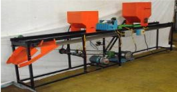

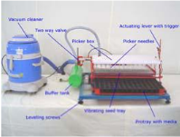

# Tractor drawn turmeric rhizome planter

<!-- p. 395 -->

Function :

Rhizome requirement, kg/ha :

To form ridges and furrows and to plant turmeric rhizomes in three rows

300 - 500

Saving in quantity of seed rhizomes, kg/ha :

Average spacing between

plants, mm :

500

180 - 200

Row to row spacing, mm :

600 (Row spacing is adjustable)

Power source :

35 - 45 hp tractor

General Information :

The rhizome planter consists of 3 ridger bottoms and planting mechanism for planting on one side of the ridges in one pass. The planting mechanism consists of rhizome hopper, cup feed seed metering mechanism, rhizome metering shaft and spike toothed ground wheel with chain sprocket drive for transmitting power from ground wheel to rhizome metering shaft and shoe type furrow opener.

Salient features :

-  It can be operated by 35-45 hp tractor

-  Three rows can be planted at a time in the required spacing.

-  Row spacing is adjustable

-  Actual field capacity of the unit is 1.2 ha per day

-  Cost of the unit is Rs.60,000

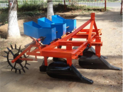

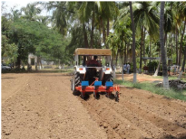

# Manually operated carrot seeder

<!-- p. 396 -->

Function

Specification

(i) Type Suitable for sowing pelletized carrot seeds Manually operated

(ii) Power

Requirement

(iii) Weight

12V battery for operating the metering mechanism

19 kg

(iv) Capacity

0.064 ha/day

General Information The carrot seeder consists of conical foam pad metering mechanism to sow pelletized carrot seeds in six rows in the range of 2 to 4 mm. The seed metering mechanism is operated by a 12 v battery. Light weight roller is provided for soil compaction. The seeder can sow pelletized carrot seeds at row to row spacing of 100 mm.

Cost of the Unit Rs.20,000/-

Salient Features

-  Pelletized carrot seeds can be sown in six rows.

-  Specially designed conical foam pad metering mechanism to avoid seed damage.

-  A single person can easy push the seeder easily on the seed beds.

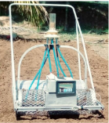

# Tractor operated fruit-shake harvester

<!-- p. 397 -->

Function

: For Harvesting Tamarind, Citrus and in Forestry

Cost of the Unit :

Rs.6000/-

Harvesting Efficiency :

85 %

Saving in time :

95 %

# Tractor operated single / two row cassava harvester

<!-- p. 397 -->

Function :

Description :

To dig cassava tubers in single / two rows

The cassava harvester consists of main frame, shanks, digging blade, hitching frame and depth adjustment wheels. It is suitable for both single row and two rows operations. The shank was designed as a bent leg plough with an angle of 150 deg to accommodate the dug cassava tubers. The blade angle of 20 deg is provided for easy penetration in to the soil. The row spacing can be altered by moving the shanks in the main frame. The depth wheels are provided to the depth of operation.

Salient features

Power source :

Field Capacity Above 45 hp tractor

: 0.65 ha/day (Single row)

Cost of unit :

0.96 ha/day (Two row)

Rs. 45,000/- (Single row)

Rs. 55,000/- (Two row)

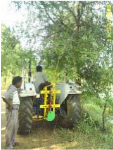

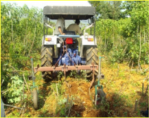

*Tractor operated Single row Cassava Harvester*

*Tractor operated Two row Cassava Harvester*

# COCONUT TREE CLIMBER

<!-- p. 398 -->

Function : To climb coconut trees for

harvesting nuts cleaning and other operations

Power source: Manual

Coverage : 5-6 trees / hour

Cost of unit: Rs. 5000/-

# IMPROVED COCONUT TREE CLIMBER

<!-- p. 398 -->

Special features : Lesser weight of the lower unit (3.0 existing model (6.0 kg) Lower unit is lifted simultaneously by leg and hand force for continuous operation

-  Comfortably designed upper frame makes

-  Harvesting capacity 45 trees/day (38 trees/day for existing model)

-  Cost of the machine: Rs.5,500/-

*kg) then*

# PALMYRAH TREE CLIMBING DEVICE

<!-- p. 399 -->

-  Even unskilled workers can use it to climb the tree with increased stability and comfort.

-  Seating arrangement provides added comfort and safety.

-  The grippers are so positioned that while ascending/descending up/down, the upper frame accommodating the operator is always horizontal to the ground, irrespective of the girth variations in the tree.

-  The operator, after reaching the top, can also use the device to move around the tree, to reach all the parts of the canopy to do tapping, harvesting and cleaning of dry fronds.

-  It eliminates the severe bruises caused in traditional method of climbing due to use of climbing ropes.

-  The device weighs about 17 kg.

-  The device along with the ladder costs Rs. 9000.

-  Eliminates the high work stress, severe neck and back pain disorders caused in traditional method of climbing.

# ARECANUT HARVETSER

<!-- p. 399 -->

Special features: Unskilled workers can also use to climb

-  Light weight aluminium pole with improved configuration of cutting edge of the knife for easy harvesting Seating arrangement (adjustable and pivotable) with back rest for safe and secure operations Rotatable unit to facilitate harvesting of bunches form surrounding trees.

-  Weight : 12 kg

-  Cost of the device along with the knife : Rs.9000/-

# TRACTOR OPERATED CLUSTER ONION HARVESTER CUM COLLECTOR

<!-- p. 400 -->

Function

Specification

(i) Type To dig and collect cluster onion Mounted implement

(ii) Power

Requirement

(iii) Capacity

45 hp tractor

1.2 ha / day

General Information The onion digger cum collector consist of digging blade,

Cost of the Unit Rs.75,000/- (Approximately)

Salient Features

-  The cluster onion harvester has a special profile of blade to ensure shallow cut of soil and riddle conveyer for separating the soil from the onion bulbs.

-  Cross conveyer and also elevating conveyer are provided for easy and continuous movement of onion.

-  A bag is provided for collection of onion.

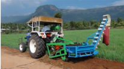

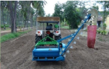

# AERIAL ACCESS HOIST FOR COCONUT HARVESTING

<!-- p. 400 -->

Special features: First machine of its kind in tractor mounted

-  A full length chassis from front to rear of the tractor provides support

-  The entire weight of the hoist and moments transmitted through the chassis to the

- stabilizers without transferring to the tractor chassis.

-  Four trees can be accessed from a single position.

-  The time required for locating unit and operating stabilizers - 1 min.

-  The time required for positioning against a tree of 10 m height was 2 min.

-  The positioning of the operator platform can be done by the operator himself

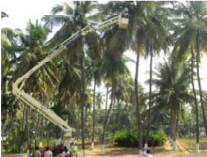

-  Lifting capacity :120 kg

-  Platform size: 1000 x 700 x 1000 mm

-  Working height : 16 m

-  Platform access height from the ground :15 m

-  Platform outreach : 6 m

-  Rotation/slewing angle : 360 degrees

-  Stabilizer :Hydraulically operated 4 nos. to provide absolute stability

-  Power : PTO of tractor, with exclusive hydraulic system and controls

-  Cost of unit (without tractor) :Rs.8.50 lakhs

# TRACTOR OPERATED MULTI-PURPOSE HOIST

<!-- p. 401 -->

Function : Amenable for fruit plucking, coconut harvesting, training, pruning, lopping and spraying tree crops.

-  The equipment is attached to the

- back of a 45 hp agricultural tractor.

-  Two labourers can stand on the platform and do operations

-  Platform can reach a maximum height of 8.1 m

-  Can also be used for maintenance works on street lights, white washing and painting of buildings.

-  Cost of the machine : Rs.55,000/- (only the attachment)

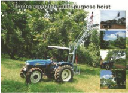

# WORKER FRIENDLY ARECANUT STRIPPER

<!-- p. 402 -->

Function : Suitable for stripping both green and ripped arecanut.

-  Damage caused to the stripped arecanut is eliminated.

-  Result in 66 and 77 per cent saving in cost and time when compared to conventional arecanut stripping

-  Coverage : Can strip 650-950 Kg of arecanut per hour

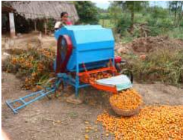

-  Efficiency : Stripping efficiency of 99.5 per cent is achieved

-  Cost of Unit : Rs. 25,000/-

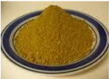

Part- XX 32. FOOD PROCESSING TECHNOLOGY

| TECHNOLOGY                         | SALIENT FEATURES                                                                                                                                                                                                                                                                                                                                                                  | PICTURES   |
|------------------------------------|-----------------------------------------------------------------------------------------------------------------------------------------------------------------------------------------------------------------------------------------------------------------------------------------------------------------------------------------------------------------------------------|------------|
| Bio-Colours                        |  Increased preference for natural colours.  Extraction of colour from beetroot.  Standardization of colour extraction with acetone and maltodextrin for maximum colour retention and yield recovery.  Rich in antioxidants with enhanced sensory appeal.  Good storage stability and maintenance of colour intensity for 12 months at room temperature.  No health hazards. |            |
| Greens based Paruppu and Idli podi |  Greens add colour, flavor, nutritional and therapeutic value to foods.  Incorporation of greens enhances the quality of the parupu and idli podi.  Good source of -carotene (7473 g), B-vitamins and iron (37 mg).  Shelf life upto 10 months.                                                                                                                             |            |
| Aonla mouth freshner               |  Aonla granules can be used as mouth fresheners and as substitutes for areca nut and tobacco.  Developed from shredded and dehydrated pieces of aonla and source of lime juice and spices.  Vitamin C (960 mg/100g) and β carotene (98 µg) with improved flavor and sensory appeal.  Contains 226 mg calcium, 273 mg phosphorous, 20 mg iron and 16 mg fibre / 100g.          |            |
| Protein Enriched Spicy Mango Bar   |  Protein rich mango bar is a combination of pulse (soya and green gram) with mango pulp  Enhanced protein and β carotene content.  Shelf life upto nine months  Provides 10 g protein, 5 g fibre, 15 mg vitamin C and                                                                                                                                                         |            |

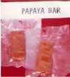

PAPAYA BAR

INCORPORATLD NOODLES

|                      | 305µg β carotene.  Can be used in nutrition intervention programmes to prevent protein malnutrition and vitamin A deficiency.                                                                                                                                             |     |
|----------------------|----------------------------------------------------------------------------------------------------------------------------------------------------------------------------------------------------------------------------------------------------------------------------|-----|
| Papaya Fruit         |  Fruit bars are manufactured by the dehydration of papaya fruit pulp.  Papaya based bars are rich sources of β carotene (1688µg/100g) with 16 % moisture content.  Shelf stable up to six months at room temperature.                                                   | Bar |
| Tomato Powder        |  Ready to use convenience food.  Can be readily rehydrated and used to substitute tomato pulp or puree and also used to thicken soups, sauces, stews, and gravies.  Rich source of lycopene, a natural antioxidant.  Low moisture food and has good storage stability. |     |
| Coconut Powder       |  Contain high fibre content of 32.67-35g%  Also provides 40 to 45% fat, 350 to 370 mg% of calcium, 6.5 to 8% protein, 2-3% moisture and 2-3 % ash.  Has a shelf life of six months.  Ready to use in, extruded products, snacks foods and confectionery.               |     |
| Ginger Garlic Powder |  Ready to use and an easy substitute for fresh ginger garlic powder.  Low moisture food and has shelf life for more than 12 months.  Easy to use and blends well with food preparations.  Less bulk and hence saves cost on transport and storage.                     |     |
| Bael Fruits Noodles  |  Bael fruit pulp its incorporated for the preparation of noodles.  The phyto-chemical analysis showed the presence of alkaloids in bael fruit pulp.  The noodles contain 13.12 % protein, 964 µg/β carotene, 110 mg calcium, 15.30 mg potassium, 2.60 mg iron, 2.51     |     |

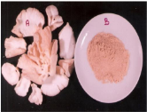

B

|                                                 | mg zinc and 2.69mg magnesium per 100g.  Shelf-life upto six months in MPP packaging materials.  Low glycemic index and suitable for diabetes.\                                                                                                                                                                                                                                                                                                                                                                                                                                                                                                                                                                                                                                                                                                                                             |               |
|-------------------------------------------------|----------------------------------------------------------------------------------------------------------------------------------------------------------------------------------------------------------------------------------------------------------------------------------------------------------------------------------------------------------------------------------------------------------------------------------------------------------------------------------------------------------------------------------------------------------------------------------------------------------------------------------------------------------------------------------------------------------------------------------------------------------------------------------------------------------------------------------------------------------------------------------------------|---------------|
| Mushroom products                               |  Mushroom protein comparable to meat protein.  Dehydrated mushroom powder finds application in formulation of a variety of value added products.  Mushroom powder (100 g) contains 12 g protein, 47 g fibre, 57 mg calcium and 29 mg iron.  Instant mushroom soup mix and mushroom biscuits which are rich in protein and fibre.  The products have a shelf life of three months at room temperature.                                                                                                                                                                                                                                                                                                                                                                                                                                                                                   |               |
| Probiotic enriched food products from fermented |  Fermentation has been reported to be responsible for product stability, flavor development and cyanide elimination.  Using mixed culture inoculums the cassava chips has been fermented dried and milled.  New and alternative nutritious bread, noodles and biscuits can be produced from different combinations of fermented cassava flour ( FCF) and Refined Wheat Flour (RWF) in the ratio of 75;25 and 50;50 as base and fortified with 15,20,25 and 30 per cent Defatted soy Flour ( DSF).  The calcium, phosphorus and iron content of the fermented cassava and defatted soy flour substituted products were increased when compared to control products. Protein content increased upto 12%  Important essential amino acids like lysine and metheonine were comparatively higher in fermented cassava flour and defatted soy flour incorporated bread, noodles and biscuits. | cassava flour |

# CONTINUOUS AONLA DE-SEEDING MACHINE

<!-- p. 406 -->

Aonla is an indigenous tropical fruit and is a rich source of vitamin C (400-1300 mg/ 100 g). It is being used in the Ayurvedic medicines and now a days it is also used in the preparation of value added products like jam, jellies, pickles, preserves (Murabba) and Ready to Serve beverages.Removal of seed from aonla is a pre-requisite for the processing of aonla fruit into different value added products. At present the seed is being removed with the hand operated equipment of capacity 10 kg/h which is a cumbersome process and also time consuming.

In order to eliminate the drudgery in the removal of seed and to increase the capacity, a continuous aonla de-seeding machine has been developed at Post Harvest Technology Centre,

Hand operated Aonla De seeder TNAU, Coimbatore.

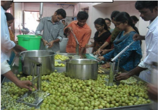

The unit essentially consists of a feed hopper, singulating unit, metering mechanism and seed removal unit. The aonla fruits dropping through the feed hopper are singulated by means of guide plates and endless flat belt. The metering mechanism keeps the fruits on the fruit seater of the base plate smoothly.

The seed from aonla is removed by piercing rod which is actuated with cam and gear mechanism. The unit is powered by a 2 HP electric motor.

# Special features of the equipment:

<!-- p. 406 -->

| Capacity          | :   | 100Kg/ h   |
|-------------------|-----|------------|
| Power required    | :   | 2 HP       |
| Efficiency        | :   | 95 %       |
| Damage            | :   | 5%         |
| Labour required   | :   | 1 person   |
| Cost of operation | :   | Rs 3/ kg   |
| Cost of the unit  | :   | Rs. 60,000 |

# BIOCOLOUR FROM BEETROOT

<!-- p. 406 -->

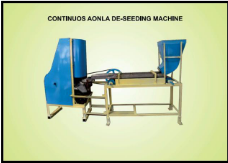

Biocolour from beetroot was prepared by utilizing as natural colour in processed foods by replacing the synthetic colours. The beetroot was washed in water and the outer skin and stalks were removed. The peeled beetroot was cut into small pieces and pulped by adding aqueous solution containing 3.0 per cent acetone (4 part beetroot pulp: 1 part aqueous solution). The beetroot pulp was filtered and the extracted juice TSS was adjusted to 25 ° brix by adding maltodextrin. Citric acid (0.1%), calcium sterate (0.1%) and gallnut powder (2%) was added to the juice and mixed thoroughly and filtered. The filtered juice was spray dried at a temperature of 200 °c. The stability of the biocolour from beetroot powder was studied at different levels of pH, preservative and temperature respectively. The physio - chemical characteristics of the freshly prepared biocolour from beetroot powder contained sedimentation - nil, solubility -100 per cent, acetone residues - nil, colour values 88.66, 4.57 and - 2.13 L* a* b*, moisture - 2.07 per cent, pH - 4.2, carbohydrate - 69.36 per cent, protein - 5.50 per cent, fat - 0.2 per cent, fiber - 0.28 per cent, ash - 4.8 per cent, total antioxidant - 16.36 mg /g and tannin - 2.74 per cent.. The prepared biocolour was applied in processed foods viz., beverages (milk shake), jam, jelly, candies (jujups and lollipop), sweetmeats (halwa and kesari), icings and icecream and the level of incorporation of biocolour was optimized. Incorporation of biocolour in processed foods was ranged from 0.2 to 0.9 per cent and the synthetic colour was between 0.01 and 0.03 per cent. Organoleptic evaluation studies showed that the overall acceptability the processed products ranged from 8.0 to 8.6 initially and from 7.5 to 8.0 at the end of 180 days. For 100 kg of fresh beetroot yielded 19.0 kg of biocolour. The cost of the biocolour from beetroot powder was Rs. 56/. per 100 gram.

# BIOCOLOUR FROM BEETROOT

<!-- p. 407 -->

# Part XXI

<!-- p. 408 -->

# 33. Soil Test Crop based Integrated Plant Nutrition System for Horticultural Crops (STCR-IPNS)

<!-- p. 408 -->

Soil test crop response based fertilizer prescriptions under integrated plant nutrition system (STCR-IPNS) for horticultural crops provide a scientific basis wherein the fertiliser doses for NPK are tailored to the requirement of NPK for specific yield levels of crops taking into account the contribution of NPK from soil, fertilizer and organic and or biofertilisers. Being a site and situation specific technology, STCR-IPNS along with entire improved package of practices for various crops ensures balanced nutrition, increased productivity and efficiency of applied NPK with sustained soil health over long run. The STCR- IPNS recommendations for various horticultural crops are furnished in Tables 1-17 and can be adopted to similar and allied soil types.

# VEGETABLES

<!-- p. 408 -->

# Small onion

<!-- p. 408 -->

Soil

: Red sandy loam

(Irugur series)

Target range : 16 - 18 t ha -1 fresh bulb FN = 0.99 T - 0.37 SN - 0.58 ON FP2O5 = 0.58 T - 1.43 SP - 0.69 OP FK2O = 0.67 T - 0.25 SK - 0.44 OK

|   Initial Soil Test Values (kg ha -1 ) - SN |   Initial Soil Test Values (kg ha -1 ) - SP |   Initial Soil Test Values (kg ha -1 ) - SK | NPK (kg ha -1 ) + FYM @ 12.5 t ha -1 + Azospirillum @ 2 kg ha -1 + PSB @ 2 kg ha -1 - 16 t FN   |   NPK (kg ha -1 ) + FYM @ 12.5 t ha -1 + Azospirillum @ 2 kg ha -1 + PSB @ 2 kg ha -1 - FP2O5 | NPK (kg ha -1 ) + FYM @ 12.5 t ha -1 + Azospirillum @ 2 kg ha -1 + PSB @ 2 kg ha -1 - FK2O   |   NPK (kg ha -1 ) + FYM @ 12.5 t ha -1 + Azospirillum @ 2 kg ha -1 + PSB @ 2 kg ha -1 - 18 FN |   NPK (kg ha -1 ) + FYM @ 12.5 t ha -1 + Azospirillum @ 2 kg ha -1 + PSB @ 2 kg ha -1 - FP2O5 |   NPK (kg ha -1 ) + FYM @ 12.5 t ha -1 + Azospirillum @ 2 kg ha -1 + PSB @ 2 kg ha -1 - FK2O |
|---------------------------------------------|---------------------------------------------|---------------------------------------------|-------------------------------------------------------------------------------------------------|-----------------------------------------------------------------------------------------------|----------------------------------------------------------------------------------------------|-----------------------------------------------------------------------------------------------|-----------------------------------------------------------------------------------------------|----------------------------------------------------------------------------------------------|
|                                         180 |                                          10 |                                         200 | 41                                                                                              |                                                                                            54 | 30                                                                                           |                                                                                            61 |                                                                                            65 |                                                                                           44 |
|                                         200 |                                          12 |                                         220 | 33                                                                                              |                                                                                            51 | 25                                                                                           |                                                                                            53 |                                                                                            62 |                                                                                           39 |
|                                         220 |                                          14 |                                         240 | 30*                                                                                             |                                                                                            48 | 20                                                                                           |                                                                                            46 |                                                                                            59 |                                                                                           34 |
|                                         240 |                                          16 |                                         260 | 30*                                                                                             |                                                                                            45 | 15*                                                                                          |                                                                                            38 |                                                                                            57 |                                                                                           29 |
|                                         260 |                                          18 |                                         280 | 30*                                                                                             |                                                                                            42 | 15*                                                                                          |                                                                                            31 |                                                                                            54 |                                                                                           24 |

Note: FN, FP2O5 and K2O are fertilizer N, P2O5 and K2O in kg ha -1 , respectively; T is the yield target in q ha -1 ; SN, SP and SK respectively are available N,P and K in kg ha -1 and ON, OP and OK are the quantities of N, P and K supplied through organic manure in kg ha -1 .

# Big onion

<!-- p. 408 -->

Soil

: Red sandy loam FN = 0.80T- 0.60 SN-0.84 ON

(Irugur series)

Target range : 28 - 32 t ha -1 fresh bulb FK2O = 0.61T- 0.33 SK-0.70 OK

FP2O5= 0.58T- 2.10 SP-0.87 OP

|   Initial Soil Test Values (kg ha -1 ) - SN |   Initial Soil Test Values (kg ha -1 ) - SP |   Initial Soil Test Values (kg ha -1 ) - SK | NPK (kg ha -1 ) + FYM @ 12.5 t ha -1 + Azospirillum @ 2 kg ha -1 + PSB @ 2 kg ha -1 - 28 t FN   |   NPK (kg ha -1 ) + FYM @ 12.5 t ha -1 + Azospirillum @ 2 kg ha -1 + PSB @ 2 kg ha -1 - FP2O5 |   NPK (kg ha -1 ) + FYM @ 12.5 t ha -1 + Azospirillum @ 2 kg ha -1 + PSB @ 2 kg ha -1 - FK2O |   NPK (kg ha -1 ) + FYM @ 12.5 t ha -1 + Azospirillum @ 2 kg ha -1 + PSB @ 2 kg ha -1 - 32 t FN |   NPK (kg ha -1 ) + FYM @ 12.5 t ha -1 + Azospirillum @ 2 kg ha -1 + PSB @ 2 kg ha -1 - FP2O5 |   NPK (kg ha -1 ) + FYM @ 12.5 t ha -1 + Azospirillum @ 2 kg ha -1 + PSB @ 2 kg ha -1 - FK2O |
|---------------------------------------------|---------------------------------------------|---------------------------------------------|-------------------------------------------------------------------------------------------------|-----------------------------------------------------------------------------------------------|----------------------------------------------------------------------------------------------|-------------------------------------------------------------------------------------------------|-----------------------------------------------------------------------------------------------|----------------------------------------------------------------------------------------------|
|                                         160 |                                          10 |                                         200 | 73                                                                                              |                                                                                           111 |                                                                                           72 |                                                                                             105 |                                                                                           135 |                                                                                           96 |
|                                         180 |                                          14 |                                         220 | 61                                                                                              |                                                                                           103 |                                                                                           65 |                                                                                              93 |                                                                                           126 |                                                                                           90 |
|                                         200 |                                          18 |                                         240 | 50*                                                                                             |                                                                                            95 |                                                                                           59 |                                                                                              81 |                                                                                           118 |                                                                                           83 |
|                                         220 |                                          20 |                                         260 | 50*                                                                                             |                                                                                            90 |                                                                                           52 |                                                                                              69 |                                                                                           114 |                                                                                           76 |
|                                         240 |                                          22 |                                         280 | 50*                                                                                             |                                                                                            86 |                                                                                           45 |                                                                                              57 |                                                                                           109 |                                                                                           70 |

## Bhendi -varieties

<!-- p. 409 -->

Soil

: Mixed black calcareous FN = 1.15 T- 0.46 SN - 0.81 ON

(sandy clay loam)

FP2O5 = 0.52 T -1.31 SP - 0.87 OP

(Perianaickenpalayam series) FK2O = 1.77 T - 0.64 SK - 0.91 OK

Target range : 15 - 18 t ha -1 green fruit

|   Initial Soil Test Values -1 - (kg ha ) - SN |   Initial Soil Test Values -1 - (kg ha ) - SP |   Initial Soil Test Values -1 - (kg ha ) - SK | NPK (kg ha -1 ) + FYM @ 12.5 t ha -1 + Azospirillum@ 2 kg ha -1 + PSB @ 2 kg ha -1 - 15 t ha -1 - FN   |   NPK (kg ha -1 ) + FYM @ 12.5 t ha -1 + Azospirillum@ 2 kg ha -1 + PSB @ 2 kg ha -1 - 15 t ha -1 - FP2O5 | NPK (kg ha -1 ) + FYM @ 12.5 t ha -1 + Azospirillum@ 2 kg ha -1 + PSB @ 2 kg ha -1 - 15 t ha -1 - FK2O   | NPK (kg ha -1 ) + FYM @ 12.5 t ha -1 + Azospirillum@ 2 kg ha -1 + PSB @ 2 kg ha -1 - 18 t ha -1 - FN   |   NPK (kg ha -1 ) + FYM @ 12.5 t ha -1 + Azospirillum@ 2 kg ha -1 + PSB @ 2 kg ha -1 - 18 t ha -1 - FP2O5 | NPK (kg ha -1 ) + FYM @ 12.5 t ha -1 + Azospirillum@ 2 kg ha -1 + PSB @ 2 kg ha -1 - 18 t ha -1 - FK2O   |
|-----------------------------------------------|-----------------------------------------------|-----------------------------------------------|--------------------------------------------------------------------------------------------------------|-----------------------------------------------------------------------------------------------------------|----------------------------------------------------------------------------------------------------------|--------------------------------------------------------------------------------------------------------|-----------------------------------------------------------------------------------------------------------|----------------------------------------------------------------------------------------------------------|
|                                           180 |                                            10 |                                           250 | 35                                                                                                     |                                                                                                        40 | 45**                                                                                                     | 60**                                                                                                   |                                                                                                        56 | 45**                                                                                                     |
|                                           200 |                                            12 |                                           300 | 26                                                                                                     |                                                                                                        37 | 44                                                                                                       | 60                                                                                                     |                                                                                                        53 | 45**                                                                                                     |
|                                           220 |                                            14 |                                           350 | 20*                                                                                                    |                                                                                                        35 | 15*                                                                                                      | 51                                                                                                     |                                                                                                        50 | 45**                                                                                                     |
|                                           240 |                                            16 |                                           400 | 20*                                                                                                    |                                                                                                        32 | 15*                                                                                                      | 42                                                                                                     |                                                                                                        48 | 33                                                                                                       |
|                                           260 |                                            18 |                                           450 | 20*                                                                                                    |                                                                                                        29 | 15*                                                                                                      | 32                                                                                                     |                                                                                                        45 | 15*                                                                                                      |

# Brinjal - varieties

<!-- p. 409 -->

Soil

: Red sandy loam FN = 0.69T - 0.72SN- 0.64 ON

(Palaviduthi series)

FP2O5 = 0.41T - 3.57SP - 0.72 OP

Target range : 32 - 35 t ha -1 fruit FK2O = 0.65T - 0.34SK- 0.52 OK

|   Initial Soil Test Values -1 ) - (kg ha SN |   Initial Soil Test Values -1 ) - SP |   Initial Soil Test Values -1 ) - SK | NPK (kg ha -1 ) + FYM @ 12.5 t ha -1 + Azospirillum@ 2 kg ha -1 + PSB @ 2 kg ha -1 - 32 t FN   |   NPK (kg ha -1 ) + FYM @ 12.5 t ha -1 + Azospirillum@ 2 kg ha -1 + PSB @ 2 kg ha -1 - FP2O5 | NPK (kg ha -1 ) + FYM @ 12.5 t ha -1 + Azospirillum@ 2 kg ha -1 + PSB @ 2 kg ha -1 - 35 t FK2O FN   |   NPK (kg ha -1 ) + FYM @ 12.5 t ha -1 + Azospirillum@ 2 kg ha -1 + PSB @ 2 kg ha -1 - FP2O5 | NPK (kg ha -1 ) + FYM @ 12.5 t ha -1 + Azospirillum@ 2 kg ha -1 + PSB @ 2 kg ha -1 - FK2O   |
|---------------------------------------------|--------------------------------------|--------------------------------------|------------------------------------------------------------------------------------------------|----------------------------------------------------------------------------------------------|-----------------------------------------------------------------------------------------------------|----------------------------------------------------------------------------------------------|---------------------------------------------------------------------------------------------|
|                                         160 |                                   10 |                                  300 | 56                                                                                             |                                                                                           62 | 45** 76                                                                                             |                                                                                           74 | 45**                                                                                        |
|                                         180 |                                   12 |                                  350 | 50*                                                                                            |                                                                                           54 | 45** 62                                                                                             |                                                                                           67 | 45**                                                                                        |
|                                         200 |                                   14 |                                  400 | 50*                                                                                            |                                                                                           47 | 42 50*                                                                                              |                                                                                           60 | 45**                                                                                        |
|                                         220 |                                   16 |                                  450 | 50*                                                                                            |                                                                                           40 | 25 50*                                                                                              |                                                                                           52 | 45                                                                                          |
|                                         240 |                                   18 |                                  500 | 50*                                                                                            |                                                                                           33 | 15* 50*                                                                                             |                                                                                           45 | 28                                                                                          |

# Cabbage

<!-- p. 409 -->

Soil

: Red Sandy loam FN = 0.55 T- 0.89 SN - 0.76 ON

(Irugur series)

Target range : 60 - 70 t ha -1 fresh head FP2O5 = 0.29 T -2.75 SP - 0.86 OP

FK2O = 0.36 T - 0.31 SK - 0.56 OK

|   Initial Soil Test Values (kg ha -1 ) - SN |   Initial Soil Test Values (kg ha -1 ) - SP |   Initial Soil Test Values (kg ha -1 ) - SK | NPK (kg ha -1 ) + FYM @ 12.5 t ha -1 + Azospirillum @ 2 kg ha -1 + PSB@2 kg ha -1 - 60 t ha FN   |   NPK (kg ha -1 ) + FYM @ 12.5 t ha -1 + Azospirillum @ 2 kg ha -1 + PSB@2 kg ha -1 - -1 FP2O5 | NPK (kg ha -1 ) + FYM @ 12.5 t ha -1 + Azospirillum @ 2 kg ha -1 + PSB@2 kg ha -1 - FK2O   | NPK (kg ha -1 ) + FYM @ 12.5 t ha -1 + Azospirillum @ 2 kg ha -1 + PSB@2 kg ha -1 - 70 t ha -1 FN   |   NPK (kg ha -1 ) + FYM @ 12.5 t ha -1 + Azospirillum @ 2 kg ha -1 + PSB@2 kg ha -1 - FP2O5 | NPK (kg ha -1 ) + FYM @ 12.5 t ha -1 + Azospirillum @ 2 kg ha -1 + PSB@2 kg ha -1 - FK2O   |
|---------------------------------------------|---------------------------------------------|---------------------------------------------|--------------------------------------------------------------------------------------------------|------------------------------------------------------------------------------------------------|--------------------------------------------------------------------------------------------|-----------------------------------------------------------------------------------------------------|---------------------------------------------------------------------------------------------|--------------------------------------------------------------------------------------------|
|                                         180 |                                          10 |                                         200 | 120                                                                                              |                                                                                            117 | 38**                                                                                       | 150**                                                                                               |                                                                                         146 | 38**                                                                                       |
|                                         200 |                                          12 |                                         250 | 102                                                                                              |                                                                                            111 | 38**                                                                                       | 150**                                                                                               |                                                                                         140 | 38**                                                                                       |
|                                         220 |                                          14 |                                         300 | 84                                                                                               |                                                                                            106 | 38**                                                                                       | 139                                                                                                 |                                                                                         135 | 38**                                                                                       |
|                                         240 |                                          16 |                                         350 | 66                                                                                               |                                                                                            100 | 38**                                                                                       | 121                                                                                                 |                                                                                         129 | 38**                                                                                       |
|                                         260 |                                          18 |                                         400 | 50*                                                                                              |                                                                                             95 | 38**                                                                                       | 104                                                                                                 |                                                                                         124 | 38**                                                                                       |

Soil

: Red Sandy loam FN = 0.93 T- 0.79 SN - 0.63 ON

(Irugur series)

Target range : 30 - 40 t ha -1 fresh curd FK2O = 0.44 T - 0.18 SK - 0.46 OK

FP2O5 = 0.44 T -1.74 SP - 0.85 OP

| Initial Soil Test (kg ha -1 )   | NPK (kg ha -1 ) + FYM @ 12.5 t ha -1 + Azospirillum@ 2 kg ha -1 + PSB @ 2 kg ha -1   |
|---------------------------------|--------------------------------------------------------------------------------------|
| Values                          | 30 t ha -1 40 t ha -1                                                                |

|   SN |   SP |   SK | FN   |   FP2O5 |   FK2O | FN    |   FP2O5 | FK2O   |
|------|------|------|------|---------|--------|-------|---------|--------|
|  180 |   10 |  200 | 90   |      87 |     66 | 150** |     131 | 75**   |
|  200 |   12 |  250 | 74   |      83 |     57 | 150** |     127 | 75**   |
|  220 |   14 |  300 | 58   |      80 |     48 | 151   |     124 | 75**   |
|  240 |   16 |  350 | 50*  |      76 |     39 | 135   |     120 | 75**   |
|  260 |   18 |  400 | 50*  |      73 |     30 | 120   |     117 | 75**   |

*maintenance dose ; **maximum dose

# Potato

<!-- p. 410 -->

Soil

: Laterite- Sandy clay loam

(Ooty series)

Target range: 30 - 40 t ha -1 fresh tuber FN = 0.70 T - 0.24 SN - 0.41 ON FP2O5 = 1.40 T - 0.55 SP - 0.95 OP FK2O = 0.72 T - 0.25 SK - 0.39 OK

|   Initial Soil Test Values (kg ha -1 ) - SN |   Initial Soil Test Values (kg ha -1 ) - SP (Bray) |   Initial Soil Test Values (kg ha -1 ) - SK |   NPK (kg ha -1 ) + FYM @ 12.5 t ha -1 + Azospirillum @ 2 kg ha -1 + PSB @ 2 kg ha -1 -1 -1 - 30 t FN | NPK (kg ha -1 ) + FYM @ 12.5 t ha -1 + Azospirillum @ 2 kg ha -1 + PSB @ 2 kg ha -1 -1 -1 - FP2O5   | NPK (kg ha -1 ) + FYM @ 12.5 t ha -1 + Azospirillum @ 2 kg ha -1 + PSB @ 2 kg ha -1 -1 -1 - FK2O   |   NPK (kg ha -1 ) + FYM @ 12.5 t ha -1 + Azospirillum @ 2 kg ha -1 + PSB @ 2 kg ha -1 -1 -1 - 40 t FN |   NPK (kg ha -1 ) + FYM @ 12.5 t ha -1 + Azospirillum @ 2 kg ha -1 + PSB @ 2 kg ha -1 -1 -1 - FP2O5 |   NPK (kg ha -1 ) + FYM @ 12.5 t ha -1 + Azospirillum @ 2 kg ha -1 + PSB @ 2 kg ha -1 -1 -1 - FK2O |
|---------------------------------------------|----------------------------------------------------|---------------------------------------------|-------------------------------------------------------------------------------------------------------|-----------------------------------------------------------------------------------------------------|----------------------------------------------------------------------------------------------------|-------------------------------------------------------------------------------------------------------|-----------------------------------------------------------------------------------------------------|----------------------------------------------------------------------------------------------------|
|                                         200 |                                                300 |                                         300 |                                                                                                   108 | 217                                                                                                 | 106                                                                                                |                                                                                                   178 |                                                                                                 357 |                                                                                                178 |
|                                         225 |                                                350 |                                         350 |                                                                                                   102 | 190                                                                                                 | 94                                                                                                 |                                                                                                   172 |                                                                                                 330 |                                                                                                166 |
|                                         250 |                                                400 |                                         400 |                                                                                                    96 | 162                                                                                                 | 81                                                                                                 |                                                                                                   166 |                                                                                                 302 |                                                                                                153 |
|                                         275 |                                                450 |                                         450 |                                                                                                    90 | 135                                                                                                 | 69                                                                                                 |                                                                                                   160 |                                                                                                 275 |                                                                                                141 |
|                                         300 |                                                500 |                                         500 |                                                                                                    84 | 120*                                                                                                | 60*                                                                                                |                                                                                                   154 |                                                                                                 247 |                                                                                                128 |

*maintenance dose ; **maximum dose

Soil

Target range :35 - 40 t ha -1 fresh root

: Laterite -Sandy clay loam (Ooty series)

FN = 0.48 T - 0.17 SN - 0.33 ON

FP2O5 = 1.11 T - 1.17 SP - 0.31 OP

FK2O = 0.83 T - 0.40 SK - 0.43 OK

|   Initial Soil Test Values (kg ha -1 ) - SN |   Initial Soil Test Values (kg ha -1 ) - SP (Bray) |   Initial Soil Test Values (kg ha -1 ) - SK |   NPK (kg ha -1 ) + FYM @ 12.5 t ha -1 + Azospirillum @ 2 kg ha -1 + PSB @ 2 kg ha -1 -1 -1 - 35 FN | NPK (kg ha -1 ) + FYM @ 12.5 t ha -1 + Azospirillum @ 2 kg ha -1 + PSB @ 2 kg ha -1 -1 -1 - FP2O5   | NPK (kg ha -1 ) + FYM @ 12.5 t ha -1 + Azospirillum @ 2 kg ha -1 + PSB @ 2 kg ha -1 -1 -1 - FK2O   |   NPK (kg ha -1 ) + FYM @ 12.5 t ha -1 + Azospirillum @ 2 kg ha -1 + PSB @ 2 kg ha -1 -1 -1 - 40 t ha FN | NPK (kg ha -1 ) + FYM @ 12.5 t ha -1 + Azospirillum @ 2 kg ha -1 + PSB @ 2 kg ha -1 -1 -1 - FP2O5   |   NPK (kg ha -1 ) + FYM @ 12.5 t ha -1 + Azospirillum @ 2 kg ha -1 + PSB @ 2 kg ha -1 -1 -1 - FK2O |
|---------------------------------------------|----------------------------------------------------|---------------------------------------------|-----------------------------------------------------------------------------------------------------|-----------------------------------------------------------------------------------------------------|----------------------------------------------------------------------------------------------------|----------------------------------------------------------------------------------------------------------|-----------------------------------------------------------------------------------------------------|----------------------------------------------------------------------------------------------------|
|                                         200 |                                                200 |                                         300 |                                                                                                  86 | 120                                                                                                 | 142                                                                                                |                                                                                                      110 | 175                                                                                                 |                                                                                                183 |
|                                         225 |                                                250 |                                         350 |                                                                                                  82 | 68*                                                                                                 | 122                                                                                                |                                                                                                      106 | 117                                                                                                 |                                                                                                163 |
|                                         250 |                                                300 |                                         400 |                                                                                                  78 | 68*                                                                                                 | 102                                                                                                |                                                                                                      102 | 68*                                                                                                 |                                                                                                143 |
|                                         275 |                                                350 |                                         450 |                                                                                                  73 | 68*                                                                                                 | 82                                                                                                 |                                                                                                       97 | 68*                                                                                                 |                                                                                                123 |
|                                         300 |                                                400 |                                         500 |                                                                                                  69 | 68*                                                                                                 | 68*                                                                                                |                                                                                                       93 | 68*                                                                                                 |                                                                                                103 |

# Beetroot

<!-- p. 411 -->

Soil

: Red Sandy clay loam FN = 0.64 T - 0.65 SN - 0.96 ON

(Palathurai series)

Target range: 35 - 40 t ha -1 fresh root FK2O = 0.61 T - 0.27 SK - 0.92 OK

FP2O5 = 0.52 T - 1.58 SP - 0.92 OP

|   Initial Soil Test Values (kg ha -1 ) - SN |   Initial Soil Test Values (kg ha -1 ) - SP |   Initial Soil Test Values (kg ha -1 ) - SK | NPK (kg ha -1 ) + Vermicompost @ 5 t ha -1 + Azospirillum @ 2 kg ha -1 + PSB @ 2 kg ha -1 -1 -1 - 35 t FN   |   NPK (kg ha -1 ) + Vermicompost @ 5 t ha -1 + Azospirillum @ 2 kg ha -1 + PSB @ 2 kg ha -1 -1 -1 - FP2O5 | NPK (kg ha -1 ) + Vermicompost @ 5 t ha -1 + Azospirillum @ 2 kg ha -1 + PSB @ 2 kg ha -1 -1 -1 - FK2O   | NPK (kg ha -1 ) + Vermicompost @ 5 t ha -1 + Azospirillum @ 2 kg ha -1 + PSB @ 2 kg ha -1 -1 -1 - 40 t FN   |   NPK (kg ha -1 ) + Vermicompost @ 5 t ha -1 + Azospirillum @ 2 kg ha -1 + PSB @ 2 kg ha -1 -1 -1 - FP2O5 |   NPK (kg ha -1 ) + Vermicompost @ 5 t ha -1 + Azospirillum @ 2 kg ha -1 + PSB @ 2 kg ha -1 -1 -1 - FK2O |
|---------------------------------------------|---------------------------------------------|---------------------------------------------|-------------------------------------------------------------------------------------------------------------|-----------------------------------------------------------------------------------------------------------|----------------------------------------------------------------------------------------------------------|-------------------------------------------------------------------------------------------------------------|-----------------------------------------------------------------------------------------------------------|----------------------------------------------------------------------------------------------------------|
|                                         160 |                                          10 |                                         300 | 64                                                                                                          |                                                                                                       135 | 103                                                                                                      | 96                                                                                                          |                                                                                                       161 |                                                                                                      133 |
|                                         180 |                                          12 |                                         350 | 60*                                                                                                         |                                                                                                       132 | 89                                                                                                       | 83                                                                                                          |                                                                                                       158 |                                                                                                      120 |
|                                         200 |                                          14 |                                         400 | 60*                                                                                                         |                                                                                                       129 | 76                                                                                                       | 70                                                                                                          |                                                                                                       155 |                                                                                                      106 |
|                                         220 |                                          16 |                                         450 | 60*                                                                                                         |                                                                                                       126 | 62                                                                                                       | 60*                                                                                                         |                                                                                                       152 |                                                                                                       93 |
|                                         240 |                                          18 |                                         500 | 60*                                                                                                         |                                                                                                       123 | 50*                                                                                                      | 60*                                                                                                         |                                                                                                       149 |                                                                                                       79 |

| Soil :                                   | Red Sandy clay loam FN = 0.69 T - 0.74 SN - 1.03 ON   |
|------------------------------------------|-------------------------------------------------------|
| (Palathurai series)                      | FP2O5 = 0.28 T - 1.35 SP - 1.15 OP                    |
| Target range: 35 - 40 t ha -1 fresh root | FK2O = 0.43 T - 0.21 SK - 0.64 OK                     |

*maintenance dose ; **maximum dose

|   Initial Soil Test Values (kg ha -1 ) - SN |   Initial Soil Test Values (kg ha -1 ) - SP |   Initial Soil Test Values (kg ha -1 ) - SK | NPK (kg ha -1 ) + Vermicompost @ 5 t ha -1 + Azospirillum @ 2` kg ha -1 + PSB @ 2 kg ha -1 - 35 t ha -1 - FN   | NPK (kg ha -1 ) + Vermicompost @ 5 t ha -1 + Azospirillum @ 2` kg ha -1 + PSB @ 2 kg ha -1 - 35 t ha -1 - FP2O5   | NPK (kg ha -1 ) + Vermicompost @ 5 t ha -1 + Azospirillum @ 2` kg ha -1 + PSB @ 2 kg ha -1 - 35 t ha -1 - FK2O   | NPK (kg ha -1 ) + Vermicompost @ 5 t ha -1 + Azospirillum @ 2` kg ha -1 + PSB @ 2 kg ha -1 - 40 t ha -1 - FN   |   NPK (kg ha -1 ) + Vermicompost @ 5 t ha -1 + Azospirillum @ 2` kg ha -1 + PSB @ 2 kg ha -1 - 40 t ha -1 - FP2O5 | NPK (kg ha -1 ) + Vermicompost @ 5 t ha -1 + Azospirillum @ 2` kg ha -1 + PSB @ 2 kg ha -1 - 40 t ha -1 - FK2O   |
|---------------------------------------------|---------------------------------------------|---------------------------------------------|----------------------------------------------------------------------------------------------------------------|-------------------------------------------------------------------------------------------------------------------|------------------------------------------------------------------------------------------------------------------|----------------------------------------------------------------------------------------------------------------|-------------------------------------------------------------------------------------------------------------------|------------------------------------------------------------------------------------------------------------------|
|                                         180 |                                          10 |                                         300 | 53                                                                                                             | 55                                                                                                                | 61                                                                                                               | 75**                                                                                                           |                                                                                                                69 | 75**                                                                                                             |
|                                         200 |                                          12 |                                         350 | 39                                                                                                             | 52                                                                                                                | 50                                                                                                               | 73                                                                                                             |                                                                                                                66 | 72                                                                                                               |
|                                         220 |                                          14 |                                         400 | 25*                                                                                                            | 50*                                                                                                               | 40                                                                                                               | 58                                                                                                             |                                                                                                                63 | 61                                                                                                               |
|                                         240 |                                          16 |                                         450 | 25*                                                                                                            | 50*                                                                                                               | 29                                                                                                               | 43                                                                                                             |                                                                                                                60 | 51                                                                                                               |
|                                         260 |                                          18 |                                         500 | 25*                                                                                                            | 50*                                                                                                               | 25*                                                                                                              | 29                                                                                                             |                                                                                                                58 | 40                                                                                                               |

# Tapioca

<!-- p. 411 -->

Soil

: Red Sandy loam

(Thulukkanur series)

Target range : 45 - 50 t ha -1 fresh tuber FN = 0.56 T- 0.61 SN- 0.81 ON FP2O5 = 0.35 T- 1.80 SP- 0.53 OP FK2O = 0.94 T- 0.67 SK- 0.70 OK

|   Initial Soil Test Values (kg ha -1 ) - SN |   Initial Soil Test Values (kg ha -1 ) - SP |   Initial Soil Test Values (kg ha -1 ) - SK | NPK (kg ha -1 ) + FYM @ 12.5 t ha -1 + Azospirillum @ 2 kg ha -1 + PSB @ 2 kg ha -1 - 45 t ha -1 FN   |   NPK (kg ha -1 ) + FYM @ 12.5 t ha -1 + Azospirillum @ 2 kg ha -1 + PSB @ 2 kg ha -1 - FP2O5 |   NPK (kg ha -1 ) + FYM @ 12.5 t ha -1 + Azospirillum @ 2 kg ha -1 + PSB @ 2 kg ha -1 - FK2O |   NPK (kg ha -1 ) + FYM @ 12.5 t ha -1 + Azospirillum @ 2 kg ha -1 + PSB @ 2 kg ha -1 - 50 t ha -1 FN |   NPK (kg ha -1 ) + FYM @ 12.5 t ha -1 + Azospirillum @ 2 kg ha -1 + PSB @ 2 kg ha -1 - FP2O5 |   NPK (kg ha -1 ) + FYM @ 12.5 t ha -1 + Azospirillum @ 2 kg ha -1 + PSB @ 2 kg ha -1 - FK2O |
|---------------------------------------------|---------------------------------------------|---------------------------------------------|-------------------------------------------------------------------------------------------------------|-----------------------------------------------------------------------------------------------|----------------------------------------------------------------------------------------------|-------------------------------------------------------------------------------------------------------|-----------------------------------------------------------------------------------------------|----------------------------------------------------------------------------------------------|
|                                         180 |                                          10 |                                         200 | 77                                                                                                    |                                                                                            95 |                                                                                          224 |                                                                                                   105 |                                                                                           112 |                                                                                          271 |
|                                         200 |                                          12 |                                         220 | 65                                                                                                    |                                                                                            91 |                                                                                          211 |                                                                                                    93 |                                                                                           108 |                                                                                          258 |
|                                         220 |                                          14 |                                         240 | 53                                                                                                    |                                                                                            87 |                                                                                          197 |                                                                                                    81 |                                                                                           105 |                                                                                          244 |
|                                         240 |                                          16 |                                         260 | 45*                                                                                                   |                                                                                            84 |                                                                                          184 |                                                                                                    69 |                                                                                           101 |                                                                                          231 |
|                                         260 |                                          18 |                                         280 | 45*                                                                                                   |                                                                                            80 |                                                                                          170 |                                                                                                    56 |                                                                                            98 |                                                                                          217 |

*maintenance dose

Soil : Red Sandy loam FN = 0.45 T- 0.63 SN- 0.72 ON (Palaviduthi series) FP2O5 = 0.42 T- 4.18 SP- 0.73 OP Target range : 80 - 90 t ha -1 FK2O = 0.40 T- 0.48 SK- 0.66 OK

|   Initial Soil Test Values (kg ha -1 ) - SN |   Initial Soil Test Values (kg ha -1 ) - SP |   Initial Soil Test Values (kg ha -1 ) - SK |   NPK (kg ha -1 ) + FYM @ 12.5 t ha -1 + Azospirillum @ 2 kg ha -1 + PSB @ 2 kg ha -1 - 80 t FN |   NPK (kg ha -1 ) + FYM @ 12.5 t ha -1 + Azospirillum @ 2 kg ha -1 + PSB @ 2 kg ha -1 - FP2O5 | NPK (kg ha -1 ) + FYM @ 12.5 t ha -1 + Azospirillum @ 2 kg ha -1 + PSB @ 2 kg ha -1 - 90 t FK2O FN   |   NPK (kg ha -1 ) + FYM @ 12.5 t ha -1 + Azospirillum @ 2 kg ha -1 + PSB @ 2 kg ha -1 - FP2O5 |   NPK (kg ha -1 ) + FYM @ 12.5 t ha -1 + Azospirillum @ 2 kg ha -1 + PSB @ 2 kg ha -1 - FK2O |
|---------------------------------------------|---------------------------------------------|---------------------------------------------|-------------------------------------------------------------------------------------------------|-----------------------------------------------------------------------------------------------|------------------------------------------------------------------------------------------------------|-----------------------------------------------------------------------------------------------|----------------------------------------------------------------------------------------------|
|                                         200 |                                          14 |                                         200 |                                                                                             179 |                                                                                           245 | 189 224                                                                                              |                                                                                           287 |                                                                                          229 |
|                                         220 |                                          16 |                                         220 |                                                                                             166 |                                                                                           237 | 179 211                                                                                              |                                                                                           279 |                                                                                          219 |
|                                         240 |                                          18 |                                         240 |                                                                                             154 |                                                                                           229 | 170 199                                                                                              |                                                                                           271 |                                                                                          210 |
|                                         260 |                                          20 |                                         260 |                                                                                             141 |                                                                                           220 | 160 186                                                                                              |                                                                                           262 |                                                                                          200 |
|                                         280 |                                          22 |                                         280 |                                                                                             129 |                                                                                           212 | 151 174                                                                                              |                                                                                           254 |                                                                                          191 |

# Spice Chilli

<!-- p. 413 -->

Soil

: Red Sandy loam FN = 8.29 T - 0.32SN

(Irugur series)

Target range : 2.0 - 2.5 t ha -1 dry pod FK2O = 5.86 T - 0.15 SK

FP2O5 = 7.13 T - 5.24 SP

|   Initial Soil Test Values (kg ha -1 ) - SN |   Initial Soil Test Values (kg ha -1 ) - SP |   Initial Soil Test Values (kg ha -1 ) - SK | NPK (kg ha -1 ) + FYM @ 12.5 t ha -1 + Azospirillum @ 2 kg ha -1 + PSB @ 2 kg ha -1 -1 -1 - 2.0 FN   | NPK (kg ha -1 ) + FYM @ 12.5 t ha -1 + Azospirillum @ 2 kg ha -1 + PSB @ 2 kg ha -1 -1 -1 - FP2O5   | NPK (kg ha -1 ) + FYM @ 12.5 t ha -1 + Azospirillum @ 2 kg ha -1 + PSB @ 2 kg ha -1 -1 -1 - FK2O   |   NPK (kg ha -1 ) + FYM @ 12.5 t ha -1 + Azospirillum @ 2 kg ha -1 + PSB @ 2 kg ha -1 -1 -1 - 2.5 t FN |   NPK (kg ha -1 ) + FYM @ 12.5 t ha -1 + Azospirillum @ 2 kg ha -1 + PSB @ 2 kg ha -1 -1 -1 - FP2O5 |   NPK (kg ha -1 ) + FYM @ 12.5 t ha -1 + Azospirillum @ 2 kg ha -1 + PSB @ 2 kg ha -1 -1 -1 - FK2O |
|---------------------------------------------|---------------------------------------------|---------------------------------------------|------------------------------------------------------------------------------------------------------|-----------------------------------------------------------------------------------------------------|----------------------------------------------------------------------------------------------------|--------------------------------------------------------------------------------------------------------|-----------------------------------------------------------------------------------------------------|----------------------------------------------------------------------------------------------------|
|                                         180 |                                          10 |                                         200 | 63                                                                                                   | 60                                                                                                  | 47                                                                                                 |                                                                                                    105 |                                                                                                  96 |                                                                                                 77 |
|                                         200 |                                          12 |                                         220 | 60*                                                                                                  | 50                                                                                                  | 44                                                                                                 |                                                                                                     98 |                                                                                                  85 |                                                                                                 74 |
|                                         220 |                                          14 |                                         240 | 60*                                                                                                  | 40*                                                                                                 | 41                                                                                                 |                                                                                                     92 |                                                                                                  75 |                                                                                                 71 |
|                                         240 |                                          16 |                                         260 | 60*                                                                                                  | 40*                                                                                                 | 40*                                                                                                |                                                                                                     85 |                                                                                                  64 |                                                                                                 68 |
|                                         260 |                                          18 |                                         280 | 60*                                                                                                  | 40*                                                                                                 | 40*                                                                                                |                                                                                                     79 |                                                                                                  54 |                                                                                                 65 |

# Turmeric

<!-- p. 413 -->

Soil

: Red Sandy loam FN = 1.11 T - 0.83 SN - 0.98 ON

(Irugur series)

FP2O5 = 0.57 T - 5.21 SP - 1.02 OP

Target range: 30 - 35 t ha -1 fresh rhizome FK2O = 0.83 T - 0.50 SK - 0.61 OK

|   Initial Soil Test Values (kg ha -1 ) - SN |   Initial Soil Test Values (kg ha -1 ) - SP |   Initial Soil Test Values (kg ha -1 ) - SK | NPK (kg ha -1 ) + FYM @ 12.5 t ha -1 + Azospirillum @ 2 kg ha -1 + PSB @ 2 kg ha -1 - 30 t FN   |   NPK (kg ha -1 ) + FYM @ 12.5 t ha -1 + Azospirillum @ 2 kg ha -1 + PSB @ 2 kg ha -1 - FP2O5 | NPK (kg ha -1 ) + FYM @ 12.5 t ha -1 + Azospirillum @ 2 kg ha -1 + PSB @ 2 kg ha -1 - 35 t FK2O FN   | NPK (kg ha -1 ) + FYM @ 12.5 t ha -1 + Azospirillum @ 2 kg ha -1 + PSB @ 2 kg ha -1 - FP2O5   |   NPK (kg ha -1 ) + FYM @ 12.5 t ha -1 + Azospirillum @ 2 kg ha -1 + PSB @ 2 kg ha -1 - FK2O |
|---------------------------------------------|---------------------------------------------|---------------------------------------------|-------------------------------------------------------------------------------------------------|-----------------------------------------------------------------------------------------------|------------------------------------------------------------------------------------------------------|-----------------------------------------------------------------------------------------------|----------------------------------------------------------------------------------------------|
|                                         175 |                                          10 |                                         175 | 123                                                                                             |                                                                                            74 | 97 178                                                                                               | 90**                                                                                          |                                                                                          138 |
|                                         200 |                                          12 |                                         200 | 102                                                                                             |                                                                                            63 | 84 158                                                                                               | 90**                                                                                          |                                                                                          126 |
|                                         225 |                                          14 |                                         225 | 81                                                                                              |                                                                                            53 | 72 137                                                                                               | 82                                                                                            |                                                                                          113 |
|                                         250 |                                          16 |                                         250 | 75*                                                                                             |                                                                                            43 | 59 116                                                                                               | 71                                                                                            |                                                                                          101 |
|                                         275 |                                          18 |                                         275 | 75*                                                                                             |                                                                                            32 | 54* 95                                                                                               | 61                                                                                            |                                                                                           88 |

# MEDICINAL CROP - Ashwagandha

<!-- p. 414 -->

Soil

: Mixed black calcareous FN = 24.77 T - 0.61 SN - 0.74 ON

(Perianaickenpalayam series) FP2O5 = 18.33 T - 2.68 SP - 0.84 OP

Target range: 0.8 - 0.9 t ha -1 dry root FK2O = 18.12 T - 0.21 SK - 0.59 OK

|   Initial Soil Test Values (kg ha -1 ) - SN |   Initial Soil Test Values (kg ha -1 ) - SP |   Initial Soil Test Values (kg ha -1 ) - SK | NPK (kg ha -1 ) + FYM@ 12.5 t ha -1 + Azospirillum @ 2 kg ha -1 + PSB @ 2 kg ha -1 -1 -1 - 0.8 FN   |   NPK (kg ha -1 ) + FYM@ 12.5 t ha -1 + Azospirillum @ 2 kg ha -1 + PSB @ 2 kg ha -1 -1 -1 - FP2O5 | NPK (kg ha -1 ) + FYM@ 12.5 t ha -1 + Azospirillum @ 2 kg ha -1 + PSB @ 2 kg ha -1 -1 -1 - 0.9 FK2O FN   | NPK (kg ha -1 ) + FYM@ 12.5 t ha -1 + Azospirillum @ 2 kg ha -1 + PSB @ 2 kg ha -1 -1 -1 - FP2O5   | NPK (kg ha -1 ) + FYM@ 12.5 t ha -1 + Azospirillum @ 2 kg ha -1 + PSB @ 2 kg ha -1 -1 -1 - FK2O   |
|---------------------------------------------|---------------------------------------------|---------------------------------------------|-----------------------------------------------------------------------------------------------------|----------------------------------------------------------------------------------------------------|----------------------------------------------------------------------------------------------------------|----------------------------------------------------------------------------------------------------|---------------------------------------------------------------------------------------------------|
|                                         180 |                                          10 |                                         300 | 33                                                                                                  |                                                                                                 86 | 52 58                                                                                                    | 90**                                                                                               | 60**                                                                                              |
|                                         200 |                                          12 |                                         350 | 21                                                                                                  |                                                                                                 80 | 41 46                                                                                                    | 90**                                                                                               | 60                                                                                                |
|                                         220 |                                          14 |                                         400 | 20*                                                                                                 |                                                                                                 75 | 31 34                                                                                                    | 90**                                                                                               | 49                                                                                                |
|                                         240 |                                          16 |                                         450 | 20*                                                                                                 |                                                                                                 70 | 20 22                                                                                                    | 88                                                                                                 | 39                                                                                                |
|                                         260 |                                          18 |                                         500 | 20*                                                                                                 |                                                                                                 64 | 20* 20*                                                                                                  | 83                                                                                                 | 28                                                                                                |

*maintenance dose ; **maximum dose

# Glory lily

<!-- p. 414 -->

Soil :

Red sandy loam FN = 41.45 T - 0.53 SN-0.71 ON

(Palaviduthi series)

Target range: 0.55 - 0.75 t ha -1 seed FP2O5 = 23.08 T - 1.92 SP - 0.88 OP

FK2O = 30.45 T - 0.21SK -0.64 OK

|   Initial Soil Test Values (kg ha -1 ) - SN |   Initial Soil Test Values (kg ha -1 ) - SP |   Initial Soil Test Values (kg ha -1 ) - SK | NPK (kg ha -1 ) + FYM@ 12.5 t ha -1 + Azospirillum @ 2 kg ha -1 + PSB @ 2 kg ha -1 -1 -1 - 0.55 FN   | NPK (kg ha -1 ) + FYM@ 12.5 t ha -1 + Azospirillum @ 2 kg ha -1 + PSB @ 2 kg ha -1 -1 -1 - FP2O5   |   NPK (kg ha -1 ) + FYM@ 12.5 t ha -1 + Azospirillum @ 2 kg ha -1 + PSB @ 2 kg ha -1 -1 -1 - 0.75 FK2O FN | NPK (kg ha -1 ) + FYM@ 12.5 t ha -1 + Azospirillum @ 2 kg ha -1 + PSB @ 2 kg ha -1 -1 -1 - FP2O5   | NPK (kg ha -1 ) + FYM@ 12.5 t ha -1 + Azospirillum @ 2 kg ha -1 + PSB @ 2 kg ha -1 -1 -1 - FK2O   |
|---------------------------------------------|---------------------------------------------|---------------------------------------------|------------------------------------------------------------------------------------------------------|----------------------------------------------------------------------------------------------------|-----------------------------------------------------------------------------------------------------------|----------------------------------------------------------------------------------------------------|---------------------------------------------------------------------------------------------------|
|                                         175 |                                          20 |                                         225 | 85                                                                                                   | 57 90                                                                                              |                                                                                                       168 | 75**                                                                                               | 150**                                                                                             |
|                                         200 |                                          25 |                                         250 | 75*                                                                                                  | 47 85                                                                                              |                                                                                                       155 | 75**                                                                                               | 146                                                                                               |
|                                         225 |                                          30 |                                         275 | 75*                                                                                                  | 37 80                                                                                              |                                                                                                       142 | 75**                                                                                               | 141                                                                                               |
|                                         250 |                                          35 |                                         300 | 75*                                                                                                  | 28 74                                                                                              |                                                                                                       128 | 74                                                                                                 | 135                                                                                               |
|                                         275 |                                          40 |                                         325 | 75*                                                                                                  | 25* 69                                                                                             |                                                                                                       115 | 64                                                                                                 | 130                                                                                               |

# Flower crops

<!-- p. 414 -->

# Chrysanthemum

<!-- p. 414 -->

Soil

: Red sandy loam FN = 2.01 T - 1.14 SN - 0.67 ON

(Somayanur series)

Target range: 18 - 20 t ha -1 flower FP2O5 = 1.08 T -2.56 SP - 0.69 OP

FK2O = 1.57 T - 0.74 SK - 0.62 OK

|   Initial Soil Test Values (kg ha -1 ) - SN |   Initial Soil Test Values (kg ha -1 ) - SP |   Initial Soil Test Values (kg ha -1 ) - SK | NPK (kg ha -1 ) + FYM@ 12.5 t ha -1 + Azospirillum @ 2 kg ha -1 + PSB @ 2 kg ha -1 -1 -1 - 18 t FN   |   NPK (kg ha -1 ) + FYM@ 12.5 t ha -1 + Azospirillum @ 2 kg ha -1 + PSB @ 2 kg ha -1 -1 -1 - FP2O5 | NPK (kg ha -1 ) + FYM@ 12.5 t ha -1 + Azospirillum @ 2 kg ha -1 + PSB @ 2 kg ha -1 -1 -1 - 20 t FK2O FN   |   NPK (kg ha -1 ) + FYM@ 12.5 t ha -1 + Azospirillum @ 2 kg ha -1 + PSB @ 2 kg ha -1 -1 -1 - FP2O5 | NPK (kg ha -1 ) + FYM@ 12.5 t ha -1 + Azospirillum @ 2 kg ha -1 + PSB @ 2 kg ha -1 -1 -1 - FK2O   |
|---------------------------------------------|---------------------------------------------|---------------------------------------------|------------------------------------------------------------------------------------------------------|----------------------------------------------------------------------------------------------------|-----------------------------------------------------------------------------------------------------------|----------------------------------------------------------------------------------------------------|---------------------------------------------------------------------------------------------------|
|                                         180 |                                          16 |                                         280 | 104                                                                                                  |                                                                                                119 | 38** 144                                                                                                  |                                                                                                141 | 38**                                                                                              |
|                                         200 |                                          20 |                                         300 | 81                                                                                                   |                                                                                                109 | 26 121                                                                                                    |                                                                                                131 | 38**                                                                                              |
|                                         220 |                                          24 |                                         320 | 63*                                                                                                  |                                                                                                 99 | 13* 98                                                                                                    |                                                                                                121 | 38**                                                                                              |
|                                         240 |                                          28 |                                         340 | 63*                                                                                                  |                                                                                                 89 | 13* 75                                                                                                    |                                                                                                110 | 27                                                                                                |
|                                         260 |                                          32 |                                         360 | 63*                                                                                                  |                                                                                                 78 | 13* 63*                                                                                                   |                                                                                                100 | 13                                                                                                |

# Part XXII 34. APPENDICES

<!-- p. 415 -->

# Appendix - I

<!-- p. 415 -->

Number of plants per acre

| Spacing(feet)   |   No.of plants per acre | Distance in feet   |   No. of plants per acre |
|-----------------|-------------------------|--------------------|--------------------------|
| 1 x 1           |                   43560 | 12 x 12            |                      302 |
| 1½ x 1½         |                   19460 | 13 x 13            |                      257 |
| 2 x 2           |                   10890 | 14 x 14            |                      222 |
| 2½ x 2½         |                    6960 | 15 x 15            |                      193 |
| 3 x 3           |                    4840 | 16 x 16            |                      170 |
| 3½ x 3½         |                    3556 | 17 x 17            |                      150 |
| 4 x 4           |                    2722 | 18 x 18            |                      134 |
| 4½ x 4½         |                    2151 | 19 x 19            |                      120 |
| 5 x 5           |                    1742 | 20 x 20            |                      108 |
| 6 x 6           |                    1210 | 22 x 22            |                      108 |
| 7 x 7           |                     889 | 24 x 24            |                       55 |
| 9 x 9           |                     537 | 28 x 28            |                       55 |
| 10 x 10         |                     435 | 30 x 30            |                       48 |
| 11 x 11         |                     360 | 40 x 40            |                       27 |

1 Acre = 4840 sq. yard 1 Acre = 43.560 sq.ft. 1 Acre = 40 Guntas 1 Acre = 4046.80 sq.mt. 1 Hec = 10000 sq.mt. 1 Hec = 250 cents 1 Hec = 2.47 acres

# Number of trees per acre

<!-- p. 416 -->

Appendix - III

|   Spacing(ft) |   Square |   Quincunx |   Hexagonal |
|---------------|----------|------------|-------------|
|            10 |      435 |        870 |         500 |
|            16 |      170 |        340 |         195 |
|            20 |      109 |        218 |         125 |
|            24 |       75 |        150 |          86 |
|            28 |       56 |        112 |          64 |
|            36 |       34 |         68 |          39 |
|            40 |       27 |         54 |          31 |

# Number of plants per acre

<!-- p. 416 -->

| Spacing (metre)   |   No. of plants per acre |
|-------------------|--------------------------|
| 1 x 1             |                     4000 |
| 2 x 2             |                     1000 |
| 3 x 3             |                      444 |
| 4 x 4             |                      250 |
| 5 x 5             |                      160 |
| 6 x 6             |                      111 |
| 7 x 7             |                       81 |
| 8 x 8             |                       62 |
| 9 x 9             |                       43 |
| 10 x 10           |                       40 |

# Germination and purity standards

<!-- p. 417 -->

|   Sl. No. | Variety       |   MinimumGermination percentage |   Purity minimum percentage |
|-----------|---------------|---------------------------------|-----------------------------|
|         1 | Cowpea        |                              75 |                          98 |
|         2 | Cluster beans |                              70 |                          98 |
|         3 | Field beans   |                              75 |                          98 |
|         4 | Beans         |                              75 |                          98 |
|         5 | Bhendi        |                              65 |                          99 |
|         6 | Bitter gourd  |                              60 |                          99 |
|         7 | Sponge gourd  |                              60 |                          99 |
|         8 | Bottle gourd  |                              60 |                          99 |
|         9 | Cucumber      |                              60 |                          99 |
|        10 | Snake gourd   |                              60 |                          99 |
|        11 | Watermelon    |                              60 |                          99 |
|        12 | Pumpkin       |                              60 |                          99 |
|        13 | Cauliflower   |                              65 |                          98 |
|        14 | Cabbage       |                              70 |                          98 |
|        15 | Knol-khol     |                              70 |                          98 |
|        16 | Carrot        |                              60 |                          95 |
|        17 | Radish        |                              70 |                          98 |
|        18 | Brinjal       |                              70 |                          98 |
|        19 | Tomato        |                              70 |                          98 |
|        20 | Chillies      |                              60 |                          98 |
|        21 | Capsicum      |                              60 |                          98 |
|        22 | Greens        |                              70 |                          95 |
|        23 | Fenugreek     |                              70 |                          98 |
|        24 | Basella       |                              60 |                          96 |
|        25 | Onion         |                              70 |                          98 |

# Appendix - V

<!-- p. 418 -->

# Viability of Horticultural seeds

<!-- p. 418 -->

| S.No                            | Name of seed                                                                                   | Max. viability period           |
|---------------------------------|------------------------------------------------------------------------------------------------|---------------------------------|
| A. Vegetables                   | A. Vegetables                                                                                  | A. Vegetables                   |
| 1                               | Onion                                                                                          | 6 Months                        |
| 2                               | Beans, Pea, Cowpea                                                                             | 1 Year                          |
| 3                               | Brinjal, Tomato, Chillies, Capsicum, Cucumber, Squashes, Pumpkin, Carrot, Radish, Turnip, Cole | 1.5 Years                       |
| 4                               | crops. Bhendi, Lettuce, Amaranthus, Methi, Beet root, Palak.                                   | 2 Years                         |
| B. Fruits and root stock plants | B. Fruits and root stock plants                                                                | B. Fruits and root stock plants |
| 1                               | Lime, Mandarin, Citrus rootstock species                                                       | 1 Week                          |
| 2                               | Mango stones, Litchi, Passion fruit, Butter fruit, Rose apple, Jambulana.                      | 1 Month                         |
| 3                               | Papaya, Kirni seeds                                                                            | 3-4 Months                      |
| 4                               | Guava                                                                                          | 4 Months                        |
| 5                               | Watermelon, Musk melon                                                                         | 1 Year                          |
| 6                               | Custard apple, Ramphal and other Annona sp.                                                    | 1.5 Years                       |
| C. Plantation and Spices        | C. Plantation and Spices                                                                       | C. Plantation and Spices        |
| 1                               | Clove, Nutmeg, Cinnamon, Curry leaf                                                            | 1 Month                         |
| 2                               | Arecanut, Cashewnut                                                                            | 3 Months                        |
| 3                               | Coconut                                                                                        | 4 Months                        |
| 4                               | Coriander and other annual spices                                                              | 1 Year                          |
| D.Flowers                       | D.Flowers                                                                                      | D.Flowers                       |
| 1                               | Aster seeds, Gladioli corns                                                                    | 1 Year                          |
| 2                               | Marigold                                                                                       | 1.5 Years                       |
| 3                               | Other annual flower seeds                                                                      | 1 to 2 Years                    |

# Average composition of manures and fertilisers

<!-- p. 419 -->

| Material s                | Percentage of Nutrients - N   | Percentage of Nutrients - P   | Percentage of Nutrients - K   |
|---------------------------|-------------------------------|-------------------------------|-------------------------------|
| Ammonium sulphate         | 20.5                          | -                             | -                             |
| Ammonium sulphate nitrate | 26.0                          | -                             | -                             |
| Ammonium nitrate          | 33.5                          | -                             | -                             |
| Ammonium phosphate        | 16.0                          | 20.0                          | -                             |
| Calcium ammonium nitrate  | 20.5                          | -                             | -                             |
| Nitrate of soda           | 16.5                          | -                             | -                             |
| Urea                      | 46.0                          | -                             | -                             |
| Superphosphate-single     | -                             | 18.0                          | -                             |
| Superphosphate-double     | -                             | 35.0                          | -                             |
| Superphosphate-triple     | -                             | 45.0                          | -                             |
| Ultraphos                 | -                             | 28.3                          | -                             |
| Mussoriephos              | -                             | 20-24                         | -                             |
| Rock phosphate            | -                             | 28.4                          | -                             |
| Bone meal                 | 3.5                           | 21.0                          | -                             |
| Muriate of Potash         | -                             | -                             | 50 or 60                      |
| Poultry manure            | 1.2 - 1.5                     | -                             | -                             |
| Sheep manure              | 0.8 - 1.6                     | -                             | -                             |
| Farm yard manure          | 0.4                           | 0.3                           | 0.2                           |
| Compost                   | 0.5                           | 0.25                          | 0.5                           |

# Conversion of pure nutrients to various N, P and K fertilisers

<!-- p. 420 -->

# Appendix VII

<!-- p. 420 -->

|   Rate of application (kg/ha) |   Ammonium sulphate (20% N) |   Urea (46% N) |   Super phosphate (18% P) |   Muriate of potash - (50 % K) |   Muriate of potash - (60 % K) |
|-------------------------------|-----------------------------|----------------|---------------------------|--------------------------------|--------------------------------|
|                            10 |                          50 |             22 |                        56 |                             20 |                             17 |
|                            20 |                         100 |             44 |                       112 |                             40 |                             34 |
|                            30 |                         150 |             66 |                       168 |                             60 |                             51 |
|                            40 |                         200 |             88 |                       224 |                             80 |                             68 |
|                            50 |                         250 |            110 |                       280 |                            100 |                             85 |
|                            60 |                         300 |            132 |                       336 |                            120 |                            102 |
|                            70 |                         350 |            154 |                       392 |                            140 |                            119 |
|                            80 |                         400 |            176 |                       448 |                            160 |                            136 |
|                            90 |                         450 |            198 |                       504 |                            180 |                            153 |
|                           100 |                         500 |            200 |                       560 |                            200 |                            170 |
|                           110 |                         550 |            242 |                       616 |                            220 |                            187 |
|                           120 |                         600 |            264 |                       672 |                            240 |                            204 |
|                           130 |                         650 |            286 |                       728 |                            260 |                            221 |
|                           140 |                         700 |            308 |                       784 |                            280 |                            238 |
|                           150 |                         750 |            330 |                       840 |                            300 |                            255 |

# Appendix VIII Neutralising value of liming materials

<!-- p. 420 -->

| Calcium carbonate or lime stone   | CaCO 3           |   100 |
|-----------------------------------|------------------|-------|
| Burnt lime                        | CaO              |   179 |
| Slaked lime                       | [Ca(OH) ] 2      |   136 |
| Dolomite                          | [CaMg(CO ) ] 3 2 |   109 |

Source: Package of Practices recommendations ‗crops' 1993, KAU.

Appendix IX Schedule for preparation of 10 litre standard spary solution

| a.i.                                                                                           | 0.02                                                                                           | 0.04                                                                                           | 0.05                                                                                           | 0.06                                                                                           | 0.08                                                                                           | 0.1                                                                                            | 0.2                                                                                            | 0.3                                                                                            | 0.4                                                                                            | 0.5                                                                                            |
|------------------------------------------------------------------------------------------------|------------------------------------------------------------------------------------------------|------------------------------------------------------------------------------------------------|------------------------------------------------------------------------------------------------|------------------------------------------------------------------------------------------------|------------------------------------------------------------------------------------------------|------------------------------------------------------------------------------------------------|------------------------------------------------------------------------------------------------|------------------------------------------------------------------------------------------------|------------------------------------------------------------------------------------------------|------------------------------------------------------------------------------------------------|
| Quantity of plant protection chemical required to be added to 10 litres of water (in ml or gm) | Quantity of plant protection chemical required to be added to 10 litres of water (in ml or gm) | Quantity of plant protection chemical required to be added to 10 litres of water (in ml or gm) | Quantity of plant protection chemical required to be added to 10 litres of water (in ml or gm) | Quantity of plant protection chemical required to be added to 10 litres of water (in ml or gm) | Quantity of plant protection chemical required to be added to 10 litres of water (in ml or gm) | Quantity of plant protection chemical required to be added to 10 litres of water (in ml or gm) | Quantity of plant protection chemical required to be added to 10 litres of water (in ml or gm) | Quantity of plant protection chemical required to be added to 10 litres of water (in ml or gm) | Quantity of plant protection chemical required to be added to 10 litres of water (in ml or gm) | Quantity of plant protection chemical required to be added to 10 litres of water (in ml or gm) |
| 20                                                                                             | 10                                                                                             | 20                                                                                             | 25                                                                                             | 30                                                                                             | 40                                                                                             | 50                                                                                             | 100                                                                                            | 150                                                                                            | 200                                                                                            | 250                                                                                            |
| 25                                                                                             | 8                                                                                              | 16                                                                                             | 20                                                                                             | 24                                                                                             | 32                                                                                             | 40                                                                                             | 80                                                                                             | 120                                                                                            | 160                                                                                            | 200                                                                                            |
| 30                                                                                             | 7                                                                                              | 13                                                                                             | 17                                                                                             | 20                                                                                             | 27                                                                                             | 33                                                                                             | 67                                                                                             | 100                                                                                            | 133                                                                                            | 167                                                                                            |
| 35                                                                                             | 6                                                                                              | 11                                                                                             | 14                                                                                             | 17                                                                                             | 23                                                                                             | 29                                                                                             | 57                                                                                             | 86                                                                                             | 114                                                                                            | 143                                                                                            |
| 40                                                                                             | 5                                                                                              | 10                                                                                             | 13                                                                                             | 15                                                                                             | 20                                                                                             | 25                                                                                             | 50                                                                                             | 75                                                                                             | 100                                                                                            | 125                                                                                            |
| 45                                                                                             | 4                                                                                              | 9                                                                                              | 11                                                                                             | 13                                                                                             | 18                                                                                             | 22                                                                                             | 44                                                                                             | 67                                                                                             | 89                                                                                             | 111                                                                                            |
| 50                                                                                             | 4                                                                                              | 8                                                                                              | 10                                                                                             | 12                                                                                             | 16                                                                                             | 20                                                                                             | 40                                                                                             | 60                                                                                             | 80                                                                                             | 100                                                                                            |
| 55                                                                                             | 4                                                                                              | 7                                                                                              | 9                                                                                              | 10                                                                                             | 15                                                                                             | 18                                                                                             | 36                                                                                             | 55                                                                                             | 73                                                                                             | 90                                                                                             |
| 60                                                                                             | 3                                                                                              | 7                                                                                              | 8                                                                                              | 10                                                                                             | 13                                                                                             | 17                                                                                             | 33                                                                                             | 50                                                                                             | 67                                                                                             | 83                                                                                             |
| 65                                                                                             | 3                                                                                              | 6                                                                                              | 8                                                                                              | 9                                                                                              | 12                                                                                             | 15                                                                                             | 30                                                                                             | 46                                                                                             | 62                                                                                             | 77                                                                                             |
| 70                                                                                             | 3                                                                                              | 6                                                                                              | 7                                                                                              | 9                                                                                              | 11                                                                                             | 14                                                                                             | 29                                                                                             | 43                                                                                             | 58                                                                                             | 71                                                                                             |
| 75                                                                                             | 3                                                                                              | 6                                                                                              | 7                                                                                              | 8                                                                                              | 11                                                                                             | 13                                                                                             | 27                                                                                             | 40                                                                                             | 53                                                                                             | 67                                                                                             |
| 80                                                                                             | 3                                                                                              | 5                                                                                              | 6                                                                                              | 8                                                                                              | 10                                                                                             | 13                                                                                             | 25                                                                                             | 36                                                                                             | 50                                                                                             | 63                                                                                             |
| 85                                                                                             | 2                                                                                              | 5                                                                                              | 6                                                                                              | 7                                                                                              | 9                                                                                              | 12                                                                                             | 24                                                                                             | 35                                                                                             | 47                                                                                             | 59                                                                                             |
| 90                                                                                             | 2                                                                                              | 4                                                                                              | 6                                                                                              | 7                                                                                              | 9                                                                                              | 11                                                                                             | 22                                                                                             | 35                                                                                             | 44                                                                                             | 56                                                                                             |
| 95                                                                                             | 2                                                                                              | 4                                                                                              | 5                                                                                              | 6                                                                                              | 8                                                                                              | 11                                                                                             | 21                                                                                             | 32                                                                                             | 42                                                                                             | 53                                                                                             |
| 100                                                                                            | 2                                                                                              | 4                                                                                              | 5                                                                                              | 6                                                                                              | 8                                                                                              | 10                                                                                             | 20                                                                                             | 30                                                                                             | 40                                                                                             | 50                                                                                             |

Source: Horticultural Technical Guide, GOK

Appendix X Vernacular names of Horticultural Crops

| Cr                 | Scientific name of the                   | Ta              | Telugu          | Malayalam       | Kannada       |
|--------------------|------------------------------------------|-----------------|-----------------|-----------------|---------------|
| op Mango           | crop Mangifera indica L.                 | mil Ma          | Mamidi          | Manga           | Marinna       |
| Guava              | Psidium gujava L.                        | Koyya           | Jama            | Pera            | Seba          |
| Pomegranat         | Punica granatum L.                       | Madulam         | Danimma         | Madulam         | Dalimbari     |
| e Jack             | Artocarpus heterophyllus                 | Pala            | Panasa          | Pilavu          | Alasu         |
| Jamun              | Eugenia jambolana                        | Naval           | Neerudu         | Navil           | Neredu        |
| Tomato             | Lycopersicon esculentum Mill.            | Thakkali        | Seemavanga      | Thakkali        | Vanga         |
| Bhendi             | Abelmoschus esculentus                   | Vendakkai       | Bhendakaya      | Bhendakayi      | Vendakai      |
| Onion              | L.Moench. Allium cepa var. aggregatum L. | Vengayam        | Neerulli        | Bawanj          | Nirulli       |
| Cluster            | Cyamopsis tetragonolobus L.              | Kothavarai      | Goruchikkuduk   | Kothavarakka    | Govardanakayi |
| beans Pumpkin      | Cucurbita moschata Poir.                 | Poosani         | aya Gummidikaya | Mattanga        | Kumblakayi    |
| Ribbed             | Luffa acutangula Roxb.                   | Peerkankai      | Nunnabheera     | Peechinga       | Heerekkai     |
| gourd Bitter gourd | Momordica charantia L.                   | Pavakkai        | Kakarakaya      | Kaipakka        | Hagalakkai    |
| Snake gourd        | Trichosanthes anguina L.                 | Pudalankai      | Potlakaya       | Padavalanga     | Padivalakkai  |
| Ash gourd          | Benincasa hispida Cogn.                  | Kalyanapoosa    | Budeethagum     | Kumbalam        | Budikumbla    |
| Bottle gourd       | Lagenaria siceraria Standl.              | ni Sorakkai     | midi Anapakaya  | Churakkai       | Soarekkai     |
| Cucumber           | Cucumis sativus L.                       | Velliri         | Dosakaya        | Vellirikkai     | Southikadi    |
| Cowpea             | Vigna sinensis L.Walp.                   | Karamani        | Alasandalu      | Kottapairu      | Avadai        |
| Lablab             | Lablab purpureus var.typicus L.          | Avarai          | Chikkudukayal   | Avarakka        | Avaraik kai   |
| Potato             | Solanum tuberosum L.                     | Urulaikizhangu  | u Urulaigadda   | Urulakizhangu   | Urulagadda    |
| Sweet potato       | Ipomoea batatas L.Lam.                   | Sakkaraivalli   | Genusagaddal    | Chakkaraikizhan | Genusa        |
| Tapioca            | Manihot esculenta Crantz.                | Maravalli       | u Karrapandalam | gu Kappakka     | Maragenusa    |
| Elephant yam       | Amorphophallus companulatus Blume.       | Shenaikizhang u | Thiyyakanda     | Chenai          | Suvarnagadda  |

| Cro          | Scientific name of the crop                     | Tami                 | Telugu            | Malayalam       | Kannada        |
|--------------|-------------------------------------------------|----------------------|-------------------|-----------------|----------------|
| p Colocasia  | Colocasia esculenta L.Scott.                    | l Seppankizhangu     | Chamagadda        | CHEMBU          | KERUGADDA      |
| Amaranthus   | Amaranthus sp.                                  | Keerai               | Thotakoora        | Cheera          | Arivesoppu     |
| Coccinia     | Coccinia indica                                 | Kovaikkai            | Donda             | Kovaikkai       | Thondikkai     |
| Curryleaf    | Murraya Koengii                                 | Karuveppilai         | Karepaku          | Kariveppillai   | Kariberu       |
| Mint         | Mentha sp.                                      | Pudina               | Pudina            | Muthina         | Pudina         |
| Pepper       | Piper nigrum L.                                 | Milagu               | Mirialu           | Kurumulagu      | Karimenasu     |
| Nutmeg       | Myristica fragrans Hoult.                       | Jathikkai            | Jajikaya          | Jatikka         | Jajikayi       |
| Cinnamon     | Cinnamomum zeylanicum Blume.                    | Lavangapattai        | Sannalavanga      | Erikkolam       | Dalacinnicakke |
| Coriander    | Coriandrum sativum L.                           | Kothamalli           | Dhaniyalu         | Kothumpalari    | Kothumpari     |
| Garlic       | Allium sativum L.                               | Vellaipoondu         | Tellagadda        | Vellulli        | Bellulli       |
| Tamarind     | Tamarindus indicus L.                           | Puli                 | Chintha           | Puli            | Hunase         |
| Ginger       | Zingiber officinale Rosc.                       | Inji                 | Allam             | Inji            | Shunti         |
| Fennel       | Foeniculum vulgare Mill.                        | Perunjeeragam        | Saompu            | Peerunjeeragam  | Sompu          |
| Fenugreek    | Trigonella foenumgraecum L.                     | Venthayam            | Menthulu          | Uluva           | Menthya        |
| Cardamom     | Elettaria cardamomum Maton.                     | Yelakkai             | Yelakayalu        | Elathari        | Yelakki        |
| Cumin        | Cuminum cyminum                                 | Seeragam             | Jeelakkara        | Jiragam         | Jeerigae       |
| Turmeric     | Curcuma domestica Val.                          | Manjal               | Pasupu            | Manjal          | Arashina       |
| Mustard      | Brassica juncia L. Czern. Coss                  | Kadugu               | Avalu             | Katuka          | Sasive         |
| Clove        | Eugenia caryophyllus Spregel.                   | Kirambu              | Lavangam          | Grambu          | Lavanga        |
| Cashew       | Anacardium occidentale L.                       | Munthiri             | Jeedimamidi       | Parangimavu     | Geru           |
| Betelvine    | Piper betle                                     | Vethalai             | Tamalapakulu      | Vettala         | Veeluvadele    |
| Senna Ajowan | Cassia augustifolia Vahl. Trachyspermum ammi L. | Surathnilavakai Omum | Nilathangadu Vamu | Sunnamukki Omum | Sunnamukki Oma |

# WAITING PERIODS FOR THE SAFE HARVEST OF HORTICULTURAL PRODUCE

<!-- p. 424 -->

|    | Crops     | Pesticide                                                           | Concentration (%)              | Waiting period (Days)   |
|----|-----------|---------------------------------------------------------------------|--------------------------------|-------------------------|
| 1. | Mango     | Dimethoate Fenthion Cypermethrin Quinalphos Methyl demeton Mancozeb | 0.06% 0.05 0.01 0.05 0.05 0.20 | 14 14 6 12 14 7         |
| 2. | Acid lime | Chlorpyriphos Methyl demeton Monocrotophos                          | 0.05 0.05 0.05                 | 9 12 7                  |
| 3. | Grapes    | Dimethoate Fenthion                                                 | 0.06 0.05                      | 5 4                     |
| 4. | Guava     | Malathion Monocrotopho s Phosalone Quinalphos                       | 0.10 0.05 0.07 0.05            | 7 9 4 12                |
| 5. | Tomato    | Phosalone Fenitrothion Quinalphos Mancozeb                          | 0.05 0.07 0.05 0.20            | 3 2 5 5                 |

|    | Crops    | Pesticide                                                  | Concentration (%)                                 | Waiting period (Days)   |
|----|----------|------------------------------------------------------------|---------------------------------------------------|-------------------------|
| 7. | Brinjal  | Phosalone                                                  | 0.07                                              | 2                       |
| 8. | Bhendi   | Phosalone                                                  | 0.07                                              | 5                       |
| 9. | Chillies | Dicofol Quinalphos Mancozeb Carbofuran Dimethoate Acephate | 0.05 0.05 0.20 350 g a.i/ha 0.03 0.06 0.075 0.151 | 1 8 6 2 5 7 5 8         |

[

# About Government Botanical Gardens, Udhagamandalam

<!-- p. 426 -->

The Government Botanical Gardens, nestled in a beautiful ravine with its entire splendor lying adjacent to the Raj Bhavan within the town. It covers an area of 22 ha ascending the slope on the hill at an elevation of 2400 - 2500 metres above MSL.

The gardens enjoys a cool temperate climate with an average rainfall of 140 cm per annum, most of which is received during South-West monsoon with frostly nights from November to February. The maximum and minimum temperatures are 290 C to 00 C respectively.

Before the garden was laid out, the area was then a patch of vegetable Garden. The upper portion with a wildness of Shola and shrubs, the lower part a swamp traversed by deep ravines. Early in 1847 at the aspiration of Marquis of Tweedale who was then the Governor of Madras, a fund was raised by donations and subscriptions to start a public garden.

In 1848, Mr. C. Mc Iver who had the training at the Royal Botanic Gardens Kew, London was appointed as Superintendent of the Government Botanic Gardens, Udhagamandalam.

The main garden is divided into six different sections, viz.,

- ! The front gardens

- ! The band stand

- ! The conservatory and its surroundings

- ! The fountain terrace and picnic gardens

- ! The new band stand and its surroundings

- ! And the nurseries

The Government Botanic Gardens, Udhagamandalam had played an important role in the earlier years by introducing many crops in the Nilgiris. Systematic introduction and maintenance of plants has resulted in the collection of about 2000 spices of plants representing 119 natural orders.

The Government Botanic Gardens, Udhagamandalam is from the inception, the primary centre of Horticulture development in the Nilgiris.

In the recent past, studies on various aspects of ornamental plants such as propagation techniques, cultivation methods, etc., are undertaken apart from introduction of new species of plants enriching the existing collection.

The special feature of the Government Botanic Gardens, Udhagamandalam is the conduct of flower show in the middle of May, every year. Exhibitions and competitive shows on various collections of flowers are held during the show. The show draws an immense crowd of enthusiasts and tourists every year.

# Growth and development of moringa under organic and inorganic systems of culture

<!-- p. 427 -->

An experiment was conducted to find out the efficacy of organic manures viz., FYM, poultry manure, neem cake, biofertilizer viz., azospirillum, VAM and natural organic product panchakavya on the growth and yield of moringa. The treatment combinations of poultry manure + neem cake + panchakavya (2% spray) out yielded other treatments for the growth and yield characters. Days to 50% flowering was advanced to 14.93 days in the above treatment. The yield attributes viz., number of pods / tree (225.57), pod weight (95.37g), pod yield 35.67 kg / tree were highest in the above treatment combination of poultry manure + neem cake + panchakavya. The nutrient contents viz., carotene (144.97 mg / 100g ascorbic acid (131.53mg / 100g) and soluble protein (5.74 g/100g) were found to be highest in the same treatment combination of poultry manure + neem cake + panchakavya. It was also found that the treatment combination of poultry manure + neem cake + panchakavya was very effective in controlling the fruit fly incidence (26.4%), when compared to control (38.22%).

# Studies on the manipulation of source - sink relationship for increasing the fruit size of tomato hybrid H24 x CLN 2123 A

<!-- p. 427 -->

In tomato, the hybrid H2s x CLN 2123 A showed greater response for the application of panchakavya. It was found that the treatment combinations of panchakavya 5% at nursery state and 40 days after transplanting + tender coconut spraying (10% once in a week for 3 times) (T8) recorded highest number of fruits per plant of 71.40, followed by 71.0 in the panchakavya 5% spray at nursery stage alone (T4) whereas the control registered the lowest number of fruits of 43.25. Similarly, the fruit weight and yield per plant were also highest in the treatment T8 (59.4g and 3.65 kg respectively). Fruit quality parameters viz., TSS ,Total acidity and ascorbic acid contents were also highest in the treatment T8 (7.5, 0.73% and 16.8 mg/100g respectively).

# Organic production package for Coleus forskohlii

<!-- p. 427 -->

In a study conducted with Coleus forskohlii revealed that application of panchakavya 4% spray was found to be superior in respect of root yield 12.40 kg / plot. when compared to control 5.23 kg / plot. Similarly, number of roots same (14.99), root length (13.73 cm), root diameter (2.49 cm) and root weight (459.35 g/ plant) was maximum in the above treatment when compared to control.

# Standardization of organic production package for Withania somnifera

<!-- p. 428 -->

An experiment was conducted for the standardization of organic production package of Withania somnifera at Horticultural College and Research Institute, Tamil Nadu Agricultural University, Coimbatore. Panchakavya 2%, 3% and 4% sprays and moringa leaf extracts 10 ml /plant, 20 ml / plant and 30 ml/ plant and chemicals cytozyme 1%, A tonic -1% and Miraculan - 1% sprays were given. Panchakavya 4% was found to be the best among all the treatments for growth and yield characters viz., plant height (145.63 cm), shoot fresh weight (976.24g), number of fruits (498.46) fruit yield (64.74 g / plant) and root length (54.21cm) . Compared to control, with only 98.48 cm, 720.61 g, 348.67, 36.23g /plant, 38.62 cm respectively.

# Effect of organics on growth and yield of Bhendi cv. Varsha Uphar

<!-- p. 428 -->

An experiment was conducted to study the effect of panchakavya and moringa leaf extract on growth and yield of bhendi var. Varsha Uphar at Department of Vegetable Crops, Horticultural College and Research Institute, Tamil Nadu Agricultural University, Coimbatore. Four sprays panchakavya (3%) and moringa leaf extract (25 ml/plant) were used started from 2 weeks after sowing and then the subsequent sprays given at 15 days interval. Both the treatments viz., panchakavya and moringa leaf extract were revealed the higher plant height, number of branches per plant, number of fruits per plant and fruit yield than the control (water spray). Moringa leaf extract increased the higher plant height and numbers of branches, while the number of fruits and fruit yield were the highest in panchakavya treated plants.

# Physiology of petal shedding in Rose

<!-- p. 428 -->

A study was conducted on the physiology of petal shedding in two cultivars of rose, viz., Edward rose and Red rose. It was found that the treatment calcium acetate 0.5% + panchakavya 5% significantly influenced the morphological characters, such as the height of the bush, length of the flowering shoot and the floral characters, such as the flower diameter, pedicel length, receptacle diameter, number of petals and petal : receptacle ratio. The treatment panchakavya 5% resulted in earlier flowering of 45.6 days and 53.31 days in cv. Edward rose and cv. Red rose respectively.

# Studies on the effect of pinching, spacing and growth regulators on growth, yield and quality of Ashwagandha (Withania somnifera )

<!-- p. 428 -->

In Ashwagandha, the yield attributes viz., root length (50.67 cm), root girth (4.93cm), root primaries (6.50 cm), root fresh (96.33g), dry weight (38.27 g) and root bark weight (22.33g) per plant were the highest under the treatment pinching + wider spacing + panchakavya (3% spray).

However the treatment pinching + closer spacing (60 x 30cm) + panchakavya (3%) registered the highest root yield of 1350 kg / hectare.

# Biodynamic Agriculture

<!-- p. 428 -->

-Biodynamic Farming‖ refers to working with energies, which create and maintain life(Pfeffer, 1984). The term derives from Greek Word -Bios (life) and ‗dynamics' (energy). The use of word -method‖ indicates that one is not dealing merely with the production of another fertilizer, organic though it is, but rather that certain principles are involved which in the practical application secure a healthy soil and plants which in turn produce healthfuy food for man and healthy feed for animals . Biodynamic agriculture works on the following principles:

- ! To restore to the soil, the organic matter in the form of humus, which holds it's fertility.

- ! To establish, maintain and improve soil living system.

- ! Organic matter as the basic factor for the soil life.

- ! Biodynamic method is not only fertilizing the soil but skillfull application of the factors contributing to soil life and health. Establish a system that brings into balance all factors which maintain life.

- ! In biodynamic way of treating manure and composts, the knowledge of enzymatic, hormone and other factors are also included.

- ! The biodynamic method puts special emphasis on the importance of crop rotation, green manuring and cover crops.

- ! The soil is not only a chemical, mineral or organic system, but it also has a physical structure. Maintenance of a crumbly, friable, deep, well-aerated structure is essential feature of fertile soil.

Efforts are being made to elaborate the concept and brief account of preparations used in biodynamic agriculture with a few explanations and experiences with the cultivation practices.

The cosmic factor that determines a month is the Moon. The movement of the Moon in relation to the Zodiac is more interesting. These Zodiac symbols are Greek in origin. The system has 12 constellations though represented by different archetype figures and animals. Within these 12 signs, there are four groups of these constellations, each of which have same qualities. They are related to basic four elements, i.e. earth, water, fire and air. These four elements can be placed in relation to influencing the four parts of the plant, the root, leaf, flower, and fruit as summarized below.

- ! Root is associated with the earth. There is no root growth without earth,

- ! Leaf is associated with water because it contains more than 80 per cent water,

- ! Flower corresponds to air and light. There is no light without air (no light on the Moon) because there is no atmosphere,

- ! Fruit and seed associated with fire, there is no fruit seed maturity without warmth. Performing farm operations on specific days means harnessing these cosmic influences for development of a particular plant part.

The earth is emerged in the planetary spheres of solar system and these forces stamp themselves for example, morphology of the plants. The earthly forces of Moon, Mercury and Venus soak into the earth form the air above and the cosmic forces of Mars, Jupiter and Saturn moves upward from the rocks below. They interact in the region of clay so that the plants grow out of it. The light of the Sun, Moon, Planets and stars reaches to the plants in regular rhythms.

Each contributes to the life, growth and form of the plant. Planets impress effect on metals, rocks, plants, animals and man, so called -astral influences‖ coined from Greek where astar means, -star‖. Just as sunshine contributes to the growth of plants and moon affect water content of all organisms, the planet also influences the earth and all who dowell on her. Since olden time, they have been divided as inner planet (Moon, Mercury and Venus between earth and Sun) and outer planets (Mars, Jupiter and Saturn). The inner planets work directly through atmosphere are indirectly via water, humus or calcium (limestone, potassium and sodium) on growth of plants.

The influences of Mars, Jupiter and Saturn are channeled through warmth and silica (quartz, feldspar and mica), they stream in through silica contents of soil and on plants being expressed in colours of flower and in fruit and seed production. By understanding the gesture and effect of each rhythm, agricultural activities like soil preparation, sowing, intercultural operations and harvesting need to be programmed accordingly.

# Biodynamic Calendar

<!-- p. 430 -->

Biodynamic farmers use the knowledge practically by choosing time to show on plant, to use various plant husbandry techniques. Agricultural practices, i.e. field preparation, sowing, manuring, harvesting etc. performed as per constellation are more effective and beneficial. Every constellation has dominant elemental influence and affects four specific parts of the plants as enumerated below in Table 1.

Interaction of element and constellation on plant parts

| Element   | Plant part   | Constellation            |
|-----------|--------------|--------------------------|
| Earth     | Root         | Virgo, Capricorn, Taurus |
| Air       | Flower       | Germini, Libra, Aquarius |
| Water     | Leaf         | Cancer, Scorpio, Pisces  |
| Fire      | Fruit        | Aries, Leo, sagittarius  |

Agricultural practices for better root activity (manuring and rooting), flowering, growth and fruiting/seed is to be done as per constellation.

Ascending period of moon: During this period, cosmic forces are active above the earth / ground. Any agricultural practice (spray, propagation etc.) performed during the period show beneficial effect. Descending period of moon : During this period, cosmic forces are active below the earth. Therefore, agricultural practices (field preparation, sowing, manuring and harvesting of root crops) performed during the period shows better success.

Agricultural Operation as per Movement of Moon : The moon moves regularly around earth and it travels monthly through each of the 12 signs of the Zodiac, staying approximately two-and-a half days in each sign. As it does so, it forms an angular relationship with the sun that is known as a Phase of the Moon, which means the angle between moon, earth and sun. Moon orbits the earth and the earth orbits the sun. It is the earths orbit that defines the ‗ecliptic', which is divided symbolically into the zodiac.

| Ascending moon                                                                 | Descending moon                                                                                  |
|--------------------------------------------------------------------------------|--------------------------------------------------------------------------------------------------|
| The earth is breathing out- the development occurs in upper parts of the plant | The earth is breathing in - the development of the plant occurs parts below the ground, eg. root |
| Cosmic energy works above the rhizosphere                                      | Cosmic energy works below the rhizosphere                                                        |
| Spring and summer season                                                       | Autumn and winter season                                                                         |
| Foliar applications, propagation activities, harvesting and sowing             | Root development, transplanting, manure application and harvesting of tuber crops                |

Phases occur in two stages - waxing and waning

The moon is -waxing‖ (ascending period) - growing during these phases stages

are : New moon, crescent moon, fist quarter moon, gibbous moon.

The moon is waning (descending period) - shrinking - during these phases Full moon disseminating second quarter balsamic.

As a general thumb rule, when moon is waxing plants develop leaves above the ground systems and when moon is waning, plants develop their root system.

Planting leafy crops that grow above ground are best sown at waxing moon and those that will require strong root system or grow below ground should be snow after full moon, in the waning phase.

Perigee (Poornima : full moon) when the moon is nearest to the earth, this occurs after every

29 and half day. In 48 hours, proceeding to full moon, there appears to be distinct increase in the moisture content of the earth and in the atmosphere. Growth promoting activities of the plants seems to be enhanced and plants are more susceptible to fungal attack because of relatively higher moisture content in the rhizosphere and atmosphere.

Apogee (new moon) - when the moon is farthest from the earth. This occurs every 27th and ½ days. Owing to moisture deficiency, harvesting and seed storage practices show better response.

Moon opposite to Saturn - this is favourable period, agricultural operation performed during this period show better response.

# Lunar Node

<!-- p. 431 -->

Imaginary point when moon crosses path of sun. It occurs twice in 27.2 days of a month and known as Rahu and Ketu

Rahu - Lunar node in ascending period of moon not suitable for agricultural activities. Ketu - Lunar node in descending period, not suitable for agricultural activities.

# Biodynamic preparations

<!-- p. 432 -->

Basically there are two types of biodynamic preparations.

- ! Biodynamic field sprays (BD-500-501).

- ! Biodynamic compost preparations (BD-502-

507). Biodynamic Field Sprays (BD 500-501)

Cow horn manure (BD-500) : This is fundamental biodynamic field spray preparation. The cow is an earthy creature with a very strong digestive system. The cow horn has the ability to absorb life energies during decomposition of the dung being incubated in winter months.

- ! Cow horns are cleaned properly with water. While collecting the horn it should be ascertained that only cow horn to the picked which is solid from proximal end their rings are at distal end.

- ! Cleaned cow horns are filled with fresh cowdung (especially from lactating and indigenous one) and buried at 30 cm depth in the soil in root free zone in descending period of moon during October - November.

- ! After 6 months of incubation, horns are taken out in descending period from moon during March- April.

- ! If decomposition of dung is not proper, cow horns should not be taken out and should be left for some more period and again is to be taken out during descending period of moon.

- ! Properly decomposed compost is to be stored at cool and dry place in earthen pot.

Specially prepared manure is made into a spray to vitalize the soil, enhance seed germination, root formation and primary root development. For spraying, 25g of BD-500 is dissolved in 13.5 litres of water in wooden / plastic bucket by making vortext in clock and anti-clockwise for one hour in the evening and the solution is spread either with the help of natural brush or with a tree twig. Spraying of BD-500 is done at the time of field preparation in descending period of the moon. Stirring small quantities of material in large amount of water is called Dynamization. This process transfers the forces and energy from the preparation to the water.

Thimmaiah (2001) observed the microbial activity of BD-500 during stirring and very interesting response has been obtained.

# Microbial analysis of BD 500

<!-- p. 433 -->

|   Stirring interval (minutes) | Bacteria (cfu/g)   | Actionmycetes (cfu/g)   | Fungi (cfu/g)   |
|-------------------------------|--------------------|-------------------------|-----------------|
|                            15 | 26 x 103           | 22 x 103                | 10 x 103        |
|                            30 | 35 x 103           | 35 x 103                | 14 x 103        |
|                            45 | 58 x 103           | 60 x 103                | 12 x 103        |
|                            60 | 66 x 103           | 88 x 103                | 35 x 103        |

It is interesting to observe that during stirring period, there was a corresponding increase in number of cfu's of bacteria, actinomycetes and fungi during one hour of stirring. The CISH, Lucknow, has also identified the following microorganisms (fungi) from BD-500 preparation.

- Fusarium semitatum

- F. sporotrichiodes

- Syncephalastrum racemosum

Cow horn silica (BD-501) : In this, ground mountain quartz (silica) after proper incubation is made in to spray on plants. It helps them to achieve optimum development and maturity and particularly affects taste, colour and aroma.

- ! After taking out of cow horn manure (BD-500), cow horns are thoroughly cleaned with water.

- ! Cow horns are filled with silica with powder paste, and buried in same pit where cow horns were buried for the preparation of BD-500 during ascending period of moon in March-April.

- ! After 6 months of incubation, horns are taken out in October-November during the ascending period of moon.

- ! Light yellowish silica powder is taken out from the horn and stored in light near the house window in glass jars.

BD 501 works on photosynthetic process in the leaf. Its action is to strengthen the effect of light and warmth on the plant and promotes healthy growth. It strengthens the quality of plant and the plant product and encourages the development of fruit and seeds. For maximum effect, the BD

501 should be applied once at the beginning of a plant's life, at the four-leaf stage and again at the flowering or fruit maturation stage. BD 501 should be applied on the leaves in the form of ‗mist' in the morning at the sunrise and the best constellation is moon in opposite to Saturn. Following fungi are isolated from BD -501 at this Insitute.

- Fusarium monliformae

- Syncephalastrum racemosum

Biodynamic Field

# Sprays

<!-- p. 434 -->

Biodynamic sets (BD-502-507) are prepared from six herbal plants, which have healing properties and influence the fermentation processes in the compost, liquid manure and Cow Pat Pit. These are also associated with particular constellations as summarized in Table.4. All these preparations are made in descending period of the moon, except BD-507, which is best prepared in air / light day. The BD sets are used in the Cow Pat Pit (CPP), BD - compost, Biodynamic liquid manure and Biodynamic liquid pesticides.

Basic BD sets used CPP, BD compost, liquid manures and pesticides

| Preparatio n   | Constellatio n   | Substances from which preparation is                                  | Role               |
|----------------|------------------|-----------------------------------------------------------------------|--------------------|
| BD-502         | Venus            | prepared Fermented flower heads of Yarrow (Achillea millefolium)      | Rich in S, K and N |
| BD-503         | Mars             | Fermented Chamomile (Matricaria recutita) blossom                     | Rich in S, K and N |
| BD-504         | Mercury          | Whole shoot of Stinging Nettle (Urtica dioica)                        | Rich in Fe         |
| BD-505         | Moon             | with flower, fermented in the soil Fermented oak (Ouercus robur) bark | Rich in Ca         |
| BD-506         | Jupiter          | Fermented flower heads of Dandelion (Taraxacum officinale)            | Rich in K and Si   |
| BD-507         | Saturn           | Valerian (Valeriana officinalis) flower extract                       | Rich in P          |

These work to regulate the composting process and enable the different elements (calcium, nitrogen and phosphorus) needed for healthy plant growth to be present in a living way. The specifications of BD sets used in these preparations are described in the Table.5.

Number of sets used for specific preparation.

| Specific preparation   | No. of sets used             |
|------------------------|------------------------------|
| Cow Pat Pit (CPP)      | 2 sets per 60 kg of cow dung |
| Liquid manure          | 2 sets per 200 litres        |
| Biodynamic compost     | 1 set per 5 m3               |

Cowdung and urine are important components of Cow Pat Pit (CPP), BD liquid manure and BD pesticides. Their brief account are summarized below.

# Cow Pat Pit (CPP) or Barrel Manure

<!-- p. 434 -->

It is a biodynamic field preparation also called as soil shampoo. Cow Pat Pit (CPP) is a strong soil conditioner. It enhances seed germination, promotes rooting in cutting and grafting, improvement in soil texture, provides resistance powers to the plants against pests and diseases, replenishes and rectifies the trace element deficiency. CPP is increasingly used for improving soil biological activities in the seed treatment and foliar applications. The CPP may be prepared throughout the year.

- ! Preparation of a pit of 60cm x 90cm size in shade and root-free zone. Precaution is to be taken that pit should be 15cm higher than plane surface.

- ! Pasting of inner wall of the pit with fresh cowdung paste.

- ! Dung of lactating cow (60kg) mixed thoroughly with 250g each of bentonite and egg shell powder and filled in the pit.

- ! Compost gets ready in 75-90 days depending upon the temperature.

One kg CPP dissolved in 40-45 litres of water overnight and sprinkled in the next morning as field sprays on the plants. This should be applied at the time of field preparation and on plants. CPP can also be applied in BD compost and with FYM for improving their nutritive value. The preparation is ready for use when it is dark brown, friable and has lost the smell of cowdung.

# Biodynamic Compost Heap

<!-- p. 435 -->

Biodynamic compost is an effective soil conditioner and is an immediate source of nutrient for a crop. Biodynamic Compost Heap can be prepared by using green leaves (nitrogenous material) and dry leaves (carbonaceous material) in 8-12 weeks. Integrating with cowdung slurry is always good in the decomposition process. The composition of air, moisture and warmth is very important in the breakdown and decomposition of material. The enrich compost is ready in 75-100 days depending upon the prevailing temperature.

- ! Five-meter long thick wood is placed on higher elevation where waterlogging does not occur during rainy season. ! Thick layer (20 cm) of dry grasses is spread on the area of 5 m x 2.5 m on the ground. ! Water (100-150 litres) mixed with dung sprinkled on the grasses. ! Again 20 cm thick layer of green grasses are sprayed equally on the heap and 100 to 150 litres of water mixed with dung sprinkled on the heaps. ! Above process (putting 20 cm thick layers of dry and green grasses alternatively) is repeated to the height of 1.5m. ! For enriching the compost with different nutrients as per the need, rock phosphate (P), slacked lime (Ca) wood ash (K) etc. can also be used in between the layers of dry / green grasses. ! Two B.D sets (502-507) are incorporated and the heap is plastered with mixtures of

- dung and clay.

The BD compost is said to be more fertile with a stronger ability to improve soil than the conventional compost. When the specially prepared CPP and BD compost have been applied to the soil, the plants become more sensitive to their environment and responsive to the rhythms of the day, seasons and planets.

# Vermicomp

<!-- p. 436 -->

ost

Vermiculture technology is an aspect involving the use of earthworms as versatile natural bioreactors for effective recycling of non-toxic organic wastes to the soil. They effectively harness the beneficial soil microflora, destroy soil pathogens, and covert organic wastes into valuable products such as biofertilizers, biopesticides, vitamins, enzymes, antibiotics, growth hormones and proteinous biomass (5).

Earthworms participate in soil farming system in following ways :

- ! Through their influence on soil pH

- ! As agents of physical decomposition of organic wastes

- ! Promoting humus formation

- ! Improving soil structure

- ! Enriching soil and water-holding capacity.

# Steps in composting

<!-- p. 436 -->

# Vermicomposting on plane surface

<!-- p. 436 -->

- ! Partially decomposed organic wastes are piled up on 2 m x 1 x 0.5 m areas at cool and elevated place.

- ! Two to five thousand red worms (Eisenia foetida) are released in the middle of bed by putting 2-4 kg one week-old dung.

- ! Water (2-5 litres) is sprayed everyday to keep the earthworms active. To protect earthworms from the excessive heat and rain, shade should be provided.

- ! Depending upon the weather conditions complete heap of the organic waste get converted into fine compost within 75-120 days.

- ! Ready compost is sieved to separate the earthworms.

- ! Separated worms are released in another heap of partially decomposed organic waste.

- ! As the time passes population of worms and vermicompost production increases very fast.

# Vermicomposting in pit

<!-- p. 436 -->

- ! Brick structure (3 cm x 1.5 cm x 5 cm) is prepared in shade.

- ! One brick wall made of cement is preferred.

- ! After putting 5 cm thick layer of concrete and sand, each 40 cm thick layer of partially decomposed or soften organic waste is spread equally above the sand.

- ! One -week-old cowdung (1-2 kg) is kept at 6-8 places on the organic waste and 50100 earthworms are released in each heap of cowdung.

! Water (2-5 litres) is sprayed in the bed and covered with 5 cm thick layer of organic waste.

! The bed is covered with thatch to protect earthworms from excessive heat, rain and cold.

- ! To keep the worms active, light spray of water is essential everyday.

- ! Worms convert all the organic waste into compost. Again 30-40 cm thick layer of partially decomposed organic waste is spread equally in the bed and moistened and it takes another

30-45 days for full conversion of organic waste into compost within 45-60 days.

- ! Prepared compost is taken out and sieved to separate earthworms from the compost.

- ! Pit is again filled up with organic waste and earthworms are released as discribed earlier.

- ! As earthworm's population increases very fast, a few more pits are to be required to increase the verimicompost production.

# Vermiwash

<!-- p. 437 -->

Vermiwash is prepared from the heavy population of earthworms reared in earthen pots or plastic drums. The extract contains major, micronutrients, vitamins (such as B 12) and hormones (gibberellins) secreted by the earthworms. Earthworms produce bacteriostatic substances and

it was found the vermiwash can protect the bacterial infections. Vermin wash can be sprayed on crops and trees for better growth, yield and quality.

- ! Bio earthen pot / plastic drum with capacity of 200 litres (provided with tap in the bottom) is placed in shade.

- ! Five cm each of concrete and coarse red sand (Morang) is laid in the bottom of the pot for effective drainage.

- ! Layer of soften kitchen waste or one-week-old dung (30-40cm) is filled in the pot.

- ! Red worms (200-300) are released in the waste / dung.

- ! An earthen pot with minute hole in the bottom from where water comes out in the form of drops is hanged over the pot / drum after 30 days of worms inoculation.

- ! After 2-3 days, extract collected in earthen pots from the tap provided in the bottom of pot/ drum which is called ‗Vermiwash'.

- ! Extract diluted in the water (1:5 ratio) can be used as a foliar spray.

Precaution : Continuous pouring of water in the pot / drum having hole in the bottom and the organic waste in the pot / drum should be changed regularly, after its full conversion into the compost.

# Nadep Compost

<!-- p. 438 -->

A farmer at Indore developed this method of aerobic composting. Because of aerobic respiration, composting is very fast and nutritional status of the compost is better than the ordinary compost. In this method of composting, farm wastes (cow-dung, green / dry grasses, wheat / paddy straw and weeds and garden soil) are used and the technique has been summarized below. The compost can be enriched through incorporation of rock phosphate, wood ash, slacked lime, Azotobacter and Rhizobium. Incorporation of two BD sets (BD 502-507) further improves the nutritive status of NADEP compost, Thimmaiah (2001) named it as hybrid compost.

# Methods of composting

<!-- p. 438 -->

! Brick aerobic structure (2m x 3.30m x 1m) is constructed at elevated place in farm area. First and the last two rows are provided without any gap to strengthen the structure.

- ! Length of the structure can be altered as per the requirement

- ! Thick layers (18-20 cm) of organic wastes are piled and water 100-150 litres mixed with cowdung is drenched on the waste.

! Again 18-20 cm thick layer of organic waste pile, covered with thick layer (2-3cm) of garden soil is sprayed and sprinkled with water (100-150 litres). ! The above processes are repeated till the piling goes 30-45 cm higher than the structure. Total heap is plastered with mixture of dung and mud. ! After 10-15 days heap gets settled leaving 15-30 cm gaps from the top.

- ! Process of filling and plastering are again repeated.

Incorporation of any of these preparation and the following other associated activities will suffice the nutritive requirement for production of horticultural crops, which can be summarized as below. In green food production nutritional requirement can be taken care through ! Regular incorporation of organic waste through NADEP, Vermi, Biodynamic Compost (BD) or Microbe Mediated Compost (MM compost). ! Use of cakes (neem, mahuwa, pongamia, castor, groundnut etc) as per availability need to be promoted. ! Promotion of green manuring and legumes as inter and cover crops whenever and wherever possible. ! Promotion of mulching with organic wastes which can be further promoted by spread of 5-20 kg vermin / BD compost or 100g CPP and incorporation of 50-100 earthworms. ! In order to encourage soil biological properties, regular use of Cow Pat Pit (CPP),

Cow Horn Manure (BD -500) are also helpful.

Need-based use of liquid manure prepared from cowdung, cow urine, leguminous leaves or vermin wash are also effective in promotion of growth and fruiting.

Wide variations in nutrient status of composts and CPP have been observed as evident from Table 6. This can be further enriched through incorporation of rock phosphate, bone-meal, slacked lime, blood and fish meal. Various combination of green vs dry leguminous non- leguminous may be helpful. These need to be worked out for meeting the nutritional requirement of various horticultural commodities.

# Biodynamic Tree Paste

<!-- p. 439 -->

In a biodynamic process for the management of orchards and gardens, the -biodynamic tree paste‖ is prepared by mixing of cowdung, bentonite (clay), BD 500 and sand. The tree paste is polished on the tree trunks and cut surfaces

Nutrient status of compost and CPP

| Preparation     | N (%)     | P (%)       | K (%)       |
|-----------------|-----------|-------------|-------------|
| General compost | 0.3 - 0.5 | 0.20 - 0.35 | 0.50-1.50   |
| Vermi compost   | 1.12-1.75 | 0.214-0.285 | 0.506-1.72  |
| Cow Pat Pit     | 0.70-2.24 | 0.214-0.428 | 0.718-0.925 |
| Nadep compost   | 1.33-2.03 | 0.202-0.389 | 0.775-2.35  |

The important properties of biodynamic tree paste are :

- ! It nourishes, strengthens and protects the bark and cambium of tree to make it healthy.

- ! Seals and heals wounds.

- ! Helpful in prevention and control of disease.

- ! On application after pruning, stimulates tree growth.

In rejuvenation of mango orchard, copper oxychloride pasting (CoC) is very expensive. Pasting with the above paste on tree trunk and cut surfaces, alone has shown better response compared with CoC pasting. Similar to tree paste, cowdung has been found to be rich in actionmycetes. Cowdung paste and actionmycetes isolated from cow dung paste has also shown positive response in control of dieback, stem end rot and anthracnose in mango and guava. Similarly, BD pesticides have shown effective control of bacterial fruit canker and tent caterpillar in mango. These need to be validated for control of pest and diseases of horticultural crops.

Biodynamic system is almost new, but the preliminary observation over 4 years by the authors and overview of world literature including personel communications have shown very encouraging response with number of horticultural and field crops and following interferences can be drawn at this juncture.

If appears to be sustainable, economic and eco-friendly

There is minimum risk of residual toxicity There has been continuous improvement in soil fertility and produce quality including selflife. Considering these experiences, following strategies are proposed to be initiated. Strategies for green food production

- ! Various aspects of green food production particularly for horticultural commodities need to be standardized.

- ! Promotion of establishment of demonstrations for preparation of biodynamic compost, cow horn manure (BD0-500), horn silica (BD-501), Cow Pat Pit (CPP), liquid manures and liquid biodynamic pesticides.

- ! Promotion for field demonstrations for organic biodynamic system of cultivation.

- ! Organizing intensive training to farmers, NGO representative, entrepreneurs, and extension personnel of Department of Horticulture for biodynamic preparations and their applications.

- ! Scientific explanation for responses of the above materials with reference to soil physical and microbiological properties and their impact.

- ! Helping State Agriculture Universities (SAUs) to initiate a few courses on Organic / Biodynamic Agriculture.

- ! Facilitation for certification / Demeter for organic /biodynamic production.

- ! Establish national standards for covering marketing of certain agricultural products as green produced products.

- ! Assure consumers that these meet a consistent standard.

- ! Market promotion for ‗Green Food' and their processed products.

- ! Regular monitoring of nutrients status of the soil.

- ! Study on various combination of locally available waste recycling for meeting the nutrient requirement and techniques of compost enrichment.

- ! Impact of organic / biodynamic farming on flora and fauna of the area.

- ! Impact analysis of organic /biodynamic farming on agro-ecosystem of the region over the years.

# References

<!-- p. 440 -->

- Pathak, R.K and Ram, R.A (2002). Approaches for green good production. In : Souvenir, National Seminar-cum-workshop on Hi-Tech Horticulture and Precision Farming, held at Taj Residency, Lucknow, pp.33-35.

- Pathak, R.K and Ram, R.A (2001). Approaches for biodynamic farming. Approaches for Sustainable Development of Horticulture. Singh, H.P., Negi, J.P and Samuel, J.C. (Eds), NHB, Gurgaon, pp. 113-19.

- Pfeffer, E. (1984). Using the bio-dynamic compost preparation and sprays in garden, orchard and farm. Biodynamic Farming and Gardening Association, Inc, Kimberton, PA, 64 pp.

- Schilthuis W. (2000). Biodynamic Agriculture, S&H Home Ag. Library Biodynamic Agriculture.

- Sharma, A.K.(2001). A Hand Book of Organic Farming. Agrobios, India, Jodhpur,pp.193- 215.

- Thimmaiah, A. (2001). Studies on biodynamic system and vermitechnology for sustainable Agriculture. Ph.D thesis, IIT, New Delhi.

# HIGH DENSITY PLANTING IN FRUIT CROPS

<!-- p. 441 -->

High density planting is the current concept by which productivity of the fruit crops can be enhanced per unit area . As most of the perennial fruit crops takes long years to attain a bigger canopy, it is possible to accommodate and maintain more trees per unit area till such canopy development interferes with general cultural operations or performance of the nearby plants by competing for light, water , nutrients and other inputs. High density planting of similar kind of fruit trees is also advantageous as it will not require much labour as required for intercropping with seasonal crops to make use of the alley spaces available otherwise. The following are some of the advantages of high density planting.

-  The yield per unit area could be increased.

-  Reduced labour cost and labour involvement towards weeding and desuckering.

-  Efficient utilization of land, water, fertilizer and solar radiation.

-  Cost of production per unit quantity of fruits could be reduced considerably.

The methods by which, the HDP can be practiced in different fruit crops are mentioned briefly below.

Mangoes can be planted at a spacing of 5m x 5m and maintained till such time canopy overlapping is noted. The alternate rows can be removed if necessary at later stage when canopy overlapping interferes with the normal gowth and performance of the plants or with cultural operations. Mangoes can be also maintained at HDP system by proper pruning and regulating the canopy. Dwarf statured varieties with narrow canopy are much suitable for HDP system. Experiments with mango varieties like Amrapali, Dashehari and Mallika in Indian Agricultural Research Institute, New Delhi have indicated that even a spacing of 2.5-3m either way can be maintained in the initial years accommodating nearly 1300 plants per ha.

# Sapota

<!-- p. 441 -->

Similar to mango, sapota is usually planted at 8-9m spacing conventionally. However, it is advisable to use a spacing of 5-6 m either way under HDP as it takes many years for the plants to assume the full canopy coverage. The recently released varieties like CO 3 sapota and PKM 4 sapota can be planted under HDP owing to their upright growth habit.

# Banana

<!-- p. 442 -->

Banana is grown normally at a spacing of 1.8 x 1.8 m (6' x 6') by planting one sucker per pit, in India. A new concept of increasing the plant density by planting more number of suckers per pit at a wider spacing has proved successful in increasing the productivity of banana. This system of high density planting in banana was devised at Horticultural College and Research Institute, Coimbatore and has proved efficient in increasing the productivity of banana. Interestingly, it has also showed thet possibility of reducing the water and fertilizer to a tune of 30-40% without affecting the yield.

Based on a series of research trials on HDP on banana taken up in the Department of Fruit crops, TNAU, Coimbatore it is recommended that HDP can be acheived by planting three suckers / hill at a spacing of 1.8 x 3.6 m ( 4629 plants/ha). On per plant basis, instead of full dosage of fertilizer (i.e. 110: 35 : 330 g of NPK ) only 75 % of the fertilizer needs to be applied. By this method, 25-40 % enhanced yield can be obtained from an unit area. Though a slight reduction in individual bunch weight was observed when compared to conventional planting, the bunch grade was found to be similar indicating no difference in the market appeal of the bunch/hands.

# Pineapple

<!-- p. 442 -->

It is possible to accomodate 43,000-50,000 plants per ha in pineapple by planting in double rows either in beds or in trenches with the plants into the second rows set in the middle of the plants in the first row. The spacing between two trenches will be 90 cm. Row to row spacing in the same bed per trench can be 45- 60 cm and plant spacing within the row is 30 cm.

HDP systems are not without disadvantages. Some disadvantages of high density planting are high initial capital investment, extended cropping cycle in herbaceous crops like banana or pineapple and occasionally quick spread of pest and diseases. But if managed properly, the HDP system will prove to be economically advantageous to the grower in the long run.
