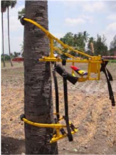
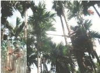

# Arecanut — Agriculture - TNAU production guide
> Auto-extracted from government extension sources by CropBot pipeline. Content is faithful to the source; see front-matter for provenance.
## Main content — Part 1 (pp. 445–445)
## ARECANUT HARVETSER

<!-- p. 445 -->

Purpose Type of the implement Cost of the implement Salient Features To climb arecanut trees for harvesting nuts Manual climbing Rs. 9000 /- (Approximately)

- Even unskilled workers can use it to climb the tree with increased stability and comfort.

- Lightweight aluminium pole with improved configuration of cutting edge of the knife for easy harvesting

- Seating arrangement (adjustable and pivotable) with back rest for safe and secure operations Rotatable unit to facilitate harvesting of bunches form surrounding trees.

## Main content — Part 2 (pp. 447–447)
## WORKER FRIENDLY ARECANUT STRIPPER

<!-- p. 447 -->

Purpose

Type of the

implement

Field capacity Can strip 650-950 Kg of arecanut per hour Cost of the Rs. 25,000 /- (Approximately)

implement

Salient

Features

- Damage caused to the stripped arecanut is eliminated.

- Results in 66 and 77 per cent saving in cost and time when compared to conventional arecanut stripping

Suitable for stripping both green and ripened arecanut.

Electric motor/engine operated

- Stripping efficiency of 99.5 per cent is achieved

## Other mentions in this source
### p. 256

In India, since the import of germplasm is in the form of seeds/sprouts, possibilities for introduction of the pest species from other countries are limited. But many of the pest species of related palm species such as coconut and areca palm, have got adapted to oil palm. Among the 49 species of insects infesting adult oilpalms, 14 species are known pests of coconut and 19 species are known pests of areca palms. Insect pests of oilpalm in India are more or less same as those reported from Malaysia and other South-East Asian countries.
### p. 452

The biomass gas stove has been developed for small scale thermal application in agriculture and allied industries. This stove widens the market for agro wastes, makes possible a higher efficiency and in some cases reduces the time and investment, all by comparison with combustion. The biomass gas stove is a natural convection type updraft gasifier consisting of a cylindrical body made of clay, sand and paddy husk with its top open and bottom closed. The diameters and height of the stove are 290 mm and 630 mm respectively. This can be reduced depending on the applications. An iron grate to hold the biomass is fixed at 50 mm from the base of the reactor. The bottom is provided with an air opening cum ash removal door. At the top, provision is made to place vessel for cooking, boiling etc. The biomass viz., wood chips, agricultural residues like coconut shell, groundnut shell, arecanut husk, tree barks and leaves can be used in this biomass gas stove. The feedstock materials used should preferably be in the form of small chips, splinters and small logs. The fuel consumption is 5 kg/h and its thermal efficiency is 23%. The cost of the unit is Rs.1000/-.
