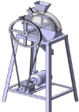
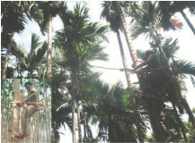
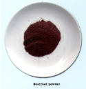
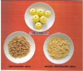
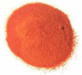
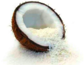
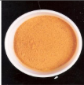
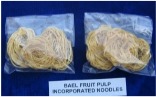
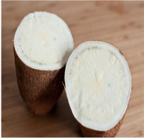

# Arecanut — Horticulture - TNAU production guide
> Auto-extracted from government extension sources by CropBot pipeline. Content is faithful to the source; see front-matter for provenance.
## Main content — Part 1 (pp. 237–238)
## 7. Arecanut (Areca catechu L.) ; Palmae

<!-- p. 237 -->

Mangala, Sumangala, Subamangala, Mohitnagar, Srimangala, Samruthi (Andaman), Hirehalli dwarf, VTLAH 1, VTLAH 2 and Thirthahalli dwarf.

Arecanut is capable of growing in a variety of soils. It thrives best in well drained soils. Adequate protection from exposure to South-Western sun is essential to avoid sunscorch. Quick growing shade trees have to be planted on the southern and western sides well in advance of planting seedlings. It is sensitive to moisture deficit and should be grown where adequate water facilities are available. Grows in a wide range of temperature ranging from minimum of 4 0 C to a maximum of 40 0 C. Altitude upto 1000 m above MSL. Rainfall - 750 - 4500 mm.

June - December.

## Seeds and sowing

<!-- p. 237 -->

For raising seedlings seed nuts from pre-marked and pre-potent mother palms of outstanding performance are selected. Sown immediately after harvest at a spacing of 5 - 6 cm apart in sand beds under partial shade with their stalk end pointing upwards. After the sprouts have produced two to three leaves (90 days old), they are transplanted to Secondary nursery beds at a spacing of 30 x 30 cm or polythene bag of 30 x 10 cm filled with forest soil and are allowed to grow for 12 to 18 months under partial shade. Periodical watering should be given.

Dwarf and compact seedlings with more number of leaves of 1 - 2 years age should be selected. Plant in pits of 90x90x90cm at a spacing of 2.75 m either way and covered with soil to the collar level and pressed around. Provide shade during summer months. Growing Banana or other crops in advance may also provide shade.

Irrigate weekly once during November - February, once in 4 days during March - May. Flood irrigation 175 lit/ tree/ day. In drip irrigation 16 - 20 lit/ tree/ day.

Apply to each bearing palm (5 years and above) 10 - 15 kg of FYM or green leaf. 100:40:140 g of NPK/ tree/ year. To palms less than five years old, half of the above dose is recommended. Manures are applied during January - February after the North - East monsoon in a basin of 0.75-1.00 m radius around the tree to a depth of 20 - 30 cm.

Weeding is done twice or thrice in a year. Wherever the land is slopy terracing has to be done to prevent soil erosion.

Cocoa, black pepper, coffee, cinnamon, clove and citrus

[

Mites Spray Dicofol 18.5 EC at 2.5 ml/lit of water.

## Spindle bug

<!-- p. 238 -->

Spray with Dimethoate 1.5 ml/lit.

Soil application of P. fluorescens (Pfbv 22) and B. subtilis (Bbv 57) each @ 10 g / vine was found to be effective in reducing the root knot and lesion nematode population.

## Bud rot or mahali disease

<!-- p. 238 -->

-  Infected tissues of the bud should be scooped off and treated with Bordeaux paste

-  Destruction and removal of seed palms and bunches

-  Drenching crowns of surrounding healthy palms with 1% Bordeaux mixture

## Foot rot

<!-- p. 238 -->

-  Affected palms have to be isolated by digging trenches all round

-  The severely affected palms should be cut and destroyed

-  The stumps should be pulled out by digging and improved the drainage

-  Soil drenching with 1% Bordeaux mixture

## Stem breaking

<!-- p. 238 -->

-  Wrapping up of the green portion of the stem which are exposed to the SouthWest sun to protect against sun-scorch

## Yellow leaf disease

<!-- p. 238 -->

-  Application of balanced nutrients with additional quantity of superphosphate

-  Apply 1 kg of lime/tree/year

-  Apply organic manures @ 12 kg/ tree/year

-  Foliar spray with 1% bordeaux mixture or mancozeb @ 0.2 %

The bearing starts after 5 years of planting. Nuts are harvested when they are three quarters ripe. The number of harvests will vary from three to five in one year depending upon the season and place of cultivation.

Yield: 1250 kg/ha

## Main content — Part 2 (pp. 394–394)
## Dehusker for fresh arecanut

<!-- p. 394 -->

Arecanut is being cultivated in 3.86 lakhs ha in India with a production of 4.76 lakhs tones of kernels. Most of the areca produced in Tamil Nadu is dehusked in green state. Labour requirement for dehusking is estimated as 7-8 kg of nuts per hour per labour. This involves huge labour requirement and high cost. Existing models are expensive and also cause damage to the kernels. The machine has longitudinal profiled blades. The concave had two spring loaded rubber pads that press the fruit gently against the rotor. The fruits are fed at the top manually. The fruits travel half the circumference and are dehusked in the process. The dehusked kernals fall to the bottom along with the

husk. Tests were conducted with both the models. The speed was varied from 40 to 80 rpm. The results showed that the dehusking efficiency was 53 to 67%. The best dehusking performance was observed in 60 rpm. The breakage was observed in the range of 8 to 10 %.

## Needle type tray seeder for vegetable nursery

<!-- p. 394 -->

Function : Vegetable growers prefer pro-tray grown seedlings

-  To mechanize placement of seeds in the protray cells

-  Singulated raw/ pelleted seeds placed in all the cells in a single stroke

-  Cost of operation is Rs. 280 for sowing 750 trays /day

-  Saving in time is 300% and saving in labour is 60 %

-  Cost of equipment is Rs.22,000/-

## Automatic protray sowing machine for vegetable nursery production

<!-- p. 394 -->

The automated protray sowing machine provides for automating all the steps involved in the

sowing of vegetable seeds in protrays.

-  The machine is able to provide above 100 per cent saving in cost over the cumbersome method of manual sowing.

-  Cost of the Unit is Rs. 1,50,000/-

## Main content — Part 3 (pp. 399–399)
## ARECANUT HARVETSER

<!-- p. 399 -->

Special features: Unskilled workers can also use to climb

-  Light weight aluminium pole with improved configuration of cutting edge of the knife for easy harvesting Seating arrangement (adjustable and pivotable) with back rest for safe and secure operations Rotatable unit to facilitate harvesting of bunches form surrounding trees.

-  Weight : 12 kg

-  Cost of the device along with the knife : Rs.9000/-

## Main content — Part 4 (pp. 402–405)
## WORKER FRIENDLY ARECANUT STRIPPER

<!-- p. 402 -->

Function : Suitable for stripping both green and ripped arecanut.

-  Damage caused to the stripped arecanut is eliminated.

-  Result in 66 and 77 per cent saving in cost and time when compared to conventional arecanut stripping

-  Coverage : Can strip 650-950 Kg of arecanut per hour

-  Efficiency : Stripping efficiency of 99.5 per cent is achieved

-  Cost of Unit : Rs. 25,000/-

Part- XX 32. FOOD PROCESSING TECHNOLOGY

| TECHNOLOGY                         | SALIENT FEATURES                                                                                                                                                                                                                                                                                                                                                                  | PICTURES   |
|------------------------------------|-----------------------------------------------------------------------------------------------------------------------------------------------------------------------------------------------------------------------------------------------------------------------------------------------------------------------------------------------------------------------------------|------------|
| Bio-Colours                        |  Increased preference for natural colours.  Extraction of colour from beetroot.  Standardization of colour extraction with acetone and maltodextrin for maximum colour retention and yield recovery.  Rich in antioxidants with enhanced sensory appeal.  Good storage stability and maintenance of colour intensity for 12 months at room temperature.  No health hazards. |            |
| Greens based Paruppu and Idli podi |  Greens add colour, flavor, nutritional and therapeutic value to foods.  Incorporation of greens enhances the quality of the parupu and idli podi.  Good source of -carotene (7473 g), B-vitamins and iron (37 mg).  Shelf life upto 10 months.                                                                                                                             |            |
| Aonla mouth freshner               |  Aonla granules can be used as mouth fresheners and as substitutes for areca nut and tobacco.  Developed from shredded and dehydrated pieces of aonla and source of lime juice and spices.  Vitamin C (960 mg/100g) and β carotene (98 µg) with improved flavor and sensory appeal.  Contains 226 mg calcium, 273 mg phosphorous, 20 mg iron and 16 mg fibre / 100g.          |            |
| Protein Enriched Spicy Mango Bar   |  Protein rich mango bar is a combination of pulse (soya and green gram) with mango pulp  Enhanced protein and β carotene content.  Shelf life upto nine months  Provides 10 g protein, 5 g fibre, 15 mg vitamin C and                                                                                                                                                         |            |

PAPAYA BAR

INCORPORATLD NOODLES

|                      | 305µg β carotene.  Can be used in nutrition intervention programmes to prevent protein malnutrition and vitamin A deficiency.                                                                                                                                             |     |
|----------------------|----------------------------------------------------------------------------------------------------------------------------------------------------------------------------------------------------------------------------------------------------------------------------|-----|
| Papaya Fruit         |  Fruit bars are manufactured by the dehydration of papaya fruit pulp.  Papaya based bars are rich sources of β carotene (1688µg/100g) with 16 % moisture content.  Shelf stable up to six months at room temperature.                                                   | Bar |
| Tomato Powder        |  Ready to use convenience food.  Can be readily rehydrated and used to substitute tomato pulp or puree and also used to thicken soups, sauces, stews, and gravies.  Rich source of lycopene, a natural antioxidant.  Low moisture food and has good storage stability. |     |
| Coconut Powder       |  Contain high fibre content of 32.67-35g%  Also provides 40 to 45% fat, 350 to 370 mg% of calcium, 6.5 to 8% protein, 2-3% moisture and 2-3 % ash.  Has a shelf life of six months.  Ready to use in, extruded products, snacks foods and confectionery.               |     |
| Ginger Garlic Powder |  Ready to use and an easy substitute for fresh ginger garlic powder.  Low moisture food and has shelf life for more than 12 months.  Easy to use and blends well with food preparations.  Less bulk and hence saves cost on transport and storage.                     |     |
| Bael Fruits Noodles  |  Bael fruit pulp its incorporated for the preparation of noodles.  The phyto-chemical analysis showed the presence of alkaloids in bael fruit pulp.  The noodles contain 13.12 % protein, 964 µg/β carotene, 110 mg calcium, 15.30 mg potassium, 2.60 mg iron, 2.51     |     |

B

|                                                 | mg zinc and 2.69mg magnesium per 100g.  Shelf-life upto six months in MPP packaging materials.  Low glycemic index and suitable for diabetes.\                                                                                                                                                                                                                                                                                                                                                                                                                                                                                                                                                                                                                                                                                                                                             |               |
|-------------------------------------------------|----------------------------------------------------------------------------------------------------------------------------------------------------------------------------------------------------------------------------------------------------------------------------------------------------------------------------------------------------------------------------------------------------------------------------------------------------------------------------------------------------------------------------------------------------------------------------------------------------------------------------------------------------------------------------------------------------------------------------------------------------------------------------------------------------------------------------------------------------------------------------------------------|---------------|
| Mushroom products                               |  Mushroom protein comparable to meat protein.  Dehydrated mushroom powder finds application in formulation of a variety of value added products.  Mushroom powder (100 g) contains 12 g protein, 47 g fibre, 57 mg calcium and 29 mg iron.  Instant mushroom soup mix and mushroom biscuits which are rich in protein and fibre.  The products have a shelf life of three months at room temperature.                                                                                                                                                                                                                                                                                                                                                                                                                                                                                   |               |
| Probiotic enriched food products from fermented |  Fermentation has been reported to be responsible for product stability, flavor development and cyanide elimination.  Using mixed culture inoculums the cassava chips has been fermented dried and milled.  New and alternative nutritious bread, noodles and biscuits can be produced from different combinations of fermented cassava flour ( FCF) and Refined Wheat Flour (RWF) in the ratio of 75;25 and 50;50 as base and fortified with 15,20,25 and 30 per cent Defatted soy Flour ( DSF).  The calcium, phosphorus and iron content of the fermented cassava and defatted soy flour substituted products were increased when compared to control products. Protein content increased upto 12%  Important essential amino acids like lysine and metheonine were comparatively higher in fermented cassava flour and defatted soy flour incorporated bread, noodles and biscuits. | cassava flour |

## Other mentions in this source
### p. 157

Vegetable cowpea var. CO 2 is recommended as suitable intercrop in elephant foot yam. It can be intercropped profitably in coconut, arecanut, rubber, banana and robusta coffee plantations at a spacing of 90 x 90 cm. Half quantity of FYM (12.5 t/ha) and one third of NPK (27:20:33) will be sufficient for the intercrop.
### p. 161

The vines should be trained on bamboo poles. Weeding has to be done as and when necessary. It can be intercropped profitably in coconut, arecanut, rubber, banana and robusta coffee plantations at a spacing of 90 x 90 cm. In Robusta banana + Dioscorea system, banana should be manured at the full recommended dosage and for yams, manuring at the 2/3 rd recommended level is sufficient.
### p. 179

 Intercropping in Arecanut - Panniyur 5
### p. 192

Keep the area around the plant weed free. It requires medium shade especially during the initial stages of growth. Fast growing shade trees like Erythrina indica, Erythrina lithosperma,Gliricidia maculata or banana are planted in between them a few months prior to planting and can be thinned out later. It can be grown as mixed crop with arecanut and coconut. In Arecanut plantations, Nutmeg can be planted after every third row of Arecanut.
### p. 217

Potash rich alluvial soils friable in nature with high humus and moisture retentivity with a pH of 6.6 - 7.0 are suitable. Cocoa is normally cultivated at altitudes upto 1200 m above MSL with an annual rainfall of 150 cm and a relative humidity of 80 % and annual mean temperature of 24 0 C to 25 0 C. Cocoa can be grown as intercrop in coconut and arecanut gardens.
### p. 218

Cocoa is a shade loving plant. During its seedling period it requires about 50% shade and later the shade requirement is about 40%. The plant is grown as a mixed crop with other plants like spices and rubber mainly under rainfed conditions. Cocoa is planted as an intercrop in coconut and arecanut gardens.
### p. 218

Cocoa is usually grown in areas where water availability is adequate. Cocoa plants are sensitive to drought, irrigation in such cases becomes essential. During summer, as it exists in Southern India, the crop requires irrigation at weekly intervals. When it is grown as mixed crop with arecanut, the crop is to be irrigated once in a week during NovemberDecember, once in 6 days during January-March and once in 4-5 days during April-May with 175 litres of water.
