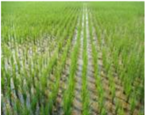

# Banana — Field Crops (Kharif) - ICAR e-course
> Auto-extracted from government extension sources by CropBot pipeline. Content is faithful to the source; see front-matter for provenance.
## Main content — Part 1 (pp. 15–19)
## Planting seedlings in the main field

<!-- p. 15 -->

| Soil - Duration   | Medium and low fertility - Short   | Medium and low fertility - Medium   | Medium and low fertility - Long   | High fertility - Short   | High fertility - Medium   | High fertility - Long   |
|-------------------|------------------------------------|-------------------------------------|-----------------------------------|--------------------------|---------------------------|-------------------------|
| Spacing (cm)      | 15x10                              | 20x10                               | 20x15                             | 20x10                    | 20x15                     | 20x20                   |
| Hills / m 2       | 66                                 | 50                                  | 33                                | 50                       | 33                        | 25                      |

- ∞ Transplant 2-3 seedlings/hill for short duration and 2 seedlings/hill for medium and long duration varieties

- ∞ Shallow planting (3 cm) ensures quick establishment and more tillers. Deeper planting (> 5cm) leads to delayed establishment and reduced tillers.

- ∞ Line planting permits rotary weeding and its associated benefits. Allow a minimum row spacing of 20 cm to use rotary weeder.

- ∞ Fill up the gaps between 7 and 10 DAT.

## Management of aged seedlings

<!-- p. 15 -->

Follow the spacing recommended to medium and low fertility soil

- ∞ Plant one or two seedlings/hill

- ∞ Avoid cluster planting of aged seedlings, which are hindering the formation of new tillers.

- ∞ New tillers alone are capable of producing normal harvestable panicle. Weak panicle may appear in the mother culm within three weeks after transplanting and vanishes well before harvest.

- ∞ To encourage the tiller production, enhance the basal N application by 50% from the recommended and thereafter follow the normal schedule recommended for other stages.

## Application of organic manures

<!-- p. 16 -->

- ∞ Apply 12.5 t of FYM or compost; or green leaf manure @ 6.25 t/ha.

- ∞ If green manure is raised @ 20 kg /ha, in-situ, incorporate it to a depth of 15 cm using a green manure trampler or tractor.

- ∞ In the place of green manure, press-mud / composted coir-pith can also be used.

## Stubble incorporation

<!-- p. 16 -->

- ∞ Apply 22 kg urea/ha at the time of first puddling while incorporating the stubbles of previous crop to compensate immobilization of N by the stubbles.

- ∞ This may be done at least 10 days prior to planting of subsequent crop. This recommendation is more suitable for double crop wetlands, wherein, the second crop is transplanted in succession with short turn-around period.

## Bio-fertilizer application

<!-- p. 16 -->

- ∞ Broadcast 10 kg of soil based powdered Blue Green Algae (BGA) flakes at 10 DAT for the dry season crop. Maintain a thin film of water for multiplication.

- ∞ Raise Azolla as a dual crop by inoculating 250 kg/ha 3 to 5 DAT and then incorporate during weeding for the wet season crop.

- ∞ Mix 10 packets (2000 g)/ha of Azospirillum and 10 packets (2000g/ha) of Phosphobacteria or 20 packets (4000g/ha) of Azophos inoculants with 25 kg FYM and 25 kg of soil and broadcast the mixture uniformly in the main field before transplanting and Pseudomonas fluorescens (Pf 1) at 2.5 kg/ha mixed with 50 kg FYM and 25 kg of soil and broadcast the mixture uniformly before transplanting.

## Application of inorganic fertilizers

<!-- p. 16 -->

- ∞ Apply fertilizer nutrients as per soil test recommendations

- ∞ If the above recommendation are not able to be followed, adopt blanket recommendation as follows:

| Nutrients                                              | N - (kg/ha)   |   P2O5 - (kg/ha) |   K2O - (kg/ha) |
|--------------------------------------------------------|---------------|------------------|-----------------|
| Short duration varieties (Dry season)                  |               |                  |                 |
| a) Cauvery delta & Coimbatore tract                    | 150           |               50 |              50 |
| b) For other tracts                                    | 120           |               40 |              40 |
| Medium and long duration varieties (Wet season)        | 150           |               50 |              50 |
| Hybrid rice                                            | 175           |               60 |              60 |
| Low N responsive cultivars (like Improved White Ponni) | 75*           |               50 |              50 |

## Split application of N and K

<!-- p. 16 -->

- ∞ Apply N and K in four equal splits viz., basal, tillering, panicle initiation and heading stages.

- ∞ Tillering and panicle initiation periods are crucial and should not be reduced with the recommended quantity.

## Application of P fertilizer

<!-- p. 17 -->

- ∞ P may be applied as basal and incorporated.

- ∞ When the green manure is applied, rock phosphate can be used as a cheap source of P fertilizer. If rock phosphate is applied, the succeeding rice crop need not be supplied with P. Application of rock phosphate + single super phosphate or DAP mixed in different proportions (75:25 or 50:50) is equally effective as SSP or DAP alone.

## Application of Zinc sulphate

<!-- p. 17 -->

- ∞ Apply 25 kg of zinc sulphate mixed with 50 kg dry sand just before transplanting.

- ∞ It is enough to apply 12.5 kg zinc sulphate /ha, if green manure (6.25 t/ha) or enriched FYM, is applied.

- ∞ If deficiency symptom appears, foliar application of 0.5% Zinc sulphate + 1.0% urea can be given at 15 days interval until the Zn deficiency symptoms disappear.

## Application of gypsum

<!-- p. 17 -->

- ∞ Apply 500 kg of gypsum/ha (as source of Ca and S nutrients) at last ploughing.

## Foliar nutrition

<!-- p. 17 -->

- ∞ Foliar spray of 1% urea + 2% DAP + 1% KCl at PI and 10 days later for all varieties.

## Neem treated urea

<!-- p. 17 -->

- ∞ Blend the urea with crushed neem seed or neem cake 20% by weight. Powder neem cake to pass through 2mm sieve before mixing with urea. Keep it overnight before use (or) urea can be mixed with gypsum in 1:3 ratios, or urea can be mixed with gypsum and neem cake at 5:4:1 ratio to increase the nitrogen use efficiency.

## Coal-tar treated urea

<!-- p. 17 -->

- ∞ For treating 100 kg urea, one kg coal-tar and 1.5 litres of kerosene is required. Melt coal-tar over a low flame and dissolve it in kerosene. Mix urea with the solution thoroughly in a plastic container, using a stick. Allow it to dry in shade on a polythene sheet. This can be stored for a month and applied basally.

- ∞ Manual weeding is also essential to remove the weeds closer to rice root zone.

- ∞ Cultural practices like dual cropping of rice-Azolla, reduces the weed infestation to a greater extent.

- ∞ Summer ploughing and cultivation of irrigated dry crops during post-rainy periods reduces the weed infestation.

## Pre-emergence herbicides

<!-- p. 17 -->

- ∞ Use Butachlor 1.25kg/ha or Anilophos 0.4kg/ha as pre-emergence application. Alternatively, pre-emergence application of herbicide mixture viz., Butachlor 0.6kg + 2,4 DEE 0.75kg/ha, or Anilophos + 2, 4 DEE Ôready-mixÕ at 0.4kg/ha followed by one hand weeding on 30-35 DAT will have a broad spectrum of weed control.

- ∞ Any herbicide has to be mixed with 50kg of dry sand on the day of application (3-4 DAT) and applied uniformly to the field with thin film water on the 3 DAT. Water should not be drained for next 2 days from the field (or) fresh irrigation should not be given.

- ∞ If pre-emergence herbicide application is not done, hand weeding has to be done on 15 th DAT.

- ∞ 2,4-D sodium salt (Fernoxone 80% WP) 1.25 kg/ha dissolved in 625 litres with a high volume sprayer, three weeks after transplanting or when the weeds are in 3-4 leaf stage.

- ∞ Puddling and leveling minimizes the water requirement

- ∞ Maintain 2.5cm of water over the puddle and allow the green manure to decompose for a minimum of 7 days in the case of less fibrous plants like sunnhemp and 15 days for more fibrous green manure plants like Kolinchi (Tephrosia purpurea).

- ∞ At the time of transplanting, a shallow depth of 2cm of water is adequate since high depth of water will lead to deep planting resulting in reduction of tillering.

- ∞ Maintain 2 cm of water up to seven days of transplanting.

- ∞ About 5cm submergence has to be continued throughout the crop period.

- ∞ Moisture stress due to inadequate water at rooting and tillering stage causes poor root growth leading to reduction in tillering, poor stand and low yield.

- ∞ Critical stages of water requirement in rice are, a) panicle initiation, b) booting, c) heading and d) flowering. During these stages, the irrigation interval should not exceed the stipulated time so as to cause the depletion of moisture below the saturation level.

- ∞ During booting and maturity stages, continuous inundation of 5cm and above leads to advancement in root decay and leaf senescence, delay in heading and reduction in the number of filled grains/panicle and poor harvest index.

- ∞ Provide adequate drainage facilities to drain excess water or strictly follow irrigation schedule of one day after disappearance of ponded water. Last irrigation may be 15 days ahead of harvest.

## Harvesting

<!-- p. 18 -->

- ∞ Taking the average duration of the crop as an indication, drain the water from the field 7 to 10 days before the expected harvest date as draining hastens maturity and improves harvesting conditions.

- ∞ When 80% of the panicles turn straw colour, the crop is ready for harvest. Even at this stage, the leaves of some of the varieties may remain green.

- ∞ Confirm maturity by selecting the most mature tiller and dehusk a few grains. If the rice is clear and firm, it is in hard dough stage.

- ∞ When most of the grains at the base of the panicle in the selected tiller are in a hard dough stage, the crop is ready for harvest. At this stage harvest the crop, thresh and winnow the grains.

- ∞ Dry the grains to 12% moisture level for storage. Grain yield in rice is estimated only at 14% moisture for any comparison.

- ∞ Maturity may be hastened by 3-4 days by spraying 20% NaCl a week before harvest to escape monsoon rains.

## Yield:

<!-- p. 18 -->

- ∞ Grain yield varies between 4000 and 6000 kg/ha depending on the management and climatic conditions. Straw yield of 8000-10000 kg/ha can normally be obtained.

- ∞ Direct wet seeding can be followed in all the areas wherein transplanting is in vogue.

Season: As that of transplanted rice

- ∞ On receipt of showers during the months of May-July, repeated ploughing should be carried out so as to conserve the moisture, destroy the weeds and break the clods.

- ∞ After inundation of water, puddling is to be done as like transplanting rice. More care should be taken to level the field to table top level.

- ∞ Stagnation of water in patches during germination and early establishment of the crop leads to uneven crop stand.

- ∞ Land leveling has say over efficient weed and water management practices.

- ∞ Provision of shallow trenches (15cm width) at an interval of 3m all along the field will facilitate the draining of excess water at the early growth stage.

All the varieties recommended for transplanting can do well under direct wet seeded conditions also. However, the following varieties are more suited.

| Varieties                                   | Duration (days)   | Time of sowing   |
|---------------------------------------------|-------------------|------------------|
| Ponmani                                     | 160 to 165        | August           |
| Co 43, IR20, ADT 38 ADT 39, Ponni, Improved | 125 to135         | September        |
| White Ponni ADT 36, ADT 37                  | 105 to 110        | 1-10 th October  |

- ∞ Follow a seed rate of 60 kg/ha

- ∞ Pre-germinate the seeds as like wet nursery

- ∞ Seed treatments as adopted for transplanted rice

- ∞ Sow the seeds by drum seeder or broadcast uniformly with thin film of water.

- ∞ Dual cropping of rice-green manure is economic for nutrient budget and efficient for grain production. For this method use ÔTNAU Rice-Green manure seederÕ.

## After cultivation

<!-- p. 19 -->

- ∞ Thinning and gap filling should be done 14-21 days after sowing.

- ∞ If dual cropped with green manure, incorporate the green manure when grown to 40cm height or at 30 days after sowing, whichever is earlier, using Cono-weeder.

- ∞ Green manure incorporated fields to be operated again with rotary weeder a week later in order to aerate the soil and to exploit organic acids formed if any.

## Manures and fertilizer application

<!-- p. 19 -->

- ∞ For direct wet seeded lowland rice, the recommendation is same at that of transplanted rice.

- ∞ Apply N and K as 25% each at 21 DAS, at active tillering, PI and heading stages.

## Main content — Part 2 (pp. 26–27)
## Transplanting

<!-- p. 26 -->

- ∞ Single seedling of 15 days old.

- ∞ Square planting of 25 x 25 cm.

- ∞ Fill up the gaps between 7 and 10 DAT.

- ∞ Transplant within 30 minutes of pulling out of seedlings.

## Irrigation management

<!-- p. 26 -->

- ∞ Irrigation only to moist the soil in the early period of 10 days

- ∞ Restoring irrigation to a maximum depth of 2.5cm after development of hairline cracks in the soil until panicle initiation

- ∞ Increasing irrigation depth to 5.0cm after PI one day after disappearance of ponded water

- ∞ Use rotary weeder / Cono weeder

- ∞ Moving the weeder with forward and backward motion to bury the weeds and as well to aerate the soil at 7-10 days interval from 10-15 days after planting on either direction of the rows and column.

*LCC based N Management*

## Nutrient managements

<!-- p. 27 -->

- ∞ As per transplanted rice.

- ∞ Use of Leaf colour chart (LCC) has more advantage in N management.

## N management through LCC

<!-- p. 27 -->

- ∞ Time of application is decided by LCC score

- ∞ Take observations from 14 DAT in transplanted rice or 21 DAS in direct seeded rice.

- ∞ Repeat the observations at weekly intervals up to heading

- ∞ Observe the leaf colour in the fully opened third leaf from the top as index leaf.

- ∞ Match the leaf colour with the colours in the chart during morning hours (8-10 am).

- ∞ Take observation in 10 places.

- ∞ LCC critical value is 3.0 in low N response cultures like ÔWhite ponniÕ and 4.0 in other cultivars and hybrids.

- ∞ When 6/10 observations show less than the critical colour value, N can be applied @ 35kg N/ha in dry season and 30kg N/ha in wet season per application.

- ∞ Green manure and farm yard manure application will enhance the growth and yield of rice in this system approach.

## Other package of practices as recommended to transplanted rice

<!-- p. 27 -->

*Grown up System of Rice Intensification (SRI) field*

## Other mentions in this source
### p. 25

Filling in soil mixture: Place a wooden frame of 0.5 m long, 1 m wide and 4 cm deep divided into 4 equal segments on the plastic sheet or banana leaves. Fill the frame almost to the top with the soil mixture. Pre-germinating the seeds 2 days before sowing: Soak the seeds for 24 hr, drain and incubate the soaked seeds for 24 hr, sow when the seeds sprout and radical (seed root) grows to 2-3 mm long.
