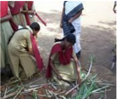
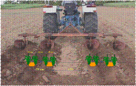
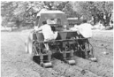
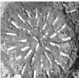
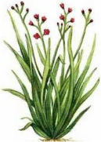

# Banana — Field Crops (Rabi) - ICAR e-course
> Auto-extracted from government extension sources by CropBot pipeline. Content is faithful to the source; see front-matter for provenance.
## Main content — Part 1 (pp. 97–103)
## Planting materials

<!-- p. 97 -->

-  Vegetative propagation

- o Known as seed pieces or setts

- o Buds on sugarcane germinate and give plants

- o Planting materials may be

-  Single bud sett or Chip bud

-  Two budded setts

-  Three budded

-  Seedlings raised from nursery

-  Seedlings raised by poly bags or

-  Tissue cultured seedlings

- o For sett planting

-  Sugarcane setts are prepared from nursery cane

-  Nursery cane is younger than (6-8 months) juice cane

## Ideal cane sett

<!-- p. 98 -->

-  Ultimate plant stand and yield depends on the type of seed material used. The characteristics of good seed cane material are

- o Free from disease and pest infestation

- o Age of seed crop is around eight months

- o Setts should have healthy buds without any damage in handling and transport

- o Buds with higher moisture content, adequate nutrients, higher amount of reducing sugars

- o Cane should be free from aerial roots and splits

- o Pure in quality

## Preparation of setts

<!-- p. 98 -->

-  Use of sharp knife to cut setts

-  Treat the setts immediately with fungicide solution

-  Machine cutting and mechanical planting is also followed in developed counties

-  Seed rates & spacing

-  Depends up on the spacing

-  Spacing varies due to

- o Climate

- o Method of establishment

-  In TN

- o 50,000 three budded setts

- o 75,000 two budded setts

- o 187,500 single budded setts

-  Row spacing may vary

- o 0.9m to 1.5m and 2.4m

## Method of planting Flat Planting

<!-- p. 99 -->

-  In this method, shallow (8-10 cm deep) furrows are opened with a local plough or cultivator at a distance of 75 to 90 cm

-  There should be adequate moisture in the field at the time of planting

-  The setts are planted in them end to end

-  Furrows are covered with 5-7 cm soil

-  In most parts of northern India and some tracts of Maharastra, cane is planted by this method

## Furrow Planting

<!-- p. 99 -->

-  In this method furrows are made with a sugarcane ridger about 10-15 cm deep in northern India and about 20 cm in south India

-  Setts are planted end to end

-  The furrows are covered with 5-6 cm soil, leaving upper portion of furrows unfilled

-  Immediately after covering the setts water is let into furrows

-  This method is practiced in parts of eastern UP and in Peninsular India, particularly in heavy soils

## Trench Method

<!-- p. 100 -->

-  In some coastal areas as well as in other areas where the crop grows very tall and the strong winds during rainy season cause lodging of cane, trench method is adopted to save the crop from lodging

-  Trenches at a distance of 75-90 cm are dug with the help of ridger or by manual labour

-  Trenches should be about 20-25 cm deep

-  Fertilizers (NPK) are spread uniformly in the trenches and mixed thoroughly in the soil

-  The setts are planted end to end in trenches

-  The tractor-drawn sugarcane planter is a very suitable device for planting cane in trenches

## Modified trench system

<!-- p. 100 -->

-  Ridges and furrows are opened at 120 cm using a tractor drawn ridger

-  The furrow bottom is widened

-  As the crop grows while each manuring, only slight earthing up is done so that a trough is maintained through the crop growth

- o Here irrigation is given in the cane row itself

-  The system has been found highly useful under :

- o Saline water irrigated and saline soil conditions

- o The salts are leached down from the root zone

- o Higher cane yield compared to conventional ridges and furrows

- o FYM or pressmud application and trash mulching in this system can further improve cane yield

## Special methods of establishment

<!-- p. 100 -->

Single bud direct planting

-  In this system single bud setts are planted directly in the field in the furrows at 30-45 cm spacing

-  This method is highly economical and sowing of seed material.

-  The buds should be healthy

## Transplanting technique (STP technique)

<!-- p. 100 -->

-  Seedlings are raised in a nursery bed using single bud setts.

-  About 6 weeks old seedlings are transplanted

-  Advantages by adopting this system are

- o Saving in the seed cost

-  Only about 2-3 t/ha against the normal 8-10 tonnes/ha.

- o Synchronous tillering leading to uniformly maturity

- o Sufficient time availability to prepare the main field

- o Saving of 2-3 irrigations

- o Possibility of increased cane yield

- o Better weed management

- o Efficient fertilizer management

## Partha" method

<!-- p. 101 -->

-  A technique developed by Mr. S.V. Parthasaradhy an eminent sugarcane scientist.

-  Suggested for water logged or excess soil moisture conditions (coastal Andhra Pradesh and Tamil Nadu during N-E monsoon period)

-  In this method

- o three eye budded setts are planted in a slanting position, 60° to the vertical, in the wet furrow or half-way on the ridges

- o Usually one eye bud is thrust into the soil and the remaining two will be above, which will sprout

- o Once the monsoon recedes, the in situ sprouted setts are pressed down into the soil and made to lie horizontally

- o Soil is put to the base

- o At this stage, the crop is manured

Paired row double side planting system

-  Drippers at 75 cm spacing 12 mm laterals with a lateral spacing of 195 cm

Tractor drawn sugar cane planter Pit method /Ring pit method

A new method of sugarcane cultivation is called pit method or ring pit method, which is cost-effective and at the same time helps farmers get a higher yield is slowly catching on. Several farm trials have proved that by adopting this method, the yield can be increased to two or three times compared to the normal rowto-row planting technique. In the pit method, the crops are raised in pits at the spacing of 180 cm between rows and 150 cm between individual pits in a row. The pits are dug using specially designed tractor drawn power tillers.

The pits are then filled with top soil, 5 kg of farmyard manure (FYM), 100 gms gypsum and 125 gms super phosphate and watered well before planting. About 16 double budded or 32 single budded setts were used for planting. The setts were collected from the eight-month-old plants and were treated with 0.1 per cent carbendazim for 10 minutes before planting. About 60,000 double budded setts were required for planting in one hectare. The pits were irrigated daily for an hour through drip fertigation. Detrashing was done on fifth month after planting and the plants were tied without lodging by dried leaves.

The growth of the crop was vigorous and they matured at the eighth month after planting. Due to the equal spacing maintained on all the sides the plants grew steadily and the nutrition supplied through drip fertigation reduced the crop duration. The continuous supply of nutrition and spacing induces the early physiological maturity that was the major benefit. All the shoots are of the same age, so there is uniform growth and sugar accumulation in the canes. Sufficient space between the clumps and row to row allows sufficient light and air circulation, which is important for good growth of the crop.

The most important factor was that the sugarcane setts were placed at a depth, which were always moist, hence, in case of drought, or non-availability of water the yield was not affected. Under the conventional system, farmers in Tamil Nadu are at present harvesting about 130 tonnes a hectare Ring pit method

## Measures to obtain higher germination

<!-- p. 103 -->

-  Using disease free healthy setts

-  Careful preparation of setts without damaging the buds or setts

-  Planting freshly prepared and treated

-  Trash mulching under

- o moisture stress and hot weather and late planted conditions

-  Seed treatment using a fungicide

## Main content — Part 2 (pp. 133–137)
## Season of Planting

<!-- p. 133 -->

Although the plantation of Java citronella can be initiated anytime during the year, onset of monsoon is the best time. The land should be prepared to fine tilth by discing and tilling. There should be enough moisture in the field at the time of planting.

The slips should be planted at a distance of 60 cm x 60 cm apart. However, in areas where the soil is very fertile and the climatic conditions support luxurious growth, a spacing of 90 cm x 90 cm may be followed.

## Method of Planting

<!-- p. 133 -->

The slips should be taken from healthy, vigorously growing and young bushes and should be planted soon after the bushes have been dug up and the slips have been separated out. If the planting is delayed, the slips may partially dry up resulting in poor plant population. The slips are planted vertically, about 10 cm deep. The planting should be done in such a way that the excess water is drained off quickly. This is because plants are extremely sensitive to temporary waterlogging, which adversely affects the growth of the plant. It is better to plant citronella on ridges to avoid waterlogging. The field should be irrigated immediately after planting if there are no rains within next 24 hours.

## Intercultural Operations

<!-- p. 133 -->

The citronella plantations should be kept weed free. When the plants have established themselves and formed bushes, the problem is not so severe because of the very nature of growth of the bushes. The bushes do not allow weeds to grow around them by cutting off the sunlight. However, in the newly established plantations and after each harvest, the weeds grow in the inter-row spaces and weeding is essential. This can be economically accomplished by running cultivator in between the rows.

Java citronella requires sufficient moisture for good growth and yield of the leaves. In the areas where annual rainfall is about 200-250cm, well distributed over the year and the humidity is high, supplemental irrigation is not necessary. In drier months, however, irrigation is provided twice a week during the first month of planting and thereafter once in 5 days.

## Manuring & Fertilization

<!-- p. 133 -->

Java citronella generally requires high dose of nitrogen for good growth. Under the agroclimatic conditions of North-Eastern India and North India, 80-120 kg N /ha per year is recommended. For the soils with high fertility level, the dose may be reduced. The recommended annual doses of P and K are 40 kg/ha each. It is beneficial to apply N in 4 equally split doses, the first about a month after planting and then after each harvest, at an interval of about three months. In poor soils, 200 kg N and 80 kg P 0 per ha should be applied. Nitrogen is applied in 5-6 split doses.

Citronella is cultivated for essential oil. Although, all the plant parts contain oil, leaves contain the maximum amount of oil. Therefore, only the leaves should be harvested. Harvesting is done by sharp sickle at about 2045cm above the ground. The number of harvests, which can be taken during a year, depends upon the growth of the plants. Under favourable conditions, upto 4 harvests can be obtained in a year. The leaves are ready for first harvest, about 6 months after planting. The second and subsequent harvests can be taken thereafter at 2.5 -3 months interval. Harvesting too soon and too late affects the quality of oil adversely. The delay also causes the leaves to dry up resulting in decrease in yield of oil. While harvesting, only the leaf blade should be cut and the sheath should be left. This is because the sheath contains only little and poor quality oil. Flowering should be discouraged as it causes aging in plants and reduces their life span. The same schedule of harvesting is to be followed during second and subsequent years. The Java citronella plantations remain productive for 5-6 years but the yield of leaves and oil is highest during second and third years, after which it starts decreasing. It is recommended that the plantation should be uprooted after 3-4 years and rotated with some small legume species. Horsegram is a very good rotational crop in south, cowpea or sunhemp (Crotalaria species) is recommended for north Indian plains.

On an average, the oil content is about 1% on the basis of fresh weight of leaves. Depending upon the nature of growth, the yield of fresh leaves is about 15-20 tonnes/ha in the first year and 20-25 tonnes/ha in the second as well as in the third year, after which the yield declines. The yield of oil obtained during the first year is about 100 kg/ha and 150 kg/ha during second and third years. Under very favourable conditions, yield of 200-250 kg oil/ha can be obtained.

The oil is used mostly in perfumery, both directly and indirectly. Soaps, soap flakes, detergents, household cleansers, technical products, insecticides, etc are often perfumed exclusively with this oil. It is also a valuable constituent in perfumery for soaps and detergents. Citronellal is occasionally used in traces in flower compositions of the citrus, cherry, ginger, etc. However, the greatest importance of Citronellal lies in its role as a starting material for further derivatives. Hydroxycitronellal can be prepared from citrinellal and it is a key ingredient in compounding. Hydroxycitronellal is one of the most frequently used floralizing perfume materials. It finds its way into almost every type of floral fragrance and great many non-floral ones. For soap perfumes, a slightly rougher grade is used. High grade is used in flavour compositions.

## Oil Contents

<!-- p. 134 -->

| Chemical constituents of Java type - Chemical   | Chemical constituents of Java type - Percentage   |
|-------------------------------------------------|---------------------------------------------------|
| Citronellal                                     | 32-45%                                            |
| Geraniol                                        | 12-18%                                            |
| Geranyl acetate                                 | 3-8%                                              |
| Citronellyl acetate                             | 2-4%                                              |
| Linalyl acetate                                 | 2%                                                |
| 1-limonene                                      | 2-5%                                              |
| Caryophyllene                                   | 2.1%                                              |
| Linalool                                        | 1.5%                                              |
| Farnesol                                        | 0.6%                                              |
| Methylisoeugenol                                | 2.3%                                              |

## Post Harvest Technology

<!-- p. 135 -->

## Distillation

<!-- p. 135 -->

The grass is steam-distilled for better recovery of oil and economical purposes. The distillation equipment consists of a boiler in which steam is produced, a distillation tub for distilling the grass, a condensor and 2-3 receivers /separators. The distillation tub is made steel with a perforated bottom, which of mint called false bottom, on which the grass rests. It has two opening: one at the bottom forsteam entry and the other at the top through which the oil vapour and steam escape. The top of the still is fitted with a lid, which is removable. Charging and discharging of the grass is done in perforated cages with chains. These cages may be lowered in the tub with the help of chain-pulley system. Tubular condensers oil vapours, coming out from the distillation tub, enter from the top of the condenser and cool down while passing through the tubular tubes. Oil and water vapour after condensation are led to a receiver where the oil separates out from the water and floats on the top and is drawn off.

The harvested grass sometimes contains dead leaves. These should be removed. The remaining leaves are cut into shorter lengths. This reduces the volume of the grass and facilities firm and even packing within the still. Further, chopping the grass gives a higher yield of oil compared to uncut grass. Generally, distillation is complete within 21/2 to 3 hours under normal pressure starting from the initial condensation of the oil. About 80% of the total oil yield is recovered in the first hour, 19% in the second hour and about 1% in the 3rd hour, of distillation. Larger percentages of the major components in the total oil, such as citronellal, geraniol, citronellal and geranyl acetate are recovered on the first hour of distillation.

Growers cultivating smaller areas can make use of properly designed direct-fired stills, in case they are not able to invest in the purchase of a boiler. In such cases, the lower portion of the distillation tub is filled with water and this function as a boiler. The water in the boiler is separated from the remaining part of the still by means of a false perforated bottom on which the grass rests. In the still, the water does not come in contact with the grass. The tub is heated from below either by wood or coal and the steam thus produced passes through grass place above in the tub carrying oil vapours with it. However, distillation in such direct-fire still takes a little more time and the quality of the oil is also inferior. Java citronella oil should preferably be stored in glass /aluminum containers.

- Citronella is a ___________

- Perennial

- Annual

- Biennial

- Method of citronella propagation is ________

- Vegetative

- Runners

- Stolons

- Soil suitable citronella cultivation is __________

- Sandy loam

- Clay loam

- sandy soil

*****☺*****

## Area under cultivation

<!-- p. 137 -->

It is cultivated in Uttar Pradesh, Madhya Pradesh, Jodhpur (Rajasthan), Karnataka, Maharashtra and Tamil Nadu.

Family: Poaceae

## Plant Description

<!-- p. 137 -->

Palmarosa is a wild growing plant related to lemongrass. It has fragrant leaves, long slender stems and terminal flowering tops. It is a drought hardy grass attaining a height of 1.5 to 2.5m having hairy and fibrous shallow root system with long linear lanceolate leaves. It produces large fawn coloured inflorescence containing while, hairy star like spiked flowers.

A well-drained sandy loam soil with soil pH of 7.5-8.5 is ideal for cultivation of Palmarosa and receiving rainfall of about 150 cm annually is an It can also be cultivated in well-drained clay loam soil which are free from water logging.

Warm tropical climate upto 300m elevation in the foothills is suitable for cultivation of Palmarosa. Temperature ranging from 10 - 360C with annual rainfall around 1000mm and ample sunshine are congenial for its growth. Moist and warm climate throughout the year accelerates its growth. Areas, which are affected by severe frost, are not suitable as the frost kills the grass and reduces the oil content.

*Centre of Origin: India*

## Main content — Part 3 (pp. 143–146)
## Land preparation and planting

<!-- p. 143 -->

Field must be free of weeds and clods. The number of ploughings, harrowing and hoeing depend upon the soil conditions, previous crop and degree of weed infestation. About 10-15 tonnes of FYM per hectare is mixed into the soil at the time of last ploughing. The field should be divided into suitable plots of convenient size, depending upon the texture of the soil, the slope of the field and quantum of irrigation. For light soil with even contour, plot size of 8.0 m x 3.0 m will be convenient.

To obtain high percentage of germination, seed should be taken from the crop harvested at the end of the preceding crop season. Old seeds tend to lose viability under ordinary storage conditions. Seed at the rate of 4-8 kg per hectare is sown after treating it with any mercurial seed-dresser at the rate of 3 g/kg of seed, to protect the seedlings from the possible attack of damping off. The seeds are small and light. Hence before sowing, the seed is mixed with sufficient quantity of fine sand or sieved farmyard manure. The seeds are broadcasted because sowing in lines at different spacing does not increase the seed yield. After broadcasting, seeds are swept lightly with a broom to cover them with some soil. Broom however, should be swept in one direction only, to avoid deep burial of the seed for uniform germination. The sowing should immediately be followed by irrigation. Germination begins in four days after sowing. If delayed, it should be stimulated by another watering.

The medicinal plants have to be grown without chemical fertilizers and use of pesticides. Organic manures like, Farm Yard Manure (FYM), Vermi-Compost, Green Manure etc. may be used as per requirement of the species.

Immediately after sowing, light irrigation is essential. First irrigation should be given with light flow or shower of water otherwise, with fast current of water most of the seeds will be swept to one side of the plot and the germination and distribution will not be uniform. The seeds germinate in 6-7 days. If the germination is poor, second irrigation should be given. Later on irrigations are given as and when required. Last irrigation should be given at the time when maximum number of spikes shoots up. The crop requires totally 6-7 irrigations for its good productivity in medium sandy soils.

## Weeding

<!-- p. 143 -->

Periodical weeding and hoeing is required.

## Plant protection

<!-- p. 143 -->

To prevent diseases, bio-pesticides could be prepared (either single or mixture) from Neem (kernel, seeds & leaves), Chitrakmool, Dhatura, Cow's urine etc.

## Harvest

<!-- p. 144 -->

Blooming begins two months after sowing and the crop become ready for harvest in February-March (110-130 days after sowing). When mature, the crop turn yellowish and the spikes turn brownish. The seeds are shed when the spikes are pressed even slightly. At the time of harvest, the atmosphere must be dry and there should be no moisture on the plant, harvesting will lead to considerable seed shattering. Hence, the crop should be harvested after 10 am.

Seed: 900-1500 kg/ha, Husk: 225-375 kg/ha

## Post harvest technology

<!-- p. 144 -->

Harvested plants spread over and after 2 days they are threshed with tractor/bullocks. Pinkish type husk are removed from the seed coat by processing through a series of grinding in mills to separate husk.

- Isabgol belongs to the family___________

- Plantaginaceae b.Poaceae

- Chenopodiaceae

- Moisture content ideal for Isabgol plant growth ________

- Low

- Medium

- High

- Mode of propagation of Isabgol is through __________

- Runners

- Stolons

- Seeds

*****☺*****

## Present Scenario

<!-- p. 146 -->

-  The two hot spots of global biodiversity viz. North Eastern Himalayas and Western Ghats are particularly rich in wild relatives of tropical root and tuber crops.

-  The Central Tuber Crops Research Institute, Thiruvananthapuram initiated collection of tuber crops germplasm and wild relatives from all over India from 1963 onwards.

## Main content — Part 4 (pp. 151–153)
## Planting Time

<!-- p. 151 -->

## 1. In Plains

<!-- p. 151 -->

Early Crop: Third week of September to first week of October.

Main crop: First week of October to third week of October.

Late Crop: Third week of October to first week of November

## II. In Hills

<!-- p. 152 -->

Potato is planted in hills from the third week of February to second week of April. In the southern hills near Ootacamund and in Nilgiris, planting is done three times in a year, i.e. in the month of February, April and September In the plateau regions of Maharashtra, Bihar Madhya Pradesh, potato is raised in rainy and winter seasons.. In the Mysore plateau, the summer and winter crop is planted in April-June and in OctoberDecember, respectively.

## Seed Rate, Methods of Sowing and Spacing

<!-- p. 152 -->

The seed requirements for a hectare on the basis of seed size are given below:

Large size- 25-30 q/ha; Medium size- 15-20 q/ha; Small size- 10-15 q/ha; Out tubers- 8-12 q/h2:-' Potato is planted mainly by two methods:

## 1. Ridge and Furrow Method:

<!-- p. 152 -->

In this method, the ridges are prepared.The length of the ridges depends on slope of the plot. Too long ridges and furrows arc not supplied with irrigation water conveniently. The potato tubers are planted on is let into furrows.

## 2. Flat Bed Method

<!-- p. 152 -->

In this method, the whole plot is divided into beds of convenient length and width. The shallow furrows are opened and potato tubers are planted at recommended distance. The tubers are covered with the original soil of furrows. When the germination is completed and plants become 10 to 12 cm height, earthing should be done. Suitable plant spacing in relation to potato seed grades are given below:

| Diameter of tuber from longer axis   | Planting distance (row x seed)   |
|--------------------------------------|----------------------------------|
| 2.5-3.5 cm                           | 50 x 20 cm or 60 x 15 cm         |
| 3.5-5.0 cm                           | 60 x 25 cm                       |
| 5.0-6.0 cm                           | 60 x 40 cm                       |

## Nutritional requirements and their management:

<!-- p. 152 -->

Soils poor in organic matter content should be supplied with 250 to 500 q/ha of farmyard manure or compost during land preparation, preferably a fortnight before planting. Potato plant is a heavy feeder. When it is grown in medium type of soils, it needs 100 to 150 kg nitrogen, 80 to 100 kg phosphorous and 80 to 100 kg potassium per hectare. Two - third to three fourth quantity of nitrogen along with whole quantity of phosphorus and potassium is applied at the time of planting. Remaining one fourth to one third nitrogen is applied 30 to 35 days after planting i.e. at the time of first earthing up or when plants become 25 to 30 cm in height either in the form of top dressing or as a foliar feeding. Spraying of essential micronutrients such as boron, zinc, copper, iron, manganese, molybdenum etc. is done when crop is showing deficiency symptoms.

## Intercultural Operations

<!-- p. 152 -->

In potato crop, both types of weeds are found i.e. broad-leaved weeds as well as narrow leaved weeds-The use of weedicides in potato crop in general is not essential because earthing up operation destroy almost all weeds, if some how, weed plants are growing on ridges, they may be pulled out by hands. Pre- emergence application of nitrofen @ 1.0 kg a.i./ha or alachlor @.2.0 kg a.i./ha or post emergence application of propanil @ 1.0 kg a.i./ha may be used ill solution fom1 (800-1000 litre/ha). Care should be taken while spraying of post- emergence herbicides that they should not come in the contact to potato plants. Proper development of

tubers depends upon aeration, moisture availability and proper soil temperature. Therefore, proper earthing up is necessary. Earthing should be done when the plants are 15 to 22 cm ill height. Generally earthing is done at the time of top dressing of nitrogenous fertilizers. The ridges should be high enough to cover up tubers. If necessary, a second earthing may be done after two -week of the first one. A mould board plough or a ridger may be used for earthing up in large area.

## Use of Plant Growth Regulators

<!-- p. 153 -->

Soaking of potato seed tuber in CCC at 500 mg/l (Schedule and Pandita, 1986), sodium ascorbate at 100 mg/l (Murti et al.. 1975) cytozyme at 5 per cent (Pandita and Hooda, 1979), Singh and Kaur, 1981) or foliar sprays with ethephon at 400 mg/l (Murti and Banerjee, 1978, Pandita and Hooda, 1979 a, Sekhon and Singh, 1985), CCC at 25 mg/l or garlic acid at 10-100 mg/l(Kumar and Agarwal, 1978) increased tuber yield. Sidda Reddy (1988) also obtained higher tuber yield with foliar sprays of mixtallol at 1 or 2 mg/l.

## Water Management

<!-- p. 153 -->

Before coming to the planting operation. it should be kept in mind that the sufficient soil moisture is available for satisfactory sprouting. If not then light pre-irrigation or just after planting may be given. The rate of water use is low till 30-35 days after planting; it means that the first irrigation is essentially done within 3035 days after planting. However, when soil moisture seems insufficient for sprouting, intervals of first irrigation should be reduced. Further, irrigation is done as and when crop needs. As regards method of irrigation in potato, the furrow method is commonly followed.

## Main content — Part 5 (pp. 161–161)
##  Rabi planting

<!-- p. 161 -->

- o 1st Fortnight of October

- o In Vedaranyam after 15th Dec

- o In Andra Pradesh

-  Mid Oct to Mid Nov

-  Early sowing ends with heavy rain

## Nursery

<!-- p. 161 -->

-  Well drained soil / raised bed

-  2.5m-2 for 1.0g seed

-  1.0g seed contains 10,000 seeds

-  Seeds to seedling is very wide (10 :1)

-  To transplant 20,000 seedlings 200,000 seeds in 50m-2 is more than sufficient

-  Farmers use more than this area and seed rate

-  Rabbing the nursery soil to prevent pest and disease is essential

-  Manuring the nursery

-  Irrigation by rose can

-  Seedling age

- o 7 weeks old

- o Pull out seedlings are pencil thickness

- o After pulling out selected seedlings top dress the remaining seedlings

## Other mentions in this source
### p. 110

 Sugarcane-banana- rice based crop rotations
### p. 142

Ishagola, Isabghul, Spogel seed, Ispaghal, Psyllium seed, Flea seed, Plantain seed, Isabgol and Ishabgul Spogel seed.
