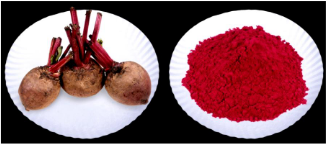

# Beetroot — Horticulture - TNAU production guide
> Auto-extracted from government extension sources by CropBot pipeline. Content is faithful to the source; see front-matter for provenance.
## Main content — Part 1 (pp. 146–147)
## 3. Beetroot (Beta vulgaris L.); Chenopodiaceae

<!-- p. 146 -->

Ooty 1, Crimson Globe, Detroit Dark Red and Red Ball.

It comes up well in all types of friable soils. The suitable soil pH is 6.0-7.0.

July - August.

6 kg of seeds are required for an area of one hectare when directly sown in ridges at a spacing of 10 cm

Plough to a fine tilth and form ridges and furrows 30 cm apart.

30 x30 x10 cm as four rows in each paired row / raised bed system.

Irrigate the field copiously immediately after sowing and afterwards as and when necessary.

Install the drip system with main and sub main pipes and place the inline lateral tubes at an interval of 1.5 m. Place the drippers in lateral tubes at an interval of 60 cm and 50cm spacing with 4 LPH and 3.5 LPH capacities respectively.Form the raised beds at 120 cm width at an interval of 30cm and place the laterals at the centre of each bed.

Apply FYM at 20 t/ha and 60:160:100 kg NPK/ha as basal and 60 kg N/ha after 30 days.

-  Apply 25 kg ZnSO4, 10 kg Borax and 40 kg S ha -1 as basal.

-  Foliar spraying of 0.5% ZnSO4 thrice on 30, 45 and 60 days after sowing.

Fertigation schedule

Recommended Dose: 120:160:100kg NPK/ha

| Crop Stage                       |   Duration in days | Fertilizer grade                  | Total fertilizer - (kg/ha)   | Nutrient supplied - N   | Nutrient supplied - P   | Nutrient supplied - K   |   % Requirement - N |   % Requirement - P |   % Requirement - K |
|----------------------------------|--------------------|-----------------------------------|------------------------------|-------------------------|-------------------------|-------------------------|---------------------|---------------------|---------------------|
| Vegetative stage                 |                 30 | 19:19:19 +MN 13-0.45 12-61-0 Urea | 42.11 4.44 19.67 80.44       | 8.0 0.58 2.36 37.0      | 8.0 - 12.0 -            | 8.0 2.0 - -             |                40.0 |                12.5 |               10.00 |
|                                  |                    |                                   | subtotal                     | 48.0                    | 20.00                   | 10.0                    |                     |                     |                     |
| Early phase of Root developm ent |                 60 | 13-0-45 12-61-0 Urea 0-0-50 Urea  | 88.89 19.67 73.96 40.00      | 11.55 2.36 34.02 -      | - 12.0 - -              | 40.00 - - 20.00         |                40.0 |                7.50 |               60.00 |
|                                  |                    |                                   | subtotal                     | 48.00                   | 12.00                   | 60.00                   |                     |                     |                     |
| Maturity                         |                 30 | 12-61-0                           | 13.12                        | 1.57                    | 8.00                    | -                       |                20.0 |                 5.0 |               30.00 |

| stage   | 13-0-45 Urea   | 66.67 29.85   |   8.67 13.76 |   - - |   30.0 - |       |      |     |
|---------|----------------|---------------|--------------|-------|----------|-------|------|-----|
|         |                | subtotal      |         24.0 |   8.0 |     30.0 |       |      |     |
| Total   |                |               |        120.0 |  40.0 |    100.0 | 100.0 | 25.0 | 100 |

*75% RD of P applied as super phosphate=810 kg/ha.

- 19:19:19 = 42 kg / ha

- 12:61:0 = 52 kg / ha

- 13:0:45 = 160 kg / ha

- 0:0:50 = 40 kg / ha

- Urea = 184 kg / ha

20 days after sowing thin the plants to single seedling per hill.

## Leaf miner and flea beetle

<!-- p. 147 -->

Spray Malathion 50 EC 2 ml/l.

## Cercospora leaf spot

<!-- p. 147 -->

-  Spray mancozeb @ 2 g/l

## Rhizoctonia root rot

<!-- p. 147 -->

-  Spot drenching with carbendazim @ 1 g/l

20 - 25 t/ha in 120 days.

| Crop Growing districts      | Tiruppur, Coimbatore ,Nilgiris, Dindigul,Theni,   |
|-----------------------------|---------------------------------------------------|
| Major markets in Tamil Nadu | Mettupalayam, Coimbatore, Erode                   |
| Grade Specification         | Size                                              |

## Main content — Part 2 (pp. 406–408)
## BIOCOLOUR FROM BEETROOT

<!-- p. 406 -->

Biocolour from beetroot was prepared by utilizing as natural colour in processed foods by replacing the synthetic colours. The beetroot was washed in water and the outer skin and stalks were removed. The peeled beetroot was cut into small pieces and pulped by adding aqueous solution containing 3.0 per cent acetone (4 part beetroot pulp: 1 part aqueous solution). The beetroot pulp was filtered and the extracted juice TSS was adjusted to 25 ° brix by adding maltodextrin. Citric acid (0.1%), calcium sterate (0.1%) and gallnut powder (2%) was added to the juice and mixed thoroughly and filtered. The filtered juice was spray dried at a temperature of 200 °c. The stability of the biocolour from beetroot powder was studied at different levels of pH, preservative and temperature respectively. The physio - chemical characteristics of the freshly prepared biocolour from beetroot powder contained sedimentation - nil, solubility -100 per cent, acetone residues - nil, colour values 88.66, 4.57 and - 2.13 L* a* b*, moisture - 2.07 per cent, pH - 4.2, carbohydrate - 69.36 per cent, protein - 5.50 per cent, fat - 0.2 per cent, fiber - 0.28 per cent, ash - 4.8 per cent, total antioxidant - 16.36 mg /g and tannin - 2.74 per cent.. The prepared biocolour was applied in processed foods viz., beverages (milk shake), jam, jelly, candies (jujups and lollipop), sweetmeats (halwa and kesari), icings and icecream and the level of incorporation of biocolour was optimized. Incorporation of biocolour in processed foods was ranged from 0.2 to 0.9 per cent and the synthetic colour was between 0.01 and 0.03 per cent. Organoleptic evaluation studies showed that the overall acceptability the processed products ranged from 8.0 to 8.6 initially and from 7.5 to 8.0 at the end of 180 days. For 100 kg of fresh beetroot yielded 19.0 kg of biocolour. The cost of the biocolour from beetroot powder was Rs. 56/. per 100 gram.

## BIOCOLOUR FROM BEETROOT

<!-- p. 407 -->

## Part XXI

<!-- p. 408 -->

## 33. Soil Test Crop based Integrated Plant Nutrition System for Horticultural Crops (STCR-IPNS)

<!-- p. 408 -->

Soil test crop response based fertilizer prescriptions under integrated plant nutrition system (STCR-IPNS) for horticultural crops provide a scientific basis wherein the fertiliser doses for NPK are tailored to the requirement of NPK for specific yield levels of crops taking into account the contribution of NPK from soil, fertilizer and organic and or biofertilisers. Being a site and situation specific technology, STCR-IPNS along with entire improved package of practices for various crops ensures balanced nutrition, increased productivity and efficiency of applied NPK with sustained soil health over long run. The STCR- IPNS recommendations for various horticultural crops are furnished in Tables 1-17 and can be adopted to similar and allied soil types.

## VEGETABLES

<!-- p. 408 -->

## Main content — Part 3 (pp. 411–411)
## Beetroot

<!-- p. 411 -->

Soil

: Red Sandy clay loam FN = 0.64 T - 0.65 SN - 0.96 ON

(Palathurai series)

Target range: 35 - 40 t ha -1 fresh root FK2O = 0.61 T - 0.27 SK - 0.92 OK

FP2O5 = 0.52 T - 1.58 SP - 0.92 OP

|   Initial Soil Test Values (kg ha -1 ) - SN |   Initial Soil Test Values (kg ha -1 ) - SP |   Initial Soil Test Values (kg ha -1 ) - SK | NPK (kg ha -1 ) + Vermicompost @ 5 t ha -1 + Azospirillum @ 2 kg ha -1 + PSB @ 2 kg ha -1 -1 -1 - 35 t FN   |   NPK (kg ha -1 ) + Vermicompost @ 5 t ha -1 + Azospirillum @ 2 kg ha -1 + PSB @ 2 kg ha -1 -1 -1 - FP2O5 | NPK (kg ha -1 ) + Vermicompost @ 5 t ha -1 + Azospirillum @ 2 kg ha -1 + PSB @ 2 kg ha -1 -1 -1 - FK2O   | NPK (kg ha -1 ) + Vermicompost @ 5 t ha -1 + Azospirillum @ 2 kg ha -1 + PSB @ 2 kg ha -1 -1 -1 - 40 t FN   |   NPK (kg ha -1 ) + Vermicompost @ 5 t ha -1 + Azospirillum @ 2 kg ha -1 + PSB @ 2 kg ha -1 -1 -1 - FP2O5 |   NPK (kg ha -1 ) + Vermicompost @ 5 t ha -1 + Azospirillum @ 2 kg ha -1 + PSB @ 2 kg ha -1 -1 -1 - FK2O |
|---------------------------------------------|---------------------------------------------|---------------------------------------------|-------------------------------------------------------------------------------------------------------------|-----------------------------------------------------------------------------------------------------------|----------------------------------------------------------------------------------------------------------|-------------------------------------------------------------------------------------------------------------|-----------------------------------------------------------------------------------------------------------|----------------------------------------------------------------------------------------------------------|
|                                         160 |                                          10 |                                         300 | 64                                                                                                          |                                                                                                       135 | 103                                                                                                      | 96                                                                                                          |                                                                                                       161 |                                                                                                      133 |
|                                         180 |                                          12 |                                         350 | 60*                                                                                                         |                                                                                                       132 | 89                                                                                                       | 83                                                                                                          |                                                                                                       158 |                                                                                                      120 |
|                                         200 |                                          14 |                                         400 | 60*                                                                                                         |                                                                                                       129 | 76                                                                                                       | 70                                                                                                          |                                                                                                       155 |                                                                                                      106 |
|                                         220 |                                          16 |                                         450 | 60*                                                                                                         |                                                                                                       126 | 62                                                                                                       | 60*                                                                                                         |                                                                                                       152 |                                                                                                       93 |
|                                         240 |                                          18 |                                         500 | 60*                                                                                                         |                                                                                                       123 | 50*                                                                                                      | 60*                                                                                                         |                                                                                                       149 |                                                                                                       79 |

| Soil :                                   | Red Sandy clay loam FN = 0.69 T - 0.74 SN - 1.03 ON   |
|------------------------------------------|-------------------------------------------------------|
| (Palathurai series)                      | FP2O5 = 0.28 T - 1.35 SP - 1.15 OP                    |
| Target range: 35 - 40 t ha -1 fresh root | FK2O = 0.43 T - 0.21 SK - 0.64 OK                     |

*maintenance dose ; **maximum dose

|   Initial Soil Test Values (kg ha -1 ) - SN |   Initial Soil Test Values (kg ha -1 ) - SP |   Initial Soil Test Values (kg ha -1 ) - SK | NPK (kg ha -1 ) + Vermicompost @ 5 t ha -1 + Azospirillum @ 2` kg ha -1 + PSB @ 2 kg ha -1 - 35 t ha -1 - FN   | NPK (kg ha -1 ) + Vermicompost @ 5 t ha -1 + Azospirillum @ 2` kg ha -1 + PSB @ 2 kg ha -1 - 35 t ha -1 - FP2O5   | NPK (kg ha -1 ) + Vermicompost @ 5 t ha -1 + Azospirillum @ 2` kg ha -1 + PSB @ 2 kg ha -1 - 35 t ha -1 - FK2O   | NPK (kg ha -1 ) + Vermicompost @ 5 t ha -1 + Azospirillum @ 2` kg ha -1 + PSB @ 2 kg ha -1 - 40 t ha -1 - FN   |   NPK (kg ha -1 ) + Vermicompost @ 5 t ha -1 + Azospirillum @ 2` kg ha -1 + PSB @ 2 kg ha -1 - 40 t ha -1 - FP2O5 | NPK (kg ha -1 ) + Vermicompost @ 5 t ha -1 + Azospirillum @ 2` kg ha -1 + PSB @ 2 kg ha -1 - 40 t ha -1 - FK2O   |
|---------------------------------------------|---------------------------------------------|---------------------------------------------|----------------------------------------------------------------------------------------------------------------|-------------------------------------------------------------------------------------------------------------------|------------------------------------------------------------------------------------------------------------------|----------------------------------------------------------------------------------------------------------------|-------------------------------------------------------------------------------------------------------------------|------------------------------------------------------------------------------------------------------------------|
|                                         180 |                                          10 |                                         300 | 53                                                                                                             | 55                                                                                                                | 61                                                                                                               | 75**                                                                                                           |                                                                                                                69 | 75**                                                                                                             |
|                                         200 |                                          12 |                                         350 | 39                                                                                                             | 52                                                                                                                | 50                                                                                                               | 73                                                                                                             |                                                                                                                66 | 72                                                                                                               |
|                                         220 |                                          14 |                                         400 | 25*                                                                                                            | 50*                                                                                                               | 40                                                                                                               | 58                                                                                                             |                                                                                                                63 | 61                                                                                                               |
|                                         240 |                                          16 |                                         450 | 25*                                                                                                            | 50*                                                                                                               | 29                                                                                                               | 43                                                                                                             |                                                                                                                60 | 51                                                                                                               |
|                                         260 |                                          18 |                                         500 | 25*                                                                                                            | 50*                                                                                                               | 25*                                                                                                              | 29                                                                                                             |                                                                                                                58 | 40                                                                                                               |

## Other mentions in this source
### p. 24

Leguminous vegetables, beetroot, elephant foot yam and sunnhemp. Avoid growing cucurbitaceous vegetables.
### p. 343

Vegetables: Iron is essential for the initial growth of vegetable crops. So it is essential to apply Iron containing fertilizers at the initial stage of development to avoid iron deficiency in vegetable crops. Iron deficiency is common in crops like Beans, Cauliflower, Beetroot, Brinjal, Tomato and Tapioca. Remedy: Apply 25 kg Ferrous sulphate per ha as soil application or foliar spray 0.5 %
