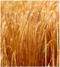
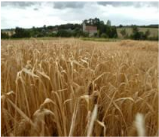
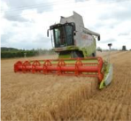
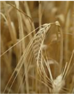

# Carnation — Field Crops (Rabi) - ICAR e-course
> Auto-extracted from government extension sources by CropBot pipeline. Content is faithful to the source; see front-matter for provenance.
## Main content — Part 1 (pp. 29–32)
##  Land preparation

<!-- p. 29 -->

- o Similar to wheat

-  Seed treatment

- o Similar to wheat

##  Method of sowing

<!-- p. 29 -->

- o Similar to wheat

- o FYM 12.5t/ha

- o N- P2O5- K2O

-  Rainfed - 40-20-20

- o Method of application

-  N 50% basal + P&K, I split at I irrigation

-  Entire basal for rainfed

-  Light soil 3 splits - I & II irrigations

-  Irrigated - 60-30-20

-  Malt

- 30-20-20

##  Water management

<!-- p. 29 -->

- o 200-300mm

- o 2-3 irrigations

- o Critical periods

-  Seedling / sprouting

-  Active tillering

-  Flag leaf

-  Milking or soft dough stages

- o Tillering and grain filling so crucial

- o Up to 30 days

- o Post emergence herbicides Isoproturan 0.75kg/ha + 0.5 kg 2,4D EE 3-5 leaf stage

- o Or Pendimethalin (pre-emergence) 1.0kg/ha + one hand weeding

##  Cropping systems

<!-- p. 30 -->

- o Rice-barley

- o Jowar - barley

- o Bajra- barley

- o Cotton-barley

- o Blackgram-barley

- o Mixed crops:

-  with Chickpea, pea, mustard, linseed, lentil

##  Harvest

<!-- p. 30 -->

- o Similar to wheat

- o Storage

-  10-12% moisture

- o Yield

-  3.0 - 3.5t/ha,

-  straw 4.0-5.0t/ha

- Centre of origin of Barley is ___________

- America

- S. Africa

- Asia & Ethiopia

- In India the highest producer of barley is ________

- U.P

- Punjab

- W.bengal

- The inflorescence of barley is called __________

- Ear

- panicle

- spike

- Most critical stage of irrigation in barley is ________

- Tillering

- CRI

- Flowering

- Barley crop needs ________

- Cold & dry climate b. Hot & humid

- dry & hot

- Photoperiodically, barley is a type of plant is ________

- Short day

- Long day

- Day neutral

- Depth of sowing of barley is

- a.1-2cm

- 3-5 cm

- 5-6cm

- Shoot of barley is called

- Stem

- Culm

- Trunk

- Leaf of barley is

- Petiole

- Sessile

- both

- Salt tolerant variety of barley

- Amber

- Neelam

- RD137

11. ________ variety is suitable for malting

- Amber

- Neelam

- RD 137

*****☺*****

-  Man made cereal

-  First wheat x rye occurred in Scotland - 1875

- o Initial crosses were sterile

- o First fertile cross was made in Germany in 1888

- o The name Triticate first appeared in Germany in 1935

-  There are Octaploid, tetraploid, hexaploid cultivars

-  Hexaploid is most common

-  Hexaploids of wheat and rye are called primary hexaploid

-  While hexaploid triticale crossed from hexaploid wheat or octoploid triticale are called secondary hexaploids

-  Secondary hexaploids are

- o Increased genomic diversity

-  Triticale is either spring or winter suited

-  They tend to tiller less but have larger inflorescence

-  Majority of triticale cultivars are awned

-  Initial cultivars are

- o Low yielder

- o Tall week straw

- o Shrunken/shriveled kernels

- o High susceptibility to ergot

- o But high protein, high level of amino acids

- o Good for animal nutrition

## Main content — Part 2 (pp. 62–67)
## Land preparation

<!-- p. 62 -->

-  Fine seed bed since seeds are small

-  Flat bed to perform ferti cum seed drill

## Seed rate & spacing

<!-- p. 62 -->

-  4-6 kg depending upon seed weight

- o 3-5 g/1000 depending upon crop and variety

-  30 x 10 to 30 x 15cm

- o 22.2 to 33.3 plants m-2

## Sowing

<!-- p. 63 -->

-  Treat the seeds with fungicides well before sowing

-  May be behind the country plough

-  Ferti cum seed drill

-  Depth of sowing 3-4cm

-  Avoid shallow sowing

-  Cover the seeds after sowing

-  Sowing may be on conserved soil moisture

-  Oil seed crops removes huge nutrients

-  S is removed in large and needs return

-  General recommendation varies to States

-  60-40-40 for irrigated

- o Half N 30 DAS

- o If SSP is applied S is taken care, if not

- o 20-40kg elemental sulphur, if soil analyzed with <10ppm

-  30-20-20 for rainfed (half of irrigated)

- o All basal

-  Nutrient requirement may be calculated by critical concentration

- o 6.07 - 6.62% N in top 2-3rd leaf at 60 DAS

- o 0.408 - 0.412% S in 4-5th leaf from top

-  Integration with biofertlizer ‗Azotobactor' is desirable

-  Total water requirement - 400mm

-  Moisture at pre-flowering and pod filling stage is critical

- o Two irrigations for mustard

-  One at rosette stage (20-30DAS)

-  Another at siliqua atage (50-60DAS)

- o In light soils three irrigations, the third at 90DAS

-  IW/CPE ratio of 0.6 is optimum

## Weed management

<!-- p. 64 -->

- o Dominant weeds

- o Chenpodium album

- o C. murale

- o Convolvulus arvensis

- o Melitotus alba

- o Intercultural operation 5-10days after 1st irrigation

- o Hand hoeing is desirable, it aerates the soil

- o Soil aeration is to conserve soil moisture

- o Herbicides can also be used

- o Pendimethalin pre-emergence 0.5-1.5 kg/ha based on soil

- o Fluchloralin 1.25kg pre-plant incorporation

- o Post emergence Isoproturan 0.75 kg /ha for

-  Wheat+mustard mixed systems

## Harvesting maturity

<!-- p. 64 -->

-  Color of leaves, stem and silique turn green to pale yellow

-  Lower silique looks - dried appearance

-  Upper may be green

-  Seeds in the silique makes rattling sound

- o Silique with 2 carpels and a false septum

- o During over maturity the two carpels split and seeds shed

- o Premature harvest leads to shriveled grains

- o After sun drying for few hours

- o Beating pods along with the plants

-  Either manually

-  Machine

-  Walking bullocks, or running tractor

- o Cleaning and drying to 8-10% moisture for storage

## Threshing

<!-- p. 64 -->

## o Average yield

<!-- p. 65 -->

|  Irrigated rapeseed   | 1.5 to 2.0 t   |
|------------------------|----------------|
|  Rainfed rapeseed     | 1.0 to 1.5t    |
|  Irrigated mustard    | 2.0 to 2.5     |
|  Rainfed mustard      | 1.5 to 2.0t    |

- o Fallow / millets / pulses - mustard

- o Rice - rapeseed

- o Intercroppings

-  Mustard + chickpea

-  Mustard + sugarcane

-  Mustard + barley / wheat / chickpea

-  Potato + mustard

1. Total production of rapeseed-mustard in the world is _________m tonnes

- 25.15

- 35.15

- c.45.15

2. Total production of rapeseed-mustard in India is _________m tonnes

- 8.15

- 6.96

- c.9.15

3. The peculiar pungency of rapeseed-mustard is due to the presence of _____

- erusic acid

- sinigrin

- Glucosinolates

- Oil content of Brassica juncea is ______

- 45 %

- 43 %

- 35 %

5. Oil content of Brassica campestris Var.yellow sarson is ______

- 45 %

- 43 %

- 35 %

- Oil content of Brassica campestris Var.brown sarson is ______

- 45 %

- 43 %

- 35 %

7. Seed rate of rapeseed-mustard is _______ kg/ha

- 6 - 8

- 4 - 6

- 2 - 4

8. Spacing recommended for rapeseed-mustard is _______

- 35 x 15 - 20 cm

- 30 x 15 - 20 cm c. 30 x 10 - 15 cm

9. Fertilizer dose for irrigated rapeseed-mustard is _______ kg NPK /ha

- 60-40-40

- 30-20-20

- 40-20-20

- Fertilizer dose for rainfed rapeseed-mustard is _______ kg NPK /ha

- 60-40-40

- 30-20-20

- 40-20-20

11. Rate of sulphur recommended for rapeseed-mustard is _______ kg /ha

- 10-20

- 20-40

- 30-40

*****☺*****

## Origin & spread

<!-- p. 67 -->

-  Probably from South - West America

-  Sunflower was introduced into Europe in 16th century

-  Reached Europe from Mexico via Spain

-  It was ornamental

-  Reached Russia via Holland in 18th century

-  First commercial production for oil -1830-40

## Main content — Part 3 (pp. 123–127)
## Land Preparation

<!-- p. 123 -->

Mints require thoroughly ploughed, harrowed, fine soil. All the stubble of weeds should be removed before the crop is planted. Manuring may be done at the time of land preparation by adding FYM @ 25 to 30 t/ha. Green manuring may also be done before the mint is planted. Sun-hemp (Crotalaria juncea L.) is an ideal green manure crop. Mints are planted on flat land or ridges. Hence, flat beds of convenient sizes or ridges are made according to the spacing recommended.

## Cultivation

<!-- p. 123 -->

Mints are propagated through the creeping stolons or suckers. In the case of peppermint and bergamot mint, even runners are planted. Stolen are obtained from the previous year's planting. A hectare of well-established mint, on an average, provides enough planting material for ten hectares. About 400 kg stolons are required for planting one hectare of land. The best time for obtaining stolons is during the months of December and January.

The stolons are cut into small pieces (7-10 cm) and planted in shallow furrows about 7-10 cm deep with a row-to-row distance of 45-60 cm, manually or mechanically. While planting on ridges, the stolons are planted half-way down on the inner sides of the ridges. The plot is irrigated immediately after planting.

## Fertilizer Application

<!-- p. 123 -->

Mint responds very well to a heavy application of nitrogenous fertilizers. The increase in herbage by the application of phosphorus is not as remarkable as in case of nitrogen. Generally, nitrogenous fertilizers @ 80120 kg P and K at 50 kg P2O5 and 40 kg K2O/ha is required for a good crop of mint. However, in M.arvensia an increase of up to 160 kg N/ha and, in M.piperate, 125 kg N/ha has given increased fresh herbage and essential oil-yield. An amount of 100-120 kg N/ha is recommended for producing the optimum herb and oilyield in M.citrata under Pantnagar conditions. A split application of 75 kg N/ha in combination with P at 60 kg P2O5/ ha is recommended under Kodaikanal conditions. Potassium application has no significant effect on herb and oil-yield. In M.spicata, the maximum herb-yield is obtained with the application of 100-120 kg N/ha. Nitrogen may be applied in three split doses at 1, ½-2 and 3 months after planting and the third dose after the first harvest of the crop.

Boron deficiency reduces both the yield of green herb and the essential oil in peppermint. Increased yields of herb, menthol content and essential oil content in peppermint have been obtained by using a combination of boron and zinc fertilizers, Visual symptoms have been documented for some cultivars of Japanese mint towards Fe and Zn deficiencies. With respect to Zn, the crop response was maximum at 20 kg/ha if Zn applied at planting. Similarly, experiments conducted at the CIMAP, Lucknow, have shown that the application of 20 kg/ha of sulphur will increase the herb and oil-yield in M.spicata. Among the different sources of S, calcium sulphate was best followed by ammonium sulphate and elemental sulphur.

The water requirement of mint is very high. Depending upon the soil and climatic conditions, the crop is irrigated 6-9 times before the first monsoon. The crop requires three irrigations after the monsoons during September, October and November. Sometimes another irrigation is required during winter, if the plant is dormant and there are no winter rains to encourage proper growth of the under ground stems. Experiments conducted at Pantnagar have revealed that fifteen irrigation are required to get the maximum herb and oilyield in Japanese mint. When mints are grown in temkperte climates, only 3-4 irrigation during the period from July to October are required.

## Inter-culture and Weed Control

<!-- p. 124 -->

Uninterrupted weed growth causes about 60% reduction in herb and oil-yields. Hence, mints require weeding and hoeing at regular intervals in the early stages of crop growth. One hand-weeding is required after the first harvest. Sinbar is the only herbicide which controls a large number of weeds effectively, when applied as a post-emergence spray @ 1 kg/ha. However, combining organic mulch with a combination of 0.5 kg/ha of Oxyfluorfen herbicide and weeding or application of Pendimethion herbicide at 1 kg/ha and weeding are found to give excellent weed control throughout the crop growth. Dalapon (4 kg/ha), or Gramaxone (2.5 1/ha) as post-emergent spray; Diuron (2 kg a.i/ha) or Terbacil treatment (2 kg a.i/ha) as preemergent treatment are also recommended for chemical weed control in mints.

In low temperature areas, the plants become dormant in November. In order to give a perennial crop (of 3 years only) in peppermint, recultivation is done either in autumn (November-December) or in spring (MarchApril). When peppermint is grown as a perennial crop, the first year crop is called ‗Row mint', while the second and third year crop is called ‗Meadow mint'. This practice is not followed in other mints which are to be planted every year.

## Crop Rotation

<!-- p. 124 -->

Crop rotations help to maintain a reasonable control on weed growth, preserve the fertility of the soil and to obtain higher returns from the land. The following crop rotations are in practice in Uttar Pradesh (a) Mintmaize-potato) (b) Mint-early paddy and potato and (c) Mint-late paddy and sweet pea. Whereas, in Punjab, the farmers practice mint-maize and rape seed/mustard and mint-maize and potato or mint and paddy rotation.

The recommendation for the Terai region of Uttar Pradesh is a 2-year rotation of mint-summer fallowing or millet (fodder) followed by mint on poor fertility lands and mint-wheat-paddy and mint on medium fertile lands.

Japanese mint is generally harvested after 100-120 days of planting, when the lower leaves start turning yellow. If the harvesting is delayed the leaves start falling, resulting in loss of oil. Further, harvesting should be done in bright sunny weather. Harvesting consists of cutting the green herb by means of a sickle 2-3 cm above the ground. A second harvest is obtained about 80 days after the first harvest and the third one after about 80 days from the second harvest. Whereas, in peppermint, spearmint and bergamot mints which are grown in temperate climates, the first crop is ready by the end of June and the second in September or October.

A good crop of Japanese mint can give as high a yield as 48 t/ha of fresh herb. However, the average yield of mints from three cuttings is 20-25 t/ha. The fresh herb contains 0.4% oil.

## Distillation of Oil

<!-- p. 124 -->

Mint oil is obtained by distilling either the fresh or the dry herb. The distillation is done both in primitive and modern stills; in the former the principle of water and steam-distillation is followed. While in the later steam

generated in a separate boiler is employed. The stems are removed from the dried material prior to distillation, because they constitute 30 to 50% of the material and contain only traces of the oil. The average yield of oil is 50-70 kg/ha. Although bergamot mint as well as Japanse mint give an average yield of 70-100 kg/ha, the yield of peppermint oil is lower with an average of 50 kg/ha.

## Storage of Oil

<!-- p. 125 -->

Mint oil is a light and golden-coloured, motile liquid and it should be completely free from moisture before storage. It is stored in large steel, galvanized steel or aluminium containers, filled up to the brim to protect against any air remaining inside and placed in a cool storage godown, away from light and humidity.

- Hindi name of Mint

- Pudina

- Putiha

- None

- The centre of origin of Mint is ________

- Mediterranean b. Russia

- S. Africa

- Planting of Mint is done during __________ month in plains

- Spring

- Summer c. Winter

- Planting of Mint is done during __________ season in temperate climates

- Kharif

- Summer c. autumn

- The fresh mint contains ________% oil

- 0.8

- 0.6

- 0.4

*****☺*****

## Area under cultivation

<!-- p. 127 -->

At present it is grown on northern districts of Travancore and Cochin, Assam, Maharashtra and parts of Uttar Pradesh.

Botanical Name: Cymbopogon flexuosus and Cymbopogon citrutus

### Family: Poaceae

<!-- p. 127 -->

## Plant distribution:

<!-- p. 127 -->

It is a perennial grass about 2 to 3m tall with profuse tillering habit having linear lanceolate leaves. The inflorescence is a highly branched terminal panicle.

### Centre of Origin: India

<!-- p. 127 -->

It flourishes on a wide variety of soils ranging from loam to poor laterite with best growth on welldrained sandy-loam soil.

The ideal elevation for commercial cultivation ranges from sea level to 300m. However in Kerala, it grows well at altitudes between 900 and 1200m, generally on poor soils along with hillslopes. Lemongrass requires warm and humid climate with sufficient sunshine and rainfall, ranging from 250-300 cm, uniformly distributed throughout the year. In the hilly areas of Kerala receiving heavy rainfall, the plant grows luxuriantly and is harvested more frequently but the oil and citral content are less as compared to the plants growing in the regions of less rainfall. Temperature range of 10-330C and sunshine is conducive to the development of oil in the plant.

## Sugandhi (OD 19)

<!-- p. 127 -->

It is adapted to a wide range of soil and climatic condition. A red stemmed variety with plant height 1 to 1.75 m and profuse tillering. The oil yield ranges from 80 to 100 kg per hectare with 85-88 per cent citral under rain-fed conditions. Aromatic and Medicinal Plants Research Station, Odakkali, Kerala released this variety.

## Pragati (LS48)

<!-- p. 127 -->

It is a tall growing variety with dark purple leaf sheath suitable for north Indian Plains and Tarai belt of subtropical and tropical climate. Average oil content is 0.63 per cent with 86 per cent. This variety is a clonal selection from OD19 developed at Central Institute of Medicinal and Aromatic Plants, Lucknow.

## Praman (Clone 29)

<!-- p. 127 -->

Evolved through clonal selection at Central Institute of Medicinal and Aromatic Plants, Lucknow and belong to species C. pendulus. It is a medium sized variety with erect leaves and profuse tillering. The oil yield is high with 82 per cent citral.

## RRL 16

<!-- p. 127 -->

Average yield of this variety is 15 to 20 tonnes/hectare/annum giving 100 to 110 kg oil. Oil content varies

## Other mentions in this source
_No other mentions of this crop were found in this source._
