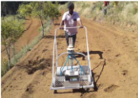
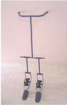
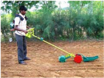
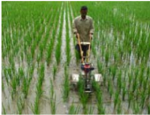

# Carrot — Agriculture - TNAU production guide
> Auto-extracted from government extension sources by CropBot pipeline. Content is faithful to the source; see front-matter for provenance.
## Main content — Part 1 (pp. 441–442)
## MANUALLY OPERATED CARROT SEEDER

<!-- p. 441 -->

Purpose Suitable for sowing pelletized carrot seeds

Type of the Manually operated

implement

Field capacity 0.064 ha/day

Cost of the

implement

Salient

Features Rs. 30,000 /- (Approximately)

- Pelletized carrot seeds can be sown in six rows.

- Specially designed conical foam pad metering mechanism to avoid seed damage.

- A single person can easy push the seeder easily on the seed beds.

## iii. INTERCULTURAL EQUIPMENTS TWO ROW FINGER TYPE PADDY ROTARY WEEDER

<!-- p. 441 -->

Purpose For weeding in rice crops

Type of the Manually operated

implement

Field capacity 0.35 ha/day.

Cost of the

implement

Salient

Features Rs. 1400 /- (Approximately)

- Two row paddy weeder

- Row to row spacing is adjustable

## BATTERY OPERATED PORTABLE WETLAND WEEDER

<!-- p. 441 -->

Purpose For weeding in rice crop

Type of the Manually operated

implement

Field capacity 0.3 ha/day

Cost of the

implement

Salient

Features Rs. 12,000 /- (Approximately)

- Single row paddy weeder

- No drudgery involved for the operator

## MULTI ROW POWER WEEDER FOR SRI

<!-- p. 442 -->

Purpose For weeding in rice crop

Type of the

implement

Field capacity Can weed 0.75 to 1.0 ha per day

Cost of the

implement

Salient

Features Rs. 40,000 /- (Approximately)

- Weeding done by two rotary weeding units powered by 1.7 HP engine

- Can be operated and lifted by one person easily to change rows.

- Complete cutting of weeds at a depth of 3 to 4 cm with less than 1% plant damage.

Self-propelled

## Other mentions in this source
_No other mentions of this crop were found in this source._
