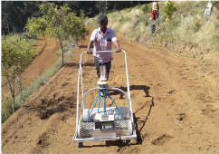

# Carrot — Horticulture - TNAU production guide
> Auto-extracted from government extension sources by CropBot pipeline. Content is faithful to the source; see front-matter for provenance.
## Main content — Part 1 (pp. 142–143)
## 1. Carrot (Daucus carota L.); Umbelliferae

<!-- p. 142 -->

## Varieties Hills

<!-- p. 142 -->

Ooty-1, Early Nantes and New Korda.

India Gold, Pusa Kesar and Half Long Danvers.

## Climate and Soil

<!-- p. 142 -->

The Carrot is a cool season crop and when grown at 15°C to 20°C will develop a good colour. The carrot crop needs deep loose loamy soil. It requires a soil pH range of 6.0 to 7.0.

At elevation above 1500 metres, carrot can be grown throughout the year under assured irrigation. At elevations between 1000 - 1500 metres. Carrot can be grown in July - February.

## Plains: August.

<!-- p. 142 -->

4 kg/ha. Mark the rows with spacing of 25 - 30 cm. Sow the seeds mixed with sand (One part of seed with 4 parts of sand).

## Thinning

<!-- p. 142 -->

Hills: 10 cm between plants. Plains: 5 cm between plants.

Prepare the land to a fine tilth and form raised beds of one metre breadth and convenient length.

Two ploughings are given and ridges and furrows are formed at 30 cm spacing.

Once in five days.

30 t of FYM and 90:90:90 kg of NPK per ha as basal dose and 45:45:45 kg of NPK after 45 days. Apply 25 kg of ZnSO4/ha as basal.

-  10 kg borax as basal soil application.

-  Foliar spraying of 0.50 % ZnSo4 thrice on 45 days and 10 days after for each spray

Spray Fluchloralin 1 l a.i./ha immediately after sowing the seeds to control weeds or first weeding to be done on 15 th day. Thinning and earthing up should be given on 30 th day.

Splitting of roots is a physiological disorder which is usually seen when there is a sudden increase in soil moisture after prolonged drought. Forking is another phenomenon where in the hard soil does not allow the straight growth of tap root which results in formation of forked root. Forked roots and split roots fetch poor price in market. Keeping the soil moisture at optimum condition will help to keep the soil also loose thereby help to avoid splits and forked roots.

Plant protection: Carrot is not much affected by pests.

Nematode: Application of neem cake @ 1 ton/ha at planting. Biofumigation of mustard plants followed by application of neemcake @ 250kg/ha along with Purpureocillium lilacinum @ 5kg/ha or application of P. lilacinum as seed treatment @ 20g/kg of seed followed by soil application @ 2.5kg/ha along with FYM @ 2.5 t/ha.

-  Spray mancozeb @ 2 g/l

Yield: 25 - 30 t/ha in 100 - 120 days.

| Growing districts           | Nilgiris, Dindigul and Krishnagiri             |
|-----------------------------|------------------------------------------------|
| Major markets in Tamil Nadu | Mettupalayam, Dindigul, Coimbatore and Chennai |
| Grade Specification         | Size, diameter or length.                      |

## Main content — Part 2 (pp. 396–397)
## Manually operated carrot seeder

<!-- p. 396 -->

Function

Specification

(i) Type Suitable for sowing pelletized carrot seeds Manually operated

(ii) Power

Requirement

(iii) Weight

12V battery for operating the metering mechanism

19 kg

(iv) Capacity

0.064 ha/day

General Information The carrot seeder consists of conical foam pad metering mechanism to sow pelletized carrot seeds in six rows in the range of 2 to 4 mm. The seed metering mechanism is operated by a 12 v battery. Light weight roller is provided for soil compaction. The seeder can sow pelletized carrot seeds at row to row spacing of 100 mm.

Cost of the Unit Rs.20,000/-

Salient Features

-  Pelletized carrot seeds can be sown in six rows.

-  Specially designed conical foam pad metering mechanism to avoid seed damage.

-  A single person can easy push the seeder easily on the seed beds.

## Tractor operated fruit-shake harvester

<!-- p. 397 -->

Function

: For Harvesting Tamarind, Citrus and in Forestry

Cost of the Unit :

Rs.6000/-

Harvesting Efficiency :

85 %

Saving in time :

95 %

## Other mentions in this source
### p. 391

! Suitable for varying diameters of tubers ! Thickness of chips can be varied ! Also suitable for slicing other tuber crops like radish, carrot, potato °etc. ! The capacity of the unit is 270 kg per hour.
