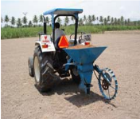
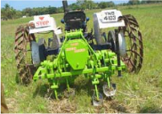
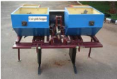

# Castor — Agriculture - TNAU production guide
> Auto-extracted from government extension sources by CropBot pipeline. Content is faithful to the source; see front-matter for provenance.
## Main content — Part 1 (pp. 217–226)
## (iii) CASTOR (Ricinus communis)

<!-- p. 217 -->

| T_Max o C   | T_Min o C   | Optimum o C   | Rainfall mm   | Altitude m MSL   |
|-------------|-------------|---------------|---------------|------------------|
| 38 - 40     | 10 - 15     | 20 - 25       | 350 - 600     | up to 2500       |

Tropical and requires moderately high temperature 20 to 27 ̊ C with low humidity throughout the growing season. It grows best in areas where there are clear warm sunny days. Prolonged cloudy weather with high temperature at the time of flowering resulted in poor seed setting, which is known as sex reversion. High temperature above 41 o C at flowering time even for as short period results in blasting of flowers. Very resistant to drought but evenly distributed rainfall is required. Heavy rainfall at flowering reduces the yield. Very susceptible to frost but grow even an altitudes of 1200 to 2100 m, if sown in March- April, perennial varieties are grown at still higher altitude for shade in coffee estates.

### A. Rainfed

<!-- p. 217 -->

- Adipattam (Jun-July)

All districts Variety : TMV 5, TMV 6

- Irrigated

- Vaigasi pattam (May - June)

All districts Hybrid : YRCH 1, YRCH 2

Hybrid :

- Karthigaipattam (Nov - Dec)

All districts YRCH 1, YRCH 2

Hybrid : YRCH 1, YRCH 2

- Panguni pattam (March- Apr)

All districts Hybrid : YRCH 1, YRCH 2

- Gardenland (border)

- Perennial

All districts Variety : YTP 1

## DESCRIPTION OF CASTOR VARIETIES

<!-- p. 218 -->

| Particulars           | CO 1                             | TMV 5                       | TMV 6                       | Hybrid YRCH 1          | Hybrid YRCH 2                            | Variety YTP 1                            |
|-----------------------|----------------------------------|-----------------------------|-----------------------------|------------------------|------------------------------------------|------------------------------------------|
| Year of Release       |                                  | 1984                        | 1997                        | 2009                   | 2017                                     | 2019                                     |
| Year of Notification  |                                  | SO.832(E)/ 18.11.1985       | SO.647(E)/ 09.09.1997       | SO.2137(E)/ 31.08.2010 | SO.399(E)/ 24.01.2018                    |                                          |
| Parentage             | Pureline selection from Anamalai | Derivative of SA 2 X S248/2 | Derivative of VP 1 X RC 962 | DPC 9 X TMV5           | M 619-1 X SKI 215                        | Cross Derivative of TMV 6 x Salem Local  |
| Duration (days)       | perennial                        | 120                         | 160                         | 150-160                | 170-180                                  | 115-120                                  |
| Yield (kg/ha)         |                                  |                             |                             |                        |                                          |                                          |
| Rainfed (mixed crop)  | -                                |                             | 500                         |                        |                                          |                                          |
| Rainfed               | 2.5                              | 850                         | 950                         | 2000                   | 2300                                     | 1456 kg/ha                               |
| (pure crop)           | kg/tree/y ear                    |                             |                             |                        |                                          |                                          |
| Irrigated (pure crop) | -                                | -                           | -                           | 3000                   | 3500                                     | 3kg/plant/ year                          |
| Oil content (%)       | 57                               | 50                          | 51.9                        | 49                     | 49                                       | 49                                       |
| Special features      |                                  |                             |                             |                        |                                          | Suitable for perennial system.           |
| Stem colour           | Pinkish green                    | Rose                        | Red                         | Light red              | Red                                      | Red                                      |
| Bloom                 | No bloom                         | Triple                      | Double                      | Triple                 | Triple                                   | Triple                                   |
| (waxy coat)           |                                  |                             |                             |                        |                                          |                                          |
| Receme/               | Bold, sparse                     | Spiny, non                  | Medium,                     | Spiny, non             | Semi spiny, non                          | Long, Conical, Semi compact              |
| capsule               | setting, non                     | dehiscent,                  | lengthy ,                   | dehiscent,             | dehiscent,                               | Bold, dehiscent,                         |
|                       | dehiscent                        | resistant to                | spiny                       | resistant to leaf      | resistant to capsule borer, leaf hopper, | resistant to capsule borer, leaf hopper, |
|                       |                                  | leaf hopper                 | capsule                     | hopper                 | Semilooper, spodoptera                   |                                          |
| Suitability           | Pure and mixed crop              | Pure and mixed crop         | Pure and mixed crop         | Pure and mixed crop    | Pure and mixed crop                      | Pernennial Pure Border crop & mixed crop |

| Other features   | -   | -   | - -   | Resistant to wilt, high basal branching and proportion of female flowers more than 95 percent. Resistant to lodging, fertilizer responsive and suitable for rainfed situation and areas of limited irrigation. Resistant to Semilooper , Spodoptera, Thrips and Capsule borer   |
|------------------|-----|-----|-------|---------------------------------------------------------------------------------------------------------------------------------------------------------------------------------------------------------------------------------------------------------------------------------|

## 1. PREPARATION OF THE FIELD

<!-- p. 219 -->

Plough two-three times with country or mould board plough.

Spread 12.5 t/ha of FYM or compost evenly on the main field before last ploughing and incorporate in to soil by working a country plough. Apply 30 kg sulphur/ ha through gypsum at the time of last ploughing for higher castor yield.

NOTE: Do not leave FYM or compost exposed to sunlight as nutrients will be lost.

## 3. SEED RATE

<!-- p. 219 -->

Adopt a seed rate of 10 kg/ha for varieties and 5 kg/ha for hybrids.

## 4. SPACING

<!-- p. 219 -->

Adopt the following spacing.

| Varieties   | Rainfed situation 90 cm x 60 cm   | Irrgiation situation 90 cm x 90 cm 3mx3m   |
|-------------|-----------------------------------|--------------------------------------------|
| YTP 1       | 3mx3m                             |                                            |
| Hybrids     |                                   |                                            |
| YRCH 1      | 120 cm x 90 cm                    | 150 cm x 120 cm                            |
| YRCH2       | 180 cm x 150 cm                   | 180 cm x 150 cm                            |

Under, irrigated conditions, for clay soils wider spacing of 150 cm x 150 cm for YRCH 1 can also be adopted.

For TMV 5 short duration variety 60 x 30 cm may be adopted.

## 5. APPLICATION OF FERTILIZERS

<!-- p. 219 -->

Apply NPK fertilizers basally as per soil test recommendations as far as possible. If soil test recommendations are not available, follow the blanket recommendation as follows

| Rainfed conditions       | Recommended NPK kg/ ha   |
|--------------------------|--------------------------|
| Varieties Hybrids - YRCH | 45 : 15 : 15 NPK kg / ha |
| 1                        | 60 : 30 : 30 NPK kg / ha |
| YRCH 2                   | 70 : 35 : 35 NPK kg / ha |
| Irrigated condition      |                          |
| Varieties                | 60 : 30 : 30 NPK kg / ha |
| Hybrids - YRCH1          | 90 : 45 : 45 NPK kg / ha |
|                          | 135 : 65 : 65 NPK kg /   |
| YRCH 2                   | ha                       |

YRCH 1: In rainfed situations apply 100% P & 50% N&K basally & remaining quantity may be applied in one or two top dressings based on the soil moisture availability.

YRCH 2: In rainfed situations, apply 35 kg P & 37.5 kg N & 17.5 kg K basally and remaining quantity of 37.5 kg N & 17.5 kg K may be applied in one or two top dressings based on the soil moisture availability.

YRCH 1: In irrigated situations, apply 100% P & 50% N&K as basal & remaining quantity N&K may be applied in two equal splits at 30 th & 60 th DAS.

YRCH 2: under irrigated condition, apply 65 kg P & 67.5 kg N & 32.5 kg K as basal and remaining quantity of 67.5 kg N & 32.5 kg K may be applied in two equal splits at 30 th & 60 th day after sowing (DAS).

Apply 12.5 kg ZnSO4 ha -1 (If the soil available Zn is < 1.2 ppm) and 25 kg FeSO4 ha -1 (if the soil available Fe is < 3.7 ppm for non calcareous soil and < 6.3 ppm for calcareous soil). If soil test values are not available.

| Rainfed conditions   |   Recommended TNAU MN mixture kg/ha |
|----------------------|-------------------------------------|
| Varieties            |                                 7.5 |
| Hybrids              |                                10.0 |
| Irrigated conditions |                                     |
| Varieties            |                                12.5 |
| Hybrids              |                                15.0 |

(Prepare enriched FYM at 1:10 ratio of MN mixture & FYM ; mix at friable moisture &incubate for one month in shade).

## 6. PRE TREATMENT OF SEEDS

<!-- p. 220 -->

- Treat the seeds with Thiram or carbendazim @ 2g / kg of seeds or with Trichoderma viride @ 4g/kg of seeds. Treat the seed 24 hours prior to sowing. Soaking the seeds with water for 10 hours enhances the germination.

b) In rainfed situations, seed priming with 1% KCl for 3 hours and sowing a week before onset of monsoon is recommended.

## 7. SOWING

<!-- p. 221 -->

a) Sow the seeds adopting the recommended spacing. b) Place the seeds at depth 4 - 6 cm. c) Put two seeds in each hole and retain only one healthy seedling by thinning out of weaker seedling/pistillate plant at 20 DAS.

## Selective mechanization

<!-- p. 221 -->

Selective mechanization in castor viz., sowing with tractor drawn seed drill with a spacing of 120 cm x 90 cm, inter cultivation with power weeder on 20 and 40 DAS, need based plant protection with boom sprayer, harvesting by secateurs and threshing and shelling by castor thresher increased the kernel yield and net return & benefit cost ratio

## 8. GAP FILLING

<!-- p. 221 -->

Gap fill on the 15 th day of sowing and simultaneously thinning may be done leaving one healthy plant.

## 9. WEED MANAGEMENT

<!-- p. 221 -->

Apply pre emergence herbicide Pendimethalin @ 1 litre/ha or Fluchloralin @ 1 litre/ha on 3 DAS followed by hand weeding twice on 20 th & 40 th DAS.

## 10. CASTOR PGR CONSORTIA (CASTOR GOLD)

<!-- p. 221 -->

Foliar application of plant growth regulator consortia @ 0.05 % (0.5 ml/litre of water) on 25 and 60 days after sowing for increasing pistillate flower production, seed setting per cent and seed yield.

## 11. NIPPING

<!-- p. 221 -->

For perennial castor variety YTP 1, nipping of primary shoot at 10 th internode using secateurs is recommended for tripling the productive branches.

## 12. INTERCROPPING

<!-- p. 221 -->

Raise one row of castor for every six rows of groundnut. In the case of late receipt of monsoon blackgram + castor at 6:1 ratio is recommended. Or Intercropping of castor with Blackgram or Greengram in 1:2 ratio is recommended for rainfed situation.

Intercropping of castor with small onion in 1:2 ratio by adopting 1.5 m x 1.0 m spacing is recommended for irrigated situation.

For hilly areas of Tamil Nadu viz., Kalrayan hills, Javadhu hills and Yelagiri hills, Samai (10kg/ha) + Castor 1.0 kg/ha) @ 10:1 ratio-line sowing (25cm x10 cm) with 50 % organic (FYM @ 8.0t/ha) and 50 % inorganic nutrient (22:11 kg N & P/ha) is recommended for realizing maximum profit.

## 13. HARVESTING THE CROP

<!-- p. 221 -->

Observe the crop considering the average duration of the variety. i) One or more capsules show sign of drying. ii) Cut the matured racemes without damaging the secondaries. iii) Dry the capsule in the sun without heaping it in the shade. iv) Use castor sheller to separate the seeds or beat the dried capsule with wooden planks, winnow and collect the seeds.

For YRCH 1, first harvest has to be done on 90 DAS, subsequently second and third harvest is to be carried out on 120 and 150 DAS, respectively.

For YRCH 2, first harvest has to be done on 110 DAS followed by second and third harvest is to be taken on 140 and 170 DAS, respectively.

The harvested spike should be sun dried and dried capsules can be shelled in the sheller.

|                                                          |                                                                                                                                                                                                                                                                                                                                                                                                                                                                                                                                                                                                                                                                                                                                                                                                                                                                                                                                                                                                                                                                     |
|----------------------------------------------------------|---------------------------------------------------------------------------------------------------------------------------------------------------------------------------------------------------------------------------------------------------------------------------------------------------------------------------------------------------------------------------------------------------------------------------------------------------------------------------------------------------------------------------------------------------------------------------------------------------------------------------------------------------------------------------------------------------------------------------------------------------------------------------------------------------------------------------------------------------------------------------------------------------------------------------------------------------------------------------------------------------------------------------------------------------------------------|
| CROP PROTECTION A. Pest Management                       | CROP PROTECTION A. Pest Management                                                                                                                                                                                                                                                                                                                                                                                                                                                                                                                                                                                                                                                                                                                                                                                                                                                                                                                                                                                                                                  |
| Pests                                                    | Management strategies                                                                                                                                                                                                                                                                                                                                                                                                                                                                                                                                                                                                                                                                                                                                                                                                                                                                                                                                                                                                                                               |
| Defoliators: Semiloopers Achaea janata Paralellia algira | • Encourage the activity of the larval parasitoid, Microplitis maculipennis • Spray Azadirachtin 0.03% 1000 ml • Spray any one of the following insecticides at fifteen days interval Chlorpyrifos 20EC @ 1250 ml/ha Profenophos 50 EC @ 500ml/ha Thiodicarb 75 WP @ 500g/ha Acephate 75SP @ 780 g/ha Flubendiamide 39.35 SC @ 100ml/ha Chlorantraniliprole 18.5 SC @ 150ml/ha                                                                                                                                                                                                                                                                                                                                                                                                                                                                                                                                                                                                                                                                                      |
| Tobacco caterpillar Spodoptera litura                    | • Use of light trap to monitor and kill the attracted adult moths • Set up the sex pheromone trap @ 12/ha to monitor the activity of the adults and to synchronize the pesticide application • Mechanical collection and destruction of egg masses and early stage larvae found in clusters which can be located easily even from a distance. • Hand picking and destruction of grownup of grown up caterpillars. • Spray NSKE 5 % or Azadirachtin 1 % EC (10000 ppm) 2 ml/ lit. or apply Bacillus thuringiensis 2g/lit. during evening hours. • Spraying nuclear polyhedrosis virus at 1.5 x 10 12 POB per ha and virus in the evening • Apply Poison bait in the soil helps in killing the grown up larvae hide in soil during day time. Poison bait ( 1 kg carbaryl+10 kg rice bran+ 1 kg jiggery+ 1 litre of water to make the bait in to pellets for one hectare) • Spray any one of the following insecticides at fifteen days interval. Spraying of insecticides should be done either in the early morning or in the evening Chlorpyrifos 20EC @ 1250 ml/ha |

| Profenophos 50 EC @ 1000 ml/ha Thiodicarb 75 WP @ 500g /ha Acephate 75SP @ 780 g/ha Flubendiamide 39.35 SC @ 100ml/ha Chlorantraniliprole 18.5 SC @ 150ml/ha   |
|----------------------------------------------------------------------------------------------------------------------------------------------------------------|

| Other defoliators Hairy caterpillars Euproctis fraternal Porthesia scintillans Slug caterpillar Parasa lepida Woolly bear Pericallia ricini Spiny caterpillar Ergolis merione Tussock caterpillar   | • Spray Azadirachtin 0.03% 1000 ml • Spray Bacillus thuringiensis var kurstaki 5%WP 1000-1250 g/ha • Spray any one of the following insecticides Profenofos 50EC@ 500ml/ha Chlorpyrifos 20EC @ 1250 ml/ha Flubendiamide 39.35 SC @ 100ml/ha Chlorantraniliprole 18.5 SC @ 150ml/ha                                                                                                                                                                                                                                                                                                             |
|-----------------------------------------------------------------------------------------------------------------------------------------------------------------------------------------------------|------------------------------------------------------------------------------------------------------------------------------------------------------------------------------------------------------------------------------------------------------------------------------------------------------------------------------------------------------------------------------------------------------------------------------------------------------------------------------------------------------------------------------------------------------------------------------------------------|
| Orgyia postica Serpentine leaf miner Liriomyza trifolii                                                                                                                                             | • Spray any one of the following plant products Neem seed kernel extract 5% Neem oil 3 % • Spray any one of the following insecticides at fifteen days interval Chlorpyrifos 20EC @ 1250 ml/ha Malathion 50 EC @ 1000 ml/ha                                                                                                                                                                                                                                                                                                                                                                    |
| Sucking pests Green leaf hopper Empoasca flavescens                                                                                                                                                 | • Spray any one of the following insecticides at fifteen days interval Dimethoate 30EC @ 825 ml/ha Acetamiprid 20SP @ 100 g/ha Thiamethoxam 25WG @ 200 g/ha Clothianidin 50WDG @ 50 g/ha                                                                                                                                                                                                                                                                                                                                                                                                       |
| White fly Trialeurodes ricini                                                                                                                                                                       | • Monitor the activities of the adult white flies by setting up yellow pan traps and sticky traps smeared with grease or sticky oil @ 25 / acre at 1 foot height above the plant canopy • Collection and removal of white fly infested leaves those which were shed due to severe attack • Spray any one of the following plant products Neem seed kernel extract 5% Neem oil 3 % • Spray Fish oil rosin soap 25g / lit of water • Spray any one of the following insecticides at fifteen days interval Imidacloprid 17.8 SL 125 ml/ha Dimethoate 30 EC @ 825 ml/ha Acetamiprid 20%SP 100g /ha |

|                                                         | Thiamethoxam 25WG @ 200 g/ha Profenophos 50%EC 1000 ml/ha Thiacloprid 21.7%SC 600ml/ha                                                                                                                                                                                                                                         |
|---------------------------------------------------------|--------------------------------------------------------------------------------------------------------------------------------------------------------------------------------------------------------------------------------------------------------------------------------------------------------------------------------|
| Flower thrips Retithrips siriacus Scirtothrips dorsalis | • Spray any one of the following insecticides at fifteen days interval Imidacloprid 17.8 SL 125 ml/ha Dimethoate 30 EC @ 825 ml/ha                                                                                                                                                                                             |
| Shoot and Capsule borer Conogethus punctiferalis        | • Spray Neem oil 3% twice at 15 days interval during flowering stage to prevent the adults to lay eggs • Spray any one of the following insecticides from flowering at fifteen days interval Profenofos 50EC@500ml/ha Malathion 50 EC @ 1000ml/ha Indoxacarb 15.8EC @ 500ml/ha Spinosad 45SC@75 ml/ha Thiodicarb 75WP@ 500g/ha |

## B.Disease Management

<!-- p. 224 -->

| Disease                    | Recommendations                                                                                                                                                                                                                                  |
|----------------------------|--------------------------------------------------------------------------------------------------------------------------------------------------------------------------------------------------------------------------------------------------|
| Grey mold: Botrytis ricini | • Remove and destroy the infected spikes • During cloudy weather and rainy season, give prophylactic spray with carbendazim @ 2 g/l twice at 15 days interval or prophylactic spray of P. fluorescens @ 2g/l and second spray after a fortnight. |
| Fusarium Wilt              | • Seed treatment with carbendazim @ 2gram/ kg of seed • Soil drenching with carbendazim @ 2gram / litre of water.                                                                                                                                |

## CASTOR - VARIETAL SEED PRODUCTION

<!-- p. 224 -->

- Land should be free of volunteer plants. The previous crop should not be the same variety or other varieties of the same crop. It can be the same variety if it is certified as per the procedures of certification agency.

- For certified quality seed production, leave a distance of 300 m all around the field from the other varieties / hybrids of the crop.

- June - July and September - October.

- Seed hardening with 2 % KH2PO4 for 16 h (seed to solution ratio 1:1) and dry back to original moisture content.

- Apply NPK @ 90:70:70 kg / ha as basal.

- 90 x 30 cm.

- Harvest the crop as once over harvest when 80 % of the capsules turn into brown colour.

- Thresh the capsules either using power operated thresher or manually by trampling or beating with pliable bamboo stick.

- Grade the seeds at 10 % moisture content using 18 / 64" round perforated sieve.

- Discard the broken and immature seeds for seed purpose.

- Treat the seeds with carbendazim @ 2 g / kg of seed.

- Treat seeds with halogen mixture (CaOCl2 + CaCO3 + arappu (Albizzia amara) leaf powder mixed in the ratio of 5:4:1 @ 3 g / kg as eco-friendly treatment.

- Store the seeds in gunny or cloth bags for short term storage (8 - 9 months) with a seed moisture content of 8 - 9 %.

- Store the seeds in polylined gunny bag for medium term storage (12 - 15 months) with a seed moisture content of 7 - 8 %.

- Store the seeds in 700 gauge polythene bag for long term storage (more than 15 months) with a seed moisture content less than 5 %.

## CASTOR - HYBRID SEED PRODUCTION

<!-- p. 225 -->

- Land should be free of volunteer plants. The previous crop should not be the same variety or other varieties of the same crop. It can be the same variety if it is certified as per the procedures of certification agency.

- For certified quality seed production, leave a distance of 300 m all around the field from the other varieties / hybrids of the crop.

- Sow the female and male parents in the ratio of 3:1 or 4:1 for certified seed production.

- Sow four rows of male parents in around the field for the availability of adequate pollen.

- Sow the female line during first fortnight of September for production of more pistillate inflorescence and male line one week later.

- Apply NPK @ 90:70:70 kg / ha as basal application.

- 90 X 30 cm.

- Harvest the racemes as once over harvest when 80 % of the capsules turn to brown colour.

- The seeds from secondary raceme are better than primary and others.

- Shell the seeds either using power operated thresher or manually by beating with pliable bamboo stick.

- Avoid hand operated thresher to reduce the mechanical damage.

- Grade the seeds using 18 / 64" round perforated sieve.

- Treat the seeds with carbendazim @ 2 g / kg of seed.

- Treat seeds with halogen mixture (CaOCl2 + CaCO3 + arappu (Albizzia amara) leaf powder mixed in the ratio of 5:4:1@ 3 g / kg of seed as eco-friendly treatment.

- Mix the seeds with dry sweet flag (or) vasambu (Achorus calamus) rhizome powder at the ratio of 1:100 for grain cum seed storage.

- Store the seeds in gunny or cloth bags for short term storage (8 - 9 months) with a seed moisture content of 8 - 9 %.

- Store the seeds in polylined gunny bag for medium term storage (12 - 15 months) with a seed moisture content of 7 - 8 %.

- Store the seeds in 700 gauge polythene bag for long term storage (more than15 months) with a seed moisture content less than 5 %.

- The seeds of female parent are poor storer than male and hybrid.

## Main content — Part 2 (pp. 437–438)
## TRACTOR OPERATED SUBSOIL COIRPITH APPLICATOR

<!-- p. 437 -->

Purpose

Type of the

implement

Field capacity The sub soil coir pith mulch is applied at

15-30 cm deep

Tractor operated

0.60 ha/day

Cost of the

implement

Salient Features Ensures higher moisture retention, crop growth and yield

Rs.40,000/- (Approximately)

## TRACTOR OPERATED ROTARY SPADING MACHINE

<!-- p. 437 -->

Purpose

Type of the Primary tillage tools suitable for all soil conditions including wet clay soil and recommended for intercultural operation in coconut orchards Tractor operated

implement

Field capacity 1.5 ha per day

Cost of the

implement

Salient Rs. 1,20,000 /- (Approximately)

High energy utilization efficiency

Features

## TWIN ROW PRECISION ORGANIC MANURE CUM FERTILIZER APPLICATOR

<!-- p. 438 -->

Purpose

Type of the Suitable for accurate and controlled application of organic manure/mulch directly below the root zone.

Tractor operated

implement

Field capacity 1.0 ha per day

Cost of the

implement

Salient

Features Rs. 1,25,000 /- (Approximately)

- Helps in improving the soil nutrient use efficiency, crop yield and soil quality. Adjustable spacing between furrows enables the use at different row spacing

- Simultaneous precise placements of organic manure and inorganic fertilizer.

## Other mentions in this source
### p. 186

Dibble the seeds at a depth of 2 - 3 cm adopting a spacing of 30 x 5 cm. In Erode district, Soybean + Castor (60 cm apart) cropping system gives high net return.
### p. 186

Irrigate immediately after sowing. Give life irrigation on 3 rd day. Further irrigation at intervals of 7 - 10 and 10 - 15 days during summer and winter season respectively to be given depending on soil and weather conditions. Soyabean is very sensitive to excess moisture and the crop is affected, if water stagnates in the fields. The crop should not suffer due to water stress from flowering to maturity. To alleviate moisture stress spray of either Kaolin 3% or liquid paraffin at 1% on the foliage. In Erode district cultivate Soybean + Castor with irrigation at 0.60 IW/CPE ratio (once in 10 to 12 days) is recommended.
### p. 196

For rainfed groundnut -castor intercropping system, apply the recommended dose of 10:10: 45 kg NPK ha -1 to the main crop of groundnut and for castor apply the recommended dose of 40 kg N
### p. 245

¾ Installation of yellow sticky traps (5 ft. x 1.5 ft.) smeared with castor oil @ 5/ ac
### p. 290

Raising of trap crop (castor and maize) along the bunds
### p. 323

� Sow castor as trap crop around and within fields to attract adult Spodoptera
### p. 326

� Sow castor as trap crop around and within fields to attract adult Spodoptera moth for egg laying
### p. 372

However, irrigating this treated effluent to oil seed crops like gingelly and castor, pulses like greengram and blackgram is not advocated as they were found to be sensitive for this type of effluent irrigation.
