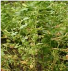
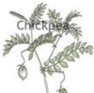
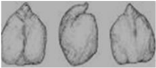

# Chickpea — Field Crops (Rabi) - ICAR e-course
> Auto-extracted from government extension sources by CropBot pipeline. Content is faithful to the source; see front-matter for provenance.
## Main content — Part 1 (pp. 36–38)
## Lecture 05 RABI PULSES CHICKPEA

<!-- p. 36 -->

## Rabi season pulse or Cool season food legumes are:

<!-- p. 36 -->

- o Chickpea, Filed pea, Lentil, , French bean

- o They contribute 60% world pulse production

-  28 million ha globally

-  They are concentrated on temperate and sub-tropical climate

-  Chickpea, lentil in developing countries

-  Peas in developed countries

## CHICKPEA / BENGALGRAM - Cicer arietinum

<!-- p. 36 -->

- Cicer derived from ‗Cicero' well known Roman family and 'arietinum' from 'aries' meaning ram's head shape

- Gram, Bengal gram, chana

- Mostly used pulse in many products

- Boiled, roasted, steamed, sprouted, flour made into many delicious food

Chickpea

## World Scenario

<!-- p. 37 -->

| Country                                               |   Million ha |   Million t |   t/ha |
|-------------------------------------------------------|--------------|-------------|--------|
| Africa (Ethiopia, Malawi, Morocco, Tanzania, Tunisia) |         0.41 |        0.32 |   0.79 |
| Mexico                                                |         0.11 |        0.16 |   1.44 |
| Asia (India, Pak, Turkey, Iran, Myanmar)              |         9.82 |        7.37 |   0.75 |
| India                                                 |         6.93 |        5.60 |   0.81 |
| Europe                                                |         0.05 |        0.04 |   0.93 |
| Australia                                             |         0.09 |        0.11 |   1.09 |
| World                                                 |        10.67 |        8.24 |   0.77 |

## Indian Scenario

<!-- p. 37 -->

| State      |      c |   Production ( '000 t) |   Productivity (kg/ha) |
|------------|--------|------------------------|------------------------|
| MP         | 2560.7 |                 2371.2 |                    926 |
| Rajasthan  | 1081.1 |                  478.9 |                    443 |
| UP         |  739.6 |                  660.6 |                    893 |
| Maharastra |   1020 |                    705 |                    691 |
| Haryana    |    130 |                     72 |                    554 |
| Karnataka  |    418 |                    229 |                    548 |
| AP         |    394 |                    627 |                   1591 |
| All India  | 6896.2 |                 5575.4 |                    808 |

(Ministry of Agriculture, Govt. of India, 2005-06)

## 1. Origin

<!-- p. 37 -->

Gram is cultivated in India from a longer period. It is originated from South West asia or eastern Mediterranean. It is cultivated in Iran, Turkey,Central and Southern Africa, Rumania and Egypt.

## 1. Varieties

<!-- p. 37 -->

- o Two types Desi & Kabuli

- o Desi is small seeded

-  Angular shaped edge

-  Shape like chickens head

-  90% of the world's cultivated

(FAOSTAT, 2006)

- o Kabuli, large and round seeded with white pale cream seed coat

- o Duration 90-180 days

- o CO 2, CO 3, CO 4 are 90days

- o All India - many varieties , Vijay, Pusa 391, DCP 91-3 (HYV, High input response, 150d, 170mg seeds size)

## 1. Climate

<!-- p. 38 -->

- Comes well under dry tracts with an annual rainfall of 600 - 1000mm.

- Soil

- Sandy loam to clay loam soil.

## Other mentions in this source
### p. 30

 with Chickpea, pea, mustard, linseed, lentil
### p. 40

Centre of origin of chick pea is ___________
### p. 40

2. The inflorescence of chick pea is ________
### p. 40

The recommended seed rate for chick pea is __________
### p. 40

Most critical stage of irrigation for chick pea is ________
### p. 40

The leading producer of chick pea is ________
### p. 40

Photoperiodically, chick pea is a type of plant is ________
### p. 40

Chick pea belongs to the family
### p. 40

Ideal temperature for sowing of chick pea is
### p. 40

The recommended seed rate for kabuli gram is _____kg/ha
### p. 40

Nipping in chick pea is a process of
### p. 44

o Third important cool season crop next to chickpea and French bean
### p. 54

Oilseed rape (Brassica napus L.) has become one of the most important oil crops and at present, is the third largest source of vegetable oil all over the world. Conventional rapeseed and mustard varieties impose health concerns due to the presence of erucic acid in oil and glucosinolate in meal. Canola has the advantage over other vegetable oils because it contains lowest content of saturated fatty acids and moderate content of poly-unsaturated fatty acids. Canola oil is low in erucic acid (<2% in oil), glucosinolates (<20 micromoles per gram in meal) and has a lower level of saturated fats (only 6%) than any other vegetable oil. It has a high proportion of un-saturated fats containing a favorable mix of both mono and poly-unsaturated fatty acids, which makes it favorite cooking oil.
### p. 65

 Mustard + chickpea
### p. 65

 Mustard + barley / wheat / chickpea
### p. 74

 Rainfed - SF - wheat / chickpea
### p. 81

o Wheat, coriander, linseed, chickpea, pulses
### p. 81

o Sorghum, wheat, linseed, chickpea, coriander etc.
### p. 168

Green gram
