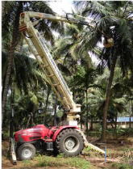
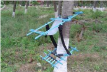

# Coconut — Horticulture - TNAU production guide
> Auto-extracted from government extension sources by CropBot pipeline. Content is faithful to the source; see front-matter for provenance.
## Main content — Part 1 (pp. 226–236)
## 6. Coconut (Cocos nucifera); Palmae Climate

<!-- p. 226 -->

T_Max o C T_Min o C Optimum

| T_Max o C   | T_Min o C   | o C     | Rainfall mm   | Altitude m MSL   |
|-------------|-------------|---------|---------------|------------------|
| 38 - 40     | 10 - 15     | 25 - 30 | 800 - 2500    | up to 600        |

Tropical and subtropical climate. Withstand water logging. Minimum sunshine should be 2000 hours per year.

## VARIETIES AND HYBRIDS Varieties

<!-- p. 226 -->

- East Coast Tall

- West Coast Tall

- VPM-3 (Selection from Andaman Ordinary Tall)

- ALR (CN -1) (Selection from Arasampatty Tall)

- ALR (CN-2) (Selection from Tiptur Tall)

- COD (Dwarf for tender coconut purpose only)

- VPM 4 (Selection from WCT)

- ALR 3 (Dwarf for tender nut purpose only and Selection from Kenthali Dwarf)

## Tall x Dwarf

<!-- p. 226 -->

(To be grown under well managed conditions)

- VHC 2 - ECT X MYD

- VHC 3 - ECT X MOD

- VPM 5 - LCT x CCNT

(Besides, the hybrids of ECT x COD, WCT x COD and WCT x MYD are also produced by the State Department of Agriculture. The dwarf x tall type (COD x WCT) which has to be grown under well-managed conditions with assured irrigation is also produced by State Department of Agriculture).

## CROP MANAGEMENT

<!-- p. 226 -->

Red sandy loam, laterite and alluvial soils are suitable. Heavy, imperfectly drained soil is unsuitable.

## Seasons

<!-- p. 226 -->

June-July, December - January. The planting can also be taken up in other seasons wherever irrigation and drainage facilities are available.

Adopt a spacing of 25' x 25' (7.5 x 7.5 m) with 175 plants/ha. For planting in field border as a single row, adopt 20' spacing between plants.

Dig pit size of 3' x 3' x 3'. In the pits. Fill the pit to a height of two feet (60 cm) with FYM, red earth and sand mixed in equal proportions. At the center of the pit, remove the soil mixture and plant the seedling after removing all the roots. Press the soil well around the seedling and provide the seedling with shade by using plaited coconut leaves or palmyrah leaves. Keep the pits free from weeds. Remove soil covering the collar region. As the seedlings grow and form stem, fill up the pits gradually by cutting the sides.

## Water management

<!-- p. 227 -->

From 5 th year onwards, adopt the following irrigation schedule based on pan evaporation for drip irrigation and basin irrigation.

## Western region

<!-- p. 227 -->

| Months                             | Normal condition (for best yield)   | Moderate water scarcity condition   | Severe water scarcity condition   |
|------------------------------------|-------------------------------------|-------------------------------------|-----------------------------------|
| A. Drip irrigation                 |                                     |                                     |                                   |
| February to May                    | 65 lit / day                        | 45 lit/ day                         | 22 lit / day                      |
| January, August and September      | 55 lit / day                        | 35 lit / day                        | 18 lit/day                        |
| June and July, October to December | 45 lit / day                        | 30 lit/ day                         | 15 lit / day                      |
| B. Basin irrigation                |                                     |                                     |                                   |
| February to May                    | 410 lit / 6                         | days*                               | days*                             |
| January, August and September      | 410 lit /7                          | days*                               | days*                             |
| June and July, October to December | 410 lit /9                          | days*                               | days*                             |

## Eastern region

<!-- p. 227 -->

| Months              | Normal condition (for best yield)   | Moderate water scarcity condition   | Severe water scarcity condition   |
|---------------------|-------------------------------------|-------------------------------------|-----------------------------------|
| A. Drip irrigation  |                                     |                                     |                                   |
| March - September   | 80 lit / day                        | 55 lit / day                        | 27 lit/day                        |
| October - February  | 50 lit / day                        | 35 lit/ day                         | 18 lit /day                       |
| B. Basin irrigation |                                     |                                     |                                   |
| March - September   |                                     | 410 lit / 5 days*                   | 410 lit / 5 days*                 |
| October - February  | 410 lit /8 days*                    |                                     |                                   |

For drip irrigation, open four pits size of 30 x 30 x 30 cm opposite to each other at one meter distance from the trunk. Place 40 cm long PVC conduit pipe (16 mm) in a slanting position in each pit and place the drippers inside the conduit tube and allow the water to drip 30 cm below the soil surface. Fill the pits with coir pith to prevent evaporation.

In the first year, irrigate on alternate days and from the second year to the time of maturity irrigate twice in a week based on the water requirement.

## Drought management and soil moisture conservation Mulching with coconut husks/leaves/coir pith

<!-- p. 227 -->

Apply coconut husks with convex surface facing upwards (100 Nos.) or dried coconut leaves (15 Nos) or coir pith up to a height of 10 cm in the basin of 1.8 m radius around the palms as mulch for soil moisture conservation particularly during summer season.

## Burial of coconut husk or coir pith

<!-- p. 227 -->

Husk burial can be done in coconut basins or in the interspaces to overcome drought and button shedding. Bury husks @ 100 Nos. with concave surface facing upwards or 25 kg of coir pith/palm in circular trenches, dug 30 cm width and 60 cm depth at 1.5 metres radius. The husk can be also buried in the trenches at a distance of 3 m from the palm with a size of 45 cm deep and 150 cm width in between two rows of coconut. The soaking of the coconut husk or coir pith as the case may be preserves the monsoon rains.

From 5 th year onwards, apply 50 kg of FYM or compost or green manure.1.3 kg Urea (560 g N), 2.0 kg Superphosphate (320 g P2O5) and 2.0 kg Muriate of potash (1200 g K2O) in two equal splits during June - July and December - January. Apply manures and fertilizers in circular basins of 1.8 m from the base of the palm, incorporate and irrigate. During 2nd, 3rd and 4th year ¼, ½ and ¾ doses of the above fertilizer schedule should be adopted respectively. Sufficient moisture should be present at the time of manuring. Fertigation may be done at monthly intervals with 75% of the recommended dose of the above fertilizers. Phosphorous may be applied as super phosphate in the basins and incorporated or as DAP through drip when good quality of water is available. TNAU micronutrient mixture is recommended @ 1.0kg/tree/year.

## TNAU coconut tonic nutrition

<!-- p. 228 -->

For nut bearing coconut Palm, root feed TNAU coconut tonic @200ml/palm once in six months.

## Bio-fertilizer recommendation

<!-- p. 228 -->

At the time of planting, apply 50g of Azospirillum, 50 g of Phosphobacteria (or) 50 g of Azophos and 50 g of AM fungi. Mix all the contents with sufficient quantity of FYM or any compost. After planting apply the above biofertilizers once in 6 months/palm near to the feeding roots as that of fertilizer application

## Organic recycling

<!-- p. 228 -->

Any one of the green manure crops like sunnhemp, wild indigo, calapagonium or daincha may be sown and ploughed in situ at the time of flowering as a substitute of compost to be applied. Sow sunnhemp @ 50 g/palm in the basin and incorporate before flowering. Coir pith compost/vermicompost made from coir pith/ coconut leaves/ other wastes from coconut grove can be applied.

## Intercultural operation weed management

<!-- p. 228 -->

The interspace in the coconut garden has to be ploughed twice in a year in June-July and December - January. Intercultural operation is essential to keep weed population under check, to enhance the utilisation of the applied plant nutrients by the coconut trees, to facilitate proper aeration to the roots of coconut, to induce fresh root growth.

For the broad-leaved weeds, pre-emergence spraying of atrazine @1.0 kg a.i./ ha for the control of grasses and sedges, post emergence spraying of glyphosate @ 10 ml and 20 g Ammonium sulphate/litre of water.

## Inter cropping

<!-- p. 228 -->

Inter/mixed crops may be selected based on the climatic requirement of the inter/mixed crop, irrigation facilities and soil type. The canopy size, age and spacing of the coconut are also to be considered. Market suitability should be taken into consideration before selecting an intercrop.

Below 7 years of age: Any suitable annual crop for particular soil type and climatic condition may be raised as intercrops upto 5 years after planting depending upon the canopy coverage. Groundnut, sesamum, sunflower, tapioca, turmeric and banana can be grown. Avoid crops like paddy and sugarcane etc.

7 - 20 years of age: Green manure crops and fodder crops (Napier grass and guinea grass) alone can be grown.

Above 20 years of age (20 years of age has to be adjusted based on the sunlight transmission of above 50% inside the canopy).

The following crops can be grown depending on the soil and climatic suitability. (i) Annuals : Groundnut, bhendi, turmeric, tapioca, sweetpotato, sirukizhangu, elephant foot yam, ginger, pineapple (ii) Biennials : Banana varieties, poovan and monthan are suitable. (iii) Perennials : Cocoa*, pepper* (Panniyur 1 or Panniyur 2 or Panniyur 5 or Karimunda), nutmeg* and vanilla* *Suitable areas are Pollachi tract of western region and Kanyakumari district. For vanilla, use disease free planting material and maintain high vigilance to maintain a disease free

crop.

## Multiple cropping system

<!-- p. 229 -->

Coconut + banana + sirukizhangu + bhendi is suitable system for the eastern region. Crops like banana, pepper, cocoa, nutmeg, vanilla can be tried under multiple cropping system in suitable areas in the western region. In all the systems, apply recommended quantity of water and manures and fertilizers to the intercrops separately.

## Crop physiology

<!-- p. 229 -->

Root feeding of TNAU coconut tonic @ 200 ml / palm twice a year at six months interval decreases button shedding and increases the number and size of nuts.

## Crop protection- Pest management

<!-- p. 229 -->

| Pests                                | Management strategies                                                                                                                                                                                                                                                                                                                                                                                                                                                                                                                                                                                                                                                                                                                                                                                                                                                                                                                |
|--------------------------------------|--------------------------------------------------------------------------------------------------------------------------------------------------------------------------------------------------------------------------------------------------------------------------------------------------------------------------------------------------------------------------------------------------------------------------------------------------------------------------------------------------------------------------------------------------------------------------------------------------------------------------------------------------------------------------------------------------------------------------------------------------------------------------------------------------------------------------------------------------------------------------------------------------------------------------------------|
| Rhinoceros beetle Oryctes rhinoceros |  Remove and burn all dead coconut trees in the garden (which are likely to serve as breeding ground) to maintain good sanitation.  Collect and destroy the various bio-stages of the beetle from the manure pits (breeding ground of the pest) whenever manure is lifted from the pits.  Incorporate the entomopathogen i.e, fungus (Metarrhizium anisopliae) in manure pits to check the perpetuation of the pest.  Soak castor cake at 1 kg in 5 l of water in small mud pots and keep them in the coconut gardens to attract and kill the adults.  Treat the longitudinally split tender coconut stem and green petiole of fronds with fresh toddy and keep them in the garden to attract and trap the beetles.  Examine the crowns of tree at every harvest and hook out and kill the adults.  For seedlings, apply 3 naphthalene balls/palm weighing 3.5 g each at the base of inter space in leaf sheath in the 3 inner |

|                                             | most leaves of the crown once in 45 days. Set up light traps following the first rains in summer and monsoon period to attract and kill the adult beetles.  Field release of Baculovirus inoculated adult rhinoceros beetle @ 15/ha reduces the leaf and crown damage caused by this beetle.  Apply mixture of either neem seed powder + sand (1:2) @150 g per palm or neem seed kernel powder + sand (1:2) @150 g per palm in the base of the 3 inner most leaves in the crown.  Set up rhinolure pheromone trap @ 1/ 2 ha to trap and kill the beetles.                                                                                                                                                                                                                                                                                                                                                                                                                                                                                                                                                                                                                                                                                                                                                                                                                                                                                                                                                                                                                                                                                                                    |
|---------------------------------------------|---------------------------------------------------------------------------------------------------------------------------------------------------------------------------------------------------------------------------------------------------------------------------------------------------------------------------------------------------------------------------------------------------------------------------------------------------------------------------------------------------------------------------------------------------------------------------------------------------------------------------------------------------------------------------------------------------------------------------------------------------------------------------------------------------------------------------------------------------------------------------------------------------------------------------------------------------------------------------------------------------------------------------------------------------------------------------------------------------------------------------------------------------------------------------------------------------------------------------------------------------------------------------------------------------------------------------------------------------------------------------------------------------------------------------------------------------------------------------------------------------------------------------------------------------------------------------------------------------------------------------------------------------------------------------------|
| Black headed caterpillar Opisina arenosella |  The incidence of the pest is noticed from the month of November to May and from August to November after rainfall. The coconut trees of all ages are attacked.  Release the larval (Bethylid, Braconid and Ichneumonid) and pupal (Eulophid) on (chalcid) parasitoids and predators periodically from January, to check the build up of the pest during summer.  Among the larval parasitoids, the bethylid Goniozus nephantidis is the most effective in controlling the pest. The optimum level of release is 1:8 of host-parasitoid ratio. The parasitoi should be released @3000/ha under the coconut trees when the pest is in the 2nd or 3rd instar larval stage. Parasitoid release trap may be used to release the parasitoid at the site of feeding. Parasitoids should not be released in the crown region since they will be killed by predators like spiders and reduviid bugs.  Remove and burn all affected leaves/leaflets.  Spray Malathion 50 EC 0.05% (1mi/lit) to cover the undersurface of the leaves thoroughly in case of severe epidemic outbreak of the pest in young palms.  Root feeding for the control of coconut Black headed caterpillar: Select a fresh and live root, cut sharply at an angle and insert the root in the insecticidal solution containing monocrotophos 36 WSC 10 ml + water 10 ml in a 7 x 10 cm polythene bag. Secure the bag tightly to the root with a cotton thread. Twenty four hours later, check whether there is absorption. If there is no absorption select another root. These methods should not be resorted to as a routine practice and it is suggested only for cases of severe epidemic outbreak of the |
| Red palm weevil Rhynchophorus ferrugineus   | pest and when the survival of the tree is threatened.  Remove and burn all wilting or damaged palms in coconut gardens to prevent further perpetuation of the pest.  Avoid injuries on stems of palms as the wounds may serve as oviposition sites for the weevil. Fill all holes in the stem with cement.  Avoid the cutting of green leaves. If needed, they should be cut about 120 cm away from the stem.  Fill the crown and the axils of top most three leaves with a mixture of fine sand and neem seed powder or neem seed kernel powder (2:1) once in three months to prevent the attack of rhinoceros beetle damage in which the red palm weevil lays eggs.  Setting up of attractant traps (mud pots) containing sugarcane molasses 2½ kg or toddy 2½ litres + acetic acid 5 ml + yeast 5 g                                                                                                                                                                                                                                                                                                                                                                                                                                                                                                                                                                                                                                                                                                                                                                                                                                                                     |

|                                     | + longitudinally split tender coconut stem/logs of green petiole of leaves of 30 numbers in one acre to trap adult red palm weevils in large numbers.  Install pheromone trap @1/2 ha Root feeding: As under black headed caterpillar                                                                                                                                    |
|-------------------------------------|---------------------------------------------------------------------------------------------------------------------------------------------------------------------------------------------------------------------------------------------------------------------------------------------------------------------------------------------------------------------------|
| Termites Odontotermes obesus        |  Locate termite mounds in or near the coconut nursery or garden and destroy.  Swabbing with neem oil 5% once on the base and upto 2 m height of the trunk for effective control.  Spray copper sulphate 1% or cashew nut shell oil 80% or spray chlorphyriphos @ 3ml/lit of water, neem oil 5% or NSKE 20% to preserve plaited coconut leaves from the termite attack. |
| Scale insect Aspidiotus destructor  |  Pluck mature nuts and spray monocrotophos 36 WSC 1 ml/ha.  Do not harvest nuts for 45 days after spraying.                                                                                                                                                                                                                                                             |
| Mealy bugs Pseudococcus longispinus |  Remove leaflets harbouring these insects and destroy them  Spray any one of the following : Malathion 50 EC 2 ml/lit Dimethoate 30 EC 1 ml/lit Methyl demeton 25 EC 1 ml/lit  Monocrotophos 36 WSC 1 ml/lit Neem oil 30ml/lit.                                                                                                                                        |

| Leaf caterpillars Turnaca acuta Nut caterpillar Nut coreid bug   |  Collect and destroy the immature stages of the insects by conducting study (or neem compaign) wherever possible and spray carbary 50 WP 2 gm/lit .  Root feeding with monocrotophos 36 WSC @ 10 ml + 10 ml water at 45 days interval for 3 times for control of leaf caterpillar.  Set up light trape to trap and collect adult moths  Spray Dichlorvas 76 WSC 2 ml / lit.   |
|------------------------------------------------------------------|-----------------------------------------------------------------------------------------------------------------------------------------------------------------------------------------------------------------------------------------------------------------------------------------------------------------------------------------------------------------------------------|
| Slug caterpillar Contheyla rotunda                               | Spray any one of the following:  Dichorvos 76 WSC 2 ml/lit  Bacillus thuringiensis 2 g/lit,  Methyl demeton 25 EC 4 ml/lit  Root feeding with monocrotophos 15 ml + 15 ml of water                                                                                                                                                                                            |
| Scolytid bark borer beetles Xyleborus parvulus                   |  Stem injection through a stove wick soaked in dimethoate 1ml/lit and plugging the hole and repeating the treatment using the same wick and hole a month after.                                                                                                                                                                                                                  |
| Eriophyid mite Aceria guerreronis                                | Manurial and fertilizer recommendation (Soil application/tree/year) Urea 1.3 kg Superphosphate 2.0 kg Muriate of potash* 3.5kg * Increased quantity is recommended to increase the plant resistance to the mite. Neem cake application @ 5 kg Organic manure (well rotten FYM) @ 50 kg                                                                                            |

|                                                       | 1. Micronutrients (Soil application / tree / year) Borax 50 g Gypsum 1.0 kg Magnesim sulphate 500g Grow sunnhemp as intercrop twice a year (Seed rate 30 kg/ha)                                                                                                                                                                                                                                                                                                                                                                                                                                                                                                                | 1. Micronutrients (Soil application / tree / year) Borax 50 g Gypsum 1.0 kg Magnesim sulphate 500g Grow sunnhemp as intercrop twice a year (Seed rate 30 kg/ha)                                                                                                                                                                                                                                                                                                                                                                                                                                                                                                                | 1. Micronutrients (Soil application / tree / year) Borax 50 g Gypsum 1.0 kg Magnesim sulphate 500g Grow sunnhemp as intercrop twice a year (Seed rate 30 kg/ha)                                                                                                                                                                                                                                                                                                                                                                                                                                                                                                                | 1. Micronutrients (Soil application / tree / year) Borax 50 g Gypsum 1.0 kg Magnesim sulphate 500g Grow sunnhemp as intercrop twice a year (Seed rate 30 kg/ha)                                                                                                                                                                                                                                                                                                                                                                                                                                                                                                                |
|-------------------------------------------------------|--------------------------------------------------------------------------------------------------------------------------------------------------------------------------------------------------------------------------------------------------------------------------------------------------------------------------------------------------------------------------------------------------------------------------------------------------------------------------------------------------------------------------------------------------------------------------------------------------------------------------------------------------------------------------------|--------------------------------------------------------------------------------------------------------------------------------------------------------------------------------------------------------------------------------------------------------------------------------------------------------------------------------------------------------------------------------------------------------------------------------------------------------------------------------------------------------------------------------------------------------------------------------------------------------------------------------------------------------------------------------|--------------------------------------------------------------------------------------------------------------------------------------------------------------------------------------------------------------------------------------------------------------------------------------------------------------------------------------------------------------------------------------------------------------------------------------------------------------------------------------------------------------------------------------------------------------------------------------------------------------------------------------------------------------------------------|--------------------------------------------------------------------------------------------------------------------------------------------------------------------------------------------------------------------------------------------------------------------------------------------------------------------------------------------------------------------------------------------------------------------------------------------------------------------------------------------------------------------------------------------------------------------------------------------------------------------------------------------------------------------------------|
|                                                       |                                                                                                                                                                                                                                                                                                                                                                                                                                                                                                                                                                                                                                                                                | Spot application Round                                                                                                                                                                                                                                                                                                                                                                                                                                                                                                                                                                                                                                                         | of ecofriendly Eco-friendly Botanical                                                                                                                                                                                                                                                                                                                                                                                                                                                                                                                                                                                                                                          | botanicals Quantity / tree                                                                                                                                                                                                                                                                                                                                                                                                                                                                                                                                                                                                                                                     |
|                                                       |                                                                                                                                                                                                                                                                                                                                                                                                                                                                                                                                                                                                                                                                                | 1                                                                                                                                                                                                                                                                                                                                                                                                                                                                                                                                                                                                                                                                              | Azadirachtin 1%                                                                                                                                                                                                                                                                                                                                                                                                                                                                                                                                                                                                                                                                | 5 ml in one lit. of water                                                                                                                                                                                                                                                                                                                                                                                                                                                                                                                                                                                                                                                      |
|                                                       |                                                                                                                                                                                                                                                                                                                                                                                                                                                                                                                                                                                                                                                                                | 2                                                                                                                                                                                                                                                                                                                                                                                                                                                                                                                                                                                                                                                                              | Neem oil + Teepol                                                                                                                                                                                                                                                                                                                                                                                                                                                                                                                                                                                                                                                              | 30 ml in one lit. of water                                                                                                                                                                                                                                                                                                                                                                                                                                                                                                                                                                                                                                                     |
|                                                       |                                                                                                                                                                                                                                                                                                                                                                                                                                                                                                                                                                                                                                                                                | 3                                                                                                                                                                                                                                                                                                                                                                                                                                                                                                                                                                                                                                                                              | Azadirachtin 1%                                                                                                                                                                                                                                                                                                                                                                                                                                                                                                                                                                                                                                                                | 5 ml in one lit. of water                                                                                                                                                                                                                                                                                                                                                                                                                                                                                                                                                                                                                                                      |
|                                                       | Method of application  The botanicals should be applied in the sequence indicated above at 45 days interval using a one litre hand sprayer. Rocker or Pedal sprayer can be used for spraying small trees.  The spray should be applied at the crown region by a climber covering only the top six bunches during non rainy season  The bunches must be covered well by the spray fluid and approximately one litre of spray fluid may be required per tree Precautions and safety measures Spraying should be avoided during windy season to prevent                                                                                                                        | Method of application  The botanicals should be applied in the sequence indicated above at 45 days interval using a one litre hand sprayer. Rocker or Pedal sprayer can be used for spraying small trees.  The spray should be applied at the crown region by a climber covering only the top six bunches during non rainy season  The bunches must be covered well by the spray fluid and approximately one litre of spray fluid may be required per tree Precautions and safety measures Spraying should be avoided during windy season to prevent                                                                                                                        | Method of application  The botanicals should be applied in the sequence indicated above at 45 days interval using a one litre hand sprayer. Rocker or Pedal sprayer can be used for spraying small trees.  The spray should be applied at the crown region by a climber covering only the top six bunches during non rainy season  The bunches must be covered well by the spray fluid and approximately one litre of spray fluid may be required per tree Precautions and safety measures Spraying should be avoided during windy season to prevent                                                                                                                        | Method of application  The botanicals should be applied in the sequence indicated above at 45 days interval using a one litre hand sprayer. Rocker or Pedal sprayer can be used for spraying small trees.  The spray should be applied at the crown region by a climber covering only the top six bunches during non rainy season  The bunches must be covered well by the spray fluid and approximately one litre of spray fluid may be required per tree Precautions and safety measures Spraying should be avoided during windy season to prevent                                                                                                                        |
| New invasive pest - Coconut Rugose spiraling whitefly | The coconut rugose spiraling whitefly was noticed in serious proportion in various district coconut gardens of Tamil Nadu. The insects suck the sap and cause damage in the leaf fronts with copious honey dew secretions on the leaves. It induce development of sooty mould fungus there by leaves become completely black and reduces the photosynthesis rate. The following TNAU technologies can be adopted to manage the spiraling whitefly,  Release of Encarsia guadeloupae @ 100 parasitoids /ac (10 leafbits/ac)  Installation of yellow sticky traps (5 ft. x 1.5 ft.) smeared with castor oil @ 5/ ac  Release of Chrysoperla zastrowi sillemi eggs @ 500/ac in | The coconut rugose spiraling whitefly was noticed in serious proportion in various district coconut gardens of Tamil Nadu. The insects suck the sap and cause damage in the leaf fronts with copious honey dew secretions on the leaves. It induce development of sooty mould fungus there by leaves become completely black and reduces the photosynthesis rate. The following TNAU technologies can be adopted to manage the spiraling whitefly,  Release of Encarsia guadeloupae @ 100 parasitoids /ac (10 leafbits/ac)  Installation of yellow sticky traps (5 ft. x 1.5 ft.) smeared with castor oil @ 5/ ac  Release of Chrysoperla zastrowi sillemi eggs @ 500/ac in | The coconut rugose spiraling whitefly was noticed in serious proportion in various district coconut gardens of Tamil Nadu. The insects suck the sap and cause damage in the leaf fronts with copious honey dew secretions on the leaves. It induce development of sooty mould fungus there by leaves become completely black and reduces the photosynthesis rate. The following TNAU technologies can be adopted to manage the spiraling whitefly,  Release of Encarsia guadeloupae @ 100 parasitoids /ac (10 leafbits/ac)  Installation of yellow sticky traps (5 ft. x 1.5 ft.) smeared with castor oil @ 5/ ac  Release of Chrysoperla zastrowi sillemi eggs @ 500/ac in | The coconut rugose spiraling whitefly was noticed in serious proportion in various district coconut gardens of Tamil Nadu. The insects suck the sap and cause damage in the leaf fronts with copious honey dew secretions on the leaves. It induce development of sooty mould fungus there by leaves become completely black and reduces the photosynthesis rate. The following TNAU technologies can be adopted to manage the spiraling whitefly,  Release of Encarsia guadeloupae @ 100 parasitoids /ac (10 leafbits/ac)  Installation of yellow sticky traps (5 ft. x 1.5 ft.) smeared with castor oil @ 5/ ac  Release of Chrysoperla zastrowi sillemi eggs @ 500/ac in |
| Palm civet Vivera zibatha                             |  Use of Palm civet trap                                                                                                                                                                                                                                                                                                                                                                                                                                                                                                                                                                                                                                                       |  Use of Palm civet trap                                                                                                                                                                                                                                                                                                                                                                                                                                                                                                                                                                                                                                                       |  Use of Palm civet trap                                                                                                                                                                                                                                                                                                                                                                                                                                                                                                                                                                                                                                                       |  Use of Palm civet trap                                                                                                                                                                                                                                                                                                                                                                                                                                                                                                                                                                                                                                                       |
| Rat Rattus rattus wroughtoni                          |  Tree banding with inverted iron cones or Prosophis thorns. Baiting with bromodialone 0.005% at 10 g/tree at crown region twice at an interval of 12 days.                                                                                                                                                                                                                                                                                                                                                                                                                                                                                                                    |  Tree banding with inverted iron cones or Prosophis thorns. Baiting with bromodialone 0.005% at 10 g/tree at crown region twice at an interval of 12 days.                                                                                                                                                                                                                                                                                                                                                                                                                                                                                                                    |  Tree banding with inverted iron cones or Prosophis thorns. Baiting with bromodialone 0.005% at 10 g/tree at crown region twice at an interval of 12 days.                                                                                                                                                                                                                                                                                                                                                                                                                                                                                                                    |  Tree banding with inverted iron cones or Prosophis thorns. Baiting with bromodialone 0.005% at 10 g/tree at crown region twice at an interval of 12 days.                                                                                                                                                                                                                                                                                                                                                                                                                                                                                                                    |

## Diseases management

<!-- p. 233 -->

## Basal stem rot (Ganoderma lucidum)

<!-- p. 233 -->

-  Aureofungin-sol @ 2g + copper sulphate @ 1g dissolved in 100 ml water or hexaconazole @ 2 ml with 100 ml of water, applied as root feeding for 3 times at 3 months interval. (The active absorbing root of pencil thickness be selected and a slanting cut is made. The solution is taken in a polythene bag or bottle and the cut end of the root is dipped in the solution)

-  Forty liters of 1% Bordeaux mixture should be applied as soil drench around the trunks in a radius of 1.5 meter

-  Neem cake @ 5 kg/tree can be applied along with fertilizers and azotobactor @ 200 g/tree

## Bud rot (Phytophthora palmivora)

<!-- p. 233 -->

-  The infected tissues from the crown region should be removed and protected with Bordeaux paste

-  Spray 1% bordeaux mixture or copper oxychloride @ 0.25 % on crown region as pre-monsoon spray

-  Spray copper oxychloride @ 0.25 % after the onset of monsoon

## Stem bleeding (Ceratocystis paradoxa)

<!-- p. 233 -->

The bark of the trunk should be removed in the bleeding area and Bordeaux paste should be applied in this area

## Preparation of 1% bordeaux mixture

<!-- p. 233 -->

Copper sulphate @ 400g should be dissolved in 20 litres of water and 400 g of lime in another 20 litres of water separately. The copper sulphate solution should be added to the lime solution constantly stirring the mixture. Earthen or wooden vessels alone should be used and metallic containers should not be used. To find out whether the mixture is in correct proportion, a polished knife should be dipped in the mixture for one minute and taken out. If there is reddish brown deposit of copper, additional quantity of lime should be added till there is no deposit in the knife.

## Preparation of bordeaux paste:

<!-- p. 233 -->

Take 200 g of copper sulphate and dissolve it in one litre of water and 200 g of lime in one litre of water separately, both are mixed simultaneously in a third vessel and the resultant mixture can be used as a paste.

## SPECIAL PROBLEMS IN COCONUT

<!-- p. 233 -->

## Rejuvenation of existing garden

<!-- p. 233 -->

The low yield in vast majority of gardens is due to thick population, lack of manuring and irrigation. These gardens could be improved if the following measures are taken.

- Thinning of thickly populated gardens

In the farmer's holdings where thick planting is adopted, many trees give an yield of less than 20 nuts/palm/year. By cutting and removal of these trees, the yield could be increased. Besides, there is saving in the cost of cultivation and increase in net profit. After removal of low yielding trees, the populations should be maintained at 175 palms/ha.

- Ensuring adequate manuring and irrigation:

The yield can be increased in the existing gardens when manuring + irrigation + cultural practice is adopted as per recommendation.

## Pencil point disorder (Micronutrient deficiency)

<!-- p. 234 -->

Because of micronutrient deficiency, the stem will taper towards its tip with lesser number of leaves. The leaf size will be greatly reduced and the leaves will be pale and yellow in colour. Along with the recommended fertilizer dose, 225 g each of Borax, Zinc sulphate, Manganese sulphate, Ferrous sulphate, Copper sulphate and 10 g of Ammonium molybdate may be dissolved in 10 litres of water and poured in the basin of 1.8 m radius. This disorder can be corrected if noticed early. Severely affected palms may be removed and replanted with new seedlings.

## Button shedding

<!-- p. 234 -->

Shedding of buttons and premature nuts may be due to any one of the following reasons:

- Excess acidity or alkalinity

- ii) Lack of drainage

- iii) Severe drought

- iv) Genetic causes

- Lack of nutrients

- vi) Lack of pollination

- vii) Hormone deficiency

- viii) Pests

- ix) Diseases

The following remedial measures are suggested.

## Rectification of soil pH

<!-- p. 234 -->

Excess acidity or alkalinity of soil may cause button shedding. If the soil pH is less than 5.5, it is an indication of excess acidity. This could be rectified by adding lime. Increase in alkalinity is indicated by soil pH higher than 8.0. This situation could be rectified by adding gypsum.

## Providing adequate drainage facilities

<!-- p. 234 -->

Lack of drainage results in the roots of coconut trees getting suffocated for want of aeration. Shedding of buttons occur under such condition. Drainage channels have to be dug along the contours to drain the excess water during rainy season.

## Management of young coconut gardens under waterlogged conditions

<!-- p. 234 -->

- (i) A trench between two rows of young coconut palms should be dug during onset of the monsoon rains. The size of the trench is 3 m width, 30 - 45 cm depth to entire length of field. The soil excavated from the trench should be placed along the rows of palms to make a raised bed.

- (ii) Form mound around the young palms to a radius of 1.2 m width with height of 30 -45 cm.

## Genetic causes

<!-- p. 234 -->

In some trees button shedding may persist even after ensuring adequate manuring, irrigation and crop pest and disease management. This is an indication of inherent defect of the mother palm from which the seed material was obtained. This underlines the need for proper choice of superior mother palm for harvesting seed coconut to ensure uniformly good yielding trees.

## Lack of nutrition

<!-- p. 234 -->

Button shedding occurs due to inadequate or lack of manuring. The recommended dose of manurial schedules and proper time of application are important to minimise the button shedding. Apply extra 2 kg of muriate of potash with 200 g of Borax/palm over and above the usual dosage of fertilizer to correct the barren nuts in coconut for period of 3 years.

## Boron deficiency or crown choke disorder

<!-- p. 235 -->

Apply 200 g of borax/palm/year in two splits.

## Lack of pollination

<!-- p. 235 -->

Button shedding also occurs due to lack of pollination. Setting up of beehives @ 15 units/ha may increase the cross pollination in the garden. Further the additional income obtained through honey, increases the net profit per unit area.

## Hormone deficiency

<!-- p. 235 -->

The fertilised female flowers i.e., buttons shed in some cases. By spraying 2, 4- D at 30 ppm or NAA 20 ppm (30 mg per litre of water) on the inflorescence one month after opening of the spathe, the setting percentage could be increased.

Button shedding may happen due to the attack of bug. Spraying of systemic insecticides like Methyldematon 0.025% (1ml/lit) or Dimethoate 0.03% (1ml/lit) may reduce the occurrence.

Button shedding also occurs due to disease incidence such as basal stem rot. Adoption of control measures suggested for the disease reduces not only spread of the disease but also prevents shedding of buttons.

## Coconut mother palm selection and nursery management

<!-- p. 235 -->

The need for collecting seed materials from high yielding coconut palms is highly essential in a perennial crop like coconut.

The following points may be remembered.

## Mother palm selection

<!-- p. 235 -->

- Select seed gardens, which contain large proportion of high yielding trees with uniformity in yielding ability. Trees growing closer to households, cattle shed, compost pits and other favorable conditions should be avoided.

- High yielding mother palms giving not less than 100nuts/palm/annum should be chosen for collecting seednuts. Alternate bearers should be avoided. The age of the palm chosen be middle age i.e., from 25 to 40 years. Even trees with 15 years age can be selected, if it is high yielding and has stabilized yield.

- The mother palm should have straight trunk, spherical or semi spherical crown, high rate of leaf and spathe production, short and stout petiole, more number of female flowers regular bearing habit, non - buckling bunches, high setting parentage, medium in nut size, high copra outturn and free from pest and diseases. A good regular bearing mother palm produces on an average one leaf and an inflorescence in its axil every month. So, there will be twelve bunches of varying stages of maturity at any one time. Avoid trees producing habitually barren nuts.

- Harvest seednuts during the months of February - August to get maximum germination and good quality seedlings. Harvest the bunches intended for seednut by lowering them to the ground using a rope to avoid injury to seednuts

- The seednuts should be round in shape and when tapped by finger should produce metallic sound. Fully ripe nuts develop twelve months after fertilisation.

- To get more quality seedlings, the seednuts of tall and hybrid are to be air cured for one month followed by sand curing for two months. For dwarf varieties, the air curing should be lesser than one month followed by sand curing for two months.

## Nursery management

<!-- p. 236 -->

- Select nursery area in a well drained plot with coarse texture soil near water source for irrigation. Nursery can be raised in the open space with artificial shade or in the adult coconut garden.

- Plant seednuts in long and narrow beds at a spacing of 30 x 30 cm either horizontally or vertically in deep trenches with 20-25 cm depth. Five rows of nuts may be planted in each bed accommodating 50 nuts per row.

- Irrigate the nursery beds once in three days.

- Keep the nursery free of weeds. To manage the weed problem in coconut nursery, growing sunnhemp 2 times (each harvested at flowering stage) followed by one hand weeding at 6 th month was found to be very effective besides yielding green manure for manuring the adult coconut palms.

- Provide shade to the nursery by raising Sesbania or Leucaena on the sides of beds.

- The seednuts start germination 6 - 8 weeks after planting and germination continues upto six months. Select seedlings that germinate before 5 months after planting. Remove those nuts which do not germinate 5 months after sowing.

- Regularly survey for pest and diseases

- Select seedlings 9 to 12 months after planting. Seedlings, which have germinated earlier, having good girth at collar and early splitting of leaflets, should be selected for planting. Do not select the so called Kakkamukku Pillai i.e., seednuts which have just germinated. Eliminate the seedlings which are deformed or having stunted growth.

- Remove the seedlings from the nursery by lifting with spade. Do not pull out the seedlings by pulling leaves or stem.

- Select quality seedlings with a minimum of 6 leaves and girth of 10 cm at collar.

## Main content — Part 2 (pp. 346–347)
## Coconut

<!-- p. 346 -->

Deficiency Symptoms: Stunted growth, non-splitting of leaves.

Deficiency Symptoms: Die back, exanthema, splitting of bark, gummosis from fruits and browning of fruits with rough skin.

Deficiency Symptoms: Tip burning of old leaves with grey brown patches is the typical symptom of copper deficiency

Deficiency Symptoms: Small green foliage, rough bark, short canes with short internodes, poor root development and reduced yield with inferior quality berries Remedial measures: Foliar application of 0.5% Copper sulphate solution between bloom and two weeks after bloom controls the disorder.

## Molybdenum (Mo)

<!-- p. 347 -->

Molybdenum functions in enzyme nitrate reductase which is responsible for reduction of nitrate to nitrite during N assimilation in plants. Although molybdenum deficiency is observed in many soils and pasture legumes, vegetables and occasionally cereals, it is very rare in fruit crops.

General Symptoms: Chlorotic interveinal mottling of the lower leaves followed by marginal necrosis and in folding of the leaves. In severe conditions necrosis and wilting of leaves occur.

Flower formation is inhibited, and if flowers do form, they abscise before setting fruits.

Cauliflower requires high molybdenum. It is an indicator crop for this nutrient. Deficiency symptoms: Drying of leaves from its edges at initial stages, later stages total drying. Leaves become long and narrow and this disorder is known as ‗Whip tail' in Cauliflower.

Deficiency symptoms: Mottling of older leaves followed by scorching of margins and in rolling is often noticed due to deficiency. Extensive flower drop and death of growing point are very often noticed due to Mo deficiency.

## Main content — Part 3 (pp. 392–393)
## Coconut tree climber (TNAU Model)

<!-- p. 392 -->

The coconut tree climber has two components, the upper frame is operated by hands and the lower frame is operated by foot. The two components are connected by adjustable belts. The upper frame is provided with a seating arrangement and the lower frame is having provision for gripping by foot. The frames are mounted to the tree by removing the end member. By standing on the lower frame, the upper frame can be lifted up or down along the tree. Similarly, by sitting in the upper

component, the lower frame can be slide up or down over the tree. The operator can climb up or down the tree by operating the upper and the lower frames alternately. Since the operator is safely held against the tree by the upper frame, there is practically no possibility of the operator falling down. An operator takes 13 minutes to safely climb, harvest the nuts and descent a tree. The cost of the unit is Rs.3000/-. An improved model with added safety features is available for Rs.4000/-

## Aerial access hoist for coconut and tall tree crop management

<!-- p. 393 -->

All existing tools and devices involve the operator to climb up the tree for harvesting and carrying out other management practices at the crown. Farmers who own large areas are interested in having a system which can elevate a person up to the tree crown by a portable aerial access platform. The existing aerial access platforms are having the following limitations.

- The access is vertically upward and not side wards

- The machines are designed to operate by resting on firm surface

- Most machines have very wide stabilizing legs which cannot be operated under field conditions.

- Require long time for setting up and operating Keeping the above constraints in view and after a

- through study of the planting pattern and space requirements the following technical requirements of a tractor mounted aerial access hoist were formulated.

| Lifting capacity                       | 120 kg                                                       |
|----------------------------------------|--------------------------------------------------------------|
| Platform size                          | 1000 x 700 x 1000 mm                                         |
| Working height                         | 16 m                                                         |
| Platform access height from the ground | 15 m                                                         |
| Platform outreach                      | 6 m                                                          |
| Rotation/slewing angle                 | 360 degrees                                                  |
| Stabilizer                             | Hydraulically operated 4 nos. to provide absolute stability  |
| Power                                  | PTO of tractor, with exclusive hydraulic system and controls |

The time required for locating unit and operating stabilizers was 1 min. The time required for positioning against a tree of 10 m height was 2 min. Suitable safety devices were incorporated to ensure stability of the hoist. The positioning of the operator platform can be done by the operator himself using electro hydraulic controls.

- Cost of the operation, Rs./hr

- :

Rs. 296 /- per hr

- Comparative savings in time and labour :

At par

- Coverage :

8 -10 trees per hour

- Cost of implement / equipment :

Rs. 7.6 lakhs

## Main content — Part 4 (pp. 398–398)
## COCONUT TREE CLIMBER

<!-- p. 398 -->

Function : To climb coconut trees for

harvesting nuts cleaning and other operations

Power source: Manual

Coverage : 5-6 trees / hour

Cost of unit: Rs. 5000/-

## IMPROVED COCONUT TREE CLIMBER

<!-- p. 398 -->

Special features : Lesser weight of the lower unit (3.0 existing model (6.0 kg) Lower unit is lifted simultaneously by leg and hand force for continuous operation

-  Comfortably designed upper frame makes

-  Harvesting capacity 45 trees/day (38 trees/day for existing model)

-  Cost of the machine: Rs.5,500/-

*kg) then*

## Main content — Part 5 (pp. 400–401)
## AERIAL ACCESS HOIST FOR COCONUT HARVESTING

<!-- p. 400 -->

Special features: First machine of its kind in tractor mounted

-  A full length chassis from front to rear of the tractor provides support

-  The entire weight of the hoist and moments transmitted through the chassis to the

- stabilizers without transferring to the tractor chassis.

-  Four trees can be accessed from a single position.

-  The time required for locating unit and operating stabilizers - 1 min.

-  The time required for positioning against a tree of 10 m height was 2 min.

-  The positioning of the operator platform can be done by the operator himself

-  Lifting capacity :120 kg

-  Platform size: 1000 x 700 x 1000 mm

-  Working height : 16 m

-  Platform access height from the ground :15 m

-  Platform outreach : 6 m

-  Rotation/slewing angle : 360 degrees

-  Stabilizer :Hydraulically operated 4 nos. to provide absolute stability

-  Power : PTO of tractor, with exclusive hydraulic system and controls

-  Cost of unit (without tractor) :Rs.8.50 lakhs

## TRACTOR OPERATED MULTI-PURPOSE HOIST

<!-- p. 401 -->

Function : Amenable for fruit plucking, coconut harvesting, training, pruning, lopping and spraying tree crops.

-  The equipment is attached to the

- back of a 45 hp agricultural tractor.

-  Two labourers can stand on the platform and do operations

-  Platform can reach a maximum height of 8.1 m

-  Can also be used for maintenance works on street lights, white washing and painting of buildings.

-  Cost of the machine : Rs.55,000/- (only the attachment)

## Other mentions in this source
### p. 157

Vegetable cowpea var. CO 2 is recommended as suitable intercrop in elephant foot yam. It can be intercropped profitably in coconut, arecanut, rubber, banana and robusta coffee plantations at a spacing of 90 x 90 cm. Half quantity of FYM (12.5 t/ha) and one third of NPK (27:20:33) will be sufficient for the intercrop.
### p. 161

The vines should be trained on bamboo poles. Weeding has to be done as and when necessary. It can be intercropped profitably in coconut, arecanut, rubber, banana and robusta coffee plantations at a spacing of 90 x 90 cm. In Robusta banana + Dioscorea system, banana should be manured at the full recommended dosage and for yams, manuring at the 2/3 rd recommended level is sufficient.
### p. 188

Rio de Janeiro, Maran, Nadan, Suruchi, Surabi, Suprabha, IISR Varadha, IISR Rejatha, IISR Mahima, Athira, Karthika Varieties for intercrop in coconut plantation : IISR- Rejatha, Athira, Maran & Rio de Janeiro
### p. 192

Keep the area around the plant weed free. It requires medium shade especially during the initial stages of growth. Fast growing shade trees like Erythrina indica, Erythrina lithosperma,Gliricidia maculata or banana are planted in between them a few months prior to planting and can be thinned out later. It can be grown as mixed crop with arecanut and coconut. In Arecanut plantations, Nutmeg can be planted after every third row of Arecanut.
### p. 213

 Remove the loose scaly bark on the main stem and thick primaries using coir glove or coconut husk.
### p. 217

Potash rich alluvial soils friable in nature with high humus and moisture retentivity with a pH of 6.6 - 7.0 are suitable. Cocoa is normally cultivated at altitudes upto 1200 m above MSL with an annual rainfall of 150 cm and a relative humidity of 80 % and annual mean temperature of 24 0 C to 25 0 C. Cocoa can be grown as intercrop in coconut and arecanut gardens.
### p. 218

Cocoa is a shade loving plant. During its seedling period it requires about 50% shade and later the shade requirement is about 40%. The plant is grown as a mixed crop with other plants like spices and rubber mainly under rainfed conditions. Cocoa is planted as an intercrop in coconut and arecanut gardens.
### p. 223

Mulching or covering the plant basin with dry leaves, cover crop cuttings, grass cuttings, paddy straw etc is recommended. Protection of young rubber plants from strong sun: Using plaited coconut leaf tree guards and white washing brown portions of the main stem
### p. 239

 Mulching of oil palm basins is essential to conserve moisture as well as to control weeds. Empty bunches, male flowers, coconut husk, sugarcane trash can be used as mulch.
### p. 257

Well drained loamy soil with slightly acidic condition is suitable. Thrives best in hot and humid conditions, under shade of rubber, coconut, coffee, etc. The pH of the soil should range from 5.5 to 7.5 for good growth. Patchouli is a tropical crop which can also be grown under sub- tropical conditions. Patchouli grows successfully upto an altitude of 800-1000m above the MSL. It prefers a warm and humid climate. The crop can be grown successfully under a fairly heavy and evenly distributed rainfall, ranging from 150-300 cm per annum.
### p. 285

Porous organic media such as leaf mould and cocopeat is ideal. A mixture of 1 part each of coir pith, leaf mould, cattle manure, coarse sand, brick pieces, charcoal, neem cake and coconut husk pieces is highly suitable.
### p. 287

Most common potting mixture consists of charcoal, broken pieces of bricks and tiles, coconut husk and fiber.
### p. 317

 Soak the seeds in 50 per cent coconut water for 12 h.
### p. 383

Can also be used for laying drip irrigation pipes by opening trenches Application of manure in coconut fields Cost of operation is Rs. 0.10 per m run of trench as against Rs. 2.00 per m run using manual labour
### p. 384

Results in 16.0 and 91.0 per cent saving in cost and time when compared to manual digging of holes Application of manure in coconut fields. Cost of operation is Rs. 0.10 per m run of trench as against Rs. 2.00 per m run using manual labour
### p. 427

In tomato, the hybrid H2s x CLN 2123 A showed greater response for the application of panchakavya. It was found that the treatment combinations of panchakavya 5% at nursery state and 40 days after transplanting + tender coconut spraying (10% once in a week for 3 times) (T8) recorded highest number of fruits per plant of 71.40, followed by 71.0 in the panchakavya 5% spray at nursery stage alone (T4) whereas the control registered the lowest number of fruits of 43.25. Similarly, the fruit weight and yield per plant were also highest in the treatment T8 (59.4g and 3.65 kg respectively). Fruit quality parameters viz., TSS ,Total acidity and ascorbic acid contents were also highest in the treatment T8 (7.5, 0.73% and 16.8 mg/100g respectively).
