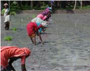

# Fieldpea — Field Crops (Kharif) - ICAR e-course
> Auto-extracted from government extension sources by CropBot pipeline. Content is faithful to the source; see front-matter for provenance.
## Main content — Part 1 (pp. 26–26)
## MAIN FIELD PREPARATION

<!-- p. 26 -->

- ∞ Puddled lowland prepared as described in transplanted rice.

- ∞ Perfect leveling is a pre-requisite for the water management proposed hereunder

## Mainfield

<!-- p. 26 -->

*Square Planting*

*Transplanted Young Seedling*

## Main content — Part 2 (pp. 45–46)
## B. MAIN FIELD PREPARATION

<!-- p. 45 -->

## Ploughing

<!-- p. 45 -->

- ∞ Plough the field with an iron plough once (or) twice. Sorghum does not require fine tilth since fine tilth adversely affects germination and yield in the case of direct sown crop.

- ∞ To overcome the subsoil hard pan in Alfisols (deep red soils) chiseling the field at 0.5m intervals to a depth of 40 cm on both the directions of the field followed by disc ploughing once and cultivator ploughing twice help to increase the yield of sorghum and the succeeding blackgram also. This was true with Sorghum followed by Groundnut also.

- ∞ Application of FYM and 100% of recommended N can also be followed. In soils with subsoil hard pan, chiselling should be done every year at the start of the cropping sequence to create a favourable physical environment.

## Application of FYM

<!-- p. 45 -->

Spread 12.5 t/ha FYM or composted coir pith along with 10 packets of Azospirillum (2000g/ha) and 10 packets (2000 g/ha) of phosphobacteria or 20 packets of Azophos (4000g/ha) on the unploughed field and incorporate the manure in the soil. Apply well decomposed poultry manure @ 5 t/ha to improve the grain yield as well as physical properties of soils.

## Formation of ridges and furrows

<!-- p. 45 -->

- ∞ Form ridges and furrows using a ridger at 6 m long and 45 cm apart.

- ∞ Form irrigation channels across the furrows.

- ∞ Alternatively, form beds of size 10 m 2 and 20 m 2 depending on the availability of water.

## Transplanted crop

<!-- p. 45 -->

- ∞ Apply NPK fertilizers as per soil test recommendations. If soil test recommendations are not available, adopt a blanket recommendation of 90 N, 45 P2O5, 45 K2O kg/ha.

- ∞ Apply N @ 50:25:25% at basal, 15 and 30 DAS and full dose of P2O5 and K2O basally before planting.

- ∞ In the case of ridge planted crop, open a furrow 5cm deep on the side of the ridge at two thirds the distance from the top of the ridge and place the fertilizer mixture along the furrow and cover with soil up to 2 cm.

- ∞ Soil application of Azospirillum at 10 packets (2 kg/ha) and 10 packets (2000g/ha) of phosphobacteria or 20 packets of Azophos (4000g/ha) after mixing with 25 kg of FYM + 25 kg of soil may be carried out before sowing/planting.

- ∞ As above.

- ∞ In the case of sorghum raised as a mixed crop with a pulse crop (Blackgram, Greengram or Cowpea) open furrows 30 cm apart to a depth of 5 cm.

- ∞ Apply fertilizer mixture in two lines in which sorghum is to be raised and cover upto 2 cm.

- ∞ Skip the third row in which the pulse crop is to be raised and place fertilizer mixture in the next two rows and cover upto 2 cm with soil.

- ∞ When Azospirillum is used, apply only 75% of recommended N for irrigated sorghum.

## Application of micronutrient mixture Transplanted crop

<!-- p. 45 -->

- ∞ Mix 12.5 kg/ha of micronutrient mixture formulated by the Department of Agriculture, Tamil Nadu with enough sand to make a total quantity of 50 kg and apply the mixture over the furrows and on top one third of the ridges.

- ∞ If micronutrient mixture is not available, mix 25 kg of zinc sulphate with sand to make a total quantity of 50 kg and apply on the furrows and on the top one third of the ridges.

- ∞ As above.

- ∞ Basal application of FeSO4, 50 kg/ha along with 12.5 t/ha FYM for iron deficient soils.

## Main content — Part 3 (pp. 80–81)
## FIELDPEA

<!-- p. 80 -->

## Pisum sativum

<!-- p. 80 -->

- Matar in Hindi

- Third important cool season crop next to chickpea and French bean

- Cultivated in about 6.51 million ha world wide with 10.95 million t annually

- Distributed in Asia, Africa, Europe, N.America, & Auastralia

- Usually cultivated for dry pods and variety of snacks

## World area production and productivity of Fieldpea

<!-- p. 80 -->

| Country            |   Million ha |   Million t |   T / ha |
|--------------------|--------------|-------------|----------|
| Europe             |         3.28 |        6.77 |     2.06 |
| France             |         0.53 |        2.57 |     4.84 |
| Russian Federation |         1.18 |        1.00 |     0.85 |
| Asia               |         1.58 |        1.87 |     1.19 |
| China              |         0.70 |        1.15 |     1.64 |
| India              |         0.62 |        0.56 |     0.91 |
| N C America        |         0.72 |        1.40 |     1.96 |
| Canada             |         0.63 |        1.26 |     2.00 |
| Australia          |         0.31 |        0.38 |     1.24 |
| South America      |         0.12 |        0.10 |     0.82 |

| World   | 6.52   | 10.95   | 1.68   |
|---------|--------|---------|--------|

## Indian scene of Fieldpea

<!-- p. 81 -->

| State     |   Million ha |   Million t |   T / ha |
|-----------|--------------|-------------|----------|
| UP        |         0.41 |        0.54 |     1.32 |
| MP        |         0.19 |        0.08 |     0.41 |
| Assam     |         0.03 |        0.02 |     0.61 |
| Rajasthan |         0.01 |        0.02 |     2.19 |
| All India |         0.73 |        0.72 |     0.95 |

- Origin

- Mediterranean region of Europe & West Asia

- Before 3000 BC

- Plant

- There are two varieties

- Annual herbaceous well developed tap root system plant

- Plant É gardenpea

- Flowers auxiliary, long peduncle, raceme with 1-2 flowers

- Pods are variable length and breadth, curved/ straight

- PlantÉFieldpea

- Flowers are purple or lavender colored

- Short peduncle

- Seeds smaller than garden pea, angular

- Varieties

- Rachna, Pant Marter 5, HUP 2, DMR 11

- Crop duration 110-140days

- Seed weighs 160 Ð 240mg

- Gardenpea : P. sativum var. hortense

- Filedpea : P. sativum var. arvense

## Other mentions in this source
### p. 38

¥ Mixed cropping: Barley is raised as mixed crop with Chickpea, pea, mustard, linseed, lentil
### p. 65

Chickpea, Lentil, Peas,
### p. 65

Redgram, Congopea, no eye pea, arhar, tur Cajanus cajan
### p. 79

Peas in developed countries
### p. 83

(Chickpea, Lentil, Fieldpea, French bean, Lathyrus)
### p. 84

Field pea: 50-60 for small seeded and 80-90 for bold seeded
### p. 104

∞ Centro / Butterfly pea
