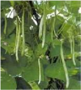
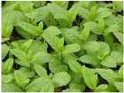
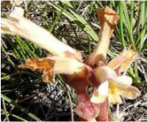

# Fieldpea — Field Crops (Rabi) - ICAR e-course
> Auto-extracted from government extension sources by CropBot pipeline. Content is faithful to the source; see front-matter for provenance.
## Main content — Part 1 (pp. 38–41)
## 3. Field preparation

<!-- p. 38 -->

- One deep ploughing followed by two harrowing

- Crop needs clodded and rough seed bed for aeration in root zone.

## 4. Sowing

<!-- p. 38 -->

- Second fortnight of October to first week of November

## 5. Seed rate

<!-- p. 38 -->

- 75 -100 kg/ha, depth of sowing - 8 to 10cm

- Spacing - 30 cm between rows for Desi types

4o to 45 cm for Kabuli types

## 1. Nutrient management

<!-- p. 38 -->

| Crop     | Ecosystem   | Planting time   |   N |   P2O5 |   K2O |   S |
|----------|-------------|-----------------|-----|--------|-------|-----|
| Chickpea | Rainfed     | Normal          |  20 |     40 |     0 |  20 |
|          | Irrigated   | Normal          |  20 |     60 |    20 |  20 |
|          |             | Late            |  40 |     40 |    20 |  20 |

## 1. Weed management

<!-- p. 38 -->

- 2 hand weedings at 25 to 30 DAS and after 60 DAS

- Basalin @ 1 kg a.i/ ha as pre emergence + 1 hand weeding at 60 DAS

## 2. Water management

<!-- p. 38 -->

- Light irrigation at flowering and grain development stage.

3. Nipping

Plucking the apical buds of the crop at about 30 to 40 DAS is done to stop the apical growth. It promotes the

lateral branching, plants to become more vigorous and produce more vigorous and produce more flowers

and pods and yield per plant is increased.

## 1. Harvesting

<!-- p. 39 -->

The matured plants are cut and dried under direct sun. The dried plants are threshed using sticks to separate

the grains.

## 1. Grain yield

<!-- p. 39 -->

Desi types - 1.5 to 2 t/ha

Kabuli types - 2.5 to 3.5 t/ha

- Centre of origin of chick pea is ___________

- America

- S. Africa

- S.W.Asia

2. The inflorescence of chick pea is ________

- Axilary raceme b. Panicle

- Ear

- The recommended seed rate for chick pea is __________

- 8-10 kg/ha

- 15-20 kg/ha

- 75-100 kg/ha

- Most critical stage of irrigation for chick pea is ________

- Tillering

- CRI

- Pre flowering

- The leading producer of chick pea is ________

- India

- Burma

- Bangladesh

- Photoperiodically, chick pea is a type of plant is ________

- Short day

- Long day

- Day neutral

- Chick pea belongs to the family

- Tiliaceae

- Leguminoceae c. Linaceae

- Ideal temperature for sowing of chick pea is

- 15-200c

- 10-250c

- 10-150c

- The recommended seed rate for kabuli gram is _____kg/ha

- 20-25

- 100-125

- 8-10

- Nipping in chick pea is a process of

- To enlarge branching

- To reduce plant height

- To protect plants against lodging

*****☺*****

## 1. Importance

<!-- p. 41 -->

- Consumed as dry seed

- In India as flour, dal (boiled, smashed in to soup), several snacks and sweets

- Rich source of ca, phosphorous and iron

- Protein 24-26%

- Also rich in vitamins

## 2. Global area production

<!-- p. 41 -->

- 5% of pulses

- 3.3 million ha &

- 2.9 million t

- Predominantly grown in Asia (80%)

- Also grown in N & E Africa, N-C America, S. Europe

## Area in India

<!-- p. 41 -->

## 1. Origin

<!-- p. 41 -->

- o Egypt is its origin. It is grown in Spain, Pakistan, Bangladesh and Syria

- o Broadly classified as microsperma and macrosperma

## Lecture 06

<!-- p. 41 -->

## Main content — Part 2 (pp. 44–49)
## World area production and productivity of Fieldpea

<!-- p. 44 -->

| Country            |   Million ha |   Million t |   T / ha |
|--------------------|--------------|-------------|----------|
| Europe             |         3.28 |        6.77 |     2.06 |
| France             |         0.53 |        2.57 |     4.84 |
| Russian Federation |         1.18 |        1.00 |     0.85 |
| Asia               |         1.58 |        1.87 |     1.19 |
| China              |         0.70 |        1.15 |     1.64 |
| India              |         0.62 |        0.56 |     0.91 |
| N C America        |         0.72 |        1.40 |     1.96 |
| Canada             |         0.63 |        1.26 |     2.00 |
| Australia          |         0.31 |        0.38 |     1.24 |
| South America      |         0.12 |        0.10 |     0.82 |
| World              |         6.52 |       10.95 |     1.68 |

## Lecture 07

<!-- p. 44 -->

## FIELDPEA Pisum sativum

<!-- p. 44 -->

## Indian scene of Fieldpea

<!-- p. 45 -->

| State     |   Million ha |   Million t |   T / ha |
|-----------|--------------|-------------|----------|
| UP        |         0.41 |        0.54 |     1.32 |
| MP        |         0.19 |        0.08 |     0.41 |
| Assam     |         0.03 |        0.02 |     0.61 |
| Rajasthan |         0.01 |        0.02 |     2.19 |
| All India |         0.73 |        0.72 |     0.95 |

##  Origin

<!-- p. 45 -->

- o Mediterranean region of Europe & West Asia

- o Before 3000 BC

##  Plant

<!-- p. 45 -->

- o There are two varieties

-  Gardenpea : P. sativum var. hortense

-  Filedpea : P. sativum var. arvense

- o Annual herbaceous well developed tap root system plant

##  Plant - gardenpea

<!-- p. 45 -->

- o Flowers auxiliary, long peduncle, raceme with 1-2 flowers

- o Pods are variable length and breadth, curved/ straight

##  Plant - Fieldpea

<!-- p. 45 -->

- o Flowers are purple or lavender colored

- o Short peduncle

- o Seeds smaller than garden pea, angular

- o Rachna, Pant Marter 5, HUP 2, DMR 11

- o Crop duration 110-140days

- o Seed weighs 160 - 240mg

- o All types of soil

- o Poor to fertile

- o Well drained soil is more suitable since sensitive to salinity and alkalinity

- o On heavy soils rough seed bed is suitable

- o Medium tillage is sufficient

##  Seed treatment

<!-- p. 46 -->

- o For seed borne pests and diseases

- o Rhizobium for nodulation

- o NW Plains - end of October

- o NE Plains - Second fortnight of November

-  Soil moisture availability decides the time

-  Delay in sowing end with terminal drought

- o Depends up on the size of the seeds & spacing

- o 50-60 kg for small seeded and 80-90 kg for bold seeded

##  Method of sowing

<!-- p. 46 -->

- o Broadcasting and planking

- o Drilling manually

- o Seed drill sowing

##  Depth of sowing

<!-- p. 46 -->

- o Since all cool season pulses are hypogeal can be planted deep depending on the moisture

| Ecosystem   | Planting time   |   N |   P2O5 |   K2O |   S |
|-------------|-----------------|-----|--------|-------|-----|
| Rainfed     | Normal          |  20 |     40 |     0 |  20 |
| Irrigated   | Normal          |  40 |     40 |    20 |  20 |
|             | Late            |  40 |     40 |    20 |  20 |

-  Crops are sown in residual soil moisture

-  They may face terminal drought

-  One or two supplemental irrigation is needed

-  May be moisture conservation practices

-  All methods to be employed

-  Herbicides can also be as per kharif pulses

-  Cropping systems

-  Cereal - legume is always good

-  They also under mixed community with winter cereals like wheat and barley

-  Harvest

-  Over ripening leads to great loss of yield

-  Staggered harvesting is one way

-  Cut entire plant and carry with moisture & then dry and thrash, clean

-  Store the seeds at 8-10% moisture

- Pea is commonly known as ___________

- Arhar

- Channa

- Matar

- Centre of origin of pea is ___________

- Mediterranean b.America

- W.bengal

- The inflorescence of pea is called __________

- Ear

- panicle

- Axilary raceme

- The recommended seed rate for pea is _____kg/ha

- 60-80 b. 75-100 c.40-50

- Pea crop needs ________

- Cold & dry climate b. Hot & humid

- dry & hot

- Pea should be treated with rhizobium inoculation of ________

- R. Japonicum b. R. leguminosarum c. R. glycine

- How much seed of Pea should be treated with one packet of rhizobium culture

- 5 kg

- 10 kg

c. 15 kg

- What is the ideal temperature for germination for pea

- 15-200c

- 22-250c

- 25-300c

- Maximum area under pea cultivation in India is in

- M.P

- U.P

- Bihar

- Higher yield of pea could be achieved by

- Use of higher dose of phosphate

- Adequate amount of N

- No nitrogen application

*****☺*****

## Area

<!-- p. 49 -->

-  It is extensively cultivated in 5 major continents

-  Brazil is the leading country

-  In India it is only a minor pulse

- o Cultivated in hills during Kharif

- o Small areas in northern plain during rabi

##  Origin

<!-- p. 49 -->

- o Highlands of middle America and Andes

- o Cultivated over a period of 7000-8000 years

- o Varieties in India are : PDR 14, HUR 15, VL 63

- o Duration 110-120 days, seed weight around 400mg

- o All types of soil

- o Poor to fertile

## Main content — Part 3 (pp. 71–75)
## Field preparation

<!-- p. 71 -->

-  Fine tilth

-  Apply FYM / Compost incorporate

-  Ridges and furrows

-  30 to 60cm according to variety

-  10 to 15 cm for short & medium stature

-  15 to 30 cm for tall (>120cm)

## Seed rate

<!-- p. 71 -->

-  @ 2 seeds per hole

-  Seed weight of 45g/1000

- o 30 x 10 30 kg

- o 30 x 15 20kg

- o 30 x 30 10kg

- o 60 x 30 5kg

## Seed treatment

<!-- p. 71 -->

-  Trichderma 4 g /kg

-  Azospirillum 600 g to one ha

-  Soaking the seeds

- o 2% ZnSO4 for 12hrs and

- o Shade drying for rainfed sowing is desirable

## Sowing

<!-- p. 71 -->

-  Well prepared deep, friable seedbed is more preferable

-  Depth of sowing 3-5cm

## Plant population

<!-- p. 72 -->

-  55,000 to 98,000 /ha almost same yield

-  If the head diameter is <10cm more population

-  If >20cm less population

## Thinning

<!-- p. 72 -->

-  Highly sensitive to intra-specific competition

## Nutrient management

<!-- p. 72 -->

-  Fast growing high oil yielding thus requires more nutrients

-  Low yield in India is attributed to poor fertile soil, cultivated in rainfed conditions

-  A crop yielding 2 t seed, 3.2t stover and 0..8t root uptakes

82 kg N, 13 kg P, 60 kg K, 9.4 kg S, 37 kg Ca and 21 kg Mg.

## State wise nutrient recommendation

<!-- p. 72 -->

- o TN 40-20-20

- o UP 80-60-40

- o AP - Rainfed 60-30-0

- Irrigated Hybrids 60-90-30; Variety 30-60-30

## Weed management

<!-- p. 72 -->

- o Fluchloralin / Pendimethalin

-  2.0kg as pre-mergence

-  High volume spray

- o Hoeing and weeding on 15th day & 30th day

- o Within three days irrigate the filed

## Water management

<!-- p. 72 -->

- o Immediately after sowing

- o 4-5 days later once

- o Interval of 7-8 days

- o Seeding, flowering and seed development stages are critical

## Seed setting and filling

<!-- p. 73 -->

- o Problem is seen with poor seed setting

- o This problem is more in warmer regions

- o In India seed filling under good management is only 75%

- o It will be as low as 10-20%

- o Reasons

-  Genetic

-  Environmental

-  Physiological

-  Availability of pollinators

## Maturity

<!-- p. 73 -->

Physiological maturity (30-40% seed moisture

When the back of the head turns green to lemon yellow

There will be 5-6 green leaves at this stage

Harvest maturity (10-12%)

Delay beyond harvest maturity severe yield loss

Sequential cropping

-  Southern India

-  Rainfed - Sunflower - millets/pulses

-  Irrigated- Rice - sunflower

-  North

-  Rainfed - SF - wheat / chickpea

- o Row intercrop

-  Groundnut + SF

-  Pigeanpea + SF

-  Castor + SF

-  Pulses + SF

- Origin of sunflower is _____

- India

- Argentina

- South west America

- Scientific name of sunflower is ______

- Helianthus annuus

- Carthamus tinctorious

- Sesamum indicum

- Total production of sunflower in the world is ____ m tonnes

- 22.27

- 28.48

- 33.23

- Total production of sunflower in India is ______ m tonnes

- 2.25

- b.1.25

- c.3.25

- Oil content of sunflower is _________

- 38-40 %

- 30-32 %

- 36-37 %

6. Nutrient recommendation for sunflower in Tamil Nadu is ________ kg NPK/ha

- 80:60:40

- 60:30:0

- c.40:20:20

- Saturated fatty acid content in sunflower is ________

- 12 %

- 15 %

- 10 %

- Mono unsaturated fatty acid content in sunflower is ________

- 16 %

- 15 %

- 10 %

*****☺*****

## Economic Importance

<!-- p. 75 -->

-  Rich in PUFA (78%) - to reduce blood cholesterols

-  Used for preparation of:

-  Margarine, and salad dressing

-  Varnishes, paints and surface coating materials

-  Oil (28-32%) is also used in:

-  Infant food and liquid nutrition formulations

-  Effective non-allergenic dispersant for injectable medicines

-  Charred oil is used to heal sores and rheumatism

-  For dye extraction -red dye

-  Cosmetics preparations

-  Petals reported to have effects on circulatory systems

-  Cake (30%)

-  Un decorticated cake as manure

-  Decorticated fed to ruminants and mono-gastric animals

-  Can be as human food, if bitter principles and phenolics are removed

-  Hulls (40%)can be used for manufacture of

-  cellulose, insulations, abrasions, hard boards and as fuel

-  Thinned young plants are used as vegetables

-  since contains carotene, riboflavin and vitamins

-  It is crop as border against animals

## Origin and distribution

<!-- p. 75 -->

- o Vavilow(1926): India, Afghanistan or Ethiopia

- o De Candole (1886): Arabia

- o Modern assessment:

-  Area encompassing S. USSR, W. Iran, Iraq, Syria, S. Turkey, Jordan and Israel

- o Distributed now:

-  Between 14° & 45° N and 15° & 35° S

-  Flowers

## Lecture 12

<!-- p. 75 -->

## Main content — Part 4 (pp. 114–121)
## Field preparation

<!-- p. 114 -->

-  Well drained sandy loam and clayey loam soils having medium depth (45‖ cm) with fairly good organic status are suitable.

-  Tropical sugarbeet require deep ploughing (45 cm) and followed by 2 - 3 ploughing to obtain a good soil tilth condition for favorable seed germination.

-  Ridges and furrows are formed at 50 cm apart.

## Manures and Fertilizers

<!-- p. 114 -->

| Manures and Fertilizers                     | Basal Application                               | Top dressing                        |
|---------------------------------------------|-------------------------------------------------|-------------------------------------|
| Manures                                     | 12.5 tonnes /ha                                 | -                                   |
| Biofertilizers Azospirillum Phosphobacteria | 2 kg /acre (10 pockets) 2 kg /acre (10 pockets) | -                                   |
| Fertilizers Nitrogen Phosphorus Potassium   | 75kg /ha 75kg /ha 75kg /ha                      | 37.5 kg / ha each at 25 & 50 DAS -- |

## Seeds and sowing

<!-- p. 115 -->

-  Optimum population is 1,00,000-1,20,000 /ha.

-  Use only pellated seeds 1,20,000 Nos /ha which require 6 pockets (3.6kg / ha.-One pocket contains 20000 seeds (600 g)]

-  The recommended spacing is 50 x 20 cm.

-  The pellated seed is dibbled at 2 cm depth in the sides of ridges at 20 cm apart

## Weeding and Earthing up

<!-- p. 115 -->

-  The crops should be maintained weed free situation up to 75 days.

-  Pretilachlor 50 EC @ 0.5 kg /ha or Pendimethalin @3.75lit /ha can be dissolved in 300 litres of water and sprayed with hand operated sprayer on 0-2 day after sowing,

-  Followed by hand weeding on 25th day and 50th day after sowing.

-  The earthing up operations coincides with top dressing of N fertilizer.

-  Tropical sugarbeet is very sensitive to water stagnation in soil at all stages of crop growth

-  Irrigation should be based on soil type and climatic condition.

-  Pre-sowing irrigation is essential since at the time of sowing, sufficient soil moisture is must for proper irrigation.

-  First irrigation is crucial for the early establishment of the crop.

-  For loose textured sandy loam soil irrigation once in 5 to 7 days and for heavy textured clay loam soil once in 8 - 10 days is recommended.

-  The irrigation has to be stopped atleast 2 to 3 weeks before harvest.

-  At the time of harvest if the soil is too dry and hard it is necessary to give pre harvest irrigation for easy harvest. Light and frequent irrigation is recommended for maintaining optimum soil moisture

## Pest and diseases

<!-- p. 115 -->

-  Pests - Aphids, Tobacco caterpillar and Flea beetles

## Diseases

<!-- p. 115 -->

-  Root and crown rot, Cercospora leaf spot and Root knot nematode

## Integrated pest and disease management

<!-- p. 115 -->

-  Seed treatment with Pseudomonas fluorescens @ 10 g/kg of seed

-  Summer ploughing and exposing the field to sunlight

-  Crop rotation for 3 years with Marigold or gingelly or sunnhemp for root rot and nematode

-  Soil application of Trichoderma viride or Pseudomonas fluorescens @ 2.5 kg/ha mixed with 50 kg of FYM before planting

-  Sow castor as trap crop around and within fields to attract adult Spodoptera moth for egg laying

-  Set up light traps (1 mercury / 5 ha) for monitoring Spodoptera litura

-  Setting up pheromone -Pherodin SL @ 12/ha for Spodoptera litura

-  Removal and destruction of Spodoptera egg masses, early stage larvae formed in clusters

-  Hand picking and destruction of grown up Spodoptera caterpillar

## Need based

<!-- p. 116 -->

-  Spraying Spodoptera nuclear polyhedrosis virus at 1.5 x 1012 POB/ha

-  Spray NSKE 5% for aphids flea beetles and for early instar caterpillars

-  Use of poison bait pellets prepared with rice bran 12.5 kg, jaggery 1.25 kg, carbaryl 50% WP - 1.25 kg in 7.5 lit water for Spodoptera litura

-  Spray any one of the following insecticides using a high volume sprayer covering the foliage and soil surface

-  Chlorpyriphos 20 EC - 2 ml / lit,Dichlorvos 76 WSC - 1 ml/lit, Fenitrothion 50 EC - 1 ml/lit, Spray malathion 50 EC (2 ml/lit) for flea beetle and leaf webber, Spray Imidacloprid 200 SL (0.2 ml/lit) or methyl demeton 25 EC (2 ml/lit) or dimethoate 30 EC (2 ml/lit) for aphids

-  Applying neem cake @ 150 kg/ha for root rot

-  Foliar spray of Mancozeb 2.5 g / lit or Chlorothalonil 2 g / litre of water for Cercospora leaf spot

-  Neem cake @ 1 t/ha or carbofuran @ 33 kg/ha as spot application on 30 days after sowing for nematode management

## Harvest and yield

<!-- p. 116 -->

-  The Tropical sugarbeet crop matured in about 5 to 6 months. The yellowing of lower leaf whirls of matured plant, Nitrogen deficiency and root brix reading of 15 to 18% indicate the maturity of beet root for harvest.

-  The average root yield of tropical sugarbeet is 80 - 100 tonnes / ha.

-  Harvesting should be timed so as the roots reach the factory within 48 hours for processing.

-  Till such time the roots should not be harvested.

-  Apart from sugar, _______ can be extracted from sugarbeet

-  Methane

- Ethanol

- Dimethyl ether

-  Ethanol produced from sugarbeet can be blended with petrol or diesel to the extent of ______ as biofuel

-  12 %

- 10 %

- 15 %

-  Optimum seed rate for tropical sugarbeet is ______ kg/ha

-  5.6

- 3.0

- 3.6

-  Spacing recommended for sugarbeet is ______

-  50 x 20 cm b. 40 x 20 cm c. 50 x 10 cm

-  Fertilizer dose recommended for sugarbeet is ________ kg NPK /ha

-  100 : 75 : 75

- 100 : 100 : 100

- 75 : 75 : 75

-  ________ crop is used as trap crop to attract Spodoptera in sugarbeet

-  Gingelly

- Castor

- Marigold

-  _________ % of root brix reading indicates the maturity of sugarbeet

-  15 - 18 b. 18 - 25

- 25 - 27

-  Yield potential of sugarbeet is ________ tonnes/ha

-  100 -120 b. 80 - 100 c. 120 - 150

*****☺*****

## Lecture 17

<!-- p. 118 -->

## Area, production, productivity and importance of medicinal and aromatic crops in India

<!-- p. 118 -->

India has been considered as treasure house of valuable medicinal and aromatic plant species. Ministry of Environment and Forests have identified and documented over 9500 plant species considering their importance in the pharmaceutical industry. In the present context of ‗back to nature' in health care, it is relevant that these valuable plant species are not only preserved but also their cultivation developed in order to meet the entire demand of the domestic industries as also to exploit the bright prospect for export. Shift from collection to cultivation of medicinal & aromatic plants will also ensure purity, authenticity and sustainable supply of raw materials required for herbal drugs, including polyherbals.

Our foreign exchange earning potential from this group of plants is estimated to be over 3000 million US dollars per annum. Agro-techniques have been developed for large number of medicinal plants by the State Agricultural Universities. Due to unorganised marketing arrangements this sector has not exploited the full potential. A Medicinal Plants Board has been constituted in the Department of Indian Systems of Medicines & Homeopathy to address all the issues.

The diverse Agro-climatic situations in the Region offer excellent scope for growing different horticultural crops like fruits, vegetables, spices, plantation crops, medicinal and aromatic plants. Medicinal and aromatic plants constitute a major segment of the flora, which provides raw materials for use in the pharmaceuticals, cosmetics and drug industries. The indigenous systems of medicines, developed in India for centuries, make use of many medicinal herbs. These systems include Ayurveda, Siddha, Unani and many other indigenous practices.

More than 9,000 native plants have established and recorded curative properties and about 1500 species are known for their aroma and flavour. Even in many of the modern medicines, the basic composition is derived from medicinal plants and these have become acceptable medicines for many reasons that include easy availability, least side effects, low prices, environmental friendliness and lasting curative property.

India and China are the two major producing countries, having 40 per cent of the global biodiversity and availability of rare species. These are well known as the home of medicinal and aromatic crops that constitute a segment of the flora, and provide raw materials to the pharmaceutical, cosmetic, fragrance, flavour etc. industries.

India has one of the richest ethnobotanical traditions in the world with more than 7000 species of plants found in different agro-ecosystems and used by various indigenous systems of medicine and industries. Over 95% of the plants used by the herbal or pharmaceutical industry is collected from wild sources. Given the alarming rate of loss of biodiversity due to other well-known factors alongside the indiscriminate collection of wild medicinal plants, there is a real danger of extinction of many of our medicinal plant species. In the face of

serious threat to biodiversity, it is extremely important to take urgent steps to conserve and develop medicinal plant genetic resources alongside their cultural roots in all our diverse agro-ecosystems.

The aromatic and medicinal plants such as Patchauli, Stivia, Citronella, Cinnamon are also being grown in mild tropical areas i.e. plain and foot hills of the State. Temperate and alpine zones accommodate cultivation of geranium, texus, ginseng, saffron etc. Mizoram is well known for its exotic orchids and medicinal and aromatic plants.

## Area, Production and productivity of medicinal plants in Tamil Nadu (2007-08)

<!-- p. 119 -->

|   Area in lakh ha. |   Production in Lakh MT |   Productivity (MT/ha) |
|--------------------|-------------------------|------------------------|
|               0.09 |                    0.17 |                   2.01 |

## Status in India

<!-- p. 119 -->

The age old Indian systems of medicine have been neglected mainly because of the rapid expansion of the allelopathic system of medical treatment. This is despite the fact that our country has a long history of local health traditions, which are backed by thousands of scriptures left behind by practitioners of these systems of medicine. One of the earliest treatises of Indian medicine, the chakara samhita (1000 BC), mentions the use of 2000 vegetable herbs for medicinal use. Over 7000 different species of plants found in different ecosystems are said to be used for medicinal purposes in our country.

India has been a traditional exporter of medicinal plants for the past several decades and ranks as one of the foremost supplier of medicinal plants in the world.

- Area under medicinal plants in Tamil Nadu _______lakh ha.

- 0.11

- 0.05

- 0.09

- Production of medicinal plants in Tamil Nadu _______lakh MT.

- 0.15

- 0.25

- 0.17

- Productivity of medicinal plants in Tamil Nadu ______ MT/ha

- 4

- 5

- 2

- Major medicinal & aromatic crop producing countries are _____

- China & Africa b. India & America c. India & China

- Foremost supplier of medicinal plants in the world is ______

- India

- China

- Australia

*****☺*****

## Main content — Part 5 (pp. 161–163)
## Field preparation

<!-- p. 161 -->

-  Soils of well drained

-  Deep summer ploughing

-  Ridges an furrows

-  Apply heavy FYM 25 t/ha before last ploughing

-  Chewing tobacco

- o 75 x 75 (17,777 plants/ha)

-  Cigar tobacco

- o 75 x 50 (26,666 plants/ha)

-  Cheroot tobacco

- o 60 x 45 (36,730 plants/ha)

-  Transplant single seedlings of pencil thickness

-  Irrigate the field prior to planting

-  Make a hole and plant

-  Cool hours or evening is preferable

-  Gap filling within 7-10 days

-  N 100 kg/ha as Ammonium sulphate

- o If brackish water restrict to 75kg

- o 50% on 45th day and 50% 60 DAP

-  Phosphorous

- o 100 kg P2O5 as SSP at planting

-  Potash

- o Chewing - 50 kg K2O

- o Cigar & Cheroot - 100 kg K2O

-  In two splits along with N

## Weeding and Intercultural operations

<!-- p. 162 -->

-  Hand weeding three weeks after transplanting

-  At 45 DAT soil mulching to make the ridge flat

-  A week later deep furrowing to heavy irrigation at Grand growth period

## Control of Orabanche

<!-- p. 162 -->

-  Remove as and when shoot appear

-  Removed shoots are to be burnt

-  Trap crops

- o Greengram, gingelly, sorghum

-  Chemical weed control

- o Fluchloralin @ 1.0 l/ha or

- o Oxyflourfen 0.5 l/ha

- o as pre-plant incorporation a week prior to planting

## Toping

<!-- p. 163 -->

-  Chewing tobacco: Top, leaving 10 leaves

## Desuckering

<!-- p. 163 -->

-  Removal of side shoots manually at weekly interval

-  Application of neem oil emulsion at 35% after topping completely suppresses the suckers

-  Neem oil 1.75 l + sandivit 0.5 l + water 2.75 l is needed for 1000 plants

## Maturity & harvest

<!-- p. 163 -->

-  Bulging of the intervenial portions of the leaf

-  Appearance of brown spot on the leaves

-  Cut the plant in the afternoon and allow it to wilt overnight

-  Mono-cropping is discouraged

- o Crop rotation helps to maintain the soil fertility

-  Intercropping is possible

- o Onion and coriander (greens) are more suitable

## Other mentions in this source
### p. 30

 with Chickpea, pea, mustard, linseed, lentil
### p. 36

o Chickpea, Filed pea, Lentil, , French bean
### p. 36

 Peas in developed countries
### p. 124

Crop rotations help to maintain a reasonable control on weed growth, preserve the fertility of the soil and to obtain higher returns from the land. The following crop rotations are in practice in Uttar Pradesh (a) Mintmaize-potato) (b) Mint-early paddy and potato and (c) Mint-late paddy and sweet pea. Whereas, in Punjab, the farmers practice mint-maize and rape seed/mustard and mint-maize and potato or mint and paddy rotation.
### p. 186

Seeding should be done in rows 25 cm apart at seed rate of 100 kg per hectare. The seeds should be treated with Vitavax 2 g/kg seed to ensure freedom from covered smut disease. Sowing of oats in lines 20 cm apart and broadcasting of pea gives higher green as well as dry fodder yield under rainfed conditions.
