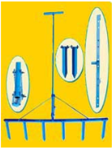

# Finger Millet — Agriculture - TNAU production guide
> Auto-extracted from government extension sources by CropBot pipeline. Content is faithful to the source; see front-matter for provenance.
## Main content — Part 1 (pp. 104–106)
## (ii) RAGI (Eleusinecoracana)

<!-- p. 104 -->

|   T_Max o C | T_Min o C   | Optimum o C   | Rainfall mm   | Altitude m MSL   |
|-------------|-------------|---------------|---------------|------------------|
|          40 | 8 - 10      | 25 - 35       | 500 - 1000    | up to 2100       |

Tropical and sub tropical. It is a heat loving plant and requires minimum of 8 - 10°C for germination, 26 - 29°C for the growth. Does not tolerate heavy rainfall and requires a dry spell during grain ripening. Short day plant.

## CROP IMPROVEMENT SEASONS AND VARIETIES

<!-- p. 104 -->

|   Sl. No. | Agro ecological zones        | Districts                                                                         | Season                                                                         | Varieties                 |
|-----------|------------------------------|-----------------------------------------------------------------------------------|--------------------------------------------------------------------------------|---------------------------|
|         1 | North Eastern Zone           | Vellore, Thiruvannamalai, Cuddalore, Villupuram, Thiruvallur and Kancheepuram     | Dec-Jan (Marghazipattam) April-May (Chithiraipattam) June-July (Adipattam)     | CO (Ra) 14 CO 15          |
|         2 | North Western Zone           | Salem, Namakkal, Dharmapuri and Krishnagiri                                       | Dec-Jan (Marghazipattam) April-May (Chithiraipattam) June-July (Adipattam)     | CO (Ra) 14 CO 15 Paiyur 2 |
|         3 | Western Zone                 | Coimbatore, Erode, Karur, Tiruppur and Dindigul                                   | Dec-Jan (Marghazipattam) April-May (Chithiraipattam) June-July (Adipattam)     | CO (Ra) 14 CO 15          |
|         4 | Cauvery Delta Zone           | Trichy, Thanjavur, Thiruvarur, Nagapattinam, Pudukkottai, Perambalur and Ariyalur | Dec-Jan (Marghazipattam) April-May (Chithiraipattam) June-July (Adipattam)     | CO (Ra) 14 CO 15          |
|         5 | Southern Zone                | Madurai and Theni                                                                 | Dec-Jan (Marghazipattam) April-May (Chithiraipattam) Sep-Oct (Puratassipattam) | CO (Ra) 14 CO 15          |
|           |                              | Sivagangai, Virudhunagar, Ramanathapuram, Tirunelveli and Thoothukudi             | Sep-Oct (Puratassipattam)                                                      | CO (Ra) 14 CO 15          |
|         6 | Hilly and High Altitude Zone | Ooty                                                                              | Dec-Jan (Marghazipattam) June-July (Adipattam) Sep-Oct (Puratassipattam)       | CO (Ra) 14 CO 15          |

## I. PARTICULARS OF RAGI VARIETIES

<!-- p. 104 -->

| PARTICULARS          | Paiyur 2              | CO (Ra) 14            | CO 15                 |
|----------------------|-----------------------|-----------------------|-----------------------|
| Year of Release      | 2008                  | 2013                  | 2015                  |
| Year of Notification | SO.2187(E)/27.08.2009 | SO.1177(E)/25.08.2005 | SO.2805(E)/25.08.2017 |
| Parentage            | VL 145 x Selection 10 | Malawi 1305 x CO 13   | CO 11 x PR 202        |
| Duration (days)      | 115                   | 105-110               | 120 - 125             |

| Rainfed/ Irrigated    | Rainfed   | Both       | Both                              |
|-----------------------|-----------|------------|-----------------------------------|
| Grain yield (kg/ha)   |           |            |                                   |
| Irrigated             | --        | 2892       | 3461                              |
| Rainfed               | 2527      | 2794       | 2950                              |
| Straw yield (kg/ha)   |           |            |                                   |
| Irrigated             | --        | 8113       | 6698                              |
| Rainfed               | 4200      | 8503       | 5030                              |
| Stem                  | Erect     | Erect      | Erect                             |
| Height (cm)           | 90        | 115-120    | 95-100                            |
| Tillers               | 3-4       | 8-9        | 5-7                               |
| Days to 50% flowering | 81        | 72         | 84-88                             |
| Ear size and shape    | Incurved  | Top curved | Large, Compact fingers top curved |
| Fingers               | 7-8       | 9-12       | 8-11                              |
| Ear length (cm)       | 7.0       | 10-12      | 9-12                              |
| Grain colour          | Brown     | Brown      | Copper brown                      |
| 1000 grain wt (g)     | 2.9       | 3.1        | 3.2                               |

## I. PREPARATION OF NURSERY (IRRIGATED TRANSPLANTED CROP)

<!-- p. 105 -->

## 1. PREPARATION OF LAND

<!-- p. 105 -->

- For raising seedlings to plant one ha of main field, select 12.5 cents (500 m 2 ) of nursery area near a water source, where water does not stagnate.

- Mix 37.5 kg of super phosphate with 500 kg of FYM or compost and spread the mixture evenly on the nursery area.

- Plough two or three times with a mould board plough or five times with a country plough.

## 2. FORMING RAISED BED

<!-- p. 105 -->

- Mark units of 6 plots each of size 3 m x 1.5 m. Provide 30 cm space between plots for irrigation.

- Excavate the soil from the interspace and all around to a depth of 15 cm to form channels and spread the soil removed from the channels on the bed and level.

## 3. PRE-TREATMENT OF THE SEEDS WITH FUNGICIDES

<!-- p. 105 -->

- Seed treatment with Azospirillum may be done @ 3 packets/ha (600 g/ha) and 3 packets (600 g/ha) of Phosphobacteria or 6 packets of Azophos (1200 g/ha).

- Mix the seeds in a polythene bag to ensure a uniform coating of seeds with Thiram 4 g/ kg or Captan 4 g/kg or Carbendazim 2 g/kg of seeds.

## 4. SOWING AND COVERING THE SEEDS

<!-- p. 105 -->

- Make shallow rills not deeper than one cm on the beds by passing the fingers vertically over them.

- Broadcast 5 kg of treated hand seeds evenly on the beds.

- Cover the seeds by the hand lightly over the soil.

- Sprinkle 500 kg of powdered FYM over the beds evenly to cover the seeds which are exposed and compact the surface lightly.

NOTE: Do not sow the seeds deep as germination will be adversely affected.

## 5. WATER MANAGEMENT

<!-- p. 106 -->

- Provide one inlet to each nursery unit.

- Allow water to enter so as to cover all the channels around the bed. Allow the water in the channel to raise till the raised beds are fully wet and then cut off water.

- Adjust the frequency of irrigation according to the soil type.

| No. of irrigations 1 st 2 nd 3 rd 4 th 5 th   | RED SOILS Immediately after sowing 3rd day after sowing 7th day after sowing 12 th day after sowing 17 th day after sowing   | HEAVY SOILS Immediately after sowing 4th day after sowing 9th day after sowing 16th day after sowing   |
|-----------------------------------------------|------------------------------------------------------------------------------------------------------------------------------|--------------------------------------------------------------------------------------------------------|

- One irrigation is given on the 3rd day in the case of red soil to soften the hard crust formed on the soil surface and also to facilitate seedlings to emerge out.

- Do not allow cracks to develop in the nursery bed by properly adjusting the quantity of

irrigation water.

## Main content — Part 2 (pp. 107–108)
## Ragi (1)

<!-- p. 107 -->

Soil

: Mixed black calcareous

(Perianaickenpalayam series)

Target : 3.5 - 4.0 t ha -1

FN = 4.35T-0.37 SN-0.98 ON

FP2O5 = 1.18T-1.03 SP-0.80 OP

FK2O = 2.68T-0.14SK-0.40 OK

|   Initial soil test values ha -1 ) - SN |   Initial soil test values ha -1 ) - SP |   Initial soil test values ha -1 ) - (kg SK | Yield target - 3.5 t ha -1 NPK (kg ha -1 ) + FYM @ 12.5 t -1 - - ha + 1 FN   | Yield target - 3.5 t ha -1 NPK (kg ha -1 ) + FYM @ 12.5 t -1 - - Azospirillum PSB @ 2 kg FP2O5   | Yield target - 3.5 t ha -1 NPK (kg ha -1 ) + FYM @ 12.5 t -1 - - 2 kg ha -1 FK2O   | Yield target - 4.0t ha -1 NPK (kg ha -1 ) + FYM @ 12.5 t ha -1 + Azospirillum @ 2 kg ha -1 - FN   | Yield target - 4.0t ha -1 NPK (kg ha -1 ) + FYM @ 12.5 t ha -1 + Azospirillum @ 2 kg ha -1 - @ 2 kg FP2O5   | Yield target - 4.0t ha -1 NPK (kg ha -1 ) + FYM @ 12.5 t ha -1 + Azospirillum @ 2 kg ha -1 - -1 FK2O   |
|-----------------------------------------|-----------------------------------------|---------------------------------------------|------------------------------------------------------------------------------|--------------------------------------------------------------------------------------------------|------------------------------------------------------------------------------------|---------------------------------------------------------------------------------------------------|-------------------------------------------------------------------------------------------------------------|--------------------------------------------------------------------------------------------------------|
|                                     180 |                                      12 |                                         300 | 34                                                                           | 15*                                                                                              | 15*                                                                                | 55                                                                                                | 15*                                                                                                         | 25                                                                                                     |
|                                     200 |                                      14 |                                         340 | 30*                                                                          | 15*                                                                                              | 15*                                                                                | 48                                                                                                | 15*                                                                                                         | 20                                                                                                     |
|                                     220 |                                      16 |                                         380 | 30*                                                                          | 15*                                                                                              | 15*                                                                                | 41                                                                                                | 15*                                                                                                         | 15*                                                                                                    |
|                                     240 |                                      18 |                                         420 | 30*                                                                          | 15*                                                                                              | 15*                                                                                | 33                                                                                                | 15*                                                                                                         | 15*                                                                                                    |
|                                     260 |                                      20 |                                         460 | 30*                                                                          | 15*                                                                                              | 15*                                                                                | 30*                                                                                               | 15*                                                                                                         | 15*                                                                                                    |

## Ragi (2)

<!-- p. 107 -->

Soil

: Red sandy loam (Somayanur series)

Target : 3.5 - 4.0t ha -1

FN =4.94T-0.55 SN

FP2O5=1.36T-0.96 SP

FK2O=4.20T-0.46 SK

|   Initial soil test value (kg ha - 1 ) - SN |   Initial soil test value (kg ha - 1 ) - SP |   Initial soil test value (kg ha - 1 ) - SK | Yield target - 3.5 t ha -1 - NPK (kg ha -1 ) + FYM @ 12.5 t ha -1 + Azospirillum @ 2 kg ha - 1 + PSB @ 2 kg ha -1 - FN   | Yield target - 3.5 t ha -1 - NPK (kg ha -1 ) + FYM @ 12.5 t ha -1 + Azospirillum @ 2 kg ha - 1 + PSB @ 2 kg ha -1 - FP2O5   | Yield target - 3.5 t ha -1 - NPK (kg ha -1 ) + FYM @ 12.5 t ha -1 + Azospirillum @ 2 kg ha - 1 + PSB @ 2 kg ha -1 - FK2O   | Yield target - 4.0 t ha -1 - NPK (kg ha -1 ) + FYM @ 12.5 t ha -1 + Azospirillum @ 2 kg ha -1 + PSB @ 2 kg ha -1 - FN   | Yield target - 4.0 t ha -1 - NPK (kg ha -1 ) + FYM @ 12.5 t ha -1 + Azospirillum @ 2 kg ha -1 + PSB @ 2 kg ha -1 - FP2O5   |   Yield target - 4.0 t ha -1 - NPK (kg ha -1 ) + FYM @ 12.5 t ha -1 + Azospirillum @ 2 kg ha -1 + PSB @ 2 kg ha -1 - FK2O |
|---------------------------------------------|---------------------------------------------|---------------------------------------------|--------------------------------------------------------------------------------------------------------------------------|-----------------------------------------------------------------------------------------------------------------------------|----------------------------------------------------------------------------------------------------------------------------|-------------------------------------------------------------------------------------------------------------------------|----------------------------------------------------------------------------------------------------------------------------|---------------------------------------------------------------------------------------------------------------------------|
|                                         160 |                                          12 |                                         160 | 33                                                                                                                       | 15*                                                                                                                         | 33                                                                                                                         | 58                                                                                                                      | 15*                                                                                                                        |                                                                                                                        54 |
|                                         180 |                                          14 |                                         180 | 30*                                                                                                                      | 15*                                                                                                                         | 24                                                                                                                         | 47                                                                                                                      | 15*                                                                                                                        |                                                                                                                        45 |
|                                         200 |                                          16 |                                         200 | 30*                                                                                                                      | 15*                                                                                                                         | 15*                                                                                                                        | 36                                                                                                                      | 15*                                                                                                                        |                                                                                                                        36 |
|                                         220 |                                          18 |                                         220 | 30*                                                                                                                      | 15*                                                                                                                         | 15*                                                                                                                        | 30*                                                                                                                     | 15*                                                                                                                        |                                                                                                                        27 |
|                                         240 |                                          20 |                                         240 | 30*                                                                                                                      | 15*                                                                                                                         | 15*                                                                                                                        | 30*                                                                                                                     | 15*                                                                                                                        |                                                                                                                        18 |

Note: FN, FP2O5 and K2O are fertilizer N, P2O5 and K2O in kg ha -1 , respectively; T is the yield target in q ha -1 ; SN, SP and SK respectively are available N,P and K in kg ha -1 and ON, OP and OK are the quantities of N, P and K supplied through organic manure in kg ha -1 .

Apply 10 packets/ha (2000 g) of Azospirillum and 10 packets (2000 g/ha) of Phosphorous solubilizing bacteria or 20 packets of Azophos (4000 g/ha) after mixing with 25 kg of soil and 25 kg FYM before transplanting. Apply TNAU MN mixture @12.5 kg/ha for irrigated and 7.5 kg/ha for rainfed crops as enriched FYM (prepare enriched FYM at 1:10 ratio of MN mixture and FYM at friable moisture and incubate for one month in shade.

## 4. FORMING BEDS AND CHANNELS

<!-- p. 108 -->

- Form beds of size 10 m 2 to 20 m 2 according to topography of the field.

- Provide suitable irrigation channels.

## 5. APPLICATION OF MICRONUTRIENTS

<!-- p. 108 -->

Mix 12.5 kg of micronutrient mixture formulated by the Department of Agriculture, Tamil Nadu with enough sand to make a total quantity of 50 kg/ha (or) Apply the mixture evenly on the beds. (or) For alleviating Zn deficiency in plants, spray 0.5% ZnSO4 on 30, 40 and 50 days after sowing. For specific micronutrient deficiencies, apply 25 kg ZnSO4, 10 kg CuSO4 and 50 kg FeSO4 + 12.5 t FYM /ha can be followed.

## III. MANAGEMENT OF MAIN FIELD

<!-- p. 108 -->

## Main content — Part 3 (pp. 110–111)
## RAGI : RAINFED Rainfall

<!-- p. 110 -->

Average and well distributed rainfall of 450-500 mm is optimum for rainfed ragi

Finger millet is grown in different seasons in different parts of the country. As a rainfed crop, it is normally sown in June- July in Tamil Nadu. It also grown in winter season (rabi) by planting in September - October in Tamil Nadu and as a summer irrigated crop by planting January - February.

## Tillage

<!-- p. 111 -->

Fall ploughing is advantageous for moisture conservation. In the month of April or May, one deep ploughing with mould board plough followed by ploughing with wooden plough twice is necessary. Before sowing secondary tillage with cultivator and multiple tooth hoe to prepare smooth seed bed is necessary.

## Main content — Part 4 (pp. 113–114)
## RAGI (FINGER MILLET) - VARIETAL SEED PRODUCTION

<!-- p. 113 -->

- Soak the seeds in 0.5 % CaCl2 for 6 h at 1:1 ratio and dry back the seeds to original seed moisture content (8 - 9 %) under shade. This can be adapted both for the garden and dry land ecosystem.

- Treat the graded seed with carbendazim @ 2 g / kg of seed.

## Nursery sowing

<!-- p. 114 -->

- In raised bed, sow the seeds not deeper than 1 cm and sprinkle with 200 kg of powdered FYM. Lightly level and compact the surface of nursery.

- Harvest the crop in 2 harvests.

- First harvest should be taken up when 50 % of seeds in the ear-heads have attained the characteristic brown colour.

- Second harvest should be taken up a week to ten days after first havest, when all the remaining earheads turned brown (spikelets are non-shattering).

- Dry the earheads until the seed moisture content is reduced to 15 % and seeds are separated manually by threshing with pliable bamboo stick or machine thresher.

- Pre-clean the threshed seeds before sun drying.

- Dry the seeds to 12 % moisture content before grading.

- Grade the seeds either with BSS 10 x 10 or BSS 12 x 12 depending upon the variety.

- Treat the seeds with carbendazim @ 2 g / kg of seed.

- Store the seeds in gunny or cloth bags for short term storage (8 - 9 months) with a seed moisture content of 10 to 12 %.

- Store the seeds in polylined gunny bag for medium term storage (12 - 15 months) with a seed moisture content of 8 to 9 %.

- Store the seeds in 700 gauge polythene bag for long term storage (more than 15 months) with a seed moisture content less than 8 %.

## Main content — Part 5 (pp. 438–438)
## MANUALLY OPERATED MARKER

<!-- p. 438 -->

Purpose

Type of the

implement

Cost of the

implement

Salient

Features Marker for line sowing Manually operated Rs. 1800 /- (Approximately)

- Easy to operate

- Reduced seed rate

- Suitable for small and marginal farmers

- Reduction in cost of cultivation

- Maintenance of optimum plant population

- Easy for inter cultural operation (Weeding, Spraying)

## Other mentions in this source
### p. 109

Ragi crop does not mature uniformly and hence the harvest is to be taken up in
### p. 110

Rainfed ragi: Azospirillum mixed with FYM and applied to field saves the cost of nitrogen by 50% with a comparable yield obtained with 40 kg N/ha.
### p. 110

Management of aged seedlings of ragi under rainfed conditions: When planting ragi seedlings beyond 21 days, increase the number of seedlings to 3/hill and increase N level by 25% to minimise yield loss.
### p. 110

Apply VAM culture (Glomus fasciculatum) at 100 g/m 2 in the nursery and also treat with Azospirillum and Phosphobacterium as seed treatment, seedling dip and field application to reduce the reniform nematode population in ragi.
### p. 111

A plant population of 4 - 5 lakhs per ha is optimum for getting higher yields and higher or lower population than the optimum will reduce the yield. Line sowing is ideal and seed drills giving spacing of 22.5 - 30 cm between rows should be used. Finger millet seeds are very small (400 seeds/g) and the recommended seed rate is 10 kg/ha. Therefore, even when seed drill is used thinning within the row leaving a spacing of 7.5 - 10 cm between plants, must be followed.
### p. 112

Finger millet responds well to fertilizer application especially to N and P. The recommended doses of fertilizers vary from state to state for rainfed crop. Recommended dose of 40:20:20 kg/ha N:P:K was applied. With judicious application of farmyard manure inorganic fertilizer efficiency is enhanced. Entire P2O5 and K2O are to be applied at sowing, whereas nitrogen is to be applied in two or three split doses depending upon moisture availability. In areas of good rainfall and moisture availability, 50% of recommended nitrogen is to be applied at sowing and the remaining 50% in two equal splits at 25-30 and 40-45 days after sowing. In areas of uncertain rainfall, 50% at sowing and the remaining 50% around 35 days after sowing is recommended.
### p. 112

For direct sown rainfed ragi post-emergence application of 2, 4 D Na salt (or) EE formulation at 0.5 kg ha -1 applied on 10 days after sowing and at 0.75 kg ha -1 applied on 15 days after sowing will give effective weed control as well as higher grain yield.
### p. 112

Finger millet based inter cropping system with pigeon pea at 4:1 ratio is recommended for rainfed situation to obtain high grain yield
### p. 113

For certified / quality seed production leave a distance of 3 m all around the field from the same and other varieties of the finger millet.
### p. 269

iii) In fields with ragi stubbles, just dibble cotton seeds at the specified spacings.
### p. 372

Treated distillery effluent contains nitrogen 1200 mg L -1 , phosphate 500 mg L -1 , potash 12000 mg L -1 , calcium 1800 mg L -1 and iron 300 mg L -1 . Since the effluent has higher dissolved salts, 50 times diluted effluent can be irrigated to sugarcane, banana, ragi, sunflower, grasses, cotton and soybean.
### p. 373

: Ragi (CO 12, CO 13)
### p. 402

Evaluation of integrated farming system for wetland farms was conducted during 1990-92. The components of the traditional and integrated farming systems are as follows: Traditional system (1 ha) : Rice - Rice - Fallow Integrated farming system (1 ha) : Crop + dairy + fishery 0.4 ha : Rice-rice + soybean (bund) - blackgram 0.2 ha : Ragi + sunflower (border) - fodder maize + cowpea - cotton + Greengram 0.2 ha : Bajra napier hybrid fodder grass 0.1 ha : Desmanthus 0.04 ha : Fish pond 0.06 ha : Cattle shed for 3 jersey cows and 2 work bullocks The integrated farming system provided a net income of Rs.25,215/- which was 100.7 per cent more than the income from the traditional rice farming (Rs.12,662/-
### p. 431

Technical feasibility of introducing new irrigated cropping system of Greengram - Maize - Sunflower against the outdated cropping system of Cotton - Sorghum - Finger millet of western agro climatic zone of Tamil Nadu
