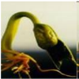
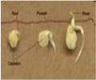

# Frenchbean — Field Crops (Rabi) - ICAR e-course
> Auto-extracted from government extension sources by CropBot pipeline. Content is faithful to the source; see front-matter for provenance.
## Main content — Part 1 (pp. 49–54)
## Lecture 08 FRENCH BEAN Phaseolus vulgaris

<!-- p. 49 -->

-  Rajmash, kidney bean, common bean etc.,

-  In India

- o the fresh pods for vegetable is called as faras and dried pulse as rajmash

- o More fleshy tender pods of round types with less string are for vegetables compared to flat pods

- o Dried seeds are highly nutritious

- o Well drained soil is more suitable since sensitive to salinity and alkalinity

- o As for other pulses except rice-fallows

- o Medium tillage is sufficient

##  Seed treatment

<!-- p. 50 -->

- o For seed borne pests and diseases

- o Rhizobium for nodulation

- o NW Plains - end of October

- o NE Plains - Second fortnight of November

-  Soil moisture availability decides the time

-  Delay in sowing end with terminal drought

- o Depends up on the size of the seeds & spacing

- o French bean : 120-140 kg (350-450mg)

##  Method of sowing

<!-- p. 50 -->

- o Broadcasting and planking

- o Drilling manually

- o Seed drill sowing

##  Depth of sowing

<!-- p. 51 -->

- o Since all cool season pulses are hypogeal can be planted deep depending on the moisture

| Ecosystem   |   N |   P2O5 |   K2O |   S |
|-------------|-----|--------|-------|-----|
| Irrigated   | 100 |     60 |    20 |  20 |

-  One or two supplemental irrigation is needed

-  All methods to be employed

-  Herbicides can also be as per kharif pulses

##  Cropping systems

<!-- p. 51 -->

-  Cereal - legume is always good

-  Cereals in Kharif

-  They also under mixed community with winter cereals like wheat & barley

-  Over ripening leads to great loss of yield in French bean

-  Staggered harvesting is one way

-  Cut entire plant and carry with moisture & then dry, thrash and clean

-  Store the seeds at 8 -10 % moisture

##  Harvest

<!-- p. 51 -->

- Common name of French bean in Hindi ___________

- Navy bean

- Kidney bean

- Rajmash

- Protein content in dried French bean seeds ________

- 18%

- 25%

- 23%

- French bean belongs to the family ________

- Tiliaceae

- Leguminoceae

- Papilionaceae

- Recommended seed rate for French bean is _____kg/ha

- 120

- 150

- 60

- Fertilizer recommendation for French bean is _____kg/ha NPK

- 100:60:20

- 100:20:0

- 150:50:50

*****☺*****

## Lecture 09

<!-- p. 53 -->

Area, production, productivity and importance and byproducts utilization of oilseeds (groundnut, sesame,

rapeseed and mustard, sunflower, safflower, castor, niger and linseed)

## Edible Oil Scenario in India

<!-- p. 53 -->

vIndia is the fourth largest oilseed producing country in the world, next only to USA, China and Brazil, harvesting about 25 million tons of oilseeds against the world production of 250 million tons per annum. Since 1995, Indian share in world production of oilseeds has been around 10 percent. Although, India is a major producer of oilseeds, per capita oil consumption in India is only 10.6 kg/annum which is low compared to 12.5 kg/annum in China, 20.8 kg/annum in Japan, 21.3 kg/annum in Brazil and 48.0 kg/annum in USA. Many varieties of oilseeds along with tree origin oilseeds are cultivated in India. Among these, the major oilseeds are Soybean, Cottonseed, Groundnut, Sunflower, Rapeseed, Sesame seed, Copra, Linseed, Castor seed and Palm Kernels. India occupies the place of pride as the world's largest producer of Groundnuts, Sesame seeds, Linseeds and Castor seeds. In India, oilseeds are grown in an area of nearly 27 million hectares across the length and breadth of the country. Depending on the period of cultivation, the oilseeds are classified as 'Kharif Crop' and 'Rabi Crop'. The Kharif Crop that is dependent on the Monsoon is harvested around October-November each year. On the other hand, the Rabi Crop is harvested around March-April each year.

The major oilseeds of India are groundnut, rape seed mustard, linseed, sesame and castor. Groundnut and rape seed mustard account about 85 percent of the total production of oilseeds in the country. In other words, groundnut among the major oilseeds is accounted as about two third, mustard seed one fourth of linseed and sesame five percent of castor, and three percent of total production. Soybean, sunflower, safflower, cotton seed and coconut are the other important oilseeds produced in India.

Rapidly increasing population and changes in dietary habits associated with urbanization increased demands for food and fuel. Non-true oilseed crops like cotton, maize, etc. are contributing up to 73% towards the national edible oil production in the country, while conventional oilseeds (rapeseed & mustard) rank second and contribute about 18-20% in the domestic edible oil production (GOP, 2006-07). Edible oil seed crops are classified as conventional (rapeseed, mustard, sesame, groundnut), non-conventional (sunflower, safflower, soybean) and non-true oilseeds (cotton, maize and rice bran). Non-true oilseed crops are contributing upto 70% towards the national edible oil production in the country whereas the nonconventional oilseed crops share about 6% in the local oil production (GOP, 2006-07).

## IMPORTANCE AND BYPRODUCTS UTILIZATION OF OILSEEDS

<!-- p. 54 -->

## Other mentions in this source
### p. 36

o Chickpea, Filed pea, Lentil, , French bean
### p. 44

o Third important cool season crop next to chickpea and French bean
