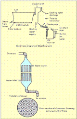

# Lemongrass — Field Crops (Rabi) - ICAR e-course
> Auto-extracted from government extension sources by CropBot pipeline. Content is faithful to the source; see front-matter for provenance.
## Main content — Part 1 (pp. 127–132)
## Lecture 19 LEMON GRASS

<!-- p. 127 -->

from 0.6 to 0.8 per cent with 80 per cent citral. Evolved from C. pendulus and released for cultivation from Regional Research Laboratory, Jammu as Jammu Lemongrass.

## CKP 25

<!-- p. 128 -->

A hybrid between C.khasianum X C.pendulus. Gives 60 t/ha herbage

## By Seeds

<!-- p. 128 -->

The common method employed in Kerala State is from seeds. The crop flowers during November-December and seeds are collected during January-February. For collection of seeds, the plants are left without harvest as the yield of seeds from plants subjected to regular harvest is less. On an average, a healthy plant gives about 100-200 g of seeds. At the time of seed collection, the whole inflorescence is cut and spread in the sun for drying for 2-3 days. These are then thrashed and seeds are again dried in the sin. These are finally stored in gunny bags. The seeds lose their viability if stored for a longer period

## Raising of Seedlings in Nursery

<!-- p. 128 -->

It is advantageous to raise the plantation through transplanting of seedlings whenever there is assured source of water. The transplanting of nursery raised seedlings is found to be superior to direct sowing of seeds. The seeds are sown by hand on well prepared raised beds of 1m to 1.5m width at the onset of monsoon and are covered with thin layer of soil. Recommended seed rate is 3-4kg/ha. The bed should be watered immediately after sowing and care should be taken to maintain adequate moisture in the soil. Seed germinates in 5-6 days and the seedlings are ready for transplanting at the age of 60 days.

## By Rooted Slips

<!-- p. 128 -->

For better quality and yield of oil it is recommended to grow lemon grass by slips obtained by dividing wellgrown clumps. Tops of clumps are cut off within 20-25 cm of the root. The latter is divided into slips and the lower brown sheath is removed to expose young roots.

Seedlings are planted at a distance of 45 cm in rows, 60 cm apart. It is better to plant on ridges in areas receiving high rainfall. In case of rooted slips one or two slips are placed into each hole, about 15 cm deep. Deeper planting is dangerous as the plants may develop root-rot during the rainy season. Slips are transplanted firmly into the ground. This is done at the beginning of the rainy season. In northern India, planting by slips may be done in February if irrigation is available. In such cases, field is irrigated immediately after planting.

Lemongrass has a high water requirement and frequent irrigations are essential for getting optimum yield in those areas where rainfall is restricted only to the monsoon. In northern India, 4-5 irrigations are required during February- June. As the plant cannot withstand any amount of water-logging, planting on ridges or open hill slopes is recommended.

## Manuring & Fertilization

<!-- p. 128 -->

It is recommended to apply 30 kg nitrogen, 30 kg P O and 30 kg K O per ha basal dose at the time of 2 5 2 planting. Remaining nitrogen (60 kg) can be applied as top-dressing in 3 split doses during the growing season. In soils having low fertility levels, the dose of nitrogen should be increased.

## Intercultural Operations Weed Control

<!-- p. 129 -->

Weeding and hoeing are very important as they affected the yield and quality of oil. Generally, 2-3 weedings are necessary during the year. In row-planted crops, inter-operations can be done by a tractor-drawn cultivator or hand-hoe. Distillation waste of this crop applied as organic mulch @ 3 tonnes/ha is found effective for controlling weeds in the crop. Among herbicides, Diuron @ 1.5 kg ai/ha and Oxyfluorfen @ 0.5 kg ai/ha are effective for weed control. Lemongrass has been found to be a weed smoothing crop. After it is established, it may inhibit weeds.

## Intercropping

<!-- p. 129 -->

The plant does not tolerate shade and oil yields were drastically reduced when the crop is grown under diffused light. However, intercropping of lemon grass in regularly pruned cinnamon plantation and newly planted cashew fields during initial 4-5 years is being widely practiced.

The time of harvesting affects the yield and quality of the oil. The first harvest is generally obtained after 4 to 6 months of transplanting. Subsequent harvests take place at intervals of 50-60 days depending upon the fertility of the soil and seasonal factors. Under normal conditions, 2-3 harvests are possible during the first year and 3-4 in subsequent years, depending on the management practices followed. Harvesting is done with the help of sickles, the plants being cut close to their bases about 10 cm above ground-level.

Depending upon soil and climatic conditions, plantation lasts on an average, for six years. The yield of oil is less during the first year. It increases in the second year and reaches a maximum in the third and fourth years, after which it declines. For economy, the plantation is maintained only for six years. On an average, 25 to 30 tonnes of fresh herbage are harvested per hectare per annum from 4 to 5 cuttings, which yields about 80 kg of oil. Under irrigated conditions an oil yield up to 150 kg/ha has been recorded. The percentage yield based on fresh weight varies between 0.2 to 0.4

In India, oil of lemongrass is primarily used for the isolation of citral for manufacturing Vitamin-A. Citral is the starting material for the manufacture of ionones and is also used in flowers, cosmetics and perfumes. A small amount of oil is used, as such in soaps, detergents and other preparations. The spent lemongrass is suitable for making paper. It is also used as fuel for the distillation of the grass. It is an excellent source of manure. It is applied either after composting or in the form of ash by burning. It may be used for mulching coffee. It is a good crop for checking soil erosion.

## Post Harvest Technology Distillation

<!-- p. 129 -->

The grass is either distilled afresh or is allowed to wilt for 24 hours. Wilting reduces the moisture content and allows a larger quantity of grass to be packed into the still, thus economizing the fuel use. The current

## www.AgriMoon.Com

<!-- p. 130 -->

method of distillation adopted in Kerala is primitive and obsolete and gives oil of poor quality, as it is based on hydro-distillation or direct-fired still. For good quality oil, it is advisable to adopt steam-distillation. The equipment for distillation consists of a boiler to produce steam, a distillation tub, a condenser and one to three separators. The distillation tub is made of mild steel and has a perforated bottom, on which the grass rests. The tub has a steam inlet pipe at the bottom. A removable lid is fitted on to the top. Charging and discharging can be done in perforated cages with iron chains, which can be lowered in the tub with the help of a chainpulley block. Different types of condensers are available, but tubular condensers are better than others. The condenser is provided with an inlet and outlet by means of which cold water is made to flow through the chamber to cool the pipes when the distillate flows through them. To obtain the maximum yield of oil and to facilitate release of oil, the grass is chopped into shorter lengths. Chopping the grass has further advantages that more grass can be charged into the still and even packing is facilitated. The grass should be packed firmly as this prevents the formation of steam channels. The steam is allowed to pass into the still with a steam pressure from 18 to 32 kg in the boiler. The mixture of vapours of water and lemongrass oil passes into the condenser. As the distillation proceeds, the distillate collects in the separator. The oil being lighter than water and insoluble floats on the top of the separator and is continuously drawn off. The oil is then decanted and filtered. Small cultivators can use direct-fire stills, but in such cases, properly resigned stills should be used. These stills are provided with a boiler at the bottom of the tub. This is separated by a false bottom from the rest of the tub. Water is poured at the bottom of the tub and grass is charged in the top portion. In the still, the water does not come in contact with the grass. The oil is stored in containers, preferably of glass or welltinned iron. Containers should completely be filled to exclude any air and protect from sunlight as they affect the citral content.

- Botanical name of Lemon grass

- Cymbopogon flexuosus b. Cymbopogon martini c. Plantago ovata

- The centre of origin of Lemon grass is ________

- India

- Russia

- S. Africa

- Suitable soil for Lemon grass cultivation

- Sandy loam

- Clayey loam

- Alluvial

*****☺*****

## Area under cultivation

<!-- p. 132 -->

The crop is grown in the states of Assam, Gujarat, Jammu & Kashmir, Karnataka, Maharashtra, Tamil Nadu,

*Lecture 20*

1500 m.

Citronella thrives well under the tropical and subtropical conditions. It requires abundant moisture and sunshine for good growth. A good rainfall of about 2000-2500 mm well spread over the year and high atmospheric humidity, appear to influence the growth of the plant, yield and quality of the oil favourably.

## Main content — Part 2 (pp. 132–133)
## CITRONELLA (Cymbopogon winterianus))

<!-- p. 132 -->

slips and each slip contains 1-3 tillers. These slips are the unit of propagation and on planting establish themselves as plants or bushes. Fibrous roots and leaves should be trimmed off the slips before planting.

## Main content — Part 3 (pp. 137–142)
## Lecture 21 PALMAROSA (Cymbopogon martini var. motia)

<!-- p. 137 -->

| Varieties   | Characters                                                                                                                                                                                                                                              |
|-------------|---------------------------------------------------------------------------------------------------------------------------------------------------------------------------------------------------------------------------------------------------------|
| IW-31245    | Profuse tillering. 20-25t/ha of herbage under low irrigation. Oil yield-150bags in 3 cuts during 16-18 months. Oil contains 90% total geraniol. It has superior rosaceous green odour of palmarosa.                                                     |
| Trishna     | It possesses straw yellow clumps, long compact inflorescence and has profuse tillering. The oil contains 93% geraniol.                                                                                                                                  |
| Jamrosa     | It has vigorous growth, high yield of 35-45t/ha of herbage, it yields between 0.3-0.4% of oil in the herb which is rich in geraniol content (54-83%) and geranil acetate (17.89%). The oil yield was estimated between 130-150kg/ha in the second year. |

## Raising Seedlings in Nursery

<!-- p. 138 -->

Usually nursery is sown by end of April to mid of May under partial shade. Nursery beds are well prepared in May. The nursery beds are made by adding enough FYM , compost or organic matter. Channels are dug around the beds to provide irrigation. Normally 2 - 2.5 kg of seed is required to cover 100 sq.m nursery, which provides sufficient seedlings to plant one hectare area. As the seeds are small and light, they are mixed with fine soil for obtaining even distribution and ease in sowing. They are sown in lines, 15-20 cm apart. Seeds should not be sown densely to avoid overcrowding of seedlings The beds are watered lightly and regularly. Germination starts within two weeks. Later on, 0.2-0.5% solution of urea may be sprayed for good vegetative growth. In about 3-4 weeks, seedlings are ready for transplanting.

## By Slips

<!-- p. 138 -->

For better quality and yield of oil it is recommended to grow Palmarosa by slips obtained by dividing wellgrown clumps. Tops of clumps are cut off within 20-25 cm of the root. The latter is divided into slips and the lower brown sheath is removed to expose young roots. Slips should be taken from plants giving a good yield and a high quality of oil. However the rate of establishment of rooted slips is very poor as compared to nursery transplants. Slips should be planted in June-July or during the rainy season.

The field is prepared before the onset of monsoon. It is ploughed and harrowed so as to give a fine tilth. All the stubble and roots of weeds are removed. The seedlings are transplanted in the fields as soon as the rainy season sets in. They can be transplanted even earlier, if the weather is not very warm and irrigation is available. Healthy and established seedlings, which are about 15 cm in height, are carefully removed from the nursery and are planted at a spacing of 60 cmx60cm.

## Intercultural Operations

<!-- p. 138 -->

The plantation should be kept free from weeds by regular weeding and hoeing. Two weeding cum hoeing operations are recommended, first 40 days after transplanting and the second 30 - 40 days after the first weeding. Among herbicides, Diuron @ 1.5 kg ai/ha or Oxyfluorfen @ 0.5 kg ai/ha are effective for weed control.

Requirement of irrigation depends upon the climatic conditions. The grass requires irrigation fortnightly during the growing season. With an ample supply of water, growth is luxuriant. It is a drought hardy species. However its growth is slow under rainfed cultivation where the plants grow in height but seldom covers the entire field. Two irrigations in rainfed crop significantly increased herbage and oil yields.

## Manuring & Fertilization

<!-- p. 139 -->

Palmarosa is a long duration crop and removes substantial quantities of nutrients from the soil for producing herbage. Therefore, use of FYM @ 10 t /ha, 40 kg N, 50 kg P 0 and 40 kg K O as a 2 5 2 basal dose is recommended. About 60kg N/ha is applied in three split doses during the growing season. The application of NPK should be repeated in subsequent years. In fertile soils, manuring may not be required for the first two years. By manuring rich soils, the vegetative growth is increased and oil content may be slightly reduced.

The essential oil is distributed in all parts of the grass, viz., flower heads, leaves and stems, the flower heads containing the major portion. It is recommended to harvest the crop 7-10 days after opening of flowers. The number of harvest depends upon the climatic condition of the place of cultivation and method of crop management. During the first year, usually one crop is obtained in October-November, whereas 2-3 crops are obtained in the subsequent years in subtropical areas in the North Indian plains. Four harvests are taken in tropical areas of South and North-East. Usually, the grass is cut at a height of 5-8 cm from the ground level and the whole plant is used for distillation. The maximum yield of oil is obtained when the entire plant is at a full flowering stage. The harvested herbage is spread in the field for 4-6 hours to reduce its moisture by 50% and such semi-dry produce can be stacked in shady cool space for few days without much loss of its oil.

Palmarosa plantation remains productive for about eight years. However, the yield of grass and oil starts decreasing from the fourth year onwards. It is, therefore, recommended that the plantation be kept only for four years. Normally 200-250 q/ha of fresh herbage is obtained in first cutting and between 250-320q/ha in second and subsequent harvests upto three years under irrigated conditions. On an average, 200 kgs of oil are received during the growing period of 15-16 months.

The yield of oil for the first four years is as under:

1st year 60kg/ha 2nd year 80kg/ha 3rd year 80kg/ha 4th year 80kg/ha

Oil of Palmarosa is used in perfumery, particularly for flavoring tobacco and for blending of soaps due to the lasting rose-note it imparts to the blend. It also serves as a source for very high grade geraniol. Geraniol is highly valued as a perfume and as a starting material for large chemicals, viz., geranyl esters that have a permanent rose-like odour.

## Distillation

<!-- p. 139 -->

The grass is either distilled afresh or is allowed to wilt for 24 hours. Wilting reduces the moisture content and allows a larger quantity of grass to be packed into the still, thus economizing the fuel use. The current method of distillation adopted in Kerala is primitive and obsolete and gives oil of poor quality, as it is based on hydro-distillation or direct-fired still. For good quality oil, it is advisable to adopt steam-distillation. The equipment for distillation consists of a boiler to produce steam, a distillation tub, a condenser and one to three separators. The distillation tub is made of mild steel and has a perforated bottom over which the grass rests. The tub has a steam inlet pipe at the bottom. A removable lid is fitted on to the top. Charging and discharging can be done in perforated cages with iron chains, which can be lowered in the tub with the help of a chainpulley block. Different types of condensers are available, but tubular condensers are better than others. The condenser is provided with an inlet and outlet by means of which cold water is made to flow through the chamber to cool the pipes when the distillate flows through them.

To obtain the maximum yield of oil and to facilitate release of oil, the grass is chopped into shorter lengths. Chopping the grass has further advantages that more grass can be charged into the still and even packing is facilitated. The grass should be packed firmly as this prevents the formation of steam channels. The steam is allowed to pass into the still with a steam pressure from 18 to 32 kg in the boiler. The mixture of vapours of water and Palmarosa oil passes into the condenser. As the distillation proceeds, the distillate collects in the separator. The oil being lighter than water and insoluble floats on the top of the separator and is continuously drawn off. The oil is then decanted and filtered. Small cultivators can use direct-fire stills, but in such cases, properly resigned stills should be used. These stills are provided with a boiler at the bottom of the tub. This is separated by a false bottom from the rest of the tub. Water is poured at the bottom of the tub and grass is charged in the top portion. In the still, the water does not come in contact with the grass. The oil is stored in containers, preferably of glass or well-tinned iron. Containers should completely be filled to exclude any air and protect from sunlight as they affect the oil content

Ditilling tub

To fttort

- Palmarosa comes under the family of ___________

- Poaceae

- Euphorbiaceae

- Convulaceae

- Ideal soil pH for the cultivation of Palmarosa________

- 7.5-8.5

- 6-7

- 5.5-6.5

- Palmarosa is a__________ duration crop

- Short

- Medium

- Long

- Maximum yield of oil is obtained when the entire palmarosa is at________ stage

- Full flowering b. Partial flowering c. Maturation

- Which part of the palmorosa contain essential oil

- Flower heads

- leaves and stems c. Both

*****☺*****

## Common names

<!-- p. 142 -->

Ishagola, Isabghul, Spogel seed, Ispaghal, Psyllium seed, Flea seed, Plantain seed, Isabgol and Ishabgul Spogel seed.

## Origin and distribution

<!-- p. 142 -->

Plantago ovata Forsk. belonging to the family Plantaginaceae has good export potential and can be exploited commercially. It is indigenous to the Mediterranean region and West Asia, It has been introduced in India & Cultivated specially in Gujarat and some parts of Rajasthan. It is also found in Punjab plains and low hills from Sutlej westwards, Sindh and Baluchistan. The area under cultivation is estimated about 50,000 ha with a production of 48,000 tonnes of seeds. Psyllium is the common name used for several members of the plant genus Plantago whose seeds are used commercially for the production of mucilage. The genus Plantagocontains over 200 species. P. ovata and P. psyllium are produced commercially in several European countries, the former Soviet Union, Pakistan, and India. Plantagoseed known commercially as black, French or Spanish psyllium is obtained from P. psyllium and P. arenaria.

## Parts used

<!-- p. 142 -->

Husk from spikes and seeds

## Active principle

<!-- p. 142 -->

Protein, polysaccharides, cellulose, pectin, oil and muscilage

Husk is used as single drug for cure of constipation and dysentery. The drug is used in inflammatory conditions of the mucous membrane of gastro intestinal and genitourinary tracts and against irritation. It is also used as demulcent, cooling, diuretic.

## Species and Varieties

<!-- p. 142 -->

## Species

<!-- p. 142 -->

- Spanish or French Psyllium seed: Plantago psyrium Linn, or of Plantago indica Linn. (P. arenaric Wald.)

2. Blonde Psyllium or Indian Plantago: Plantago ovata Fork

RI-87, RI-89, AMB-2, GI-1, GI-2, MI-4, MIB-121, HI-34, HI-2, HI-1, HI-5, JI-4, NIHARIKA. Gujarat Isabgol-1, variety yields 800-900 kg of seeds per hectare. The new variety 'Gujarat Isabgol-2' has a potential to yield 1,000 kg of seeds per hectare.

It is an irrigated crop, which grows well on light soils, soil with poor drainage is not conducive for good growth of this crop. A silty-loam soil having a soil pH from 4.7 to 7.7 with high nitrogen and low moisture content is ideal for growth of plants and high yield of seeds.

Isabgol thrives well in warm- temperate regions. It requires cool and dry weather & is sown during winter months. Sowing during first week of November gives best yields. Early sowing makes the crop vulnerable to

## Other mentions in this source
### p. 127

Botanical Name: Cymbopogon flexuosus and Cymbopogon citrutus
### p. 127

The ideal elevation for commercial cultivation ranges from sea level to 300m. However in Kerala, it grows well at altitudes between 900 and 1200m, generally on poor soils along with hillslopes. Lemongrass requires warm and humid climate with sufficient sunshine and rainfall, ranging from 250-300 cm, uniformly distributed throughout the year. In the hilly areas of Kerala receiving heavy rainfall, the plant grows luxuriantly and is harvested more frequently but the oil and citral content are less as compared to the plants growing in the regions of less rainfall. Temperature range of 10-330C and sunshine is conducive to the development of oil in the plant.
### p. 137

Palmarosa is a wild growing plant related to lemongrass. It has fragrant leaves, long slender stems and terminal flowering tops. It is a drought hardy grass attaining a height of 1.5 to 2.5m having hairy and fibrous shallow root system with long linear lanceolate leaves. It produces large fawn coloured inflorescence containing while, hairy star like spiked flowers.
