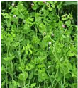
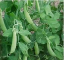

# Lentil — Field Crops (Rabi) - ICAR e-course
> Auto-extracted from government extension sources by CropBot pipeline. Content is faithful to the source; see front-matter for provenance.
## Main content — Part 1 (pp. 41–44)
## LENTIL Lens culinaris

<!-- p. 41 -->

| State     |   Area |   Production |   t/ha |
|-----------|--------|--------------|--------|
| UP        |   0.55 |         0.45 |   0.81 |
| MP        |   0.49 |         0.24 |   0.48 |
| Bihar     |   0.17 |         0.10 |   0.58 |
| WB        |   0.05 |         0.04 |   0.84 |
| Rajasthan |   0.01 |         0.03 |   1.01 |
| All India |   1.34 |         0.88 |   0.66 |

## 2. Climate

<!-- p. 42 -->

As the crop requires very cool climate it is cultivated in winter season. It can tolerate severe winter and frost condition also.

-  Soil

-  The suitable soil types are alluvial are black cotton soils.

-  Varieties

-  Pusa-1, Pusa-4, Pusa-6, Pusa-206, Pant-209, T-36, B-77, Pant L-639.

-  Cultivation practises

-  Lentil is grown as second crop after rice. The seeds are also sown broadcast in standing rice crop without any field preparation.

-  Seeds and sowing

-  The seeds are sown in lines at 20 -30 am apart using 30 -50kg seed/ha.

-  Fertilizer management

-  The crop may be grown on residual fertility. Application of 15 kg N and 40 kg P2o5 per hectare gives better yield.

-  Water management

-  If there is no winter rain one or two light irrigation at flowering and grain filling stages are given.

-  Yield

-  The crop produces 8 - 9 quintals/ha under rainfed and 18-20 quintals/ha under irrigated condition with god fertilizer management.

-  Microsperma are predominantly cultivated in India

-  Macrosperma are large sized grains cultivated in Mediterranean region

- o To mention some varieties in India

-  Pant L 406, 639, Pant L 4

-  DPL 15 and DPL 62

- Centre of origin of Lentil is ___________

- America

- S. Africa

- Mediterranean region

- The inflorescence in lentil is ________

- Raceme

- Spikelets

- Panicle

- The recommended seed rate for lentil is _________kg/ha

- 8-10

- 75-100

- 30-40

- Lentil crop needs

a. Cool & dry climateb. Warm & humidc. Dry & hot climate

5. The row to row spacing by pora method of sowing of lentil is_______cm

- 30

- 10

- 50

6. The row to row spacing for late sowing of lentil is_______cm

- 50

- 20

- 30

- Lentil contains about _______% protein

- 20

- 25

- 10

- Weed in lentil can be controlled by applying

- 2,4-D

- Fluchloralin

- both

9. The insect pod borer is commonly found on

- Wheat

- Lentil

- Maize

- Lentil belongs to family

- Leguminoceae

- Linaceae

- Tiliaceae

*****☺*****

- o Matar in Hindi

- o Third important cool season crop next to chickpea and French bean

- o Cultivated in about 6.51 million ha world wide with 10.95 million t annually

- o Distributed in Asia, Africa, Europe, N.America, & Auastralia

- o Usually cultivated for dry pods and variety of snacks

## Other mentions in this source
### p. 30

 with Chickpea, pea, mustard, linseed, lentil
### p. 36

o Chickpea, Filed pea, Lentil, , French bean
### p. 36

 Chickpea, lentil in developing countries
