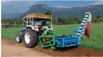
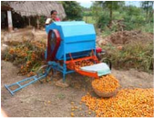
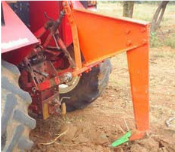
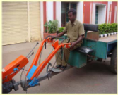
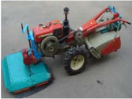
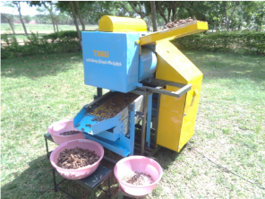

# Onion — Agriculture - TNAU production guide
> Auto-extracted from government extension sources by CropBot pipeline. Content is faithful to the source; see front-matter for provenance.
## Main content — Part 1 (pp. 447–449)
## TRACTOR OPERATED CLUSTER ONION HARVESTER CUM COLLECTOR

<!-- p. 447 -->

Purpose To dig and collect cluster onion

Type of the Tractor mounted

implement

Field capacity 1.2 ha/day

Cost of the Rs. 75,000 /- (Approximately)

implement

Salient

Features

- The cluster onion harvester has a special profile of blade to ensure shallow cut of soil and riddle conveyer for separating the soil from the onion bulbs.

- Cross conveyer and also elevating conveyer are provided for easy and continuous movement of onion.

- A bag is provided for collection of onion.

## vi. MISCELLANEOUS MACHINERY POWER TILLER OPERATED SLASHER CUM INSITU SHREDDER

<!-- p. 448 -->

Purpose Suitable for shredding vegetable residues of

Type of the

implement

Field capacity 0.8 hectare can be shredded per day

Cost of the

implement

Salient

Features Rs. 25,000 /- (Approximately)

- Suitable for any make of power tiller of 10-15 HP

- Saving in time - 73 %

brinjal, chillies, bhendi, etc. left after harvest

and parthenium, etc.

Power tiller operated

- Saving in cost - 75%

## SUBSOILER ATTACHMENT FOR STUMP REMOVAL

<!-- p. 448 -->

Purpose

Type of the

implement

Cost of the

implement

Salient

Features Removes stumps in dryland Tractor operated Rs. 14,000 (including subsoiler)

- Savings in cost by Rs. 1.50 per stump

- Savings in time is 10-12 minutes per stump

## TRAILER MOUNTED STEERING FOR POWER TILLER - TRAILER SYSTEM

<!-- p. 448 -->

Purpose

Type of the

implement

Cost of the steering system Rs. 2,000 Approximately

Salient

Features Steering of power tiller Power tiller operated

- Avoids the operator getting down and turn the power tiller trailer system.

- All the controls are well within the reach of the operator.

- Shorter turning radius, enabling the operator to take turns even in very narrow space

- Operator feels comfortable while taking a turn.

- Reduced discomfort to the operator through elimination of lateral and vertical swing of the handle.

## Salient Features:

<!-- p. 449 -->

- ¾ Suitable for deseeding dried dehulled tamarind fruits

- ¾ Various sizes of the dehulled tamarind fruits can be used for deseeding

- ¾ The roller gap can be adjusted as per the size of the tamarind fruits

- ¾ The deseeded fruits are separated into pulp strip, seeds and broken pieces

- ¾ The cost of the unit: Rs.1,00,000/-

- ¾ Capacity of the machine : 30-40 kg/h

- ¾ Cost of operation: Rs. 2.5/kg

TNAU

## 24. AGRICULTURAL PROCESSING EQUIPMENTS

<!-- p. 449 -->

## Other mentions in this source
### p. 221

Intercropping of castor with small onion in 1:2 ratio by adopting 1.5 m x 1.0 m spacing is recommended for irrigated situation.
