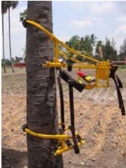

# Palmyrah — Horticulture - TNAU production guide
> Auto-extracted from government extension sources by CropBot pipeline. Content is faithful to the source; see front-matter for provenance.
## Main content — Part 1 (pp. 242–242)
## 9. Palmyrah (Borassus flabellifer); Palmae

<!-- p. 242 -->

SVPR - 1

Arid, deep sandy & loamy soils are suitable. Dry areas with low rainfall are also ideal.

Seed. Germination of 63.25 % is achieved 6 weeks after sowing

## Seed sowing

<!-- p. 242 -->

Seed nut should be high yielder of padaneer & fruits, dwarf in stature, early and regular bearer, free from pest & diseases. Select matured fruit bunches and yellow tinch in stylar region. Seeds are stored in shade for 3 weeks. Shrunken, weight less and bored seeds are rejected. Seeds may be directly sown in situ or in nursery to raise the seedlings. For direct sowing, 3 - 4 whole fruits are planted in pits (20x20x20cm) at 10 m apart and half filled with sand and soil mixture. Pit is covered with dried leaves. Sowing may be taken up during rainy months (November). Germination takes place within 3 weeks.

## Main content — Part 2 (pp. 399–399)
## PALMYRAH TREE CLIMBING DEVICE

<!-- p. 399 -->

-  Even unskilled workers can use it to climb the tree with increased stability and comfort.

-  Seating arrangement provides added comfort and safety.

-  The grippers are so positioned that while ascending/descending up/down, the upper frame accommodating the operator is always horizontal to the ground, irrespective of the girth variations in the tree.

-  The operator, after reaching the top, can also use the device to move around the tree, to reach all the parts of the canopy to do tapping, harvesting and cleaning of dry fronds.

-  It eliminates the severe bruises caused in traditional method of climbing due to use of climbing ropes.

-  The device weighs about 17 kg.

-  The device along with the ladder costs Rs. 9000.

-  Eliminates the high work stress, severe neck and back pain disorders caused in traditional method of climbing.

## Other mentions in this source
### p. 226

Dig pit size of 3' x 3' x 3'. In the pits. Fill the pit to a height of two feet (60 cm) with FYM, red earth and sand mixed in equal proportions. At the center of the pit, remove the soil mixture and plant the seedling after removing all the roots. Press the soil well around the seedling and provide the seedling with shade by using plaited coconut leaves or palmyrah leaves. Keep the pits free from weeds. Remove soil covering the collar region. As the seedlings grow and form stem, fill up the pits gradually by cutting the sides.
### p. 242

Palmyrah is a slow grower. First frond appears in about 5 months. First fan shaped leaves appears only in the 2 nd year. When it attains the height of 12 - 18 m, comes to flowering (13 - 15 yrs) for padaneer (Sweet sap) purpose. Average of 100 - 200 lit obtained for a period of 4 months from Feb - May. Padaneer and fruit yield are highly variable in individual palms.
