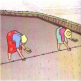
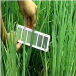
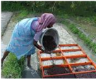
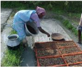
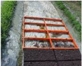
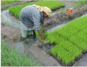

# Rice — Field Crops (Kharif) - ICAR e-course
> Auto-extracted from government extension sources by CropBot pipeline. Content is faithful to the source; see front-matter for provenance.
## Main content — Part 1 (pp. 11–14)
## Rice Seasons

<!-- p. 11 -->

| Month of sowing    | Season                       | Duration (Days)   | Districts                                                                                                                                                                                             |
|--------------------|------------------------------|-------------------|-------------------------------------------------------------------------------------------------------------------------------------------------------------------------------------------------------|
| Dec-Jan            | Navarai                      | < 120             | Tiruvallur, Vellore, Tiruvannamalai, Cuddalore, Villupuram, Tiruchirapalli, Perambalur, Karur, Nagapattinam, Madurai, Theni, Salem, Namakkal, Dindigul, Dharmapuri, Coimbatore,Erode and Pudukkottai. |
| Apr-May            | Sornavari                    | <120              | Tiruvallur, Vellore, Tiruvannamalai, Cuddalore, Villupuram, Namakkal, Dharmapuri                                                                                                                      |
| Apr-May & May-June | Early Kar Kar                | <120              | Tirunelveli, Kanyakumari, Thoothukudi, Erode, Coimbatore, Madurai, Theni, Dindigul, Salem, Namakkal, Dharmapuri.                                                                                      |
| June-July          | Kuruvai                      | <120              | Tiruchirapalli, Perambalur, Karur, Thanjavur, Nagapattinam, Tiruvarur, Pudukottai, Erode                                                                                                              |
| July-Aug.          | Early Samba                  | 130 to 135        | Tiruvallur, Vellore, Tiruvannamalai, Salem, Namakkal, Cuddalore, Villupuram, Madurai, Theni, Ramanathapuram, Dharmapuri, Coimbatore, Erode, Pudukkottai, The Nilgiris                                 |
| August             | Samba                        | 130-135 and >150  | All districts                                                                                                                                                                                         |
| Sep-Oct            | Late Samba Thaladi/ Pishanam | 130-135           | Tiruvallur, Madurai, Theni, Coimbatore, Erode                                                                                                                                                         |
| Sep-Oct            | Late Pishanam                | 130-135           | Madurai, Theni, Dindigul, Kanyakumari, Tirunelveli , Thoothukudi                                                                                                                                      |
| Oct-Nov            | Late Thaladi                 | 115-120           | Thanjavur, Nagapattinam, Tiruvarur, Tiruchirapalli,                                                                                                                                                   |

|         |                              |         | Perambalur, Karur                             |
|---------|------------------------------|---------|-----------------------------------------------|
| Sep-Oct | Late Samba Thaladi/ Pishanam | 130-135 | Tiruvallur, Madurai, Theni, Coimbatore, Erode |

## Seasons and Varieties

<!-- p. 12 -->

| Navarai (Dec -Jan)                | ADT 36, ADT 37, ASD 16, IR 64, ASD 18, ADT 42, ADT 43, MDU 5, ASD 20, IR 20, ADT 39, CO 43, CO 47, ASD 20, TRY (R)2*                                                                                       |
|-----------------------------------|------------------------------------------------------------------------------------------------------------------------------------------------------------------------------------------------------------|
| Sornavari (April - May)           | ADT 36, IR 36, IR 50, ADT 37, ASD 16, ASD 17, IR 64, ASD 18, ADT 42, MDU 5, ASD 20, ADT 43, CO 47, TRY (R)2*, ADT (R) 45, ADTRH 1, ADT (R) 47, ADT (R) 47                                                  |
| Early Kar (Apr - May)             | IR 50, ADT 36, IR 64, ADT 42, ADT 43, ADT 45, CO 47, ADT (R) 47                                                                                                                                            |
| Kar (May - Jun)                   | IR 50, ADT 36, ASD 16, ASD 17, IR 64, ASD 18, ADT 42, MDU 5, ASD 20, ADT 43, CO 47, ADT (R) 45, TRY (R)2*, ADTRH 1, ADT (R) 47, IR 36, ADT 37, Bhavani, IR 20, White Ponni, CO 43, MDU 4, ASD 19, Paiyur 1 |
| Kuruvai (Jun -Jul)                | ADT 36, IR 50, IR 64, ASD 16, ADT 37, ASD 18, ADT 42, MDU 5, ADT 43, CO 47, ADT (R) 45,TRY (R)2*, ADTRH 1, ADT (R) 47, ADT (R) 48                                                                          |
| Samba (Aug)                       | Ponmani, IR 20, White Ponni, CO 43, ADT 40, Paiyur 1, PY 4, ADT 39, TRY 1, ASD 19, ADT(R) 44, CORH 2, CO 45, ASD 19, ADT 38, ADT (R) 46, CO 42, ADT 40, ADT 38, MDU 3, MDU 4, Bhavani                      |
| Late Samba (Sep - Oct)            | IR 20, White Ponni, ADT 38, ADT 39, CO 43, CO 46, TRY 1, ADT (R)46, CORH 2, Ponmani, ASD 19, ADT (R)46, TPS 2, TPS 3, ASD 18, ASD 19, MDU 5,                                                               |
| Pishanam/Late Pishanam (Sep-Oct.) | ASD 18, ASD 16, ASD 19, CO 43, TRY 1, ADT (R)46                                                                                                                                                            |
| Dry (July - Aug)                  | ADT 36, PMK 2, TKM 11, PMK (R) 3, TKM 10, TKM (R) 12                                                                                                                                                       |
| Semi-dry (Jul Ð Aug)              | ADT 36, IR 36, ADT 39, ASD 17, PMK 2, TKM (R) 12, PMK (R) 3, MDU 5,                                                                                                                                        |

## Ruling Varieties in Tamil Nadu

<!-- p. 12 -->

Short duration: ADT 48 (95-100 days), ADT 43 (110 days), ADT 37 (105 days), ADT 36 (115 days), CO 47 (110-115 days), ASD 20 (110 days), ADS 17 (101 days), ADS 16 (110 days), IR 64 (115-120 days).

Latest varieties: RMD (R) 1 (100-105 days), TPS (R)4 (95 days), PMK (R)4 (100-105 days),

Medium duration (120 Ð145 days): IR 20, Bhavani, CO 43, CO 46, IR 36, MDU 3, MDU 4, ADT 38, ADT 39, ADT 44, ADT 46, TPS 2 , TPS 3, ASD 19, TRY 1.

Latest varieties: CO(R) 48, CO(R) 49, CO(R) 50, TRY ¨ 3.

Long duration (>150 days): Ponmani (CR 1009) /Savithri, White Ponni, BPT 5204 (Samba Masourie), PY 4 (Jawahar)

Hybrids: CORH 1, ADTRH 1, CORH 2, ADTRH 2, CORH 3.

Varieties famous in India: Ratna, Jaya, Rasi, Triveni, Mandya, Swarnapraba, Red Annapoorna, Aishwarya, Basmati.

## TYPES OF RICE CULTIVATION I. TRANSPLANTED PUDDLED LOWLAND RICE

<!-- p. 13 -->

## A. NURSERY MANAGEMENT

<!-- p. 13 -->

## i. WET NURSERY

<!-- p. 13 -->

Nursery area: Select 20 cents (800 m 2 ) of land area near to water source for raising seedlings for one hectare.

Seed rate: 30 kg for long duration; 40 kg for medium duration; 60 kg for short duration varieties and 20 kg for hybrids.

## Seed treatment

<!-- p. 13 -->

- ∞ Treat the seeds with Carbendazim or Pyroquilon or Tricyclozole solution @ 2 g/l of water for 1 kg of seeds.

- ∞ This wet seed treatment gives protection to the seedlings up to 40 days from disease such as blast and this method is better than dry seed treatment.

- ∞ If the seeds are required for sowing immediately, keep the soaked seed in gunny in dark and cover with extra gunnies and leave for 24hrs for sprouting.

- ∞ Seed treatment with Pseudomonas fluorescens: Treat the seeds with talc based formulation of Pseudomonas fluorescens 10g/kg of seed and soak in 1.0 lit of water overnight. Decant the excess water and allow the seeds to sprout for 24hrs and then sow.

- ∞ Seed treatment with Azospirillum: Treat with three packets (600 g/ha) of Azospirillum and 3 packets (600g/ha) of Phosphobacteria or 6 packets (1200g/ha) of Azophos. In bioinoculants mixed with sufficient water wherein the seeds are soaked overnight before sowing in the nursery bed (The bacterial suspension after decanting may be poured over the nursery area itself).

- ∞ Bio-control agents are compatible with bio-fertilizers

- ∞ Bio-fertilizers and bio-control agents can be mixed together for seed soaking

- ∞ Fungicides and bio-control agents are incompatible.

## Forming seedbeds

<!-- p. 13 -->

- ∞ Mark plots of 1.5 to 2.0m breadth with channels of 30cm wide all around the seedbeds.

- ∞ Length of the seed bed may vary from 8 to 10m according to soil and slope of the land.

- ∞ Collect the puddled soil from the channel and spread on the seedbeds or drag a heavy stone along the channel to lower it, so that the seed bed is at a higher level. Level the surface of the seedbed, so that the water drains into the channel.

Sow the sprouted seeds uniformly on the seedbed, having sufficient water in the nursery.

- ∞ Drain the water 18 to 24hrs after sowing.

- ∞ Care must be taken to avoid stagnation of water in any part of the seedbed.

- ∞ Allow enough water to saturate the soil from 3 rd to 5 th day. From 5 th day onwards, increase the water level from 1.5cm depending on the height of the seedlings. Thereafter maintain 2.5cm depth of water.

- ∞ Apply pre-emergence herbicides viz., Pretilachlor + safener @ 0.3kg/ha, on 3 rd or 4 th day after sowing to control weeds in the lowland nursery. Keep a thin film of water and allow it to disappear. Avoid drainage of water. This will control germinating weeds.

- ∞ Apply 1.0 tonne of fully decomposed FYM or compost to 20 cents nursery and spread the manure uniformly on dry soil.

- ∞ Basal application of DAP is recommended when the seedlings are to be pulled out in 20-25 days after sowing in less fertile nursery soils. For that situation, before the last puddling, apply 40kg of DAP and if not readily available, apply straight fertilizers 16kg of urea and 120kg of super phosphate.

- ∞ If seedlings are to be pulled out after 25 days, application of DAP is to be done 10 days prior to pulling out.

- ∞ For clayey soils where root snapping is a problem, 4kg of gypsum and 1kg of DAP/cent of area can be applied at 10 days after sowing.

## ii. DRY NURSERY

<!-- p. 14 -->

- ∞ Dry ploughed field with fine tilth is required.

- ∞ Nursery area of 20 cents with sand and loamy soil status is more suitable for this type of nursery.

- ∞ Plots of 1 to 1.5m width of beds and channels to be formed. Length is according to the slope and soil. Raised beds are more ideal if the soil is clayey in nature.

- ∞ Seed rate and seed treatment as that of wet nursery.

- ∞ Sowing is dry seeding. Seeds are covered with sand and finely powdered well decomposed farm yard manure.

- ∞ Irrigation to be done to wet the soil to saturation.

- ∞ Optimum age for transplanting Ð 4 th leaf stage.

- ∞ This type of nursery is handy in times of delayed receipt of canal water.

## B. MAIN FIELD MANAGEMENT

<!-- p. 14 -->

## Main content — Part 2 (pp. 19–26)
## II. WET SEEDED PUDDLED LOWLAND RICE

<!-- p. 19 -->

- ∞ In wet seeded rice, pre-emergence application of pretilachlor 0.75kg/ha on 8 DAS or pretilachlor + safener (Sofit) @ 0.45kg/ha on 3-4 DAS followed by one hand weeding on 40 DAS.

- ∞ During first one week, just wet the soil by thin film of water.

- ∞ Depth of irrigation may be increased to 2.5cm progressively along the crop age.

- ∞ Afterwards, follow the schedule as given to transplanted rice.

Other package of practices: As recommended in transplanted rice

## III. DRY SEEDED RAINFED UN-PUDDLED LOWLAND RICE (Rainfed rice)

<!-- p. 20 -->

The crop establishment, growth and maturity depend up on the rainfall received. There will be standing water after crop establishment for a minimum period of few days to a maximum up to grain filling, depending up on the rainfall. This type of cultivation in Tamil Nadu is called as Ôrainfed riceÕ, with the assumption that the soil moisture will be under unsaturated (dry) condition during establishment or entire growth period, with reference to tropical climate.

- ∞ Coastal districts of Tamil Nadu like Kanchipuram, Tiruvallur, Pudukottai, Ramanathapuram, Virudhunagar, Sivagangai and Kanyakumari.

- ∞ June-July (Coastal northern districts)

- ∞ September-October (Coastal southern districts)

- ∞ Dry plough to get fine tilth taking advantage of rains and soil moisture availability.

- ∞ Apply Gypsum @ 1 t/ha basally wherever soil crusting and soil hardening problem exist.

- ∞ Perfect land leveling for efficient weed and water management.

- ∞ Provide shallow trenches (15 cm width) at an interval of 3m all along the field to facilitate draining excess water at the early growth stage.

- ∞ Short duration varieties as mentioned in season and varieties including local land races suitable for those tracts.

- ∞ Seed rate: 75kg/ha dry seed for any recommended variety.

- ∞ Seed hardening with 1% KCl for 16 hours (seed and KCl solution 1:1) and shade dried to bring to storable moisture. This will enable the crop to withstand early moisture stress.

- ∞ On the day of sowing, treat the hardened seeds first with Pseudomonas fluorescens 10g/kg of seed and then with Azophos 2000g or Azospirillum and Phosphobacteria @ 600g each per ha seed, whichever is available.

- ∞ Drill sow with 20 cm inter row spacing using seed drill.

- ∞ The seeds can also be sown behind the country plough.

- ∞ Depth of sowing should be 3-5 cm and the top soil can be made compact with leveling board.

- ∞ Pre-monsoon sowing is advocated for uniform germination.

## After cultivation

<!-- p. 21 -->

- ∞ Azospirillum inoculants 10 packets (2000g/ha) and Phosphobacteria 10 packets (2000g/ha) or 20 packets (4000g/ha) of Azophos mixed with 25 kg of FYM may be broadcasted uniformly over the field just after the receipt soaking rain / moisture.

- ∞ Thinning and gap filling should be done 14-21days after sowing, taking advantage of the immediate rain

- ∞ Spray Cycocel 1000 ppm (1 ml of commercial product in one lit. of water) under water deficit situations to mitigate ill-effects.

- ∞ Foliar spray of Kaolin 3% or KCl 1% to overcome moisture stress at different physiological stages of rice.

## Manures and fertilizer application

<!-- p. 21 -->

- ∞ Blanket recommendation : 50:25:25 kg NPK/ha

- ∞ Apply a basal dose of 750 kg of FYM enriched with fertilizer phosphorus (P at 25 kg/ha)

- ∞ Apply N and K in two equal splits at 20-25 and 40-45 days after germination.

- ∞ If the moisture availability from the tillering phase is substantial, three splits (25 kg N and 12.5 kg K at 20-25, 40-45 and 60-65 DAS) can be adopted.

- ∞ N at PI may be enhanced to 40 kg, if the tiller production is high (may be when the estimated LAI is greater than 5.0) and moisture availability ensured by standing water for 10 days.

- ∞ Basal application of FeSO4 at 50 kg/ha is desirable for iron deficient soil.

- ∞ Foliar spray of 1% urea + 2% DAP + 1%KCl at PI and 10 days later may be taken up for enhancing the rice yield if sufficient soil moisture is ensured

- ∞ First weeding can be done between 15 and 21 days after germination.

- ∞ Second weeding may be done 30-45 days after first weeding.

- ∞ Apply Pendimethalin 1.0kg/ha on 5 days after sowing or Pretilachlor + safener (Sofit) 0.45kg/ha on the day of receipt of soaking rain followed by one hand weeding on 30 to 35 days after sowing.

Harvesting: Same as that for wet rice cultivation

Yield: Grain yield levels vary widely depends on the moisture availability. Normally 50-75% of the normal can be obtained.

## DRY SEEDED RAINFED UN-PUDDLED LOWLAND RICE WITH SUPPLEMENTAL IRRIGATION

<!-- p. 21 -->

It is called as semi-dry rice. Crop establishment is as that of rainfed rice but the rain water collected in village tank (Kanmai) is supplemented to protect the crop during peak vegetative and reproductive phases. Interaction between applied nutrients and crop is positive here due to better moisture availability than rainfed rice and hence, varieties may be improved ones and nutrient levels may be higher than the previous system.

- ∞ Kanchipuram/Tiruvallur, Ramanathapuram, Sivaganga, Kanyakumari, Nagapattinam/ Tiruvarur and Pudukottai.

## Seasons

<!-- p. 22 -->

- ∞ July to August - Kanchipuram, Tiruvallur, Kanyakumari

- ∞ August Ð Nagapattinam, Tiruvarur, Pudukottai

- ∞ September to October - Ramanathapuram, Sivaganga

Field preparation: Refer Rainfed rice.

- ∞ Short duration varieties as mentioned in season and verities including local land races suitable for those tracts.

- ∞ Since there is supplemental irrigation high yielding improved short duration varieties can yield more yield than the land races.

Sowing, After cultivation, Manures and fertilizer application, Weed management, Water management, Harvest:

Refer rainfed rice.

## DRY SEEDED IRRIGATED UN-PUDDLED LOWLAND RICE

<!-- p. 22 -->

It is also be called Ôsemi-dry riceÕ. It is a contingent plan to command areas, anticipating the release of water; rice crop can be established under rainfed condition up to a maximum of 45 days as that of previous two situations. Field is converted to wet condition on receipt of canal water. Conversion depends up on receipt of canal water and nutrient management is decided according to the period of irrigation.

Area: Tiruvarur and Nagapattinam districts

Season: Samba / Thaladi seasons command areas.

Field preparation: Refer Rainfed rice.

- ∞ Medium duration varieties, if sown in August and short duration varieties beyond September, as mentioned in season and varities.

- ∞ Since there is assured irrigation from canal, high yielding improved short or medium duration varieties can be cultivated depending up on the situation (month of sowing, nearness to canal, depth of standing water during NEM etc).

Sowing, after cultivation, Manures and fertilizer application, Weed management, Water management, Harvest: Refer Rainfed rice.

## DEEP WATER RICE

<!-- p. 22 -->

- ∞ Cultivation is like the methods described in this section except the harvest. Harvest may some times restricted only to panicle because of the standing water even after maturity.

- ∞ There are small batches in and around Dharmapuri district. Rainfall availability in these tract is better than the rainfed rice cultivated in other parts of Tamil Nadu. There is no bund to stagnate the water. Moisture availability is there but crop growth depends on the nutrient status.

## Other cultural practices

<!-- p. 23 -->

- ∞ As recommended to semi-dry rice

- ∞ Nutrient may be split applied depending up on the growth.

- ∞ LCC based N application is more suitable for this tract.

Intercropping: Blackgram for every four rows of rice.

Grain yield: Grain yield depends up on the moisture availability and nutrient status.

## TRANSPLANTED HYBRID RICE

<!-- p. 23 -->

| Seed rate       | 20 kg/ha                                                                                                                                                                                                                                                                                          |
|-----------------|---------------------------------------------------------------------------------------------------------------------------------------------------------------------------------------------------------------------------------------------------------------------------------------------------|
| Nursery         | Basal application of DAP at 2 kg/cent of nursery area. Sparse sowing of seeds at one kg/cent of nursery area will give robust seedlings with 1-2 tillers per seedling at the time of planting. If the soil is heavy, apply 4 kg gypsum/cent of nursery area, 10 days before pulling of seedlings. |
| Age of seedling | 20 to 25 days                                                                                                                                                                                                                                                                                     |
| Spacing (cm)    | 20 x 10 (50 hills/m 2 ) or 25 x 10 (40 hills/m 2 ) according to soil fertility                                                                                                                                                                                                                    |
| Seedlings/ hill | One (along with tillers if already produced)                                                                                                                                                                                                                                                      |
| Fertilizer      | 175:60:60 kg NPK/ha                                                                                                                                                                                                                                                                               |

## DRY SEEDED UPLAND RICE

<!-- p. 23 -->

- ∞ Dry season with assured irrigation is more suitable.

- ∞ Difficulty in crop establishment may be seen in areas with heavy downpour (North east monsoon periods of Tamil Nadu)

Varieties: Hybrids and varieties with heavy tillering.

Components of System of Rice Intensification (SRI) Cultivation

*Young Seedling (14 days old)*

*Weeding by Cono Weeder*

*Single Seedlinglhill*

*Alternate Wetting & Drying*

*Square Planting LCC based N Management*

## NURSERY

<!-- p. 24 -->

Seed rate: 7- 8 kg for single seedling/hill.

## Preparation of nursery area

<!-- p. 24 -->

## SYSTEM OF RICE INTENSIFICATION (SRI) CULTIVATION

<!-- p. 24 -->

Prepare 100 m 2 nursery to plant 1 ha area. Select a leveled area near the water source. Spread a plastic sheet or used polythene gunny bags on the shallow raised bed to prevent roots growing deep into soil.

## Nursery Management

<!-- p. 25 -->

*Soil Mixture*

*Filling the Wooden Frame*

*Blending Soil Mixture*

*Sowing Sprouted Seeds*

*Wooden Frame*

*Lifting Seedlings*

Preparation of soil mixture: Four (4) m 3 of soil mix is needed for each 100 m 2 of nursery. Mix 70% soil + 20% well-decomposed pressmud / bio-gas slurry / FYM + 10% rice hull. Incorporate in the soil mixture 1.5 kg of powdered di-ammonium phosphate or 2 kg 17-17-17 NPK fertilizer.

Filling in soil mixture: Place a wooden frame of 0.5 m long, 1 m wide and 4 cm deep divided into 4 equal segments on the plastic sheet or banana leaves. Fill the frame almost to the top with the soil mixture. Pre-germinating the seeds 2 days before sowing: Soak the seeds for 24 hr, drain and incubate the soaked seeds for 24 hr, sow when the seeds sprout and radical (seed root) grows to 2-3 mm long.

Sowing: Sow the pre-germinated seeds weighing 90-100 g/m 2 (100g dry seed may weigh 130g after sprouting) uniformly and cover them with dry soil to a thickness of 5mm. Sprinkle water immediately using rose can to soak the bed and remove the wooden frame and continue the process until the required area is completed.

Watering: Water the nursery with rose-can as and when needed (twice or thrice a day) to keep the soil moist. Protect the nursery from heavy rains for the first 5 DAS. At 6 DAS, maintain thin film of water all around the seedling mats. Drain the water 2 days before removing the seedling mats for transplanting.

Spraying fertilizer solution (optional): If seedling growth is slow, sprinkle 0.5% urea + 0.5% zinc sulfate solution at 8-10 DAS.

Lifting seedling mats: Seedlings reach sufficient height for planting at 15 days. Lift the seedling mats and transport them to main field.

## Main content — Part 3 (pp. 28–29)
## GENETICALLY MODIFIED RICE

<!-- p. 28 -->

This types of rice that have been genetically modified for agricultural purposes. The rice genome is usually modified using particle bombardment via the use of a gene gun or more commonly, a process known as agro-bacterium mediated transformation. Rice plants can be modified in DNA to be herbicide resistant, resist pests, increase grain size, generate nutrients, flavours or even produce human proteins. The natural movement of genes across species, often called horizontal gene transfer or lateral gene transfer, can also occur with rice through gene transfer mediated by natural vectors. The cultivation and use of genetically modified varieties of rice is however controversial and not legal in some countries.

## Herbicide resistant varieties

<!-- p. 28 -->

Some companies introduce herbicide resistance in the non-target crop so as to make their herbicides more effective on their targets. Most traditional herbicides work on dicotyledons and do not work on grasses. The incorporation of herbicide resistance in cereal crops allows the use of broad-spectrum herbicides that work on all undesirable plants including monocotyledonous weeds. Monsanto conducts research on rice that can tolerate glyphosate (active ingredient in the herbicide with trade name of "Roundup") to produce "Roundup Ready rice". BayerÕs line of herbicide resistant rice is known as Liberty Link. Bayer crop science is currently attempting to get their latest variety (LL62) approved for use in the EU.

## Nutritional value (Golden rice)

<!-- p. 28 -->

Half of the world population's main food source is rice. In Asia, white rice is eaten three times a day. The main concern about white rice is that it has insufficient concentrations of vitamin A. It has been suggested that rice could be fortified to reduce the level of nutritional vitamin A deficiencies. Golden rice was originally created by Dr. Ingo Potrykus and his team in Zurich, Switzerland. This genetically modified rice is capable of producing beta-carotene in the endosperm (grain) which is a pre cursor for vitamin A production. In addition, Golden rice had increased iron content. PotrykusÕs goal is to distribute the rice to poor countries whose citizens suffer blindness and even death from a lack of vitamin A. Currently, the company SynGenta owns the license for commercial distribution of golden rice.

## Pest resistance

<!-- p. 28 -->

BT rice is modified to express the cryIA(b) gene of the Bacillus thuringiensis bacterium. The gene confers resistance to a variety of pests including the rice borer through the production of endotoxins. The Chinese Government is currently doing trials on insect resistant cultivars. The benefit of this is that the farmers did not need to spray their crops to control fungal, viral, or bacterial pathogens. In comparison, conventional rice is sprayed three to four times per growing season to control pesticides.

## 03. MAIZE - ORIGIN, GEOGRAPHIC DISTRIBUTION, ECONOMIC IMPORTANCE, SOIL AND CLIMATIC REQUIREMENT, VARIETIES, CULTURAL PRACTICES AND YIELD

<!-- p. 29 -->

Bhutta (Bengali), Makai (Gujarati), Maka (Hindi, Marathi, Oriya), Musikinu jola (Kannada), Makaay (Kashmiri), Cholam (Malayalam), Makka Cholam (Tamil), Mokka jonnalu (Telugu)

The primary centre of origin of maize is considered by most authorities to be the Central America and Mexico, where many diverse types of maize are found. The discovery of fossil maize pollen with other archaeological evidence in Mexico indicates Mexico to be the native of maize.

Maize is cultivated throughout the world. From 58¡N latitude to 40¡S latitude, the crop spreads and cultivated over 139 million ha of area and around 600 million tonnes of maize is produced. Crop occupies the third position next to rice and wheat in area and production. USA, China, Brazil, Mexico, India, Romania, Philippines, Indonesia are some of important countries cultivate maize crop. In India, Rajasthan, UP, MP, Bihar, Karnataka, Gujarat, AP, J&K, HP and Maharashtra are important states produce maize.

It is staple human food, feed for livestock, for fermentation and many industrial uses. It is having abundant starch (65%). There are two types of milling. Wet milling produces industrial starch like sweeteners, also produces various modified maize starch for paper lamination, textile wrap, sizing and laundry finishing. Dry milled products are animal feed, brewing, breakfast cereals, other food. In India, dry milling is the predominant process for flour and animal feed, fermentation and distilling industries and composite flours. In the new millennium, it is an alternate crop to rice and wheat. About 35% production is consumed by human, 25% poultry and cattle feed, 15% food processing.

## Main content — Part 4 (pp. 75–77)
## Rice fallow pulse

<!-- p. 75 -->

## Cultivation practices

<!-- p. 75 -->

________________________________________________________________________

- It is also called relay crop /zero tilled crop /residual crop

- Crops suitable blackgram & greengram

- Area

- Deltaic rice belts of AP & TN

- In AP single rice cropped areas

- In TN Ð Cauvery delta and Tamirabarani

- Nagapattinam has higher area per district

- Season

- Dec-Jan or end of Samba /Early Thaladi or end of Rainy season

- In TN optimum period for sowing

- Greengram Ð Dec15- Dec31

- Blackgram - Jan 1 Ð 15

- In AP November

- Seed rate 20 kg for greengram & 25 kg for blackgram

- Method of sowing

- Broadcast the seeds 7-10days before harvest rice

- Field will be at waxy condition

- No standing water

- Seeds fallen should not role

- Harvest the rice when the pulse is in two leaf stage

- Cut the rice and leave stubble just above the pulse plant

- The crop manages the stress given via walking, or keeping rice stubble over it

- After cultivation

- No irrigation is needed if sown in optimum season

- No inter cultural operation is needed

- Insect pest control is the major management

- Foliar nutrition by DAP 2% solution just at the time of flower initiation and 15 days later is recommended

- Harvest

- 55-60 days after rice harvest

- When 70-80% pods turn brown

- Entire plant uprooted and heaped in the field for 2 or 3 days

- Then taken to threshing floor and dried and threshed either by cattle or by tractor if the produce is more than an acre

- Plant stand depends up on

- Field management in the previous rice

- Good leveling of rice crop ensuresÉ

- Uniform germination of pulse crop

- Good weed management

- P applied to previous rice is more efficient for relay crop

- Average yield is decided

- Optimum stand with equidistance

- Residual moisture,

- residual nutrients and

- Appropriate season

L15

## Crop 17

<!-- p. 77 -->

## Other mentions in this source
### p. 17

∞ When the green manure is applied, rock phosphate can be used as a cheap source of P fertilizer. If rock phosphate is applied, the succeeding rice crop need not be supplied with P. Application of rock phosphate + single super phosphate or DAP mixed in different proportions (75:25 or 50:50) is equally effective as SSP or DAP alone.
### p. 17

∞ Manual weeding is also essential to remove the weeds closer to rice root zone.
### p. 18

∞ Critical stages of water requirement in rice are, a) panicle initiation, b) booting, c) heading and d) flowering. During these stages, the irrigation interval should not exceed the stipulated time so as to cause the depletion of moisture below the saturation level.
### p. 18

∞ Confirm maturity by selecting the most mature tiller and dehusk a few grains. If the rice is clear and firm, it is in hard dough stage.
### p. 18

∞ Dry the grains to 12% moisture level for storage. Grain yield in rice is estimated only at 14% moisture for any comparison.
### p. 19

Season: As that of transplanted rice
### p. 19

∞ After inundation of water, puddling is to be done as like transplanting rice. More care should be taken to level the field to table top level.
### p. 19

∞ Seed treatments as adopted for transplanted rice
### p. 19

∞ For direct wet seeded lowland rice, the recommendation is same at that of transplanted rice.
### p. 26

∞ Puddled lowland prepared as described in transplanted rice.
### p. 27

∞ As per transplanted rice.
### p. 27

∞ Take observations from 14 DAT in transplanted rice or 21 DAS in direct seeded rice.
### p. 27

∞ Green manure and farm yard manure application will enhance the growth and yield of rice in this system approach.
### p. 34

Wheat is the worldÕs number one cereal in area. Cultivation of wheat is as old as civilization. It is the first mentioned crop in Bible. Wheat is eaten in various forms by more than 1000 million people in the world. In India, it is second important staple food crop next to rice. In areas wheat is staple cereal food; it is eaten in the form of ÔchapattisÕ. In areas where rice is the staple cereal food, wheat is eaten in the form of ÔpurisÕ or in the form of ÔupmaÕ (cooked from ÔsujiÕ or ÔrawaÕ). In addition to this, wheat is also consumed in various other preparations such as ÔdaliaÕ, ÔhalwaÕ, Ôsweet mealsÕ, etc. In most of the urban areas of the country, the use of backed leavened bread, flakes, cakes, biscuits, etc. is increasing at a fast rate. Besides staple food to human, wheat straw is a good source of feed for a large population of cattle in the country.
### p. 37

It is important next to rice, wheat, maize in area and production. It is more suitable than wheat in India. Due to hardy nature, it can withstand adverse agro-environments like, drought, salinity, alkalinity, varied topography like plain, hill, under rainfed and irrigated conditions, etc. It is the crop preferred by farmers where wheat is not possible.
### p. 44

∞ Treat the seeds with three packets (600 g)/ha of Azospirillum and 3 packets (600g) of phosphobacteria or 6 packets of Azophos (1200g) using rice gruel as binder.
### p. 50

Pearl millet is one of the major coarse grain crops and is considered to be a poor manÕs food. It is staple food in a short period in the relatively dry tracts of the country. It is the most drought tolerant crop among cereals and millets. The grain of pearl millet is superior in nutritive value to sorghum grain but inferior in feeding value. Grain contains 12.4% of moisture, 11.6% of protein, 5% of fat, 67% of carbohydrates and 2.7% of minerals. Pearl millet grains are eaten cooked like rice or ÔchapatisÕ are prepared. It is also used as feed for poultry industry and green fodder or dry fodder for cattle.
### p. 53

Dry the earheads. Thresh in a mechanical thresher or spread it and drag a stone roller over it or cattle threshes. Dry the seeds below 10 per cent and mix 100 kg of grains with 1kg of activated kaolin to reduce the rice weevil and rice moth incidence. Spray Malathion 50EC 10 ml/ lit @ 3 lit of spray fluid/100 m 2 over the bags during storage godowns, For grain purpose the grain should be dried well below 10% moisture and stored in gunny bags.
### p. 54

o They posses biological value similar to wheat & rice
### p. 62

o Like rice it can be cooked and used
### p. 63

o Husked rice is nutritious and tasty
### p. 63

o It originated from rice weed
### p. 69

Sole crop after rice,
### p. 70

Rice Ð wheat Ð blackgram
### p. 70

Blackgram Ð rice - groundnut
### p. 74

Rice fallow pulse
### p. 74

Rice ÐRice Ð greengram Ð blackgram
### p. 82

Mostly grown in residual soil moisture in rice fields
### p. 84

Broadcasting on standing rice crops (lentil & lathyrus)
### p. 92

Pillipesara (Phaseolus trilobus) is broadcast in standing rice
### p. 92

o In between two rice if the period available is 40-60days
### p. 92

o After the rice but sown as rice fallow / self sown Tephrosia purpurea
### p. 93

o Before rice if rain is there under prepared field
### p. 93

∞ As intercrop along rice
### p. 93

∞ Mature seeds remain dormant in the rice soil
### p. 94

∞ Sown as rice fallow pulses in AP
### p. 94

∞ Broadcasting on standing crops (rice)
### p. 94

∞ Drum seeding in rice inter rows
### p. 105

∞ Example. Crested wheat grass,Intermediate wheat grass,Drooping wheat grass,Common bent grass,Meadow fox-tail grass,false oat grass,false brome grass,rescue grass,smooth brome grass,bush grass,rice grass,Timothy grass,muhly grass, perennial rye grass etcÉ.
### p. 111

∞ Molasses for rice, wheat
