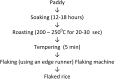
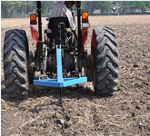
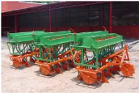
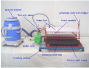
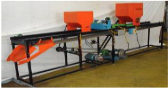
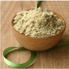

# Rice — Agriculture - TNAU production guide
> Auto-extracted from government extension sources by CropBot pipeline. Content is faithful to the source; see front-matter for provenance.
## Main content — Part 1 (pp. 13–31)
## 1. RICE (Oryza sativa L.)

<!-- p. 13 -->

|                                    |                            | TNAU Rice TRY 3*, TRY 1*, CO 43, TKM 13, VGD 1, CO 52, CO (R) 50, ADT 39, ADT 38, TNAU Rice ADT 49, Imp.White Ponni, ADT (R) 46, TNAU Rice Hybrid CO 4   |
|------------------------------------|----------------------------|----------------------------------------------------------------------------------------------------------------------------------------------------------|
| Summer                             | (Dec.)                     | ADT 53, CO 51, ADT (R) 45, TPS 5, ADT 36, ADT 37, CORH 3, ASD 16,                                                                                        |
| d. Flood affected areas            | (Aug-Sep)                  | CR 1009 sub1                                                                                                                                             |
| e.Salt affected areas              |                            | TRY 1, TRY 2, TRY 3 and Co 43                                                                                                                            |
| II. North Eastern Zone             | II. North Eastern Zone     | II. North Eastern Zone                                                                                                                                   |
| a. Kanchipuram/Tiruvallur          | a. Kanchipuram/Tiruvallur  | a. Kanchipuram/Tiruvallur                                                                                                                                |
| Sornavari                          | (April -May)               | ADT 53, CO 51, ADT 43, ADT (R) 45, TPS 5, ADT 36, ADT 37, CORH 3, ASD 16, TKM 9                                                                          |
| Samba/ Late Samba                  | (Aug- Sep)                 | VGD 1, TKM 13, CO 52, CO (R) 50, ADT 39, ADT 38, TNAU Rice ADT 49, CO 43, Imp.White Ponni, ADT (R) 46, TNAU Rice TRY 3*, TNAU Rice Hybrid CO 4           |
| Navarai                            | (Dec -Jan)                 | ADT 53, CO 51, ADT (R) 45, MDU 6, ADT 36, ADT 37, CORH 3, TKM 9                                                                                          |
| Rainfed direct seeded and Semi-dry | (July - Aug)               | Anna (R) 4, ADT 36, ADT 39, TKM 9, TKM 11                                                                                                                |
| b. Vellore/Tiruvannamalai          | b. Vellore/Tiruvannamalai  | b. Vellore/Tiruvannamalai                                                                                                                                |
| Sornavari                          | (April-May)                | ADT 53, CO 51, ADT 43, ADT (R) 45, TPS 5 , MDU 6, ADT 36, ADT 37, CORH 3, ASD 16, TKM 9                                                                  |
| Samba                              | (Aug)                      | VGD 1, TKM 13, CO 52, Imp.White Ponni, ASD 19, TNAU Rice ADT 49, CO (R) 50, ADT 39, ADT 38, CO 43, ADT (R) 46, TNAU Rice Hybrid CO 4                     |
| Navarai                            | (Dec -Jan)                 | ADT 53, CO 51, ADT (R) 45, TPS 5 , MDU 6, ADT 36, ADT 37, CORH 3, ASD 16, TKM 9                                                                          |
| c. Cuddalore/ Villupuram           | c. Cuddalore/ Villupuram   | c. Cuddalore/ Villupuram                                                                                                                                 |
| Sornavari                          | (April -May)               | ADT 53, CO 51, ADT 43, ADT (R) 45, TPS 5, MDU 6, ADT 36, ADT 37, CORH 3, ASD 16, TKM 9                                                                   |
| Samba                              | (Aug)                      | CR 1009 Sub1, TNAU Rice ADT 50, ADT 51, CR 1009,                                                                                                         |
| Samba                              | (Aug)                      | VGD 1,TKM 13, CO 52, Imp.White Ponni,, TRY 3*, TNAU Rice Hybrid CO 4,CO (R) 50, TNAU Rice ADT 49, CO 43, TRY 1, ADT(R) 46, ADT 38                        |
| Navarai                            | (Dec-Jan)                  | ADT 53, CO 51, ADT (R) 45, TPS 5 , MDU 6, ADT 36, ADT 37, CORH 3, ASD 16, TKM 9                                                                          |
| Delta regions of Cuddalore         | Delta regions of Cuddalore | Delta regions of Cuddalore                                                                                                                               |
| Samba                              | (Aug)                      | CR 1009, CR 1009 Sub 1, ADT 51                                                                                                                           |
| Late samba/Thaladi                 | (Sep-Oct)                  | ADT 38, ADT 39, ADT 46, Co 50, Co 52, TKM 13, Improved white ponni, TRY 3                                                                                |

| Salt affected areas (Cuddalore)   |                              | TRY 1, TRY 2, TRY 3 and Co 43                                                                                                                         |
|-----------------------------------|------------------------------|-------------------------------------------------------------------------------------------------------------------------------------------------------|
| III. Western zone                 | III. Western zone            | III. Western zone                                                                                                                                     |
| a. Coimbatore/Tiruppur/Erode      | a. Coimbatore/Tiruppur/Erode | a. Coimbatore/Tiruppur/Erode                                                                                                                          |
| Kar                               | (May - Jun)                  | ADT 53, CO 51, ADT 43, ADT (R) 45, TPS 5 , MDU 6, ADT 36, ADT 37, CORH 3, ASD 16                                                                      |
| Samba /Late Samba                 | (Aug - Sep)                  | CO 52, TKM 13, VGD 1, CO 43, Imp.White Ponni, TNAU Rice Hybrid CO 4, CO (R) 50, ADT(R) 46, TNAU Rice ADT 49, ADT 39,                                  |
| Navarai                           | (Dec -Jan)                   | ADT 53, CO 51, ADT (R) 45, TPS 5 , MDU 6, ADT 36, ADT 37, CORH 3, ASD 16                                                                              |
| b. Karur/Perambalur/Ariyalur      | b. Karur/Perambalur/Ariyalur | b. Karur/Perambalur/Ariyalur                                                                                                                          |
| Kuruvai                           | (Jun -Jul)                   | ADT 53, CO 51, ADT 43, ADT (R) 45, TPS 5 , MDU 6, ADT 36, ADT 37, CORH 3, ASD 16, TKM 9                                                               |
| Samba                             | (Aug)                        | CR 1009 Sub1, TNAU Rice ADT 50, ADT 51, CR 1009                                                                                                       |
| Late Samba / Thaladi              | (Sep -Oct)                   | VGD 1,TKM 13, CO 52, CO (R) 50, ADT 39, ADT 38, TNAU Rice ADT 49, CO 43, Imp.White Ponni, ADT (R) 46, TNAU Rice TRY 3*, TNAU Rice Hybrid CO 4, TRY 1* |
| Navarai                           | (Dec -Jan)                   | ADT 53, CO 51, ADT (R) 45, TPS 5 , MDU 6, ADT 36, ADT 37, CORH 3, ASD 16, TKM 9                                                                       |
| Delta regions of Karur            | Delta regions of Karur       | Delta regions of Karur                                                                                                                                |
| Late Samba                        | (Sep -Oct)                   | ADT 38, ADT 39, ADT 46, Co 50, Co 52, TKM 13, Improved white ponni, TRY 3                                                                             |
| Delta regions of Ariyalur         | Delta regions of Ariyalur    | Delta regions of Ariyalur                                                                                                                             |
| Samba                             | (Aug)                        | CR 1009, CR 1009 Sub 1, ADT 51                                                                                                                        |
| Late samba/Thaladi                | (Sep-Oct)                    | ADT 38, ADT 39, ADT 46, Co 50, Co 52, TKM 13, Improved white ponni, TRY 3                                                                             |
| IV. North Western Zone            | IV. North Western Zone       | IV. North Western Zone                                                                                                                                |
| a. Salem/Namakkal                 | a. Salem/Namakkal            | a. Salem/Namakkal                                                                                                                                     |
| Kar                               | (May - Jun)                  | ADT 53, CO 51, ADT 43, ADT (R) 45, TPS 5 , MDU 6, ADT 36, ADT 37, CORH 3, ASD 16, TKM 9                                                               |
| Samba                             | (Aug)                        | VGD 1,TKM 13, CO 52, Imp.White Ponni, CO 43, TRY 1*, TNAU Rice TRY 3*, CO (R) 50, TNAU Rice ADT 49, TNAU Rice Hybrid CO 4                             |
| Navarai                           | (Dec - Jan)                  | ADT 53, CO 51, ADT (R) 45, TPS 5 , MDU 6, ADT 36, ADT 37, CORH 3, ASD 16, TKM 9                                                                       |
| b. Dharmapuri/ Krishnagiri        | b. Dharmapuri/ Krishnagiri   | b. Dharmapuri/ Krishnagiri                                                                                                                            |
| Kar                               | (May -Jun)                   | ADT 53, CO 51, ADT 43, ADT (R) 45, TPS 5 , MDU 6, ADT 36, ADT 37, CORH 3, ASD 16, TKM 9                                                               |
| Samba/Late Samba                  | (Aug - Oct)                  | VGD 1,TKM 13, CO 52, Paiyur 1, Imp.White Ponni, TNAU Rice ADT 49, ADT 39, ASD 19, CO 43                                                               |
| Navarai                           | (Dec- Jan)                   | ADT 53, CO 51, ADT (R) 45, TPS 5 , MDU 6, ADT 36, ADT 37, CORH 3, ASD 16, TKM 9                                                                       |

| V. High Altitude zone           | V. High Altitude zone       | V. High Altitude zone                                                                                                                         |
|---------------------------------|-----------------------------|-----------------------------------------------------------------------------------------------------------------------------------------------|
| a. The Nilgiris Samba           | (Jul -Aug)                  | CO(R)50, CO 52, ADT 39                                                                                                                        |
| VI. Southern zone               | VI. Southern zone           | VI. Southern zone                                                                                                                             |
| a. Pudukottai                   | a. Pudukottai               | a. Pudukottai                                                                                                                                 |
| Kuruvai                         | (Jun -Jul)                  | ADT 53, CO 51, ADT 43, ADT (R) 45, TPS 5 , ADT 36, ADT 37, CORH 3, ASD 16                                                                     |
| Samba                           | (Aug)                       | CR 1009 Sub1, TNAU Rice ADT 50, ADT 51, CR 1009                                                                                               |
| Late Samba/Thaladi              | (Sep - Oct)                 | VGD 1,TKM 13, CO 52, CO (R) 50, ADT 39, ADT 38, TNAU Rice ADT 49, CO 43, Imp.White Ponni, ADT (R) 46, TNAU Rice TRY 3*, TNAU Rice Hybrid CO 4 |
| Rainfed direct seeded/ Semi-dry | (Jul -Aug)                  | CR 1009 Sub1, CR 1009, ADT 39                                                                                                                 |
| Delta regions                   | (Sep -Oct)                  | ADT 38, ADT 39, ADT 46, Co 50, Co 52, TKM 13, Improved white ponni, TRY 3                                                                     |
| Salt affected areas             |                             | TRY 1, TRY 2, TRY 3 and Co 43                                                                                                                 |
| b. Madurai/Dindigul/Theni       | b. Madurai/Dindigul/Theni   | b. Madurai/Dindigul/Theni                                                                                                                     |
| Kar                             | (May -Jun)                  | MDU 6, CO 51, ADT 53, ASD 16, MDU 5, ADT43, ADT(R)45                                                                                          |
| Samba/ Late Samba               | (Aug- Sep)                  | VGD 1,TKM 13, CO 52, CO (R) 50, ADT 39, ADT 38, TNAU Rice ADT 49, CO 43, Imp.White Ponni, ADT (R) 46, TNAU Rice TRY 3*, TNAU Rice Hybrid CO 4 |
| Navarai                         | (Dec -Jan)                  | MDU 6, CO 51, ADT 53, ADT 36, ADT 37, ADT(R)45, ASD 16                                                                                        |
| Semi-dry                        | (Jul -Aug)                  | Anna (R) 4, MDU 5, PMK (R) 3                                                                                                                  |
| c. Ramanathapuram               | c. Ramanathapuram           | c. Ramanathapuram                                                                                                                             |
| Samba                           | (Aug)                       | Imp.White Ponni, TNAU Rice TRY 3, TRY 1*, VGD 1,TKM 13, CO 52, TNAU Rice Hybrid CO 4, CO (R) 50, CO 43, ADT 39                                |
| Rainfed direct seeded & Semidry | (Jul -Aug)                  | Anna (R) 4, MDU 5, MDU 6, PMK (R) 3, ADT 36, ADT 53, CO 51                                                                                    |
| d. Virudhunagar                 | d. Virudhunagar             | d. Virudhunagar                                                                                                                               |
| Samba                           | (Sep-Oct)                   | VGD 1,TKM 13, CO 52, CO (R) 50, ADT 39, ADT 38, TNAU Rice ADT 49, CO 43, Imp.White Ponni, ADT (R) 46, TNAU Rice TRY 3*, TNAU Rice Hybrid CO 4 |
| Rainfed direct seeded           | (Jul -Aug)                  | Anna (R) 4, ADT 36, MDU 6, PMK (R) 3, ADT (R) 45                                                                                              |
| e. Sivaganga                    | e. Sivaganga                | e. Sivaganga                                                                                                                                  |
| Semi-dry                        | (Jul -Aug)                  | ADT 36, MDU 6, PMK (R) 3, Anna (R) 4, ADT 53, CO 51, ADT 39, TKM 13, VGD 1                                                                    |
| f. Tirunelveli, Thoothukudi     | f. Tirunelveli, Thoothukudi | f. Tirunelveli, Thoothukudi                                                                                                                   |
| Early kar                       | (Apr - May)                 | TPS 5 , ASD 16, ASD 18, ADT 53, CO 51, ADT 43, ADT                                                                                            |
| Kar                             | (May -Jun)                  | (R) 45, ADT 36, ADT 37, CORH 3, TKM 9                                                                                                         |
| Pishanam/Late Pishanam          | (Sep-Oct.)                  | TPS 3, ASD 19, VGD 1, TKM 13, CO 52, CO (R) 50, ADT 39, ADT 38, TNAU Rice ADT 49, CO 43, Imp.White                                            |

|                                                                                     | Ponni, ADT (R) 46, TRY 1, TNAU Rice   | Ponni, ADT (R) 46, TRY 1, TNAU Rice                                                                                                                                    |
|-------------------------------------------------------------------------------------|---------------------------------------|------------------------------------------------------------------------------------------------------------------------------------------------------------------------|
| Semi dry                                                                            | (July- Aug)                           | Hybrid CO 4 Anna (R) 4, PMK (R) 3                                                                                                                                      |
| Drought affected areas (Ramanathapuram, Virudhunagar, Tiruvallur& parts of Madurai) |                                       | Anna (R) 4, PMK 3                                                                                                                                                      |
| VII. High Rainfall zone                                                             | VII. High Rainfall zone               | VII. High Rainfall zone                                                                                                                                                |
| a. Kanyakumari                                                                      | a. Kanyakumari                        | a. Kanyakumari                                                                                                                                                         |
| Kar                                                                                 | (May -Jun)                            | TPS 5, ASD 16, ADT 36, ASD 18, ADT 43,ADT(R) 45, CORH 3, ADT 53, CO 51,                                                                                                |
| Pishanam / Late samba                                                               | (Sep - Oct)                           | ASD 19, TPS 3, CR 1009 Sub1, CR 1009, CO 43, TRY 1*, TNAU Rice TRY 3, VGD 1,TKM 13, ADT 39, CO 52, ADT (R) 46, TNAU Rice Hybrid CO 4, CO(R) 50, Imp.White Ponni, CO 43 |
| Semi-dry                                                                            | (Jul - Aug)                           | ADT 36, TKM 9                                                                                                                                                          |

Note of Caution of the varieties: ADT43 is recommended for Kar, Sornavari and Kuruvai seasons and should not be grown during cold weather period. Improved white ponni is also susceptible to blast and care should be taken on plant protection measures. All samba/late samba season varieties are likely to get infected with false smut and hence prophylactic spraying has to beadopted.

Kuruvai/Navarai/Sornavari : Short duration

late samba/thaladi : Medium duration

Samba : long duration

## II. PARTICULARS OF RICE VARIETIES SHORT DURATION VARIETIES

<!-- p. 17 -->

| PARTICULARS              | CO 51                                                 | MDU 6                    | TPS 5                    |
|--------------------------|-------------------------------------------------------|--------------------------|--------------------------|
| Year of Release          | 2013                                                  | 2015                     | 2014                     |
| Year of Notification     | SO.268(E)/28.1.2015 (SVRC) SO.1007(E)/30.3.2017(CVRC) | SO.1379(E)/27.03.2018    | SO.1556(E)/11.06.2015    |
| Parentage                | ADT 43 / RR 272-1745                                  | MDU 5 / ACM 96136        | ASD 16 / ADT 37          |
| Duration (Days)          | 105-110                                               | 115-120                  | 118                      |
| Average Yield (kg/ha)    | 6641                                                  | 6118                     | 6301                     |
| 1000 grain wt (g)        | 16.0                                                  | 17.3                     | 22.7                     |
| Grain L/B ratio          | 3.0                                                   | 3.09                     | 2.3                      |
| Grain type               | Medium Slender                                        | Long Slender             | Short bold               |
| Morphological Characters | Morphological Characters                              | Morphological Characters | Morphological Characters |
| Habit                    | Semi dwarf, erect                                     | Erect ,good tillering    | Erect                    |
| Leaf sheath              | Green                                                 | Green                    | Green                    |
| Septum                   | -                                                     | Green                    | Green                    |
| Ligule                   | -                                                     | Pale green               | Light green              |

| Auricle         | Pale Green                                                                                         | Pale green                                                                                         | Light green                                                                                        |
|-----------------|----------------------------------------------------------------------------------------------------|----------------------------------------------------------------------------------------------------|----------------------------------------------------------------------------------------------------|
| Panicle         | Intermediate, droopy                                                                               | Intermediate, droopy                                                                               | Well exserted panicle                                                                              |
| Husk colour     | Straw                                                                                              | Straw                                                                                              | Straw                                                                                              |
| Rice colour     | White                                                                                              | White                                                                                              | White                                                                                              |
| Abdominal white | Occasionally present                                                                               | Occasionally present                                                                               | Occasionally present                                                                               |
| Grain size (mm) | Grain size (mm)                                                                                    | Grain size (mm)                                                                                    | Grain size (mm)                                                                                    |
| Length          | 5.5                                                                                                | 6.8                                                                                                | 6.1                                                                                                |
| Breadth         | 1.8                                                                                                | 2.2                                                                                                | 2.7                                                                                                |
| Thickness       | --                                                                                                 | --                                                                                                 |                                                                                                    |
| Seed source     | Seed centre,TNAU, Coimbatore-3                                                                     | Seed centre, TNAU, Coimbatore                                                                      | Seed centre, TNAU, Coimbatore                                                                      |
| Marketability   | Bold variety : Direct procurement centre Fine variety : Direct procurement centre/private traders. | Bold variety : Direct procurement centre Fine variety : Direct procurement centre/private traders. | Bold variety : Direct procurement centre Fine variety : Direct procurement centre/private traders. |

| PARTICULARS              | ADT 36               | ADT 37                | ADT 43                              |
|--------------------------|----------------------|-----------------------|-------------------------------------|
| Year of Release          | 1980                 | 1987                  | 1998                                |
| Year of Notification     | SO 19(E)/ 14.01.1982 | SO.280(E)/ 13.04.1989 | SO.425(E)/ 8.6.1999                 |
| Parentage                | Triveni/ IR 20       | BG 280-1 2/ PTB 33    | IR 50/ Imp. White Ponni             |
| Duration (Days)          | 110                  | 105                   | 110                                 |
| Average Yield (kg/ha)    | 5500                 | 6200                  | 5900                                |
| 1000 grain wt (g)        | 20.6                 | 23.4                  | 15.5                                |
| Grain L/B ratio          | 3.1                  | 1.79                  | 2.81                                |
| Grain type               | Medium               | Short bold            | Medium slender                      |
| Morphological Characters |                      |                       |                                     |
| Habit                    | Semi dwarf,Erect     | Semi dwarf, Erect     | Semi dwarf, slightly open           |
| Leaf sheath              | Green                | Green                 | Light green                         |
| Septum                   | Green                | White                 | Cream                               |
| Ligule                   | Colourless           | White                 | White                               |
| Auricle                  | Colourless           | White                 | -                                   |
| Panicle                  | Long compact         | Compact               | Moderately long, Intermediate type, |

|                 |                                                                                                    |                                                                                                    | drooping                                                                                           |
|-----------------|----------------------------------------------------------------------------------------------------|----------------------------------------------------------------------------------------------------|----------------------------------------------------------------------------------------------------|
| Husk colour     | Straw                                                                                              | Straw                                                                                              | Straw                                                                                              |
| Rice colour     | White                                                                                              | White                                                                                              | White                                                                                              |
| Abdominal white | Absent                                                                                             | White, Present                                                                                     | Very occasionally present                                                                          |
| Grain size (mm) |                                                                                                    |                                                                                                    |                                                                                                    |
| Length          | 7.8                                                                                                | 5                                                                                                  | 5.46                                                                                               |
| Breadth         | 2.5                                                                                                | 2.8                                                                                                | 1.94                                                                                               |
| Thickness       | 2.0                                                                                                | 1.88                                                                                               | 1.63                                                                                               |
| Seed source     | Seed centre, TNAU, Coimbatore-3                                                                    | Seed centre,TNAU, Coimbatore-3                                                                     | Seed centre,TNAU, Coimbatore-3                                                                     |
| Marketability   | Bold variety : Direct procurement centre Fine variety : Direct procurement centre/private traders. | Bold variety : Direct procurement centre Fine variety : Direct procurement centre/private traders. | Bold variety : Direct procurement centre Fine variety : Direct procurement centre/private traders. |

| PARTICULARS              | ADT (R) 45            | ASD 16               | ASD 18                  |
|--------------------------|-----------------------|----------------------|-------------------------|
| Year of Release          | 2001                  | 1986                 | 1991                    |
| Year of Notification     | SO.1134(E)/15.11.2001 | SO.867(E)/26.11.1986 | SO.615(E)/17.8.1993     |
| Parentage                | IR50 / ADT 37         | ADT 31/CO 39         | ADT 31/IR 50            |
| Duration (Days)          | 110                   | 110 - 115            | 105 - 110               |
| Average Yield (kg/ha)    | 5400                  | 5600                 | 5900                    |
| 1000 grain wt (g)        | 17.5                  | 24.2                 | 21.8                    |
| Grain L/B ratio          | 2.98                  | 2.6                  | 3.2                     |
| Grain type               | Medium slender        | Short Bold           | Medium slender          |
| Morphological Characters |                       |                      |                         |
| Habit                    | Semi dwarf, erect     | Semi dwarf,erect     | Semi dwarf              |
| Leaf sheath              | Green                 | Green                | Pale Green              |
| Septum                   | Cream                 | Green                | Light green             |
| Ligule                   | White                 | White                | White clefted           |
| Auricle                  | -                     | Colourless           | Pale green              |
| Panicle                  | Compact               | Long Compact         | Medium, compact exerted |

| Husk colour     | Straw                                                                                              | Straw                                                                                              | Straw                                                                                              |
|-----------------|----------------------------------------------------------------------------------------------------|----------------------------------------------------------------------------------------------------|----------------------------------------------------------------------------------------------------|
| Rice colour     | White                                                                                              | White                                                                                              | White                                                                                              |
| Abdominal white | Absent                                                                                             | Present                                                                                            | Slightly present                                                                                   |
| Grain size (mm) |                                                                                                    |                                                                                                    |                                                                                                    |
| Length          | 8.00                                                                                               | 7.86                                                                                               | 8.64                                                                                               |
| Breadth         | 2.16                                                                                               | 3.02                                                                                               | 2.7                                                                                                |
| Thickness       | 1.97                                                                                               | 1.96                                                                                               | 2.2                                                                                                |
| Seed source     | Seed centre, TNAU, Coimbatore-3                                                                    | Seed centre,TNAU, Coimbatore-3                                                                     | Seed centre,TNAU, Coimbatore-3                                                                     |
| Marketability   | Bold variety : Direct procurement centre Fine variety : Direct procurement centre/private traders. | Bold variety : Direct procurement centre Fine variety : Direct procurement centre/private traders. | Bold variety : Direct procurement centre Fine variety : Direct procurement centre/private traders. |

| PARTICULARS              | Anna (R) 4             | CORH 3 (hybrid)         | ADT 53               |
|--------------------------|------------------------|-------------------------|----------------------|
| Year of Release          | 2009                   | 2006                    | 2019                 |
| Year of Notification     | SO.2137(E)/ 31.08.2010 | SO.1178(E)/ 20.7.2007   | SO.3220(E)/ 5.9.2019 |
| Parentage                | Pantdhan 10 x IET 9911 | TNAU CMS 2A/CB 87R      | ADT 43 / JGL 384     |
| Duration (Days)          | 105-110                | 110-115                 | 110-115              |
| Average Yield (kg/ha)    | 3700                   | 7500                    | 6334                 |
| 1000 grain wt (g)        | 25.7                   | 22.0                    | 14.5                 |
| Grain L/B ratio          | 3.45                   | 2.95                    | 3.1                  |
| Grain type               | Long slender           | Medium slender          | Medium Slender       |
| Morphological Characters |                        |                         |                      |
| Habit                    | Semidwarf erect        | Semi dwarf              | Medium tall, erect   |
| Leaf sheath              | Green                  | Green                   | Green                |
| Septum                   | -                      | -                       | Cream                |
| Ligule                   | -                      | -                       | White, Split shape   |
| Auricle                  | Pale green             | Pale green              | Light green          |
| Panicle                  | Intermediate           | Long, compact, drooping | Intermediate Compact |
| Husk colour              | Straw                  | Straw                   | Straw                |
| Rice colour              | White                  | White                   | White                |
| Abdominal white          | Absent                 | Occasionally present    | Absent               |

| Grain size (mm)   |                                                                                                    |                                                                                                    |                                                                                                    |
|-------------------|----------------------------------------------------------------------------------------------------|----------------------------------------------------------------------------------------------------|----------------------------------------------------------------------------------------------------|
| Length            | 6.90                                                                                               | 6.2                                                                                                | 5.8                                                                                                |
| Breadth           | 2.00                                                                                               | 2.1                                                                                                | 1.9                                                                                                |
| Thickness         | -                                                                                                  | 1.2                                                                                                | 1.02                                                                                               |
| Seed source       | Seed centre,TNAU, Coimbatore-3                                                                     | Seed centre, TNAU, Coimbatore-3                                                                    | Seed centre,TNAU, Coimbatore-3                                                                     |
| Marketability     | Bold variety : Direct procurement centre Fine variety : Direct procurement centre/private traders. | Bold variety : Direct procurement centre Fine variety : Direct procurement centre/private traders. | Bold variety : Direct procurement centre Fine variety : Direct procurement centre/private traders. |

| PARTICULARS              | TKM 11                  | TRY 2                 |
|--------------------------|-------------------------|-----------------------|
| Year of Release          | 1998                    | 2001                  |
| Year of Notification     | SO.425(E)/8.6.1999      | SO.1134(E)/15.11.2001 |
| Parentage                | C 22/BJ 1               | IET6238/IR36          |
| Duration (Days)          | 110-120                 | 115-120               |
| Average Yield (kg/ha)    | 3000                    | 5362                  |
| 1000 grain wt (g)        | 21.4                    | 22.8                  |
| Grain L/B ratio          | 3.2                     | 3.5                   |
| Grain type               | Long slender            | Long slender          |
| Morphological Characters |                         |                       |
| Habit                    | Erect                   | Semi dwarf,erect      |
| Leaf sheath              | Green                   | Green                 |
| Septum                   | cream                   | Light green           |
| Ligule                   | Colourless              | Distinct              |
| Auricle                  | Light green             | Hairy light brown     |
| Panicle                  | Long, compact, drooping | Compact               |
| Husk colour              | -                       | Straw                 |
| Rice colour              | White                   | White                 |
| Abdominal white          | -                       | Absent                |
| Grain size (mm)          |                         |                       |
| Length                   | 9.3                     | 9.1                   |

| Breadth       | 2.3                                                                                               | 2.6                                                                                               |
|---------------|---------------------------------------------------------------------------------------------------|---------------------------------------------------------------------------------------------------|
| Thickness     | 1.6                                                                                               | 1.7                                                                                               |
| Seed source   | Seed centre,TNAU, Coimbatore-3                                                                    | Seed centre, TNAU, Coimbatore-3                                                                   |
| Marketability | Bold variety : Direct procurement centre Fine variety : Direct procurement centre/private traders | Bold variety : Direct procurement centre Fine variety : Direct procurement centre/private traders |

| PARTICULARS              | ADT (R) 48               | MDU 5                    | PMK (R) 3                      | TKM 9                    |
|--------------------------|--------------------------|--------------------------|--------------------------------|--------------------------|
| Year of Release          | 2005                     | 1996                     | 2003                           | 1978                     |
| Year of Notification     | SO.599(E)/ 25.04.2006    | SO.662(E)/ 17.09.1997    | SO.1177(E)/ 25.08.2005         | SO.19(E)/ 14.01.1982     |
| Parentage                | IET 11412/IR 64          | O.glaberrima/ Pokkali    | UPLRI 7/CO 43                  | TKM 7 / IR 8             |
| Duration(Days)           | 94-99                    | 95 - 100                 | 110-115                        | 100-105                  |
| Average Yield (Kg / ha)  | 4800                     | 4500                     | 3025                           | 5019                     |
| 1000 grain wt(g)         | 22.0                     | 21.1                     | 26.10                          | 25.13                    |
| GrainL/B ratio           | 3.25                     | 3.12                     | 2.64                           | 2.71                     |
| Grain type               | Long slender             | Medium slender           | Long bold                      | Short bold               |
| Morphological characters | Morphological characters | Morphological characters | Morphological characters       | Morphological characters |
| Habit                    | Semidwarf erect          | Erect                    | Erect                          | Dwarf                    |
| Leaf sheath              | Green                    | Green                    | Green                          | -                        |
| Septum                   | Cream                    | -                        | -                              | Light blue               |
| Ligule                   | Acute, prominent         | Colourless               | Pale green                     | -                        |
| Auricle                  | -                        | Colourless               | -                              | -                        |
| Panicle                  | Intermediate             | Intermediate             | Intermediate                   | Compact                  |
| Husk colour              | Straw                    | Straw                    | Gold yellow with brown streaks | Straw                    |
| Rice colour              | White                    | White                    | White                          | Red                      |
| Abdominal white          | Occassionally present    | -                        | -                              | Present                  |
| Grain size(mm)           | Grain size(mm)           | Grain size(mm)           | Grain size(mm)                 | Grain size(mm)           |
| Length                   | 9.15                     | 8.45                     | 6.75                           | 8.12                     |
| Breadth                  | 2.54                     | 2.7                      | 2.38                           | 2.99                     |
| Thickness                | 1.90                     | -                        | 2.08                           | 2.01                     |
| Seed source              | Seed centre, TNAU,       | Seed centre,TNAU,        | Seed centre, TNAU,             | Seed centre, TNAU,       |

|               | Coimbatore-3                                                                                      | Coimbatore-3                                                                                      | Coimbatore-3                                                                                      | Coimbatore-3                                                                                      |
|---------------|---------------------------------------------------------------------------------------------------|---------------------------------------------------------------------------------------------------|---------------------------------------------------------------------------------------------------|---------------------------------------------------------------------------------------------------|
| Marketability | Bold variety : Direct procurement centre Fine variety : Direct procurement centre/private traders | Bold variety : Direct procurement centre Fine variety : Direct procurement centre/private traders | Bold variety : Direct procurement centre Fine variety : Direct procurement centre/private traders | Bold variety : Direct procurement centre Fine variety : Direct procurement centre/private traders |

## MEDIUM DURATION VARIETIES

<!-- p. 23 -->

| PARTICULARS              | PARTICULARS              | Rice CO 52               | TKM 13                          | TNAU Rice TRY 3          | VGD 1                            |
|--------------------------|--------------------------|--------------------------|---------------------------------|--------------------------|----------------------------------|
| Year of Release          | Year of Release          | 2017                     | 2015                            | 2010                     | 2019                             |
| Year of Notification     | Year of Notification     | SO.1379(E)/27.03. 2018   | SO.3540(E)/ 22.11.2016          | SO.1708(E)/26.07. 2012   | SO.3220(E)/5. 9.2019             |
| Parentage                | Parentage                | BPT 5204 / CO(R) 50      | WGL 32100 / Swarna              | ADT 43 / Jeeraga Samba   | ADT 43/ Seeragasamba             |
| Duration (Days)          | Duration (Days)          | 130-135                  | 130                             | 135                      | 130 - 135                        |
| Average Yield kg/ha      | Average Yield kg/ha      | 6191                     | 5938                            | 5833                     | 5859                             |
| 1000 grain wt (g)        | 1000 grain wt (g)        | 14.10                    | 13.8                            | 23.0                     | 8.8 to 8.9                       |
| Grain L/B ratio          | Grain L/B ratio          | 3.0                      | 2.83                            | 2.58                     | 2.1                              |
| Grain type               | Grain type               | Medium Slender           | Medium Slender                  | Medium                   | Short bold                       |
| Morphological Characters | Morphological Characters | Morphological Characters | Morphological Characters        | Morphological Characters | Morphological Characters         |
| Habit                    | Erect, Medium Tall       | Erect, Medium Tall       | Semi dwarf, erect, non- lodging | Intermediate erect       | Semi dwarf, erect                |
| Leaf sheath              | Green                    | Green                    | Green                           | Green                    | Green                            |
| Septum                   | --                       | --                       | Cream                           | --                       | Cream                            |
| Ligule                   | --                       | --                       | Split, White                    | Cleft, White             | White                            |
| Auricle                  | White                    | White                    | Present, Colourless             | Light Green              | light green                      |
| Panicle                  | Long, compact, Droopy    | Long, compact, Droopy    | Well exerted, Compact           | Intermediate, Compact    | Compact and drooping at maturity |
| Husk colour              | Straw                    | Straw                    | Straw                           | Straw                    | Straw                            |
| Rice colour              | White                    | White                    | White                           | White                    | White                            |
| Abdominal white          | Occasionally present     | Occasionally present     | Occasionally present            | Occasionally present     | Absent                           |
| Grain size (mm)          | Grain size (mm)          | Grain size (mm)          | Grain size (mm)                 | Grain size (mm)          | Grain size (mm)                  |
| Length                   | 5.5                      | 5.5                      | 5.44                            | 6.2                      | 3.7                              |

| Breadth                  | 1.8                                                                                               | 1.92                                                                                              | 2.4                                                                                               | 1.8                                                                                               |
|--------------------------|---------------------------------------------------------------------------------------------------|---------------------------------------------------------------------------------------------------|---------------------------------------------------------------------------------------------------|---------------------------------------------------------------------------------------------------|
| Thickness                | --                                                                                                | --                                                                                                | 1.5                                                                                               | 1.25                                                                                              |
| Seed source              | Seed centre,TNAU, Coimbatore-3                                                                    | Seed centre,TNAU, Coimbatore-3                                                                    | Seed centre,TNAU, Coimbatore-3                                                                    | Seed centre,TNAU, Coimbatore                                                                      |
| Marketability            | Bold variety : Direct procurement centre Fine variety : Direct procurement centre/private traders | Bold variety : Direct procurement centre Fine variety : Direct procurement centre/private traders | Bold variety : Direct procurement centre Fine variety : Direct procurement centre/private traders | Bold variety : Direct procurement centre Fine variety : Direct procurement centre/private traders |
| PARTICULARS              | TNAU Rice ADT 49                                                                                  | CO (R ) 50                                                                                        | ADT 39                                                                                            | ADT 38                                                                                            |
| Year of Release          | 2011                                                                                              | 2010                                                                                              | 1988                                                                                              | 1987                                                                                              |
| Year of Notification     | SO.1708(E)/ 26.07.2012                                                                            | SO.1708(E)/ 26.07.2012                                                                            | SO.280(E)/ 13.04.1989                                                                             | SO.280(E)/ 13.04.1989                                                                             |
| Parentage                | CR1009/ Jeeraga Samba                                                                             | CO 43 / ADT 38                                                                                    | IR 8/IR 20                                                                                        | IR 1529-680-3-2/ IR 4432-52-6-4/ IR 7963-30-2                                                     |
| Duration (Days)          | 130- 135                                                                                          | 130-135                                                                                           | 120 - 125                                                                                         | 130 - 135                                                                                         |
| Average Yield kg/ha      | 6173                                                                                              | 6338                                                                                              | 5000                                                                                              | 6200                                                                                              |
| 1000 grain wt (g)        | 14.0                                                                                              | 20.5                                                                                              | 18                                                                                                | 21                                                                                                |
| Grain L/B ratio          | 2.77                                                                                              | 2.90                                                                                              | 2.9                                                                                               | 3.2                                                                                               |
| Grain type               | Medium Slender                                                                                    | Medium                                                                                            | Medium slender                                                                                    | Long Slender                                                                                      |
| Morphological Characters | Morphological Characters                                                                          | Morphological Characters                                                                          | Morphological Characters                                                                          | Morphological Characters                                                                          |
| Habit                    | Semi dwarf, Erect                                                                                 | Medium tall with New plant type                                                                   | Semi dwarf                                                                                        | Semi dwarf, erect                                                                                 |
| Leaf sheath              | Green                                                                                             | Green                                                                                             | Green                                                                                             | Green                                                                                             |
| Septum                   | Cream                                                                                             | -                                                                                                 | Light Cream                                                                                       | White                                                                                             |
| Ligule                   | Split , white                                                                                     | -                                                                                                 | Papery white                                                                                      | White Non- prominent                                                                              |
| Auricle                  | Colourless                                                                                        | Pale green                                                                                        | Non-pigmented                                                                                     | White                                                                                             |
| Panicle                  | Compact                                                                                           | Long compact droopy                                                                               | Medium, Modera- tely dense                                                                        | Long moderately                                                                                   |
| Husk colour              | Straw                                                                                             | Straw                                                                                             | Straw                                                                                             | dense                                                                                             |
| Rice colour              | White                                                                                             | White                                                                                             | White                                                                                             | Straw                                                                                             |
| Abdominal white          | Occasionally present                                                                              | Occasionally present                                                                              | Absent                                                                                            | White                                                                                             |

| Grain size (mm) - Length   | Grain size (mm) - 7.36                                                                            | Grain size (mm) - 6.10                                                                            | Grain size (mm) - 7.6                                                                             | Absent - 6.9                                                                                      |
|----------------------------|---------------------------------------------------------------------------------------------------|---------------------------------------------------------------------------------------------------|---------------------------------------------------------------------------------------------------|---------------------------------------------------------------------------------------------------|
| Breadth                    | 2.24                                                                                              | 2.10                                                                                              | 2.3                                                                                               | 2.4                                                                                               |
| Thickness                  | 1.69                                                                                              | -                                                                                                 | 1.9                                                                                               | 2                                                                                                 |
| Seed source                | Seed centre, TNAU, Coimbatore                                                                     | Seed centre,TNAU, Coimbatore-3                                                                    | Seed centre,TNAU, Coimbatore-3                                                                    | Seed centre, TNAU, Coimbatore-3                                                                   |
| Marketability              | Bold variety : Direct procurement centre Fine variety : Direct procurement centre/private traders | Bold variety : Direct procurement centre Fine variety : Direct procurement centre/private traders | Bold variety : Direct procurement centre Fine variety : Direct procurement centre/private traders | Bold variety : Direct procurement centre Fine variety : Direct procurement centre/private traders |
| PARTICULARS                | Imp. White Ponni ADT (R) 46                                                                       | Imp. White Ponni ADT (R) 46                                                                       | CO 43                                                                                             | Paiyur 1                                                                                          |
| Year of Release            | 1986 2002                                                                                         | 1986 2002                                                                                         | 1982                                                                                              | 1982                                                                                              |
| Year of Notification       | SO.280(E)/ 13.04.1989 SO.1177(E)/ 25.08.2005                                                      | SO.280(E)/ 13.04.1989 SO.1177(E)/ 25.08.2005                                                      | SO.596(E)/ 13.8.1984                                                                              | SO.596(E)/ 13.8.1984                                                                              |
| Parentage                  | Taichung 65/2 MayangEbos*80 ADT38 / CO 45                                                         | Taichung 65/2 MayangEbos*80 ADT38 / CO 45                                                         | Dasal x IR 20                                                                                     | IR 1721-14/IR 1330-3-3-2                                                                          |
| Duration (Days)            | 135 - 140 135                                                                                     | 135 - 140 135                                                                                     | 135 - 140                                                                                         | 135-140                                                                                           |
| Average Yield kg/ha        | 4500 6656                                                                                         | 4500 6656                                                                                         | 5200                                                                                              | 5900                                                                                              |
| 1000 grain wt (g)          | 16.4 23.8                                                                                         | 16.4 23.8                                                                                         | 20                                                                                                | -                                                                                                 |
| Grain L/B ratio            | 3.22 3.12                                                                                         | 3.22 3.12                                                                                         | 3.5                                                                                               | -                                                                                                 |
| Grain type                 | Medium slender Long Slender                                                                       | Medium slender Long Slender                                                                       | Medium slender                                                                                    | Medium slender                                                                                    |
| Morphological Characters   | Morphological Characters                                                                          | Morphological Characters                                                                          | Morphological Characters                                                                          | Morphological Characters                                                                          |
| Habit                      | Medium tall Erect, semi- dwarf                                                                    | Medium tall Erect, semi- dwarf                                                                    | Erect                                                                                             | Medium tall                                                                                       |
| Leaf sheath                | Green Green                                                                                       | Green Green                                                                                       | Green                                                                                             | -                                                                                                 |
| Septum                     | Green Cream                                                                                       | Green Cream                                                                                       | Green                                                                                             | -                                                                                                 |
| Ligule                     | White Long white                                                                                  | White Long white                                                                                  | White, longer                                                                                     | -                                                                                                 |
| Auricle                    | Colourless Pale green                                                                             | Colourless Pale green                                                                             | Colourless                                                                                        | -                                                                                                 |
| Panicle                    | Long drooping Intermediate                                                                        | Long drooping Intermediate                                                                        | Long drooping                                                                                     | -                                                                                                 |
| Husk colour                | Straw Straw                                                                                       | Straw Straw                                                                                       | Straw                                                                                             | Straw                                                                                             |
| Rice colour                | White White                                                                                       | White White                                                                                       | White                                                                                             | White                                                                                             |
| Abdominal white            | Absent Absent                                                                                     | Absent Absent                                                                                     | Absent                                                                                            | Absent                                                                                            |
| Grain size (mm)            |                                                                                                   |                                                                                                   |                                                                                                   |                                                                                                   |

| Length        | 8                                                                                                 | 9.58                                                                                              | 8.1                                                                                               | -                                                                                                 |
|---------------|---------------------------------------------------------------------------------------------------|---------------------------------------------------------------------------------------------------|---------------------------------------------------------------------------------------------------|---------------------------------------------------------------------------------------------------|
| Breadth       | 3                                                                                                 | 2.46                                                                                              | 2.3                                                                                               | -                                                                                                 |
| Thickness     | 2                                                                                                 | 1.95                                                                                              | 1.8                                                                                               | -                                                                                                 |
| Seed source   | Seed centre,TNAU, Coimbatore-3                                                                    | Seed centre, TNAU, Coimbatore-3                                                                   | Seed centre, TNAU, Coimbatore-3                                                                   | Seed centre, TNAU, Coimbatore-3                                                                   |
| Marketability | Bold variety : Direct procurement centre Fine variety : Direct procurement centre/private traders | Bold variety : Direct procurement centre Fine variety : Direct procurement centre/private traders | Bold variety : Direct procurement centre Fine variety : Direct procurement centre/private traders | Bold variety : Direct procurement centre Fine variety : Direct procurement centre/private traders |

| PARTICULARS              | TPS 3               | TNAU Rice hybrid CO 4    | TRY 1                     | ASD 19                                 |
|--------------------------|---------------------|--------------------------|---------------------------|----------------------------------------|
| Year of Release          | 1993                | 2011                     | 1995                      | 1995                                   |
| Year of Notification     | SO.360(E)/ 1.5.1997 | SO.1708(E)/ 26.07.2012   | SO.92(E)/ 2.2.2001        | SO.360(E)/ 1.5.1997                    |
| Parentage                | RP31-492/LMN        | TNAU CMS 23 A / CB 174 R | IR578-172-2-2/ BR-1-2-B-1 | Lalnakanda/ IR 30                      |
| Duration (Days)          | 135-140             | 130 - 135                | 135-140                   | 127 (120-132)                          |
| Average Yield (kg/ha)    | 5253                | 7348                     | 5255                      | 5800                                   |
| 1000 grain wt (g)        | 23.2                | 20.40                    | 24                        | 18.39                                  |
| Grain L/B ratio          | 2.06                | 2.96                     | 2.6                       | 3.06                                   |
| Grain type               | Short bold          | Medium slender           | Medium                    | Short, slender                         |
| Morphological Characters |                     |                          |                           |                                        |
| Habit                    | Semi dwarf/erect    | Semi dwarf               | Erect                     | Semi-dwarf, erect                      |
| Leaf sheath              | Green               | Green                    | Green                     | Light green                            |
| Septum                   | Cream               | -                        | White                     | Cream                                  |
| Ligule                   | -                   | -                        | White                     | White                                  |
| Auricle                  | -                   | Pale green               | White                     | Palegreen                              |
| Panicle                  | Long                | Long compact droopy      | Long, moderately compact  | Compact, dense drooping & well exerted |
| Husk colour              | Straw               | Straw                    | Straw                     | Straw                                  |
| Rice colour              | White               | White                    | White                     | White                                  |
| Abdominal white          | Present             | Occasionally present     | Absent                    | Absent                                 |
| Grain size (mm)          |                     |                          |                           |                                        |
| Length                   | 7.96                | 5.67                     | 6.2                       | 8.28                                   |
| Breadth                  | 3.0                 | 1.91                     | 2.4                       | 2.32                                   |

| Thickness     | 2.0                                                                                               | -                                                                                                 | 1.8                                                                                               | 1.72                                                                                              |
|---------------|---------------------------------------------------------------------------------------------------|---------------------------------------------------------------------------------------------------|---------------------------------------------------------------------------------------------------|---------------------------------------------------------------------------------------------------|
| Seed source   | Seed centre, TNAU, Coimbatore-3                                                                   | Seed centre, TNAU, Coimbatore-3                                                                   | Seed centre,TNAU, Coimbatore-3                                                                    | Seed centre,TNAU, Coimbatore-3                                                                    |
| Marketability | Bold variety : Direct procurement centre Fine variety : Direct procurement centre/private traders | Bold variety : Direct procurement centre Fine variety : Direct procurement centre/private traders | Bold variety : Direct procurement centre Fine variety : Direct procurement centre/private traders | Bold variety : Direct procurement centre Fine variety : Direct procurement centre/private traders |

## LONG DURATION VARIETIES

<!-- p. 27 -->

| PARTICULARS              | Rice ADT 51                   | CR 1009 Sub 1                       | TNAU Rice ADT 50      | CR 1009               |
|--------------------------|-------------------------------|-------------------------------------|-----------------------|-----------------------|
| Year of Release          | 2017                          | 2015                                | 2012                  | 1982                  |
| Year of Notification     | S.O. 6318(E) /26.12.2018      | SO.3540(E)/22. 11.2016              | SO.268(E)/28.01.2 015 | SO.499(E)/08.07. 1983 |
| Parentage                | BPT 5204 / I.W.Ponni          | CR 1009 / FR 13 A (MAB)             | BPT 5204 / CR 1009    | Pankaj/Jagannat h     |
| Duration (Days)          | 154                           | 150-155                             | 149                   | 155 - 160             |
| Average Yield (kg/ha)    | 6587                          | 5759                                | 5945                  | 5300                  |
| 1000 grain wt (g)        | 23.9                          | 23.0                                | 15.9                  | 23.5                  |
| Grain L/B ratio          | 2.74                          | 2.05                                | 2.56                  | 2.2                   |
| Grain type               | Medium                        | Short bold                          | Medium Slender        | Short bold            |
| Morphological Characters |                               |                                     |                       |                       |
| Habit                    | Erect Semi dwarf              | Semi dwarf tolerance to submergence | Medium tall           | Erect                 |
| Leaf sheath              | Green                         | Green                               | Green                 | Green                 |
| Septum                   | Cream                         | -                                   | Cream                 | Green                 |
| Ligule                   | White                         | -                                   | Split , white         | White                 |
| Auricle                  | Present, Light green          | Pale Green                          | Absent                | Colourless            |
| Panicle                  | Well exerted, compact panicle | Intermediate                        | Compact               | Medium drooping       |
| Husk colour              | Straw                         | Straw                               | Straw                 | Straw                 |
| Rice colour              | White                         | White                               | White                 | White                 |
| Abdominal white          | Absent                        | Occasionally present                | Occasionally present  | Absent                |
| Grain size (mm)          |                               |                                     |                       |                       |
| Length                   | 6.3                           | 5.06                                | 7.24                  | 6.9                   |
| Breadth                  | 2.3                           | 2.46                                | 3.50                  | 3.1                   |
| Thickness                | 1.56                          | --                                  | 1.65                  | 2.1                   |
| Seed source              | Seed centre, TNAU,            | Seed centre, TNAU,                  | Seed centre,          | Seed centre,          |

|               | Coimbatore-3                                                                                      | Coimbatore-3                                                                                      | TNAU, Coimbatore                                                                                  | TNAU, Coimbatore-3                                                                                |
|---------------|---------------------------------------------------------------------------------------------------|---------------------------------------------------------------------------------------------------|---------------------------------------------------------------------------------------------------|---------------------------------------------------------------------------------------------------|
| Marketability | Bold variety : Direct procurement centre Fine variety : Direct procurement centre/private traders | Bold variety : Direct procurement centre Fine variety : Direct procurement centre/private traders | Bold variety : Direct procurement centre Fine variety : Direct procurement centre/private traders | Bold variety : Direct procurement centre Fine variety : Direct procurement centre/private traders |

## CROP MANAGEMENTSYSTEMS OF RICE CULTIVATION IN TAMIL NADU

<!-- p. 28 -->

Rice is cultivated under puddled and un-puddled lowland situations in Tamil Nadu. 'Transplanting' and 'direct wet seeding' are the two environments under puddled lowland. Whereas, un-puddled lowland cultivation undergoes different environments like, dry seeding exclusively with rainfall, locally called as 'rainfed rice', with supplemental irrigation during peak vegetative and reproductive phases by the rain water collected / harvested in tanks ('semi-dry rice') and also assured irrigation from canal after 30-45 days of dry situation (also called semi-dry rice) . They are grouped as follows:

## 1. Transplanted puddled lowland rice

<!-- p. 28 -->

## 2. Direct seeded lowland rice

<!-- p. 28 -->

- Wet seeded rice in puddled soil

- Dry seeded rice in un-puddled soil

- Rainfed

- ii) Semi dry - supplemental irrigation

- iii) Semi dry - canal irrigation* (contingent crop)

- Dry seeded upland rice - This system of rice cultivation is there in areas with high rainfall (like Assam and NE frontiers of India) where the land is slopy and terraced and there is no possibility for bunding to stagnate the water. Grain yield is poor due to loss of nutrients and soil mainly caused by water erosion. Moisture availability is mostly at saturation or at wet range. There is very limited area in Dharmapuri district, Tamil Nadu.

- Deep water rice cultivation exists in certain pockets of Nagapattinam and Tiruvarur districts particularly during NE monsoon with heavy downpour.

## 1. TRANSPLANTED PUDDLED LOWLAND RICE

<!-- p. 29 -->

## TRANSPLANTED RICE

<!-- p. 29 -->

## 1.1 Nursery management

<!-- p. 29 -->

## 1.1.1. Wet nursery Nursery area

<!-- p. 29 -->

Select 20 cents (800 m 2 ) of land area near to water source for raising seedlings for one hectare.

- 30 kg for long duration

- 40 kg for medium duration

- 60 kg for short duration varieties and 20 kg for hybrids

- Treat the seeds in Carbendazim or Pyroquilon or Tricyclozole solution at 2 g/l of water for 1 kg of seeds. Soak the seeds in water for 10 hrs and drain excess water.

- This wet seed treatment gives protection to the seedlings up to 40 days from seedling disease such as blast and this method is better than dry seed treatment.

- If the seeds are required for sowing immediately, keep the soaked seed in gunny in dark and cover with extra gunnies and leave for 24hrs for sprouting.

- Seed treatment with Pseudomonas fluorescens: Treat the seeds with talc based formulation of Pseudomonas fluorescens 10g/kg of seed and soak in 1lit of water overnight. Decant the excess water and allow the seeds to sprout for 24hrs and then sow.

- Seed treatment with biofertilizers : Five packets (1kg/ha) each of Azospirillum and Phosphobacteria or five packets (1kg/ha) of Azophos bioinoculants are mixed with sufficient water wherein the seeds are soaked overnight before sowing in the nursery bed (The bacterial suspension after decanting may be poured over the nursery area itself).

Carrier based formulation: Treat one hectare of seeds with 1 kg each of biofertilizers viz., Azsopirillum, Phosphobacteria, (or) Azophos, Silicate solubilizing bacteria (SSB) / Potash bacteria (KRB) using rice gruel, shade dry for 30 minutes before sowing.

Liquid formulation : Treat one hectare of seeds with 125 ml of each biofertilizers viz., Azsopirillum, Phosphobacteria (or) Azophos, Silicate solubilizing bacteria (SSB) / Potash bacteria (KRB) shade dry for 30 minutes before sowing.

- Biocontrol agents are compatible with biofertilizers

- Biofertilizers and biocontrol agents can be mixed together for seed soaking

- Fungicides and biocontrol agents are incompatible

## Forming Seedbeds

<!-- p. 30 -->

- Mark plots of 2.5m breadth with channels 30cm wide all around the seedbeds.

- Length of the seed bed may vary from 8 to 10m according to soil and slope of the land.

- Collect the puddled soil from the channel and spread on the seedbeds or drag a heavy stone along the channel to lower it, so that the seed bed is at a higher level.

- Level the surface of the seedbed, so that the water drains into the channel.

## Sowing

<!-- p. 30 -->

- Sow the sprouted seeds uniformly on the seedbed having thin film of water in the surface.

- Drain the water 18 to 24 hrs after sowing

- Care must be taken to avoid stagnation of water on the seedbed.

- Allow enough water to saturate the soil from 3 rd to 5 th day. From 5 th day onwards, increase the water depth to 1.5 cm depending on the height of the seedlings.

- Thereafter maintain 2.5 cm depth of water.

## Weed Management

<!-- p. 30 -->

- Apply any one of the pre-emergence herbicides viz., Pyrazosulfuron ethyl @ 20 g/ha on 3 rd or 4 th day after sowing to control weeds in the lowland nursery. Keep a thin film of water and allow it to disappear. Avoid drainage of water. This will control germinating weeds.

- Pre-emergence herbicide Butachlor 1.0 l/ha (or) Pendimethalin 1.0 l/ha. Herbicides should be applied on 8 DAS with thin layer of water in the field.

## Nutrient management

<!-- p. 30 -->

- Apply 1 tonne of fully decomposed FYM or compost to 20 cents nursery and spread the manure uniformly on dry soil.

- Basal application of DAP is recommended when the seedlings are to be pulled out in 20-25 days after sowing in less fertile nursery soils.

- For that situation, before the last puddling, apply 40 kg of DAP and if not readily available, apply straight fertilizers 16 kg of urea and 120 kg of super phosphate.

- If seedlings are to be pulled out after 25 days, application of DAP is to be done 10 days prior to pulling out.

- For clayey soils where root snapping is a problem, 4 kg of gypsum and 1 kg of DAP/cent can be applied at 10 days after sowing.

- Soil application of 100 g ZnSO4 /cent can be followed.

## 1.1.2. Dry nursery

<!-- p. 30 -->

- Dry ploughed field with fine tilth is required.

- Nursery area with sand and loamy soil status is more suitable for this type of nursery.

- Area 20 cents.

- Plots of 1 to 1.5 m width of beds and channels may be formed. Length may be according to the slope and soil. Raised beds are more ideal if the soil is clayey in nature.

- Seed rate and seed treatment as that of wet nursery.

- Sowing may be dry seeding. Seeds may be covered with sand and finely

- powdered well decomposed farm yard manure.

- Irrigation may be done to wet the soil to saturation.

- Optimum age for transplanting - 4 th leaf stage

- This type of nursery is handy in times of delayed receipt of canal water.

- During transplanting seedlings may be dipped in 2% ZnSO4 or ZnO for 30 min and then transplanted.

## 1.2. Main Field Management

<!-- p. 31 -->

## Main content — Part 2 (pp. 39–40)
## Non-Puddled machine Transplanted Rice (NPTR)

<!-- p. 39 -->

- Traditional transplanted rice cultivation requires 1200-1400 mm of water of which puddling consumes 250 mm of water.

- In NPTR, puddling is replaced with dry ploughing (using cultivator and rotavator) followed by laser leveling and wetting.

- Soil is allowed to settle for 12-24 hrs before transplanting very light irrigation is given again to maintain a uniform depth of 1 cm standing water.

- Machine transplanting is adopted in the wetted soil.

- Alternate Wetting and Drying Irrigation method is followed for water management.

- Though there was a yield reduction, considerable water saving under NPTR from 120 to 245 mm.

- Insect management: See Crop Protection Chapter

- Disease management: See Crop Protection Chapter

- Harvesting

- Taking the average duration of the crop as an indication, drain the water from the field 7 to 10 days before the expected harvest date as draining hastens maturity and improves harvesting conditions.

- When 80% of the panicles turn straw colour, the crop is ready for harvest. Even at this stage, the leaves of some of the varieties may remain green.

- Confirm maturity by selecting the most mature tiller and dehusk a few grains. If the rice is clear and firm, it is in hard dough stage.

- When most of the grains at the base of the panicle in the selected tiller are in a hard dough stage, the crop is ready for harvest. At this stage harvest the crop, thresh and winnow the grains.

- Dry the grains to 12% moisture level for storage. Grain yield in rice is estimated only at 14% moisture for any comparison.

- Maturity may be hastened by 3-4 days by spraying 20% NaCl a week before harvest to escape monsoon rains.

## 1.6. Seedling throwing method of stand establishment

<!-- p. 39 -->

- 20 days old seedlings of short duration rice varieties

- Requirement of seedlings will be approximately 20% more than the line planting or equal to random planting.

- The seedlings are thrown into the puddled leveled field by labour without using force.

- Suitable for all seasons except Thaladi or heavy rain season.

- 50% labour shaving as compared to line planting and 35% to random planting.

- Up to 7-10 days of seedling throwing care should be taken to maintain thin film of water (similar to wet seeded rice).

- Other cultural operations are same as in transplanted rice

- Grain yield will be equal to line planted crop and 10-12% higher than random planted crop.

## 1.7. Transplanted hybrid rice

<!-- p. 40 -->

| Seed rate       | 20 kg per hectare                                                                                                                                                                                                                                                                                 |
|-----------------|---------------------------------------------------------------------------------------------------------------------------------------------------------------------------------------------------------------------------------------------------------------------------------------------------|
| Nursery         | Basal application of DAP at 2 kg/cent of nursery area. Sparse sowing of seeds at one kg/cent of nursery area will give robust seedlings with 1-2 tillers per seedling at the time of planting. If the soil is heavy, apply 4 kg gypsum/cent of nursery area, 10 days before pulling of seedlings. |
| Age of seedling | 20 to 25 days                                                                                                                                                                                                                                                                                     |
| Spacing (cm)    | 20 x 10 (50 hills/m 2 ) or 25 x 10 (40 hills/m 2 ) according to soil fertility                                                                                                                                                                                                                    |
| Seedlings/ hill | One (along with tillers if already produced)                                                                                                                                                                                                                                                      |
| Fertilizer      | 175:60:60 kg N, P2O5 and K2O/ha                                                                                                                                                                                                                                                                   |

Other package of practices: same as in transplanted rice varieties.

## 1.8. INTEGRATED CROP MANAGEMENT (ICM) - RICE

<!-- p. 40 -->

(SRI - System of Rice Intensification)

## 1.8.1.Season

<!-- p. 40 -->

- Dry season with assured irrigation is more suitable.

- Difficulty in crop establishment may be seen in areas with heavy downpour (NE Monsoon periods of Tamil Nadu

## 1.8.2.Varieties

<!-- p. 40 -->

- Hybrids and varieties with heavy tillering feature

## 1.8.3.Nursery

<!-- p. 40 -->

## 1.8.3.1.Seed rate

<!-- p. 40 -->

- 5-7 kg/ha for single seedling per hill

- 12 -15 kg/ha for two seedlings per hill wherever difficulty in establishment of rice is seen

## Main content — Part 3 (pp. 42–42)
## 2. WET SEEDED PUDDLED LOWLAND RICE

<!-- p. 42 -->

## WET SEEDED RICE

<!-- p. 42 -->

## 2.1 Area

<!-- p. 42 -->

- Direct wet seeding can be followed in all the areas wherein transplanting is in vogue.

## 2.2. Season

<!-- p. 42 -->

- As that of translated rice

## Main content — Part 4 (pp. 43–45)
## TNAU Rice cum Green manure seeder

<!-- p. 43 -->

- Manually drawn seeder developed at TNAU to sow pre-germinated paddy and green manure daincha crop (Sesbania aculeata) in alternate rows in puddled soil.

- On attaining a height of 40 cm after about one month of sowing the daincha crop was trampled by using long handled IRRI design cono weeder.

- Seeder sows four paddy rows and four daincha rows in a single pass.

- Using one (male) operator and two women labourers half of ha can be sown with the seeder in a day of 8 hours.

- Paddy was sown at 60 kg/ha seed rate and green manure crop at 20 kg/ha seed rate. The distance between the adjacent rows is 12.5 cm. When compared to sole wet seeded rice, weeds are better controlled in the wet seeded rice inter-cropped with green manure.

- Also intercropping of rice with green manure dhaincha and incorporation at 7.0 t/ha enhanced the growth and yield of rice and beneficial in terms of N addition (40 kg N /ha).

- There is greater possibility of intercropping green manures during early stage of rice crop with increased grain yield by one tones / ha.

## 2.6. After cultivation

<!-- p. 43 -->

- Thinning and gap filling should be done 14 - 21 days after sowing, taking advantage of the immediate rain.

- If dual cropped with green manure, incorporate the green manure when grown to 40 cm height or at 30 days after sowing, whichever is earlier, using Cono-weeder.

- Green manure incorporated fields may be operated again with rotary weeder a week later in order to aerate the soil and to exploit organic acids formed if any.

## 2.7. Manures and fertilizer application

<!-- p. 44 -->

- For direct wet seeded lowland rice, the recommendation is same at that of transplanted rice.

- Apply N and K as 25% each at 21 DAS, at active tillering, PI and heading stages.

- If N applied through LCC, use the critical value 4 for line sown drill seeded rice.

- Entire P as basal applied in the last plough or at the time of incorporation of green manure/ compost.

- Biofertilizers as recommended to transplanted rice may be followed wherever feasible and moisture available.

- Micro nutrient, foliar application and biofertlizers as recommended to transplanted rice.

## 2.8. Weed management

<!-- p. 44 -->

- In wet seeded rice, pre-emergence application of Pretilachlor 0.75 kg/ha on 8 DAS on 3-4 DAS followed by one hand weeding on 40 DAS in direct drum seeded rice

- In wet seeded rice, sowing with drum seeder and cono weeding (manual / power weeder) is done at 10, 20 and 30 DAS

- In wet seeded rice, hand weeding twice on 15 - 20 DAT and 45 DAT will control the weeds effectively (or) Pendimethalin 1.0 lit/ha at 8 DAT with optimum moisture condition and one hand weeding on 45 DAT.

- In rice -rice -fallow system intercropping of Sesbania rostrata control the weeds of rice field along with incorporation of Sesbania rostrata in to the field and one hand weeding on 35 DAS.

- Apply PE Pretilachlor 0.45 kg ha -1 on 3 DAS + Roto cylindrical weeder + weeding on 45 DAS in wet seeded rice have good control of weeds like Echinochloa crusgalli, Panicum repens, Eclipta alba and Monochoria vaginalis.

- Pre-emergence application of Pendimethalin 1.0 kg/ha at 3 DAS followed by post emergence application of bispyribac sodium 25 g/ha at 25 DAS along with one hand weeding 45 DAS effectively reduced weed density in wet seeded rice.

- Pre emergence application of pyrazosulfuron ethyl at 20 g a.i /ha on 3 DAS followed by cono weeding on 25 DAS had higher weed control efficiency in drum seeded rice.

- Combination of drum seeded rice intercropped with green manure (dhaincha) along with pre-emergence herbicide application of Pretilachlor (30.7 EC) @ 0.45 kg ha -1 + safener on 5 DAS is the best weed control method in drum seeded rice.

## 2.9. Water management

<!-- p. 44 -->

- During first one week irrigate the soil with thin film of water.

- Depth of irrigation may be increased to 2.5 cm progressively as per the crop age.

- Follow schedule as given in transplanted rice.

### 2.10. Insect management: See Crop Protection Chapter

<!-- p. 44 -->

### 2.11. Disease management: See Crop Protection Chapter

<!-- p. 44 -->

## Other package of practices

<!-- p. 44 -->

- As recommended in transplanted rice

## RAINFED RICE

<!-- p. 45 -->

The crop establishment, growth and maturity depend up on the rainfall received. There will be standing water after crop establishment for a minimum period of few days to a maximum up to grain filling, depending up on the rainfall. This type of cultivation in Tamil Nadu is called as 'rainfed rice', with the assumption that the soil moisture will be under unsaturated (dry) condition during establishment or entire growth period, with reference to tropical climate.

## 3.1. Area

<!-- p. 45 -->

- Coastal districts of Tamil Nadu like Kanchipuram, Tiruvallur, Pudukottai, Ramanathapuram, Virudhunagar, Sivagangai and Kanyakumari.

## 3.2. Season

<!-- p. 45 -->

- June - July - (Coastal northern districts)

- September - October (Coastal southern districts)

## Main content — Part 5 (pp. 45–47)
## 3. DRY SEEDED RAINFED UN-PUDDLED LOWLAND RICE

<!-- p. 45 -->

## 3.6. After cultivation

<!-- p. 46 -->

- 10 packets (2 kg/ha) each of Azospirillum inoculant and Phosphobacteria or 10 packets

(2 kg/ha) of Azophos mixed with 25 kg of FYM may be broadcasted uniformly over the field just after the receipt soaking rain / moisture.

- Thinning and gap filling should be done 14 - 21days after sowing, taking advantage of the immediate rain

- Foliar spray of Cycocel 1000 ppm (1 ml of commercial product in one lit. of water) under water deficit situations to mitigate ill-effects.

- Foliar spray of Kaolin 3% or KCl 1% to overcome moisture stress at different physiological stages of rice.

## 3.7. Manures and fertilizer application

<!-- p. 46 -->

- Blanket recommendation : 50:25:25 kg N:P2O5:K2O /ha

- Apply a basal dose of 750 kg of FYM enriched with fertilizer phosphorus (P at 25 kg/ha)

- Apply N and K in two equal splits at 20 - 25 and 40 - 45 days after germination.

- If the moisture availability from the tillering phase is substantial, three splits (25 kg N and 12.5 kg K at 20-25, 40-45 and 60-65 DAG) can be adopted.

- N at PI may be enhanced to 40 kg, if the tiller production is high (may be when the estimated LAI is greater than 5.0) and moisture availability ensured by standing water for 10 days.

- Basal application of FeSO4 at 50 kg/ha + 12.5 t FYM is desirable for iron deficient soil (or) apply TNAU Rainfed rice MN mixture @12.5 kg/ha as EFYM at 1:10 ratio incubated for 30 days at friable moisture.

- Need based foliar application of 0.5% ZnSO4 and 1% FeSO4 + 0.1% citric acid may be taken up at tillering and PI stages.

- Foliar spray of 1% urea + 2% MAP + 1% KCl at PI and 10 days after may be taken up for enhancing the rice yield if sufficient soil moisture is ensured

- Apply 25 kg ZnSO4 if the soil is Zn deficient.

## 3.8. Weed management

<!-- p. 46 -->

- First weeding can be done between 15 and 21 days after germination.

- Second weeding may be done 30 - 45 days after first weeding.

- Apply pendimethalin 1.0 kg/ha on 5 days after sowing on the day of receipt of soaking rain followed by one hand weeding on 30 to 35 days after sowing.

- Insect management: See Crop Protection Chapter

- Disease management: See Crop Protection Chapter

### 3.11. Harvesting

<!-- p. 46 -->

Same as that for wet rice cultivation

## 4. DRY SEEDED RAINFED UN-PUDDLED LOWLAND RICE WITH SUPPLEMENTAL IRRIGATION

<!-- p. 47 -->

## Semi dry rice

<!-- p. 47 -->

It is called as semi-dry rice. Crop establishment is as that of rainfed rice but the rain water collected in village tank (Kanmai) is supplemented to protect the crop during peak vegetative and reproductive phases. Interaction between applied nutrients and crop is positive here due to better moisture availability than rainfed rice and hence varieties may be improved ones and nutrient levels may be higher than the previous system.

## 4.1. Area

<!-- p. 47 -->

- � Kanchipuram, Tiruvallur, Ramanathapuram,Sivaganga, Kanyakumari, Nagapattinam, Tiruvarur and Pudukottai.

## 4.2. Seasons

<!-- p. 47 -->

- � July to August - Kanchipuram/Tiruvallur, Kanyakumari

- � August - Nagapattinam/Tiruvarur, Pudukottai

- � September to October - Ramanathapuram, Sivaganga

## Main content — Part 6 (pp. 49–49)
## 5. DRY SEEDED IRRIGATED UN-PUDDLED LOWLAND RICE

<!-- p. 49 -->

## Also be called 'semi-dry rice'

<!-- p. 49 -->

It is a contingent plan to command areas, anticipating the release of water; rice crop can be established under rainfed condition up to a maximum of 45 days as that of previous two situations. Filed is converted to wet condition on receipt of canal water. Conversion depends up on receipt of canal water and nutrient management is decided according to the period of irrigation.

## 5.1.Area

<!-- p. 49 -->

- Tiruvarur and Nagapattinam districts

## 5.2.Season

<!-- p. 49 -->

·

- Samba / Thaladi seasons command areas.

## Main content — Part 7 (pp. 51–73)
## 5.14. DEEP WATER RICE

<!-- p. 51 -->

- Cultivation is like the methods described in this section except the harvest. Harvest may some times restricted only to panicle because of the standing water

even after maturity.

## DRY SEEDED UPLAND RICE

<!-- p. 51 -->

## Establishment

<!-- p. 51 -->

- As that of section 3 to 5.

## Area

<!-- p. 52 -->

- There are small batches in and around Dharmapuri district. Rainfall availability in these tract is better than the rainfed rice cultivated in other parts of Tamil Nadu. There is no bund to stagnate the water. Moisture availability is there but crop growth depends on the nutrient status.

## Other Cultural practices

<!-- p. 52 -->

- As recommended to semi-dry rice (sec. 4)

- Nutrient may be split applied depending upon the growth.

- LCC based N application is more suitable for this tract.

- Use of PPFM-Pink Pigmented Facultative Microbes (seed treatment @ 0.2 kg / 5 kg seeds, soil application basal @ 2.0 kg/ha and foliar spray@ 500 ml/ha at PI & flag leaf stages)for mitigation of terminal drought is recommended.

## Intercropping

<!-- p. 52 -->

- Blackgram for every four rows of rice.

## Grain Yield

<!-- p. 52 -->

- Grain yield depends up on the moisture availability and nutrient status.

## AEROBIC RICE

<!-- p. 52 -->

- Suitable variety PMK (R) 3

- Optimum plant population : 50 hills per m 2 (20 x 10 cm)

- Green manure intercrop in aerobic rice : Daincha intercropping and incorporation at 25 DAS

- Ridges and furrows

- Weed management : Pre emergence application of pendimethalin at 0.75 kg/ha followed by two hand weeding or mechanical weeding on 25 and 45 DAS

- PE pendimethalin 1.0 kg ha -1 along with single tyne sweep weeding on 45 DAS which was comparable with PE along with hand weeding.

- Fertilizer dose : 150 : 50 : 50 kg NPK/ha.

- N in four splits : 20 % at 15 DAS, 30 % at tillering and PI and 20% at flowering or Nitrogen management at LCC value of 4

- Basal application of ZnSO4 at 25 kg/ha and FeSO4 + 12.5t FYM at 50 kg/ha is desirable wherever zinc and iron deficiency were noted (or) apply TNAU Rainfed rice MN mixture @12.5 kg/ha as EFYM at 1:10 ratio incubated for 30 days at friable moisture.

- Need based foliar application of 0.5% ZnSO4 and 1% FeSO4 + 0.1% citric acid may be taken up at tillering and PI stages

- Irrigation : IW/CPE ratio of 1.0 with 3 cm depth of water - total water requirement of 650 mm.

- Surface drip fertigation: Under aerobic rice conditions, schedule surface drip irrigation (with the lateral distance of 80 cm) at 125 % Open Pan Evaporation (PE) for clay soil / 150 % PE for sandy soil along with fertigation of 500 ml / ha of Azophosmet (composite biofertilizer) as seed treatment (@ 200 g / 10 kg

seeds) and fertigation through drip system @ 500 ml / ha to be given during panicle initiation and flag leaf stages

- Sub-surface drip biogation: Under aerobic rice conditions, schedule sub-surface drip fertigation (laterals concealed at 10 cm soil depth at a distance of 80 cm) scheduled at 125 % Open Pan Evaporation (PE) for clay soil / 150 % PE for sandy soil along with fertigation of Azophosmet as seed treatment @ 200 g 10 kg / seeds and fertigation @ 500 ml / ha and along with biogation of seaweed extract @ 500 ml / ha to be given during panicle initiation and flag leaf stages

## POST HARVEST TECHNOLOGY OF RICE PROCESSING OF RICE

<!-- p. 53 -->

## Parboiling

<!-- p. 53 -->

- Parboiling is a hydrothermal treatment followed by drying before milling for the production of milled parboiled grain. Parboiling of paddy has been known in the orient for centuries. Nearly 50 per cent of the paddy produced in India at present is parboiled.

- In general, the three major steps in parboiling, i.e. soaking, steaming and drying and have a great influence on the final characteristics and quality of parboiled rice.

- Parboiling is the latest premilling treatment which improves the quality of rice. The traditional parboiling process in India is carried out in different ways.

- � Paddy

- � Cleaning

- � Soaking in water (8 h)

- � Draining

- � Steaming (20 minutes)

- � Aerating (3h) and heaping (3h)

- � Tempering (1h)

- � Sun drying (2-4 h)

- � Dried paddy (14% moisture)

## Improved parboiling method of CFTRI, Mysore, India (Batch)

<!-- p. 53 -->

- � Paddy

- � Cleaning

- � Soaking in hot water for 3 h (70 0 C)

- � Draining the water

- � Steaming

- � Shade drying (2-4 h)

- � Dried paddy (15 % moisture)

## MILLING OF PADDY

<!-- p. 53 -->

- � Milling of dried paddy (raw and parboiled) Destoner (remove dust, dirt, chaff and stones)

- � Sheller

- � Husk Brown rice and unshelled paddy (aspirated through fan box)

- � Huller (primary polishing)

- � Bran Polished rice

- � Cone polishing

- � Bran Head rice

- � Packaging

## Parched rice *

<!-- p. 54 -->

It is prepared by throwing rice in sand heated to a high temperature in an iron or mud pan. On stirring, rice begins to crackle and swell. Then the content of the pan are removed and sieved to separate the parched rice from sand. Parboiled rice is used for making grayish to brilliant white colour parched rice and sold either salted or unsalted. It is eaten as such or mixed with butter milk or milk.

## Expanded cereals Expanded rice (Pori) *

<!-- p. 54 -->

- Expanded rice (murmura, pori, muri) is a traditional convenience food widely consumed in India either as such or with Jaggery, roasted Bengal gram and shredded vegetables and spices. The product is mostly produced in home or cottage sector by skilled artisans.

- In the traditional process, the paddy is soaked in water preferably over night until saturation, drained and then either steamed or dry roasted in sand for parboiling. The parboiled paddy is milled, salted and again roasted in sand for expansion.

## Flow chart

<!-- p. 54 -->

Paddy

↓

Soaking in water (30% m.c)

↓

Parboiled rice (14% m.c)

↓

Milling (15% m.c)

↓

Dry heat parboiled rice in pans (110 o C)

↓

Salting (Sodium chloride 10g/100ml water per kg of rice)

↓

Roasting in hot sand (250 o C)

↓

Expanded rice (0.5% m.c)

## Puffing / Popping * Puffed rice : (using rice)

<!-- p. 54 -->

This popular ready-to-eat snack product is obtained by puffing milled parboiled rice. In the traditional process rice is gently heated on the furnace without sand to reduce the

## PROCESSED PRODUCTS

<!-- p. 54 -->

moisture content slightly. It is then mixed with salt solution and again roasted on furnace in small batches with sand on a strong fire for a few seconds to produce the expanded rice. Rice expands about 8 times retaining the grain shape and is highly porous and crisp.

## Parched paddy or puffed rice: (using paddy)

<!-- p. 55 -->

Sun dried paddy is filled in mud jars and is moistened with hot water. After 2-3 min. the water is decanted and the jars are kept in an inverted position for 8-10 hours. Next the paddy is exposed to the sun for a short time and then parched in hot sand as in the preparation of parched rice. Puffed rice is prepared by throwing pretreated paddy into sand heated to a high temperature in an iron pan. During parching the grain swell and burst into a soft white product. The parched grains are sieved to remove sand and winnowed to separate the husk.

## Puffed rice from parboiled rice

<!-- p. 55 -->

The rice is soaked in salt water to increase the moisture to about 20%. The moist rice is introduced into a hot vessel at about 250-275 o C for 30-40 seconds. The rice puffs suddenly.

## Popped rice

<!-- p. 55 -->

This is yet another traditional value added product prepared from raw paddy. The paddy at a moisture content of 12-14% is directly roasted in iron pans using sand as a medium at a temperature of 150-200 o C. The production of popped rice is comparatively less and the product is mainly used in religious functions and ceremonies.

## Flaking *

<!-- p. 55 -->

Flaked rice is another important value added product prepared from paddy. Traditionally, it is prepared from soaked paddy, after heat treatment and immediate flattening using a flaking machine (an edge runner)

Paddy

↓

Soaking (12-18 hours)

↓

Roasting (200 - 250 0 C for 20-30 sec)

↓

Tempering (5 min)

↓

Flaking (using an edge runner) Flaking machine

↓

Flaked rice

Flaked rice is made from parboiled rice. Paddy is soaked in water for 2 -3 days to soften the kernel followed by boiling water for a few minutes and the water is drained off. The paddy is heated in a shallow earthen vessel or sand in iron pan till the husks break open. It is pounded by a wooden pestle which flattens the kernel and removes the husk. The husk is separated by winnowing. Flaked rice is thin and papery and of white colour.

Quick cooking rice is made by steeping polished rice in water to a moisture content of 35 per cent, cooking under pressure and drying. Alternatively the rice may be subjected to freezing, thawing and dehydration.

## Derived products

<!-- p. 55 -->

Polished rice may be precooked and canned as rice pudding and also used to make dry breakfast cereals.

## RICE AND RICE PRODUCTS

<!-- p. 56 -->

Modernization of rice milling Industry also results in production of quality by-products viz., broken rice, husk and rice bran. Technology is now available for the production of valueadded products from these by-products.

## Byproducts of Rice Broken rice

<!-- p. 56 -->

The broken rice is widely used in the food preparations and in the industries for making flour and in the manufacture of baby foods. The starch extracted from broken rice finds wider application in the pharmaceutical, textile and other industries.

## Rice husk

<!-- p. 56 -->

Rice husk that contains about 38% cellulose and 32% lignin and is one of the most abundant renewable agriculture based fuel materials. The production of rice husk is about 80 million tonnes per year, equivalent in energy to about 170 million barrels of oil. Paddy husk contains about 22 per cent ash of which 95 per cent is silica. Because of its high silica content, it is used as an abrasive. Large quantities of husk are used in India as fuel for boilers, kilns and household purposes.

## Rice bran

<!-- p. 56 -->

Commercially rice bran is the most valuable by-product, which is characterized by its high fat (15 to 20%) and protein content. It also contains vitamins, minerals and many other useful chemicals. It is a potential source of edible oil. Because of its nutritional value, it is being used as feed for poultry and livestock. More stable defatted bran containing higher percentage of protein, vitamins and minerals is an excellent ingredient for both food and feed. The bran is the most nutritious byproduct of rice milling and is used almost exclusively as a feedstuff. It is generally contaminated with husk, which lowers its nutritive value. Rice bran contains about 12 per cent protein and 15 per cent fat.

## Rice bran oil

<!-- p. 56 -->

Bran oil is obtained by the extraction of rice bran with solvents. Bran oil is also obtained in the solvent extraction milling of rice. The oil contains a high percentage of unsaturated fatty acids, yet it is quite stable because of the presence of natural antioxidants. When refined, bleached and deodorized, it is used for salad dressing and as cooking oil. Bran after solvent extraction has a higher percentage of protein that the original material. With its low fat content it keeps well.

## Importance

<!-- p. 56 -->

Rice bran oil is the oil extracted from the germ and inner husk of rice. Rice bran oil is rich in vitamin E, γ-oryzanol (an antioxidant that may help prevent heart attacks) and phytosterols (compounds believed to help lower cholesterol absorption) which may provide associated health benefits. It has a mild taste and is popular in Asian cuisine because of its suitability for high- temperature cooking methods such as deep-frying and stir-frying. Rice bran oil is mostly monounsaturated - a tablespoon contains 7 grams of monounsaturated fat, three of saturated fat and five of polyunsaturated fat.

Rice bran oil also contains components of vitamin E that may benefit health. The unique components, such as oryzanol or tocotrienol, have been drawing people's attention. Numerous studies show rice bran oil reduces the harmful cholesterol (LDL) without reducing good cholesterol (HDL). In those studies, Oryzanol is reported as the key element responsible for that function. Tocotrienol, on the other hand, is highlighted as the most precious and powerful vitamin E existing in nature and is said to have an anti-cancer effect, too. As a Vitamin-E source, rice bran oil is rich not only in alpha Tocopherol but also has the highest amount of Tocotrienol in liquid form vegetable oils.

## Uses

<!-- p. 57 -->

Rice bran oil is ideal oil for margarine and shortening. The flavor gives the good palatability and the desired prime form crystal provides smooth plasticity and spreading qualities. When processed to retain high levels of tocols, rice bran oil may be used as a natural antioxidant source for topically coating a wide range of products such as crackers, nuts, and similar snacks to extend shelf life.

## Rice polishing

<!-- p. 57 -->

Rice polishing is also rich in nutrients. They are not recovered in sizeable quantity in India. They are mostly used as animal feed.

## Uses of defatted bran and bran

<!-- p. 57 -->

Defatted bran can be successfully used as an ingredient in the bakery products such as bread, cake, biscuits etc. After finer grinding, it can be incorporated into maida flour up to 20 per cent for the preparation of bakery products.

## Appendix - I

<!-- p. 57 -->

## 1. Cereals Rice (1)

<!-- p. 57 -->

Soil

: River alluvium (Noyyal series) FN = 4.39 T - 0.52 SN - 0.80 ON

Season: Kharif

Target : 7 t ha -1

FP2O5 = 2.22 T - 3.63 SP-0.98 OP

FK2O = 2.44 T - 0.39 SK- 0.72 OK

|   Initial soil test values (kg ha -1 ) - SN |   Initial soil test values (kg ha -1 ) - SP |   Initial soil test values (kg ha -1 ) - SK |   NPK (kg ha -1 ) + GM @ 6.25 t ha -1 + Azospirillum @ 2 kg ha -1 + PSB @ 2 kg ha -1 - FN |   NPK (kg ha -1 ) + GM @ 6.25 t ha -1 + Azospirillum @ 2 kg ha -1 + PSB @ 2 kg ha -1 - FP2O5 | NPK (kg ha -1 ) + GM @ 6.25 t ha -1 + Azospirillum @ 2 kg ha -1 + PSB @ 2 kg ha -1 - FK2O   |   NPK (kg ha -1 ) + FYM @ 12.5 t ha -1 + Azospirillum @ 2 kg ha - 1 + PSB @ 2 kg ha -1 - FN |   NPK (kg ha -1 ) + FYM @ 12.5 t ha -1 + Azospirillum @ 2 kg ha - 1 + PSB @ 2 kg ha -1 - FP2O5 | NPK (kg ha -1 ) + FYM @ 12.5 t ha -1 + Azospirillum @ 2 kg ha - 1 + PSB @ 2 kg ha -1 - FK2O   |
|---------------------------------------------|---------------------------------------------|---------------------------------------------|-------------------------------------------------------------------------------------------|----------------------------------------------------------------------------------------------|---------------------------------------------------------------------------------------------|---------------------------------------------------------------------------------------------|------------------------------------------------------------------------------------------------|-----------------------------------------------------------------------------------------------|
|                                         200 |                                          18 |                                         300 |                                                                                       150 |                                                                                           67 | 25*                                                                                         |                                                                                         148 |                                                                                             65 | 25*                                                                                           |
|                                         220 |                                          20 |                                         350 |                                                                                       140 |                                                                                           60 | 25*                                                                                         |                                                                                         138 |                                                                                             58 | 25*                                                                                           |
|                                         240 |                                          22 |                                         400 |                                                                                       130 |                                                                                           53 | 25*                                                                                         |                                                                                         128 |                                                                                             51 | 25*                                                                                           |
|                                         260 |                                          24 |                                         450 |                                                                                       119 |                                                                                           45 | 25*                                                                                         |                                                                                         117 |                                                                                             43 | 25*                                                                                           |
|                                         280 |                                          26 |                                         500 |                                                                                       109 |                                                                                           38 | 25*                                                                                         |                                                                                         107 |                                                                                             36 | 25*                                                                                           |

Note: FN, FP2O5 and K2O are fertilizer N, P2O5 and K2O in kg ha -1 , respectively; T is the yield target in q ha -1 ; SN, SP and SK respectively are available N,P and K in kg ha -1 and ON, OP and OK are the quantities of N, P and K supplied through organic manure in kg ha -1 .

## Rice (2)

<!-- p. 58 -->

Soil

: River alluvium (Noyyal series)

Season: Rabi

Target : 7 t ha -1

FN = 4.63 T - 0.56 SN - 0.90 ON

FP2O5 = 1.98 T - 3.18 SP- 0.99 OP

FK2O = 2.57 T - 0.42 SK - 0.67 OK

|   Initial soil test values (kg ha -1 ) - SN |   Initial soil test values (kg ha -1 ) - SP |   Initial soil test values (kg ha -1 ) - SK |   NPK (kg ha -1 ) + GM @ 6.25 t ha -1 + Azospirillum @ 2 kg ha -1 + PSB @ 2 kg ha -1 - FN |   NPK (kg ha -1 ) + GM @ 6.25 t ha -1 + Azospirillum @ 2 kg ha -1 + PSB @ 2 kg ha -1 - FP2O5 | NPK (kg ha -1 ) + GM @ 6.25 t ha -1 + Azospirillum @ 2 kg ha -1 + PSB @ 2 kg ha -1 - FK2O   |   NPK (kg ha -1 ) + FYM @ 12.5 t ha -1 + Azospirillum @ 2 kg ha -1 + PSB @ 2 kg ha -1 - FN |   NPK (kg ha -1 ) + FYM @ 12.5 t ha -1 + Azospirillum @ 2 kg ha -1 + PSB @ 2 kg ha -1 - FP2O5 | NPK (kg ha -1 ) + FYM @ 12.5 t ha -1 + Azospirillum @ 2 kg ha -1 + PSB @ 2 kg ha -1 - FK2O   |
|---------------------------------------------|---------------------------------------------|---------------------------------------------|-------------------------------------------------------------------------------------------|----------------------------------------------------------------------------------------------|---------------------------------------------------------------------------------------------|--------------------------------------------------------------------------------------------|-----------------------------------------------------------------------------------------------|----------------------------------------------------------------------------------------------|
|                                         200 |                                          18 |                                         300 |                                                                                       159 |                                                                                           58 | 25*                                                                                         |                                                                                        157 |                                                                                            56 | 25*                                                                                          |
|                                         220 |                                          20 |                                         350 |                                                                                       148 |                                                                                           52 | 25*                                                                                         |                                                                                        146 |                                                                                            50 | 25*                                                                                          |
|                                         240 |                                          22 |                                         400 |                                                                                       137 |                                                                                           46 | 25*                                                                                         |                                                                                        135 |                                                                                            44 | 25*                                                                                          |
|                                         260 |                                          24 |                                         450 |                                                                                       126 |                                                                                           39 | 25*                                                                                         |                                                                                        124 |                                                                                            37 | 25*                                                                                          |
|                                         280 |                                          26 |                                         500 |                                                                                       114 |                                                                                           33 | 25*                                                                                         |                                                                                        112 |                                                                                            31 | 25*                                                                                          |

## Rice - SRI (3)

<!-- p. 58 -->

Soil

: River alluvium (Noyyal series)

Season: Kharif

Target : 8 t ha -1

FN = 4.33 T - 0.53 SN - 0.68 ON

FP2O5 = 2.08 T - 3.18 SP - 0.70 OP

FK2O = 2.78 T - 0.30 SK - 0.63 OK

|   Initial soil test values (kg ha -1 ) - SN |   Initial soil test values (kg ha -1 ) - SP |   Initial soil test values (kg ha -1 ) - SK |   NPK (kg ha -1 ) + GM @ 6.25 t ha -1 + Azospirillum @ 2 kg ha -1 + PSB @ 2 kg ha -1 - FN | NPK (kg ha -1 ) + GM @ 6.25 t ha -1 + Azospirillum @ 2 kg ha -1 + PSB @ 2 kg ha -1 - FP2O5   | NPK (kg ha -1 ) + GM @ 6.25 t ha -1 + Azospirillum @ 2 kg ha -1 + PSB @ 2 kg ha -1 - FK2O   |   NPK (kg ha -1 ) + FYM @ 12.5 t ha -1 + Azospirillum @ 2 kg ha -1 + PSB @ 2 kg ha -1 - FN | NPK (kg ha -1 ) + FYM @ 12.5 t ha -1 + Azospirillum @ 2 kg ha -1 + PSB @ 2 kg ha -1 - FP2O5   | NPK (kg ha -1 ) + FYM @ 12.5 t ha -1 + Azospirillum @ 2 kg ha -1 + PSB @ 2 kg ha -1 - FK2O   |
|---------------------------------------------|---------------------------------------------|---------------------------------------------|-------------------------------------------------------------------------------------------|----------------------------------------------------------------------------------------------|---------------------------------------------------------------------------------------------|--------------------------------------------------------------------------------------------|-----------------------------------------------------------------------------------------------|----------------------------------------------------------------------------------------------|
|                                         200 |                                          18 |                                         300 |                                                                                       187 | 75**                                                                                         | 75**                                                                                        |                                                                                        183 | 75**                                                                                          | 75**                                                                                         |
|                                         220 |                                          20 |                                         350 |                                                                                       177 | 75**                                                                                         | 75**                                                                                        |                                                                                        173 | 71                                                                                            | 75**                                                                                         |
|                                         240 |                                          22 |                                         400 |                                                                                       166 | 73                                                                                           | 69                                                                                          |                                                                                        162 | 64                                                                                            | 68                                                                                           |
|                                         260 |                                          24 |                                         450 |                                                                                       156 | 67                                                                                           | 54                                                                                          |                                                                                        152 | 58                                                                                            | 53                                                                                           |
|                                         280 |                                          26 |                                         500 |                                                                                       145 | 61                                                                                           | 39                                                                                          |                                                                                        141 | 52                                                                                            | 38                                                                                           |

** Maximum dose

## Rice - SRI (4)

<!-- p. 58 -->

Soil

: River alluvium (Noyyal series)

Season: Rabi

Target : 8 t ha -1

FN = 4.20 T - 0.45 SN - 0.68 ON

FP2O5 = 2.05 T - 2.65 SP - 0.66 OP

FK2O = 2.85 T - 0.29 SK - 0.59 OK

|   Initial soil test values (kg ha -1 ) - SN |   Initial soil test values (kg ha -1 ) - SP |   Initial soil test values (kg ha -1 ) - SK |   NPK (kg ha -1 ) + GM @ 6.25 t ha -1 + Azospirillum @ 2 kg ha -1 + PSB @ 2 kg ha -1 - FN | NPK (kg ha -1 ) + GM @ 6.25 t ha -1 + Azospirillum @ 2 kg ha -1 + PSB @ 2 kg ha -1 - FP2O5   | NPK (kg ha -1 ) + GM @ 6.25 t ha -1 + Azospirillum @ 2 kg ha -1 + PSB @ 2 kg ha -1 - FK2O   |   NPK (kg ha -1 ) + FYM @ 12.5 t ha -1 + Azospirillum @ 2 kg ha -1 + PSB @ 2 kg ha -1 - FN | NPK (kg ha -1 ) + FYM @ 12.5 t ha -1 + Azospirillum @ 2 kg ha -1 + PSB @ 2 kg ha -1 - FP2O5   | NPK (kg ha -1 ) + FYM @ 12.5 t ha -1 + Azospirillum @ 2 kg ha -1 + PSB @ 2 kg ha -1 - FK2O   |
|---------------------------------------------|---------------------------------------------|---------------------------------------------|-------------------------------------------------------------------------------------------|----------------------------------------------------------------------------------------------|---------------------------------------------------------------------------------------------|--------------------------------------------------------------------------------------------|-----------------------------------------------------------------------------------------------|----------------------------------------------------------------------------------------------|
|                                         200 |                                          18 |                                         300 |                                                                                       193 | 75**                                                                                         | 75**                                                                                        |                                                                                        191 | 75**                                                                                          | 75**                                                                                         |
|                                         220 |                                          20 |                                         350 |                                                                                       184 | 75**                                                                                         | 75**                                                                                        |                                                                                        182 | 75**                                                                                          | 75**                                                                                         |
|                                         240 |                                          22 |                                         400 |                                                                                       175 | 75**                                                                                         | 75**                                                                                        |                                                                                        173 | 76                                                                                            | 75**                                                                                         |
|                                         260 |                                          24 |                                         450 |                                                                                       166 | 75**                                                                                         | 65                                                                                          |                                                                                        164 | 70                                                                                            | 66                                                                                           |
|                                         280 |                                          26 |                                         500 |                                                                                       157 | 72                                                                                           | 50                                                                                          |                                                                                        155 | 65                                                                                            | 51                                                                                           |

## Rice - SRI - White Ponni (5)

<!-- p. 59 -->

Soil :

River alluvium (Noyyal series)

Season:

Rabi

Target :

6 t ha -1

|   Initial soil test values (kg ha -1 ) - SN |   Initial soil test values (kg ha -1 ) - SP |   Initial soil test values (kg ha -1 ) - SK |   NPK (kg ha -1 ) + GM @ 6.25 t ha -1 + Azospirillum @ 2 kg ha -1 + PSB @ 2 kg ha -1 - FN | NPK (kg ha -1 ) + GM @ 6.25 t ha -1 + Azospirillum @ 2 kg ha -1 + PSB @ 2 kg ha -1 - FP2O5   | NPK (kg ha -1 ) + GM @ 6.25 t ha -1 + Azospirillum @ 2 kg ha -1 + PSB @ 2 kg ha -1 - FK2O   |   NPK (kg ha -1 ) + FYM @ 12.5 t ha -1 + Azospirillum @ 2 kg ha -1 + PSB @ 2 kg ha -1 - FN | NPK (kg ha -1 ) + FYM @ 12.5 t ha -1 + Azospirillum @ 2 kg ha -1 + PSB @ 2 kg ha -1 - FP2O5   | NPK (kg ha -1 ) + FYM @ 12.5 t ha -1 + Azospirillum @ 2 kg ha -1 + PSB @ 2 kg ha -1 - FK2O   |
|---------------------------------------------|---------------------------------------------|---------------------------------------------|-------------------------------------------------------------------------------------------|----------------------------------------------------------------------------------------------|---------------------------------------------------------------------------------------------|--------------------------------------------------------------------------------------------|-----------------------------------------------------------------------------------------------|----------------------------------------------------------------------------------------------|
|                                         200 |                                          18 |                                         300 |                                                                                        85 | 25*                                                                                          | 32                                                                                          |                                                                                         86 | 25*                                                                                           | 35                                                                                           |
|                                         220 |                                          20 |                                         350 |                                                                                        78 | 25*                                                                                          | 25*                                                                                         |                                                                                         79 | 25*                                                                                           | 26                                                                                           |
|                                         240 |                                          22 |                                         400 |                                                                                        71 | 25*                                                                                          | 25*                                                                                         |                                                                                         72 | 25*                                                                                           | 25*                                                                                          |
|                                         260 |                                          24 |                                         450 |                                                                                        64 | 25*                                                                                          | 25*                                                                                         |                                                                                         65 | 25*                                                                                           | 25*                                                                                          |
|                                         280 |                                          26 |                                         500 |                                                                                        58 | 25*                                                                                          | 25*                                                                                         |                                                                                         59 | 25*                                                                                           | 25*                                                                                          |

## Rice - SRI (6)

<!-- p. 59 -->

Soil

: River alluvium

(Ambasamudram series)

Season: Rabi

Target : 7 t ha -1

FN = 3.43 T - 0.34 SN - 0.64 ON

FP2O5 = 1.83 T - 3.24 SP - 0.61 OP

FK2O = 1.98 T - 0.18 SK - 0.37 OK

FN = 3.54T- 0.30 SN - 0.94 ON

FP2O5 = 1.37T- 0.41 SP - 0.80 OP

FK2O = 2.61T - 0.64 SK -0.61 OK

|   Initial soil test values (kg ha -1 ) - SN |   Initial soil test values (kg ha -1 ) - SP a |   Initial soil test values (kg ha -1 ) - SK |   NPK (kg ha -1 ) + GM @ 6.25 t ha -1 + Azospirillum @ 2 kg ha -1 + PSB @ 2 kg ha -1 - FN |   NPK (kg ha -1 ) + GM @ 6.25 t ha -1 + Azospirillum @ 2 kg ha -1 + PSB @ 2 kg ha -1 - FP2O5 | NPK (kg ha -1 ) + GM @ 6.25 t ha -1 + Azospirillum @ 2 kg ha -1 + PSB @ 2 kg ha -1 - FK2O   |   NPK (kg ha -1 ) + FYM @ 12.5 t ha -1 + Azospirillum @ 2 kg ha -1 + PSB @ 2 kg ha -1 - FN |   NPK (kg ha -1 ) + FYM @ 12.5 t ha -1 + Azospirillum @ 2 kg ha -1 + PSB @ 2 kg ha -1 - FP2O5 | NPK (kg ha -1 ) + FYM @ 12.5 t ha -1 + Azospirillum @ 2 kg ha -1 + PSB @ 2 kg ha -1 - FK2O   |
|---------------------------------------------|-----------------------------------------------|---------------------------------------------|-------------------------------------------------------------------------------------------|----------------------------------------------------------------------------------------------|---------------------------------------------------------------------------------------------|--------------------------------------------------------------------------------------------|-----------------------------------------------------------------------------------------------|----------------------------------------------------------------------------------------------|
|                                         200 |                                            20 |                                         150 |                                                                                       135 |                                                                                           65 | 54                                                                                          |                                                                                        135 |                                                                                            60 | 57                                                                                           |
|                                         225 |                                            30 |                                         175 |                                                                                       127 |                                                                                           61 | 38                                                                                          |                                                                                        127 |                                                                                            56 | 41                                                                                           |
|                                         250 |                                            40 |                                         200 |                                                                                       120 |                                                                                           57 | 25*                                                                                         |                                                                                        120 |                                                                                            52 | 25*                                                                                          |
|                                         275 |                                            50 |                                         225 |                                                                                       112 |                                                                                           52 | 25*                                                                                         |                                                                                        112 |                                                                                            47 | 25*                                                                                          |
|                                         300 |                                            60 |                                         250 |                                                                                       105 |                                                                                           48 | 25*                                                                                         |                                                                                        105 |                                                                                            43 | 25*                                                                                          |

## Rice - SRI (7)

<!-- p. 59 -->

Soil

: Red non calcareous

(Vannapatti series)

Season : Rabi

Target : 7 t ha -1

FN = 3.49 T - 0.36 SN - 0.74 ON

FP2O5 = 1.66 T - 2.76 SP - 0.69 OP

FK2O = 2.19 T - 0.66 SK - 0.52 OK

|   Initial soil test values (kg ha -1 ) - SN |   Initial soil test values (kg ha -1 ) - SP |   Initial soil test values (kg ha -1 ) - SK |   NPK (kg ha -1 ) + GM @ 6.25 t ha -1 + Azospirillum @ 2 kg ha -1 + PSB @ 2 kg ha -1 - FN | NPK (kg ha -1 ) + GM @ 6.25 t ha -1 + Azospirillum @ 2 kg ha -1 + PSB @ 2 kg ha -1 - FP2O5   | NPK (kg ha -1 ) + GM @ 6.25 t ha -1 + Azospirillum @ 2 kg ha -1 + PSB @ 2 kg ha -1 - FK2O   |   NPK (kg ha -1 ) + FYM @ 12.5 t ha -1 + Azospirillum @ 2 kg ha -1 + PSB @ 2 kg ha -1 - FN | NPK (kg ha -1 ) + FYM @ 12.5 t ha -1 + Azospirillum @ 2 kg ha -1 + PSB @ 2 kg ha -1 - FP2O5   | NPK (kg ha -1 ) + FYM @ 12.5 t ha -1 + Azospirillum @ 2 kg ha -1 + PSB @ 2 kg ha -1 - FK2O   |
|---------------------------------------------|---------------------------------------------|---------------------------------------------|-------------------------------------------------------------------------------------------|----------------------------------------------------------------------------------------------|---------------------------------------------------------------------------------------------|--------------------------------------------------------------------------------------------|-----------------------------------------------------------------------------------------------|----------------------------------------------------------------------------------------------|
|                                         200 |                                          12 |                                         100 |                                                                                       119 | 60**                                                                                         | 54**                                                                                        |                                                                                        115 | 51**                                                                                          | 57**                                                                                         |
|                                         220 |                                          14 |                                         120 |                                                                                       112 | 55**                                                                                         | 41**                                                                                        |                                                                                        108 | 46                                                                                            | 44**                                                                                         |
|                                         240 |                                          16 |                                         140 |                                                                                       105 | 49**                                                                                         | 28**                                                                                        |                                                                                        101 | 40                                                                                            | 31**                                                                                         |
|                                         260 |                                          18 |                                         160 |                                                                                        98 | 44                                                                                           | 25                                                                                          |                                                                                         94 | 35                                                                                            | 25*                                                                                          |
|                                         280 |                                          20 |                                         180 |                                                                                        91 | 38                                                                                           | 25                                                                                          |                                                                                         87 | 29                                                                                            | 25*                                                                                          |

## ** Maintenance dose

<!-- p. 60 -->

## Rice (8)

<!-- p. 60 -->

Soil

: Red sandy loam (Irugur series)

Season : Kharif

Target : 7 t ha -1

|   Initial soil test values (kg ha -1 ) - SN |   Initial soil test values (kg ha -1 ) - SP |   Initial soil test values (kg ha -1 ) - SK |   NPK (kg ha -1 ) + GM @ 6.25 t ha -1 + Azospirillum @ 2 kg ha -1 + PSB @ 2 kg ha -1 - FN | NPK (kg ha -1 ) + GM @ 6.25 t ha -1 + Azospirillum @ 2 kg ha -1 + PSB @ 2 kg ha -1 - FP2O5   | NPK (kg ha -1 ) + GM @ 6.25 t ha -1 + Azospirillum @ 2 kg ha -1 + PSB @ 2 kg ha -1 - FK2O   |   NPK (kg ha -1 ) + FYM @ 12.5 t ha -1 + Azospirillum @ 2 kg ha -1 + PSB @ 2 kg ha -1 - FN | NPK (kg ha -1 ) + FYM @ 12.5 t ha -1 + Azospirillum @ 2 kg ha -1 + PSB @ 2 kg ha -1 - FP2O5   | NPK (kg ha -1 ) + FYM @ 12.5 t ha -1 + Azospirillum @ 2 kg ha -1 + PSB @ 2 kg ha -1 - FK2O   |
|---------------------------------------------|---------------------------------------------|---------------------------------------------|-------------------------------------------------------------------------------------------|----------------------------------------------------------------------------------------------|---------------------------------------------------------------------------------------------|--------------------------------------------------------------------------------------------|-----------------------------------------------------------------------------------------------|----------------------------------------------------------------------------------------------|
|                                         160 |                                          12 |                                         160 |                                                                                       168 | 60**                                                                                         | 60**                                                                                        |                                                                                        166 | 60**                                                                                          | 60**                                                                                         |
|                                         180 |                                          14 |                                         180 |                                                                                       150 | 60**                                                                                         | 60**                                                                                        |                                                                                        148 | 60**                                                                                          | 60**                                                                                         |
|                                         200 |                                          16 |                                         200 |                                                                                       132 | 60**                                                                                         | 60**                                                                                        |                                                                                        130 | 57                                                                                            | 60**                                                                                         |
|                                         220 |                                          18 |                                         220 |                                                                                       115 | 55                                                                                           | 55                                                                                          |                                                                                        113 | 48                                                                                            | 58                                                                                           |
|                                         240 |                                          20 |                                         240 |                                                                                        97 | 46                                                                                           | 43                                                                                          |                                                                                         95 | 39                                                                                            | 46                                                                                           |

## Rice (9)

<!-- p. 60 -->

Soil

: Red -Sandy loam (Irugur series)

Season : Rabi

Target : 7 t ha -1

FN = 5.19 T - 0.89 SN - 0.98 ON

FP2O5 = 2.27 T - 4.50 SP - 1.09 OP

FK2O = 3.11 T - 0.59 SK - 1.02 OK

FN = 4.88 T - 0.68 SN - 0.72 ON

FP2O5 = 2.06 T - 2.91 SP - 2.27 OP

FK2O = 2.89 T - 0.47 SK - 0.59 OK

FN = 2.80 T - 0.29 SN - 0.89 ON

FP2O5 = 1.35 T - 1.28 SP - 1.78 OP

FK2O = 2.50 T - 0.42 SK - 1.14 OK

|   Initial soil test values (kg ha -1 ) - SN |   Initial soil test values (kg ha -1 ) - SP |   Initial soil test values (kg ha -1 ) - SK |   NPK (kg ha -1 ) + GM @ 6.25 t ha -1 + Azospirillum @ 2 kg ha -1 + PSB @ 2 kg ha -1 - FN | NPK (kg ha -1 ) + GM @ 6.25 t ha -1 + Azospirillum @ 2 kg ha -1 + PSB @ 2 kg ha -1 - FP2O5   |   NPK (kg ha -1 ) + GM @ 6.25 t ha -1 + Azospirillum @ 2 kg ha -1 + PSB @ 2 kg ha -1 - FK2O |   NPK (kg ha -1 ) + FYM @ 12.5 t ha -1 + Azospirillum @ 2 kg ha -1 + PSB @ 2 kg ha -1 - FN | NPK (kg ha -1 ) + FYM @ 12.5 t ha -1 + Azospirillum @ 2 kg ha -1 + PSB @ 2 kg ha -1 - FP2O5   | NPK (kg ha -1 ) + FYM @ 12.5 t ha -1 + Azospirillum @ 2 kg ha -1 + PSB @ 2 kg ha -1 - FK2O   |
|---------------------------------------------|---------------------------------------------|---------------------------------------------|-------------------------------------------------------------------------------------------|----------------------------------------------------------------------------------------------|---------------------------------------------------------------------------------------------|--------------------------------------------------------------------------------------------|-----------------------------------------------------------------------------------------------|----------------------------------------------------------------------------------------------|
|                                         180 |                                          12 |                                         200 |                                                                                       166 | 75**                                                                                         |                                                                                          75 |                                                                                        164 | 75**                                                                                          | 75**                                                                                         |
|                                         200 |                                          14 |                                         220 |                                                                                       153 | 75**                                                                                         |                                                                                          66 |                                                                                        151 | 73                                                                                            | 69                                                                                           |
|                                         220 |                                          16 |                                         240 |                                                                                       139 | 75**                                                                                         |                                                                                          57 |                                                                                        137 | 68                                                                                            | 60                                                                                           |
|                                         240 |                                          18 |                                         260 |                                                                                       125 | 69                                                                                           |                                                                                          47 |                                                                                        123 | 62                                                                                            | 50                                                                                           |
|                                         260 |                                          20 |                                         280 |                                                                                       112 | 63                                                                                           |                                                                                          38 |                                                                                        110 | 56                                                                                            | 41                                                                                           |

## Rice (10)

<!-- p. 60 -->

Soil

: Black alluvium (Adanur series)

Season: Rabi

Target : 8 t ha -1

|   Initial soil test values (kg ha -1 ) - SN |   Initial soil test values (kg ha -1 ) - SP |   Initial soil test values (kg ha -1 ) - SK |   NPK (kg ha -1 ) + GM @ 6.25 t ha -1 + Azospirillum @ 2 kg ha -1 + PSB @ 2 kg ha -1 - FN |   NPK (kg ha -1 ) + GM @ 6.25 t ha -1 + Azospirillum @ 2 kg ha -1 + PSB @ 2 kg ha -1 - FP2O5 |   NPK (kg ha -1 ) + GM @ 6.25 t ha -1 + Azospirillum @ 2 kg ha -1 + PSB @ 2 kg ha -1 - FK2O |   NPK (kg ha -1 ) + FYM @ 12.5 t ha -1 + Azospirillum @ 2 kg ha -1 + PSB @ 2 kg ha -1 - FN |   NPK (kg ha -1 ) + FYM @ 12.5 t ha -1 + Azospirillum @ 2 kg ha -1 + PSB @ 2 kg ha -1 - FP2O5 |   NPK (kg ha -1 ) + FYM @ 12.5 t ha -1 + Azospirillum @ 2 kg ha -1 + PSB @ 2 kg ha -1 - FK2O |
|---------------------------------------------|---------------------------------------------|---------------------------------------------|-------------------------------------------------------------------------------------------|----------------------------------------------------------------------------------------------|---------------------------------------------------------------------------------------------|--------------------------------------------------------------------------------------------|-----------------------------------------------------------------------------------------------|----------------------------------------------------------------------------------------------|
|                                         180 |                                          16 |                                         240 |                                                                                       119 |                                                                                           65 |                                                                                          66 |                                                                                        117 |                                                                                            58 |                                                                                           69 |
|                                         200 |                                          18 |                                         260 |                                                                                       113 |                                                                                           62 |                                                                                          58 |                                                                                        111 |                                                                                            55 |                                                                                           61 |
|                                         220 |                                          20 |                                         280 |                                                                                       107 |                                                                                           59 |                                                                                          49 |                                                                                        105 |                                                                                            52 |                                                                                           52 |
|                                         240 |                                          22 |                                         300 |                                                                                       101 |                                                                                           57 |                                                                                          41 |                                                                                         99 |                                                                                            50 |                                                                                           44 |
|                                         260 |                                          24 |                                         320 |                                                                                        96 |                                                                                           54 |                                                                                          33 |                                                                                         94 |                                                                                            47 |                                                                                           36 |

## Rice (11)

<!-- p. 61 -->

Soil

: Black alluvium (Kalathur series)

Season: Kharif (Kuruvai)

Target : 7t ha -1

|   Initial soil test values (kg ha -1 ) - SN |   Initial soil test values (kg ha -1 ) - SP |   Initial soil test values (kg ha -1 ) - SK |   NPK (kg ha -1 ) + GM @ 6.25 t ha -1 + Azospirillum @ 2 kg ha -1 + PSB @ 2 kg ha -1 - FN |   NPK (kg ha -1 ) + GM @ 6.25 t ha -1 + Azospirillum @ 2 kg ha -1 + PSB @ 2 kg ha -1 - FP2O5 |   NPK (kg ha -1 ) + GM @ 6.25 t ha -1 + Azospirillum @ 2 kg ha -1 + PSB @ 2 kg ha -1 - FK2O |   NPK (kg ha -1 ) + FYM @ 12.5 t ha -1 + Azospirillum @ 2 kg ha -1 + PSB @ 2 kg ha -1 - FN |   NPK (kg ha -1 ) + FYM @ 12.5 t ha -1 + Azospirillum @ 2 kg ha -1 + PSB @ 2 kg ha -1 - FP2O5 |   NPK (kg ha -1 ) + FYM @ 12.5 t ha -1 + Azospirillum @ 2 kg ha -1 + PSB @ 2 kg ha -1 - FK2O |
|---------------------------------------------|---------------------------------------------|---------------------------------------------|-------------------------------------------------------------------------------------------|----------------------------------------------------------------------------------------------|---------------------------------------------------------------------------------------------|--------------------------------------------------------------------------------------------|-----------------------------------------------------------------------------------------------|----------------------------------------------------------------------------------------------|
|                                         200 |                                          18 |                                         260 |                                                                                       167 |                                                                                           61 |                                                                                          62 |                                                                                        165 |                                                                                            54 |                                                                                           65 |
|                                         220 |                                          20 |                                         280 |                                                                                       152 |                                                                                           57 |                                                                                          55 |                                                                                        150 |                                                                                            50 |                                                                                           58 |
|                                         240 |                                          22 |                                         300 |                                                                                       137 |                                                                                           54 |                                                                                          47 |                                                                                        135 |                                                                                            47 |                                                                                           50 |
|                                         260 |                                          24 |                                         320 |                                                                                       122 |                                                                                           50 |                                                                                          40 |                                                                                        120 |                                                                                            43 |                                                                                           43 |
|                                         280 |                                          26 |                                         340 |                                                                                       107 |                                                                                           47 |                                                                                          32 |                                                                                        105 |                                                                                            40 |                                                                                           35 |

## Rice(12)

<!-- p. 61 -->

Soil

: Black alluvium (Kalathur series)

Season: Rabi

Target : 7 t ha -1

|   Initial soil test values (kg ha -1 ) - SN |   Initial soil test values (kg ha -1 ) - SP |   Initial soil test values (kg ha -1 ) - SK |   NPK (kg ha -1 ) + GM @ 6.25 t ha -1 + Azospirillum @ 2 kg ha -1 + PSB @ 2 kg ha -1 - FN | NPK (kg ha -1 ) + GM @ 6.25 t ha -1 + Azospirillum @ 2 kg ha -1 + PSB @ 2 kg ha -1 - FP2O5   | NPK (kg ha -1 ) + GM @ 6.25 t ha -1 + Azospirillum @ 2 kg ha -1 + PSB @ 2 kg ha -1 - FK2O   |   NPK (kg ha -1 ) + FYM @ 12.5 t ha -1 + Azospirillum @ 2 kg ha -1 + PSB @ 2 kg ha -1 - FN |   NPK (kg ha -1 ) + FYM @ 12.5 t ha -1 + Azospirillum @ 2 kg ha -1 + PSB @ 2 kg ha -1 - FP2O5 | NPK (kg ha -1 ) + FYM @ 12.5 t ha -1 + Azospirillum @ 2 kg ha -1 + PSB @ 2 kg ha -1 - FK2O   |
|---------------------------------------------|---------------------------------------------|---------------------------------------------|-------------------------------------------------------------------------------------------|----------------------------------------------------------------------------------------------|---------------------------------------------------------------------------------------------|--------------------------------------------------------------------------------------------|-----------------------------------------------------------------------------------------------|----------------------------------------------------------------------------------------------|
|                                         200 |                                          18 |                                         260 |                                                                                       187 | 75**                                                                                         | 75**                                                                                        |                                                                                        185 |                                                                                            70 | 75**                                                                                         |
|                                         220 |                                          20 |                                         280 |                                                                                       173 | 73                                                                                           | 71                                                                                          |                                                                                        171 |                                                                                            66 | 74                                                                                           |
|                                         240 |                                          22 |                                         300 |                                                                                       160 | 69                                                                                           | 65                                                                                          |                                                                                        158 |                                                                                            62 | 68                                                                                           |
|                                         260 |                                          24 |                                         320 |                                                                                       147 | 65                                                                                           | 58                                                                                          |                                                                                        145 |                                                                                            58 | 61                                                                                           |
|                                         280 |                                          26 |                                         340 |                                                                                       133 | 62                                                                                           | 52                                                                                          |                                                                                        131 |                                                                                            55 | 55                                                                                           |

## Rice (13)

<!-- p. 61 -->

Soil

: River alluvium (Manakkarai series)

Season: Kharif (Kuruvai)

Target : 7 t ha -1

|   Initial soil test values (kg ha -1 ) - SN |   Initial soil test values (kg ha -1 ) - SP |   Initial soil test values (kg ha -1 ) - SK |   NPK (kg ha -1 ) + GM @ 6.25 t ha -1 + Azospirillum @ 2 kg ha -1 + PSB @ 2 kg ha -1 - FN | NPK (kg ha -1 ) + GM @ 6.25 t ha -1 + Azospirillum @ 2 kg ha -1 + PSB @ 2 kg ha -1 - FP2O5   | NPK (kg ha -1 ) + GM @ 6.25 t ha -1 + Azospirillum @ 2 kg ha -1 + PSB @ 2 kg ha -1 - FK2O   |   NPK (kg ha -1 ) + FYM @ 12.5 t ha -1 + Azospirillum @ 2 kg ha -1 + PSB @ 2 kg ha -1 - FN | NPK (kg ha -1 ) + FYM @ 12.5 t ha -1 + Azospirillum @ 2 kg ha -1 + PSB @ 2 kg ha -1 - FP2O5   | NPK (kg ha -1 ) + FYM @ 12.5 t ha -1 + Azospirillum @ 2 kg ha -1 + PSB @ 2 kg ha -1 - FK2O   |
|---------------------------------------------|---------------------------------------------|---------------------------------------------|-------------------------------------------------------------------------------------------|----------------------------------------------------------------------------------------------|---------------------------------------------------------------------------------------------|--------------------------------------------------------------------------------------------|-----------------------------------------------------------------------------------------------|----------------------------------------------------------------------------------------------|
|                                         180 |                                          14 |                                         240 |                                                                                       137 | 75**                                                                                         | 75**                                                                                        |                                                                                        135 | 75**                                                                                          | 75**                                                                                         |
|                                         200 |                                          16 |                                         260 |                                                                                       125 | 75**                                                                                         | 75**                                                                                        |                                                                                        123 | 75**                                                                                          | 75**                                                                                         |
|                                         220 |                                          18 |                                         280 |                                                                                       113 | 75**                                                                                         | 67                                                                                          |                                                                                        111 | 75**                                                                                          | 70                                                                                           |
|                                         240 |                                          20 |                                         300 |                                                                                       101 | 75**                                                                                         | 55                                                                                          |                                                                                         99 | 72                                                                                            | 58                                                                                           |
|                                         260 |                                          22 |                                         320 |                                                                                        89 | 70                                                                                           | 43                                                                                          |                                                                                         87 | 63                                                                                            | 46                                                                                           |

FN = 5.29 T - 0.75 SN - 0.89 ON FP2O5 = 1.65 T - 1.76 SP - 0.78 OP FK2O = 2.73 T - 0.37 SK- 0.82 OK

FN = 5.34 T - 0.67 SN - 0.73 ON

FP2O5 = 1.90 T - 1.86 SP - 0.70 OP

FK2O = 2.81 T - 0.33 SK - 0.80 OK

FN = 4.25 T - 0.60 SN - 0.79 ON

FP2O5 = 2.71 T - 4.39 SP - 0.89 OP

FK2O = 3.83 T - 0.60 SK - 0.82 OK

## Rice (14)

<!-- p. 62 -->

Soil

: River alluvium (Manakkarai series)

Season: Rabi (Pishanam)

Target : 7 t ha -1

FN = 4.47 T - 0.58 SN - 0.79 ON

FP2O5 = 2.66 T - 3.68 SP - 0.89 OP

FK2O = 4.08 T - 0.65 SK - 0.82 OK

|   Initial soil test values (kg ha -1 ) - SN |   Initial soil test values (kg ha -1 ) - SP |   Initial soil test values (kg ha -1 ) - SK |   NPK (kg ha -1 ) + GM @ 6.25 t ha -1 + Azospirillum @ 2 kg ha -1 + PSB @ 2 kg ha -1 - FN | NPK (kg ha -1 ) + GM @ 6.25 t ha -1 + Azospirillum @ 2 kg ha -1 + PSB @ 2 kg ha -1 - FP2O5   | NPK (kg ha -1 ) + GM @ 6.25 t ha -1 + Azospirillum @ 2 kg ha -1 + PSB @ 2 kg ha -1 - FK2O   |   NPK (kg ha -1 ) + FYM @ 12.5 t ha -1 + Azospirillum @ 2 kg ha -1 + PSB @ 2 kg ha -1 - FN | NPK (kg ha -1 ) + FYM @ 12.5 t ha -1 + Azospirillum @ 2 kg ha -1 + PSB @ 2 kg ha -1 - FP2O5   | NPK (kg ha -1 ) + FYM @ 12.5 t ha -1 + Azospirillum @ 2 kg ha -1 + PSB @ 2 kg ha -1 - FK2O   |
|---------------------------------------------|---------------------------------------------|---------------------------------------------|-------------------------------------------------------------------------------------------|----------------------------------------------------------------------------------------------|---------------------------------------------------------------------------------------------|--------------------------------------------------------------------------------------------|-----------------------------------------------------------------------------------------------|----------------------------------------------------------------------------------------------|
|                                         180 |                                          14 |                                         240 |                                                                                       156 | 75**                                                                                         | 75**                                                                                        |                                                                                        154 | 75**                                                                                          | 75**                                                                                         |
|                                         200 |                                          16 |                                         260 |                                                                                       144 | 75**                                                                                         | 75**                                                                                        |                                                                                        142 | 75**                                                                                          | 75**                                                                                         |
|                                         220 |                                          18 |                                         280 |                                                                                       132 | 75**                                                                                         | 71                                                                                          |                                                                                        130 | 75**                                                                                          | 74                                                                                           |
|                                         240 |                                          20 |                                         300 |                                                                                       121 | 75**                                                                                         | 58                                                                                          |                                                                                        119 | 75**                                                                                          | 61                                                                                           |
|                                         260 |                                          22 |                                         320 |                                                                                       109 | 75**                                                                                         | 45                                                                                          |                                                                                        107 | 75**                                                                                          | 48                                                                                           |

## 12 Points for SRI

<!-- p. 62 -->

Use of quality certified / hybrid seed Seed rate 2 kg per acre 40 m 2 nursery for one acre Raised bed nursery / Tray nursery 14 days old seedling (3-4 leaf stage) Levelling with lazer leveller Marker for square planting Square planting with 25 cm x 25 cm Single seedling per hill Alternate wetting and drying method of irrigation

Cono weeding four times from 10 DAT at an interval of 10-15 days Use of leaf colour chart (LCC) for N management

## A) Pest management Nursery

<!-- p. 62 -->

Seed treatment with Imidacloprid 48FS @ 2.5 g/kg seed.

An area of 800 sq.m. (20 cents) nursery is required for planting one ha of main field. Forty litres of spray fluid is required for spraying the nursery area.

| Pests                            | Management strategies                                                                                                                                                                                                                                                                                                                                                  |
|----------------------------------|------------------------------------------------------------------------------------------------------------------------------------------------------------------------------------------------------------------------------------------------------------------------------------------------------------------------------------------------------------------------|
| Thrips Stenchaetothrips biformis | • Sampling: Wet your palm with water and pass over the foliage in 12 places at random in the nursery and count the number of thrips. • ETYL: If thrips population exceeds 60 numbers in 12 passes or if rolling of half of leaf area of first and 2nd leaves in 10% of seedlings is noticed. • Spray any one of the following insecticides: Monocrotophos 36% SL 40 ml |

|                                                                     | Thiamethoxam 25% WG 4 g                                                                                                                                                                                                                                     |
|---------------------------------------------------------------------|-------------------------------------------------------------------------------------------------------------------------------------------------------------------------------------------------------------------------------------------------------------|
| Green leafhopper Nephotettix nigropictus N. cincticeps N. virescens | • Sampling: Take 25 net sweepings in the nursery area. If the population exceeds 60 for 25 sweepings or 20/m 2 by actual counting, • Maintain 2.5 cm of water in the nursery and broadcast carbofuran 3% CG 3.5 kg in 20 cents                              |
| Caseworm Parapoynx stagnalis                                        | • Mix 250 ml of kerosene with sand and apply to the standing water • Dislodge the cases by passing a rope and drain water • Collect the cases and destroy • Spray any one of the following insecticides: Monocrotophos 36% SL 40 ml Quinalphos 25% EC 80 ml |
| Army worm Spodoptera mauritia                                       | • Drain water from the nursery • Spray chlorpyriphos 20% EC 80 ml during evening hours.                                                                                                                                                                     |

## ii) Main field

<!-- p. 63 -->

- Remove/destroy stubbles after harvest

- Keep the fields free from weeds

- Trim field bunds

- Provide effective drainage

- Avoid use of excessive 'N' fertilizers.

- Avoid close planting, especially in BPH and leaffolder prone areas/seasons

- Leave 30 cm space at every 2.5 m

- Use irrigation water judiciously

- Use light traps (1/ha) to monitor pest incidence

- Use pheromone traps (12/ha) to monitor stem borer and leaffolder incidence

- Remove and destroy egg masses of stem borer

- In BPH prone areas/seasons, avoid use of resurgence causing chemicals like synthetic pyrethroids and quinalphos

- Use suggested insecticides at recommended doses based on ETL

- Avoid repeated use of same insecticide

- Dose recommended are per ha, unless otherwise specified

## Economic threshold level (ETL) for important pests

<!-- p. 63 -->

| Pest       | ETL                                                                         |
|------------|-----------------------------------------------------------------------------|
| Stem borer | 2 egg masses/m 2 or 10% dead hearts or 2% white ear                         |
| Leaffolder | 10% leaf damage at vegetative phase and 5% of flag leaf damage at flowering |

| Gall midge        | 10% silver shoots                                                                                            |
|-------------------|--------------------------------------------------------------------------------------------------------------|
| Whorl maggot      | 25% damaged leaves                                                                                           |
| Thrips            | 60 numbers in 12 passes or rolling of the first and second leaves in 10% of seedlings.                       |
| Brown planthopper | 1 hopper/ tiller in the absence of predatory spider and 2 hoppers / tiller when spider is present at 1/hill. |
| Green leafhopper  | 60/25 net sweeps or 5/hill at vegetative stage or 10/hill at flowering or 2/hill in tungro endemic area      |
| Earhead bug       | 5 bugs/100 earheads at flowering and 16 bugs/100 ear heads from milky stage to grain maturity                |

| Pests                             | Management strategies                                                                                                                                                                                                                                                                                                                                                                                                                                                                                                                                                                                                                                                                                                                            |
|-----------------------------------|--------------------------------------------------------------------------------------------------------------------------------------------------------------------------------------------------------------------------------------------------------------------------------------------------------------------------------------------------------------------------------------------------------------------------------------------------------------------------------------------------------------------------------------------------------------------------------------------------------------------------------------------------------------------------------------------------------------------------------------------------|
| Stem borer Scirpophaga incertulas | • Release of the egg parasitoid, Trichogramma japonicum thrice (at weekly interval from 37 DAT) @ 1,00,000/ha each release (when moth activity is noticed) • Bacillus thuringiensis var. kurstaki @ 1.50 kg/ha • Spray any one of the following insecticides: (per ha) Acephate 75 % SP 670-1000 g Acephate 95 % SG 590 g Azadirachtin 0.03% 1000 ml Carbofuran 3% CG 25 kg Carbosulfan 6% G 16.7 kg Carbosulfan 25% EC 800-1000 ml Cartap hydrochloride 50 % SP 1000 g Chlorantraniliprole 18.5% SC 150 ml Chlorantraniliprole 0.4% G 10 kg Chlorpyriphos 20% EC 1250 ml Fipronil 5% SC 1000-1500 g Fipronil 80%WG 50- 62.5 kg Flubendiamide 20% WG 125 g Flubendiamide 39.35% M/M SC 50 g Thiacloprid 21.7% SC 500 g Thiamethoxam 25% WG 100 g |

| Leaffolder Cnaphalocrocis medinalis     | • Release Trichogramma chilonis thrice (at weekly interval from 30 DAT) @ 1,00,000/ha each (when moth activity is noticed) • Spray Bacillus thuringiensis var. kurstaki 1.50 kg/ha • Apply Beauveria bassiana 1.15 WP 2.5 kg/ha • Spray any one of the following insecticides per ha: Acephate 75 % SP 666-1000 ml Acephate 95 % SG 590 g Azadirachtin 0.03% 1000 ml Chlorpyriphos 20% EC 1250 ml Carbosulfan 6% G 16.7 kg Cartaphydrochloride 50 % SP 1000 g Chlorantraniliprole 18.5% SC 150 g Chlorantraniliprole 0.4% G 10 kg Fipronil 80%WG 50-62.5 g Flubendiamide 20% WG 125-250 g Flubendiamide 39.35% M/M SC 50 g Indoxacarb 15.8% EC 200 g Thiamethoxam 25% WG 100 g   |
|-----------------------------------------|----------------------------------------------------------------------------------------------------------------------------------------------------------------------------------------------------------------------------------------------------------------------------------------------------------------------------------------------------------------------------------------------------------------------------------------------------------------------------------------------------------------------------------------------------------------------------------------------------------------------------------------------------------------------------------|
| Gall midge Orseolia oryzae              | • Distribute Platygaster oryzae parasitised galls at 1 per 10 m 2 on 10 days after transplanting (DAT), when natural parasitisation is noticed in abundance. • Spray any one of the following insecticides per ha: Carbosulfan 25% EC 800-1000 ml Chlorpyriphos 20% EC 1250 ml Fipronil 5% SC 1000-1500 g Fipronil 0.3% G 16.67 - 25 kg Quinalphos 5% G 5 kg Thiamethoxam 25% WG 100 g                                                                                                                                                                                                                                                                                           |
| Whorl maggot Hydrellia sasakii          | • Spray any one of the following insecticides per ha: Cartap hydrochloride 4% G 18.75 - 25 kg Chlorpyriphos 20% EC 1250 ml Fipronil 5% SC 1000-1500 g Fipronil 0.3% GR 16.67- 25 kg                                                                                                                                                                                                                                                                                                                                                                                                                                                                                              |
| Case worm Parapoynx stagnalis           | Spray phenthoate 50% EC 1000 ml                                                                                                                                                                                                                                                                                                                                                                                                                                                                                                                                                                                                                                                  |
| Hispa/ spiny beetle Dicladispa armigera | • Spray any one of the following insecticides per ha: Carbofuran 3% CG 25 kg Chlorpyriphos 20% EC 1250 ml Malathion 5% DP 25 kg                                                                                                                                                                                                                                                                                                                                                                                                                                                                                                                                                  |

|                                              | Malathion 50%EC 1150 ml                                                                                                                                                                                                                                                                                                                                                                                                                                                                                                                                                                                                                                                                                                                                                                                                           |
|----------------------------------------------|-----------------------------------------------------------------------------------------------------------------------------------------------------------------------------------------------------------------------------------------------------------------------------------------------------------------------------------------------------------------------------------------------------------------------------------------------------------------------------------------------------------------------------------------------------------------------------------------------------------------------------------------------------------------------------------------------------------------------------------------------------------------------------------------------------------------------------------|
| Grasshopper                                  | Dust chlorpyriphos 1.5% DP 25 kg/ha                                                                                                                                                                                                                                                                                                                                                                                                                                                                                                                                                                                                                                                                                                                                                                                               |
| Thrips Stenchaetothrips biformis             | • Spray any one of the following insecticides per ha: Azadirachtin 0.15% W/W 1.5 - 2.5 kg Thiamethoxam 25% WG 100 g                                                                                                                                                                                                                                                                                                                                                                                                                                                                                                                                                                                                                                                                                                               |
| Brown planthopper Nilaparvata lugens         | • Avoid excessive use of nitrogen • Control irrigation by intermittent draining • Set up light traps during night or yellow pan traps during day time • Drain water before use of insecticides • Direct spray towards the base of the plants. • Spray any one of the following insecticides per ha: Acephate 75 % SP 666-1000 g Acephate 95 % SG 590 g Acetamiprid 20% SP 50-100 g Azadirachtin 0.03% 1000 ml Neem oil 3% 15 lit Buprofezin 25% SC 800 ml Carbosulfan 25% EC 800-1000 ml Clothianidin 50% WG 20-24 g Chlorantraniliprole 18.5% SC 150 g Chlorantraniliprole 0.4% G 10 kg Chlorpyriphos 1.5% DP 25 kg Chlorpyriphos 20% EC 1250 ml Dinotefuran 20% SG 150-200g Fenobucarb 50% EC 500-1500 ml Fipronil 5% SC 1000-1500 ml Fipronil 0.3% GR 16.67-25 kg Imidacloprid 70% WG 30-35 kg Imidacloprid 17.8 SL 100-125 ml |
| White backed planthopper Sogatella furcifera | Pymetrozine 50% WG 300g • Spray any one of the following insecticides per ha: Phosphamidon 40% SL 1000 ml Azadirachtin 0.03% 1000 ml Buprofezin 25% SC 800 ml Carbosulfan 25% EC 800-1000 ml Chlorantraniliprole 18.5% SC 150 g Chlorantraniliprole 0.4% G 10 kg                                                                                                                                                                                                                                                                                                                                                                                                                                                                                                                                                                  |

|                                                                     | Fipronil 5% SC 1000-1500 ml Fipronil 0.3% GR 16.67-25 kg Imidacloprid 70% WG 30-35 kg Imidacloprid 17.8% SL 100-125 ml                                                                                                                                                                                                                                                                                                                                                                                                                                                   |
|---------------------------------------------------------------------|--------------------------------------------------------------------------------------------------------------------------------------------------------------------------------------------------------------------------------------------------------------------------------------------------------------------------------------------------------------------------------------------------------------------------------------------------------------------------------------------------------------------------------------------------------------------------|
| Green leafhopper Nephotettix nigropictus N. cincticeps N. virescens | • Spray any one of the following insecticides twice, 15 and 30 days after transplanting per ha: Phosphamidon 40% SL 1000 ml Carbofuran 3% CG 25 kg Buprofezin 25% SC 800 g Carbosulfan 25% EC 800-1000 ml Fipronil 5% SC 1000-1500 g Fipronil 0.3% G 16.67-25 kg Imidacloprid 17.8% SL 100 -125 ml Thiamethoxam 25% WG 100 g • The vegetation on the bunds should also be sprayed with the insecticides • Set up light traps to attract and control the leafhoppers as well as to monitor the vector population. • Destroy/ kill the leafhoppers attracted to light trap |
| Mealybug Brevennia rehi                                             | • Spray methyl demeton 25% EC 1000 ml/ha                                                                                                                                                                                                                                                                                                                                                                                                                                                                                                                                 |
| Blue leafhopper/ white leafhopper                                   | • Spray methyl demeton 25% EC 500-1000 ml/ha                                                                                                                                                                                                                                                                                                                                                                                                                                                                                                                             |
| Black bug Scotinophara lurida                                       | • Spray neem seed kernel extract 5% (25 kg kernel/ha)                                                                                                                                                                                                                                                                                                                                                                                                                                                                                                                    |
| Earhead bug Leptocorisa acuta and L. oratorius                      | • Dust/ spray any one of the following, the first during flowering and second a week later (per ha): Quinalphos 1.5% D 25 kg Malathion 50% EC 500 ml Neem seed kernel extract 5% (25 kg kernel/ha) Notchi or Ipomoea or Prosopis leaf extract 10% KKM 10% D 25 kg                                                                                                                                                                                                                                                                                                        |
| Termite Anacanthotermus viarum                                      | • Apply chopped paddy straw treated with chlorpyriphos 1.5% DP 25 kg/ha                                                                                                                                                                                                                                                                                                                                                                                                                                                                                                  |
| Mite Oligonychus oryzae                                             | Spray any one of the following insecticides per ha: • Dicofol 18.5% EC 1250 ml Azadirachtin 0.03% 1000 ml                                                                                                                                                                                                                                                                                                                                                                                                                                                                |

| Rat Rattus rattus rufuscens, Rattus meltada   | • Poison bait at 1 part zinc phosphide with 49 parts popped corn/rice/dry fish or warfarin 0.5% 1 part with 19 parts of popped corn/rice/dry fish or bromodialone 0.25 w/w (1:49) at 0.005%. Mix one part of bromodialone + 49 parts of bait and keep inside the field. • Mechanical collection and destruction • Narrow bund maintenance (45 x 30 cms) • Setting up of owl perches • Setting up of Thanjavur bow trap @ 100/ha   |
|-----------------------------------------------|-----------------------------------------------------------------------------------------------------------------------------------------------------------------------------------------------------------------------------------------------------------------------------------------------------------------------------------------------------------------------------------------------------------------------------------|

## IPM module

<!-- p. 68 -->

- Seed treatment with Imidacloprid 48%FS @ 2.5 g/kg

- Pseudomonas fluorescens - Seed treatment (10 g/kg), seedling dip (2.5 kg/ha), main field application (2.5 kg/ha)

- Pest and disease management in nursery (preferably neem seed kernel extract 5% or Neem oil 2%)

- Integrated Nutrient Management

- Use of neem cake coated urea (5 : 1)

- Incorporation of green manures / biofertilizers

- 'N' management by Leaf Colour Chart (LCC)

- 'K' application - basal (50%) + one top dressing (50%)

- Adoption of cultural practices

- Variety selection

- Spacing based on season, variety and location (endemic / hot spot)

- Rogueing space (1' for every 8')

- Water management - alternate wetting and drying and submergence of recommended level during critical periods only

- Release of biocontrol agents (Trichogramma japonicum for stem borer and Trichogramma chilonis for leaffolder), when the moth activity is noticed

- Set up bird (owl) perches at 40 to 50 /ha

- Application of botanicals especially Neem seed kernel extract 5% and Neem oil 2%

- ETL based insecticide / fungicide application (No synthetic pyrethroids)

- Integrated rodent management

- Narrow bund maintenance (45 x 30 cms) Zinc phosphide baiting (49: 1) Trapping with Thanjavur bow trap (100 nos./ha)

Baiting with bromodialone

## Resurgence

<!-- p. 68 -->

Repeated application of the following insecticides can cause resurgence of insect pests Avoid spraying of synthetic pyrethroids and the following insecticides

- BPH, Nilaparvata lugens : acephate, carbofuran, chlorpyriphos, deltamethrin, ethopenprox, fenthion, fenvalerate, methomyl, methylparathion, monocrotophos, permethrin, perthane, phosalone, quinalphos, thiometon, vamidothion

- GLH, Nephotettix virescens : deltamethrin, phorate

- WBPH, Sogatella furcifera : cypermethrin, deltamethrin, fenvalerate

- Leaf folder, Cnaphalocrocis medinalis : Carbofuran

## I. Disease management in nursery

<!-- p. 69 -->

| Dry seed treatment                                                                                                                   | • Treat the seeds with thiram or captan or carboxin or carbendazim @ 2 g/kg of seeds • Treat the seeds at least 24 hours prior to soaking for sprouting • The treated seeds can be stored for 30 days without any loss in viability                                                                                                                                                                                                                                                                                                                                                                                                                                      |
|--------------------------------------------------------------------------------------------------------------------------------------|--------------------------------------------------------------------------------------------------------------------------------------------------------------------------------------------------------------------------------------------------------------------------------------------------------------------------------------------------------------------------------------------------------------------------------------------------------------------------------------------------------------------------------------------------------------------------------------------------------------------------------------------------------------------------|
| Wet seed treatment                                                                                                                   | • Treat the seeds with carbendazim or tricyclazole @ 2 g/l/kg of seeds • Soak the seeds in the solution for 2 hours • Drain the solution, sprout the seeds and sow in the nursery bed • This wet seed treatment gives protection to the seedlings up to 40 days from seedling diseases such as blast and this method is better than dry seed treatment or • Treat the seeds with talc based formulation of Pseudomonas fluorescens @ 10g/kg of seed and soak in 1lit of water overnight • Decant the excess water and allow to sprout the seeds for 24 h and then sow CIB Recommendation • Treat the seeds with carbendazim 25% + mancozeb 50% WS @ 3- 3.5 g/kg of seeds |
| Seedling dip with Pseudomonas fluorescens ™ Fungicides and                                                                           | • Stagnate water to a depth of 2.5cm over an area of 25m 2 in the main field • Sprinkle 2.5 kg of the talc based formulation of P. fluorescens and mix with stagnated water • The seedlings pulled out from the nursery are to be soaked for 30 min. in the stagnated water and then transplanted biocontrol agents are incompatible                                                                                                                                                                                                                                                                                                                                     |
| ™ Biocontrol agents are compatible with biofertilizers ™ Biofertilizers and biocontrol agents can be mixed together for seed soaking | ™ Biocontrol agents are compatible with biofertilizers ™ Biofertilizers and biocontrol agents can be mixed together for seed soaking                                                                                                                                                                                                                                                                                                                                                                                                                                                                                                                                     |

## II. Disease management in main field

<!-- p. 70 -->

| Name of the Disease                                     | Recommendations                                                                                                                                                                                                                                                                                                                                                                                                                                                                                                                                                                                                                                                                                                                                                                                                                                                                                                                                                                                                                                                                                                                                                                                                                                                                                                        |
|---------------------------------------------------------|------------------------------------------------------------------------------------------------------------------------------------------------------------------------------------------------------------------------------------------------------------------------------------------------------------------------------------------------------------------------------------------------------------------------------------------------------------------------------------------------------------------------------------------------------------------------------------------------------------------------------------------------------------------------------------------------------------------------------------------------------------------------------------------------------------------------------------------------------------------------------------------------------------------------------------------------------------------------------------------------------------------------------------------------------------------------------------------------------------------------------------------------------------------------------------------------------------------------------------------------------------------------------------------------------------------------|
| Blast : Pyricularia grisea (Magnaporthe grisea)         | 1. Cultural methods • Remove collateral weed hosts from bunds and channels • Use only disease free seedlings • Avoid excess nitrogen • Apply N in three split doses (50% as basal, 25% at tillering phase and 25% at panicle initiation stage) • Use resistant varieties like CO 47, CO 52 and TNAU rice hybrid CO 4 and moderately resistant varieties like CO 50 and CO 51 in endemic areas 2. Chemical method • Spray carbendazim 50WP @ 500 g/ha or tricyclozole 75 WP @ 500 g/ha or metominostrobin 20 SC @ 500 ml/ha or Azoxystrobin 25 SC @ 500 ml/ha after observing initial infection of the disease CIB Recommendation • Spray isoprothiolane 40 % EC @ 750 ml/ha or kasugamycin 3% S.L @ 1000 -1500 ml/ha or kasugamycin 5% + copper oxychloride 45% WP @ 700gm/ha or picoxystrobin 22.52% SC @ 600 ml/ha or tebuconazole 25% WG @ 750 gm/ha or mancozeb 75 % WP @ 1.5 - 2.0 kg/ha or aureofungin 46.15% SP @ 1% after observing initial infection of the disease and repeat after 15 days, if required. 3. Biological control • Treat the seeds with Pseudomonas fluorescens TNAU liquid formulation @ 10 ml/kg of seeds • Seedling root dipping with P. fluorescens TNAU liquid formulation @ 500 ml for one hectare seedlings • Soil application with P. fluorescens TNAU liquid formulation @ 500 ml/ha |
| Brown spot: Drechslera oryzae (Cochliobolus miyabeanus) | • Foliar spray with P. fluorescens TNAU liquid formulation @ 5 ml/l • Spray metominostrobin @ 500 ml/ha after observing initial infection of the disease CIB Recommendation • Spray propineb 70% WP @ 1500 - 2000 gm/ha or propineb 54.2% + tricyclazole15 % WP @ 1250 gm/ha or carbendazim 5% GR @ 12.5 kg/ha r combined infection of blast and brown spot • Spray propineb 54.2% + tricyclazole 15 % WP @ 1250 gm/ha after                                                                                                                                                                                                                                                                                                                                                                                                                                                                                                                                                                                                                                                                                                                                                                                                                                                                                           |

|                                                             | observing initial infection of the disease. For combined infection of blast, sheath blight and brown spot • Spray azoxystrobin 16.7 % + tricyclazole 33.3% SC @ 500 ml/ha after observing initial infection of the disease                                                                                                                                                                                                                                                                                                                                                                                                                                                                                                                                                                                                                                                                                                                                                                                                                                                                                                                                                                                                                                                                                                                                                           |
|-------------------------------------------------------------|--------------------------------------------------------------------------------------------------------------------------------------------------------------------------------------------------------------------------------------------------------------------------------------------------------------------------------------------------------------------------------------------------------------------------------------------------------------------------------------------------------------------------------------------------------------------------------------------------------------------------------------------------------------------------------------------------------------------------------------------------------------------------------------------------------------------------------------------------------------------------------------------------------------------------------------------------------------------------------------------------------------------------------------------------------------------------------------------------------------------------------------------------------------------------------------------------------------------------------------------------------------------------------------------------------------------------------------------------------------------------------------|
| Sheath rot: Sarocladium oryzae                              | Botanicals • Spray neem oil 3% or Ipomoea leaf powder extract @ 25 kg/ha or Prosopis leaf powder extract @ 25 kg/ha. First spray at boot leaf stage and second at 15 days later Chemical method • Spray carbendazim @ 500 g/ha or metominostrobin @ 500 ml/ha or hexaconazole 75% WG @ 100 mg/ lit. First spray at the time of disease appearance and second spray at 15 days later Biological control • Treat the seeds with Pseudomonas fluorescens TNAU liquid formulation @ 10 ml/kg of seeds • Seedling root dipping with P. fluorescens TNAU liquid formulation @ 500 ml for one hectare seedlings • Soil application with P. fluorescens TNAU liquid formulation @ 500ml/ha                                                                                                                                                                                                                                                                                                                                                                                                                                                                                                                                                                                                                                                                                                   |
| Sheath blight: Rhizoctonia solani (Thanatephorus cucumeris) | • Foliar spray with P. fluorescens TNAU liquid formulation @ 5ml/l Cultural method • Apply neem cake @ 150 kg/ha to soil Using botanical • Foliar spray with neem oil 3% @ 15 l/ha starting from disease appearance Chemical method • Spray carbendazim 50 WP @ 500 g/ha or azoxystrobin @ 500 ml/ha or hexaconazole 75% WG @ 100 mg/l. First spray at the time of disease appearance and second spray at 15 days later. CIB Recommendation • Spray azoxystrobin 11% + tebuconazole 18.3% w/w SC @ 750 ml/ha or azoxystrobin 7.1% + propiconazole 11.9 % W/W SE @ 500 ml/ha or flusilazole 40% EC @ 300 ml/ha or iprodione 50 % W.P @ 2.25 kg/ha or pencycuron 22.9 % SC @ 600-750 ml/ha or propiconazole 25% E.C @ 500 ml/ha or thifluzamide 24 % SC @ 375 ml/ha or carbendazim 25 % + flusilazole 12.5% SE @ 800-960 ml/ha after observing initial infection of the disease For combined infection of blast and sheath blight • Spray hexaconazole 4% + carbendazim 16% SC @ 750 gm/ha or hexaconazole 5% EC @ 1000 ml/ha or iprodione 25% + carbendazim 25% WP@ 500 gm/ha or carpropamid 27.8% SC @ 100 ml/ha or iprobenphos 48 % EC @ 200 ml/ha or kresoxim-methyl 44.3% SC @ 500 gm/ha or tebuconazole 25.9% E.C. @ 750 ml/ha or tricyclazole 45% + hexaconazole 10% WG @ 500 gm/ha or carbendazim 1.92% + mancozeb 10.08% GR @ 12.5 kg/ha after observing initial infection of |

|                                                                                                                 | the disease. Repeat the applications as per severity of diseases. Broadcast the granules under standing water condition Biological control • Treat the seeds with Pseudomonas fluorescens TNAU liquid formulation @ 10 ml/kg of seeds • Seedling root dipping with P. fluorescens TNAU liquid formulation @ 500 ml for one hectare seedlings • Soil application with P. fluorescens TNAU liquid formulation @ 500 ml/ha • Foliar spray with P. fluorescens TNAU liquid formulation @ 5 ml/l   |
|-----------------------------------------------------------------------------------------------------------------|-----------------------------------------------------------------------------------------------------------------------------------------------------------------------------------------------------------------------------------------------------------------------------------------------------------------------------------------------------------------------------------------------------------------------------------------------------------------------------------------------|
| Rice grain discoloration: Helminthosporiu m oryzae, Alternaria tenuis, Fusarium Moniliforme, Sarocladium oryzae | • Spray carbendazim + thiram + mancozeb (1:1:1) @ 0.2% at 50% flowering stage CIB Recommendation • Spray tebuconazole 50% + trifloxystrobin 25% WG @ 200 gm/ha at 50% flowering stage For combined infection of sheath blight, leaf blast and neck blast and grain discolouration • Spray tebuconazole 50% + trifloxystrobin 25% @ 200 gm/ha For combined infection of blast, brown spot and grain discolouration, spray tricyclazole 18% + mancozeb 62% WP @ 1000 - 1250 g/ha                |
| Bacterial leaf blight: Xanthomonas oryzae pv. oryzae and Bacterial leaf streak:                                 | • Spray 20% fresh cow dung extract twice (starting from initial appearance of the disease and another at fortnightly interval) or spray twice copper hydroxide 77 WP @1.25 kg/ha 30 and 45 days after planting or spray streptomycin sulphate + tetracycline combination @ 300 g + copper oxychloride @ 1.25 kg/ha. If necessary repeat 15 days later • Application of bleaching powder @ 5 kg/ha in the irrigation water is recommended at the kresek stage                                  |
| Xanthomonas oryzae pv. oryzicola False smut: virens                                                             | • Spray neem oil 60 EC @ 3% or NSKE @ 5% for the control of sheath rot, sheath blight, grain discolouration and bacterial blight • Two sprays with propiconazole 25 EC @ 500 ml/ha or hydroxide 77 WP @ 1.25 kg/ha at boot leaf and 50% flowering stages CIB Recommendation Two sprays with copper hydroxide 77 WP @ 2.0 kg/ha at boot leaf                                                                                                                                                   |
| Ustiloginoidea                                                                                                  | copper and 50% flowering stages                                                                                                                                                                                                                                                                                                                                                                                                                                                               |
| Rice tungro disease: Rice tungro Bacilliform virus and Rice tungro Spherical virus (Vectors: Nephotettix        | Physical methods • Set up light traps to attract and control the leaf hopper vectors as well as to monitor the population. • In the early morning, the population of leafhopper alighting near the light trap should be killed by spraying / dusting the insecticides. This should be practiced every day Chemical method • Spray phosphamidon 40% SL 1000 ml/ha or carbofuran 3% CG 25 kg/ha or buprofezin 25% SC 800 g/ha or carbosulfan 25% EC 800-                                        |

| virescens N. nigropictus N. parvus N. malayanus Recilia dorsalis)                        | 1000 ml/ha or fipronil 5% SC 1000-1500 g/ha or fipronil 0.3% G 16.67-25 kg/ha or imidacloprid 17.8% SL 100 -125 ml/ha or thiamethoxam 25% WG 100 g/ha twice at 15 and 30 days after transplanting • The vegetation on the bunds should also be sprayed with the insecticides                                                                                                                                                                                                                                                                                     |
|------------------------------------------------------------------------------------------|------------------------------------------------------------------------------------------------------------------------------------------------------------------------------------------------------------------------------------------------------------------------------------------------------------------------------------------------------------------------------------------------------------------------------------------------------------------------------------------------------------------------------------------------------------------|
| Rice Orange leaf: Candidatus Phytoplasma (Vector: Nephotettix virescens, N. nigropictus) | Cultural method • Plough the stubbles as soon as the crop is harvested to prevent the survival of orange leaf pathogen during offseason Chemical method • Spray phosphamidon 40% SL 1000 ml/ha or carbofuran 3% CG 25 kg/ha or buprofezin 25% SC 800 g/ha or carbosulfan 25% EC 800-1000 ml/ha or fipronil 5% SC 1000-1500 g/ha or fipronil 0.3% G 16.67-25 kg/ha or imidacloprid 17.8% SL 100 -125 ml/ha or thiamethoxam 25% WG 100 g/ha twice at 15 and 30 days after transplanting • The vegetation on the bunds should also be sprayed with the insecticides |

## C) Nematode management

<!-- p. 73 -->

- ™ Application of carbofuran 3G @ 1 kg a.i./ha both in nursery and in main field at 45days after planting reduces of rice root-knot nematode, Meloidogyne graminicola.

## RICE - VARIETAL SEED PRODUCTION

<!-- p. 73 -->

- Land should be free of volunteer plants. The previous crop should not be the same variety or other varieties of the same crop. It can be the same variety, if it is certified as per the procedures of certification agency.

- For certified / quality seed production, a distance of 3 m all around the field from the same and other varieties of the crop.

## Pre-sowing seed management

<!-- p. 73 -->

- In dormant cultivars, break the dormancy by soaking the seeds in equal volume of 0.1 N conc. HNO3 or 0.5 % KNO3 for 12 - 16 h.

- Upgrade the seeds adapting specific gravity grading with salt solution prepared by dissolving 1.5 kg of common salt in 10 lit of water. Remove the floaters and sinkers should be used for sowing after repeated washing with water.

- Harden the seeds for rainfed or direct sowing by soaking in equal volume of 1% KCl solution for 16 h and dry back the seeds to original moisture content.

- Soak the seed in 4% Pseudomonas fluorescens for 12 h at the ratio of 1 : 1 and dry back the seeds to original seed moisture content under shade.

- Soak the seeds in equal volume of 80 µM concentration of sodium nitroprusside for 16 hrs to raise the nursery in saline / sodic soils.

## Main content — Part 8 (pp. 75–75)
## RICE - HYBRID SEED PRODUCTION TECHNIQUES

<!-- p. 75 -->

- Select fertile land with good drainage and irrigation facilities.

- Previous crop should not be different varieties / hybrids of paddy

- Space isolation : 100 m

- Time isolation : 25 days (later)

- Barrier isolation : Either a distance of 30 m with vegetative barrier or plastic sheet with 2 m height.

## Staggered sowing

<!-- p. 75 -->

- Male parent should be sown in three to four staggered sowings based on the duration of parental lines for continuous availability of pollen till the completion of flowering in the female parent.

## Main field management

<!-- p. 75 -->

- Between 'A' lines 10 cm; between 'R' lines 30 cm; between A and 'R' line 20 cm : within rows 15 cm.

## Main content — Part 9 (pp. 187–187)
## SOYABEAN IN RICE FALLOWS

<!-- p. 187 -->

Soyabean can be sown in rice fallows from middle of January to middle of March. Seeds can be dibbled at 75 kg/ha.

## SPECIAL SITUATIONS

<!-- p. 187 -->

- Optimum time of sowing Soyabean CO 1 - 2 nd fortnight of June in Kharif

- Intercropping of Soyabean CO 2 in Sugarcane is recommended for North Western Zone.

- Intercropping of Soyabean in coconut gardens of more than 10 years is recommended.

- Vermipelleting (50 g/kg) and adopting spacing of 30 x 10 cm and two foliar sprays of 2% DAP during flowering is recommended to achieve higher yield.

## Main content — Part 10 (pp. 432–432)
## vii) Potential transplanting window for hybrid rice

<!-- p. 432 -->

Planting hybrid rice CORH2 either on 26 th September or at 3 rd October as compared to planting in normal date of planting of 19 th September which is recommended for planting rice variety especially for the variety ADT39.

## Main content — Part 11 (pp. 435–437)
## b) Model result on rice productivity

<!-- p. 435 -->

The study on the yield of ADT 43 rice over Cauvery Delta Zone as simulated by Decision support System for Agricultural technology Transfer (DSSAT) under CO2 fertilization, the result had shown that a reduction of 135 Kg ha -1 decade -1 for PRECIS (Providing Regional Climates for Impact Studies) model, while there was an increase in yield of24 Kg ha -1 decade -1 for RegCM3 (Regional Climate Model System 3) model, thus indicating the possibility of change in rice yield under climate change scenario.

## c) Impact of Climate change on crops

<!-- p. 435 -->

Analysis on the maize crop yield indicated reduction in yield by 3.0, 9.3 and 18.3 per cent respectively during 2020, 2050 and 2080 from the current yield levels in the major maize growing districts of Tamil Nadu with increase in minimum temperature. Sorghum crop yield is expected to decline by 4.5, 11.2 and 18.7 per cent during 2020,

2050 and 2080 from the current yield levels if no management intervention is made in the major sorghum growing districts of Tamil Nadu. This is due to nighttime temperature increase.

- Adaptation strategies developed under ClimaRice project for sustaining rice productivity in Cauvery Delta Zone (CDZ) against climate change

- � Introduction of System of Rice Intensification (SRI) under non-rainy season

- � Introduction of temperature tolerant rice varieties

- � Seed treatment with bio-fertilizer (Azospirillum), application of blue green alage (BGA) and growing azolla as dual crop in rice. This reduces methane emission from the rice field

Table of Meteorological Standard Week

|   Std. Week. No. | Month    | Dates   |   Std. Week. No. | Month     | Dates   |
|------------------|----------|---------|------------------|-----------|---------|
|                1 | January  | 1-7     |               27 | July      | 2-8     |
|                2 |          | 8-14    |               28 |           | 9-15    |
|                3 |          | 15-21   |               29 |           | 16-22   |
|                4 |          | 22-28   |               30 |           | 23-29   |
|                5 |          | 29-4    |               31 |           | 30-5    |
|                6 | February | 5-11    |               32 | August    | 6-12    |
|                7 |          | 12-18   |               33 |           | 13-19   |
|                8 |          | 19-25   |               34 |           | 20-26   |
|                9 |          | 26-4*   |               35 |           | 27-2    |
|               10 | March    | 5-11    |               36 | September | 3-9     |
|               11 |          | 12-18   |               37 |           | 10-16   |
|               12 |          | 19-25   |               38 |           | 17-23   |
|               13 |          | 26-1    |               39 |           | 24-30   |
|               14 | April    | 2-8     |               40 | October   | 1-7     |
|               15 |          | 9-15    |               41 |           | 8-14    |
|               16 |          | 16-22   |               42 |           | 15-21   |
|               17 |          | 23-29   |               43 |           | 22-28   |
|               18 |          | 30-6    |               44 |           | 29-4    |
|               19 | May      | 7-13    |               45 | November  | 5-11    |
|               20 |          | 14-20   |               46 |           | 12-18   |
|               21 |          | 21-27   |               47 |           | 19-25   |
|               22 |          | 28-3    |               48 |           | 26-2    |
|               23 | June     | 4-10    |               49 | December  | 3-9     |
|               24 |          | 11-17   |               50 |           | 10-16   |
|               25 |          | 18-24   |               51 |           | 17-23   |
|               26 |          | 25-1    |               52 |           | 24-31** |

## 23. FARM IMPLEMENTS AND MACHINERY

<!-- p. 437 -->

## i. LAND PREPARATION IMPLEMENTS

<!-- p. 437 -->

## TRACTOR OPERATED CHISEL PLOUGH

<!-- p. 437 -->

Purpose

Type of the

implement

Field capacity 1.4 ha / day at a spacing of 1.5m between rows

Cost of the

implement

Salient

Features Rs.12000/- (Approximately)

Operated by any 35-45 hptractor. The implement is simple in construction and has only three components namely frame, standard and share. The share has a lift angle of 20 degree, width of 25mm and length of 150mm. The implement is protected by shear pin which prevents damage from overloading.

Suitable for deep tillage upto a depth of 40 cm for breaking hard soil pan.

Tractor operated

## Main content — Part 12 (pp. 439–440)
## ii. SOWING IMPLEMENTS SEED CUM FERTILIZER DRILL FOR PADDY

<!-- p. 439 -->

Purpose

Type of the For direct sowing of paddy and simultaneous application of fertilizer Tractor mounted

implement

Field capacity 3 ha/day

Cost of the

implement

Salient

Features Rs. 75,000 /- (Approximately)

- For dry sowing of paddy seeds in 9 rows at uniform depth and spacing

## NEEDLE TYPE TRAY SEEDER FOR VEGETABLE NURSERY

<!-- p. 439 -->

Purpose To sow in pro tray cavities

Field capacity Can sow seeds in 60 trays/ hour

Cost of the

unit

Salient

Features Rs. 35,000 /- (Approximately)

- To mechanize placement of seeds in the pro-tray cells

- Singulated raw/ pelleted seeds placed in all the cells in a single stroke

- Cost of operation is Rs. 280 for sowing 750 trays /day

- Saving in time is 300% and saving in labour is 60

## AUTOMATIC PROTRAY SOWING MACHINE FORVEGETABLE NURSERY PRODUCTION

<!-- p. 440 -->

Purpose Filling medium and sowing seeds in protray

Field capacity Can sow seeds in 200 trays/ hour

Cost of the Rs. 1,00,000 /- (Approximately)

implement

Salient

Features

- The automated protray sowing machine provides for automating all the steps involved in the sowing of vegetable seeds in protrays.

- The machine is able to provide above 100 per cent saving in cost.

## Main content — Part 13 (pp. 456–456)
## Utilization of rice bran in traditional breakfast foods

<!-- p. 456 -->

- ™ Rice bran is a byproduct of rice, obtained on polishing. The bran is a rich source of protein, essential fats, B and E vitamins, minerals, fiber and antioxidants.

- ™ Rice bran extracts in water can be used as a fiber free nutrient that has a lot of health giving properties.

- ™ The rice oil is high in mono- and polyunsaturated fatty acids.

- ™ Rice bran extracts can be used in a variety of preparations like bakery products and beverages.

- ™ The Home Science College has standardised the preparation of flavored milk with the incorporation of rice bran extract.

- ™ This beverage has antioxidant properties besides the soluble vitamins and proteins of bran.

- ™ The heat stabilized bran can be incorporated in putt mix, ready to cook idiappam mix and spagetti, thus increasing the nutritive value of these products.

## Other mentions in this source
### p. 31

For fluffy paddy soils: compact the soil by passing 400kg stone roller or oildrum with stones inside, eight times at proper moisture level (moisture level at friable condition of soil which is approximately 13 to18%) once in three years, to prevent the sinking of draught animals and workers during puddling.
### p. 31

For sodic soils with pH values of more than 8.5, plough at optimum moisture regime, apply gypsum at 50% gypsum requirement uniformly, impound water, provide drainage for leaching out soluble salts and apply green leaf manure at 5 t/ha, 10 to 15 days before transplanting. Mix 37.5 kg of zinc sulphate per ha with sand to make a total quantity of 75 kg and spread the mixture uniformly on the leveled field. Do not incorporate the mixture in the soil. Rice under sodic soil responds well to these practices.
### p. 31

For acid soils apply lime based on the soil analysis for obtaining normal rice yields. Lime is applied 2.5 t/ha before last ploughing. Apply lime at this rate to each crop up to the 5 th crop.
### p. 34

� Take observations from 14 DAT in transplanted rice or 21 DAS in direct seeded rice.
### p. 34

� When 6/10 observations show less than the critical colour value, N can be applied as per the following recommendation : Application of 25 kg N ha -1 (1 bag urea) at 7 DAT followed by N @ 40 kg ha -1 each time for kuruvai/ short duration rice / 30 kg ha -1 each time for medium & long duration rice as and when the leaf colour value falls below the critical value of 4 for varieties and hybrids and critical value of 3 for white ponni, monitored from 14 DAT.
### p. 34

**Recommendation of P&K fertilizer rates based on SSNM approach for rice growing tracts of Tamil Nadu (other than Cauvery Delta)
### p. 35

** The above SSNM based fertilizer P and K arrived based on yield response are recommended for specific soil series prevailing in different rice growing areas for adoption by farmers
### p. 35

� When the green manure is applied, rock phosphate can be used as a cheap source of P fertilizer. If rock phosphate is applied, the succeeding rice crop need not be supplied with P. Application of rock phosphate + single super phosphate or DAP mixed in different proportions (75:25 or 50:50) is equally effective as SSP or DAP alone.
### p. 35

� Soil application of 25 kg zinc sulphate/ha mixed with 50 kg dry sand or apply 25 kg of TNAU Wetland rice MN mixture/ha enriched in FYM at 1:10 ratio incubated for 30 days at friable moisture, just before transplanting.
### p. 35

� Biofortification strategies; For biofortification of Zn in rice, the efficient cultivars viz., CO51, CO47, ADT 47, ADT 37 may be grown with the basal soil application of 50 kg ZnSO4 alongwith foliar spraying of 0.50% ZnSO4 thrice at 50% flowering, milky and dough stages to enrich the grain Zn content.
### p. 36

Application of Pink Pigmented Facultative Methylotroph (Methylobacterium sp.) as seed treatment (@ 200 g / 10 kg seeds), soil application (@ 2 kg / ha) and foliar spray (@ 500 ml / ha) at panicle initiation and flag leaf stages for alleviation of water stress effects in both SRI and transplanted system of rice cultivation.
### p. 36

Cultural practices like dual cropping of rice-azolla, and rice-green manure (described in wet seeded rice section 2.5 & 2.6 of this chapter) reduces the weed infestation to a greater extent.
### p. 37

Stale bed preparation by pre-puddling minimum tillage with glyphosate combine with post- plant pre emergence butachlor 1.25 kg ha -1 resulted in increased rice grain yield, net income and B: C ratio in rice-rice cropping.
### p. 38

After the establishment stage, cyclic submergence of water (as in table) is the best practice for rice crop. This cyclic 5cm submergence has to be continued throughout the crop period.
### p. 38

Critical stages of water requirement in rice are a) panicle initiation, b) booting, c) heading and
### p. 39

Safe AWDI of 10 cm depletion in light soils and 15 cm depletion in heavy soils was found to improve the water use efficiency in rice.
### p. 40

Preparation of soil mixture: Four (4) m 3 of soil mix is needed for each 100 m 2 of nursery. Mix 70% soil + 20% well-decomposed pressmud / bio-gas slurry / FYM + 10% rice hull. Incorporate 1.5 kg of powdered DAP or 2 kg 17-17-17 NPK fertilizer in the soil mixture.
### p. 42

Placing of water pipe as safe alternate wetting and drying irrigation (AWDI) reduces the total number of irrigation given to rice crop (Perforated water pipe is placed 10 - 15 cm below the soil surface and the water lever moderation observed for time of irrigation)
### p. 42

Manual weeding is also essential to remove the weeds closer to rice root zone.
### p. 42

As per transplanted rice.
### p. 42

Green manure and farm yard manure application will enhance the growth and yield of rice in this system approach.
### p. 42

STCR based fertilizer recommendation for transplanted rice (for some selected districts) is given in the Appendix I.
### p. 43

Seed treatments as adopted for transplanted rice
### p. 48

� Foliar spray of Kaolin 3% or KCl 1% to overcome moisture stress at different physiological stages of rice. .
### p. 48

� Basal application of ZnSO4 at 25kg/ha and FeSO4 at 50 kg/ha + 12.5 t FYM is desirable wherever zinc and iron deficiency were noted (or) apply TNAU Rainfed rice MN mixture @12.5 kg/ha as EFYM at 1:10 ratio incubated for 30 days at friable moisture.
### p. 48

� Foliar spray of 1% urea + 2% MAP + 1% KCl at PI and 10 days after may be taken up for enhancing the rice yield if sufficient soil moisture is ensured
### p. 49

one day after disappearance of ponded water to be followed in order to save water and to bring additional area under rice cultivation.
### p. 49

� It is same as that of transplanted rice.
### p. 50

Basal application of ZnSO4 at 25 kg/ha and FeSO4 at 50 kg/ha + 12.5t FYM is desirable wherever zinc and iron deficiency were noted (or) apply TNAU Rainfed rice MN mixture @12.5 kg/ha as EFYM at 1:10 ratio incubated for 30 days at friable moisture.
### p. 50

Foliar spray of 1% urea + 2% MAP + 1% KCl at PI and 10 days later may be taken up for enhancing the rice yield if sufficient soil moisture is ensured
### p. 51

Foliar spray of Kaolin 3% or KCl 1% to overcome moisture stress at different physiological stages of rice.
### p. 51

For delayed water release in LBP area, irrigating rice to 5cm depth three days after disappearance of pounded water and growing ADT 38 rice can be resorted to if the release of water is delayed up to September.
### p. 51

As that of irrigated rice when canal water is used for irrigation
### p. 51

As that of transplanted rice. This area is more suitable to combine harvester.
### p. 74

Seeds of poor storable paddy varieties (ADT 38, ADT 46) at 10 per cent moisture content are to be treated with halopolymer @ 4 g / kg + Bavistin @ 2 g / kg + Imidacloprid @ 1 ml / kg and stored in super grain bag for extending the storability.
### p. 100

Dry the seeds below 10 per cent and mix 100 kg of grains with 1kg of activated kaolin to reduce the rice weevil and rice moth incidence.
### p. 139

Fungicide (or) bio control agents treated seeds should be again treated with bacterial culture after 24 hours. Treat the seeds required for sowing 1 ha with 200g each of Rhizobial culture CPR6 / CPR 9, phosphobacteria and PGPR (Pseudomonas sp.) using rice gruel, shade dry it before sowing. (or) Treat one hectare of seeds with 25 g each of powder formulation of Rhizobium and AM fungi using binder (polymer), shade dry before sowing.
### p. 149

Treat the seeds required for sowing 1 ha with 200g each of Rhizobial culture COG 15, Phosphobacteria and PGPR (Pseudomonas sp.) using rice gruel, shade dry it before sowing. (or) Treat one hectare of seeds with 25 g each of each of powder formulation of Rhizobium and AM fungi using binder (polymer), shade dry before sowing.
### p. 150

Foliar spray of 1% urea for yield improvement in black gram. recommended. For rice fallow pulses in Delta area, the present recommendation
### p. 150

Foliar spraying of 0.5% ZnSO4, 1% FeSO4 + 0.1% citric acid at 30, 45 DAS if the plants shown deficiency symptoms. For yield improvement through increasing the physiological, biochemical attributes, foliar spray of urea 1% on 30, 45 days after sowing is recommended. For rice fallow pulses in Delta area, the present recommendation of foliar spray of 2% DAP may be continued.
### p. 151

i) For rice fallow crops foliar spray of TNAU Pulse wonder @ 5 kg/ha once at flowering to decreases flower shedding.
### p. 154

(Rice fallows)
### p. 154

For relay cropping broadcast the seeds in the standing crop 5 to 10 days before the harvest of the paddy crop uniformly under optimum soil moisture conditions so that the seeds should get embedded in the waxy mire.
### p. 154

For combined harvesting areas, broadcast the seeds before harvesting the paddy crop with machinerie
### p. 158

Treat the seeds required for sowing 1 ha with 200g each of Rhizobial culture COG 15, Phosphobacteria and PGPR (Pseudomonas sp.) using rice gruel, shade dry it before sowing. (or) Treat one hectare of seeds with 25 g each of each of powder formulation of Rhizobium and AM fungi using binder (polymer), shade dry before sowing.
### p. 159

For yield improvement through increasing the physiological, biochemical attributes, foliar spray of urea 1% on 30 and 45 days after sowing is recommended. For rice fallow pulses in Delta area, the present recommendation of foliar spray of 2% DAP may be continued.
### p. 159

i) For rice fallow crops, foliar spray of TNAU Pulse wonder @ 5 kg/ha once at flowering or DAP 20 g/litre once at flowering and another at 15 days thereafter
### p. 162

For relay cropping broadcast the seeds in the standing crop 5 to 10 days before the harvest of the paddy crop uniformly under optimum soil moisture conditions so that the seeds should get embedded in the waxy mire.
### p. 162

For combined harvesting areas, broadcast the seeds before harvesting the paddy crop with machineries
### p. 166

The improved rhizobial strain COC 10 is more effective in increasing the yield. Treat the seeds with one packet (200 g/ha) of Rhizobial culture (COC 10) and one packet (200 g/ha) of Phosphobacteria developed at TNAU using rice kanji as binder. If the seed treatment is not carried out apply 10 packets (2 kg/ha) of Phosphobacteria with 25 kg of FYM and 25 kg of soil before sowing. Dry the biofertilizer treated seeds in shade for 15 minutes before sowing.
### p. 171

Treat the seeds with one packet (200 g/ha) of Rhizobial culture and one packet (200 g/ha) of Phosphobacteria developed at TNAU using rice kanji as binder. If the seed treatment is not carried out apply 10 packets of Phosphobacteria with 25 kg of FYM and 25 kg of soil before sowing. Dry the biofertilizer treated seeds in shade for 15 minutes before sowing.
### p. 174

Treat the seeds with one packet (200 g/ha) of Rhizobial culture and one packet (200 g/ha) of Phosphobacteria developed at TNAU using rice kanji as binder. If the seed treatment is not carried out apply 10packets of Rhizobium (2 kg/ha) and 10 packets(2 kg) of Phosphobacteria with 25 kg of FYM and 25 kg of soil before sowing. Dry the biofertilizer treated seeds in shade for 15 minutes before sowing.
### p. 178

Fungicide treated seeds should be again treated with bacterial culture. There should be an interval of atleast 24 hours between fungicidal and bacterial culture treatments. Three packets of bacterial culture are sufficient for treating seeds required for one ha. The bacterial culture slurry may be prepared with rice kanji. Dry the inoculated seeds in shade for 15 minutes before sowing.
### p. 183

Fungicide treated seeds should be again treated with bacterial culture. There should be an interval of atleast 24 hours between fungicidal and bacterial culture treatments. Three packets of bacterial culture are sufficient for treating seeds required for one hectare. The bacterial culture may be prepared with rice kanji. Dry the inoculated seeds in shade for 15 minutes, before sowing.
### p. 186

Treat the seeds with 3 packets (600 g/ha) of Rhizobial culture (COS-1) and 3 packets (600 g/ha) of Phosphobacteria developed at TNAU using rice kanji as binder. If the seed treatment is not carried out apply 10 packets of Rhizobium (2000 g/ha) and 10 packets (2000 g) of Phosphobacteria with 25 kg of FYM and 25 kg of soil before sowing. Dry the bacterial culture treated seeds in shade for 15 minutes before sowing.
### p. 202

iv) Treat the seeds with 3 packets (600 g)/ha of Rhizobial culture TNAU14 developed at TNAU using rice kanji as binder. If the seed treatment is not carried out, apply 10 packets/ha (2000 g) with 25 kg of FYM and 25 kg of soil before sowing.
### p. 210

Suitable Varieties for Rice fallow :VRI 1
### p. 211

In rice fallows, field is ploughed once with optimum moisture, seeds are sown immediately and covered with one more ploughing.
### p. 213

a) Give a spacing of 30 cm between rows and 30 cm between plants. b) For rice fallows, seeds are broadcasted and thinned to maintain 11 plants/m 2
### p. 230

iv) Treat the seeds required for sowing 1 ha with 600 g of Azospirillum and 600g of phosphobacteria (or) 600g of Azophos using rice gruel as binder, shade dry the treated seeds for 30 min and sow immediately.
### p. 241

Below 7 years of age: Any suitable annual crop for particular soil type and climatic condition may be raised as intercrops upto 5 years after planting depending upon the canopy coverage. Groundnut, sesamum, sunflower, tapioca, turmeric and banana can be grown. Avoid crops like paddy and sugarcane etc.
### p. 300

After harvest of the paddy crop, form irrigation and drainage channels of 40 cm depth and 30 cm width at intervals of 6 m across the field and along the field borders.
### p. 313

In fields which had shown high level of red rot disease, follow crop rotation with rice.
### p. 319

In fields which had shown high level of red rot disease, follow crop rotation with rice.
### p. 320

Step 2: Treat the seeds required for one hectare with 3 packets (600gm) of Azospirillum using rice gruel as binder.
### p. 324

Use of poison bait pellets prepared with rice bran 12.5 kg, jaggery 1.25 kg, carbaryl 50% WP 1.25 kg in 7.5 lit water for Spodoptera litura
### p. 326

� Use of poison bait pellets prepared with rice bran 12.5 kg, jaggery 1.25 kg, carbaryl 50% WP
### p. 353

At present, four mushrooms viz., Button mushroom (Agaricus bisporus), Oyster Mushroom (Pleurotus spp), Paddy straw mushroom (Volvariella spp.) and Milky mushroom (Calocybe indica) have been recommended for round the year cultivation in India.
### p. 353

Mushrooms have been reported to be capable of transforming agro wastes like paddy straw into protein rich food and have been confirmed to be sources of single cell protein. Mushrooms contain rich source of carbohydrates, proteins, amino acids and dietary fibre. Vitamins such as riboflavin, niacin and pantothenic acid, and the essential minerals selenium, copper and potassium are abundant in mushrooms. The foremost importance is that mushrooms do not have cholesterol, instead contain ergosterol that act as a precursor for vitamin D synthesis in human body. Mushrooms are believed to help fight against cancer, relieves hypertension, imparts protection from heart diseases. Mushroom crop is in fact a boon that can solve several problems like the protein malnutrition, unemployment issues and environmental pollution.
### p. 355

Paddy straw is used as the raw substrate which has to be soaked in water for 4 hours and boiled or steamed in autoclave for 45 minutes and shade dried until 65-70% moisture.
### p. 356

Paddy straw and spawn are filled as alternate layers in polythene bags and 10-12 holes are made in the beds.
### p. 356

The bags are placed in the cropping house/shed in racks or in hanging rope system. After 15-16 days when the paddy straws in the bags are covered with white mycelia growth, pinheads start emerging where water spray is essential to prevent drying of buds.
### p. 356

Paddy straw is processed as in oyster mushroom cultivation and cylindrical beds are prepared with 90x30 cm polythene bags and stored at 30 o C in thatched sheds (spawn running room).
### p. 356

After 18-20 days when the paddy straws in the bags are covered with white mycelial growth, the beds are cut in to two halves and casing soil (autoclaved garden soil) is layered on to the cut halves for 2 cm height and sprayed with water.
### p. 359

Crop residues are the plant parts that are left in the field after harvest. The harvest refuses include straws, stubble, stover and haulms of different crops. Crop remains are also from thrashing sheds or that are discarded during crop processing. This includes process wastes like groundnut shell, oil cakes, rice husks and cobs of maize, sorghum and cumbu. The greatest potential as a biomass resource appears to be from the field residues of sorghum, maize, soybean, cotton, sugarcane etc. In Tamil Nadu 190 lakh tonnes of crop residues are available for use. These residues will contribute 1.0 lakh ton of nitrogen, 0.5 lakh ton of phosphorus and 2.0 lakh tons of potassium. However crop residues need composting before being used as manure.
### p. 371

Hence, only one time application of 3.75 to 5.00 lakhs litres of untreated distillery effluent (spentwash) per hectare of sodic soils in summer months is recommended. Natural oxidation can be induced for a period of six weeks with two intermittent dry ploughing at a particular interval. Then, after 45 - 60 th day of application, soil is to be irrigated with fresh water and drained. This treatment reduces the pH and exchangeable sodium percentage to normal level and increases the productivity of the sodic soils. After this reclamation practice, rice crop can be raised in the effluent applied field adopting the conventional cultivation technique. Application of this effluent again to the next crop/season or year after year and also to the land nearby drinking water sources is not advocated.
### p. 373

: Rice (TRY 1, CO 43, Paiyur 1, ASD 16)
### p. 394

Remove one year old culm from the matured mother clump at 5-10 years growth stage. Care should be taken to remove the culm without damaging the culm as well as mother clump. The removed culm should be delimbed carefully by leaving growing buds in the nodes. Then, the culm should be placed it in the raised nursery bed and covered with loose soil and sand mixture for half inch thickness. After providing adequate shade to the culms in the nursery bed with coconut sheaths or rice straw, watering should be done to field capacity. Watering twice a day should be continued and shoot emergence will be observed after one month from all buds present in all nodes of the entire culm. Continue watering up to three months. The root emergence could be observed in 2-3 months. After rooting, the rooted culm should be removed entirely from the soil without any damage. To facilitate uprooting the rooted culms without damage, watering should be done. Each rooted node with shoots should be separated with small hand saw. The separated cutting can be transferred to poly bag.
### p. 395

Almost all agro and forest residues can be briquetted. Agro and forest residues include saw dust, rice husk, groundnut shell, cotton stalks, wood chips etc. Forest residues such as plantation residues, mill residues (ply wood and match wood residues) can be used for making briquettes. All these residues can be briquetted individually and in combination with or without using binders. The factors that mainly influence the selection of raw materials are moisture content, ash content, flow characteristics, particle size and availability of raw materials. Moisture content in the range of 10-15% is preferred because high moisture content will pose problems in binding and more energy for drying. The ash content of biomass affects its slagging behaviour, operating conditions and mineral composition of ash. Biomass feedstock having upto 4% of ash content is preferred for briquetting. Granular homogeneous materials which can flow easily in conveyers are suitable for briquetting.
### p. 399

To enhance and sustain the productivity, economic returns, employment generation for the family labour round the year and soil fertility with environmental protection, integration of rice-gingelly- maize and rice- soybean -sunflower cropping each in 0.45 ha with recycled poultry manure as fish pond silt to rice and 75 per cent of the recommended NPK to each crop in the system + poultry (50 layers) + fish (1000 polyculture fingerlings in 0.10 ha of ponded water) comprising catla (20 per cent), silver carp (20 per cent), rohu (20 per cent), mrigal (15 per cent), common carp (15 per cent) and grass carp (10 per cent) fed with poultry dropping + oyster mushroom (5kg/day) for the lowland farmers having one hectare farm.
