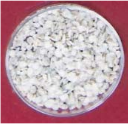
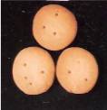
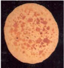

# Sorghum — Agriculture - TNAU production guide
> Auto-extracted from government extension sources by CropBot pipeline. Content is faithful to the source; see front-matter for provenance.
## Main content — Part 1 (pp. 77–78)
## II. PARTICULARS OF SORGHUM VARIETIES

<!-- p. 77 -->

| PARTICULARS          | K 12                             | CO 30                         |
|----------------------|----------------------------------|-------------------------------|
| Year of Release      | 2015                             | 2010                          |
| Year of Notification | SO.1379(E)/ 27.03.2018           | SO.1708(E)/26.07.2012         |
| Parentage            | Derivative of SPV 772 × S 35-29  | Derivative of APK 1 x TNS 291 |
| Duration (Days)      | 95-100                           | 95-105                        |
| Area (Districts)     | Southern districts of Tamil Nadu | All districts                 |
| Season (Pattam)      |                                  |                               |
| Rainfed              | Puratasi                         | Adi,Puratasi                  |
| Irrigated            | Chithirai                        | Thai, Chithirai               |

| Grain yield (kg/ha)   | Grain yield (kg/ha)                                                                                                                                 | Grain yield (kg/ha)                                                                 |
|-----------------------|-----------------------------------------------------------------------------------------------------------------------------------------------------|-------------------------------------------------------------------------------------|
| Rainfed               | 3123                                                                                                                                                | 2400                                                                                |
| Irrigated             | -                                                                                                                                                   | 3360                                                                                |
| Fodder yield (kg/ha)  | Fodder yield (kg/ha)                                                                                                                                | Fodder yield (kg/ha)                                                                |
| Rainfed               | 11900                                                                                                                                               | 7000                                                                                |
| Irrigated             | -                                                                                                                                                   | 9200                                                                                |
| Stalk                 | Juicy                                                                                                                                               | Juicy                                                                               |
| Plant height (cm)     | 225-240                                                                                                                                             | 220-240                                                                             |
| Sheath Colour         | Reddish purple                                                                                                                                      | Tan Green                                                                           |
| Midrib                | White                                                                                                                                               | Dull white                                                                          |
| Earhead shape         | Elongated                                                                                                                                           | Cylindrical                                                                         |
| Compactness           | Semi Compact                                                                                                                                        | Semi Compact                                                                        |
| Grain Colour          | Creamy white                                                                                                                                        | White                                                                               |
| Special features      | Tolerant to drought, photo insensitive, moderately resistant to shoot fly and stem borer, resistant to downy mildew. Suitable for rainfed situation | High dry Matter digestibility, tolerance to shoot fly, grain mould and downy mildew |

## I. SELECTION OF SEEDS

<!-- p. 78 -->

Good quality seeds are to be collected from disease and pest-free fields.

## Quantity of seed required

<!-- p. 78 -->

Irrigated Transplanted - 7.5 kg/ha; Direct sown - 10 kg/ha Rainfed Direct sown - 15 kg/ha Sorghum under irrigated condition is raised both as a direct sown and transplanted crop. Transplanted crop has the following advantages:

- Main field duration is reduced by 10 days.

- Shoot fly, which attacks direct sown crops during the first 3 weeks and which is difficult to control, can be effectively and economically controlled in the nursery itself.

- Seedlings which show chlorotic and downy mildew symptoms can be eliminated, thereby incidence of downy mildew in the main field can be minimised.

- Optimum population can be maintained as only healthy seedlings are used for transplanting.

- Seed rate can also be reduced by 2.5 kg/ha.

## II. NURSERY PRACTICES

<!-- p. 78 -->

## Main content — Part 2 (pp. 80–86)
## Sorghum - Hybrid (1)

<!-- p. 80 -->

Soil

: Red sandy loam (Irugur series)

Target : 4.0 - 5.0 t ha -1

FN = 4.86T - 0.53 SN - 0.98 ON

FP2O5 = 1.63T - 0.87 SP - 0.90 OP

FK2O = 4.56T - 0.59SK - 0.76 OK

|   Initial soil test -1 - SN |   Initial soil test -1 - (kg ha SP |   Initial soil test -1 - values SK | Yield target - 4 t ha -1 NPK (kg ha -1 ) + FYM @ 12.5 t - ha -1 + FN   | Yield target - 4 t ha -1 NPK (kg ha -1 ) + FYM @ 12.5 t - Azospirillum @ 2 kg FP2O5   | Yield target - 4 t ha -1 NPK (kg ha -1 ) + FYM @ 12.5 t - kg ha -1 FK2O   |   Yield target - 5 t ha -1 -1 - NPK (kg ha -1 ha FN |   Yield target - 5 t ha -1 -1 - ha ) + FYM Azospirillum PSB @ 2 FP2O5 | Yield target - 5 t ha -1 -1 - @ 12.5 @ 2 kg ha -1 FK2O   |
|-----------------------------|------------------------------------|------------------------------------|------------------------------------------------------------------------|---------------------------------------------------------------------------------------|---------------------------------------------------------------------------|-----------------------------------------------------|-----------------------------------------------------------------------|----------------------------------------------------------|
|                         160 |                                 12 |                                160 | 58                                                                     | 23                                                                                    | 48                                                                        |                                                 106 |                                                                    39 | 68**                                                     |
|                         180 |                                 14 |                                180 | 47                                                                     | 23*                                                                                   | 36                                                                        |                                                  96 |                                                                    37 | 68**                                                     |
|                         200 |                                 16 |                                200 | 36                                                                     | 23*                                                                                   | 24                                                                        |                                                  85 |                                                                    36 | 68**                                                     |
|                         220 |                                 18 |                                220 | 26                                                                     | 23*                                                                                   | 23*                                                                       |                                                  74 |                                                                    34 | 58                                                       |
|                         240 |                                 20 |                                240 | 45*                                                                    | 23*                                                                                   | 23*                                                                       |                                                  64 |                                                                    32 | 46                                                       |

## Sorghum -Varieties (2)

<!-- p. 81 -->

Soil

: Mixed black calcareous

(Perianaickenpalayam series)

Target : 4.0- 5.0 t ha -1

FN = 6.06T-0.81SN-0.53 ON

FP2O5 = 2.06T-3.14 SP-0.72 OP

FK2O = 5.03T-0.47SK-0.66 OK

|   Initial soil test values (kg ha -1 ) - SN |   Initial soil test values (kg ha -1 ) - SP |   Initial soil test values (kg ha -1 ) - SK | Yield target - 4 t ha -1 - NPK (kg ha -1 ) + FYM @ 12.5 t ha -1 + Azospirillum @ 2 kg ha -1 + PSB @ 2 kg ha -1 - FN   | Yield target - 4 t ha -1 - NPK (kg ha -1 ) + FYM @ 12.5 t ha -1 + Azospirillum @ 2 kg ha -1 + PSB @ 2 kg ha -1 - FP2O5   | Yield target - 4 t ha -1 - NPK (kg ha -1 ) + FYM @ 12.5 t ha -1 + Azospirillum @ 2 kg ha -1 + PSB @ 2 kg ha -1 - FK2O   | Yield target - 5 t ha -1 - NPK (kg ha -1 ) + FYM @ 12.5 t ha -1 + Azospirillum @ 2 kg ha -1 + PSB @ 2 kg ha -1 - FN   | Yield target - 5 t ha -1 - NPK (kg ha -1 ) + FYM @ 12.5 t ha -1 + Azospirillum @ 2 kg ha -1 + PSB @ 2 kg ha -1 - FP2O5   | Yield target - 5 t ha -1 - NPK (kg ha -1 ) + FYM @ 12.5 t ha -1 + Azospirillum @ 2 kg ha -1 + PSB @ 2 kg ha -1 - FK2O   |
|---------------------------------------------|---------------------------------------------|---------------------------------------------|-----------------------------------------------------------------------------------------------------------------------|--------------------------------------------------------------------------------------------------------------------------|-------------------------------------------------------------------------------------------------------------------------|-----------------------------------------------------------------------------------------------------------------------|--------------------------------------------------------------------------------------------------------------------------|-------------------------------------------------------------------------------------------------------------------------|
|                                         180 |                                          12 |                                         300 | 45*                                                                                                                   | 23*                                                                                                                      | 23*                                                                                                                     | 105                                                                                                                   | 33                                                                                                                       | 71                                                                                                                      |
|                                         200 |                                          14 |                                         340 | 45*                                                                                                                   | 23*                                                                                                                      | 23*                                                                                                                     | 89                                                                                                                    | 27                                                                                                                       | 52                                                                                                                      |
|                                         220 |                                          16 |                                         380 | 45*                                                                                                                   | 23*                                                                                                                      | 23*                                                                                                                     | 73                                                                                                                    | 23*                                                                                                                      | 33                                                                                                                      |
|                                         240 |                                          18 |                                         420 | 45*                                                                                                                   | 23*                                                                                                                      | 23*                                                                                                                     | 57                                                                                                                    | 23*                                                                                                                      | 23*                                                                                                                     |
|                                         260 |                                          20 |                                         460 | 45*                                                                                                                   | 23*                                                                                                                      | 23*                                                                                                                     | 45*                                                                                                                   | 23*                                                                                                                      | 23*                                                                                                                     |

Note: FN, FP2O5 and K2O are fertilizer N, P2O5 and K2O in kg ha -1 , respectively; T is the yield target in q ha -1 ; SN, SP and SK respectively are available N,P and K in kg ha -1 and ON, OP and OK are the quantities of N, P and K supplied through organic manure inkg ha -1 .

- In the case of ridge planted crop, open a furrow 5 cm deep on the side of the ridge at two thirds the distance from the top of the ridge and place the fertilizer mixture along the furrow and cover with soil upto 2 cm.

- Soil application of Azospirillum at 10 packets (2 kg/ha) and 10 packets (2000g/ha) of phosphobacteria or 20 packets of Azophos (4000g/ha) after mixing with 25 kg of FYM + 25 kg of soil may be carried out before sowing/planting.

- Apply NPK fertilizers as per soil test recommendations as far as possible. If soil test recommendations are not available, adopt a blanket recommendation of 90 N, 45 P2 O5, 45 2 5 K 2 O kg/ha.

- 5 ii. Apply N @ 50:25:25 % at 0, 15 and 30 DAS and full dose of P2 O5 and K2 O basally before sowing and if basal application is not possible the same could be top dressed within 24 hours.

- In the case of bed planted crop, mark lines to a depth of 5 cm and 45 cm apart. Place the fertilizer mixture at the depth of 5 cm along the lines. Cover the lines upto 2 cm from the top before sowing.

- In the case of sorghum raised as a mixed crop with a pulse crop (Blackgram, Greengram or Cowpea) open furrows 30 cm apart to a depth of 5 cm.

- Apply fertilizer mixture in two lines in which sorghum is to be raised and cover upto 2 cm.

- Skip the third row in which the pulse crop is to be raised and place fertilizer mixture in the next two rows and cover upto 2 cm with soil.

- Application of bio-fertilizers: When Azospirillum is used apply only 75% of recommended N for irrigated sorghum.

- APPLICATION OF MICRONUTRIENTS Transplanted Crop

- Mix 12.5 kg/ha of micronutrient mixture formulated by the Department of Agriculture, Tamil Nadu with enough sand to make a total quantity of 50 kg and apply the mixture over the furrows and on top one third of the ridges (or) TNAU MN mixture @ 12.5 kg ha -1 for irrigated; 7.5 kg for rainfed crop as enriched FYM. Prepare enriched FYM @ 1:10 ratio of MN Mixture & FYM at friable moisture and incubate for one month in shade.

- If micronutrient mixture is not available, mix 25 kg of zinc sulphate with sand to make a total quantity of 50 kg and apply on the furrows and on the top one third of the ridges.

- Mix 12.5 kg of micronutrient mixture formulated by the Department of Agriculture, Tamil Nadu with enough sand to make a total quantity of 50 kg.

- Spread the mixture evenly on the beds.

- Basal application of 25 kg ZnSO4/ha -1 (or) 12.5 kg kg Zn SO4 + 12.5 t/ha FYM for deficient soils.

- Basal application of FeSO4 @ 50 kg/ha along with 12.5 t/ha FYM for iron deficient soils.

- Foliar spraying of 0.5% ZnSO4, 1.0% FeSO4+0.1% citric acid thrice on 30, 40 and 50 DAS if deciciency observed in plants.

## III. MANAGEMENT OF MAIN FIELD Spacing: 45 x 15 cm Population: 15/m 2 1. TRANSPLANTED CROP

<!-- p. 82 -->

- Pull out the seedlings when they are 15 to 18 days old.

- Prepare slurry with 5 packets of Azospirillum (1000g/ha) and 5 packets (1000g/ha) of Phosphobacteria or 10 packets of Azophos (2000 g/ha) in 40 lit. of water and dip the root portion of the seedlings in the solution for 15-30 minutes and transplant.

- Let in water through the furrows

- Plant one seedling per hill

- Plant the seedlings at a depth of 3 to 5 cm.

- Plant the seedlings on the side of the ridge, half the distance from the top of the ridge and the bottom.

## 2. DIRECT SOWN CROP

<!-- p. 82 -->

- In the case of pure crop of sorghum, maintain the seed rate at 10kg/ha.

- In the case of inter crop of sorghum with pulse crop, maintain the seed rate of sorghum at 10 kg/ha and pulse crop at 10 kg/ha.

- In the case of pure crop of sorghum, sow the seeds with a spacing of 15 cm between seeds in the rows which are 45 cm apart.

- Maintain one plant per hill.

- If shootfly attack is there, remove the side shots and retain one healthy shoot.

- Sow the seeds over the lines where fertilizers are placed.

- Sow the seeds at a depth of 2 cm and cover with soil.

- In the case of sorghum intercropped with pulses sow one paired row of sorghum

alternated with a single row of pulses. The spacing between the row of sorghum and pulse crop is 30 cm.

Forage cowpea CO 1 can be intercropped in sorghum at two rows of fodder cowpea in between paired rows of sorghum.

- WEED MANAGEMENT

- Apply PE Atrazine @ 0.25 kg/ha on 3-5 DAS followed by 2,4-D @ 1 kg/ha on 2025 DAS on the soil surface, using Backpack/Knapsack/Rocker sprayer fitted with a flat fan nozzle using 500 litres of water/ha (or) if herbicides are not used, hand weeding twice on 10-15 DAS and 30-35 DAS.

- Apply PE Atrazine@0.25 kg/ha on 3-5 DAS followed by one hand weeding on 30-35 DAS.

- In line sown crop, apply PE Atrazine @ 0.25 kg/ha on 3-5 DAS followed by Twin Wheel hoe weeder weeding on 30-35 DAS.

- In transplanted crop, apply PE Atrazine @ 0.25 kg/ha on 3-5 DAT followed by 2,4-D @ 1 kg/ha on 20-25 DAT.

- If pulse crop is to be raised as an intercrop in sorghum do not use Atrazine, spray PE Pendimethalin @ 0.75 kg/ha on 3-5 DAS

- THINNING OF THE SEEDLINGS AND GAP FILLING Direct sown crop

Thin the seedlings and gap fill with the seedlings thinned out. Maintain a spacing of 15 cm between plants after the first hand weeding. Thin the pulse crop to a spacing of 10 cm between plants for all pulse crop except cowpea, for which spacing is maintained at 20 cm between plants.

- DEFICIENCY SYMPTOMS

Zinc: Deficiency symptoms first appear in the newly formed leaves at 20 to 30 days age. Older leaves have yellow streaks or chlorotic striping between veins. Iron:Interveinal chlorosis will be observed. If the deficiency continues the entire leaf including the veins may exhibit chlorotic symptoms. Newly formed leaves exhibit chlorotic symptoms. The entire crop may exhibit bleached appearance, dry and may die.

- Foliar spraying of 1% FeSO4+0.1% citric acid thrice if deficieny symptom appeared.

- Recommendation given in transplanted crop may be followed.

NOTE:

- Spray only if micronutrient mixture is not applied.

- Apply in case of iron deficiency.

- If soil is calcareous

## IV. WATER MANAGEMENT

<!-- p. 84 -->

Regulate irrigation according to the following growth phase of the crop.

|                 | Transplanted crop   | Direct sown crop   |
|-----------------|---------------------|--------------------|
| Growth phase    | 1 to 40 days        | 1 to 33 days       |
| Flowering phase | 41 to 70 days       | 34 to 65 days      |
| Maturity phase  | 71 to 95 days       | 66 to 95 days      |

| Stages                                    | No. of Irrigation   | Days of Transplanting / Sowing of Crop - Transplanted   | Days of Transplanting / Sowing of Crop - Direct Sown   |
|-------------------------------------------|---------------------|---------------------------------------------------------|--------------------------------------------------------|
| Light Soils                               |                     |                                                         |                                                        |
| i. Irrigate for germination               | 1                   | 1 st day                                                | 1 st day                                               |
| or establishment                          | 2                   | 4 th day                                                | 4 th day                                               |
| Regulate irrigation                       | 1                   | 15 th day                                               | 15 th day                                              |
| during vegetative phase                   | 2                   | 28 th day                                               | 28 th day                                              |
| iii. Flowering phase (copious irrigation) | 1                   | 40 th day                                               | 40 th day                                              |
|                                           | 2                   | 52 nd day                                               | 52 nd day                                              |
|                                           | 3                   | ..                                                      | 64 th day                                              |
| iv. Maturity phase (Control irrigation)   | 1                   | 65 th day                                               | 76 th day                                              |
|                                           | 2                   | ..                                                      | 88 th day                                              |
| v. Stop irrigation thereafter             | ..                  | ..                                                      |                                                        |
| Heavy soils                               |                     |                                                         |                                                        |
| i. Irrigate for germination               | 1                   | 1 st day                                                | 1 st day                                               |
| or establishment                          | 2                   | 4 th day                                                | 4 th day                                               |
| ii. Regulate irrigation                   | 1                   | 17 th day                                               | 17 th day                                              |
| during vegetative phase                   | 2                   | 30 th day                                               | 30 th day                                              |
| iii. Flowering phase (give                | 1                   | 40 th day                                               | 45 th day                                              |
| copious irrigation)                       | 2                   | 52 nd day                                               | 60 th day                                              |
|                                           | 3                   | .. day                                                  | 75 th                                                  |
| iv. Maturity phase (Control irrigation)   | 1                   | 72 nd day day                                           | 90 th                                                  |

NOTE : Adjust irrigation schedule according to the weather conditions and depending upon the receipt of rains. Contingent Plans to be done before 75% of soil moisture is lost from available water. Foliar Spray of 3% Kaolin (30 g in one litre of water) during period of stress will mitigate the ill effects.

## V. HARVESTING AND PROCESSING

<!-- p. 85 -->

- Consider the average duration of the crop and observe the crop. When the crop matures the leaves turn yellow and present a dried up appearance.

- The grains are hard and firm.

- At this stage, harvest the crop by cutting the earheads separately.

- Cut the stalk after a week, allow it to dry and then stack.

- In the case of tall varieties, cut the stem at 10 to 15 cm above ground level and afterwards separate the earheads and stack the stalk.

- Dry the earheads.

- Thresh using a mechanical thresher or by drawing a stone roller over the earheads or by using cattle and dry the produce and store.

## RATOON SORGHUM CROP

<!-- p. 85 -->

## 1. RATOONING TECHNIQUE

<!-- p. 85 -->

- Harvest the main crop leaving 15 cm stubbles.

- Remove the first formed two sprouts from the main crop and allow only the later formed two sprouts to grow. Allow two tillers per hill.

## 2. HOEING AND WEEDING

<!-- p. 85 -->

- Remove the weeds immediately after harvest of the main crop.

- Hoe and weed twice on 15 th and 30 th day after cutting.

## 3. APPLICATION OF FERTILIZERS

<!-- p. 85 -->

- Apply 100 kg N/ha in two split doses.

- Apply the first dose on 15 th day after cutting and the second on 45 th day after cutting.

- Apply 50 kg P2 O5 /ha along with the application of N on 45 th day.

## 4. WATER MANAGEMENT

<!-- p. 85 -->

- Irrigate immediately after cutting the main crop.

- Irrigation should not be delayed for more than 24 hours after cutting.

- Irrigate on 3 rd or 4 th day after cutting.

- Subsequently irrigate once in 7 - 10 days.

- Stop irrigation on 70 - 80 days after ratooning.

## 5. HARVEST

<!-- p. 85 -->

Harvest the crop when the grains turn yellow.

NOTE: The duration of the ratoon crop is about 15 days less than the main crop.

## 1. RAINFALL

<!-- p. 86 -->

Average and well distributed rainfall of 250-300 mm is optimum for rainfed sorghum.

## 2. DISTRIBUTION

<!-- p. 86 -->

Madurai, Dindigul, Theni, Ramanathapuram, Tirunelveli, Thoothukudi, Virudhunagar, Sivagangai, Tiruchirapalli, Erode, Salem, Namakkal, Coimbatore and Dharmapuri Districts.

## 3. SEASON

<!-- p. 86 -->

The crop can be grown in South West and North East monsoon seasons provided the rainfall is evenly distributed.

## Main content — Part 3 (pp. 86–92)
## RAINFED SORGHUM

<!-- p. 86 -->

- phosphobacteria or 20 packets of Azophos (4000 g/ha) with phosphobacteria 2 kg with 25 kg FYM + 25 kg soil.

- iv) The seed is pelletised with 15 g of Chloropyriphos in 150 ml of gum and shade dried.

## 7. SOWING

<!-- p. 87 -->

Sow the seeds well before the onset of monsoon at 5 cm depth (by seed drill or by country plough).

## Pre-monsoon sowing

<!-- p. 87 -->

Sow the hardened seeds at 5 cm depth with seed cum fertilizer drill to ensure uniform depth of sowing and fertilizer application before the onset of monsoon as detailed below:

## District Optimum period

<!-- p. 87 -->

- Coimbatore 37-38th week (II to III week of Sep.)

- Erode 38th week (III week of Sep.)

- Sivaganga 40th week (I week of Oct.)

- Ramanathapuram 40th week (I week of Oct.)

- Thoothukudi 39-40th week (Last week of Sep. to I week of Oct)

- Vellore, Tiruvannamalai 37th-38th week (Sep. II week to Sep. III week)

- Sow the sorghum seeds over the line where the fertilizers are placed.

- Sow the seeds at a depth of 5 cm and cover with the soil.

- Sow the seeds with the spacings of 15 cm in the paired rows spaced 60 cm apart.

- Sow the pulse seeds to fall 10 cm apart in the furrows between the paired rows of sorghum.

## 8. SPACING

<!-- p. 87 -->

45 x 15 cm or 45 x 10 cm.

## 9. FERTILIZER

<!-- p. 87 -->

Apply 12.5 t/ha of Composted Coir pith + NPK at 40:20:0; Apply enriched FYM @ 750 kg/ha. The recommended dose of 40 kg N and 20 kg P2 O5 /ha for rainfed sorghum can be halved if FYM @ 5 t/ha is applied.

Keep sorghum field free of weeds from second week after germination till 5 th week. If sufficient moisture is available spray Atrazine 0.25 kg/ha as pre-emergence application within 3 days after the receipt of the soaking rainfall for sole sorghum and for sorghum based intercropping system with pulses, use Pendimethalin at 0.75 kg/ha.

Under rainfed sorghum intercropped with cowpea as a pre-plant incorporation of isoproturan @ 0.5 kg ha -1 gave good control of weed with applied after 1 st and 2 nd spell of rainfall pendimethalin 1.0 kg ha -1 will be safer for both the crops.

## 11. CROPPING SYSTEM

<!-- p. 88 -->

- The most profitable and remunerative sorghum based cropping system adopted is sorghum with cowpea, redgram, lab-lab, blackgram.

- In rainfed Vertisol, adopt paired row planting in sorghum and sow one row of blackgram/ cowpea in between paired rows of sorghum to have 100% population of sorghum plus 33% population of blackgram/cowpea.

- Intercropping of sunflower CO 1, with the main crop of sorghum CO 26 in 4:2 ratio is recommended under rainfed conditions during North-East monsoon for black soils of CBE.

- Intercropping of soybean with sorghum in the ratio 4:2 is recommended for kharif seasons.

- For sorghum - blackgram intercropping system as well as sole cropping, application of 20 kg N and 20 kg P O /ha through enriched FYM and treating the seeds with Azospirillum is 25 recommended for Aruppukottai region.

- For sorghum (CO 25) + Fodder cowpea (CO 1) intercropping system, application of 20 kg N and 20 kg P O /ha with enriched FYM is recommended for Coimbatore region 25

- The intercropping system, fodder sorghum (K 7) + Fodder cowpea (CO 5) at 3:2 ratio is found profitable for rainfed Vertisols of Aruppukottai.

- Tamarind and Neem trees upto 3-4 years from date of planting form an ideal tree component for agroforestry in black cotton soils of Kovilpatti. Sorghum and blackgram gave higher yield even at 50 per cent of the recommended level of fertilizer application.

- Protect nursery by applying any one of the following insecticides (in 6 litres of water) on 7th and 14th day of sowing

- Methyl demeton 25EC 12 ml

- Dimethoate 30EC 12 ml

- Plough soon after harvest, remove and destroy the stubbles.

- Treat seeds with chlorpyriphos 20EC or phosalone 35 EC (4 ml/kg) or imidacloprid 48FS or imidacloprid 70WS or thiamethoxam 30FS (10 g/kg) before sowing.

- Avoid repeated application of insecticides which may induce resurgence

- The sowing of sorghum should be completed in as short a time as possible to avoid continuous flowering which favours grain midge and earhead bug multiplication in an area.

- Set up light traps till mid night to monitor, attract and kill adults of stem borer, grain midge and earhead caterpillars.

## Economic threshold level (ETL) for important pests

<!-- p. 88 -->

| Insect pest   | ETL                                                                               |
|---------------|-----------------------------------------------------------------------------------|
| Shoot fly     | 1 egg/plant in 10% of plants in the first two weeks of sowing or 10 % dead hearts |
| Mite          | 5 mites/cm 2 of leaf area                                                         |

| Stem borer                                      | 10 % damage                                                                                                                                                                                                                                                                                                                                                                                                                                                                                                                                                                                                                                                                                                                                                                                        |
|-------------------------------------------------|----------------------------------------------------------------------------------------------------------------------------------------------------------------------------------------------------------------------------------------------------------------------------------------------------------------------------------------------------------------------------------------------------------------------------------------------------------------------------------------------------------------------------------------------------------------------------------------------------------------------------------------------------------------------------------------------------------------------------------------------------------------------------------------------------|
| Grain midge                                     | 5 / earhead                                                                                                                                                                                                                                                                                                                                                                                                                                                                                                                                                                                                                                                                                                                                                                                        |
| Earhead caterpillar                             | 2 / earhead                                                                                                                                                                                                                                                                                                                                                                                                                                                                                                                                                                                                                                                                                                                                                                                        |
| Earhead bug                                     | 10 / earhead                                                                                                                                                                                                                                                                                                                                                                                                                                                                                                                                                                                                                                                                                                                                                                                       |
| Shoot fly Atherigona soccata                    | • Take up early sowing of sorghum immediately after the receipt of South West or North East monsoon to minimise shoot fly incidence • In case of direct seeding, use increased seed rate up to 12.5 kg/ha and remove shoot fly damaged seedlings at the time of thinning • In case of trasnsplanting, transplant only healthy seedlings • Spray dimethoate 30EC 12 ml for an area of 120 m 2 nursery • Set up fish meal trap @ 12/ha till the crop is 30 days old • Plough soon after harvest, remove and destroy the stubbles Apply any one of the following/ha • Carbofuran 3CG 33.3 kg (at the time of sowing) • Dimethoate 30EC 500 ml • Neem seed kernel extract 5% • Quinalphos 25EC 1500 ml Spray quinalphos 25EC 1500 ml/ha Direct the spray fluid towards the under surface of the leaves |
| Mite, Oligonychus indicus                       |                                                                                                                                                                                                                                                                                                                                                                                                                                                                                                                                                                                                                                                                                                                                                                                                    |
| Aphids Rhopalosiphum maidis Melanaphis sacchari | Spray dimethoate 30EC 500 ml/ha                                                                                                                                                                                                                                                                                                                                                                                                                                                                                                                                                                                                                                                                                                                                                                    |
| Stem borer, Chilo partellus, Sesamia inferens   | • Sowing lab lab / cowpea as an intercrop to minimize stem borer damage (Sorghum: Lab lab /cowpea 4:1) • Apply carbofuran 3CG 17 kg/ha (with sand) to make up a total quantity of 50 kg/ha and apply in leaf whorls                                                                                                                                                                                                                                                                                                                                                                                                                                                                                                                                                                                |
| Grain midge, Contarinia sorgicola               | • Apply any one of the following/ha on 3rd and 18th day after panicle emergence • Dimethoate 30EC 1650ml • Malathion 50EC 1600 ml • Malathion 5D 25 kg • Neem seed kernel extract 5% • Phosalone 35EC 1150 ml • Phosalone 4D 25 kg                                                                                                                                                                                                                                                                                                                                                                                                                                                                                                                                                                 |
| Earhead bug, Calocoris angustatus               | Apply any one of the following/ha on 3 rd and 18 th day after panicle emergence • Malathion 50EC 1000 ml • Malathion 5D 25 kg • Neem seed kernel extract 5% • Quinalphos 1.5DP 25 kg                                                                                                                                                                                                                                                                                                                                                                                                                                                                                                                                                                                                               |
| Earhead caterpillar, Helicoverpa armigera       | • Set up sex pheromone traps at 12 nos./ha to attract males of Helicoverpa armigera from flowering to grain hardening • Apply NPV at 1.5 X10 12 POB along with crude sugar 2.5 kg + cotton seed kernel powder 250 g on the earheads twice at 10 days interval (preferably during early morning or evening) Apply any one of the following/ha on 3 rd and 18 th day after panicle emergenc                                                                                                                                                                                                                                                                                                                                                                                                          |

|                                | • Malathion 5D 25 kg • Phosalone 4D 25 kg     |
|--------------------------------|-----------------------------------------------|
| Rice weevil, Sitophilus oryzae | • Treat seeds with chlorpyriphos 20EC 4 ml/kg |

Nursery practices

Seed treatment: Treat the seeds 24h prior to sowing with carbendazim or captan or thiram @ 2 g/kg of seeds or metalaxyl @ 6 g/ kg of seeds.

| Name of the Disease                                                                   | Recommendations                                                                                                                                                                                                                                                                        |
|---------------------------------------------------------------------------------------|----------------------------------------------------------------------------------------------------------------------------------------------------------------------------------------------------------------------------------------------------------------------------------------|
| Rust: Puccinia purpurea                                                               | • Spray mancozeb @ 1 kg/ha. Repeat fungicidal application after 10 days                                                                                                                                                                                                                |
| Ergot or Sugary disease: Sphacelia sorghi                                             | • Adjust the sowing period to prevent flowering during rainy and winter seasons • Spray mancozeb @ 1000 g/ha or propiconazole @ 500 ml/ha at 5 - 10% flowering and at 50% flowering stages. Repeat the spray after a week, if necessary                                                |
| Head Mould: Fungal complex Fusarium, Curvularia, Alternaria, Aspergillus and Phomasp. | • Spray mancozeb or captan @ 1000 g + aureofungin sol 100 g/ha in case of intermittent rainfall during earhead emergence and repeat, if necessary a week later                                                                                                                         |
| Downy Mildew: Peronosclerospora sorghi                                                | • Rogue out infected plants up to 45 days of sowing • Spray metalaxyl + mancozeb @ 500 g or mancozeb @ 1000 g/ha after symptom development CIB recommendation • Seed treatment with metalaxyl-M 31.8% ES @ 2 ml/kg of seed or slurry seed treatment with metalaxyl35%WS @ 2 g/ kg seed |
| Charcoal Rot: Macrophomina phaseolina                                                 | • Treat the seeds with Pseudomonas fluorescens @10 g/kg or Trichoderma viride @ 4 g/kg of seed                                                                                                                                                                                         |
| Grain smut : Sphacelotheca sorghi                                                     | CIB recommendation • Treat the seeds with sulphur 80% WP @ 3-4 g/kg seed                                                                                                                                                                                                               |

## SORGHUM - VARIETAL SEED PRODUCTION

<!-- p. 90 -->

- Land should be free of volunteer plants. The previous crop should not be the same variety or other varieties of the same crop. It can be the same variety, if it is certified as per the procedures of certification agency.

- For certified / quality seed production leave a distance of 100 m all around the field from the same and other varieties of the crop.

- The distance may be extended to 400 m for the presence of Johnson grass.

- June - July and October - November.

- Soak the seeds in KH2PO4 2 % for 16 h at of 1:0.6 ratio and dry back the seeds to original seed moisture content (8 - 9 %) under shade. This can be adopted both for the garden and dry land ecosystem.

- Soak the seed in 4% Pseudomonas fluorescens for 12 h at 1 : 1 ratio and dry back the seeds to original seed moisture content under shade.

- As basal application NPK @ 100 : 50 : 50 kg / ha.

- 45 x 10 cm.

- Spray 2 % carbendazim at ten days before harvest against black mould.

- Seeds attain physiological maturity 40 - 45 days after 50 % flowering.

- Harvest the earheads as once over harvest, when the seeds have attained the characteristic yellow colour.

- Thresh the earheads either manually or mechanically at a moisture content of 15 - 18 %.

- Size grade the seeds either with 9 / 64" or depending upon the variety.

- Treat the seeds with carbendazim @ 2 g / kg.

- Treat the seeds with halogen mixture @ 3 g / kg (CaOCl2 + CaCO3 + arappu (Albizzia amara) leaf powder mixed in the ratio of 5:4:1 as eco-friendly treatment.

- Store the seeds in gunny or cloth bags for short term storage (8-9 months) with a seed moisture content of 10 - 12 %.

- Store the seeds in polylined gunny bag for medium term storage (12- 15 months) with a seed moisture content of 8 - 9 %.

- Store the seeds in 700 gauge polythene bag for long term storage (more than 15 months) with a seed moisture content less than 8 %.

## SORGHUM - HYBRID SEED PRODUCTION

<!-- p. 91 -->

- Fertile land with good drainage and irrigation facility.

- Field should not have volunteer plants. Hence, the previous crop should not be the same or different variety / hybrid of sorghum.

- For certified / quality seed production leave a distance of 200 m all around the field from same and other varieties of sorghum.

- For increased seed set and effective synchronization, sow the crop during October - November.

- Sow the female and male parents in the ratio of 4:2 for foundation seed production and 5:2 for certified seed production

- Sow the male parent in four rows around the field for the availability of adequate pollen.

- NPK @ 100: 50: 50 kg / ha.

- Apply NPK @ 50:50:50 kg / ha as basal; 25 kg of nitrogen after first weeding and during boot leaf stage as top dressing.

- Foliar spray of 0.5% FeSO4 at primordial initiation stage and there after two sprays at ten days interval to enhance the seed set.

## Synchronization techniques (Adopt any one of the following)

<!-- p. 92 -->

- Apply 1 % urea at flower initiation to the delayed parent.

- Withhold one irrigation to the advanced parent.

- Staggering the sowing of male and female parents depending upon the hybrid and location.

- Foliar spray of cycocel (CCC) @ 300 ppm to delay the flower formation

- Foliar spray of growth retardant, MH @ 500 ppm at 45 DAS to the advanced parent.

- Harvest the male parent (R line) first and remove from field.

- Harvest the hybrid crop when 90 % of seeds in the earhead have attained the characteristic yellow colour.

## Other management practices

<!-- p. 92 -->

The techniques recommended for varieties can be adapted.

## Main content — Part 4 (pp. 320–322)
## 8. SWEET SORGHUM (Sorghum bicolor)

<!-- p. 320 -->

fertilizer cost.

## 7. RECOMMENDED INM

<!-- p. 321 -->

- � Apply 12.5 tons of FYM/ha at last ploughing.

- � Soil application of Azospirillum @ 10 packets (2.0 kg/ha) after mixing with 25 kg of FYM + 25 kg of soil may be carried out before sowing/planting.

- � 12.5 kg /ha of MN mixture mixed with enough sand to make a total quantity of 50 kg and applied over the furrows and on top 1/3 of the ridges.

- � Apply NPK fertilizers as per soil test recommendations. If soil test recommendation is not available adopt a blanket recommendation of 120 : 40: 40 kg of NPK/ha

## 8. STAGES OF APPLICATION OF FERTILIZERS

<!-- p. 321 -->

- � Apply azospirillum and MN mixtures as basal

- � Apply half dose of N and full dose of P 2O 5 and K 2O basally before sowing.

- � Apply the balance N in two splits of 25% each on 15 th and 30 th day of sowing.

## Downy mildew

<!-- p. 321 -->

- � Rogue downy mildew infected plants up to 45 days after sowing

- � Spray any one of the fungicides like Metalaxyl 500 g or Mancozeb 1000g/ha after noticing the symptoms of foliar diseases, for both transplanted and direct sown crops.

## Leaf diseases: Cercospora leafspot, Rust, Colletotrichum leaf spot

<!-- p. 321 -->

- � Spray Mancozeb @ 1kg/ha. Repeat fungicidal application after 10 days if necessary

## Grain mould

<!-- p. 321 -->

- � Spray any one of the fungicides like Mancozeb @ 1000g/ha in case of intermittent rainfall during earhead emergence and repeat if necessary another spray 10 days later

## Ergot

<!-- p. 321 -->

- � Spray any one of the following fungicide at emergence of earhead (5 - 10% flowering stage) followed by a spray at 50% flowering and repeat the spray after a week if necessary

## PRODUCTION TECHNOLOGY

<!-- p. 322 -->

## Introduction

<!-- p. 322 -->

Tropical sugarbeet (Beta vulgaris spp. Vulgaris var altissima Doll) is a biennial sugar producing tuber crop, grown in temperate countries. This crop constitutes 30% of total world production and distributed in 45 countries. Now tropical sugarbeet hybrids are gaining momentum in tropical and sub tropical countries including Tamil Nadu as a promising energy crop and alternative raw materials for the production of ethanol. Apart from sugar production, the value added products like ethanol can also be extracted from sugarbeet. The ethanol can be blended with petrol or diesel to the extent of 10% and used as bio-fuel. The sugarbeet waste material viz., beet top used as green fodder, beet pulp used as cattle feed and filter cake from industry used as organic manure.

Tropical sugarbeet now emerged as commercial field crop because of the favourable characters like (i) tropical sugarbeet hybrids suitable for Tamil Nadu (ii) Shorter duration of 5 to 6 months (iii) needs moderate water requirement of 60-80 cm. (iv) higher sugar content of 12 - 15% (v) improve soil conditions because of tuber crop and (vi) grow well in saline and alkali soil. The harvesting period of sugarbeet coincides with March - June, the human resource of sugar factory in the off season may efficiently utilized for processing of sugarbeet in the sugar mills, which helps in continuous functioning of sugar mills.

## Hybrids and duration

<!-- p. 322 -->

The tropical sugarbeet hybrids suitable for cultivation in Tamil Nadu are Cauvery, Indus and Shubhra. The duration of these tropical hybrids will be 5 to 6 months depending on climatic conditions prevailing during crop growth period.

## Climate and season

<!-- p. 322 -->

Tropical sugarbeet require good sunshine during its growth period. The crop does not prefer high rainfall as high soil moisture or continuous heavy rain may affect development of tuber and sugar synthesis. Tropical sugarbeet can be sown in SeptemberNovember coincide with North East monsoon with a rainfall of 300 - 350 mm well distributed across the growing period which favours vegetative growth and base for root enlargement. The optimum temperature for germination is 20 - 25 0 C, for growth and development 30 - 35 0 C and for sugar accumulation in 25- 35 0 C.

Tropical sugarbeet is sown in September to November and harvested during March and May.

## Main content — Part 5 (pp. 327–329)
## MULTICUT FODDER SORGHUM (Sorghum bicolour)

<!-- p. 327 -->

| Zone District/Season    | Month                   | Varieties           |
|-------------------------|-------------------------|---------------------|
| Irrigated               |                         |                     |
| All Irrigated districts | Jan - Feb and Apr - May | CO (FS) 29 and CO31 |

## II. PARTICULARS OF MULTICUT FODDER SORGHUM VARIETIES

<!-- p. 327 -->

| PARTICULARS                       | CO (FS) 29                                         | CO 31                                  |
|-----------------------------------|----------------------------------------------------|----------------------------------------|
| Parentage                         | Derivative of the cross TNS 30 x Sorghum sudanense | Gamma ray induced mutant of CO (FS) 29 |
| Duration (Days)                   | Multicut (3 years)                                 | Multicut (3 years)                     |
| Average green fodder yield (t/ha) | 160-170 (6-7 cuts)                                 | 190 (6-7 cuts)                         |
| Morphological characters          |                                                    |                                        |
| Plant height (cm)                 | 260-280                                            | 270 -290                               |
| Number of tillers                 | 10-15                                              | 12-17                                  |
| Number of leaves/stem             | 8-10                                               | 9-11                                   |
| Leaf length (cm)                  | 80-90                                              | 85-95                                  |
| Leaf breadth (cm)                 | 3.5-4.6                                            | 4.5 - 5.0                              |
| Leaf stem ratio                   | 0.2-0.25                                           | 0.26                                   |
| Quality characters                |                                                    |                                        |
| Protein content (%)               | 8.64                                               | 9.86                                   |
| Dry matter (%)                    | 23.60                                              | 25.90                                  |
| Crude fibre (%)                   | 21.00                                              | 19.80                                  |
| IVDMD (%)                         | 50.30                                              | 52                                     |

## B. CROP MANAGEMENT I. GREEN FODDER PRODUCTION IRRIGATED FODDER CHOLAM

<!-- p. 327 -->

## 3 . Sowing

<!-- p. 328 -->

- Seed treatment: Treat the seeds with 3 packets (600 g)/ha of Azospirillum and 3 packets (600g) of Phosphobacteria or Azophos 6 packets (1200g)

- Seed rate: 5 kg/ha

- Spacing: 30 x 10 -15 cm

## 4. Nutrient management

<!-- p. 328 -->

- Spread 25 tonnes/ha of FYM or compost on the unploughed field, along with 10 packets of Azospirillum inoculants (2000 g) and 10 packets of Phosphobacteria (2000g) or 20 packets of Azophos (4000g)

- Apply 45 : 40 : 40 kg N,P, K/ha as basal and 45 kg N as top dressing on 30 DAS followed by the application of 45 kg N/ha after every cut. After 4 th cut, apply 40 kg P and 40 kg K along with 45 kg N to sustain the fodder yield and quality.

- Application of Azospirillum (2000g/ha) and Phosphobacterium (2000g/ha) together as a mixture or Azophos (4000g/ha) along with 75% required dose of N and P fertilizer will enhance the yield besides saving of 25% of fertilizer dose.

Irrigate immediately after sowing. Life irrigation on the third day and thereafter once in 10 days,

First hand weeding on the 20 th day of sowing and if necessary 2 nd hand weeding between 35 - 40 days after sowing. After each harvest a weeding may be given before fertilization.

As per CIB&RC, insecticide is not recommended for the management of pests in fodder crops. No insecticide is registered/label claimed against the pests of fodder crops.

Green fodder should be harvested at 50% flowering stage. First harvest at 65-70 days after sowing and there after the ratoon crop may be harvested once in 50 days depending on flowering.

As green fodder under irrigated conditions, a pure crop yields about 170 to 190 t/ha (6-7 cuts) of green fodder

All types of soil with good drainage. Does not come up well in flooded or waterlogged conditions.

Plough the field twice with an iron plough and three or four times with country plough. Form ridges and furrows using a ridger, 30 cm apart and form beds of size 10 m 2 or 20 m 2 depending on the availability of water and slope of the land.

- Spread FYM or compost at 12.5 t/ha along with 10 packets of Azospirillum (2000 g) and 10 packets of Phosphobacteria (2000g) inoculum or 20 packets of Azophos (4000g) and incorporate the manure into the soil during ploughing.

- Apply NPK fertilizers as per soil test recommendation as for as possible. If soil testing is not done, follow blanket recommendation of 30: 40: 20 kg N, P2O5 and K2 O / ha.

## Main content — Part 6 (pp. 456–457)
## Sorghum Flakes

<!-- p. 456 -->

- ™ Nutritionally superior to rice flakes.

- ™ Ideal breakfast and snack food.

- ™ Simple and low cost processing technique.

- ™ Quick to cook and easily digestible.

- ™ Good source of minerals and fibre.

- ™ Sorghum flakes (100 g) contains 8.6 g protein, 3.7 g fat, 1.5 g fibre, 69 mg calcium and 16 mg iron.

## Samai Biscuits

<!-- p. 456 -->

- ™ Little millet (samai) is a good source of minerals, B vitamins and fibre.

- ™ Fat, iron and niacin content are higher in little millet, than in other cereals.

- ™ Calcium, phosphorus and iron content of samai biscuits are 25.8, 150 and 4.21 mg/100g respectively.

- ™ High in fibre (1.40 %), and is important as health food.

- ™ Has a shelf life of upto nine months.

## Health Mix for Geriatrics

<!-- p. 457 -->

- ™ The health mix designed for the aged was formulated from cereals, millets, pulses, and vegetables.

- ™ In combination with milk powder and jaggery improved nutritional status of selected elderly subjects.

- ™ Significant increase in haemoglobin level.

- ™ The health mix (100 g) furnished 12 g protein, 2 g fat and 482µg β carotene.

## Millet based health food mix

<!-- p. 457 -->

- ™ Can be used for preparing nutritious balls and beverages.

- ™ Easily digestible and good for children and aged persons.

- ™ Health mix (100g) contains 9.75% moisture, 16.61% protein, 3.69% crude fibre, 6.19 % reducing sugar 9.67 % total sugar, 20.68mg calcium, 244.00 mg phosphorous, 5.35 mg, potassium, 7.57 mg iron and 5.32 mg zinc.

- ™ Has good storage stability.

## Khakra

<!-- p. 457 -->

0

- ™ Khakra is Indian flat bread.

- ™ Traditional food of Gujarat, simulating chapathi in terms of product formulation and is further toasted to a moisture content of 5-6%.

- ™ Incorporated with defatted soya flour (25%), the product is a rich source of protein.

- ™ Addition of defatted soya flour increases protein (70%), iron (50%) and calcium (36%)

The product has a shelf life upto 90 days at room temperature.

## Other mentions in this source
### p. 79

Plough the field with an iron plough once (or) twice. Sorghum does not require fine tilth since it adversely affects germination and yield in the case of direct sown crop. To overcome the subsoil hard pan in Alfisols (deep red soils) chiselling the field at 0.5 m intervals to a depth of 40 cm on both the directions of the field followed by disc ploughing once and cultivator ploughing twice help to increase the yield of sorghum and the succeeding crops.
### p. 141

For rainfed Vertisols receiving less than 300 mm of rainfall, Agathi + Sorghum (CO 26) + Cotton (MCU 10) + Blackgram (Co 5) system is ideal. (Agathi in I tier with a spacing of 1 x 1 m - sorghum in II tier with a spacing of 45 x 15 cm - cotton in III tier with the spacing of 45 x 15 cm and Blackgram in IV tier with 30 x 10 cm). For both systems, apply 40 kg N and 20
### p. 165

Cowpea is called the "hungry - season crop" because it is the first crop to be harvested before the cereal crops. Cowpea is tolerant of shading and can be combined with tall cereal plants such as sorghum and maize. It is sensitive to waterlogging, though less than other legumes. High moisture may hinder cowpea crops in the sub - humid tropics due to the many diseases. Frost can damage the plant during flowering period.
### p. 320

Application of inorganic nutrients alone in the long run will lead to soil and environmental pollution. Hence integration organic and inorganic fertilizer will sustain the soil heath and improve the cane yield of the sweet sorghum crop.
### p. 355

Mother spawn is nothing but the mushroom fungus grown on a grain based medium. Among the several substrate materials tested by TNAU, Coimbatore, sorghum grains are the best substrate for excellent growth of the fungus. Well-filled, disease-free sorghum grains are used as substrate for growing the spawn materials. The various steps involving in preparation of mother spawn are listed below here under.
### p. 355

The sorghum grains are washed in water thoroughly to remove chaffy and damaged grains.
### p. 359

Crop residues are the plant parts that are left in the field after harvest. The harvest refuses include straws, stubble, stover and haulms of different crops. Crop remains are also from thrashing sheds or that are discarded during crop processing. This includes process wastes like groundnut shell, oil cakes, rice husks and cobs of maize, sorghum and cumbu. The greatest potential as a biomass resource appears to be from the field residues of sorghum, maize, soybean, cotton, sugarcane etc. In Tamil Nadu 190 lakh tonnes of crop residues are available for use. These residues will contribute 1.0 lakh ton of nitrogen, 0.5 lakh ton of phosphorus and 2.0 lakh tons of potassium. However crop residues need composting before being used as manure.
### p. 400

Integration of 0.32 ha each of sorghum + red gram - sunflower + coriander, maize + fodder cowpea - cotton + coriander and perennial fodder CO3 grass + legume fodder (Lucerne) with dairy (6 cows + 4 calves), biogas (2 m 3 capacity) and mushroom (2 kg day -1 ) + spawn production (10 bottles day -1 ) recorded higher productivity than the cropping alone with sorghum - cotton (0.50 ha) and maize - cotton (0.50 ha) cropping systems. Cropping + dairy + biogas + fish + mushroom integration recorded the highest gross, net and per day returns. It also registered the highest benefit cost ratio of 2.41 during 2000-2001.
### p. 400

Integrated farming system model involving crop + tree + goat was taken from 19992001. Experimental results on integrated farming system revealed that (i) integration of sorghum + cowpea (grain), sorghum + cowpea (fodder) and C. glaucus each in 0.33 ha intercropped in E. officinalis with Tellichery goat component (5+1) in 0.01 ha resulted in higher productivity, economic returns and provided better employment opportunity and improved soil fertility than raising sole sorghum alone (ii) coir pith mulching and pitcher irrigation increased the tree seedling growth than the control, (iii) tied ridges conserved more moisture and improved the productivity of the crops, (iv) application of 50 per cent N through fertilizer and 50 per cent N through goat manure increased the productivity, enhanced the soil fertility and provided better opportunity for recycling of manure to the crops. Results of on-farm field experiments conducted during 2009 - 2011, revealed that, integration of Cenchrus setigerus + Stylosanthes hamata and fodder sorghum + Pillipesara with sheep (5+1) and buffalo (2 No.'s) could be the best silvipastoral farming system with the application of recommended dose of 25: 45: 19 kg ha -1 NPK for Cenchrus based system and 30: 20: 10 kg ha -1 NPK for fodder sorghum based system along with FYM (10 t ha -1 ) for dry land of Western Zone of Tamil Nadu.
### p. 402

To identify suitable integrated farming for the dry lands, experiments were conducted at Regional Research Station, Aruppukottai and Agricultural Research Station, Kovilpatti. In the rainfed black soils, the common crops are sorghum, pulses, cotton and sunflower. Introduction of tree legumes like subabul, Acacia senegal and Prosopis cineraria and perennial fodder grass Cenchrus ciliaris and inclusion of goat rearing were evaluated at Regional Research Station, Aruppukottai. Five female and one male goat of Tellicherry breed were raised in deep litter system. The results revealed that the IFS yielded an additional income of Rs.2163 to Rs.2556 per year from a farm area of 1.6 ha. In another study at Aruppukottai proved the IFS system of crop + horticulture + goat proven to be successful in the black soils and increased the profit by Rs.2363 to Rs.4706 per ha over cropping alone. At Agricultural Research Station, Kovilpatti, studies were taken in farmers' holdings in the dryland red soils. IFS with crop+goat yielded an annual income of Rs.8410 per ha compared to Rs.4654 per ha under traditional cropping alone.
### p. 411

Crops tested maize sunflower and sorghum
### p. 425

Water balance study was conducted for Tamil Nadu based on the Water Requirement Satisfaction Index (WRSI). It is suggested that sorghum can be sown during 36 th Std week against 16 th Std week. The data from the Table indicate that if it is sown during 16 th Std week, the crop may suffer with soil moisture stress. This result is valid for sorghum crop for Manapparai Taluk sowing by 36 th standard week is recommended.
### p. 429

Virudhunagar Aruppukottai Sorghum Black 36
### p. 429

Virudhunagar Rajapalayam Sorghum Black 36
### p. 429

Virudhunagar Sattur Sorghum Black 36
### p. 429

Virudhunagar Srivilliputtur Sorghum Black 36
### p. 429

Virudhunagar Tiruchuli Sorghum Black 36
### p. 429

Virudhunagar Virudhunagar Sorghum Black 36
### p. 429

Virudhunagar Aruppukottai Sorghum Black 37
### p. 429

Virudhunagar Rajapalayam Sorghum Black 37
### p. 429

Virudhunagar Sattur Sorghum Black 37
### p. 429

Virudhunagar Srivilliputtur Sorghum Black 37
### p. 429

Virudhunagar Tiruchuli Sorghum Black 37
### p. 429

Virudhunagar Virudhunagar Sorghum Black 37
### p. 429

Virudhunagar Aruppukottai Sorghum Black 38
### p. 429

Virudhunagar Rajapalayam Sorghum Black 38
### p. 429

Virudhunagar Sattur Sorghum Black 38
### p. 429

Virudhunagar Srivilliputtur Sorghum Black 38
### p. 429

Virudhunagar Tiruchuli Sorghum Black 38
### p. 429

Virudhunagar Virudhunagar Sorghum Black 38
### p. 429

Virudhunagar Aruppukottai Sorghum Black 39
### p. 429

Virudhunagar Rajapalayam Sorghum Black 39
### p. 429

Virudhunagar Sattur Sorghum Black 39
### p. 429

Virudhunagar Srivilliputtur Sorghum Black 39
### p. 429

Virudhunagar Tiruchuli Sorghum Black 39
### p. 429

Virudhunagar Virudhunagar Sorghum Black 39
### p. 429

Virudhunagar Aruppukottai Sorghum Red 36
### p. 429

Virudhunagar Rajapalayam Sorghum Red 36
### p. 429

Virudhunagar Sattur Sorghum Red 36
### p. 429

Virudhunagar Srivilliputtur Sorghum Red 36
### p. 429

Virudhunagar Tiruchuli Sorghum Red 36
### p. 429

Virudhunagar Virudhunagar Sorghum Red 36
### p. 429

Virudhunagar Aruppukottai Sorghum Red 37
### p. 429

Virudhunagar Rajapalayam Sorghum Red 37
### p. 429

Virudhunagar Sattur Sorghum Red 37
### p. 429

Virudhunagar Srivilliputtur Sorghum Red 37
### p. 429

Virudhunagar Tiruchuli Sorghum Red 37
### p. 429

Virudhunagar Virudhunagar Sorghum Red 37
### p. 429

Virudhunagar Aruppukottai Sorghum Red
### p. 429

Virudhunagar Rajapalayam Sorghum Red
### p. 429

Virudhunagar Sattur Sorghum Red
### p. 429

Virudhunagar Srivilliputtur Sorghum Red
### p. 429

Virudhunagar Tiruchuli Sorghum Red
### p. 430

Virudhunagar Virudhunagar Sorghum Red
### p. 430

Virudhunagar Aruppukottai Sorghum Red
### p. 430

Virudhunagar Rajapalayam Sorghum Red
### p. 430

Virudhunagar Sattur Sorghum Red
### p. 430

Virudhunagar Srivilliputtur Sorghum Red
### p. 430

Virudhunagar Tiruchuli Sorghum Red
### p. 430

Virudhunagar Virudhunagar Sorghum Red
### p. 431

Sowing of sorghum variety CSV15 before the receipt of monsoon rainfall (Premonsoon sowing) is recommended with 60:30:0 kg NPK / ha during above average rainfall year and 40:20:0 Kg NPK / ha during below average rainfall year. The result is applicable when seasonal climate forecast information is available in advance.
### p. 431

Technical feasibility of introducing new irrigated cropping system of Greengram - Maize - Sunflower against the outdated cropping system of Cotton - Sorghum - Finger millet of western agro climatic zone of Tamil Nadu
### p. 435

Analysis on the maize crop yield indicated reduction in yield by 3.0, 9.3 and 18.3 per cent respectively during 2020, 2050 and 2080 from the current yield levels in the major maize growing districts of Tamil Nadu with increase in minimum temperature. Sorghum crop yield is expected to decline by 4.5, 11.2 and 18.7 per cent during 2020,
### p. 436

2050 and 2080 from the current yield levels if no management intervention is made in the major sorghum growing districts of Tamil Nadu. This is due to nighttime temperature increase.
