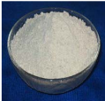
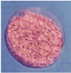
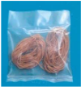

# Soybean — Agriculture - TNAU production guide
> Auto-extracted from government extension sources by CropBot pipeline. Content is faithful to the source; see front-matter for provenance.
## Main content — Part 1 (pp. 185–187)
## (ix) SOYABEAN (Glycine max (L.) Merr.)

<!-- p. 185 -->

|   T_Max o C |   T_Min o C | Optimum o C   | Rainfall mm   |   Altitude m MSL |
|-------------|-------------|---------------|---------------|------------------|
|          40 |          10 | 25 - 32       | 600 - 750     |             2000 |

Tropical and subtropical warm and moist climate. Short day plant. It can withstand short periods of waterlogging and short drought.

## 1. SEASON AND VARIETIES

<!-- p. 185 -->

| DISTRICT/SEASON                                                                                  | VARIETIES   |
|--------------------------------------------------------------------------------------------------|-------------|
| Adipattam (June - July) Purattasipattam (Sep. - Oct.) Masipattam (February - March) Rice fallows | Co(Soy)3    |

## II. Description of soybean varieties

<!-- p. 185 -->

| Particulars          | Co (Soy) 3                          |
|----------------------|-------------------------------------|
| Year of Release      | 2005                                |
| Year of Notification | SO.599(E)/25.04.2006                |
| Parentage            | Cross derivative of UGM 69 x JS 335 |
| 50% flowering        | 39 - 41 days                        |
| Duration (days)      | 90-100                              |
| Grain yield (Kg/ha)  |                                     |
| Rainfed              | -                                   |
| Irrigated            | 1700                                |
| Height (cm)          | 53.5                                |
| Branches             | 5 - 6                               |
| Flower colour        | Pink                                |
| Colour of grain      | Creamy yellow with brown hilum      |
| 100 seed weight (g)  | 10.95 - 11.75                       |

- Treat the seeds with Carbendezim or Thiram @ 2g/kg of seed 24hrs before sowing or with talc formulation of Trichoderma viride @ 4 g/kg seed (or) Pseudomonas fluorescens @ 10 g/kg seed.

- Biocontrol agents are compatible with biofertilizers.

- First treat the seeds with biocontrol agents and then with Rhizobium.

- Fungicides and biocontrol agents are incompatible.

- Coat the seeds with ZnSO4 @ 300 mg/kg using 10% maida solution as adhesive (250 ml/ kg) or gruel and arappu leaf powder (250 g/kg) as carrier to increase

the field stand.

- Treat the seeds atleast 24 hours before sowing.

Treat the seeds with 3 packets (600 g/ha) of Rhizobial culture (COS-1) and 3 packets (600 g/ha) of Phosphobacteria developed at TNAU using rice kanji as binder. If the seed treatment is not carried out apply 10 packets of Rhizobium (2000 g/ha) and 10 packets (2000 g) of Phosphobacteria with 25 kg of FYM and 25 kg of soil before sowing. Dry the bacterial culture treated seeds in shade for 15 minutes before sowing.

- Apply 20 kg N and 80 kg P2 O5 and 40 kg K2 O per ha 40 kg of S as gypsum (220 kg/ha) as basal dressing. Soil application of 25 kg ZnSO4, 25 kg MnSO4/ha under irrigated condition if the soil is deficient.

- ii) Foliar spray of NAA 40 mg/litre and Salicylic acid 100 mg/litre once at preflowering and another at 15 days thereafter

- iii). Foliar spray of DAP 20 g/litre or urea 20 g/litre once at flowering and another at 15 days thereafter

- iv). Foliar spraying of 1% FeSO4 + 0.1% citric acid thrice at 7-10 days interval.

Dibble the seeds at a depth of 2 - 3 cm adopting a spacing of 30 x 5 cm. In Erode district, Soybean + Castor (60 cm apart) cropping system gives high net return.

Irrigate immediately after sowing. Give life irrigation on 3 rd day. Further irrigation at intervals of 7 - 10 and 10 - 15 days during summer and winter season respectively to be given depending on soil and weather conditions. Soyabean is very sensitive to excess moisture and the crop is affected, if water stagnates in the fields. The crop should not suffer due to water stress from flowering to maturity. To alleviate moisture stress spray of either Kaolin 3% or liquid paraffin at 1% on the foliage. In Erode district cultivate Soybean + Castor with irrigation at 0.60 IW/CPE ratio (once in 10 to 12 days) is recommended.

- Pendimethalin 1.0 litre /ha after sowing followed by one hand weeding on 30 days after sowing. ii) If herbicide spray is not given two hand weedings on 20 and 35 days after sowing may be given.

- iii) Early Post emergence application of Imazythypur @ 50 g / ha may be applied as post emergence on 20 DAS with one hand weeding on 30 days after sowing.

## 8 HARVESTING

<!-- p. 186 -->

Yellowing of leaves and shedding, indicate the maturity of the crop. Cut the entire plant when most of the pods have turned yellow, drying and processing.

## i. VARIETIES

<!-- p. 187 -->

CO 1

## ii. SEASON

<!-- p. 187 -->

The crop can be grown in South-West and North-East monsoon seasons. The middle of July is the optimum time of sowing for rainfed Soyabean in North Western Zone.

## 3. SEED TREATMENT WITH THE FUNGICIDES AND BIOFERTILIZERS

<!-- p. 187 -->

- Treat the seeds with Carbendezim or Thiram @ 2g/kg of seed 24hrs before sowing or with talc formulation of Trichoderma viride @ 4 g/kg seed or Pseudomonas fluorescens @ 10 g/kg seed.

- Biocontrol agents are compatible with biofertilizers.

- First treat the seeds with biocontrol agents and then with Rhizobium.

- Fungicides and biocontrol agents are incompatible.

- Treat the seeds required for ha. with three pockets of Rhizobium and 3 packets of Phosphobacteria

- Apply NPK as per soil test recommendation as far as possible. If soil test recommendation is not available adopt blanket recommendation of 20:40:20:20 NPKS kg/ha, if adequate moisture is available.

- ii) Apply entire dose of N, P, K and S as basal.

Adopt a spacing of 30 cm between rows and 5 cm between plants in the row.

## 6. SOWING

<!-- p. 187 -->

Dibble or drill the seeds.

- If sufficient moisture is available, Pendimethalin 1.0 litre/ha after sowing followed by one hand weeding on 30 days after sowing.

- ii) If herbicide spray is not given, two hand weeding on 20 and 35th day after

## Main content — Part 2 (pp. 187–190)
## RAINFED SOYABEAN

<!-- p. 187 -->

sowing.

- iii) Early Post emergence application of Imazythypur @ 40 g ai/ha applied as per amergence on 20 days after sowing with one hand weeding on 30 DAS.

| Spodoptera, Helicoverpa, Spilosoma, Semilooper, Leaf miner, Stem fly   | Bacillus thuringiensis var. Kurstaki, Bio-tech. International @ 500-750 g/ha Chlorantraniliprole 18.5% SC @150 ml/ha Ethion 50% EC @1500ml/ha Flubendiamide 39.35% SC 150ml/ha Indoxacarb 15.8%EC 330ml/ha Profenophos 50%EC 1.0 l/ha Spinetorum 11.7% SC 450ml/ha   |
|------------------------------------------------------------------------|----------------------------------------------------------------------------------------------------------------------------------------------------------------------------------------------------------------------------------------------------------------------|
| Girdle beetle                                                          | Profenophos 50%EC 1.0 l/ha Thiacloprid 21.7% SC750ml/ha                                                                                                                                                                                                              |
| Leaf weevil                                                            | Malathion 50% EC @1500ml/ha Quinalphos 1.5DP 16kg/ha Quinalphos 25%EC 1.0 l/ha                                                                                                                                                                                       |

Seed treatment: Treat the seeds with T. asperellum @ 4 g or P. fluorescen s@ 10 g/kg or carbendazim @ 2 g/kg or thiram @ 4 g/kg of seeds

| Disease                                                                                                            | Recommendations                                                                                                                                                                                                            |
|--------------------------------------------------------------------------------------------------------------------|----------------------------------------------------------------------------------------------------------------------------------------------------------------------------------------------------------------------------|
| Rust: Phakopspora pachyrhizi                                                                                       | Spray triadimefon @ 0.1 % or propiconazole @ 0.1% or hexaconazole @ 0.1% at flowering stage or at the onset of disease                                                                                                     |
| Virus diseases Yellow mosaic (Gemini virus) (Vector -Bemisia tabaci) Bud blight (Ilarvirus) (Vector- Thrips palmi) | • Rogue out the virus infected plants up to 30 days • Two sprays with thiamethoxam 25 WG @ 100 g/ha or methyl demeton @ 800 ml/ha or imidacloprid 17.8 SL @ 250 ml/ha at 30 and 45 days after sowing to control the vector |

## SOYABEAN - SEED PRODUCTION VARIETAL SEED PRODUCTION

<!-- p. 188 -->

- Land should be free of volunteer plants. The previous crop should not be of the same variety or other varieties of the same crop. It can be of the same variety if it is certified as per the procedures of certification agency.

- For certified / quality seed production leave a distance of 3 m all around the field from the same and other varieties of the crop.

- Harvest the pods as they turn yellow in colour.

- Thresh the pods either manually or mechanically using pliable bamboo sticks.

- Grade the seeds using 14 / 64" or 12 / 64" sieves based on the varieties.

- Dry the seeds to 7- 8 % moisture content.

- Treat with carbendazim @ 2 g / kg of seed along with carbaryl @ 200 mg / kg of seed.

- Treat seeds with halogen mixture (CaOCl2 + CaCO3 + arappu (Albizzia amara) leaf powder mixed in the ratio of 5:4:1 @ 3 g / kg as eco-friendly treatment.

- Store the seeds with a seed moisture content of 10 - 12 % in gunny or cloth bags for short term storage (8 - 9 months).

- Store the seeds with a seed moisture content of 8 - 10 % in polylined gunny bag for medium term storage (12 - 15 months).

- Store the seeds with a seed moisture content less than 7 % in 700 gauge polythene bag for long term storage (more than15 months).

## CLIMATE RQUIREMENT

<!-- p. 190 -->

|   T_Max o C |   T_Min o C | Optimum o C   | Rainfall mm   |   Altitude m MSL |
|-------------|-------------|---------------|---------------|------------------|
|          38 |          10 | 15 - 30       | 700 - 4200    |             1500 |

Tropical and subtropical warm and moist climate. It is widely cultivated in the humid tropics.tolerates salinity and waterlogging. This crop can grow in light shade under trees to serve as a nitrogen - fixing cover crop.

Sword bean SBS 1 is an introduction and is one of the vegetables with photoinsensitivity. It matures in 110 - 120 days. It can be grown throughout the year and gives good response to irrigation. Tender pods are ready for harvest from 75 days after sowing. As a pure crop it gives an average grain yield of 1356 kg/ha and green pod yield of 7500 kg/ha. This can also be grown as border crop, intercrop and a shade crop.

## I. SEASON

<!-- p. 190 -->

June - July (Rainfed), September - October (Rabi), February - March (Summer).

## II. DESCRIPTION OF VARIETY - SBS 1

<!-- p. 190 -->

Year of release

1990

Plant habit Dwarf, erect, bushy

Pigmentation Green

Branches (No)

4 - 6

Inflorescence Axillary raceme

Flower Bold, light purple

Pods Long, pendulous, green, flat and fleshy (for vegetable use).

100 seed weight (g)

Becomes very hard on maturity.

131.6

Seed colour Milky white

Days to 50% bloom

45 - 50

Salient features Early duration (110 - 120 days) Vegetable cum grain crop Free from beany odour Highly nutritious and delicious (25.9% protein) No major pests and diseases

## Main content — Part 3 (pp. 457–458)
## Puffed Soya

<!-- p. 457 -->

- ™ Puffing of soya reduces antinutrients and improves bioavailability of nutrients.

- ™ Rich source of protein.

- ™ Easily digestible and ideal protein source for vulnerable groups.

- ™ Provides 32%protein.

- ™ Low moisture content (6%).

- ™ Has storage stability upto two months.

## Okara Mix

<!-- p. 458 -->

## Soya milk Fruit Juice

<!-- p. 458 -->

- ™ Blending fruit juice and soya milk improves nutritive value and sensory quality.

- ™ Rose and mango flavoured soya milk is highly acceptable.

- ™ Contains 4 g protein, 2 g fat, 78 mg calcium, 21 mg phosphorous and 1.5 mg iron per 100 g of the fruit blended soya milk.

- ™ Has a shelf life of 15 days under refrigerated condition. Best used in nutrition intervention programmes for the vulnerable groups.

## Extruded products from texturised soya protein

<!-- p. 458 -->

- ™ Extruded products (noodles) incorporated with texturised soya protein are richin protein.

- ™ Addition of tomato juice further improved the quality of the noodles.

- ™ Has good sensory appeal

- ™ Texturised vegetable protein incorporated noodles is suitable for children.

Texturised soya noodles contains 20.3 g protein and 72 mg calcium

## Millet based value added products

<!-- p. 458 -->

- ™ Millets are miles ahead of rice and wheat in terms of their nutritional content. Millets are good source of minerals and dietary fibre.

- ™ The nutrients present in the millets have the capacity for reducing the risk of life style diseases.

- ™ Due to urbanization, climatic changes, erratic rainfall etc, the farmers are forced to seek alternative crops for rice.

- ™ Forecasting the future need of our country millet based products like multigrain adai mix, multipurpose snack mix, health mix, samosa mix, karasev mix, pongal mix, priyani mix, flakes etc., were developed.

- ™ The processed millet based products has six months shelf life and it suits the convenience seeking farmers.

- ™ Okara is a by-product obtained during the processing of soy milk.

- ™ Cheap source of protein and can be used to enrich traditional food products.

- ™ Fresh okara contains 80% moisture, 13.7% protein, 1.5% fat, 4 % carbohydrate and 2% fibre.

- ™ The processed okara in the ready to use form finds application in the preparation of traditional foods, bakery and confectionery products.

- ™ Okara mix has a shelf life of 4 months.

## Other mentions in this source
### p. 88

Intercropping of soybean with sorghum in the ratio 4:2 is recommended for kharif seasons.
### p. 112

Rotation with legumes like greengram / blackgram / field bean / soybean / horse gram or ground nut in southern state will minimize inorganic fertilizer application and also sustain higher yields.
### p. 283

Intercropping with pulses viz., cowpea, greengram, blackgram, soybean and maize reduces the bollworm incidence and population of sucking pests of cotton, viz., aphid and leafhopper with the highest activity of natural enemies viz., spiders and predatory lady bird beetles.
### p. 304

In areas of adequate irrigation, sow one row of soybean or blackgram or greengram along the centre of the ridge on the 3rd day of planting. Intercropping of daincha or sunhemp along ridges and incorporation of the same on the 45 th day during partial earthing up helps to increase the soil fertility, and also the cane yield.
### p. 305

Premergence application of Thiobencarb @ 1.25 kg ai/ha under intercropping system in Sugarcane with Soybean, blackgram or groundnut gives effective weed control. Raising intercrops is not found to affect the cane yield and quality.
### p. 359

Crop residues are the plant parts that are left in the field after harvest. The harvest refuses include straws, stubble, stover and haulms of different crops. Crop remains are also from thrashing sheds or that are discarded during crop processing. This includes process wastes like groundnut shell, oil cakes, rice husks and cobs of maize, sorghum and cumbu. The greatest potential as a biomass resource appears to be from the field residues of sorghum, maize, soybean, cotton, sugarcane etc. In Tamil Nadu 190 lakh tonnes of crop residues are available for use. These residues will contribute 1.0 lakh ton of nitrogen, 0.5 lakh ton of phosphorus and 2.0 lakh tons of potassium. However crop residues need composting before being used as manure.
### p. 372

Treated distillery effluent contains nitrogen 1200 mg L -1 , phosphate 500 mg L -1 , potash 12000 mg L -1 , calcium 1800 mg L -1 and iron 300 mg L -1 . Since the effluent has higher dissolved salts, 50 times diluted effluent can be irrigated to sugarcane, banana, ragi, sunflower, grasses, cotton and soybean.
### p. 379

Apply soya flour twice @ 5g / kg of shoots on first day of first feeding during fourth and fifth instars during first feeding.
### p. 399

To enhance and sustain the productivity, economic returns, employment generation for the family labour round the year and soil fertility with environmental protection, integration of rice-gingelly- maize and rice- soybean -sunflower cropping each in 0.45 ha with recycled poultry manure as fish pond silt to rice and 75 per cent of the recommended NPK to each crop in the system + poultry (50 layers) + fish (1000 polyculture fingerlings in 0.10 ha of ponded water) comprising catla (20 per cent), silver carp (20 per cent), rohu (20 per cent), mrigal (15 per cent), common carp (15 per cent) and grass carp (10 per cent) fed with poultry dropping + oyster mushroom (5kg/day) for the lowland farmers having one hectare farm.
### p. 402

Evaluation of integrated farming system for wetland farms was conducted during 1990-92. The components of the traditional and integrated farming systems are as follows: Traditional system (1 ha) : Rice - Rice - Fallow Integrated farming system (1 ha) : Crop + dairy + fishery 0.4 ha : Rice-rice + soybean (bund) - blackgram 0.2 ha : Ragi + sunflower (border) - fodder maize + cowpea - cotton + Greengram 0.2 ha : Bajra napier hybrid fodder grass 0.1 ha : Desmanthus 0.04 ha : Fish pond 0.06 ha : Cattle shed for 3 jersey cows and 2 work bullocks The integrated farming system provided a net income of Rs.25,215/- which was 100.7 per cent more than the income from the traditional rice farming (Rs.12,662/-
### p. 457

™ Incorporated with defatted soya flour (25%), the product is a rich source of protein.
### p. 457

™ Addition of defatted soya flour increases protein (70%), iron (50%) and calcium (36%)
