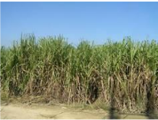
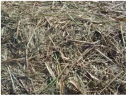
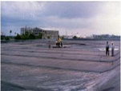
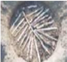
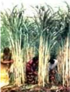
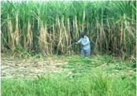
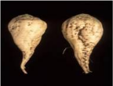

# Sugarcane — Field Crops (Rabi) - ICAR e-course
> Auto-extracted from government extension sources by CropBot pipeline. Content is faithful to the source; see front-matter for provenance.
## Main content — Part 1 (pp. 87–97)
## Role of sugarcane in Indian economy

<!-- p. 87 -->

India is the fourth largest economy in the world, next to US, China and Japan. The contributions of the above four countries to the world GDP are US - 21.1%, China - 12.1%, Japan - 7% and India - 5.7%. Sugar industry is the second largest in the country after cotton textiles and contributes around 6% of the Agricultural GDP. Indian sugar industry contributes substantially to the rural economy as the sugar mills are located in rural areas and employ rural folk to a large extent. Sugar industry by-products viz., molasses and bagasse support other industries. Molasses is the cheapest feedstock for the distilleries. The bagasse has been accepted as a viable alternative raw material to wood in the paper and pulp industry. During the recent past, Government initiatives to encourage alternate renewable sources of energy have motivated most of the sugar mills to install cogeneration plants using bagasse as fuel with highpressure boilers, efficient condensers and waste heat recovery systems. The installed capacity of cogeneration plants is around 1500 MW and the potential has been estimated to be 5000 MW.

## Sugarbeet

<!-- p. 87 -->

## Economic Importance

<!-- p. 87 -->

Sugar : 45% world total sugar production

Bio- fuel : 10% Ethanol blending

Economics : Rs.10,000 crores foreign exchange saving / year

## Multiple uses of sugarcane based products / byproducts

<!-- p. 88 -->

|   S. No. | Product / byproduct   | Uses                                                                        |
|----------|-----------------------|-----------------------------------------------------------------------------|
|       1. | Sugar Gur Khandsari   | Domestic consumption Confectionaries Pharmaceuticals Biodegradable polymers |
|       2. | Molasses              | Industrial alcohol Cattle feed                                              |
|       3. | Bagasse               | Fuel Co generation of electricity Paper and paper boards                    |
|       4. | Bagasse ash(fly ash)  | Chemical Industry Special types of glasses                                  |
|       5. | Cane trash            | Manure Fodder                                                               |
|       6. | Press mud             | Manure Wax industry                                                         |
|       7. | Cane tops             | Fodder                                                                      |
|       8. | Stubbles              | Fuel in rural ovens                                                         |

- Sugarcane is the _______most important industrial crop in the country India

- First

- Third

- Second

- In India, the productivity of sugarcane is highest in the state

- Punjab

- Karnataka c. None

- The most cultivated sugar crop of the world is __________

- Sorghum

- Sugarbeet

- Sugarcane

- Sugarcane seed sets essentially have _____buds

- 1

- 2

- 3

- Molasses is used for _____ preparation.

- Alcohol

- Fuel

- Fertilizer

*****☺*****

## Introduction

<!-- p. 90 -->

Sugarcane is an industrial crop with acreage of about 4 million hectares and production to the tune of 300 million tonnes in India. It provides employment to over a million people directly or indirectly besides contributing significantly to the national exchequer. In commercial agriculture, the cane is subjected to various weather conditions and stresses. In Indian subtropics erratic availability of moisture and frequent occurrence of red rot disease severely impair the productivity of cane. Sugarcane is an industrial crop with acreage of about 4 million hectares and production to the tune of 300 million tonnes in India. It provides employment to over a million people directly or indirectly besides contributing significantly to the national exchequer. In commercial agriculture, cane is subjected to various weather conditions and stresses. In the Indian subtropics erratic availability of moisture and frequent occurrence of red rot disease severely impair the productivity of cane.

-  62% world's sugar is met from cane

-  Sugar requirement is projected at 150 million tonnes for the world

-  India alone requires 16-20 million t

-  Sugar industry is the largest agro-based industry next only to textiles in India

-  At present there are 450 sugar factories

-  Average productivity is 14.2 million t (1998)

-  Average sugar recovery of 11%

## By products in sugarcane industry

<!-- p. 90 -->

-  There are many end uses - probably more than 150

-  But many of them are of negligible economic interest

-  38 end-products are potentially important

-  But four main byproducts of the sugarcane are:

## Lecture 15 Saccharum officinarum

<!-- p. 90 -->

- o Cane tops

- o Bagasse

- o Filter mud / press mud and Spent Wash

- o Molasses

##  Cane tops

<!-- p. 91 -->

- o Cane tops have no real market value

- o They can be compared to fair quality fodder with an average feed value,

- o when fresh, of about 2.8 MJ of metabolizable energy per kilo of dry matter.

- o However cane tops should be collected and transported from the cane fields to the feedlot

##  Bagasse

<!-- p. 91 -->

- o It is the fibrous residue of the cane stalk left after crushing and extraction of the juice

-  It consists of fibres, water and relatively small quantities of soluble solids - mostly sugar

- o Utilizations are:

-  Electricity

-  Particle board

-  Paper

-  Furfural

-  It is a colorless, inflammable, volatile, aromatic liquid

-  25 tonnes of bagasse to produce 1 tonne of furfural

-  Furfural has many industrial uses:

-  Selective solvent for the refining of lubricating oils

-  As an intermediate in the production of nylon and resins

-  Methane

##  Filter mud / pressmud

<!-- p. 92 -->

- o The precipitated impurities contained in the cane juice, after removal by filtration, form a cake of varying moisture content called filter mud

- o This cake contains much of the colloidal organic matter anions that precipitate during clarification, as well as certain non-sugars included in these precipitates

##  Filter mud / pressmud

<!-- p. 92 -->

- o The use of filter mud

-  As animal feed has not proved economically rewarding, the main constraints being the magnitude of the drying process involved and the low digestibility of the dried scums

-  As soil nutrient there is limitations

-  Higher values of C.O.D. and B.O.D .

-  Wax percentage in substantial quantity which prevents microbial action

-  High concentration of various chemicals which are detrimental to survival of beneficial microflora

-  Bio-degradation being exothermic reaction survival of microbes except thermophiles is difficult

-  Due to above mentioned difficulties, bio-degradation of pressmud and spent wash is a difficult process

##  Molasses

<!-- p. 92 -->

- o Molasses is the final effluent obtained in the preparation of sugar by repeated crystallization

- o It is the residual syrup from which no crystalline sucrose can be obtained by simple means

- o The yield of molasses is approximately 3.0 percent per tonne of cane

-  but it is influenced by a number of factors (2.2 to 3.7 percent)

-  The specific gravity varies between 1.39 and 1.49, with 1.43 as indicative average

- o The composition of molasses varies but, on average, would be as follows:

-  Water 20%

-  Other carbohydrates 4%

-  Sucrose 35%

-  Nitrogenous compounds 4.5%

-  Fructose 9%

-  Non-nitrogenous acids 5%

-  Glucose 7%

-  Ash 12%

-  Other reducing sugars 3%

- o For distillery industry

- o Alcohol and related products

- o Export to some developed countries as raw materials

- o It is an ingredient to animals feed

-  India is considered as native to thin cane

-  Tropical thick canes from larger islands of Oceana with New Guinea as possible nucleus

- o Brandes (1956) - three different movements

-  Introduction to Solomon islands - 8000 BC

-  Westerly direction to Indonesia and Philippines - 6000 BC

-  Fiji, Tonga, Samoa, the Cook islands & Hawaii - 600-1100 AD

## World Scenario (Area, production, productivity, in million ha, tonne and t/ha)

<!-- p. 93 -->

| Country   |   Area |   Production |   Productivity |
|-----------|--------|--------------|----------------|
| Brazil    |   6.15 |        455.3 |           74.0 |
| India     |   4.20 |        281.2 |           66.9 |
| China     |   1.22 |        100.7 |           82.5 |
| Pak       |   0.91 |         44.7 |           49.2 |
| Asia      |   8.81 |        569.8 |           64.7 |
| America   |   9.48 |        688.3 |           72.6 |
| Africa    |   1.62 |         92.5 |           57.1 |
| World     |   20.4 |       1392.4 |           68.3 |

## Indian Scenario (Area, production, productivity)

<!-- p. 94 -->

(Ministry of Agriculture, Govt. of India, 2005-06)

| State      |   Area ( '000 ha) |   Production ( '000 t) |   Productivity (t/ha) |
|------------|-------------------|------------------------|-----------------------|
| UP         |            2155.8 |               125469.9 |                  58.2 |
| Maharastra |               501 |                  38853 |                  77.6 |
| TN         |             335.4 |                35106.5 |                   105 |
| Karnataka  |               219 |                  18267 |                  83.4 |
| AP         |               230 |                  17656 |                  76.8 |
| Punjab     |                84 |                   4860 |                  57.9 |
| Gujarat    |               197 |                  14580 |                    74 |
| Haryana    |               127 |                   8180 |                  64.4 |
| Bihar      |             101.3 |                 4337.9 |                  42.8 |
| MP         |              55.5 |                   2425 |                  43.7 |
| India      |            4201.1 |               281171.8 |                  66.9 |

## Species of sugarcane

<!-- p. 94 -->

-  Cultivated

*Saccharum officinarum*

## Wild species

<!-- p. 95 -->

*o S. spontaneum S. barberi*

*S. sinense*

## The plant

<!-- p. 96 -->

-  Grass family with tillering capacity

-  Above ground parts are

- o Stem of stalk with nodes and internodes

- o Leaves

- o Inflorescence

##  Roots

<!-- p. 96 -->

- o Sett roots developed from root primordial

- o Shoot root , thicker branched

- o Buttress roots, fibrous branched

-  After the introduction of hybridization programme in early 20th century many improved varieties are available

-  Varieties for region and season are available in plenty

-  SBI, Coimbatore in collaboration with NARS has set up breeding programme

-  Breeders of NARS will visit and at a specified period and carry materials

## Seasons

<!-- p. 96 -->

-  There are four main seasons in TN

- o Early - Dec-Jan

- o Mid-season - Feb-Mar

- o Late - Apr - may

- o Special season - June-July

-  All India

*S. robustum*

- o Spring - Feb-Mar

-  Suru in Maharastra, Eksali in Gujarat & AP

- o Autumn - Sep-Oct-

-  13-15 months, supplies sugar for early crushing

- o Adsali - July Aug

-  16-18 months

-  Increase in yield & sugar recovery

-  Though advantageous area is declining due to water problem

- o Late planting - beyond March, reduction in duration and yield

## Soils

<!-- p. 97 -->

-  Cultivated in wide range of soils

-  Moderately heavy medium deep (1-2m) loams are better than

- o Heavier and shallow soils

-  The soil must be of good depth and drainage

-  No salt and compaction

## Seed bed

<!-- p. 97 -->

-  Preparation of good seed bed is essential

- o Since the same field is retained for 2-3 years

- o Deep ploughing / sub-soiling is needed

##  Field Layout

<!-- p. 97 -->

- o In India - by adopting two systems viz.,

-  Ridge and furrows system

-  Flat system.

- o There are some special systems

-  Trench system

-  Deep Trench system

-  Paired - row system

-  Ring or pit system etc.

## Main content — Part 2 (pp. 103–113)
## Manures for Sugarcane

<!-- p. 103 -->

-  Apply FYM / Compost during field preparation

-  Inorganic fertilizers:

- o For Coastal and flow irrigated areas

-  N & K applied in three equal quantities at

-  30, 60 and 90 DAG

-  N may be coated with neem cake @20%

- o For Lift irrigated areas

- o For Jaggery producing areas

-  175 : 112.5: 60 N: P2O5: K2O kg /ha

-  For those soils deficient in …

-  Foliar application and drip fertigation can

- o Reduce N dose

- o Increase cane yield

- o Save ground water pollution by fertilizers

-  Azospirillum application can enhance the growth

-  Band placement of fertilizer is another method by which losses can be minimized

-  270 : 112.5: 60 N: P2O5: K2O kg /ha

-  225 : 112.5: 60 N: P2O5: K2O kg /ha

- o In iron : 100 kg ferrous sulphate /ha

- o In Zinc : 37.5 kg Zinc sulphate

-  To support and sustain a vigorous nursery crop, irrigating at optimum levels in important

-  Any shortage in the irrigation would lead to reduced sett yield

-  Moisture stress would pre-dispose the crop to the attack of some pests and diseases

-  Irrigation at IW/CPE ratio of 1.0 is ideal

- o According to moisture depletion irrigating at 25% depletion of available soil moisture (ASM) may be ideal

- o This in practical terms means:

-  Once in 6-7days in a loamy soil and

-  At around 10-12 days in heavy clay soil

## Weed control

<!-- p. 104 -->

-  A weed-free environment is absolutely essential

-  Deep ploughing and removal of perennial weeds

-  Pre-emergence application of

- o Atrazine 1.75kg or Oxyflurofen 0.75 lit/ha on 3-4 days of planting using knapsack sprayer

-  Post-emergence application of

- o Gramaxone 2.5 lit + 2-4,D Sodium salt 2.5 lit/ha as directed spray on 21 DAP

-  Hand weeding before each manuring

-  Other cultural operations and precautions

## Cultural operations

<!-- p. 104 -->

-  Important cultural operations in sugarcane in addition to weeding, manuring and irrigation are

- o Earthing up

- o Detrashing

- o Propping and

- o Flowering control

## Earthing-Up

<!-- p. 104 -->

-  This practice is followed where furrows are practiced

-  Earthing up are 2-3times during crop period.

- o The first earthing-up is known as "partial earthing-up and

-  To cover the fertilizers

-  To provide anchorage to root system

- o The second operation is "full earthing-up".

-  Full earthing-up is done after final manuring (90-120 days coinciding with peak tillering)

-  The soil from the ridge is thrown on both sides towards cane rows and the furrows will become as ridges and ridges as furrows

-  The furrows so formed are used for irrigation

## Wet earthing up

<!-- p. 105 -->

-  Done around 6months age of the crop

-  The furrows are irrigated and the wet soil from furrows is taken and plaster the ridges

- o It checks late tillering and watery shoots

-  Heavy earthing up is useful during floods

- o When the flood water recedes, the excess water from earthed-up soil drains out quickly thus providing aeration

## Hoeing

<!-- p. 105 -->

-  This operation is done where soil crust formation is very common

-  In sub tropics hoeing is done after germination is over using a bullock drawn or a tractor - drawn harrows

-  While carrying out this operation some of the germinated setts may be uprooted and they are pressed down manually

## Detrashing

<!-- p. 105 -->

-  On an average a stalk may produce30-35 leaves

-  All are not useful for effective photosynthesis

- o Only the top 8-10 leaves are sufficient

## Propping

<!-- p. 106 -->

-  Tying the canes by using the lower bottom leaves to check lodging of cane

-  Propping can be either done for each row or two rows can be brought together and tied

-  It is for:

- o Prevention the lodging

- o Extensively followed in coastal belt where cyclone effect is very severe

- o Lodging also very common in

-  Tall varieties

-  Top growth is heavy and where the growth habit is not erect, and

-  The varieties with less fibre content

- o Most of the bottom leaves are dried will not participate in photosynthesis

- o At the same time they drain out the food materials which otherwise could be used for stalk growth

-  Therefore it is important to remove the dry and lower leaves

-  This operation is known as detrashing

-  Detrashing helps in clean cultivation

-  Easy movement of air within the crop canopy

-  Reduce certain pests like scales mealy bugs, white fly etc.,

-  Easy entry into the field

-  Avoids bud germination due to accumulation of water in the leaf sheath

-  Easy to take up cultural operations including sprayings

-  Easy to harvest, obtaining clean canes for milling

-  Detrashed leaves can be used for

- o Mulching in the furrows or

- o Used for composting

- o Infested leaves with pest or disease may be burnt out

## Lodging leads to several problems

<!-- p. 107 -->

-  Cane breakage and thus loss of stalk number at harvest loss

-  Lodged canes are easily infested by certain pests and diseases

-  Damage by rats and rodents

-  Bud sprouting leads to reduced cane quality

-  Aerial root formation affects cane quality

-  difficult to irrigate and harvest the cup

## To prevent lodging

<!-- p. 107 -->

-  Heavy earthing up

-  Propping

-  Paired row planting with earthing up

-  Deep trench planting

-  Selection of varieties resist lodging

-  Raising wind breaks along the field borders

-  Application of potassium

## Removal of water shoots

<!-- p. 107 -->

-  Water shoots are late formed tillers or side shoots which are robust and fast growing.

-  They originate mainly due to excess water supply, heavy and late manuring, inadequate earthing up

-  These water shoots contain lot of water, low sucrose and more of reducing sugars

-  Water shoots affect the growth of adjacent stalks

-  They harbor insect pests and when they are milled sugar recoveries are low because of reduced juice quality

- o Therefore removal of water shoots whenever they appear

- o Water shoots can be used as cattle feed

## Control of flowering

<!-- p. 107 -->

-  In commercial sugarcane cultivation, flowering is not desirable

-  Once the plant flowered the cane growth stops and starts ripening

-  If not harvested immediately reversion of sugars, increase in fibre, pith formation, cane breakage etc.

-  The deterioration is much faster if it is summer

-  Solution

- o Non-flowering or shy flowering varieties can be used where flowering is a severe problem

- o Controlled irrigation

- o Change of planting period

- o Use of growth regulating substances

-  Spraying of ethrel at 500ppm, twice or 1000ppm once at floral initiation

## Ratoon Management

<!-- p. 108 -->

-  The crop raised from planting cane sett is called plant crop

-  After the harvest of plant crop stubble sprouts and gives rise to succeeding crop called as ratoon crop

-  The practice of taking up ratoon crop is called ‗ratooning'

## Ratooning ability

<!-- p. 108 -->

-  Is generic, based upon ability ratoon varieties are classified as:

- o Good or poor ratooner

- o Co 1148, Co 419, Co 740 are some examples for good ratooners

-  Ratooning has following advantages:

- o Reduction in the cost of field preparation, planting material, operation cost

- o Saving in field duration - ratoon matures earlier than plant crop

- o Ratoon may give equal yield that of plant crop

## Ratooning is common practice

<!-- p. 108 -->

-  Number ratoon varies

- o In Cuba 10-11 crops

- o South Africa & USA 4-6 crops

- o Hawaii, Brazil and Australia 2-3

- o In India ratoon yield is generally poor since

-  Very little attention to manure ratoon

-  30-40% area is under ratoon in India

-  The average productivity is low

## Ratoon management

<!-- p. 108 -->

-  Select variety suitable during plant crop

-  Plant crop should be harvested at right maturity

- o Delayed harvest to be avoided

-  Harvesting close to the ground with sharp cutting

- o Stubble shaving to 4-6cm is recommended if no uniform cut at harvest

-  Remove the trash but do not burn it

-  Irrigated the field properly

-  Shoulder breaking or off-barring to remove decayed stubbles

-  Gap filling with sprouted setts or seedlings

-  Ratoon is less efficient in N utilization hence 25% additional N from 5-7 days after ratooning is desirable

-  P & K should be judiciously

-  Spraying of FeSO4 @ 2.5kg/ha in 150 litres on 15th day if chlorotic symptom is noticed

- o If persists repeat twice at 15 days interval

- o In the last spray add 12.5kg urea

-  After cultivation practices to be done more effectively

-  Ratoon requires more plant protection

- o Grassy shoot disease, ratoon stunting

## Maturity and harvest

<!-- p. 109 -->

-  Ripening of sugarcane refers to rapid synthesis and storage of sucrose in the stalk

-  Accumulation of sugar in the stalk starts soon after completion of elongation phase

-  Glucose produced during photosynthesis is not utilized for conversion but stored as sucrose

-  When the concentration exceeds 16% in the juice and 85% purity the cane is said to be matured

-  As the crop advances in maturity:

- o Water content decreases

- o Sucrose content increases

- o Reducing sugars decreases

-  Both organic and inorganic non-sugars also decreases

- o At peak maturity sucrose content is at maximum and non-sugars at minimum

-  Assessing maturity

- o Use of hand refractometer - Brix reading

- o Assess the maturity by HR meter survey - 18-25% indicates optimum maturity

- o When the reading between top and bottom is 1:1 - is right time to harvest

-  If delayed

-  Sucrose content decreases

-  Non-sugars increases

-  Fibre content increases

-  Ripening is influenced by number of factors

- o Climate

- o Nutrition

- o Variety

-  Cool dry weather is the key factor

- o Bright sunshine

- o Day temp 28-30C

- o Night temp 12-14C

-  RTD (Relative temp disparity) decides

-  Ripeners

- o Spray Sodium metasilicate 4kg in 750 litres /ha 6 months after planting

- o Repeat at 8th & 10th months

-  and not at declining phase

- o Polaris and Ethrel are most extensively used in Hawaii

-  Polaris @ 5 kg in 600 l /ha

-  Intercropping

- o Since a slow grower during initial 2-3 months may be an intercrop raised

- o The crop should not affect cane yield

- o Marketability, ability and feasibility decides the short crops

- o Pulses, potato, onion etc are some

-  Sequential cropping - Rotations

- o After sugarcane 1 or 2 or 3 crops

-  Rice based cropping system for one year

-  Wheat based

-  Sugarcane-banana- rice based crop rotations

1. By product of sugarcane is _______

- Spentwash

- Bagasse c. Molasses d. all these

2. The fibrous residue of the cane stalk left after crushing and extraction of the juice is called _______

- Spentwash

- Bagasse c. Molasses d. all these

3. Bagasse is used for production of__________

- Electricity

- paper

- methane d. all these

4. The precipitated impurities contained in the cane juice, after removal by filtration is called _______

- Pressmud

- Bagasse c. Molasses d. all these

5. The final effluent obtained in the preparation of sugar by repeated crystallization is ________

- Pressmud

- Bagasse c. Molasses d. all these

6. The yield of molasses is approximately ________ % per tonne of sugarcane

- 5

- 7

- 3

- 10

7. Sucrose content of molasses is _______

- 45 %

b. 35 % c. 25 % d. 55 %

8. Glucose content of molasses is _______

- 5 %

- 7 %

- 10 % d. 12 %

9. Ash content of molasses is _______ <

- 12 %

- 7 %

- 10 % d. 15 %

10. Total world production of sugarcane is _______ m tonnes

- 1255

- 1155

- 1355

11. Total production of sugarcane in India is _______ m tones

- 275

- b .265

- 300

12. Productivity of sugarcane is high in which of the following state

- Maharastra

- Tamil Nadu

- Punjab

13. Average productivity of sugarcane in India is ______ t /ha

- 99

- 89

- 67

14. Cultivated species of sugarcane is ______

- S. spontaneum b. S. robustum

- S. officinarum

15. Wild species of sugarcane is ______

- S. barberi

- S. robustum c. S. officinarum

- Seed rate for two budded setts is ________ setts /ha

- 50,000

- 75,000

- 1,87,500

- Seed rate for three budded setts is ________ setts /ha

- 50,000

- 75,000

- 1,87,500

- Seed rate for single budded setts is ________ setts /ha

- 50,000

- 75,000

- 1,87,500

- Latest planting technique developed by TNAU in sugarcane is ______

- Furrow planting b. Trench method c. Pit method

- Fertilizer dose recommended for coastal and irrigated areas is _____ kg NPK/ha

a. 225 : 112.5 : 60 b. 270 : 112.5 : 60 c. 175 : 112.5 : 60

- Fertilizer dose recommended for lift irrigated areas is _____ kg NPK/ha

- 225 : 112.5 : 60 b. 270 : 112.5 : 60 c. 175 : 112.5 : 60

- Fertilizer dose recommended for jaggery producing areas is _____ kg NPK/ha

- 225 : 112.5 : 60 b. 270 : 112.5 : 60 c. 175 : 112.5 : 60

- Removal of dried and older leaves in sugarcane is called _______

- Mulching

- Propping

- Detrashing

- Tying the canes by using the lower bottom leaves is called _____

- Mulching

- Propping

- Detrashing

- The late formed tillers or side shoots which are robust and fast growing are called

- Sword suckers b. water shoots

- sprouts

- Flowering in sugarcane is called _______

- Arrowing

- Sprouting

- Tillering

- _________ % of brix reading indicates the maturity of sugarcane

- 16 - 18

- 18 - 25

- 25 - 27

- Ripening in sugarcane is enhanced by spraying _________

- Sodium metasilicate

- Polaris

- Ethrel d. all these are correct

*****☺*****

## Importance of sugarbeet

<!-- p. 113 -->

-  Tropical sugarbeet is a biennial sugar producing tuber crop, grown in temperate countries

-  This crop constitutes 30% of total world production and distributed in 45 countries.

-  Now tropical sugarbeet hybrids are gaining momentum in tropical and sub tropical countries including Tamil Nadu as a promising energy crop and alternative raw materials for the production of ethanol.

-  Apart from sugar production, the value added products like ethanol can also be extracted from sugarbeet.

-  The ethanol can be blended with petrol or diesel to the extent of 10% and used as bio-fuel.

-  The sugarbeet waste material viz., beet top used as green fodder, beet pulp used as cattle feed and filter cake from industry used as organic manure.

Tropical sugarbeet now emerged as commercial field crop because of the favourable characters like

-  tropical sugarbeet hybrids suitable for Tamil Nadu

-  Shorter duration of 5 to 6 months

-  needs moderate water requirement of 60-80 cm.(iv) higher sugar content of 12 - 15% (v) improve soil conditions because of tuber crop and

-  grow well in saline and alkali soil.

-  The harvesting period of sugarbeet coincides with March - June, the human resource of sugar factory in the off season may efficiently utilized for processing of sugarbeet in the sugar mills, which helps in continuous functioning of sugar mills.

## Hybrids and duration

<!-- p. 113 -->

The tropical sugarbeet hybrids suitable for cultivation in Tamil Nadu are

-  Cauvery,

-  Indus and

-  Shubhra.

## Lecture 16

<!-- p. 113 -->

## Other mentions in this source
### p. 24

o In UP wheat is alternated with sugarcane
### p. 65

 Mustard + sugarcane
### p. 86

Sugarcane is the second most important industrial crop in the country grown in over 4 million hectares. The growth of sugarcane agriculture in the country had been consistent during the past seven decades. There was increase in area, production, productivity and sugar recovery. During the period from 1930-31 to 2005-06, the area under sugarcane had gone up from 1.18 million ha to 4.24 million ha, productivity from 31 tonnes to 65.6 tonnes per hectare and total cane produced from 37 million tonnes to 323 million tonnes. Current sugar production in the country is about 20 million tonnes, while the domestic demand for sugar is about 19 million tonnes. Thus the domestic requirement for sugar is fully met by the industry, though our export share remains marginal.
### p. 98

o Buds on sugarcane germinate and give plants
### p. 98

 Sugarcane setts are prepared from nursery cane
### p. 99

 In this method furrows are made with a sugarcane ridger about 10-15 cm deep in northern India and about 20 cm in south India
### p. 100

 The tractor-drawn sugarcane planter is a very suitable device for planting cane in trenches
### p. 101

 A technique developed by Mr. S.V. Parthasaradhy an eminent sugarcane scientist.
### p. 102

A new method of sugarcane cultivation is called pit method or ring pit method, which is cost-effective and at the same time helps farmers get a higher yield is slowly catching on. Several farm trials have proved that by adopting this method, the yield can be increased to two or three times compared to the normal rowto-row planting technique. In the pit method, the crops are raised in pits at the spacing of 180 cm between rows and 150 cm between individual pits in a row. The pits are dug using specially designed tractor drawn power tillers.
### p. 102

The most important factor was that the sugarcane setts were placed at a depth, which were always moist, hence, in case of drought, or non-availability of water the yield was not affected. Under the conventional system, farmers in Tamil Nadu are at present harvesting about 130 tonnes a hectare Ring pit method
