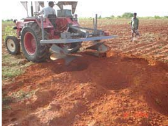
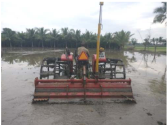
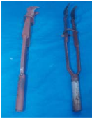
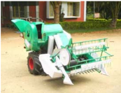
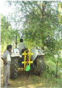

# Sugarcane — Agriculture - TNAU production guide
> Auto-extracted from government extension sources by CropBot pipeline. Content is faithful to the source; see front-matter for provenance.
## Main content — Part 1 (pp. 297–297)
## 7. SUGARCANE (Saccharum officinarum)

<!-- p. 297 -->

|   T_Max o C |   T_Min o C | Optimum o C   | Rainfall mm   |   Altitude m MSL |
|-------------|-------------|---------------|---------------|------------------|
|          42 |          15 | 32 - 35       | 2500 - 3000   |             1000 |

Tropical crop. Besides temperature and rainfall, light (day length) plays a very important role in proper growth and development i.e. tillering of cane. A long, warm growing season with a high incidence of solar radiation and adequate moisture is required.Short day length decreases number of tillers. Under long day length conditions, plant produces more dry matter.

## CROP IMPROVEMENT A. PLANTED (MAIN) CROP

<!-- p. 297 -->

Sugarcane is grown chiefly in the main season (December - May) in the entire State. In parts of Tiruchirapalli, Perambalur, Karur, Salem, Namakkal and Coimbatore districts, it is also raised during the special season (June - September). The particulars in respect of each season are given below:

## Main content — Part 2 (pp. 300–302)
## IV. MAIN FIELD PREPARATION FOR PLANTING SUGARCANE

<!-- p. 300 -->

## 1. PREPARATION OF THE FIELD

<!-- p. 300 -->

- Wetland (Heavy soils): In wetlands, preparatory cultivation by ploughing the

land and bringing the soil to fine tilth could not be done.

- After harvest of the paddy crop, form irrigation and drainage channels of 40 cm depth and 30 cm width at intervals of 6 m across the field and along the field borders.

- Form ridges and furrows with a spacing of 80 cm between rows with spade.

- Stir the furrows with hand hoes and allow the soil to weather for 4 to 5 days.

## b) Problem soils with excessive soil moisture:

<!-- p. 300 -->

In problem soils, with excessive moisture where it is difficult to drain water, form raised beds at 30 cm intervals with Length - 5 m, Width - 80 cm, and Height -15 cm.

## c. Garden lands with medium and light soils:

<!-- p. 300 -->

In medium and light soil irrigated by flow or lift irrigation adopt the following:

- The initial ploughing with two disc plough followed by eight disc plough and using cultivator for deep ploughing followed by one time operation of rotovator to pulverize the soil to get a fine tilth, free of weeds and stubbles.

- Level the field with laser leveler for effective and proper irrigation management.

- Open ridges and furrows with tractor operated victory plough with a depth of 30cm and spacing of 80 cm between the rows for normal planting with furrow irrigation.

- Open irrigation channels at 10 m intervals.

## 2. BASAL APPLICATION OF ORGANIC MANURES:

<!-- p. 300 -->

Apply FYM at 12.5 t/ha or compost 25 t/ha or filter press mud at 37.5 t/ha before the last ploughing under gardenland conditions. In wetlands this may be applied along the furrows and incorporated well.

## Preparation of reinforced compost from sugarcane trash and pressmud:

<!-- p. 300 -->

Spread the sugarcane trash to a thickness of 15 cm over an area of 7 m x 3 m. Then apply pressmud over this trash to a thickness of 5 cm. Sprinkle the fertilizer mixture containing mussoorie rock phosphate, gypsum and urea in the ratio of 2:2:1 over these layers at the rate of 5 kg/100 kg of trash. Moist the trash and pressmud layers adequately with water. Repeat this process till the entire heap rises to a height of 1.5 m. Use cowdung slurry instead of water to moist the layer wherever it is available. Cover the heap with a layer of soil and pressmud at 1:1 ratio to a thickness of 15 cm. Leave the heap as such for three months for decomposition. Moist the heap once in 15 days. During rainy season, avoid moistening the heap. After three months, turn and mix the heap thoroughly and form a heap and leave it for one more month. Then turn and mix the heap thoroughly at the end of the fourth month. Moist the heap once in 15 days during 4th and 5th month also. This method increases the manurial value of trash compost by increasing, N, P and Ca content. It also brings down the C:N ratio by 10 times as compared to raw cane trash.

## Composition of cane trash, pressmud and cane trash compost

<!-- p. 301 -->

| Major nutrients   | Cane trash   | Pressmud     | Cane trash compost   |
|-------------------|--------------|--------------|----------------------|
| Nitrogen (N)      | 0.40         | Percent 1.90 | 1.60                 |
| Phosphorus (P)    | 0.13         | 1.50         | 1.10                 |
| Potassium(K)      | 0.40         | 0.50         | 0.40                 |
| Calcium (Ca)      | 0.56         | 3.00         | 1.00                 |
| Magnesium (Mg)    | 0.30         | 2.00         | 0.60                 |
| Sulphur (S)       | 0.12         | 0.50         | 0.48                 |
| Micronutrients    | Cane trash   | Pressmud     | Cane trash compost   |
|                   |              | PPM          |                      |
| Iron (Fe)         | 360          | 2240         | 2710                 |
| Manganese (Mn)    | 110          | 400          | 450                  |
| Zinc (Zn)         | 90           | 360          | 370                  |
| Copper (Cu)       | 30           | 130          | 80                   |
| C:N ratio         | 113:1        | 16:1         | 22:1                 |

## 2. BASAL APPLICATION OF PERTILIZER

<!-- p. 301 -->

(i) If soil test is not done, follow blanket recommendation of NPK @ 300:100:200 kg/ha Apply super phosphate (625 kg/ha) along the furrows and incorporate with hand hoe.

- (ii) Soil test crop response based integrated plant nutrition system (STCR- IPNS) recommendation may be adopted for prescribing fertilizer doses for specified yield targets. (ready reckoners are furnished)

## Sugarcane (1)

<!-- p. 301 -->

Soil

: Mixed black calcareous

(Perianaickenpalayam series)

Target : 125-150 t ha -1

FN = 4.17 T - 1.09 SN - 1.11 ON FP2O5= 1.01 T - 2.56 SP - 1.01 OP

FK2O = 3.44 T - 0.84 SK - 1.03 OK

|   Initial soil test values (kg ha -1 ) - SN |   Initial soil test values (kg ha -1 ) - SP |   Initial soil test values (kg ha -1 ) - SK | Yield target - 125t ha -1 - NPK (kg ha -1 ) + FYM @ 12.5 t ha -1 + Azospirillum @ 2 kg ha -1 + PSB @ 2 kg ha -1 - FN   | Yield target - 125t ha -1 - NPK (kg ha -1 ) + FYM @ 12.5 t ha -1 + Azospirillum @ 2 kg ha -1 + PSB @ 2 kg ha -1 - FP2O5   | Yield target - 125t ha -1 - NPK (kg ha -1 ) + FYM @ 12.5 t ha -1 + Azospirillum @ 2 kg ha -1 + PSB @ 2 kg ha -1 - FK2O   |   Yield target - 150 t ha -1 - NPK (kg ha -1 ) + FYM @ 12.5 t ha -1 + Azospirillum @ 2 kg ha -1 + PSB @ 2 kg ha -1 - FN | Yield target - 150 t ha -1 - NPK (kg ha -1 ) + FYM @ 12.5 t ha -1 + Azospirillum @ 2 kg ha -1 + PSB @ 2 kg ha -1 - FP2O5   | Yield target - 150 t ha -1 - NPK (kg ha -1 ) + FYM @ 12.5 t ha -1 + Azospirillum @ 2 kg ha -1 + PSB @ 2 kg ha -1 - FK2O   |
|---------------------------------------------|---------------------------------------------|---------------------------------------------|------------------------------------------------------------------------------------------------------------------------|---------------------------------------------------------------------------------------------------------------------------|--------------------------------------------------------------------------------------------------------------------------|-------------------------------------------------------------------------------------------------------------------------|----------------------------------------------------------------------------------------------------------------------------|---------------------------------------------------------------------------------------------------------------------------|
|                                         200 |                                          15 |                                         300 | 223                                                                                                                    | 50*                                                                                                                       | 113                                                                                                                      |                                                                                                                     328 | 68                                                                                                                         | 199                                                                                                                       |
|                                         220 |                                          17 |                                         350 | 201                                                                                                                    | 50*                                                                                                                       | 100*                                                                                                                     |                                                                                                                     306 | 63                                                                                                                         | 157                                                                                                                       |
|                                         240 |                                          19 |                                         400 | 180                                                                                                                    | 50*                                                                                                                       | 100*                                                                                                                     |                                                                                                                     284 | 58                                                                                                                         | 115                                                                                                                       |
|                                         260 |                                          21 |                                         450 | 158                                                                                                                    | 50*                                                                                                                       | 100*                                                                                                                     |                                                                                                                     262 | 53                                                                                                                         | 100*                                                                                                                      |
|                                         280 |                                          23 |                                         500 | 150*                                                                                                                   | 50*                                                                                                                       | 100*                                                                                                                     |                                                                                                                     240 | 50*                                                                                                                        | 100*                                                                                                                      |

## Sugarcane (2)

<!-- p. 302 -->

Soil

: Red coastal alluvium (Gadillum series)

Target : 125 t ha -1 and 150 t ha -1

|   Initial soil test values ha -1 ) - SN |   Initial soil test values ha -1 ) - SP |   Initial soil test values ha -1 ) - (kg SK |   Yield target - 125 t ha -1 NPK (kg ha -1 ) + FYM @ 12.5 - ha -1 ha FN | Yield target - 125 t ha -1 NPK (kg ha -1 ) + FYM @ 12.5 - Azospirillum PSB @ 2 FP2O5   |   Yield target - 125 t ha -1 NPK (kg ha -1 ) + FYM @ 12.5 - @ 2 kg ha -1 FK2O |   Yield target - 150 t ha -1 NPK (kg ha -1 ) + FYM @ 12.5 - ha -1 ha FN | Yield target - 150 t ha -1 NPK (kg ha -1 ) + FYM @ 12.5 - Azospirillum PSB @ 2 FP2O5   |   Yield target - 150 t ha -1 NPK (kg ha -1 ) + FYM @ 12.5 - @ 2 kg ha -1 FK2O |
|-----------------------------------------|-----------------------------------------|---------------------------------------------|-------------------------------------------------------------------------|----------------------------------------------------------------------------------------|-------------------------------------------------------------------------------|-------------------------------------------------------------------------|----------------------------------------------------------------------------------------|-------------------------------------------------------------------------------|
|                                     200 |                                      15 |                                         200 |                                                                     280 | 50*                                                                                    |                                                                           155 |                                                                     381 | 50*                                                                                    |                                                                           222 |
|                                     220 |                                      17 |                                         220 |                                                                     265 | 50*                                                                                    |                                                                           143 |                                                                     366 | 50*                                                                                    |                                                                           210 |
|                                     240 |                                      19 |                                         240 |                                                                     250 | 50*                                                                                    |                                                                           132 |                                                                     351 | 50*                                                                                    |                                                                           199 |
|                                     260 |                                      21 |                                         260 |                                                                     235 | 50*                                                                                    |                                                                           121 |                                                                     337 | 50*                                                                                    |                                                                           187 |
|                                     280 |                                      23 |                                         280 |                                                                     220 | 50*                                                                                    |                                                                           109 |                                                                     322 | 50*                                                                                    |                                                                           176 |

## Sugarcane (3)

<!-- p. 302 -->

Soil

: Red sandy loam (Irugur series)

Target : 100 t ha -1 -125 t ha -1

|   Initial soil test values (kg ha -1 ) - SN |   Initial soil test values (kg ha -1 ) - SP |   Initial soil test values (kg ha -1 ) - SK |   Yield target - 100 t ha -1 - NPK (kg ha -1 ) + FYM @ 12.5 t ha -1 + Azospirillum @ 2 kg ha -1 + PSB @ 2 kg ha -1 - FN | Yield target - 100 t ha -1 - NPK (kg ha -1 ) + FYM @ 12.5 t ha -1 + Azospirillum @ 2 kg ha -1 + PSB @ 2 kg ha -1 - FP2O5   | Yield target - 100 t ha -1 - NPK (kg ha -1 ) + FYM @ 12.5 t ha -1 + Azospirillum @ 2 kg ha -1 + PSB @ 2 kg ha -1 - FK2O   |   Yield target - 125 t ha -1 - NPK (kg ha -1 ) + FYM @ 12.5 t ha -1 + Azospirillum @ 2 kg ha -1 + PSB @ 2 kg ha -1 - FN |   Yield target - 125 t ha -1 - NPK (kg ha -1 ) + FYM @ 12.5 t ha -1 + Azospirillum @ 2 kg ha -1 + PSB @ 2 kg ha -1 - FP2O5 |   Yield target - 125 t ha -1 - NPK (kg ha -1 ) + FYM @ 12.5 t ha -1 + Azospirillum @ 2 kg ha -1 + PSB @ 2 kg ha -1 - FK2O |
|---------------------------------------------|---------------------------------------------|---------------------------------------------|-------------------------------------------------------------------------------------------------------------------------|----------------------------------------------------------------------------------------------------------------------------|---------------------------------------------------------------------------------------------------------------------------|-------------------------------------------------------------------------------------------------------------------------|----------------------------------------------------------------------------------------------------------------------------|---------------------------------------------------------------------------------------------------------------------------|
|                                         200 |                                          14 |                                         200 |                                                                                                                     150 | 50*                                                                                                                        | 105                                                                                                                       |                                                                                                                     236 |                                                                                                                         72 |                                                                                                                       184 |
|                                         220 |                                          16 |                                         220 |                                                                                                                     139 | 50*                                                                                                                        | 100*                                                                                                                      |                                                                                                                     224 |                                                                                                                         68 |                                                                                                                       169 |
|                                         240 |                                          18 |                                         240 |                                                                                                                     128 | 50*                                                                                                                        | 100*                                                                                                                      |                                                                                                                     213 |                                                                                                                         64 |                                                                                                                       155 |
|                                         260 |                                          20 |                                         260 |                                                                                                                     116 | 50*                                                                                                                        | 100*                                                                                                                      |                                                                                                                     202 |                                                                                                                         60 |                                                                                                                       140 |
|                                         280 |                                          22 |                                         280 |                                                                                                                     105 | 50*                                                                                                                        | 100*                                                                                                                      |                                                                                                                     191 |                                                                                                                         56 |                                                                                                                       126 |

Note: FN, FP2O5 and K2O are fertilizer N, P2O5 and K2O in kg ha -1 , respectively; T is the yield target in t ha -1 ; SN, SP and SK respectively are available N,P and K in kg ha -1 and ON, OP and OK are the quantities of N, P and K supplied through organic manure inkg ha -1 .

- (i) Apply 37.5 kg Zinc sulphate/ha and 100 kg Ferrous sulphate + 12.5 t FYM/ha to zinc and iron deficient soils.

- (ii) Application of sulphur in the form of Gypsum @ 500 kg /ha to sulphur deficient soils to increase the cane yield and juice quality.

- (iii) Basal application of 5 kg CuSO4 for copper deficient soil.

FN =4.06 T-0.74SN-0.87 ON FP2O5=0.71T-1.09 SP-0.72 OP FK2O=2.67T-0.57SK-1.33 OK

FN =3.42 T-0.56 SN-0.93 ON FP2O5=1.15T-1.94 SP-0.98 OP FK2O=3.16T-0.73SK-0.99 OK

## Main content — Part 3 (pp. 304–314)
## WEED MANAGEMENT IN PURE CROP OF SUGARCANE

<!-- p. 304 -->

- Wherever weed menace is higher, one line weeding along the crop row and spade digging of ridges have to be done on 30, 60 and 90 DAP

- Spray Atrazine 1 kg or Oxyflurofen 750 ml/ha mixed in 500 liters of water as pre emergence herbicide on the 3rd day of planting, using deflector or fan type nozzle fitted with knapsack sprayer.

- Pre emergence application of atrazine @ 1.0 kg ha -1 on 3 DAP followed by post emergence directed application of glyphosate @ 10 ml / litre of water on 45 DAP with hood+ one hand weeding on 90 DAP registered the maximum cane yield.

- If the parasitic weed striga is a problem, Pre-emergence application of Atrazine 1.0 kg/ha on 3 DAP + hand weeding on 45 DAP with an earthing up on 60 DAP combined with post-emergence sparaying of 2,4-D @ 6 g (0.6%) + Urea @ 20 g (2%) / litre of water on 90 DAP + Trash mulching 5 t/ha on 120 DAP.

- Pre- plant application of glyphosate at 2.0 kg h a-1 along with 2% ammonium sulphate at 21 days before planting of sugarcane followed by post emergence direct spraying of glyphosate at 2.0 kg h a-1 along with 2% ammonium sulphate with a special hood on 30 DAP suppressed the nut sedges (Cyperus rotandus) and provided weed free environment.

- If herbicide is not applied work the junior-hoe along the ridges on 25, 55 and 85 days after planting for removal of weeds and proper stirring. Remove the weeds along the furrows with hand hoe. Otherwise operate power tiller fitted with tynes for intercultivation.

- Control of creeper weeds post emergence directed application of fernoxone (2, 4 -D sodium salt) @ 2 gm + 10 gm of urea per liter of water may be sprayed over the creeper weeds.

## Weed management in Sugarcane intercropping system

<!-- p. 305 -->

Premergence application of Thiobencarb @ 1.25 kg ai/ha under intercropping system in Sugarcane with Soybean, blackgram or groundnut gives effective weed control. Raising intercrops is not found to affect the cane yield and quality.

## 9. EARTHING UP

<!-- p. 305 -->

After application of 3rd dose fertilizer (90 days), work victory plough along the ridges for efficient and economical earthing up. At 150 days after planting, earthing up may be done with spade.

## 10. DETRASHING

<!-- p. 305 -->

Remove the dry cane leaves on 150 th and 210 th day to avoid borer infestation.

## 11. PROPPING

<!-- p. 305 -->

Do double line propping with trash twist at the age of 210 days of the crop.

## 12. TOP DRESSING WITH FERTILIZERS

<!-- p. 305 -->

Apply 275 kg of nitrogen and 112.5 kg of K O/ha in three equal splits at 30, 60 and 90 days

## a. Soil application

<!-- p. 305 -->

Coastal and flow irrigated belts (assured water supply areas). In the case of lift irrigation belt, apply 225 kg of nitrogen and 112.5 kg of K O/ha in three equal splits at 30, 60 and 90 days (water scarcity areas). For jaggery areas, apply 175 kg of nitrogen and 112.5 kg of K2O/ha in three equal splits on 30, 60 and 90 days.

## NITROGEN SAVING

<!-- p. 305 -->

- Neem Cake Blended Urea: Apply 67.5 kg of N/ha + 27.5 kg of Neem Cake at 30 days and repeat on 60th and 90th days.

Note: Neem cake blending: Powder the required quantity of neem cake and mix it with urea thoroughly and keep it for 24 hours. Thus, 75 kg of nitrogen/ha can be saved by this method.

- Azospirillum: Mix 12 packets (2400 g)/ha of Azospirillum inoculant or TNAU Biofert -1 with 25 kg of FYM and 25 kg soil and apply near the clumps on 30th day of planting. Repeat the same on 60th day with another 12 packets (2400 gm). Repeat the above on the other side of the crop row on the 90th day (for lift irrigated belt).

- Band placement: Open deep furrows of 15 cm depth with hand hoes and place the fertilisers in the form of band and cover it properly.

- Subsurface application: Application of 255 kg of Nitrogen in the form of urea along with potash at 10cm depth with 15cm intervals by the side of the cane clump will result in the saving of 20 kg N/ha without any yield reduction.

## Nutritional Disorders :

<!-- p. 306 -->

Nitrogen deficiency : All leaves of sugarcane exhibit a yellow - green colour and retardation of growth. Cane stalks are smaller in diameter and premature drying of older leaves. Roots attain a greater length but are smaller in diameter.

Phosphorus deficiency : Reduction in length of sugarcane stalks, diameters of which taper rapidly at growing points. The colour of the leaves is greenish blue, narrow and some what reduce length. Reduced tillering, decreased shoot / root ratio with restricted root development.

Potassium deficiency: Depressed growth, yellowing and marginal drying of older leaves and development of slender stalks. An orange, yellow colour appears in the older lower leaves which develop numerous chlorotic spots that later become brown with dead centre. A reddish discoloration which is confined to the epidermal cells of the upper surfaces and midribs of the leaves. The young leaves appear to have developed from a common point giving a "Bunched top" appearance. Poor root growth with less member of root hairs.

Zinc deficiency: Mild zinc deficiency exhibit a tendency to develop anthrocyanin pigments in the leaves. Pronounced bleaching of the green colour along the major veins and also striped effect due to a loss of chlorophyll along the veins. In acute cases of zinc deficiency there is evidences of necrosis and growth ceases at the growing point (meristem).

Iron deficiency: Symptoms of Iron deficiency are generally seen in young leaves where pale stripes with scanty chlorophyll content occur between parallel lines. In advanced stages of deficiency the young leaves turn completely white, even in the veins. Root growth also becomes restricted. Boron deficiency : Boron deficiency could be seen in the cane by depressed growth, development of distorted and chlorotic leaves and the presence of definite leaf and stalks lesions. In extreme cases of boron deficiency the plant will die.

## Importance of Balanced Nutrition

<!-- p. 306 -->

The soil fertility has declined in many sugarcane growing areas of the state due to improper and some times, distorted fertilizer schedules adopted over the years under intensive cultivation of the crop. Hence balanced application of fertilizer based on soil test values and crop requirement is essential.

## How to Evaluate fertilizer requirement

<!-- p. 307 -->

Through STCR fertilizer prescription equations

- Perianaickenpalayam series (Inceptisols) of Coimbatore and Erode STL Jurisdiction FN = 4.17 T - 1.09 SN - 1.11 ON FP2O5 = 1.01 T - 2.56 SP - 1.01 OP FK2O = 3.44 T - 0.84 SK - 1.03 OK

- Gadillum series (Red laterite) of Cuddalore STL Jurisdiction FN = 4.06 T - 0.74 SN - 0.87 ON FP2O5 = 0.71 T - 1.09 SP - 0.72 OP FK2O = 2.67 T - 0.57 SK

- 1.30 OK

- Irugur series (Inceptisols) of Coimbatore, Erode, Trichy and Salem STL Jurisdiction FN = 3.42 T - 0.56 SN - 0.93 ON FP2O5 = 1.15 T - 1.94 SP - 0.98 OP FK2O = 3.16 T - 0.73 SK - 0.99 OK

## Micro nutrient fertilizers

<!-- p. 307 -->

- (a) Zinc deficient soils : Basal application of 37.5 kg/ha of zinc sulphate.

- (b) For zinc deficiency symptoms: foliar spray of 0.5% zinc sulphate with 1% urea at 15 days internal till deficiency symptoms disappear.

- (a) Iron deficient soils: Basal application of 100 kg/ha of ferrous sulphate + 12.5t FYM.

- (b) For Iron deficiency symptoms: Foliar spray of 1% ferrous sulphate + 0.1% citric acid with 1% urea at 15 days interval till deficiency symptoms disappear.

- Soil application of CuSO4@ 5 kg/ha in copper deficient soils. Alternatively foliar spray of 0.2% CuSO4 twice during early stage of crop growth.

Common Micronutrient mixture : To provide all micronutrients to sugarcane, 50 kg /ha of micronutrient mixture containing 20 kg Ferrous sulphate,10 kg Manganese sulphate, 10 kg Zinc sulphate, 5 kg of Copper sulphate, 5 kg of Borax mixed with 100 kg of well decomposed FYM, can be recommended as soil application prior to planting. (Or) Application of TNAU MN mixture @ 50 kg/ha as EFYM for higher cane yield.

## Recommended dosage of macro and micronutrients Macronutrients

<!-- p. 307 -->

- Sugarcane - plant crop (meant for sugar mills) 300:100:200 kg N, P2O5 and K2O per ha

- b.

- Sugarcane - Ratoon crop (meant for sugar mills) 300 + 25% extra N : 100 : 200 kg N, P2O5 and K2O per ha

- Sugarcane for jaggery manufacture (plant as well as ratoon crop)

- 225 : 62.5 : 112.5 kg N, P2O5 and K2O per ha

## 13. BIOFERTILIZER FOR SUGARCANE

<!-- p. 307 -->

Azospirillum is the common biofertilizer recommended for N nutrition which could colonize the roots of sugarcane and fix atmospheric nitrogen to the tune of about 50 to 75 kg nitrogen per ha per year. Recently, another endophytic nitrogen fixing bacterium, Gluconacetobacter diazotrophicus isolated from sugarcane can able to fix more nitrogen than Azospirillum. It colonizes throughout the sugarcane and increases the total N content. In soil, it can also colonize the roots and able to solubilize the phosphate, iron and Zn. It can also enhance the crop growth, yield of sugarcane and sugar content of the juice. Since it is more efficient than Azospirillum, this new organism was test-verified in various centres and released as new biofertilizer Gluconacetobacter diazotrophicus TNAU Biofert-I. Phosphobacteria as P solubiliser are recommended for sugarcane crop.

## Sett treatment with Gluconacetobacter diazotrophicus

<!-- p. 308 -->

Before planting the sugarcane setts can be treated with ten packets (2 kg) per ha of Gluconacetobacter diazotrophicus prepared as slurry with 250 L of water.

## Soil application Gluconacetobacter diazotrophicus

<!-- p. 308 -->

Twelve packets (2.4 kg) per ha is recommended for soil application each at 30th, 60th and 90th day after planting under irrigated condition.

## Same method of application can be followed for Phosphobacteria.

<!-- p. 308 -->

- If basal application is not followed apply the same with 30th day, 60th day and 90th day after planting and copiously irrigate the field.

- Biofertilizer treatment should be done just before planting.

- Immediately plant/ Irrigate after biofertilizer application

- Do not mix biofertilizer along with chemical fertilizer.

- Reduces 25% of the recommended N to reap the benefits of biofertilizer application

## 14. WATER MANAGEMENT

<!-- p. 308 -->

Irrigate the crop depending upon the need during different phases of the crop.

## Germination phase (0 - 35 days):

<!-- p. 308 -->

Provide shallow wetting with 2 to 3 cm depth of water at shorter intervals especially for sandy soil for enhancing the germination. Sprinkler irrigation is the suitable method to satisfy the requirement, during initial stages.

Later, irrigation can be provided at 0.75, 0.75 and 0.50 IW/CPE ratio during tillering, grandgrowth and maturity phases respectively. The irrigation intervals in each phase are given below:

## Days of irrigation interval

<!-- p. 308 -->

## Stages

<!-- p. 308 -->

| Tillering phase (36 to 100 days)     |   8 |   10 |
|--------------------------------------|-----|------|
| Grand growth phase (101 - 270        |   8 |   10 |
| days) Maturity phase (271 - harvest) |  10 |   14 |

## Drip Irrigation:

<!-- p. 308 -->

- o Planting setts obtained from 6-7 months old healthy nursery and planted in paired row planting system with the spacing of 30x30x30 / 150 cm. for manual harvest and 30/150 cm for machine harvest

- o Eight setts per metre per row have to be planted on either sides of the ridge thus making it as four row planting system.

- o 12 mm drip laterals have to be placed in the middle ridge of each furrow with the lateral spacing of 240 cm & 8 'Lph' clog free drippers should be placed with a spacing of 75 cm on the lateral lines. The lateral length should not exceed more than 30-40 m.

- o Phosphorus @ 62.5 kg ha -1 has to be applied as basal at the time of planting.

- o Nitrogen and Potassium @ 275:112.5 kg ha -1 have to be injected into the system as urea and muriate of potash by using "Ventury" assembly in 10-12

- equal splits starting from 15 to 150- 180 days after planting.

- o Low or medium in nutrient status soil to be given with 50 per cent additional dose of Nitrogen and Potassium.

- o Irrigation is given once in three days based on the evapo-transpiration demand of the crop.

- o The double side planting of sugarcane with lateral spacing of 120+40 cm under subsurface drip fertigation system improves the yield.

- o Application of 125 % recommended NPK (Rec NPK-275 :63:112.5 kg /ha ) through fertigation under pit system of planting inprove the yield and yield attributes.

## Concept of fertigation

<!-- p. 309 -->

- Fertigation is the judicious application of fertilizers by combining with irrigation water.

- Fertigation can be achieved through fertilizer tank, venturi System, Injector Pump, Non- Electric Proportional Liquid Dispenser (NEPLD) and Automated system.

- Recommended N & K @ of 275 and 112.5 kg. ha -1 may be applied in 14 equal splits with 15 days interval from 15 DAP.

- 25 kg N and 8 kg K2O per ha per split.

- Urea and MOP (white potash) fertilisers can be used as N and K sources respectively

- Fertigation up to 210 DAP can also be recommended.

## Advantages of Fertigation

<!-- p. 309 -->

- Ensures a regular flow of water as well as nutrients resulting in increased growth rates for higher yields

- Offers greater versatility in the timing of the nutrient application to meet specific crop demands

- Improves availability of nutrients and their uptake by the roots

- Safer application method which eliminates the danger of burning the plant root system

- Offers simpler and more convenient application than soil application of fertilizer thus saving time, labour, equipment and energy

- Improves fertilizer use efficiency

- Reduction of soil compaction and mechanical damage to the crops

- Potential reduction of environmental contamination

- Convenient use of compound and ready-mix nutrient solutions containing also small concentration of micronutrients.

## 15. Contingent plan

<!-- p. 309 -->

## Gradual widening of furrow:

<!-- p. 309 -->

At the time of planting, form furrow at a width of 30 cm initially. After that, widen the furrow to 45 cm on 45th day during first light earthing up and subsequently deepen the furrow on 90th day to save 35% of water.

## Drought Management:

<!-- p. 310 -->

- Soak the setts in lime solution (80 kg Kiln lime in 400 lit) for one hour.

- Plant in deep furrows of 30 cm depth.

- Foliar spray of kel and urea each at 2.5 per cent during moisture stress period at 15 days interval.

- Foliar spray of Kaolin (60 g in 1 ltr. of water) to alleviate the water stress.

- Under water scarcity condition, alternate furrow and skip furrow method is beneficial.

- Apply 125 kg of MOP additionally at 120 day of planting.

- Basal incorporation of coir waste @ 25 tonnes/ha at the time of last ploughing.

- Removal of dry trash at 5 th month and leave it as mulch, in the field.

## 16. CROP PROTECTION

<!-- p. 310 -->

## A. Pest Management:

<!-- p. 310 -->

## SUGARCANE

<!-- p. 310 -->

- Deep plough during summer

- Select scale insect free setts

- Treat the setts with imidacloprid 70% WS @ 100 ml/ 100 kg to avoid termite

- Adopt early planting (Dec-Jan)

- Plant sugarcane in paired or wider rows for taking effective control measures

- Trash mulch on ridges at 3 DAP

- Intercrop with green gram, black gram and daincha

- Keep bunds free from weeds

- Avoid ratoons in infested fields

- Provide adequate rrigation & avoid excessive use of nitrogenous fertilizers

- Detrash on 150 and 210 th DAP

- Drain excess water

- Avoid use of insecticide treated leaves as cattle feed.

| Early Shoot borer, Chilo infuscatellus        | • Release Sturmiopsis inferens gravid females @ 125/ha on 30 and 45 DAP Apply any one of the following insecticides/ha • Chlorantraniliprole 0.4% G @ 18.75 g • Chlorantraniliprole 18.5 % SC @ 375 ml • Chlorpyriphos 20%EC 1.0 lit • Fipronil 0.3% GR @ 25 kg • Fipronil 5% SC @1.5 lit • Monocrotophos 36 %SL 1.5 lit • NSKE 5 % • Thiamethoxam 75% w/w SG @ 160 g   |
|-----------------------------------------------|-------------------------------------------------------------------------------------------------------------------------------------------------------------------------------------------------------------------------------------------------------------------------------------------------------------------------------------------------------------------------|
| Internode borer, Chilo sacchariphagus indicus | • Release egg parasitoid, Trichogramma chilonis at the rate of 2.5 cc / release/ha (Six releases at 15 days interval starting from fourth month).                                                                                                                                                                                                                       |
| Top shoot borer, Scirpophaga excerptalis      | • Collect and destroy egg masses • Release prepupal parasitoid, Isotima javensis @ 125 females /ha                                                                                                                                                                                                                                                                      |

|                                                                                                                                            | Apply any one of the following insecticides/ha • Carbofuran 3% CG @ 66 kg • Chlorantraniliprole 0.4% G @ 18.75 kg • Chlorantraniliprole 18.5% SC 375 ml                                                                                                                                           |
|--------------------------------------------------------------------------------------------------------------------------------------------|---------------------------------------------------------------------------------------------------------------------------------------------------------------------------------------------------------------------------------------------------------------------------------------------------|
| Pyrilla, Pyrilla perpusilla                                                                                                                | • Release lepidopteran parasitoid, Epiricrania melanoleuca @ 8000 -10,000 cocoon /ha (or) 8 - 10 lakh eggs/ha Spray any one of the following on 150 and 210 DAP /ha after detrashing • Chlorpyriphos 20 % EC @ 1.50 lit • Monocrotophos 36%SL @ 1.50 lit                                          |
| Aleurodids, Aleurolobus barodensis Aphid, Melanaphis sacchari, M. indosacchari Scale insect, Melanaspis glomerata Mealybug, Saccharicoccus | • Spray monocrotophos 36%SL @ 1.50 lit/ha                                                                                                                                                                                                                                                         |
| sacchari Termite, Odontotermes obesus                                                                                                      | • Flood irrigate the furrows at the time of planting • Drench soil with chlorpyriphos 20% EC @ 6.25 lit/ha Apply any one of the following insecticides/ha • Chlorantraniliprole 18.5% SC @ 500 ml • Clothianidin 50% WDG @ 250 g • Imidacloprid 17.8% SL@ 350 ml • Thiamethoxam 75% w/w SG @160 g |
| Root grub Holotrichia consanguinea H. serrata Leucopholis lepidophora                                                                      | • Set up light trap to collect and destroy adults • Collect and destroy adult beetles present on neem, Ailanthus and Acacia trees • Imidacloprid 17.8% SL@ 350 ml / ha                                                                                                                            |
| Woolly aphid, Ceratovacuna lanigera                                                                                                        | • Avoid transportation of aphid infested leaves from one location to another • Conserve and augment biocontrol agents like Dipha aphidivora, Micromus and coccinellids Spray any one of the following insecticides /ha • Chlorpyriphos 25%EC 1.0 lit • Monocrotophos 36%SL 625 ml                 |
| Root borer                                                                                                                                 | Spray any one of the following insecticides /ha • Fipronil 5% SC @1.5 lit • Fipronil 0.3% GR @ 25 kg                                                                                                                                                                                              |

B) Disease management

| Disease                                             | Recommendations                                                                                                                                                                                                                                                                                                                                                                                                                                                                                                                                                                                                                                                                                                                                                                                              |
|-----------------------------------------------------|--------------------------------------------------------------------------------------------------------------------------------------------------------------------------------------------------------------------------------------------------------------------------------------------------------------------------------------------------------------------------------------------------------------------------------------------------------------------------------------------------------------------------------------------------------------------------------------------------------------------------------------------------------------------------------------------------------------------------------------------------------------------------------------------------------------|
| Red rot: Colletotrichum fal catum                   | • Selection of setts from healthy nursery programme. • Growing of recommended resistant and moderately resistant varieties viz., Co 86249, CoC 22, CoC 25, CoG 6 and Co 0212 • Sett treatment with carbendazim before planting (carbendazim 50 WP @ 0.05% along with 1.0% urea for 15 minutes) • The irrigation interval in red rot affected field must be lengthened. Once in 15 days during tillering, growth phases and once in 25 days during maturity phase which restricts the spread • Removal of the affected clumps at an early stage and soil drenching with 0.1 % carbandazim 50 WP • The trash of red rot affected field after harvest may be uniformly spread and burnt • In the red rot affected field crop rotation with rice for one season and other crops for two seasons could be adopted |
| Sett rot: Ceratocytis paradoxa                      | • Sett treatment with carbendazim before planting (carbendazim 50 WP @ 0.05% along with 1.0% urea for 15 minutes) • Proper drainage and planting of setts in 1-2 cm depth                                                                                                                                                                                                                                                                                                                                                                                                                                                                                                                                                                                                                                    |
| Smut: Sporisorium scitamineum (Ustilago scitaminea) | • Sett treatment with carbendazim before planting (carbendazim 50 WP @ 0.05% along with 1.0% urea for 15 minutes) • Treating the setts with Aerated Steam Therapy (AST) at 50 ºC for 1 hour or in hot water at 50 ºC for 30 minutes or at 52 ºC for 18 minutes • Roguing of smut whips with gunny bags/polythene bag and burnt • Discourage ratooning of the diseased crops having more than 10 per cent infection                                                                                                                                                                                                                                                                                                                                                                                           |
| Grassy shoot disease (GSD): Candidatus Phytoplasma  | • Rogue out infected plants in the seed nursery • Treat setts with aerated steam at 50°C for 1 hour to control primary infection • Spray dimethoate @ 0.1 % to control insect vector • Avoid ratooning if GSD incidence is more than 15 % in the plant crop                                                                                                                                                                                                                                                                                                                                                                                                                                                                                                                                                  |

Leaf spot: Cercospora longipes

·

Rust: Puccinia melanocephala

·

Yellow leaf disease: Sugarcane yellow leaf virus (Vector: Melanopsis sacchari)

·

·

·

pray mancozeb @ 2 kg or carbendazim @ 500 g/ha

pray mancozeb @ 2 kg/ha

se of disease free setts for planting

election of tissue culture seedling from meristem tip culture

roper nutritional management

## General Recommendations

<!-- p. 313 -->

- Select healthy setts for planting. In the seed crop, select plants which do not show symptoms of red rot, smut, grassy shoot and ratoon stunting. Setts showing red colour at the cut end and hollows should be rejected.

- In fields which had shown high level of red rot disease, follow crop rotation with rice.

- Sett treatment with carbendazim before planting (carbendazim 50 WP @ 0.05% along with 1.0% urea for 15 minutes.

- Treat setts with aerated steam at 50°C for one hour to control primary infection of smut and grassy shoot disease.

Clumps infected by grassy shoot, smut and ratoon stunting diseases should be uprooted and destroyed.

## 17. PRE-HARVEST PRACTICES

<!-- p. 313 -->

- Apply cane ripeners

- Spray Sodium metasilicate 4 kg/ha in 750 litres of water on the foliage of crop at 6 months after planting.

- Repeat the same twice at 8th and 10th months to obtain higher cane yield and sugar percentage.

- Assessing maturity of crops

- Assess the maturity by hand refractometer brix survey and 18 to 20 per cent brix indicates optimum maturity for harvest.

- Top-bottom ratio of H.R.Brix reading should be 1:1.

## 18. HARVESTING

<!-- p. 313 -->

- Early varieties have to be harvested at 10 to 11 months age and mid-season varieties at 11 to 12 months age.

- Harvest the cane at peak maturity. Cut the cane to the ground level for both plant and ratoon crops.

## B. RATOON CROP

<!-- p. 313 -->

## I. MANAGEMENT OF THE FIELD AFTER HARVEST OF THE PLANT CROP

<!-- p. 313 -->

Complete the following operations within 10 days of harvest of plant crop to obtain better establishment and uniform sprouting of shoots.

- Remove the trash from the field. Do not burn it. Irrigate the field copiously.

- Follow stubble shaving with sharp spades to a depth of 4 - 6 cm along the ridges at proper moisture.

- Work with cooper plough along with sides of the ridges to break the compaction.

- The gappy areas in the ratoon sugarcane crop should be filled within 30 days of stubble shaving. The sprouted cane stubbles taken from the same field is the best material for full establishment. The next best method is gap filling with seedlings raised in polybags.

- Apply basal dose of organic manure and super phosphate as recommended for plant crop.

## II. MANAGEMENT OF THE CROP

<!-- p. 314 -->

- 25% additional N application on 5-7 days after ratooning.

- Foliar spray of Ferrous sulphate at 2.5 kg/ha on the 15th day. If chlorotic condition persists, repeat the spray twice further at 15 days interval. Add urea 2.5 kg/ha in the last spray.

- Hoeing and weeding on 20th day and 40th to 50th day.

- First top dressing on 25th day, 2nd on 45th to 50th day.

- Final manuring on 70th to 75th day.

- Partial earthing up on 50th day. If junior-hoe is worked two or three times upto 90th day, partial earthing up is not necessary.

- Final earthing up on 90th day.

- Detrashing on 120th and 180th day.

- Trash twist propping on 180th day.

- Harvest after 11 months.

## C. SHORT CROP (NURSERY CROP) SELECTION OF PROPER PLANTING MONTHS FOR RAISING NURSERY CROP IN RELATION TO MAIN FIELD PLANTING

<!-- p. 314 -->

Raise six to seven months old nursery crop prior to main field planting as follows:

## Raise nursery crop during

<!-- p. 314 -->

## Main content — Part 4 (pp. 438–439)
## TRACTOR OPERATED PIT DIGGER FOR SUGAR CANE PLANTING

<!-- p. 438 -->

Purpose

Type of the

implement

Field capacity 250 to 300 holes per hour

Cost of the

implement

Salient

Features Rs. 1,20,00 /- (Approximately)

- At a time two pits of dia 90 cmcan be made

- Spacing between the auger is adjustable

Pit Digger for Sugarcane Planting

Tractor operated

## SYSTEM FOR CONTROLLED LEVEL OF PUDDLING

<!-- p. 439 -->

Purpose To control the level of puddling in wetland

Type of the Tractor mounted

implement

Field capacity 1.5 ha / day

Cost of the

implement

Salient

Features Rs.50,000/-(Additional Hydraulic cylinder to the existing laser leveller)

- Constant depth of puddle can be maintained accurately, reducing the tillage energy expended by deep puddling.

- Reduce water requirement for puddling.

- Establishment of a strong sub soil layer that will reduce deep percolation.

- Ensures good level surface layer and subsurface layer enabling easy transplanting

## Main content — Part 5 (pp. 440–440)
## SUGARANE SETT CUTTER

<!-- p. 440 -->

Purpose Cutting sugarcane sett with single bud

Field capacity 1500 setts/hour

Cost of the

implement

Salient

Features Rs. 5,000 /- (Approximately)

- Damage is less when compared to manual cutting

·

## Main content — Part 6 (pp. 442–443)
## SUGARCANE DETRASHER

<!-- p. 442 -->

Purpose For detrashing sugarcane

Type of the

implement

Cost of the

implement

Salient

Features Manually operated Rs. 1200 /- (Approximately)

- Labour requirement is less

- Easy for handling

- Reduced cost of de-trashing

- Used for all varieties of cane

- Also removes the sprouted buds

## iv. HARVESTING AND THRASHING MACHINES MINI COMBINE HARVESTER FOR PADDY

<!-- p. 442 -->

Purpose For harvesting paddy

Type of the Self-propelled

implement

Field capacity 1 ha/day

Cost of the

implement

Salient

Features Rs. 3,00,000 /- (Approximately)

- It performs different operations like paddy Harvesting, threshing, winnowing simultaneously

- Suitable for small and medium farms

## v. HORTICULTURAL IMPLEMENTS TRACTOR OPERATED FRUIT-SHAKE HARVESTER

<!-- p. 443 -->

Purpose For harvesting tamarind, and citrus fruits

Type of the

implement

Cost of the

implement

Salient

Features Tractor operated Rs. 6000 /- (Approximately)

- Harvesting efficiency is 85 per cent

- Savings in time is 95 per cent

## Main content — Part 7 (pp. 459–459)
## Sugarcane Syrup

<!-- p. 459 -->

- ™ Concentrated sugar cane juice.

- ™ Alternative natural sweetener in the place of refined sugar.

- ™ Convenient and ready to use, has wide application in the preparation of traditional, bakery and confectionary products.

- ™ Sugarcane syrup (100 g) contains 43 mg calcium, 42 mg phosphorus and 2 mg iron.

- ™ Has a shelf life of twelve months at room temperature.

At Home Science College and Research Institute, a Food Processing Training Center was established by installing the processing equipments namely Murukku machine, Sieving machine, Mixture machine, Steaming machine, Tray wrapping machine, Handy induction sealing machine, Continuous sealing machine, Nitrogen flush vaccum packaging machine, Pulveriser, Extruder, Milk Extraction unit, Cabiner drier and other processing accessories to train the entreprenuers, farmers, SHGs on processing of millets based value added products. The equipments are available to the budding entrepreneurs on rental basis to utilize the facilities.

## Other mentions in this source
### p. 187

Intercropping of Soyabean CO 2 in Sugarcane is recommended for North Western Zone.
### p. 241

Below 7 years of age: Any suitable annual crop for particular soil type and climatic condition may be raised as intercrops upto 5 years after planting depending upon the canopy coverage. Groundnut, sesamum, sunflower, tapioca, turmeric and banana can be grown. Avoid crops like paddy and sugarcane etc.
### p. 257

iii) For red palm weevils, use of attractants incorporating fermented sugarcane juice, acetic acid, yeast etc., to collect and kill the adult weevils is recommended.
### p. 299

CoC 25, CoG 6, TNAU Sugarcane Si 7, Co 09004, Co 06022, CO 91015(Atulya)
### p. 299

Co 86032, Co 06030, TNAU Sugarcane Si 8, Co 0212
### p. 299

CoC 25, CoG 6, TNAU Sugarcane Si 7, Co 09004, Co 06022, CO 91015(Atulya)
### p. 300

For the varieties released from Tamil Nadu Agricultural University for supply of primary seed materials, the Sugarcane Research Stations at Cuddalore, Sirugamani and Melalathur may be contacted. For other varieties promoted by the factories, for seed materials the concerned factories may be contacted.
### p. 303

Paired row system of planting double side planting of sugarcane setts with 150 + 30 cm spacing for Astraf 8000 series (Mechanical harvester) operated areas and 150 + 30 cm spacing for New Holland 4000 series operated areas may be
### p. 304

Sugarcane cultivates under subsurface drip system the laterals may be placed 20cm depth in the furrows and setts are placed 5cm above the laterals.
### p. 304

For sustainable sugarcane initiative system (SSI) transplanting young chip bud seedling raised in portray (25-35 days old) in wide spacing (5x2 feet) in the main field with drip fertigation system.
### p. 315

Foliar spray of TNAU Sugarcane Booster @ 1.0, 1.5 and 2 kg/acre in 200 litres of water at 45,60 and 75 days after planting enhances cane growth and weight, internodal length, cane yield, sugar content and offers drought tolerance.
### p. 317

Enforcement of compulsory IPM measures against woolly aphid infestation in newly planted and ratoon sugarcane fields by invoking suitable provisions of the State Pest Act of the State.
### p. 317

Harvesting of the entire matured sugarcane crop on priority for crushing as well burning of the trash.
### p. 317

Promotion of paired or wider row cultivation of sugarcane for taking effective control measures.
### p. 317

Conservation of lepidopteran predator, Dipha aphidivora predator population in limited areas of sugarcane crop for further distribution and use thereof.
### p. 317

Regular surveillance and monitoring of sugarcane woolly aphid for timely
### p. 359

Crop residues are the plant parts that are left in the field after harvest. The harvest refuses include straws, stubble, stover and haulms of different crops. Crop remains are also from thrashing sheds or that are discarded during crop processing. This includes process wastes like groundnut shell, oil cakes, rice husks and cobs of maize, sorghum and cumbu. The greatest potential as a biomass resource appears to be from the field residues of sorghum, maize, soybean, cotton, sugarcane etc. In Tamil Nadu 190 lakh tonnes of crop residues are available for use. These residues will contribute 1.0 lakh ton of nitrogen, 0.5 lakh ton of phosphorus and 2.0 lakh tons of potassium. However crop residues need composting before being used as manure.
### p. 368

Vermiculture bed or worm bed (3 cm) can be prepared by placing after saw dust or husk or coir waste or sugarcane trash in the bottom of tub / container. A layer of fine sand (3 cm) should be spread over the culture bed followed by a layer of garden soil (3 cm). All layers must be moistened with water.
### p. 372

Treated distillery effluent contains nitrogen 1200 mg L -1 , phosphate 500 mg L -1 , potash 12000 mg L -1 , calcium 1800 mg L -1 and iron 300 mg L -1 . Since the effluent has higher dissolved salts, 50 times diluted effluent can be irrigated to sugarcane, banana, ragi, sunflower, grasses, cotton and soybean.
### p. 373

: Sugarcane (COG 94076, COG 88123, COC 771)
### p. 416

The initial investment in drip irrigation system is mainly depends upon the spacing of crops. The initial cost will be almost 75 - 85 thousand rupees per hectare for wider spacing crops such as coconut, mango, grapes and for orchard crops. The initial cost is approximately 1 - 1.25 lakh rupees per hectare for close spacing crops such as sugarcane, banana, papaya, mulberry, turmeric, tapioca, vegetables and flower crops.
