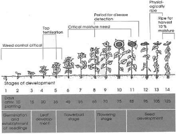

# Sunflower — Field Crops (Rabi) - ICAR e-course
> Auto-extracted from government extension sources by CropBot pipeline. Content is faithful to the source; see front-matter for provenance.
## Main content — Part 1 (pp. 54–54)
## Sunflower

<!-- p. 54 -->

Sunflower is a robust oilseed crop, the seeds of which contain about 20% protein in addition to 40-50%, oil which has a mild taste, pleasant flavour, good keeping quality with acceptable amounts of vitamins A, D and E. Hulls obtained during decortication of sunflower have high fibre content and can be used as a roughage in certain animal feeds. Alternately, they can be used to produce heat by burning, as they yield the same amount at heat as lignite coal.

## Main content — Part 2 (pp. 67–71)
## Sunflower world scenario in 1999 (Million ha & million t)

<!-- p. 67 -->

| Country            |   Area |   Production |   Productivity |
|--------------------|--------|--------------|----------------|
| Russian Federation |   5.94 |         6.75 |           1.14 |
| Argentina          |   2.19 |         3.80 |           1.73 |
| Ukraine            |   3.92 |         5.32 |           1.36 |
| India              |   2.13 |         1.12 |           0.53 |
| USA                |   0.71 |         0.96 |           1.36 |
| Romania            |   0.98 |         1.53 |           1.55 |
| China              |   1.03 |         1.82 |           1.77 |
| World              |  23.70 |        31.33 |           1.32 |

## Lecture 11

<!-- p. 67 -->

## SUNFLOWER Helianthus annuus

<!-- p. 67 -->

## IMPORTANCE OF SUNFLOWER OIL

<!-- p. 67 -->

-  Among the vegetable oils most suitable to coronary system

-  High level of linoleic acid and absence of linolenic acid

-  PUFA (Polyunsaturated fatty acid) - Linoleic content is more (67%) and about 90% unsaturated (+monounsaturated 21%)

-  Major ingredient in margarine and shortening products

(FAOSTAT, 2006)

## Indian Scenario of sunflower

<!-- p. 68 -->

| State      |   Area ( '000 ha) |   Production ( '000 t) |   Productivity (kg/ha) |
|------------|-------------------|------------------------|------------------------|
| Karnataka  |              1427 |                    787 |                    552 |
| Maharastra |               355 |                    206 |                    580 |
| AP         |               444 |                    298 |                    671 |
| Punjab     |              17.8 |                   28.7 |                   1612 |
| Bihar      |              22.6 |                   26.4 |                   1345 |
| UP         |              12.6 |                   16.1 |                   1278 |
| TN         |              17.1 |                   21.2 |                   1240 |
| India      |            2339.6 |                   1439 |                    615 |

## (Ministry of Agriculture, Govt. of India, 2005-06) Favourable features for growth of sunflower in India

<!-- p. 68 -->

-  Wide adaptability

-  Photoperiod insensitiveness

-  Shorter duration (60-100 days)

-  High quality edible oil (PUFA)

-  High seed multiplication ratio (>1: 80)

-  Easier & cheaper cultivation

-  Remunerative market price

-  Suitable for mechanization

## Stages of Sunflower

<!-- p. 68 -->

elpo

horvost

moeturo

7

Stcgos of cevelopmont

Jo

13

1

45

55

65

70

75

125

Gemmhatlon

mont

## Erect, tall usually un-branched

<!-- p. 69 -->

-  Plant height, head size, days to flowering & maturity are all vary due to environment

-  Root - tap root - but thick root mat with short tap root is common

- o May be problem in light soil to heavy mass - lodging

- o Limitations in the exploitation of soil moisture & nutrients

- o Earthing-up interferes with roots

- o Irrigation frequency should be short to meet the demand

- o Waterlogging adversely affects the crop due to weakening of anchorage and proliferation of fungal diseases

##  The stem

<!-- p. 69 -->

- o Mostly unbranched

- o Branching is not desirable

-  Basal branching may be useful

-  Leaf axil branching problem

-  N triggers branching

- o Green stem contributes for photosynthesis

- o Ht varies

-  80-120 short can accomododate more plants

-  120-150 medium

-  150-180 tall

##  The leaf

<!-- p. 69 -->

- o Varies with plant type and environment

- o Limited to number of nodes

- o 8 to as many as 70

- o Arranged alternate at right angle

-  The inflorescence

- o Capitulum borne terminally

- o Surrounded by one or more whorls of bracts called involucre (modified leaves)

- o Head diameter is yield deciding factor

-  Anthesis and fertilization

- o Flowering from periphery

- o Outermost opens first

- o Daily 1-5 rows continues up to 5-10 days

-  The seed

- o Seed is called ‗achene'

- o Seed size 7-25mm long, 4-13m long,3 -7.5mm thick

- o Dormancy normally 10-45 days

- o Oil content 36-37%

- o 1000 seed weight 43-45g

## The climate

<!-- p. 70 -->

Temp range 8-34°C

Optimum 20 & 25°C

Requires cooler (15-20°C) growing period and warmer maturing period (20-25°C)

Base minimum is 10°C

High temp (>38°C) in post-anthesis inhibit quantity and quality of oil

Rainfall of 500mm, with 300 mm it can yield

Avoid flowering coincide continuous drizzle

-  Can be in wide range of soils

-  Any soil with good drainage is more important

-  Neutral to moderately alkaline soils

-  pH ranges 6.5 to 8.0

-  Complete failure in sandy soil with pH 4.6

CO1, CO2, CO 3, CO 4 Modern, K2, K1, BSH 1 EC 68415

## Hybrids have advantage than varieties

<!-- p. 70 -->

-  High yield potential

-  Uniform crop stand

-  More self-fertile, less problem of seed set

- o MSFH 1, BSH 1

## Seasons

<!-- p. 70 -->

Rainfed

June-July, Kharif in North

Oct-Nov

Irrigated

-  Dec - Jan

-  April - May

## Other mentions in this source
### p. 53

rapeseed and mustard, sunflower, safflower, castor, niger and linseed)
### p. 53

vIndia is the fourth largest oilseed producing country in the world, next only to USA, China and Brazil, harvesting about 25 million tons of oilseeds against the world production of 250 million tons per annum. Since 1995, Indian share in world production of oilseeds has been around 10 percent. Although, India is a major producer of oilseeds, per capita oil consumption in India is only 10.6 kg/annum which is low compared to 12.5 kg/annum in China, 20.8 kg/annum in Japan, 21.3 kg/annum in Brazil and 48.0 kg/annum in USA. Many varieties of oilseeds along with tree origin oilseeds are cultivated in India. Among these, the major oilseeds are Soybean, Cottonseed, Groundnut, Sunflower, Rapeseed, Sesame seed, Copra, Linseed, Castor seed and Palm Kernels. India occupies the place of pride as the world's largest producer of Groundnuts, Sesame seeds, Linseeds and Castor seeds. In India, oilseeds are grown in an area of nearly 27 million hectares across the length and breadth of the country. Depending on the period of cultivation, the oilseeds are classified as 'Kharif Crop' and 'Rabi Crop'. The Kharif Crop that is dependent on the Monsoon is harvested around October-November each year. On the other hand, the Rabi Crop is harvested around March-April each year.
### p. 53

The major oilseeds of India are groundnut, rape seed mustard, linseed, sesame and castor. Groundnut and rape seed mustard account about 85 percent of the total production of oilseeds in the country. In other words, groundnut among the major oilseeds is accounted as about two third, mustard seed one fourth of linseed and sesame five percent of castor, and three percent of total production. Soybean, sunflower, safflower, cotton seed and coconut are the other important oilseeds produced in India.
### p. 53

Rapidly increasing population and changes in dietary habits associated with urbanization increased demands for food and fuel. Non-true oilseed crops like cotton, maize, etc. are contributing up to 73% towards the national edible oil production in the country, while conventional oilseeds (rapeseed & mustard) rank second and contribute about 18-20% in the domestic edible oil production (GOP, 2006-07). Edible oil seed crops are classified as conventional (rapeseed, mustard, sesame, groundnut), non-conventional (sunflower, safflower, soybean) and non-true oilseeds (cotton, maize and rice bran). Non-true oilseed crops are contributing upto 70% towards the national edible oil production in the country whereas the nonconventional oilseed crops share about 6% in the local oil production (GOP, 2006-07).
### p. 57

Ground nut b. Sunflower c. Safflower
### p. 57

Sunflower c. Rape seed
### p. 57

b.Sunflower c. Linseed
### p. 58

o May be Canadian oil like -Mazola‖ (maize oil - Corn oil), -Sanola‖ sunflower oil ( again brand name for PUFA content)
### p. 67

 Sunflower was introduced into Europe in 16th century
### p. 73

 Rainfed - Sunflower - millets/pulses
### p. 73

 Irrigated- Rice - sunflower
### p. 74

Origin of sunflower is _____
### p. 74

Scientific name of sunflower is ______
### p. 74

Helianthus annuus
### p. 74

Total production of sunflower in the world is ____ m tonnes
### p. 74

Total production of sunflower in India is ______ m tonnes
### p. 74

Oil content of sunflower is _________
### p. 74

6. Nutrient recommendation for sunflower in Tamil Nadu is ________ kg NPK/ha
### p. 74

Saturated fatty acid content in sunflower is ________
### p. 74

Mono unsaturated fatty acid content in sunflower is ________
### p. 77

 The fruit achene, resembles small slightly rectangular sunflower seeds
### p. 82

Helianthus annuus
### p. 82

Sunflower
