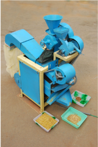
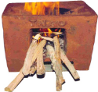
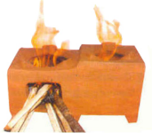
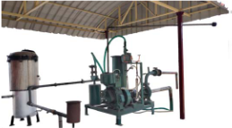
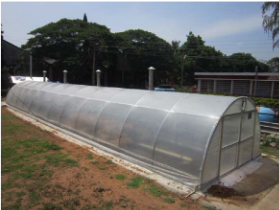
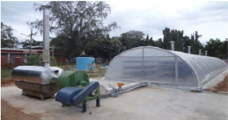
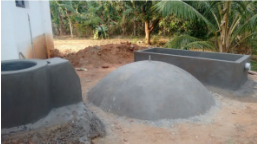
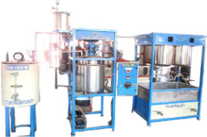

# Tamarind — Agriculture - TNAU production guide
> Auto-extracted from government extension sources by CropBot pipeline. Content is faithful to the source; see front-matter for provenance.
## Main content — Part 1 (pp. 449–456)
## TAMARIND DESEEDER

<!-- p. 449 -->

## Improved TNAU Dhal Mill

<!-- p. 450 -->

## The salient features of the improved TNAU dhal mill:

<!-- p. 450 -->

- ™ Suitable for splitting, cleaning and grading of pulses into dhal at the rate of 25-30 kg / hour

- ™ Capable of dry milling of cereals into powder by changing into cast iron rolls

- ™ Easy to operate and run by one H.P. single phase motor

- ™ The unit has pitting unit for enhancing the preconditioning process

- ™ Reduced conditioning time of 4-6 hours compared to 12 hours in conventional method

- ™ Milling and grading efficiencies are more than 80%

- ™ The cost of the unit is Rs.50000/-

- ™ The cost of operation is Rs.2 per kg

## 25. RENEWABLE ENERGY ENGINEERING (i) SINGLE POT CHULHA

<!-- p. 451 -->

The single pot chulha has a double wall with a gap of 2.5 cm. It has a grate at the bottom of the combustion chamber. Legs have been provided in the four corners of the chulha (5 cm height) as the ash can be collected below the grate. The outer wall has two rectangular secondary air openings at the lower portion on both sides for air entry. The inner wall has 1 cm diameter holes which maintain a triangular pitch of approximately 3 cm. The secondary air enters through the rectangular opening in the outer wall gets heated in the annular chamber and while moving up it passes through the holes in the combustion chamber. The preheated air helps in proper burning of the fuel. The efficiency of single pot improved chulha is 24%. The cost of the unit is Rs.350/-.

*(ii) DOUBLE POT CHULHA*

The TNAU double pot portable chulha (chimneyless) is made with two walls Around the first pot, an annular chamber having a width of 2.5 cm is left and the outer wall is constructed. The outer wall is also extended to cover the second pot in which case the annular chamber width is 3.5 cm, because of the smaller diameter of the second pot hole. Two secondary air inlets are made, one on the outer wall with rectangular shape (17 cm x 1 cm) near the combustion chamber and the other at the bottom of the second pot hole with round shape having a diameter of 5 cm. At the bottom of the first pot hole in the base, a hole of diameter 14 cm is made and a grate (C.I.) is placed over it. For the entry of secondary air to the first pot hole, 1 cm dia holes are made with a triangular pitch of 3 cm on the inner side of first pot hole and also on the tunnel projecting into the second pot hole. The efficiency of double pot improved chulha is 26%. The cost of the unit is Rs.600/-.

*(iii)BIOMASS GAS STOVE*

The biomass gas stove has been developed for small scale thermal application in agriculture and allied industries. This stove widens the market for agro wastes, makes possible a higher efficiency and in some cases reduces the time and investment, all by comparison with combustion. The biomass gas stove is a natural convection type updraft gasifier consisting of a cylindrical body made of clay, sand and paddy husk with its top open and bottom closed. The diameters and height of the stove are 290 mm and 630 mm respectively. This can be reduced depending on the applications. An iron grate to hold the biomass is fixed at 50 mm from the base of the reactor. The bottom is provided with an air opening cum ash removal door. At the top, provision is made to place vessel for cooking, boiling etc. The biomass viz., wood chips, agricultural residues like coconut shell, groundnut shell, arecanut husk, tree barks and leaves can be used in this biomass gas stove. The feedstock materials used should preferably be in the form of small chips, splinters and small logs. The fuel consumption is 5 kg/h and its thermal efficiency is 23%. The cost of the unit is Rs.1000/-.

*(iv) DOWNDRAFT GASIFIER FOR WATER PUMPING*

A downdraft gasifier along with a gas cleaning system retrofitted with a 5 Hp diesel engine coupled with a centrifugal pump for pumping water for irrigation applications. In order to supply producer gas for running the 5 Hp engine on dual fuel mode, a 10 kg/h capacity downdraft gasifier is required. A maximum of 50 percent diesel can be saved by substituting 50 percent of diesel with the producer gas obtained from biomass. And the cost of operating the gasifier coupled water pumping system is around Rs.50/h.

*(v) SOLAR TUNNEL DRIER*

The solar tunnel dryer is commercially used dryer for drying agro food products. Solar tunnel dryer is working based on Green House Effect principle. It results that 15-20°C increase in temperature above ambient temperature inside the solar tunnel dryer to dry the product from initial moisture to safe storage moisture. It mainly consists of semi-cylindrical tunnel structure, solar collector and cement concrete floor with absorber surface (Table 1). The semi cylindrical pipe structure covered with U.V. stabilized semi-transparent polyethylene sheet of 200-micron thickness. Drying floor with absorber surface is a cement concrete flooring laid at a gradient of 5° along the length with special black coating. The dryer is walk-in type and to facilitate loading and unloading of the product to be dried. The trays made of 8 SWG thick galvanized iron mesh with dimension of 1m x 1m can be used to increase the capacity. The dimensions of drying chamber (LxWxH) is 18m x 3.75m x 2.0m. The length can be varied depending upon capacity of the products to be dried.

## (vi) BIOMASS HOT AIR GENERATION SYSTEM INTEGRATED WITH SOLAR TUNNEL DRYER

<!-- p. 454 -->

Renewable energy integrated drying system using solar thermal and biomass hot air with controlled environment can be used for continuous drying of agro-products.

- Solar mode is used for drying during sunshine hours and biomass mode is used during off-sunshine hours, cloudy weather.

- Suitable to dry coconut, turmeric, chillies, medicinal plants, vadam (food) products etc., with hygienic environment and enhanced quality compared to conventional open sun drying.

- Efficient (19 %) biomass combustor with heat exchanger is suitable for various biomass fuel such as coconut husk, coconut shell and wood logs.

- The integrated drying system attains the drying temperature ranged from 45 to 65 o C and has controls to maintain desired RH and temperature.

- Loading capacity is 500 kg to 2 tonnes per batch

- Drying time for coconut in integrated dryer is 48-52 h and 4-5 days in Solar tunnel dryer

- Cost of installation of integrated dryer is Rs.6.0 lakhs for 500 kg and Rs.8.0 lakhs for 2 tonnes/batch

- Reduces 35% drying time over solar tunnel dryer and 70 % over conventional open sun drying method.

## (vii) NIGHT SOIL BIOGAS PLANT

<!-- p. 454 -->

Night Soil cum Kitchen Waste based Biogas Plant is the integration of modern biogas technology with disposal of night soil and food wastes generated from hostel kitchens and dining halls for harnessing bio-based energy.

- The hydraulic retention time of the plant is 45-55 days and human waste from 40 persons will be required for the production of 1 m 3 .

- Biogas contains 65-70% methane and 30-35% carbon dioxide with traces of H2S.

- Available at varying capacities from 1 m 3 to any higher capacity, based on the feedstock availability.

- Cost of installation is Rs. 30,000 for 1 m 3 and about Rs. 6.5 lakhs for 20 m 3 capacity.

- Biogas is utilised for cooking, lighting through mantle lamps, running engines, electricity generation, etc.

- Biogas burners, lamps and engines are available with hourly capacities from 8 to 100, 4-5 and from 50 cubic feet, respectively.

- Major advantages are sanitation and hygiene, environmental improvement, energy generation, provision of community facilities, etc.

## (viii) BIODIESEL PILOT PLANT

<!-- p. 455 -->

The bio-diesel pilot plant consists of a transesterification reactor with heater, a stirrer, chemical mixing tank, glycerol settling tank (2 Nos.) and washing tank. The capacity of pilot bio-diesel plant is 250 litres/day. The cost of the pilot plant is Rs.5 lakhs. oil is mixed with alcohol and catalyst mixture in transesterification reactor. The reactor is kept at reaction temperature for specific duration with vigorous agitation. After reaction, the biodiesel and glycerol mixture is sent to the glycerol settling tank. The crude bio-diesel is collected and washed to get pure bio-diesel. Depending upon the need, the size of the unit can be scaled up to get higher production.

- HOME SCIENCE

## FOOD PROCESSING TECHNOLOGIES

<!-- p. 456 -->

## Other mentions in this source
### p. 88

Tamarind and Neem trees upto 3-4 years from date of planting form an ideal tree component for agroforestry in black cotton soils of Kovilpatti. Sorghum and blackgram gave higher yield even at 50 per cent of the recommended level of fertilizer application.
### p. 443

Purpose For harvesting tamarind, and citrus fruits
### p. 449

¾ Suitable for deseeding dried dehulled tamarind fruits
### p. 449

¾ Various sizes of the dehulled tamarind fruits can be used for deseeding
### p. 449

¾ The roller gap can be adjusted as per the size of the tamarind fruits
