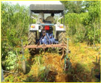
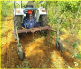

# Tapioca — Agriculture - TNAU production guide
> Auto-extracted from government extension sources by CropBot pipeline. Content is faithful to the source; see front-matter for provenance.
## Main content — Part 1 (pp. 443–444)
## TRACTOR OPERATED SINGLE / TWO ROW CASSAVA HARVESTER

<!-- p. 443 -->

Purpose To dig cassava tubers in single / two rows

Type of the

implement

Field capacity 0.65 ha/day for single row and 0.96 ha/day for double row

Cost of the

implement

Salient

Features Rs. 45,000/- for single row and Rs. 55,000/- for double row (Approximately)

Tractor operated

- It is suitable for both single row and two rows operations.

- The blade angle of 20 deg is provided for easy penetration in to the soil.

- The row spacing can be altered by moving the shanks in the main frame.

- The depth wheels are provided to the depth of operation.

Purpose

Type of the

## Other mentions in this source
### p. 241

Below 7 years of age: Any suitable annual crop for particular soil type and climatic condition may be raised as intercrops upto 5 years after planting depending upon the canopy coverage. Groundnut, sesamum, sunflower, tapioca, turmeric and banana can be grown. Avoid crops like paddy and sugarcane etc.
### p. 241

The following crops can be grown depending on the soil and climatic suitability. (i) Annuals : Groundnut, bhendi, turmeric, tapioca, sweetpotato, sirukizhangu, elephant foot yam, ginger, pineapple (ii) Biennials : Banana varieties, poovan and monthan are suitable. (iii) Perennials :
### p. 407

Hard pan occurs in red soil areas due to the movement of clay and iron hydroxides and calcium carbonate and settling at shallow depth, which increases the soil bulk density to more than 1.8 g/cc, their by preventing the root proliferation. These soils can be reclaimed by chiselling the soils with chisel plough at 0.5 m interval first in one direction and then in the direction perpendicular to the previous one, once in two to three years. Applications of FYM or composted coir pith at 12.5 t ha-1could bring additional yields of about 30 per cent over control. Deep ploughing of the field during summer season can be followed to open up the sub soil. Cultivation of deep rooted crops like tapioca, cotton and semipereneal crop like mulberry encourage natural breaking of the hardpan.
### p. 416

The initial investment in drip irrigation system is mainly depends upon the spacing of crops. The initial cost will be almost 75 - 85 thousand rupees per hectare for wider spacing crops such as coconut, mango, grapes and for orchard crops. The initial cost is approximately 1 - 1.25 lakh rupees per hectare for close spacing crops such as sugarcane, banana, papaya, mulberry, turmeric, tapioca, vegetables and flower crops.
