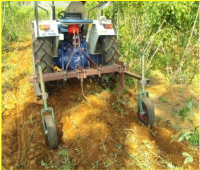

# Tapioca — Horticulture - TNAU production guide
> Auto-extracted from government extension sources by CropBot pipeline. Content is faithful to the source; see front-matter for provenance.
## Main content — Part 1 (pp. 153–155)
## 6. Tapioca (Manihot esculenta Crantz.) ; Euphorbiaceae

<!-- p. 153 -->

CO 2, CO 3, CO (Tp) 4, CO (Tp ) 5, MVD 1, H 165, H 226, Sree Visakham (H.1687), Sree Sahya (H.2304), Sree Prakash (S. 856), Sree Vijaya, Sree Jaya, Sree Rekha, Sree Prabha, Sree Athulya, Sree Raksha (CMD resistant), Yethapur 1 (YTP 1)

## Climate and soil

<!-- p. 153 -->

Well drained soil preferably red lateritic loam with a pH range of 5.5-7.0 is ideal. Thrives best in tropical, warm humid climate with well distributed rainfall of over 100 cm per annum. Cultivated upto an elevation of 1000 m.

Plant throughout the year under irrigation. Plant during April for rainfed crop. Select healthy mosaic free vigorous plants for taking planting materials. Prepare setts of 15 cm long with 8 - 10 nodes from the middle portion of the stem. Avoid mechanical damage while preparation and handling of setts. The cut end should be uniform. Dip the setts in Carbendazim 1 g in one liter of water for 15 minutes before planting to prevent tuber rot. Dip the setts in Dimethoate @ 2 ml/litre of water + Carbendazim @ 2 g/litre of water for 15 minutes before planting. Scale insects and mealy bug adhering to the planting materials may be destroyed by the sett treatment Plant the setts vertically with buds pointing upward on the sides of ridges. 12,500 setts are needed for planting one ha. For rainfed conditions, treat the setts with a mixture of potassium chloride @ 5 g/lit and micronutrients viz., ZnSO4 and FeSO4 each @ 0.5% for 20 minutes.Dip the setts for 20 minutes in Azospirillum and Phosphobacteria each at 30 g/l.

## Virus elimination through tissue culture in cassava

<!-- p. 153 -->

The protocol for virus elimination through tissue culture has been standardized for the varieties MVD 1 and H 226 by using meristem culture. The Murashige and Skoog (MS) medium supplemented with BAP at 0.1 mg/l for meristem establishment and shoot growth, and MS medium without growth regulators for rooting have to be followed. The in vitro plantlets are to be hardened in sterile pot mixture (sand : soil : FYM in 1 : 1: 1) under mist chamber for 10-15 days and later kept under shade net for 10 days before transferring them to the open field.

Plough the field 4 - 5 times to get a fine tilth. The soil depth should be atleast 30 cm. Form ridges and furrows at the following spacings:

## Irrigated

<!-- p. 153 -->

75 x 75 cm (17,777 setts) and 90 x 90 cm (12,345 setts).

## Rainfed

<!-- p. 153 -->

60 x 60 cm (27,777 setts)

## Under Kanyakumari conditions

<!-- p. 153 -->

90 x 90 cm (12,345 setts).

First irrigation is given at the time of planting. Life irrigation is given on the 3 rd day followed by once in 7 - 10 days upto 3 rd month and once in 20 - 30 days upto 8 th month.

Install drip system with main and sub-main and place the inline laterals at the interval of 1.5 m. Place the drippers at the interval of 60 cm for 4 LPH and 50 cm for 3.5 LPH in the lateral system. Form the raised beds at 120 cm width at an interval of 30cm and place the laterals at the centre of each bed.

## Sequential cropping

<!-- p. 154 -->

Raise CO 2 vegetable cowpea during March and harvest green pods before planting cassava during June -July. After green pod harvest, incorporate the cowpea haulms into the field by disc ploughing. Through sequential cropping, 50% reduction in application of FYM (12.5 t/ha) and P (30 kg/ha) is ensured.

## Irrigated crop

<!-- p. 154 -->

Apply 25 t FYM/ha and incorporate at the time of planting. Apply 45:90:120 kg NPK/ha as basal and 45:120 kg NK/ha 90 days after planting during earthing up. Apply 25kg ZnSo4, 20 kg S as gypsum, 10 kg Borax ha -1 as basal soil application.

## Rainfed crop

<!-- p. 154 -->

Apply FYM at 12.5 t/ha along with 50 kg N, 65 kg P and 125 kg K/ha as basal. Apply 2 kg of Azotobactor through soil application at 30 - 60 days after planting on receipt of showers (2.0 kg Azotobacter + 20 kg FYM + 20 kg soil per hectare).

## Fertigation requirement

<!-- p. 154 -->

90: 90 :240 kg of NPK / ha. Apply once in every three days throughout the cropping period.

60 x 90cm in paired row system.

## Fertigation schedule: Tapioca (variety)

<!-- p. 154 -->

| Crop Stage                     | Durati on in Days   | Fertilizer Grade           | Total Fertilizer (kg/ha)   | Nutrient supplied - N   | Nutrient supplied - P   | Nutrient supplied - K   | % Requirement - N   |   % Requirement - P |   % Requirement - K |
|--------------------------------|---------------------|----------------------------|----------------------------|-------------------------|-------------------------|-------------------------|---------------------|---------------------|---------------------|
| Planting to crop establishment | 20                  | 19:19:19+MN 13-0-45 0-0-50 | 23.57 34.67 7.87           | 4.48 4.50 -             | 4.48 - -                | 4.48 15.6 3.93          | 10.0 0              |                5.00 |               10.00 |
|                                |                     |                            | Sub total                  | 8.98                    | 4.48                    | 24.0                    | 47.3 -              |                     |                     |
| Vegetative                     | 70                  | 12-61-0 13-0-45 Urea       | 11.40 105.33 26.80         | 1.34 13.69 12.33        | 6.80 - -                | - 47.3 -                | 30.0                |                 7.5 |               20.00 |
|                                |                     |                            | Sub total                  | 27.36                   | 6.80                    | 47.3                    |                     |                     |                     |
| Tuber formation                | 60                  | 12-61-0 0-0-50 Urea        | 11.40 144.00 55.73         | 1.34 - 25.64            | 6.80 - -                | - 72.0 -                | 30.0                |                7.50 |               30.00 |
|                                |                     |                            | Sub total                  | 26.98                   | 6.80                    | 72.0                    |                     |                     |                     |
| Tuber development              | 90                  | 19:19:19+MN 0-0-50 Urea    | 23.57 182.67 48.87         | 4.48 - 22.48            | 4.48 - -                | 4.48 92.3 -             | 30.0                |                5.00 |               40.00 |
| Total duration                 | 240                 |                            | sub total                  | 26.96                   | 4.48                    | 96.8                    |                     |                     |                     |
| Total                          | Total               | Total                      | Total                      | 90.28 (or) 90           | 22.56 (or) 22.50        | 240.2 (or) 240          | 100                 |                  25 |                 100 |

-  75% RD of Phosphorus applied as superphosphate 421.88 kg/ha.

## Chlorosis

<!-- p. 155 -->

Foliar spray of 1% FeSO4 + 0.5% ZnSO4 at 60 and 90 DAP.

Fill up the gaps within 20 days of planting. Carry out first weeding 20 days after planting. Subsequent weeding should be done once in a month upto 5 months depending upon the weed intensity. Thin to two shoots per plant during 60th day. Grow aggregatum onion, coriander, short duration pulses and short duration vegetables as intercrops from planting date upto 60 days

Mites: Soaking spray with dicofol 18.5 EC 2.5 ml/l during 3rd and 5th month.

## White fly (Bemisia tabaci)

<!-- p. 155 -->

Integrated pest management practices:

- Remove alternate weed hosts viz., Abutilon indicum.

- Install yellow sticky trap at 12 Nos/ha.

- Use nitrogen judiciously.

- Avoid excessive irrigation.

- Spray neem oil 3 % or fish oil rosin soap 25 g/l or Methyl demeton 25 EC 2 ml/l. While using neem oil, teepol or sandovit should be added at 1 ml/l for better contact with foliage.

Apply Methyl demeton in the early stage and Phosalone in the later stages of crop growth.

- Avoid use of synthetic pyrethroids.

- Avoid extending the crop growth beyond its duration.

## Spiralling whitefly

<!-- p. 155 -->

- Install sticky cum light trap and operate between 4 and 6 am to attract adults.

- Conserve parasitoids Encarsia haitiensis and E. guadeloupae.

## Main content — Part 2 (pp. 390–391)
## Mechanical Chipper for Tapioca

<!-- p. 390 -->

Tapioca (Manihot esculenta) is a root crop cultivated for use of food, animal feed and production of starch. In India tapioca is grown in 0.35 million ha. area and produces about 6 million tonnes annually. The physiological deterioration of tapioca root is related to accumulation after the harvest within a shorter period of one week. This spoilage can be prevented by chipping and drying of tapioca tubers. At present the tuber is sliced manually which is highly time consuming and in-efficient, besides causing drudgery to the personworking. Therefore a vertical feed type motorised tapioca chipping machine has been developed in the Department of Agricultural Processing, Tamil Nadu Agricultural University, Coimbatore.

The developed tapioca chipper consists mainly of a feed hopper with guides, chipping disc with knives, chips outlet and a 0.5 HP single phase electric motor. The feed hopper is provided with vertical guides made of pipes of diameter 25 to 80 mm for 100 mm length to facilitate feedings of tubers of varying diameters. Through these guides the tubers reach the chipping disc having three blades, rotating at 300 rpm. The radially mounted blades on the chipping disc slice the tuber and the chip is collected through the outlet.

Salient features:

! Suitable for varying diameters of tubers ! Thickness of chips can be varied ! Also suitable for slicing other tuber crops like radish, carrot, potato °etc. ! The capacity of the unit is 270 kg per hour.

- ! The cost of the unit is Rs.10,000/-.

## Main content — Part 3 (pp. 397–398)
## Tractor operated single / two row cassava harvester

<!-- p. 397 -->

Function :

Description :

To dig cassava tubers in single / two rows

The cassava harvester consists of main frame, shanks, digging blade, hitching frame and depth adjustment wheels. It is suitable for both single row and two rows operations. The shank was designed as a bent leg plough with an angle of 150 deg to accommodate the dug cassava tubers. The blade angle of 20 deg is provided for easy penetration in to the soil. The row spacing can be altered by moving the shanks in the main frame. The depth wheels are provided to the depth of operation.

Salient features

Power source :

Field Capacity Above 45 hp tractor

: 0.65 ha/day (Single row)

Cost of unit :

0.96 ha/day (Two row)

Rs. 45,000/- (Single row)

Rs. 55,000/- (Two row)

*Tractor operated Single row Cassava Harvester*

*Tractor operated Two row Cassava Harvester*

## Main content — Part 4 (pp. 411–412)
## Tapioca

<!-- p. 411 -->

Soil

: Red Sandy loam

(Thulukkanur series)

Target range : 45 - 50 t ha -1 fresh tuber FN = 0.56 T- 0.61 SN- 0.81 ON FP2O5 = 0.35 T- 1.80 SP- 0.53 OP FK2O = 0.94 T- 0.67 SK- 0.70 OK

|   Initial Soil Test Values (kg ha -1 ) - SN |   Initial Soil Test Values (kg ha -1 ) - SP |   Initial Soil Test Values (kg ha -1 ) - SK | NPK (kg ha -1 ) + FYM @ 12.5 t ha -1 + Azospirillum @ 2 kg ha -1 + PSB @ 2 kg ha -1 - 45 t ha -1 FN   |   NPK (kg ha -1 ) + FYM @ 12.5 t ha -1 + Azospirillum @ 2 kg ha -1 + PSB @ 2 kg ha -1 - FP2O5 |   NPK (kg ha -1 ) + FYM @ 12.5 t ha -1 + Azospirillum @ 2 kg ha -1 + PSB @ 2 kg ha -1 - FK2O |   NPK (kg ha -1 ) + FYM @ 12.5 t ha -1 + Azospirillum @ 2 kg ha -1 + PSB @ 2 kg ha -1 - 50 t ha -1 FN |   NPK (kg ha -1 ) + FYM @ 12.5 t ha -1 + Azospirillum @ 2 kg ha -1 + PSB @ 2 kg ha -1 - FP2O5 |   NPK (kg ha -1 ) + FYM @ 12.5 t ha -1 + Azospirillum @ 2 kg ha -1 + PSB @ 2 kg ha -1 - FK2O |
|---------------------------------------------|---------------------------------------------|---------------------------------------------|-------------------------------------------------------------------------------------------------------|-----------------------------------------------------------------------------------------------|----------------------------------------------------------------------------------------------|-------------------------------------------------------------------------------------------------------|-----------------------------------------------------------------------------------------------|----------------------------------------------------------------------------------------------|
|                                         180 |                                          10 |                                         200 | 77                                                                                                    |                                                                                            95 |                                                                                          224 |                                                                                                   105 |                                                                                           112 |                                                                                          271 |
|                                         200 |                                          12 |                                         220 | 65                                                                                                    |                                                                                            91 |                                                                                          211 |                                                                                                    93 |                                                                                           108 |                                                                                          258 |
|                                         220 |                                          14 |                                         240 | 53                                                                                                    |                                                                                            87 |                                                                                          197 |                                                                                                    81 |                                                                                           105 |                                                                                          244 |
|                                         240 |                                          16 |                                         260 | 45*                                                                                                   |                                                                                            84 |                                                                                          184 |                                                                                                    69 |                                                                                           101 |                                                                                          231 |
|                                         260 |                                          18 |                                         280 | 45*                                                                                                   |                                                                                            80 |                                                                                          170 |                                                                                                    56 |                                                                                            98 |                                                                                          217 |

*maintenance dose

Soil : Red Sandy loam FN = 0.45 T- 0.63 SN- 0.72 ON (Palaviduthi series) FP2O5 = 0.42 T- 4.18 SP- 0.73 OP Target range : 80 - 90 t ha -1 FK2O = 0.40 T- 0.48 SK- 0.66 OK

|   Initial Soil Test Values (kg ha -1 ) - SN |   Initial Soil Test Values (kg ha -1 ) - SP |   Initial Soil Test Values (kg ha -1 ) - SK |   NPK (kg ha -1 ) + FYM @ 12.5 t ha -1 + Azospirillum @ 2 kg ha -1 + PSB @ 2 kg ha -1 - 80 t FN |   NPK (kg ha -1 ) + FYM @ 12.5 t ha -1 + Azospirillum @ 2 kg ha -1 + PSB @ 2 kg ha -1 - FP2O5 | NPK (kg ha -1 ) + FYM @ 12.5 t ha -1 + Azospirillum @ 2 kg ha -1 + PSB @ 2 kg ha -1 - 90 t FK2O FN   |   NPK (kg ha -1 ) + FYM @ 12.5 t ha -1 + Azospirillum @ 2 kg ha -1 + PSB @ 2 kg ha -1 - FP2O5 |   NPK (kg ha -1 ) + FYM @ 12.5 t ha -1 + Azospirillum @ 2 kg ha -1 + PSB @ 2 kg ha -1 - FK2O |
|---------------------------------------------|---------------------------------------------|---------------------------------------------|-------------------------------------------------------------------------------------------------|-----------------------------------------------------------------------------------------------|------------------------------------------------------------------------------------------------------|-----------------------------------------------------------------------------------------------|----------------------------------------------------------------------------------------------|
|                                         200 |                                          14 |                                         200 |                                                                                             179 |                                                                                           245 | 189 224                                                                                              |                                                                                           287 |                                                                                          229 |
|                                         220 |                                          16 |                                         220 |                                                                                             166 |                                                                                           237 | 179 211                                                                                              |                                                                                           279 |                                                                                          219 |
|                                         240 |                                          18 |                                         240 |                                                                                             154 |                                                                                           229 | 170 199                                                                                              |                                                                                           271 |                                                                                          210 |
|                                         260 |                                          20 |                                         260 |                                                                                             141 |                                                                                           220 | 160 186                                                                                              |                                                                                           262 |                                                                                          200 |
|                                         280 |                                          22 |                                         280 |                                                                                             129 |                                                                                           212 | 151 174                                                                                              |                                                                                           254 |                                                                                          191 |

## Other mentions in this source
### p. 229

Below 7 years of age: Any suitable annual crop for particular soil type and climatic condition may be raised as intercrops upto 5 years after planting depending upon the canopy coverage. Groundnut, sesamum, sunflower, tapioca, turmeric and banana can be grown. Avoid crops like paddy and sugarcane etc.
### p. 229

The following crops can be grown depending on the soil and climatic suitability. (i) Annuals : Groundnut, bhendi, turmeric, tapioca, sweetpotato, sirukizhangu, elephant foot yam, ginger, pineapple (ii) Biennials : Banana varieties, poovan and monthan are suitable. (iii) Perennials : Cocoa*, pepper* (Panniyur 1 or Panniyur 2 or Panniyur 5 or Karimunda), nutmeg* and vanilla* *Suitable areas are Pollachi tract of western region and Kanyakumari district. For vanilla, use disease free planting material and maintain high vigilance to maintain a disease free
### p. 343

Vegetables: Iron is essential for the initial growth of vegetable crops. So it is essential to apply Iron containing fertilizers at the initial stage of development to avoid iron deficiency in vegetable crops. Iron deficiency is common in crops like Beans, Cauliflower, Beetroot, Brinjal, Tomato and Tapioca. Remedy: Apply 25 kg Ferrous sulphate per ha as soil application or foliar spray 0.5 %
### p. 344

It is immobile in plant system. It plays a role in flowering, pollen germination, pollen tube growth and fruiting. It helps in the translocation of sugars from leaves to enhance photosynthesis. Boron also acts as a catalyst in physiological processes viz, cell division, differentiation and development. Its essentiality is obvious in Potato, Tapioca, Cabbage, Grapes, Citrus, Tomato and Guava.
### p. 387

Function tapioca, cotton and orchards.
### p. 388

Useful for weeding between rows of crops like tapioca, tomato and crops whose rows spacing is more than 45 cm.
