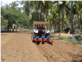

# Turmeric — Agriculture - TNAU production guide
> Auto-extracted from government extension sources by CropBot pipeline. Content is faithful to the source; see front-matter for provenance.
## Main content — Part 1 (pp. 440–440)
## TRACTOR DRAWN TURMERIC RHIZOME PLANTER

<!-- p. 440 -->

Purpose To plant turmeric rhizomes on ridges

Type of the Tractor mounted

implement

Field capacity 1.2 ha/day

Cost of the

implement

Salient

Features Rs. 60,000 /- (Approximately)

- Three rows can be planted at a time in the required spacing.

- Row spacing is adjustable

- Saving in quantity of 500 kg/ ha seed rhizomes

## Other mentions in this source
### p. 145

Treat the seeds with turmeric rhizome powder (or) neem leaf powder at 1:50 ratio against bruchid infestation as an eco-friendly seed treatment.
### p. 241

Below 7 years of age: Any suitable annual crop for particular soil type and climatic condition may be raised as intercrops upto 5 years after planting depending upon the canopy coverage. Groundnut, sesamum, sunflower, tapioca, turmeric and banana can be grown. Avoid crops like paddy and sugarcane etc.
### p. 241

The following crops can be grown depending on the soil and climatic suitability. (i) Annuals : Groundnut, bhendi, turmeric, tapioca, sweetpotato, sirukizhangu, elephant foot yam, ginger, pineapple (ii) Biennials : Banana varieties, poovan and monthan are suitable. (iii) Perennials :
### p. 416

The initial investment in drip irrigation system is mainly depends upon the spacing of crops. The initial cost will be almost 75 - 85 thousand rupees per hectare for wider spacing crops such as coconut, mango, grapes and for orchard crops. The initial cost is approximately 1 - 1.25 lakh rupees per hectare for close spacing crops such as sugarcane, banana, papaya, mulberry, turmeric, tapioca, vegetables and flower crops.
### p. 454

Suitable to dry coconut, turmeric, chillies, medicinal plants, vadam (food) products etc., with hygienic environment and enhanced quality compared to conventional open sun drying.
