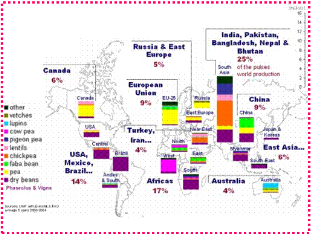
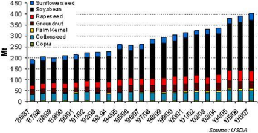
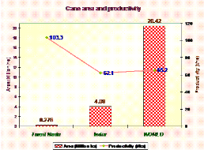
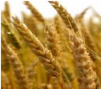
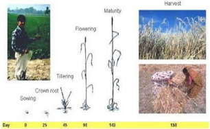
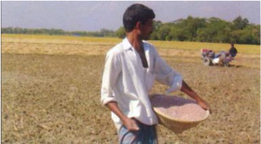
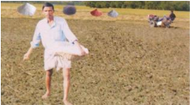

# Wheat — Field Crops (Rabi) - ICAR e-course
> Auto-extracted from government extension sources by CropBot pipeline. Content is faithful to the source; see front-matter for provenance.
## Main content — Part 1 (pp. 6–26)
## Importance of wheat

<!-- p. 6 -->

-  World's number one cereal in area

-  Cultivation of wheat is as old as civilization

-  It is the first mentioned crop in Bible

-  Used for bread, cakes, bakeries, also manufacture of dextrose, alcohol etc

-  A nutritious food of all

## Wheat: Indian Scenario

<!-- p. 6 -->

| State     |   Area ( '000 ha) |   Production ( '000 t) |   Productivity (kg/ha) |
|-----------|-------------------|------------------------|------------------------|
| UP        |            9163.9 |                24073.8 |                   2627 |
| MP        |            3692.8 |                 5957.7 |                   1613 |
| Punjab    |              3468 |                  14493 |                   4179 |
| Rajasthan |            2123.9 |                 5865.3 |                   2762 |
| Haryana   |              2304 |                   8857 |                   3844 |
| Bihar     |            2003.7 |                   3239 |                   1617 |
| All India |             26484 |                69354.5 |                   2619 |

(Ministry of Agriculture, Govt. of India, 2005-06)

## Area Expansion in wheat cultivation in India - In million

<!-- p. 7 -->

| Year    |   Area (ha) |   Production (t) |   Productivity (t) |
|---------|-------------|------------------|--------------------|
| 1950-51 |        9.75 |             6.45 |               0.66 |
| 1960-61 |       12.93 |            11.00 |               0.85 |
| 1967-68 |       15.00 |            16.54 |               1.10 |
| 1970-71 |       18.24 |            23.83 |               1.30 |
| 1980-81 |       22.28 |            36.31 |               1.63 |
| 1990-91 |       24.17 |            56.13 |               2.26 |
| 1998-99 |       27.40 |            70.78 |               2.58 |

## Rabi season pulses

<!-- p. 7 -->

## Cool season food legumes are

<!-- p. 7 -->

- o Chickpea, Filedpea, Lentil, , Frenchbean,

- o They contribute 60% world pulse production

-  28 million ha globally

-  They are concentrated on temperate and sub-tropical climate

-  Chickpea, lentil in developing countries

-  Peas in developed countries

India, Pakietan;

Bangladesh; Nepal &

Bhutan

Europe

2590

590

Canada

E4

China

USA

Turkoy,

East Asia_

USA,

Mexic 0

Brazil _

Atrica:

Australia

## Global Pulse production

<!-- p. 8 -->

## Demand for pulses in Tamil Nadu

<!-- p. 8 -->

Annual production

: 1.77 l.t

Requirement for the projected population : 7.0 l.t

Import

: 5.23 l.t

Countries

: Australia, Myanmar,Canada, Turkey,France and Tanzania

Indian States

: Maharashtra, A.P, Karnataka, Punjab and M.P

## Importance of Oilseeds

<!-- p. 8 -->

India is the fourth largest oilseed producing country in the world

The major oilseeds are Soybean, Cottonseed, Groundnut, Sunflower, Rapeseed, Sesame seed, Copra, Linseed, Castor seed and Palm Kernels.

In India, oilseeds are grown in an area of nearly 27 million hectares across the length and breadth of the country.

450

Sunilonerseed

Soyabean

400

Rapes eed

350

Groundnut

PalmKemnel

300

Cotonseed

250

4

200

150

100

50

0

Scue

"0405

'87/88

"8889

"02703

13.04

## World Oilseed Production Importance of sugar crops

<!-- p. 9 -->

-  In addition to providing the source for the manufacture of sugar, sugar crops are used to produce alcohol and ethanol.

-  In certain countries, sugar cane is eaten raw in minor quantities.

-  It also is used in the preparation of juices and for animal feed.

-  There are two major sugar crops: sugar beets and sugar cane. However, sugar and syrups are also produced from the sap of certain species of maple trees, from sweet sorghum when cultivated explicitly for making syrup and from sugar palm.

-  Sugar beets that are cultivated solely as a fodder crop and are classified as vegetable crops

-  Sugar cane is a perennial grass that is cultivated mainly in the tropics.

-  Sugar beet is an annual crop that is propagated by the seeds of the flowers, cultivated in cooler climates than sugar cane

-  Both sugar beets and sugar cane have high water content, accounting for about 75 percent of the total weight of the plants. The sugar content of sugar cane ranges from 10 to 15 percent of the total weight, while that of sugar beets is between 13 and 18 percent.

-  The traditional sources of sugar are sugar cane and sugar beets.

1

1

Ei

4276

MORD

## Importance of medicinal and aromatic crops

<!-- p. 10 -->

-  India is endowed with a rich wealth of medicinal plants. These plants have made a good

- contribution to the development of ancient Indian medicine.

-  One of the earliest treatises on Indian medicine the Charak Samhita (1000 B.C), records the use of over 340 drugs of vegetable origin.

-  Medicinal and aromatic plants are important for human health. These plants have been used from the prehistoric times to present day. These plants based medicines are consumed in all civilizations.

-  It is believed that the herbal medicine can give good effect to body without causing side effects to human's life. Besides, the usage of medical plants has been increasing as an important role that can support the economic system.

-  The medical and aromatic plants for health are used as herbal treatments and therapies that can be new habits for culture.

-  With the high consumption of medical plants, it is possible that the over exploitation of such plants could be happen.

-  Some of the medicinal plants can be cultivated well in a research centre, agricultural site or even in a house. But for the wild medical plants, it needs to be more concerned to avoid the over cropped and keep the sustainability of the medical and aromatic plants.

## Importance of forage crops

<!-- p. 11 -->

India is basically an agricultural country and about 70 per cent of its people live in villages. Their livelihood is dependent mainly on agriculture and animal husbandry. Though India has a huge livestock population of over 582 million, besides poultry, production of milk and other livestock products are the lowest compared to the production in the world.

## Livestock population in India

<!-- p. 11 -->

| S. No.   | Livestock   |   Population (million) |
|----------|-------------|------------------------|
| 1.       | Cattle      |                 245.73 |
| 2.       | Buffalo     |                 109.44 |
| 3.       | Sheep       |                  79.78 |
| 4.       | Goat        |                 125.60 |
| 5.       | Pig         |                  18.23 |
| 6.       | Others      |                   3.79 |
| 7.       | Poultry     |                 459.96 |
| Total    |             |                 582.61 |

## Balance-sheet of animal feed and fodder in India

<!-- p. 11 -->

| Feed & fodder   |   Availability (m.t) |   Requirement (m.t) |   Deficit (m.t) |
|-----------------|----------------------|---------------------|-----------------|
| Green fodder    |               224.08 |              611.99 |          387.91 |
| Crop residues   |               231.05 |              869.79 |          638.74 |
| Concentrates    |                31.60 |               65.40 |           81.80 |

It is seen from the Table, that there is a huge gap between demand and supply of all kinds of feeds and fodders.

On the other hand, the land resources available for growing fodder and forage crops, it is estimated that the average cultivated area devoted to fodder production is only 4.4 per cent of the total area. Similarly, the area under permanent pastures and cultivable wastelands is approximately 13 and 15 million hectares respectively. Likewise, the total area under forests is 2.51 crore hectares and that open to grazing is 2.1 crore hectares. All these resources are able to meet the forage requirements of the grazing animals only during the monsoon season. But for the remaining periods of the year, the animals have to be maintained on the cropresidues or straws of jowar, bajra, ragi, wheat, barley, sugarcane trash etc. either in the form of whole straw or bhusa, supplemented with some green fodder, or as sole feed.

To attain the goal of rearing hybrid cows, feeding them with nutritious fodder is the most important aspect. Nutritious feed improves the health of the animal. In order to improve the quality and quantity of forage in India, location specific fodder varieties and species have been identified and also developed suitable cultivation technology for economic production.

One of the agriculture most limiting resources is water. A huge quantity of waste water (Effulent, sewage) is available. Identification of optimum forage production strategies for recycling water and plant nutrients along with monitoring of fodder quality, antinutritional/toxic principles and heavy metals will not only help to promote forage production but also prevent pollution hazard.

1. The most cultivated crop in India among cereals

- Rice

- Wheat

- Maize

- World production of wheat is __________ million tonnes

- 578.34

- 478.34

- 678.34

- ___________ leads as highest productivity of wheat in the world

- India

- USA

- China

- 70% of area and 75% of the production of groundnut in India is in

- A.P

- Tamil Nadu

- Both

- Production of wheat is __________ million tonnes in India

- 71

- 81

- 61

- Highest productivity of wheat is in ________ state of India

- Tamil Nadu

- Punjab c. Maharastra

- In India, productivity of sugarcane is highest in the state

- Tamil Nadu

- Punjab

- None

- Mention the Rabi season pulse

- Chick pea b. Green gram c. Red gram

*****☺*****

-  De Candolle believed - Valley of Euphrates and Tigris

-  But Vavilov

- o Origin of Durum wheat probably Abyssinia

- o Soft wheat groups - In the region of Western Pakistan, SW Afghanistan, and S parts of mountainous Babshara

-  World's number one cereal in area

-  Cultivation of wheat is as old as civilization

-  It is the first mentioned crop in Bible

-  Used for bread, cakes, bakeries, also manufacture of dextrose, alcohol etc

-  A nutritious food of all

## Classification of wheat

<!-- p. 14 -->

-  Genus Tricum can be classified into 3 groups

- o Diploids = 7 pairs of chromosomes

- o Tetraploids = 14 pairs

- o Hexaploids = 21 pairs

## Commonly cultivated wheat sp

<!-- p. 14 -->

-  There are 7 in the world, only 4 is important in India, they are:

- o Common wheat ( T vulgare / aestivum)

-  Bread wheat

-  Most suited for chapati and bakery

-  Cultivated throughout India

-  Common wheat may be sub-divided

-  Hard red winter wheat - commercial class

-  Hard red spring - where winter is too severe, high protein and excellent bread making characteristics

## Lecture 02

<!-- p. 14 -->

## WHEAT TRITICUM SP

<!-- p. 14 -->

-  Soft red winter - grown in humid conditions, grains are soft, low protein, flour more suitable for cakes, cookies

-  White wheat - mainly for pasty purpose

- o Duram (T durum)

-  Macroni wheat

-  Best suited for noodles, vermicelli

-  Spring habit

-  Cultivated in Central & Southern India

- o Emmer wheat (T dicoccum)

- o Winter / spring wheat

-  Wheat suitable for TN

-  Preferred for granular preparation

-  Gujarat, Maharastra, AP & TN

- o Shot wheat (T sphaerococcum)

-  Indian dwarf wheat

-  Practically gone out of cultivation due to low productivity

-  Small extent N. India and W Pak for local consumption

- o Sonak - to replace Sonalika

- o HD 2285

- o PBW 343, HD 2687, WH 542, UP 2336, Raj 3077, CPAN 3004, PDW 215

- o Many more like

-  Varieties for irrigated late sown

-  Varieties for salt affected areas etc

##  Adaptation and distribution

<!-- p. 16 -->

- o Widely cultivated cereal

- o 47ºS to 57ºN latitude

- o Cultivated in wide range of soils but

- o Well suited to fertile well drained silt and clay loam soils

- o Poorly suited to sandy or poorly drained soils

##  Climate

<!-- p. 16 -->

- o Wheat has hardening ability after germination

- o It can germinate at temp just above 4ºC

- o After germination it can withstand freezing temperatures by-

-  Spring wheat - as low as (-9.4ºC)

-  Winter wheat - as low as (-31.6ºC)

- o Normal process starts above 5ºC under the presence of adequate sunlight

- o During the process of hardening there is gradual increase in the dry matter, sugars, amide nitrogen, and amino nitrogen in the tissues

- o As a result there is greater tolerance to freezing of proteins

- o Hardened plants have lower moisture in the leaves and

- o Water is held more tightly within the cells

-  Response to photo period and growth

- o It is long day plant

- o Long day hastens the flowering

- o Short day increase the vegetative period

- o But no more varieties after the release of photo-insensitive

-  Temperature and growth

- o Wheat can be exposed to low temp during vegetative and high temp and long days during reproductive phases

- o Optimum is 20-22ºC

-  Optimum for vegetative - 16-22 º C

-  Leaves are largest at 22 º C

- o Temp above 22 ºC decreases the plant height, root length and tiller number

- o Heading is accelerated as temp rose from 22 to 34 ºC but retarded above 34 ºC

- o At grain development 25 ºC for 4- 5 weeks is optimum

-  Temp above 25 ºC reduce the grain weight

## Growth stages in wheat in North India

<!-- p. 17 -->

##  Vegetative

<!-- p. 17 -->

- o Germination : 5-7 days

- o CRI : 20-25 DAS

- o Tillering: from 15 days at 4-5 days until 45 DAS

- o Jointing: Peak plant growth 45-60 DAS

-  Internode elongation period

##  Reproductive

<!-- p. 17 -->

- o Boot leaf 70-75 DAS

- o Flowering : 85-90 DAS

- o Milking: 100-105DAS

- o Dough: 105-110

- o Maturity: 115 - 120

Harvost

Sowing

##  Coordinating Research Zones

<!-- p. 18 -->

- o There are 6 zones in India for wheat improvement and coordination

- o Northern Hills Zone

- o North Western Plans Zone

- o North Eastern Plains Zone

- o Central Zone

- o Peninsular Zone

- o Southern Hills Zone

*Different growth stages of wheat*

tilleaing

Jointing

Boot

## Wheat cultivation practices

<!-- p. 19 -->

- o Time of sowing decides yield potential in wheat

- o Irrigated long duration varieties (135-140d)

-  Nov 10-30th

- o Short duration varieties (120-125)may be sown up to Dec 15

- o Later than Dec 15th there is drastic reduction in yield

- o Zone wise there is slight variation

- o Usually after harvest of Kharif crops

- o Field is prepared by disking once and harrowing

- o Moderate to fine tilth is suitable

- o Zero tillage also possible

-  After rice dibbling in lines may be an option

RIPENING

HEADING

##  Methods of sowing

<!-- p. 20 -->

- o Broad casting

- o Zero / No-tillage sowing

- o Behind the plough

- o Drilling

- o Dibbling

- o FIRB - Furrow irrigated raised bed system

- o Normal recommendation 100-125 kg /ha

- o Increase seed rate by 25% when

-  Under late sown

-  When the soil moisture is less

- o Broadcast requires higher seed rate - 150 kg

- o For dibbling 25-30kg is sufficient

##  Spacing

<!-- p. 21 -->

- o Varies with varieties

- o Tillering variety requires wider spacing

- o Irrigated wheat spaced 22.5 cm and 8-18 cm between plants

- o Rainfed wheat - 25-30 cm x 5-6cm

- o When late sown closer spacing 15-16cm

##  Mineral Nutrition

<!-- p. 21 -->

- o Nitrogen

-  Critical leaf N conc is 2.5%

-  Poor tillering and small ear heads are deficiency

-  Indian soils lack N

-  General recommendation

-  For irrigated crop -s 120-150 kg

-  Rainfed - 40-60kg

-  Irrigated 2-3 equal splits

-  Heavy soils 2 splits

-  Light soils three

-  Basal, 1st irrigation and 2nd irrigation are time

-  In rainfed crop if moisture availability is sufficient

-  Additional dose may be - 40kg/ha

-  All the nitrogenous may be used

-  For calcarious and strongly alkaline soils

-  Ammonium sulphate is better than Urea

## o Phosphorous

<!-- p. 21 -->

-  It is also critical nutrient particularly for dwarf

-  If adequate P fertilization is done for

-  Maize-wheat

-  Sorghum - wheat

-  Rice-wheat

-  P may be reduced or avoided

-  But most of soils are responding

-  May be 0.1% dry leaf P conc be maintained

-  60kg P2O5 at planting is good

-  Source wise water soluble is preferred

-  Rock phosphate efficiency much lower

-  For acid soils

-  Use of rock phosphate with pyrites may be useful

-  When the water soluble (SSP / DAP) when placed near the root zone is more efficient than broadcasting

-  All P as basal

## o Potassium

<!-- p. 22 -->

-  There is response to applied K

-  In general Indo-Gangetic alluvium is rich in K and not recommended with K

-  General recommendation is 40-60kg /ha

-  May be basal or split along with 1st irrigation

## o Micro-nutrients

<!-- p. 22 -->

-  Zn, Fe, Cu, Mn and B are reported as deficient in certain soils and conditions

-  Zn is widely reported

-  <10ppm in leaves is acute deficiency

-  Higher P is interfering with Zn

-  Generally 25 kg Zn SO4 /ha

-  Foliar spray with 0.5%

-  5kg ZnSO4 along with 2.5kg slaked lime is dissolved in 1000 lit to spray 1 ha

## o INM

<!-- p. 22 -->

-  Green manure / FYM applied to Kharif crop

-  A pulse crop before wheat

-  Biofertlizers along the seeds and soil

##  Irrigation

<!-- p. 23 -->

- o Highly responds to irrigation

- o 4-6 irrigations are essential

- o 40-50% depletion of ASM

- o Appropriate IW :CPE ratio for wheat 0.7-0.9

- o On clay loam up to 80% depletion

- o Critical phases for irrigation are

-  CRI - 20-25 DAS)

-  Second most critical stage - Flowering

-  Third important stage - jointing and milk stages

##  For varying number irrigations

<!-- p. 23 -->

|   No of irrigations Stages | No of irrigations Stages   |
|----------------------------|----------------------------|
|                          1 | CRI                        |
|                          2 | CRI + LJ                   |
|                          3 | CRI + B + M                |
|                          4 | CRI + LT + F + M           |
|                          5 | CRI + LT + LJ + F + M      |
|                          6 | CRI + LT + LJ + F + M + D  |

CRI - Crown root initiation; LT - Late tillering; LJ - late jointing; F- Flowering; M- milking; D - Dough stages

##  Weed control

<!-- p. 23 -->

- o Deadly competitor

- o Should be controlled at the early

- o Better filed maintenance to previous crop

- o Problematic mono-cot weeds are

-  Phalaris minor - (Canary grass)

-  Avena fatua (Wild oat)

-  Polypogan monspliensis

- o Hand weeding is recommended

-  Before 20-25DAS

-  Second weeding 2 weeks later

- o Use of herbicides becomes handy

-  Dicots can be controlled by 2,4 D (EE) 0.3-0.4 kg /ha at 35DAS

-  Monocots can be controlled by

-  Isoproturon 1-1.5kg /ha or

-  Methabenzthiazuron 1.5 kg or

-  Metoxuron 1.5 kg /ha on 30-35 DAS

-  Pre-emergence application of Pendimethalin or Isoproturon is broad spectrum control

##  Harvesting and threshing

<!-- p. 24 -->

- o Yellow and dry straw is visual indicator

- o Shredding, breaking of spikes are over ripe

- o Most suitable stage is grain moisture of 20-25%

- o Combine harvester is ideal

- o Usually manually harvested or by reapers is dried for 3-4 days on threshing floor and threshed

##  Wheat based cropping systems

<!-- p. 24 -->

- o Normally wheat is cultivated after Kharif crops under double crop sequence

- o Kharif crops may be

-  Rice, maize, sorghum, millet, mungbean, urdbean, cowpea, pigeonpea, cotton etc.,

- o A third crop of any catch crop is raised in certain pockets

- o In UP wheat is alternated with sugarcane

- Bread wheat is ___________

- Secale cereale

- Hordeum vulgare

- Triticum aestivum

- According to Vavilov the origin of Durum wheat is ________

- Abyssinia

- Asia

- Africa

- Permanent adventitious roots of wheat is called __________

- Primary roots

- Secondary roots c. Clonal roots

- Common wheat is ________

- Triticum durum

- Triticum dicoccum c. Triticum aestivum

- Duram wheat is ________

- Triticum durum

- Triticum dicoccum c. Triticum aestivum

- Emmer wheat is ________

- Triticum durum b. Triticum dicoccum

- Triticum aestivum

- Wheat is a _________ plant

- Short day

- long day

- day neutral

8. Duration of CRI stage in wheat is ________ DAS

- 45-60

- 20-25

- 30-45

- Duration of boot leaf stage in wheat is ________ DAS

- 45-60

- 70-75

- 30-45

- Duration of flowering stage in wheat is ________ DAS

- 85-90

- 70-75

- 100-105

- Duration of milking stage in wheat is ________ DAS

- 85-90

- 70-75

- 100-105

- Duration of dough stage in wheat is ________ DAS

- 105-110

- 115-120

- 100-105

- Duration of maturity stage in wheat is ________ DAS

- 105-110

- 115-120

- 100-105

14. Normal recommendation of seed rate for wheat is ________ kg/ha

- 75-90

- 90-100

- 100-125

15. The recommended seed rate for wheat under dibbling method is ________ kg/ha

- 25-30

- 30-45

- 45-60

*****☺*****

## Lecture 03

<!-- p. 26 -->

## Main content — Part 2 (pp. 33–35)
## Alternate wheat cereals as food

<!-- p. 33 -->

-  Einkorn - AA

- o T. monococcum

-  Emmer - AABB

- o T. turgidum L. group dicoccum

-  Spelt - AABBDD

- o - T. spelta

-  Kamut - AABB

- o T. turgidun ssp turanicum

-  Triticale - AABBRR

- o xTricosecale

## Climate and soil requirements

<!-- p. 34 -->

Climatic and soil requirements are similar to that of wheat. It can also be grown under relatively higher temperature and wet soil conditions. In light soils it is suitable under rainfed condition.

## Cultivation practices

<!-- p. 34 -->

## As rainfed crop

<!-- p. 34 -->

-  It is sown during October and matures in 110 - 130days.

-  The seeds are sown continuously with a row spacing of 20 -30 cm.

-  The seed rate is 75 - 100 kg/ha.

-  Depth of sowing should be 8 to 9 cm.

-  The crop is matured with 40:40:0 kg NPK/ha.

## Under irrigated condition,

<!-- p. 34 -->

-  It is sown during middle of November and matures in 120 - 150days.

-  Seed requirement is 125 - 150 kg/ha. Seeds are dibbled at 15 to 20 cm row spacing continuously at 5 - 8 cm depth. The crop is given with 5-7 irrigation.

-  The crop is matured with 150:60:40 kg NPK/ha.

Harvesting, threshing and grain storage practices are similar to wheat.

- Triticale is a cross between ___________

- Wheat & Maize b. Wheat & Rice c. Wheat & Rye

- Mention the man made cereal ________

- Triticale

- Oats

- Barley

- Majority of triticale cultivars are________

- awnless

- awned

- both

- Sowing time for rainfed triticale is ________

- October b. June

- May

- Seeds of rainfed triticale is sown in a row spacing of

- 10-20cm

- 20-30 cm c. 50-60cm

- Seed rate of rainfed triticale is

- 100-150kg

- 75-100kg

- 50-60kg

- Seed rate of irrigated triticale is

- 100-150kg

- 125-150kg

- 75-100kg

*****☺*****

## Other mentions in this source
### p. 26

 It is important next to rice, wheat, maize in area and production
### p. 26

 It is more suitable than wheat in India
### p. 26

o It is the crop preferred by farmers where wheat is not possible
### p. 27

o Similar to wheat
### p. 29

o Similar to wheat
### p. 29

o Similar to wheat
### p. 29

o Similar to wheat
### p. 30

o Similar to wheat
### p. 32

 First wheat x rye occurred in Scotland - 1875
### p. 32

 Hexaploids of wheat and rye are called primary hexaploid
### p. 32

 While hexaploid triticale crossed from hexaploid wheat or octoploid triticale are called secondary hexaploids
### p. 33

o They yielding better than wheat
### p. 33

o Protein equal to wheat similar bread wheat
### p. 33

o Importance to wheat and barley reduced the area and interest in Triticale
### p. 33

o Nutritional quality is good / better than wheat, preferred by consumers but due reduced production
### p. 33

 They can utilize water and nutrients more efficiently than winter wheat
### p. 33

 Seeding, seed rate season etc are as wheat
### p. 33

 Nutrient and water requirement are similar to wheat and they are responding well when grown for grain
### p. 33

 For forage the seed rate may be enhanced than wheat -80-100 kg in rainfed and drylands
### p. 43

Wheat
### p. 47

 They also under mixed community with winter cereals like wheat and barley
### p. 51

 They also under mixed community with winter cereals like wheat & barley
### p. 64

 Wheat+mustard mixed systems
### p. 65

 Mustard + barley / wheat / chickpea
### p. 74

 Rainfed - SF - wheat / chickpea
### p. 81

o Wheat, coriander, linseed, chickpea, pulses
### p. 81

o Sorghum, wheat, linseed, chickpea, coriander etc.
### p. 110

 Wheat based
### p. 194

 Molasses for rice, wheat
